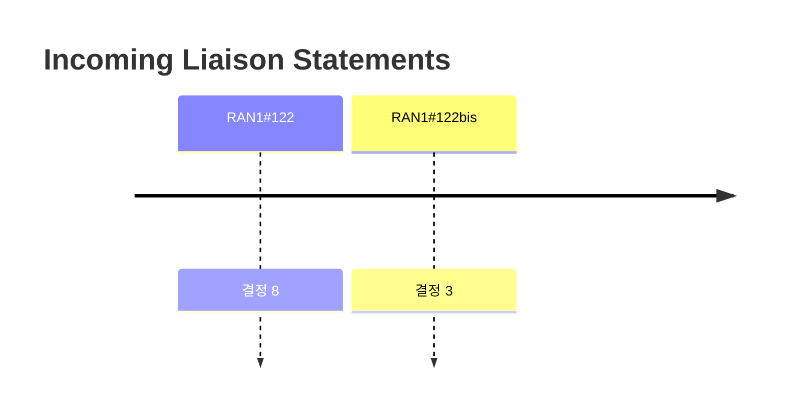

# 5 Incoming Liaison Statements

> 이 파일은 `scripts/generate_report.py`가 자동으로 생성합니다. 직접 수정하지 마세요.

공식 Agenda 기준으로 이 섹션의 결정을 모았습니다. 번호는 최신 회의 기준이며, 회의 간 연결은 같은 섹션 안의 같은 Agenda 제목으로 합니다.

> 이 섹션은 RAN1#122bis 이후 Agenda에 없습니다.

## 회의별 결정 수

## 최신 회의에는 없는 Agenda

삭제됐거나 제목이 바뀐 Agenda입니다. 제목이 바뀐 경우에도 자동으로 잇지 않으니 위 목록과 비교해 보세요.

### 5 Incoming Liaison Statements (마지막: RAN1#122bis)

회의별 결정 수: #122 8 · #122bis 3 · #123 0 · #124 0 · #124bis 0 · #125 0 · #126 0

| 회의 | 번호 | 구분 | 내용 | 출처 |
|---|---|---|---|---|
| RAN1#122 | 5 | Conclusion | Based on RAN4 reply LS in R1-2505112, RAN1 acknowledges that there may or may not be MPR impact due to UL RE-level resource muting. - It is up to RAN4 to decide whether any additional MPR requirements are needed for CP-OFDM/DFT-s-OFDM with uplink RE-level resource muting. | [Chair notes RAN1#122 eom](https://www.3gpp.org/ftp/tsg_ran/WG1_RL1/TSGR1_122/Inbox/Chair_notes/Chair%20notes%20RAN1%23122%20eom.zip) |
| RAN1#122 | 5 | Agreement | The following contents are included in the reply LS on CSI-RS based CFRA using SBFD RO. \| RAN1 thanks RAN2 for the LS on CSI-RS based CFRA using SBFD RO. RAN1 would like to provide the following feedback to RAN2. RAN1 agrees that CBRA and CFRA in SBFD symbols are supported for SBFD-aware UEs in RRC_CONNECTED. For L3 HO and BFR, CSI-RS-based CFRA using SBFD RO is considered to have no impact on RAN1 specifications. \| Send LS to inform RAN2 about this agreement. | [Chair notes RAN1#122 eom](https://www.3gpp.org/ftp/tsg_ran/WG1_RL1/TSGR1_122/Inbox/Chair_notes/Chair%20notes%20RAN1%23122%20eom.zip) |
| RAN1#122 | 5 | Agreement | Draft LS R1-2506555 is endorsed in principle. | [Chair notes RAN1#122 eom](https://www.3gpp.org/ftp/tsg_ran/WG1_RL1/TSGR1_122/Inbox/Chair_notes/Chair%20notes%20RAN1%23122%20eom.zip) |
| RAN1#122 | 5 | Agreement | Final LS R1-2506556 is endorsed. Relevant Tdoc(s) | [Chair notes RAN1#122 eom](https://www.3gpp.org/ftp/tsg_ran/WG1_RL1/TSGR1_122/Inbox/Chair_notes/Chair%20notes%20RAN1%23122%20eom.zip) |
| RAN1#122 | 5 | Agreement | Adopt the following reply to Q2: The parameter G/T is calculated as follows (per TR 38.821): For the value of -31.6dB/K, it is obtained with , , and . Although values smaller than -31.6 dB/K can be derived based on some assumptions in TR 36.763 (e.g. NF=9dB), RAN1 considers that the value of -31.6dB/K may be used by SA4 in their evaluations. Some companies in RAN1 consider that values higher than -31.6dB/K can be supported in commercial implementations, but RAN1 could not reach consensus on these values. | [Chair notes RAN1#122 eom](https://www.3gpp.org/ftp/tsg_ran/WG1_RL1/TSGR1_122/Inbox/Chair_notes/Chair%20notes%20RAN1%23122%20eom.zip) |
| RAN1#122 | 5 | Agreement | Adopt the following reply to Q1: On the evaluation assumptions, RAN1 generally agrees with the overall set of parameters selected by SA4, with the following comments: - On the modulation order, RAN1 would like to highlight that MCS indices 0 and 1 use pi/2 BPSK for single tone transmissions. It is up to SA4 to decide whether to evaluate pi/2 BPSK with MCS indices 0 and 1. - For the downlink CNR, the relevant UE parameter is noise figure (and/or G/T) instead of transmit power. RAN1 recommends SA4 corrects the following sentence:   - DL CNR=-3.3dB, 0dBi UE antenna gain, 15kHz SCS, 12 tones, 1 UE receive antenna, noise figure of 7dB. - If SA4 wants to evaluate 40ms bundling, RAN1 specifications may support this case by assuming 15kHz SCS (single and multi-tone) in the uplink. It is up to SA4 whether to consider this case in their evaluations. - RAN1/2 have not yet started the work on designing SPS. Therefore, RAN1 currently cannot confirm whether the example frame structure for SPS (related to Figure 5.2.2.3-2 and associated text) will be supported. - In previous RAN1 evaluations related to voice, RAN1 has considered 2% BLER as the target performance metric. It is up to SA4 to decide what values to use in their evaluations. - Power classes are to be confirmed by RAN4. - Although the example Figure 5.2.2.3-1 is supportable by RAN1 specifications in most scenarios, it may not be supportable in the case where the cell is very large (e.g. >3000km), when the UE does not support TA report and the network does not support UE-specific K-offset. The example Figure 5.2.2.3-1 itself also requires the UE to be configured with two HARQ processes and with HARQ feedback disabled. | [Chair notes RAN1#122 eom](https://www.3gpp.org/ftp/tsg_ran/WG1_RL1/TSGR1_122/Inbox/Chair_notes/Chair%20notes%20RAN1%23122%20eom.zip) |
| RAN1#122 | 5 | Agreement | Draft LS R1-2506540 is endorsed in principle. | [Chair notes RAN1#122 eom](https://www.3gpp.org/ftp/tsg_ran/WG1_RL1/TSGR1_122/Inbox/Chair_notes/Chair%20notes%20RAN1%23122%20eom.zip) |
| RAN1#122 | 5 | Agreement | Final LS R1-2506541 is endorsed. Relevant Tdoc(s) | [Chair notes RAN1#122 eom](https://www.3gpp.org/ftp/tsg_ran/WG1_RL1/TSGR1_122/Inbox/Chair_notes/Chair%20notes%20RAN1%23122%20eom.zip) |
| RAN1#122bis | 5 | Agreement | Reply to Q2 of R1-2506707 as the following: \| Assuming line-of-sight condition for the duration of the call, no change in large scale parameters (e.g. fixed shadowing), and using an NTN TDL-C channel model (which is a channel model previously used by RAN1 and SA4 evaluations), the probability of having 16 or 64 packets consecutively lost is negligible under typical operating conditions (e.g. up to 10% packet error rate) For the case of line-of-sight not being guaranteed for the duration of the call, an intermittent blockage (e.g. according to the land mobile satellite channel model in TR 38.811) may still occur in practice, in which case the probability of having 16 or 64 packets consecutively lost may not be negligible. RAN1 has not reached consensus on whether to consider this case. \| | [Chair notes RAN1#122b eom4](https://www.3gpp.org/ftp/tsg_ran/WG1_RL1/TSGR1_122b/Inbox/Chair_Notes/Chair%20notes%20RAN1%23122b%20eom4.docx) |
| RAN1#122bis | 5 | Agreement | Draft LS R1-2508095 is endorsed in principle. | [Chair notes RAN1#122b eom4](https://www.3gpp.org/ftp/tsg_ran/WG1_RL1/TSGR1_122b/Inbox/Chair_Notes/Chair%20notes%20RAN1%23122b%20eom4.docx) |
| RAN1#122bis | 5 | Agreement | Final LS R1-2508096 is endorsed | [Chair notes RAN1#122b eom4](https://www.3gpp.org/ftp/tsg_ran/WG1_RL1/TSGR1_122b/Inbox/Chair_Notes/Chair%20notes%20RAN1%23122b%20eom4.docx) |
