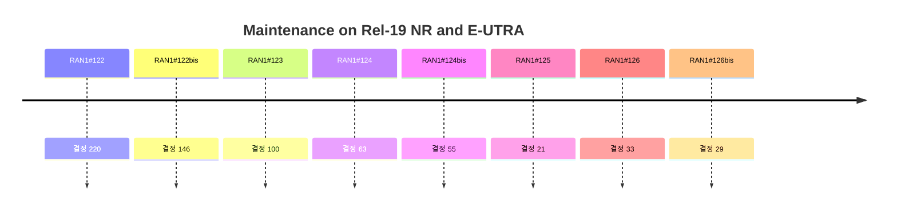

# 8 Maintenance on Rel-19 NR and E-UTRA

> 이 파일은 `scripts/generate_report.py`가 자동으로 생성합니다. 직접 수정하지 마세요.

공식 Agenda 기준으로 이 섹션의 결정을 모았습니다. 번호는 최신 회의 기준이며, 회의 간 연결은 같은 섹션 안의 같은 Agenda 제목으로 합니다.

## 회의별 결정 수

## 직전 회의 대비 (RAN1#126 → RAN1#126bis)

- 신규 결정 29건 (Agreement 27, Working Assumption 0, Conclusion 2)
- Agenda 신설: Maintenance on UE features
- Agenda 제외: 없음

## 8 Maintenance on Rel-19 NR and E-UTRA

회의별 결정 수 (하위 Agenda 포함): #122 0 · #122bis 29 · #123 19 · #124 15 · #124bis 10 · #125 21 · #126 33 · #126bis 29

### 8.1 Maintenance on AI/ML for NR Air interface, NR MIMO Phase 5,  NES and NTN for NR and IoT

회의별 결정 수 (하위 Agenda 포함): #122 0 · #122bis 0 · #123 0 · #124 0 · #124bis 0 · #125 11 · #126 19 · #126bis 11

| 회의 | 번호 | 구분 | 내용 | 출처 |
|---|---|---|---|---|
| RAN1#125 | 8.1 | Agreement | The following TP is endorsed as Alignment CR for TS.38.212 and Clause 6.3.2.1.2. Reason for change: The current specification incorrectly states the SGCS fields of the CSI report for CSI-PAI are included in CSI part 1. Summary of change: Remove “CSI part 1” to clarify that the SGCS fields of the CSI report for CSI-PAI are in a single CSI report. Consequences if not approved: The specification would contain an inaccurate description of the CSI fields for CSI-PAI reporting. \| 6.3.2.1.2 CSI <unchanged parts are omitted> Table 6.3.2.1.2-3K: Mapping order of CSI fields of one CSI report for CSI-PAI <unchanged parts are omitted> \| | [Chair notes RAN1#125_eom](https://www.3gpp.org/ftp/tsg_ran/WG1_RL1/TSGR1_125/Inbox/Chair_notes/Chair%20notes%20RAN1%23125_eom.docx) [R1-2605022](https://www.3gpp.org/ftp/tsg_ran/WG1_RL1/TSGR1_125/Docs/R1-2605022.zip) |
| RAN1#125 | 8.1 | Agreement | The following TP is endorsed as Alignment CR for TS.38.214 for Clause 5.2.1.4.6. Reason for change: Incorrect capture of previous agreement. Summary of change: Change the brackets to align with the agreement made in RAN1#122. Consequence if not approved: UE does not know which code point to report when a calculated SGCS falls at the endpoint of intervals. \| TS38.214 5.2.1.4.6 CSI-PAI reporting << Unchanged parts are omitted >> Table 5.2.1.4.6-1: SGCS Quantization Mapping << Unchanged parts are omitted >> \| | [Chair notes RAN1#125_eom](https://www.3gpp.org/ftp/tsg_ran/WG1_RL1/TSGR1_125/Inbox/Chair_notes/Chair%20notes%20RAN1%23125_eom.docx) [R1-2605022](https://www.3gpp.org/ftp/tsg_ran/WG1_RL1/TSGR1_125/Docs/R1-2605022.zip) |
| RAN1#125 | 8.1 | Agreement | The following TP for TS 38.214 Clause 5.4 is endorsed. The corresponding CR for Rel-19 TS 38.214 in R1-2605124 is endorsed. Reason for change: CSI computation time for the CSI report of RS-PAI has not been discussed or defined yet in current specification. Furthermore, the current specification would cause the RS-PAI report to fall under the branch of the “ of table 5.4-2 otherwise”, which would mistakenly apply high latency CSI computation time  to the RS-PAI report. Summary of change: Reuse CSI computation time of legacy beam management, i.e. () for model monitoring CSI report of RS-PAI. Consequences if not approved: UE may be unable to determine the appropriate CSI computation time for RS-PAI report and could erroneously use the high latency CSI computation time  for the RS-PAI report. \| 5.4 UE CSI computation time <omitted texts> Z, Z' and µ are defined as: and , where M is the number of updated CSI report(s) according to Clause 5.2.1.6, corresponds to the m-th updated CSI report and is defined as - of the table 5.4-1 if max{ µPDCCH, µCSI-RS, µUL} ≤ 3 and if the CSI is triggered without a PUSCH with either transport block or HARQ-ACK or both when L = 0 CPUs are occupied (according to Clause 5.2.1.6) and the CSI to be transmitted is a single CSI and corresponds to wideband frequency-granularity where the CSI corresponds to at most 4 CSI-RS ports in a single resource without CRI report and where CodebookType is set to 'typeI-SinglePanel' or where reportQuantity is set to 'cri-RI-CQI', or - of the table 5.4-2 if the CSI to be transmitted corresponds to wideband frequency-granularity where the CSI corresponds to at most 4 CSI-RS ports in a single resource without CRI report and where CodebookType is set to 'typeI-SinglePanel' or where reportQuantity is set to 'cri-RI-CQI', or - of the table 5.4-2 if the CSI to be transmitted corresponds to wideband frequency-granularity where the reportQuantity is set to 'ssb-Index-SINR', 'cri-SINR', 'ssb-Index-SINR- Index ', or 'cri-SINR- Index ', or - of the table 5.4-2 if reportQuantity is set to 'cri-RSRP', 'ssb-Index-RSRP', 'cri-RSRP- Index', 'L1-SRS-RSRP', 'L1-CLI-RSSI' or, 'ssb-Index-RSRP- Index ' or 'rs-pai-r19', is according to UE reported capability beamReportTiming and KBl is according to UE reported capability beamSwitchTiming as defined in [13, TS 38.306], or if the CSI report is configured with ltm-CSI-ReportConfig for L1-RSRP measurement, or if the CSI report is configured with eventType, or - , with of the table 5.4-2 if reportQuantity is set to 'p-cri-r19', 'p-cri-RSRP-r19', 'p-ssb-index-r19', or 'p-ssb-index-RSRP-r19', where and are according to UE reported capability as defined in [13, TS 38.306] and different values for and may be reported by UE capability based on whether nroftimeinstance-r19 is configured or not within the CSI report, or <omitted texts> \| | [Chair notes RAN1#125_eom](https://www.3gpp.org/ftp/tsg_ran/WG1_RL1/TSGR1_125/Inbox/Chair_notes/Chair%20notes%20RAN1%23125_eom.docx) [R1-2604995](https://www.3gpp.org/ftp/tsg_ran/WG1_RL1/TSGR1_125/Docs/R1-2604995.zip) |
| RAN1#125 | 8.1 | Conclusion | There is no RAN1 consensus to support Proposal 2 in R1-2604995. | [Chair notes RAN1#125_eom](https://www.3gpp.org/ftp/tsg_ran/WG1_RL1/TSGR1_125/Inbox/Chair_notes/Chair%20notes%20RAN1%23125_eom.docx) [R1-2604995](https://www.3gpp.org/ftp/tsg_ran/WG1_RL1/TSGR1_125/Docs/R1-2604995.zip) |
| RAN1#125 | 8.1 | Agreement | The following is endorsed as Alignment CR for Clause 9 in Rel-19 TS38.213. Adopt the following changes in Clause 9 in TS 38.213: \| 9 UE procedure for reporting control information **unchanged omitted** If a UE multiplexes aperiodic CSI in a PUSCH and the UE would multiplex UCI that includes HARQ-ACK information and/or UEIRI in a PUCCH that overlaps with the PUSCH and the timing conditions for overlapping PUCCHs and PUSCHs in clause 9.2.5 are fulfilled, the UE multiplexes only the HARQ-ACK information and/or UEIRI in the PUSCH and does not transmit the PUCCH. **unchanged omitted** \| | [Chair notes RAN1#125_eom](https://www.3gpp.org/ftp/tsg_ran/WG1_RL1/TSGR1_125/Inbox/Chair_notes/Chair%20notes%20RAN1%23125_eom.docx) [R1-2604993](https://www.3gpp.org/ftp/tsg_ran/WG1_RL1/TSGR1_125/Docs/R1-2604993.zip) |
| RAN1#125 | 8.1 | Agreement | The following TP for clause 8 and 8.1 of TS 38.213 is endorsed. The corresponding CR for Rel-19 TS 38.213 in R1-2605092 is endorsed. ===============================TP #1 for TS 38.213 =============================== Reason for change: The RO validation for on demand SIB1 is unclear due to missing IE sib1-tdd-UL-DL-ConfigurationCommon and OD-SIB1-Config. Summary of changes: Add missing IE sib1-tdd-UL-DL-ConfigurationCommon for RO validation for on demand SIB1. Add missing IE OD-SIB1-Config. Consequence if not approved: Ambiguity occurs for the RO validation for on demand SIB1. ================================Start of TP #1 =================================== 8	Random access procedure < Unchanged Text Omitted > For unpaired spectrum -	if a UE is not provided tdd-UL-DL-ConfigurationCommon, all PRACH occasions are first PRACH occasions -	otherwise, a PRACH occasion is -	a first PRACH occasion, when it includes only symbols that are indicated as uplink or flexible by tdd-UL-DL-ConfigurationCommon and the UE is not provided by sbfd-RACH-DualConfig, and, or -	a second PRACH occasion, when the UE is provided by sbfd-RACHDualConfig, or when it is only within SBFD symbols and includes at least one SBFD symbol indicated as downlink by tdd-UL-DL-ConfigurationCommon and the UE is provided sbfd-RACHSingleConfig < Unchanged Text Omitted > 8.1 Random access preamble < Unchanged Text Omitted > For unpaired spectrum, -	if a UE is not provided tdd-UL-DL-ConfigurationCommon for a cell, a PRACH occasion for the cell in a PRACH slot is valid if it does not precede a SS/PBCH block in the PRACH slot and starts at least  symbols after a last SS/PBCH block reception symbol, where  is provided in Table 8.1-2 and, if channelAccessMode = "semiStatic" is provided, does not overlap with a set of consecutive symbols before the start of a next channel occupancy time where the UE does not transmit [15, TS 37.213] -	the candidate SS/PBCH block index of the SS/PBCH block corresponds to the SS/PBCH block index provided by ssb-PositionsInBurst in SIB1 or in ServingCellConfigCommon or in SSB-MTC-AdditionalPCI corresponding to the cell, as described in clause 4.1 < Unchanged Text Omitted > -	if a UE is provided tdd-UL-DL-ConfigurationCommon or sib1-tdd-UL-DL-ConfigurationCommon for a cell, a PRACH occasion for the cell in a PRACH slot is valid if -	for a first PRACH occasion -	it is within UL symbols, or -	it does not precede a SS/PBCH block in the PRACH slot and starts at least  symbols after a last downlink symbol and at least  symbols after a last SS/PBCH block symbol, where  is provided in Table 8.1-2, and if channelAccessMode = "semiStatic" is provided, does not overlap with a set of consecutive symbols before the start of a next channel occupancy time where there shall not be any transmissions, as described in [15, TS 37.213] -	the candidate SS/PBCH block index of the SS/PBCH block corresponds to the SS/PBCH block index provided by ssb-PositionsInBurst in SIB1 or in ServingCellConfigCommon or in SSB-MTC-AdditionalPCI corresponding to the cell, as described in clause 4.1 < Unchanged Text Omitted > | [Chair notes RAN1#125_eom](https://www.3gpp.org/ftp/tsg_ran/WG1_RL1/TSGR1_125/Inbox/Chair_notes/Chair%20notes%20RAN1%23125_eom.docx) [R1-2604976](https://www.3gpp.org/ftp/tsg_ran/WG1_RL1/TSGR1_125/Docs/R1-2604976.zip) |
| RAN1#125 | 8.1 | Agreement | The following TP for clause 8.1 of TS 38.213 is endorsed. The corresponding CR for Rel-19 TS 38.213 in R1-2605098 is endorsed. Change reason: The RO validation for adaptation fails to take partial overlap scenarios into account. Change summary: Add the definition of partial overlap to the specification to align with the existing agreement. Consequence if not approved: Under partial overlap conditions, the UE cannot correctly determine the validity of RO. <begin TP for subclause 8.1 of TS 38.213-j30> 8.1	Random access preamble Physical random access procedure for a UE is triggered upon request of a PRACH transmission by higher layers or by a PDCCH order or LTM Cell Switch Command MAC CE in clause 6.1.3.75 [11, TS 38.321] for a cell. A configuration by higher layers for a PRACH transmission includes the following: -	A configuration for PRACH transmission on the cell [4, TS 38.211]. -	A preamble index, a preamble SCS, , a corresponding RA-RNTI when applicable [11, TS 38.321], and a PRACH resource for the cell. -	A number of  preamble repetitions for the PRACH transmission if the UE would transmit the PRACH with repetitions. A UE transmits a PRACH on a cell using the selected PRACH format with transmission power , as described in clause 7.4, on the indicated PRACH resource or on a determined set of  resources using a same spatial filter in case of  preamble repetitions. For Type-1 random access procedure, a UE can be provided, by rach-Config-Adapt in RACH-ConfigCommon, parameters for determining time resources and frequency resources for PRACH transmission [4, TS 38.211]. When a PRACH occasion associated with rach-Config-Adapt overlaps in both time and frequency domain with has same frequency resource and same time resource as a PRACH occasion in RACH-ConfigCommon that is not associated with rach-Config-Adapt, the former PRACH occasion is not valid and is not considered in the procedures in this clause. <end TP for subclause 8.1 of TS 38.213-j30> NR-NTN | [Chair notes RAN1#125_eom](https://www.3gpp.org/ftp/tsg_ran/WG1_RL1/TSGR1_125/Inbox/Chair_notes/Chair%20notes%20RAN1%23125_eom.docx) [R1-2605082](https://www.3gpp.org/ftp/tsg_ran/WG1_RL1/TSGR1_125/Docs/R1-2605082.zip) |
| RAN1#125 | 8.1 | Agreement | The following TP for Clause 9 of TS 38.213 is endorsed. The corresponding final CR for TS38.213 in R1-2605107 is endorsed. \|  \| \| Reason for change: For a UE enabled with inter-slot OCC operation, UE behaviour is not clear in case where a UE may determine to do multiplexing UCI in the PUSCH in a first slot and determine to drop the PUSCH in the second slot of a same OCC group. Summary of change: UE drops all the PUSCH repetitions in an OCC group before multiplexing UCI in the PUSCH when enabled with inter-slot OCC. Consequences if not approved: Unclear UE behaviour \| \| 9 UE procedure for reporting control information *** Unchanged parts are omitted *** For the remaining of this clause, for a UE operating on an NTN serving cell, the timeline conditions for resolving time overlapping between a PUSCH transmission with repetitions in an OCC group [6, TS 38.214] and PUCCH transmissions are applicable with respect to the first repetition of the PUSCH transmission in the OCC group - if the UE would multiplex UCI from the PUCCH transmissions in the PUSCH, and for the case where the PUSCH would not be dropped as described in the remaining of this clause or in clause 6.1.2.1 [6, TS 38.214], the UE multiplexes the UCI in all repetitions of the PUSCH transmission in the OCC group - if the UE would not transmit a repetition of the PUSCH transmission, the UE does not transmit all repetitions of the PUSCH transmission in the OCC group - the UE does not expect to transmit in different slots more than one PUCCHs that provide HARQ-ACK information or CSI reports and would overlap with the PUSCH transmission in the OCC group *** Unchanged parts are omitted *** \| | [Chair notes RAN1#125_eom](https://www.3gpp.org/ftp/tsg_ran/WG1_RL1/TSGR1_125/Inbox/Chair_notes/Chair%20notes%20RAN1%23125_eom.docx) [R1-2604991](https://www.3gpp.org/ftp/tsg_ran/WG1_RL1/TSGR1_125/Docs/R1-2604991.zip) |
| RAN1#125 | 8.1 | Agreement | The following TP for Clause 4.2 of TS 38.213 is endorsed. The corresponding final CR for TS38.213 in R1-2605106 is endorsed. \| Reason for change: \| Application of a timing advance command between PUSCH repetitions in an OCC group would cause phase continuity not to be maintained. To avoid restrictions in when a MAC CE with a TA command can be sent in DL, the application time should be delayed by the UE until after the end of the OCC group. \| \| Summary of change: \| When the application time of a timing advance command is between PUSCH repetitions in an OCC group, it is delayed by the UE until after the end of the OCC group. \| \| Consequences if not approved: \| Application of a TA command may cause phase continuity not to be maintained for OCC PUSCH. \| \| 4.2 Transmission timing adjustments <unchanged text omitted> For a timing advance command received on uplink slot , except for a timing advance command received in a cell switch command, and for a transmission other than a PUSCH scheduled by a RAR UL grant or a fallbackRAR UL grant as described in clause 8.2A or 8.3, or a PUCCH with HARQ-ACK information in response to a successRAR as described in clause 8.2A, the corresponding adjustment of the uplink transmission timing applies from the beginning of uplink slot where , is a time duration in msec of symbols corresponding to a PDSCH processing time for UE processing capability 1 when additional PDSCH DM-RS is configured, is a time duration in msec of symbols corresponding to a PUSCH preparation time for UE processing capability 1 [6, TS 38.214], is the maximum timing advance value in msec that can be provided by a TA command field of 12 bits, is the number of slots per subframe, is the subframe duration of 1 msec, and , where is provided by cellSpecificKoffset and is provided by a Differential Koffset MAC CE command [11, TS 38.321]; otherwise, if not respectively provided, or . and are determined with respect to the minimum SCS among the SCSs of all configured UL BWPs for all uplink carriers in the TAG and of all configured DL BWPs for the corresponding downlink carriers. For , the UE assumes [6, TS 38.214]. Slot and are determined with respect to the minimum SCS among the SCSs of all configured UL BWPs for all uplink carriers in the TAG. is determined with respect to the minimum SCS among the SCSs of all configured UL BWPs for all uplink carriers in the TAG and for all configured initial UL BWPs provided by initialUplinkBWP. The uplink slot is the last slot among uplink slot(s) overlapping with the slot(s) of PDSCH reception assuming , where the PDSCH provides the timing advance command and is defined in [4, TS 38.211]. <unchanged text omitted> \| 4.2 Transmission timing adjustments <unchanged text omitted> For a timing advance command received on uplink slot , except for a timing advance command received in a cell switch command, and for a transmission other than a PUSCH scheduled by a RAR UL grant or a fallbackRAR UL grant as described in clause 8.2A or 8.3, or a PUCCH with HARQ-ACK information in response to a successRAR as described in clause 8.2A, the corresponding adjustment of the uplink transmission timing applies from the beginning of uplink slot where , is a time duration in msec of symbols corresponding to a PDSCH processing time for UE processing capability 1 when additional PDSCH DM-RS is configured, is a time duration in msec of symbols corresponding to a PUSCH preparation time for UE processing capability 1 [6, TS 38.214], is the maximum timing advance value in msec that can be provided by a TA command field of 12 bits, is the number of slots per subframe, is the subframe duration of 1 msec, and , where is provided by cellSpecificKoffset and is provided by a Differential Koffset MAC CE command [11, TS 38.321]; otherwise, if not respectively provided, or . and are determined with respect to the minimum SCS among the SCSs of all configured UL BWPs for all uplink carriers in the TAG and of all configured DL BWPs for the corresponding downlink carriers. For , the UE assumes [6, TS 38.214]. Slot and are determined with respect to the minimum SCS among the SCSs of all configured UL BWPs for all uplink carriers in the TAG. is determined with respect to the minimum SCS among the SCSs of all configured UL BWPs for all uplink carriers in the TAG and for all configured initial UL BWPs provided by initialUplinkBWP. The uplink slot is the last slot among uplink slot(s) overlapping with the slot(s) of PDSCH reception assuming , where the PDSCH provides the timing advance command and is defined in [4, TS 38.211]. <unchanged text omitted> \| LS on Collision Handling for HD FDD VSATs (R1-2603492) | [Chair notes RAN1#125_eom](https://www.3gpp.org/ftp/tsg_ran/WG1_RL1/TSGR1_125/Inbox/Chair_notes/Chair%20notes%20RAN1%23125_eom.docx) [R1-2604991](https://www.3gpp.org/ftp/tsg_ran/WG1_RL1/TSGR1_125/Docs/R1-2604991.zip) |
| RAN1#125 | 8.1 | Agreement | With respect to the LS response to RAN4 on Collision Handling for HD-FDD VSATs is as follows, the following text is endorsed in principle. From a RAN1 perspective, RAN1 has not identified any specific issue for re-using the HD-FDD (e)RedCap collision handling rules for HD-FDD VSAT UE. Existing collision handling rules to address (e)RedCap HD-FDD collision cases are band agnostic. RAN1 confirms that the (e)RedCap HD-FDD collision handling behaviors can be reused for HD-FDD VSAT UEs, without introducing new collision handling rules. NOTE: RAN1 spec changes may be needed if RAN4 introduces a new HD-FDD VSAT UE capability. | [Chair notes RAN1#125_eom](https://www.3gpp.org/ftp/tsg_ran/WG1_RL1/TSGR1_125/Inbox/Chair_notes/Chair%20notes%20RAN1%23125_eom.docx) [R1-2605067](https://www.3gpp.org/ftp/tsg_ran/WG1_RL1/TSGR1_125/Docs/R1-2605067.zip) |
| RAN1#125 | 8.1 | Agreement | The draft LS in R1-2605074 is endorsed with the following changes: - In Action field: Change “agreements” to “agreement”. - In heading: Add information for Response to field. The final LS in R1-2605071 with applying above change is endorsed. | [Chair notes RAN1#125_eom](https://www.3gpp.org/ftp/tsg_ran/WG1_RL1/TSGR1_125/Inbox/Chair_notes/Chair%20notes%20RAN1%23125_eom.docx) [R1-2605067](https://www.3gpp.org/ftp/tsg_ran/WG1_RL1/TSGR1_125/Docs/R1-2605067.zip) |
| RAN1#126 | 8.1 | Agreement | The following TP for TS 38.214 Clause 5.2.1.6 is endorsed. The corresponding CR for Rel-19, TS 38.214 in R1-2606870 is endorsed. \| Reason for change \| Incorrectly capture of previous agreement. \| \| Summary of change \| To align with the agreement made in RAN1#122, remove “consecutive” from CPU occupancy duration for SP CSI-PAI report. \| \| Consequences if not approved \| The current specification would contain an inaccurate description of CPU occupancy duration for SP CSI-PAI report. \| \| 5.2.1.6 CSI processing criteria ============================= unchanged parts are omitted ============================ For a CSI report with CSI-ReportConfig with higher layer parameter reportQuantity not set to 'none', or a CSI report with LTM-CSI-ReportConfig, or reportQuantity not set to 'none-bm-r19' or 'none-csi-r19', the CPU(s) (including and/or , for CSI reports with reportQuantity set to 'p-cri-r19', 'p-cri-RSRP-r19', 'p-ssb-index-r19', or 'p-ssb-index-RSRP-r19', and CSI reports configured with the higher layer parameter csi-InferencePrediction-r19, and for CSI report with reportQuantity set to 'rs-pai-r19' or 'csi-pai-r19') are occupied for a number of OFDM symbols as follows: - A periodic or semi-persistent CSI report (excluding an initial semi-persistent CSI report on PUSCH after the PDCCH triggering the report, a semi-persistent CSI report on PUSCH configured with reportQuantity set to 'csi-pai-r19', and a semi-persistent CSI report on PUSCH configured with the higher layer parameter codebookType set to 'typeII-Doppler-r18' or 'typeII-Doppler-PortSelection-r18') occupies CPU(s) from the first symbol of the earliest one of each CSI-RS/CSI-IM/SSB resource, or each CSI-RS/CSI-IM resource associated with all configured sub-configurations for periodic CSI report corresponding to a CSI-ReportConfig that contains a list of sub-configurations provided by csi-ReportSubConfigToAddModList, or each CSI-RS/CSI-IM resource associated with all activated/triggered sub-configurations for semi-persistent CSI report corresponding to a CSI-ReportConfig that contains a list of sub-configurations provided by csi-ReportSubConfigToAddModList, for channel or interference measurement, respective latest CSI-RS/CSI-IM/SSB occasion no later than the corresponding CSI reference resource, until the last symbol of the configured PUSCH/PUCCH carrying the report. - An aperiodic CSI report occupies CPU(s) from the first symbol after the PDCCH triggering the CSI report until the last symbol of the scheduled PUSCH carrying the report. When the PDCCH reception includes two PDCCH candidates from two respective search space sets, as described in clause 10.1 of [6, TS 38.213], for the purpose of determining the CPU occupation duration, the PDCCH candidate that ends later in time is used. - An initial semi-persistent CSI report on PUSCH after the PDCCH trigger occupies CPU(s) from the first symbol after the PDCCH until the last symbol of the scheduled PUSCH carrying the report. When the PDCCH reception includes two PDCCH candidates from two respective search space sets, as described in clause 10.1 of [6, TS 38.213], for the purpose of determining the CPU occupation duration, the PDCCH candidate that ends later in time is used. - A semi-persistent CSI report on PUSCH configured with the higher layer parameter codebookType set to 'typeII-Doppler-r18' or 'typeII-Doppler-PortSelection-r18' occupies CPU(s) from the first symbol of KP-th latest consecutive periodic/semi-persistent CSI-RS occasions no later than CSI reference resource, until the last symbol of the PUSCH carrying the report, where the value of is indicated by UE capability. - A semi-persistent CSI report on PUSCH configured with reportQuantity set to 'csi-pai-r19' occupies CPU(s) from the first symbol of the latest consecutive periodic/semi-persistent CSI-RS occasion of a corresponding linked CSI report (linked by inferenceReportConfigId-r19) no later than CSI reference resource of the linked CSI report, until the last symbol of the PUSCH carrying the CSI-PAI report. ============================= unchanged parts are omitted ============================ \| | [Chair notes RAN1#126_eom1](https://www.3gpp.org/ftp/tsg_ran/WG1_RL1/TSGR1_126/Inbox/Chair_notes/Chair%20notes%20RAN1%23126_eom1.docx) [R1-2606794](https://www.3gpp.org/ftp/tsg_ran/WG1_RL1/TSGR1_126/Docs/R1-2606794.zip) `[126-R19-AI 8.1]` |
| RAN1#126 | 8.1 | Agreement | The following TP for TS 38.214 Clause 5.2.3 is endorsed. The corresponding CR for Rel-19, TS 38.214 in R1-2606870 is endorsed. \| Reason for change \| Clause 5.2.3 of TS38.214 explicitly identifies the reportQuantity values for which CSI feedback consists of a single part. Rel-19 AI/ML introduced new report quantities for AI/ML-based CSI report for inference and performance monitoring. But these new quantity values remain unspecified in terms of whether support single part CSI. As a result, it is currently unclear whether AI/ML-based CSI reports support single CSI part. \| \| Summary of change \| Adding Rel-19 AI/ML reportQuantity values to clarify that CSI reports for AI/ML support single CSI part. \| \| Consequences if not approved \| Ambiguity occurs on whether Rel-19 AI/ML CSI reports support single CSI part or two-part CSI reporting. \| \| 5.2.3 CSI reporting using PUSCH ============================= unchanged parts are omitted ============================ When the higher layer parameter reportQuantity is configured with one of the values 'cri-RSRP', 'ssb-Index-RSRP', 'cri-SINR' or 'ssb-Index-SINR', or 'cri-RSRP-Index', 'ssb-Index-RSRP-Index', 'cri-SINR-Index', 'ssb-Index-SINR-Index', 'tdcp', 'cli-RSSI', 'cli-SRS-RSRP', 'cjtc-Dd', 'cjtc-F', 'cjtc-Dd-F', 'cjtc-P', 'p-CRI-r19', 'p-CRI-RSRP-r19', 'p-SSB-Index-r19', 'p-SSB-Index-RSRP-r19', 'rs-pai-r19', 'csi-pai-r19', the CSI feedback consists of a single part. ============================= unchanged parts are omitted ============================ \| | [Chair notes RAN1#126_eom1](https://www.3gpp.org/ftp/tsg_ran/WG1_RL1/TSGR1_126/Inbox/Chair_notes/Chair%20notes%20RAN1%23126_eom1.docx) [R1-2606794](https://www.3gpp.org/ftp/tsg_ran/WG1_RL1/TSGR1_126/Docs/R1-2606794.zip) `[126-R19-AI 8.1]` |
| RAN1#126 | 8.1 | Agreement | The following TP for TS 38.214 Clause 6.2.1.3 is endorsed. The corresponding CR for Rel-19, TS 38.214 Clause 6.2.1.3 in R1-2606870 is endorsed. \| Reason for change \| 1. When the collision between the SRS for carrier switching and the CSI report happens, UE should follow a priority rule defined. However, the priority rule for the SRS and CSI-PAI report is unclear. 2. To ensure consistent priority rule for two types of PAI reports, i.e., CSI-PAI report and RS-PAI report. \| \| Summary of change \| 1. Reuse the same dropping rule for collision handling between PMI and SRS for the collision handling between CSI-PAI and SRS 2. Revert following agreement made in RAN1#122bis, and apply the same priority rules to collision between RS-PAI and SRS as to collision between CSI-PAI and SRS. \| \| Consequences if not approved \| 1. The collision handling between the SRS for carrier switching and the CSI-PAI report is unclear 2. Inconsistency in collision handling between CSI-PAI/SRS and RS-PAI/SRS. \| \| 6.2.1.3 UE sounding procedure between component carriers ============================= unchanged parts are omitted ============================ The following prioritization rules shall be applied in case of collision between a transmission of SRS over carrier and transmission of a physical signal/channel over a carrier of a serving cell in set - the UE shall not transmit SRS whenever SRS transmission (including any interruption due to uplink or downlink RF retuning time [11, TS 38.133] as defined by higher layer parameters switchingTimeUL and switchingTimeDL of SRS-SwitchingTimeNR) on the carrier of the serving cell and PUSCH/PUCCH transmission carrying HARQ-ACK/positive SR/RI/CRI/SSBRI/UEIRI/P-CRI/P-SSBRI/RS-PAI and/or PRACH on a carrier of a serving cell in set happen to overlap in the same symbol - the UE shall not transmit a periodic/semi-persistent SRS whenever periodic/semi-persistent SRS transmission (including any interruption due to uplink or downlink RF retuning time [11, TS 38.133] as defined by higher layer parameters switchingTimeUL and switchingTimeDL of SRS-SwitchingTimeNR) on the carrier of the serving cell and PUSCH transmission carrying aperiodic CSI on a carrier of a serving cell in set happen to overlap in the same symbol - the UE shall drop PUCCH/PUSCH transmission carrying periodic/semi-persistent CSI comprising only CQI/PMI/L1-RSRP/L1-SINR/P-L1-RSRP/CSI-PAI/RS-PAI and/or Type 1 configured grant PUSCH transmission carrying UE initiated CSI report, and/or SRS transmission on a carrier of a serving cell in set configured for PUSCH/PUCCH transmission whenever the transmission and SRS transmission (including any interruption due to uplink or downlink RF retuning time [11, TS 38.133] as defined by higher layer parameters switchingTimeUL and switchingTimeDL of SRS-SwitchingTimeNR) on the carrier of the serving cell happen to overlap in the same symbol - the UE shall drop PUSCH transmission carrying aperiodic CSI comprising only CQI/PMI/L1-RSRP/L1-SINR/TDCP/cjtc-Dd/cjtc-F/cjtc-Dd-F/cjtc-P/P-L1-RSRP/CSI-PAI/RS-PAI on a carrier of a serving cell in set whenever the transmission and aperiodic SRS transmission (including any interruption due to uplink or downlink RF retuning time [11, TS 38.133]) as defined by higher layer parameters switchingTimeUL and switchingTimeDL of SRS-SwitchingTimeNR) on the carrier of the serving cell happen to overlap in the same symbol. ============================= unchanged parts are omitted ============================ \| | [Chair notes RAN1#126_eom1](https://www.3gpp.org/ftp/tsg_ran/WG1_RL1/TSGR1_126/Inbox/Chair_notes/Chair%20notes%20RAN1%23126_eom1.docx) [R1-2606795](https://www.3gpp.org/ftp/tsg_ran/WG1_RL1/TSGR1_126/Docs/R1-2606795.zip) `[126-R19-AI 8.1]` |
| RAN1#126 | 8.1 | Agreement | The following TP for TS 38.214 Clause 5.1.6.1.2. The corresponding CR for Rel-19, TS 38.214 Clause 5.1.6.1.2 in R1-2606879 is endorsed. Reason for change: A new RRC IE CSI-LoggedMeasurementConfig is defined in 38.331 for network-side data collection, which is used to configure UE to perform the logging of measurements on CSI-RS resources. For CSI-RS measurement configured by the IE CSI-ReportConfig for L1 CSI report, there are some descriptions and constraints in spec 38.214, which are also needed for CSI-RS measurement configured by the IE CSI-LoggedMeasurementConfig for L3 CSI report. Summary of change: Add descriptions and constraints for CSI-RS measurement configured by the IE CSI-LoggedMeasurementConfig (L3 CSI report) in 38.214. Consequences if not approved: The descriptions and constraints for CSI-RS measurement configured by the IE CSI-LoggedMeasurementConfig (L3 CSI report) are missing in 38.214. \| 5.1.6.1.2 CSI-RS for L1-RSRP and L1-SINR computation If a UE is configured with a NZP-CSI-RS-ResourceSet configured with the higher layer parameter repetition set to 'on', the UE may assume that the CSI-RS resources, described in Clause 5.2.2.3.1, within the NZP-CSI-RS-ResourceSet are transmitted with the same downlink spatial domain transmission filter, where the CSI-RS resources in the NZP-CSI-RS-ResourceSet are transmitted in different OFDM symbols. If repetition is set to 'off', the UE shall not assume that the CSI-RS resources within the NZP-CSI-RS-ResourceSet are transmitted with the same downlink spatial domain transmission filter. If the UE is configured with a CSI-ReportConfig with reportQuantity set to 'cri-RSRP', 'cri-SINR', 'cri-RSRP-Index', 'cri-SINR-Index', 'none', 'p-cri-r19', 'p-cri-RSRP-r19', 'p-ssb-index-r19', 'p-ssb-index-RSRP-r19', 'none-bm-r19', or 'rs-pai-r19', and if the CSI-ResourceConfig for channel measurement (higher layer parameters resourcesForChannelMeasurement and resourcesForSetA-r19 when reportQuantity set to 'none-bm-r19') contains a NZP-CSI-RS-ResourceSet that is configured with the higher layer parameter repetition and without the higher layer parameter trs-Info, the UE can only be configured with the same number (1 or 2) of ports with the higher layer parameter nrofPorts for all CSI-RS resources within the set. If the UE is configured with the CSI-RS resource in the same OFDM symbol(s) as an SS/PBCH block, the UE may assume that the CSI-RS and the SS/PBCH block are quasi co-located with 'typeD' if 'typeD' is applicable. Furthermore, the UE shall not expect to be configured with the CSI-RS in PRBs that overlap with those of the SS/PBCH block, and the UE shall expect that the same subcarrier spacing is used for both the CSI-RS and the SS/PBCH block. If the UE is configured with a CSI-LoggedMeasurementConfig, and if the CSI-ResourceConfig for channel measurement (higher layer parameters csi-LoggedResourceConfig) contains a NZP-CSI-RS-ResourceSet that is configured with the higher layer parameter repetition and without the higher layer parameter trs-Info, the UE can only be configured with the same number (1 or 2) of ports with the higher layer parameter nrofPorts for all CSI-RS resources within the set. Each Reporting Setting CSI-LoggedMeasurementConfig is associated with a single downlink BWP (indicated by higher layer parameter BWP-Id) given in the associated CSI-ResourceConfig for channel measurement. <omitted texts> \| MIMO | [Chair notes RAN1#126_eom1](https://www.3gpp.org/ftp/tsg_ran/WG1_RL1/TSGR1_126/Inbox/Chair_notes/Chair%20notes%20RAN1%23126_eom1.docx) [R1-2606835](https://www.3gpp.org/ftp/tsg_ran/WG1_RL1/TSGR1_126/Docs/R1-2606835.zip) `[126-R19-AI 8.1]` |
| RAN1#126 | 8.1 | Agreement | The following changes for Clause 9.2 in TS 38.213 is endorsed. The corresponding CR for Rel-19, TS 38.213 in R1-2606868 is endorsed. - Reason for change: In Rel-19, UEIRI is introduced as a new type of UCI for notifying (ModeA) or requesting a PUSCH resource (ModeB) for UE-initiated/event-driven beam reporting. Whether UE transmits UEIRI on a PUCCH format 0 or format 1 in the PUCCH resource depends on whether the triggering condition of the event(s) for UE-initiated/event-driven beam reporting is met or not. In this case, the information bit of UEIRI is not always included in the PUCCH resource. However, in the current spec, UEIRI is described as a compulsory UCI in the PUCCH resource, which is not correct. - Summary of change: Add the condition “if any” to the information bit for UEIRI where the contents of UCI bit(s) are described in the first paragraph of Section 9.2, TS38.213. - Consequences if not approved: The availability of information bit for UEIRI in PUCCH is not correctly stated. \| 9.2 UCI reporting in physical uplink control channel UCI types reported in a PUCCH include HARQ-ACK information, SR, LRR, UEIRI, and CSI. UCI bits include HARQ-ACK information bits, if any, SR information bits, if any, LRR information bit, if any, UEIRI information bit, if any, and CSI bits, if any. The HARQ-ACK information bits correspond to a HARQ-ACK codebook as described in clause 9.1. For the remaining of this clause, unless stated otherwise in clauses 9.2.4A and 9.2.5.1, any reference to SR is applicable for SR and/or for LRR and/or for UEIRI. <Unchanged parts are omitted> \| | [Chair notes RAN1#126_eom1](https://www.3gpp.org/ftp/tsg_ran/WG1_RL1/TSGR1_126/Inbox/Chair_notes/Chair%20notes%20RAN1%23126_eom1.docx) [R1-2606809](https://www.3gpp.org/ftp/tsg_ran/WG1_RL1/TSGR1_126/Docs/R1-2606809.zip) `[126-R19-AI 8.1]` |
| RAN1#126 | 8.1 | Agreement | The following changes for Clause 9 in TS 38.213 is endorsed. The corresponding CR for Rel-19, TS 38.213 in R1-2606869 is endorsed. - Reason for change:  UE behaviour is unclear for overlapping PUCCH with UEIRI and other channels/signals. - Summary of change: Reuse the same behaviour as SR for overlapping PUCCH with UEIRI and other channels/signals. - Consequences if not approved: Unclear UE behaviour. \| 9 UE procedure for reporting control information <Unchanged parts are omitted> If a UE is configured for NR-DC operation, the UE does not expect to be configured with a PUCCH-SCell. For the remaining of this clause, unless stated otherwise, any reference to SR is applicable for LRR and/or for UEIRI. A PUSCH or a PUCCH transmission other than PUCCH transmissions with SL HARQ-ACK reports, including repetitions if any, can be of priority index 0 or of priority index 1. For a configured grant PUSCH transmission, a UE determines a priority index from phy-PriorityIndex, if provided. For a PUCCH transmission with HARQ-ACK information corresponding to a SPS PDSCH reception or a SPS PDSCH release, a UE determines a priority index from harq-CodebookID, if provided. For a PUCCH transmission with SR, a UE determines the corresponding priority as described in clause 9.2.4. For a PUSCH transmission with semi-persistent CSI report, a UE determines a priority index from a priority indicator field, if provided, in a DCI format that activates the semi-persistent CSI report. If a priority index is not provided to a UE for a PUSCH or a PUCCH transmission other than PUCCH transmissions with SL HARQ-ACK reports, the priority index is 0. <Unchanged parts are omitted> \| | [Chair notes RAN1#126_eom1](https://www.3gpp.org/ftp/tsg_ran/WG1_RL1/TSGR1_126/Inbox/Chair_notes/Chair%20notes%20RAN1%23126_eom1.docx) [R1-2606809](https://www.3gpp.org/ftp/tsg_ran/WG1_RL1/TSGR1_126/Docs/R1-2606809.zip) `[126-R19-AI 8.1]` |
| RAN1#126 | 8.1 | Agreement | The draft CR in R1-2606230 for Rel-19 TS 38.214 is endorsed as alignment CR for TS 38.214. | [Chair notes RAN1#126_eom1](https://www.3gpp.org/ftp/tsg_ran/WG1_RL1/TSGR1_126/Inbox/Chair_notes/Chair%20notes%20RAN1%23126_eom1.docx) [R1-2606809](https://www.3gpp.org/ftp/tsg_ran/WG1_RL1/TSGR1_126/Docs/R1-2606809.zip) `[126-R19-AI 8.1]` |
| RAN1#126 | 8.1 | Agreement | The draft CR in R1-2606128 for Rel-19 TS 38.215 is endorsed as alignment CR for TS 38.215. | [Chair notes RAN1#126_eom1](https://www.3gpp.org/ftp/tsg_ran/WG1_RL1/TSGR1_126/Inbox/Chair_notes/Chair%20notes%20RAN1%23126_eom1.docx) [R1-2606809](https://www.3gpp.org/ftp/tsg_ran/WG1_RL1/TSGR1_126/Docs/R1-2606809.zip) `[126-R19-AI 8.1]` |
| RAN1#126 | 8.1 | Conclusion | There is no consensus in RAN1 to support the following change from R1-2605805 of Clause 5.2.1.5.4.1 in TS 38.214: \| 5.2.1.5.4.1 UE Initiated CSI reporting <Unchanged parts are omitted> The counter of the event instances for such reference signal is reset: - if the reference signal in the indicated TCI state is updated and newBeamResourceSet is a NZP-CSI-RS-ResourceSet configured with repetition, or the SS/PBCH block which is QCLed with the reference signal in the indicated TCI state is updated and newBeamResourceSet is a CSI-SSB-ResourceSet when the UE is configured with a CSI-ReportConfig with the higher layer parameter eventType set to ‘event2’ or ‘event1’, or - if the reference signal with the valueOfQ-th highest L1-RSRP out of the reference signals among the activated TCI states is updated and newBeamResourceSet is a NZP-CSI-RS-ResourceSet configured with repetition, or the SS/PBCH block with the valueOfQ-th highest L1-RSRP out of the SS/PBCH blocks QCLed with the reference signals among the activated TCI states, which determines event instance(s), is updated and newBeamResourceSet is a CSI-SSB-ResourceSet when the UE is configured with a CSI-ReportConfig with the higher layer parameter eventType set to ‘event7’, or - if eventThreshold or valueOfQ or eventInstanceCount or eventDetectionTimeWindow in the CSI-ReportConfig are reconfigured. <Unchanged parts are omitted> \| | [Chair notes RAN1#126_eom1](https://www.3gpp.org/ftp/tsg_ran/WG1_RL1/TSGR1_126/Inbox/Chair_notes/Chair%20notes%20RAN1%23126_eom1.docx) [R1-2606867](https://www.3gpp.org/ftp/tsg_ran/WG1_RL1/TSGR1_126/Docs/R1-2606867.zip) `[126-R19-AI 8.1]` |
| RAN1#126 | 8.1 | Conclusion | There is no consensus in RAN1 to support the TP from R1-2605669 of Clause 6.3.2.1.2 in TS 38.212 and Clause 5.2.1.5.4.1 in TS 38.214. NES | [Chair notes RAN1#126_eom1](https://www.3gpp.org/ftp/tsg_ran/WG1_RL1/TSGR1_126/Inbox/Chair_notes/Chair%20notes%20RAN1%23126_eom1.docx) [R1-2606867](https://www.3gpp.org/ftp/tsg_ran/WG1_RL1/TSGR1_126/Docs/R1-2606867.zip) `[126-R19-AI 8.1]` |
| RAN1#126 | 8.1 | Agreement | The following TP for TS 38.213 Clause 23 is endorsed. The corresponding CR for Rel-19, TS 38.213 in R1-2606872 is endorsed. \| Reason for change: After receiving on-demand SIB1, UE may monitor PDCCH in a CSS set with index 0 or in a CORESET with index 0 (e.g., for SIBx/paing/RAR reception). As clarified in RAN2 reply LS R2-2604211, the controlResourceSetZero and searchSpaceZero fields are always absent in SIB1 irrespective of whether SIB1 is provided in an on-demand manner or provided in a periodic manner, so in this case the search space set index 0 or CORESET with index 0 should refer to searchSpaceZero and controlResourceSetZero in OD-SIB1-Config, when for FR1 or for FR2. Summary of Change: Clarify the UE behavior that when for FR1 or for FR2, for PDCCH monitoring in a search space set with index 0 or in a CORESET with index 0, the UE continues to apply searchSpaceZero and controlResourceSetZero in OD-SIB1 Config. Consequences if not approved: After receiving on-demand SIB1, ambiguity occurs for PDCCH monitoring in a search space set with index 0 or in a CORESET with index 0. 23 UE procedure to request SIB1 reception < Unchanged parts are omitted > pon receiving a PWS notification or paging indicating system information change [12, TS 38.331], and if for FR1 or for FR2, the UE continues to apply searchSpaceZero and controlResourceSetZero in OD-SIB1 Config. < Unchanged parts are omitted > \| | [Chair notes RAN1#126_eom1](https://www.3gpp.org/ftp/tsg_ran/WG1_RL1/TSGR1_126/Inbox/Chair_notes/Chair%20notes%20RAN1%23126_eom1.docx) [R1-2606831](https://www.3gpp.org/ftp/tsg_ran/WG1_RL1/TSGR1_126/Docs/R1-2606831.zip) `[126-R19-AI 8.1]` |
| RAN1#126 | 8.1 | Agreement | The following TP for TS 38.211 Clause 6.3.3.1 is endorsed. The corresponding CR for Rel-19, TS 38.211 in R1-2606849 is endorsed. \| Reason for change: The parameter sib1-RestrictedSetConfig of UL-WUS configuration for SIB1 request in TS 38.331 is not captured in TS 38.211. Summary of change: Add description for parameter sib1-RestrictedSetConfig of TS 38.211 according to the IE sib1-RestrictedSetConfig defined in the TS 38.331. Consequence if not approved: Ambiguity occurs for the sib1-RestrictedSetConfig for on demand SIB1. 6.3.3 Physical random-access channel 6.3.3.1 Sequence generation The set of random-access preambles shall be generated according to from which the frequency-domain representation shall be generated according to where , , , or depending on the PRACH preamble format as given by Tables 6.3.3.1-1 and 6.3.3.1-2. There are 64 preambles defined in each time-frequency PRACH occasion, enumerated in increasing order of first increasing cyclic shift of a logical root sequence, and then in increasing order of the logical root sequence index, starting with the index obtained from the higher-layer parameter - prach-RootSequenceIndex or rootSequenceIndex-BFR or by msgA-PRACH-RootSequenceIndex if configured and a type-2 random-access procedure is initiated as described in clause 8.1 of [5, TS 38.213], or by - prach-RootSequenceIndex in EarlyUL-SyncConfig if the PRACH transmission is for a candidate cell, or by - prach-RootSequenceIndex in RACH-ConfigTwoTA if the PRACH transmission is associated with an additional PCI different from serving cell PCI, or by - prach-RootSequenceIndex in SIB1-RequestConfig if the PRACH transmission is for SIB1 request. Additional preamble sequences, in case 64 preambles cannot be generated from a single root Zadoff-Chu sequence, are obtained from the root sequences with the consecutive logical indexes until all the 64 sequences are found. The logical root sequence order is cyclic; the logical index 0 is consecutive to . The sequence number is obtained from the logical root sequence index according to Tables 6.3.3.1-3 to 6.3.3.1-4B. The cyclic shift is given by where is given by Tables 6.3.3.1-5 to 6.3.3.1-7. The type of restricted sets (unrestricted, restricted type A, restricted type B) is given by - the higher-layer parameter msgA-RestrictedSetConfig, if provided; - or the higher-layer parameter ltm-restrictedSetConfig associated with a candidate cell indicated in Cell indicator field of a PDCCH order, if provided; - or the higher-layer parameter twoTA-restrictedSetConfig associated with an additional PCI indicated in PRACH association indicator field of a PDCCH order, if provided; - otherwise, the higher-layer parameter restrictedSetConfig. < Unchanged Text Omitted > \| | [Chair notes RAN1#126_eom1](https://www.3gpp.org/ftp/tsg_ran/WG1_RL1/TSGR1_126/Inbox/Chair_notes/Chair%20notes%20RAN1%23126_eom1.docx) [R1-2606825](https://www.3gpp.org/ftp/tsg_ran/WG1_RL1/TSGR1_126/Docs/R1-2606825.zip) `[126-R19-AI 8.1]` |
| RAN1#126 | 8.1 | Agreement | The following TP for TS 38.213 Clause 11.1 is endorsed. The corresponding CR for Rel-19, TS 38.213 in R1-2606850 is endorsed. \| Reason for change: The slot configuration for on demand SIB1 is unclear due to missing IE sib1-tdd-UL-DL-ConfigurationCommon. Summary of change: Add missing IE sib1-tdd-UL-DL-ConfigurationCommon for slot configuration for on demand SIB1. The SSB symbols indicated by OD-SIB1-Config cannot be indicated as uplink by sib1-tdd-UL-DL-ConfigurationCommon, and the PRACH symbols indicated by OD-SIB1-Config cannot be indicated as downlink by sib1-tdd-UL-DL-ConfigurationCommon. Consequence if not approved: Ambiguity occurs for the slot configuration for on demand SIB1. 11.1 Slot configuration A slot format includes downlink symbols, uplink symbols, and flexible symbols. The following are applicable for each serving cell. If a UE is provided tdd-UL-DL-ConfigurationCommon, the UE sets the slot format per slot over a number of slots as indicated by tdd-UL-DL-ConfigurationCommon. The tdd-UL-DL-ConfigurationCommon provides - a reference SCS configuration by referenceSubcarrierSpacing - a pattern1. The pattern1 provides - a slot configuration period of msec by dl-UL-TransmissionPeriodicity - a number of slots with only downlink symbols by nrofDownlinkSlots - a number of downlink symbols by nrofDownlinkSymbols - a number of slots with only uplink symbols by nrofUplinkSlots - a number of uplink symbols by nrofUplinkSymbols A value msec is valid only for , . A value msec is valid only for , . A value msec is valid only for,. A value msec is valid only for , or . A slot configuration period of msec includes slots with SCS configuration . From the slots, a first slots include only downlink symbols and a last slots include only uplink symbols. The symbols after the first slots are downlink symbols. The symbols before the last slots are uplink symbols. The remaining are flexible symbols. The first symbol every periods is a first symbol in an even frame. If tdd-UL-DL-ConfigurationCommon provides both pattern1 and pattern2, the UE sets the slot format per slot over a first number of slots as indicated by pattern1 and the UE sets the slot format per slot over a second number of slots as indicated by pattern2. The pattern2 provides - a slot configuration period of msec by dl-UL-TransmissionPeriodicity - a number of slots with only downlink symbols by nrofDownlinkSlots - a number of downlink symbols by nrofDownlinkSymbols - a number of slots with only uplink symbols by nrofUplinkSlots - a number of uplink symbols by nrofUplinkSymbols The applicable values of are same as the applicable values for . A slot configuration period of msec includes first slots and second slots. From the slots, a first slots include only downlink symbols and a last include only uplink symbols. The symbols after the first slots are downlink symbols. The symbols before the last slots are uplink symbols. The remaining are flexible symbols. A UE expects that divides 20 msec. The first symbol every periods is a first symbol in an even frame. A UE expects that the reference SCS configuration is smaller than or equal to a SCS configuration for any configured DL BWP or UL BWP. Each slot provided by pattern1 or pattern2 is applicable to consecutive slots in the active DL BWP or the active UL BWP where the first slot starts at a same time as a first slot for the reference SCS configuration and each downlink or flexible or uplink symbol for the reference SCS configuration corresponds to consecutive downlink or flexible or uplink symbols for the SCS configuration . A downlink or flexible symbol provided by tdd-UL-DL-ConfigurationCommon can include an UL sub-band provided by ul-SubbandlocationAndBandwidth, a first DL sub-band provided by firstDL-SubbandlocationAndBandwidth and may additionally include a second DL sub-band provided by secondDL-SubbandlocationAndBandwidth, for a SCS configuration of any configured UL BWP or DL BWP, respectively, as provided by scs-SpecificCarrierList [4, TS 38.211]. The downlink or flexible symbol is then referred to as an SBFD symbol; otherwise, it is referred to as a non-SBFD symbol. Unless otherwise stated, the UE considers symbols in a slot indicated as downlink and as SBFD by tdd-UL-DL-ConfigurationCommon to be available for transmissions. Uplink symbols by tdd-UL-DL-ConfigurationCommon are non-SBFD symbols. An SBFD symbol or a non-SBFD symbol provided by tdd-UL-DL-ConfigurationCommon cannot change to a non-SBFD symbol or to an SBFD symbol, respectively, by other information. The UE is not provided coresetPoolIndex and is not configured to receive PDSCH according to more than one TCI states mapped to one TCI codepoint [6, TS 38.214] for a serving cell where the UE is provided SBFD symbols. For a PUCCH or a PUSCH transmission in flexible symbols indicated as SBFD by tdd-UL-DL-ConfigurationCommon and associated with PRACH transmission in first PRACH occasions, the UE assumes the flexible symbols as non-SBFD symbols in this RACH attempt. The frequency location of an UL sub-band, or a first DL sub-band, or a second DL sub-band, starts at RB and includes a number of contiguous RBs provided by ul-SubbandlocationAndBandwidth, or firstDL-SubbandlocationAndBandwidth or secondDL-SubbandlocationAndBandwidth, respectively, that indicates an offset and a length as RIV according to [6, TS 38.214], setting , and a value provided by offsetToCarrier for the subcarrierSpacing. SBFD symbols are consecutive, start from a first slot provided by SBFD-StartingSlotIndex and from a first symbol in the first slot provided by SBFD-StartingSymbolIndex, and end in a second slot provided by SBFD-EndingSlotIndex and in a second symbol in the second slot provided by SBFD-EndingSymbolIndex. SBFD symbols can be provided in any of pattern1 and, if provided, pattern2. A configuration period for SBFD symbols is msec when only pattern1 is provided, or when pattern2 is additionally provided. Except for a PRACH transmission in a PRACH occasion determined based on a second RACH configuration provided by sbfd-RACHDualConfig as described in clause 8, the UE transmits or receives a physical channel or signal either only in SBFD symbols or only in non-SBFD symbols. For a PUCCH transmission with SP-CSI reports, or for a PUCCH with SR, LRR, UEIRI, UE doesn’t transmit the PUCCH transmission occasion that is mapped to SBFD symbols and non-SBFD symbols. When the UE is provided sbfd-Config2-Transmission, the UE can - transmit a first PUCCH or PUSCH or a first repetition of a PUCCH or PUSCH in non-SBFD symbols, and - transmit a second PUCCH or PUSCH or a second repetition of the PUCCH or PUSCH, in SBFD symbols When the UE is provided sbfd-Config2-Reception, the UE can - receive a first PDSCH or a first repetition of a PDSCH in non-SBFD symbols, and - receive a second PDSCH or a second repetition of the PDSCH in SBFD symbols When a UE is not provided sbfd-Config2-Transmission - for a PUCCH or PUSCH transmission with repetitions, if the first repetition is either in SBFD symbols or in non-SBFD symbols, the remaining repetitions are also either in SBFD symbols or in non-SBFD symbols, respectively - for a Type 2 CG PUSCH transmission, or for a PUSCH transmission with SP-CSI reports, if the first transmission after a latest activation is either in SBFD symbols or in non-SBFD symbols, the remaining transmissions associated with the latest activation are also either in SBFD symbols or in non-SBFD symbols, respectively - for a Type 1 CG PUSCH, or for a PUCCH transmission with SP-CSI reports, or for a PUCCH with SR, LRR, UEIRI, or P-CSI, or SRS, all respective transmissions are either only in SBFD symbols or only in non-SBFD symbols as indicated by the respective configurations [12, TS 38.331] When a UE is not provided sbfd-Config2-Reception, - for a PDSCH reception with repetitions, if the first repetition is either in SBFD symbols or in non-SBFD symbols, the remaining repetitions are also either in SBFD symbols or in non-SBFD symbols, respectively - for a SPS PDSCH reception, if the first reception after a latest activation is either in SBFD symbols or in non-SBFD symbols, the remaining receptions associated with the latest activation are also either in SBFD symbols or in non-SBFD symbols, respectively In an SBFD symbol, and except for cross-link interference measurements [6, TS 38.214], the UE transmits or receives only in RBs that are both in the active UL BWP and in the UL sub-band, or both in the active DL BWP and the DL sub-band(s), respectively. The UE does not transmit in SBFD symbols indicated for presence of SS/PBCH blocks within the active DL BWP by ssb-PositionsInBurst in SIB1 or in ServingCellConfigCommon. If the UE is additionally provided tdd-UL-DL-ConfigurationDedicated, the parameter tdd-UL-DL-ConfigurationDedicated overrides only flexible symbols per slot over the number of slots as provided by tdd-UL-DL-ConfigurationCommon. The tdd-UL-DL-ConfigurationDedicated provides - a set of slot configurations by slotSpecificConfigurationsToAddModList - for each slot configuration from the set of slot configurations - a slot index for a slot provided by slotIndex - a set of symbols for a slot by symbols where - if symbols = allDownlink, all symbols in the slot are downlink - if symbols = allUplink, all symbols in the slot are uplink - if symbols = explicit, nrofDownlinkSymbols provides a number of downlink first symbols in the slot and nrofUplinkSymbols provides a number of uplink last symbols in the slot. If nrofDownlinkSymbols is not provided, there are no downlink first symbols in the slot and if nrofUplinkSymbols is not provided, there are no uplink last symbols in the slot. The remaining symbols in the slot are flexible For each slot having a corresponding index provided by slotIndex, the UE applies a format provided by a corresponding symbols. The UE does not expect tdd-UL-DL-ConfigurationDedicated to indicate as uplink or as downlink a symbol that tdd-UL-DL-ConfigurationCommon indicates as a downlink or as an uplink symbol, respectively. For a set of symbols of a slot that are indicated as SBFD by tdd-UL-DL-ConfigurationCommon, the UE ignores symbols provided by tdd-UL-DL-ConfigurationDedicated, if any. For each slot configuration provided by tdd-UL-DL-ConfigurationDedicated, a reference SCS configuration is the reference SCS configuration provided by tdd-UL-DL-ConfigurationCommon. A slot configuration period and a number of downlink symbols, uplink symbols, and flexible symbols in each slot of the slot configuration period are determined from tdd-UL-DL-ConfigurationCommon and tdd-UL-DL-ConfigurationDedicated and are common to each configured BWP. A UE considers symbols in a slot indicated as downlink by tdd-UL-DL-ConfigurationCommon, or tdd-UL-DL-ConfigurationDedicated to be available for receptions and considers symbols in a slot indicated as uplink by tdd-UL-DL-ConfigurationCommon, or by tdd-UL-DL-ConfigurationDedicated to be available for transmissions. If a UE is not configured to monitor PDCCH for DCI format 2_0, for a set of symbols of a slot that are indicated as flexible by tdd-UL-DL-ConfigurationCommon and tdd-UL-DL-ConfigurationDedicated if provided, or when tdd-UL-DL-ConfigurationCommon and tdd-UL-DL-ConfigurationDedicated are not provided to the UE - the UE receives PDSCH or CSI-RS in the set of symbols of the slot if the UE receives a corresponding indication by a DCI format - the UE transmits PUSCH, PUCCH, PRACH, or SRS in the set of symbols of the slot if the UE receives a corresponding indication by a DCI format, a RAR UL grant, fallbackRAR UL grant, or successRAR For operation on a single carrier in unpaired spectrum, if a UE is configured by higher layers to receive a PDCCH, or a PDSCH, or a CSI-RS, or a DL PRS in a set of symbols of a slot, the UE receives the PDCCH, the PDSCH, the CSI-RS, or the DL PRS if the UE does not detect a DCI format that indicates to the UE to transmit a PUSCH, a PUCCH, a PRACH, or a SRS in at least one symbol of the set of symbols of the slot; otherwise, the UE does not receive the PDCCH, or the PDSCH, or the CSI-RS, or the DL PRS in the set of symbols of the slot. For a UE operation with shared spectrum channel access in FR1, or in FR2-2 when the UE is provided ChannelAccessMode2 = 'enabled', if the UE is provided csi-RS-ValidationWithDCI, is not provided CO-DurationsPerCell, and is not provided SlotFormatCombinationsPerCell, and if the UE is configured by higher layers to receive a CSI-RS in a set of symbols of a slot, the UE cancels the CSI-RS reception in the set of symbols of the slot if the UE does not detect a DCI format indicating an aperiodic CSI-RS reception or scheduling a PDSCH reception in the set of symbols of the slot. If a UE is provided channelAccessMode ='dynamic' and is provided availableRB-SetsToAddModList and availableRB-SetsToReleaseList, the UE expects to be provided co-DurationsPerCellToAddModList and co-DurationsPerCellToReleaseList and/or slotFormatCombToAddModList and slotFormatCombToReleaseList. For operation on a single carrier in unpaired spectrum, if a UE is configured by higher layers to transmit SRS, or PUCCH, or PUSCH, or PRACH in a set of symbols of a slot and the UE detects a DCI format indicating to the UE to receive CSI-RS or PDSCH in a subset of symbols from the set of symbols, then - If the UE does not indicate the capability of partialCancellationPUCCH-PUSCH-PRACH-TX, the UE does not expect to cancel the transmission of the PUCCH or PUSCH or PRACH in the set of symbols if the first symbol in the set occurs within relative to a last symbol of a PDCCH reception where the UE detects the DCI format; otherwise, the UE cancels the PUCCH, or the PUSCH, or an actual repetition of the PUSCH [6, TS 38.214], determined from clauses 9, 9.2.5 and 9.2.6 or clause 6.1 of [6, TS 38.214], or the PRACH transmission in the set of symbols. - If the UE indicates the capability of partialCancellationPUCCH-PUSCH-PRACH-TX, the UE does not expect to cancel the transmission of the PUCCH or PUSCH or PRACH in symbols from the set of symbols that occur within relative to a last symbol of a PDCCH reception where the UE detects the DCI format. The UE cancels the PUCCH, or the PUSCH, or an actual repetition of the PUSCH [6, TS 38.214], determined from clauses 9, 9.2.5 and 9.2.6 or clause 6.1 of [6, TS 38.214], or the PRACH transmission in remaining symbols from the set of symbols. - The UE does not expect to cancel the transmission of SRS in symbols from the subset of symbols that occur within relative to a last symbol of a PDCCH reception where the UE detects the DCI format. The UE cancels the SRS transmission in remaining symbols from the subset of symbols. is the PUSCH preparation time for the corresponding UE processing capability [6, TS 38.214] assuming and corresponds to the smallest SCS configuration between the SCS configuration of the PDCCH carrying the DCI format and the SCS configuration of the SRS, PUCCH, PUSCH or , where corresponds to the SCS configuration of the PRACH if it is 15kHz or higher; otherwise . For a set of symbols of a slot that are indicated to a UE as uplink by tdd-UL-DL-ConfigurationCommon, or tdd-UL-DL-ConfigurationDedicated, the UE does not receive PDCCH, PDSCH, or CSI-RS when the PDCCH, PDSCH, or CSI-RS overlaps, even partially, with the set of symbols of the slot. For a set of symbols of a slot that are indicated to a UE as uplink by tdd-UL-DL-ConfigurationCommon, or tdd-UL-DL-ConfigurationDedicated, the UE does not receive DL PRS in the set of symbols of the slot, if the UE is not provided with a measurement gap. For a set of symbols of a slot that are indicated to a UE as downlink by tdd-UL-DL-ConfigurationCommon, or tdd-UL-DL-ConfigurationDedicated and, when applicable, are indicated as non-SBFD by tdd-UL-DL-ConfigurationCommon, the UE does not transmit PUSCH, PUCCH, PRACH, or SRS when the PUSCH, PUCCH, PRACH, or SRS overlaps, even partially, with the set of symbols of the slot. For a set of symbols of a slot that are indicated to a UE as flexible by tdd-UL-DL-ConfigurationCommon, and tdd-UL-DL-ConfigurationDedicated if provided, or are indicated as SBFD by tdd-UL-DL-ConfigurationCommon, the UE does not expect to receive both dedicated higher layer parameters configuring transmission from the UE in the set of symbols of the slot and dedicated higher layer parameters configuring reception by the UE in the set of symbols of the slot. For operation on a single carrier in unpaired spectrum, for a set of symbols of a slot indicated to a UE for reception of SS/PBCH blocks by ssb-PositionsInBurst in SIB1 or by ssb-PositionsInBurst in ServingCellConfigCommon or as described in Clause 4.4 or, if the UE is not provided dl-OrJointTCI-StateList, by ssb-PositionsInBurst in SSB-MTCAdditionalPCI associated to physical cell ID with active TCI states for PDCCH or PDSCH, or for a set of symbols of a slot corresponding to SS/PBCH blocks configured for L1 beam measurement/reporting, the UE does not transmit PUSCH, PUCCH, PRACH in the slot if a transmission would overlap with any symbol from the set of symbols and the UE does not transmit SRS in the set of symbols of the slot. The UE does not expect the set of symbols of the slot to be indicated as uplink by tdd-UL-DL-ConfigurationCommon, or tdd-UL-DL-ConfigurationDedicated, when provided to the UE. < Unchanged Text Omitted > \| | [Chair notes RAN1#126_eom1](https://www.3gpp.org/ftp/tsg_ran/WG1_RL1/TSGR1_126/Inbox/Chair_notes/Chair%20notes%20RAN1%23126_eom1.docx) [R1-2606825](https://www.3gpp.org/ftp/tsg_ran/WG1_RL1/TSGR1_126/Docs/R1-2606825.zip) `[126-R19-AI 8.1]` |
| RAN1#126 | 8.1 | Agreement | The following TP for TS 38.213 Clause 11.1 is endorsed. The corresponding CR for Rel-19, TS 38.213 in R1-2606851 is endorsed. \| Reason for change: OD-SIB1 configuration configures search space 0 and CORESET 0 for NES Cell. The set of symbols of CORESET 0 in a slot is used for downlink reception and should not be configured as uplink by sib1-tdd-UL-DL-ConfigurationCommon or tdd-UL-DL-ConfigurationDedicated. The current specification is not clear for this case while it is clear for other cases (e.g., CORESET 0 configured by pdcch-ConfigSIB1 in MIB). Summary of change: Clarify the symbols of CORESET 0 of NES Cell configured by OD-SIB1 configurations cannot be configured as uplink. Consequence if not approved: The symbols of CORESET 0 configured by OD-SIB1 configuration from cell A may be configured as uplink by NES cell which makes the UE behaviour unclear. 11.1 Slot configuration A slot format includes downlink symbols, uplink symbols, and flexible symbols. The following are applicable for each serving cell. < Unchanged Text Omitted > For a set of symbols of a slot indicated to a UE by pdcch-ConfigSIB1 in MIB for a CORESET for Type0-PDCCH CSS set, the UE does not expect the set of symbols to be indicated as uplink by tdd-UL-DL-ConfigurationCommon, or tdd-UL-DL-ConfigurationDedicated. ,For a set of symbols of a slot corresponding to CORESETs provided in MIB, or in SIB1, or in ServingCellConfigCommonSIB and are indicated as SBFD by tdd-UL-DL-ConfigurationCommon, the UE does not expect to receive dedicated higher layer parameters configuring transmission from the UE in the set of symbols of the slot. < Unchanged Text Omitted > \| | [Chair notes RAN1#126_eom1](https://www.3gpp.org/ftp/tsg_ran/WG1_RL1/TSGR1_126/Inbox/Chair_notes/Chair%20notes%20RAN1%23126_eom1.docx) [R1-2606825](https://www.3gpp.org/ftp/tsg_ran/WG1_RL1/TSGR1_126/Docs/R1-2606825.zip) `[126-R19-AI 8.1]` |
| RAN1#126 | 8.1 | Agreement | The following TP for TS 38.213 Clause 4.1 is endorsed. The corresponding CR for Rel-19, TS 38.213 in R1-2606852 is endorsed. \| Reason for change: The periodicity of on-demand SSB can be configured differently than the always-on SSB. However, the current spec says the UE can assume a periodicity of a half frame when the always-on SSB periodicity parameter is absent. When the on-demand SSB periodicity is different than the always-on SSB periodicity this then conflicts with the following statement in the spec which says the UE can assume the periodicity of all SS/PBCH blocks in the serving cell is the same. Summary of Change: Clarify that the assumption of the same periodicity from all SS/PBCH blocks in the serving cell does not hold for on-demand SSB. Consequences if not approved: Incorrect UE assumption on the periodicity of the SSB. 4.1 Cell search < Unchanged Text Omitted > A UE can be provided per serving cell by ssb-periodicityServingCell a periodicity of the half frames for reception of the SS/PBCH blocks for the serving cell. If the UE is not configured a periodicity of the half frames for receptions of the SS/PBCH blocks, the UE assumes a periodicity of a half frame. A UE assumes that the periodicity is same for all SS/PBCH blocks in the serving cell. < Unchanged Text Omitted > \| NR/IoT-NTN | [Chair notes RAN1#126_eom1](https://www.3gpp.org/ftp/tsg_ran/WG1_RL1/TSGR1_126/Inbox/Chair_notes/Chair%20notes%20RAN1%23126_eom1.docx) [R1-2606825](https://www.3gpp.org/ftp/tsg_ran/WG1_RL1/TSGR1_126/Docs/R1-2606825.zip) `[126-R19-AI 8.1]` |
| RAN1#126 | 8.1 | Agreement | The following TP for TS 36.213 Clause 8.6.1 is endorsed. The corresponding CR for Rel-19, TS 36.213 in R1-2606871 is endorsed. \| Spec \| TS 36.213 \| \| Reason for change: \| The value of the initial redundancy version for the support of CB-Msg3-EDT for LTE-MTC NTN is missing. \| \|  \|  \| \| Summary of change: \| Incorporating in clause 8.6.1 of TS 36.213 for LTE-MTC NTN, a statement related to the support of PUSCH for CB-Msg3-EDT as to apply the same solution as for preconfigured uplink resources and the same solution as in NB-IoT NTN for CB-Msg3-EDT. \| \|  \|  \| \| Consequences if not approved: \| The initial redundancy version for the support of CB-Msg3-EDT for LTE-MTC NTN will remain missing, remaining unclear what the value of the initial redundancy version is. \| \| Clauses affected \| 8.6.1 \| \| --------------------------------------------------------------- Text Start ----------------------------------------------------------------- 8.6.1 Modulation order and redundancy version determination -------------------------------------------------------------- Text Omitted --------------------------------------------------------------- For a BL/CE UE configured in CEModeA, is determined by the 'Redundancy version' field in DCI format 6-0A, if present. For a BL/CE UE configured in CEModeA, if the UE is configured with higher layer parameter ce-PUSCH-MultiTB-Config and multiple TB are scheduled in the corresponding DCI, and the 'Redundancy version' field for a scheduled TB is not present in the corresponding DCI, for all TBs scheduled by the DCI. For a BL/CE UE configured with CEModeB, . For a BL/CE UE, for a PUSCH transmission using preconfigured uplink resource. ---------------------------------------------------------------- Text End ------------------------------------------------------------------ \| --------------------------------------------------------------- Text Start ----------------------------------------------------------------- 8.6.1 Modulation order and redundancy version determination -------------------------------------------------------------- Text Omitted --------------------------------------------------------------- For a BL/CE UE configured in CEModeA, is determined by the 'Redundancy version' field in DCI format 6-0A, if present. For a BL/CE UE configured in CEModeA, if the UE is configured with higher layer parameter ce-PUSCH-MultiTB-Config and multiple TB are scheduled in the corresponding DCI, and the 'Redundancy version' field for a scheduled TB is not present in the corresponding DCI, for all TBs scheduled by the DCI. For a BL/CE UE configured with CEModeB, . For a BL/CE UE, for a PUSCH transmission using preconfigured uplink resource. ---------------------------------------------------------------- Text End ------------------------------------------------------------------ \| | [Chair notes RAN1#126_eom1](https://www.3gpp.org/ftp/tsg_ran/WG1_RL1/TSGR1_126/Inbox/Chair_notes/Chair%20notes%20RAN1%23126_eom1.docx) [R1-2606813](https://www.3gpp.org/ftp/tsg_ran/WG1_RL1/TSGR1_126/Docs/R1-2606813.zip) `[126-R19-AI 8.1]` |
| RAN1#126 | 8.1 | Agreement | The following TP for TS 36.213 Clause 16.5 is endorsed. The corresponding CR for Rel-19, TS 36.213 in R1-2606906 is endorsed. \| Spec \| TS 36.213 \| \| Reason for change: \| In NB-IoT NTN TDD operation, it was concluded to do not “specify further enhancements for NPUSCH format 1 scheduling delays”. This was adopted based on the understanding that legacy scheduling values (8, 16, 32, 64) can be used under the assumption that if the scheduled uplink transmission falls into a guard period subframe (muted subframe) then the most immediate available subframe is used. However, this assumption/behavior is currently not described into the 3GPP technical specifications. \| \|  \|  \| \| Summary of change: \| Incorporating in clause 16.5.1 of TS 36.213 for NB-IoT NTN TDD operation, a statement that aligns terminology of legacy procedures (i.e., “a slot is considered an NB-IoT UL slot if is it fully contained within an NB-IoT UL subframe”) to reflect that if because of the scheduling delay value the NPUSCH format 1 transmission happens to coincide with a guard period subframe, then the NPUSCH format 1 transmission shall be performed at the first available subframe of the U consecutive uplink subframes of NB-IoT NTN TDD operation. \| \|  \|  \| \| Consequences if not approved: \| If the behavior is not described, there is no guarantee that all implementations will have to assume that a scheduled uplink transmission that falls into a guard period subframes should be understood to be postponed to the most immediate available uplink subframe. \| \| Clauses affected \| 16.5 \| \| --------------------------------------------------------------- Text Start ----------------------------------------------------------------- 16.5 Narrowband physical uplink shared channel related procedures For a NB-IoT UE that supports twoHARQ-Processes-r14 or the UE is configured with higher layer parameter npusch-MultiTB-Config, there shall be a maximum of 2 uplink HARQ processes. -------------------------------------------------------------- Text Omitted --------------------------------------------------------------- - for IoT NTN TDD, a NB-IoT UE shall assume a subframe as a NB-IoT UL subframe if it is one of the U consecutive uplink subframes according to the frame structure type 1 for IoT NTN TDD and is(s) the value of U defined in [3]. ---------------------------------------------------------------- Text End ------------------------------------------------------------------ \| --------------------------------------------------------------- Text Start ----------------------------------------------------------------- 16.5 Narrowband physical uplink shared channel related procedures For a NB-IoT UE that supports twoHARQ-Processes-r14 or the UE is configured with higher layer parameter npusch-MultiTB-Config, there shall be a maximum of 2 uplink HARQ processes. -------------------------------------------------------------- Text Omitted --------------------------------------------------------------- - for IoT NTN TDD, a NB-IoT UE shall assume a subframe as a NB-IoT UL subframe if it is one of the U consecutive uplink subframes according to the frame structure type 1 for IoT NTN TDD and is(s) the value of U defined in [3]. ---------------------------------------------------------------- Text End ------------------------------------------------------------------ \| | [Chair notes RAN1#126_eom1](https://www.3gpp.org/ftp/tsg_ran/WG1_RL1/TSGR1_126/Inbox/Chair_notes/Chair%20notes%20RAN1%23126_eom1.docx) [R1-2606813](https://www.3gpp.org/ftp/tsg_ran/WG1_RL1/TSGR1_126/Docs/R1-2606813.zip) `[126-R19-AI 8.1]` |
| RAN1#126 | 8.1 | Conclusion | The misalignment issue was discussed in Rel-19 NR NTN WI without consensus. RAN1 is not pursuing enhancement in Rel-19 NR-NTN to address the issue raised by RAN4 in R1-2605188. | [Chair notes RAN1#126_eom1](https://www.3gpp.org/ftp/tsg_ran/WG1_RL1/TSGR1_126/Inbox/Chair_notes/Chair%20notes%20RAN1%23126_eom1.docx) [R1-2606877](https://www.3gpp.org/ftp/tsg_ran/WG1_RL1/TSGR1_126/Docs/R1-2606877.zip) `[126-R19-AI 8.1]` |
| RAN1#126 | 8.1 | Agreement | Capture the following in the Draft LS response to R1-2605188. The misalignment between transmission of PRACH at UE side and monitoring of PRACH at NW side may occur in beam hopping operation when RO periodicity is <160ms. Some companies have the view that the misalignment is due to configuration or NW implementation. The misalignment may also occur in beam hopping operation when RO periodicity is 160ms and cells served by the same hopping beam have overlapping valid PRACH occasions, e.g. due to the aligned SFN and same PRACH time-domain configuration and SSB-to-RO mapping, while the corresponding satellite Rx beam is not active for a footprint at such PRACH occasions. The draft LS in R1-2606882 is endorsed by changing “kindly” to “respectfully” The final LS in R1-2606892 is endorsed. | [Chair notes RAN1#126_eom1](https://www.3gpp.org/ftp/tsg_ran/WG1_RL1/TSGR1_126/Inbox/Chair_notes/Chair%20notes%20RAN1%23126_eom1.docx) [R1-2606834](https://www.3gpp.org/ftp/tsg_ran/WG1_RL1/TSGR1_126/Docs/R1-2606834.zip) `[126-R19-AI 8.1]` |
| RAN1#126bis | 8.1 | Agreement | Proposal 1 in Section 2.3 of R1-2608699 is endorsed as Alignment CR for Rel-19 TS 38.214. | [Chair notes RAN1#126bis_eom1](https://www.3gpp.org/ftp/tsg_ran/WG1_RL1/TSGR1_126b/Inbox/Chair_notes/Chair%20notes%20RAN1%23126bis_eom1.docx) `[126bis-R19-AI 8.1]` |
| RAN1#126bis | 8.1 | Agreement | Proposal 1 in R1-2608670 is agreed. The corresponding final CR for Rel-19 TS38.212, Clause 6.3.1.1.3 in R1-2608742 is endorsed. | [Chair notes RAN1#126bis_eom1](https://www.3gpp.org/ftp/tsg_ran/WG1_RL1/TSGR1_126b/Inbox/Chair_notes/Chair%20notes%20RAN1%23126bis_eom1.docx) `[126bis-R19-AI 8.1]` |
| RAN1#126bis | 8.1 | Agreement | Proposal 3 in section 3.2 of R1-2608688 is endorsed as Alignment CR for Rel-19 TS38.214. | [Chair notes RAN1#126bis_eom1](https://www.3gpp.org/ftp/tsg_ran/WG1_RL1/TSGR1_126b/Inbox/Chair_notes/Chair%20notes%20RAN1%23126bis_eom1.docx) `[126bis-R19-AI 8.1]` |
| RAN1#126bis | 8.1 | Agreement | The draft CR in R1-2607797 for Rel-19 TS38.214, Clause 5.2.2.5 is endorsed. The corresponding final CR for Rel-19 TS38.214, Clause 5.2.2.5 in R1-2608711 is endorsed. | [Chair notes RAN1#126bis_eom1](https://www.3gpp.org/ftp/tsg_ran/WG1_RL1/TSGR1_126b/Inbox/Chair_notes/Chair%20notes%20RAN1%23126bis_eom1.docx) `[126bis-R19-AI 8.1]` |
| RAN1#126bis | 8.1 | Agreement | The draft CR in R1-2608138 for Rel-19 TS38.214 is endorsed as Alignment CR for Rel-19 TS38.214. NES | [Chair notes RAN1#126bis_eom1](https://www.3gpp.org/ftp/tsg_ran/WG1_RL1/TSGR1_126b/Inbox/Chair_notes/Chair%20notes%20RAN1%23126bis_eom1.docx) `[126bis-R19-AI 8.1]` |
| RAN1#126bis | 8.1 | Agreement | Adopt the following TP for TS 38.213 Clause 8.1 is endorsed. The corresponding final CR for Rel-19 TS38.213 in R1-2608744 is endorsed. \| Reason for change: The SSB to RO mapping for on demand SIB1 is unclear due to missing IE ssb-PerRACH-Occasion in OD-SIB1-Config. Summary of change: Add missing IE ssb-PerRACH-Occasion in OD-SIB1-Config in TS 38.213. The number of SSBs per RACH occasion for OD-SIB1 is not captured in TS 38.213. Consequence if not approved: Ambiguity occurs for the SSB to RO mapping for on demand SIB1. 8.1 Random access preamble < Unchanged Text Omitted > For link recovery, a UE is provided SS/PBCH block indexes associated with one PRACH occasion by ssb-perRACH-Occasion in BeamFailureRecoveryConfig. For a dedicated RACH configuration provided by RACH-ConfigDedicated, if cfra is provided, a UE is provided SS/PBCH block indexes associated with one PRACH occasion by ssb-perRACH-Occasion in occasions. For the PRACH transmission on a candidate cell [38.213, clause 21], a UE is provided SS/PBCH block indexes associated with one PRACH occasion by ssb-PerRACH-Occasion-r18 in EarlyUL-SyncConfig. For the PRACH transmission for SIB1 request [38.213, clause 23], a UE is provided SS/PBCH block indexes associated with one PRACH occasion by ssb-perRACH-Occasion-r19 in OD-SIB1-Config. If , one SS/PBCH block index is mapped to consecutive valid PRACH occasions. If , all consecutive SS/PBCH block indexes are associated with one PRACH occasion. SS/PBCH block indexes provided by ssb-PositionsInBurst in SIB1 or in OD-SIB1-Config or in ServingCellConfigCommon or in SSB-MTC-AdditionalPCI or in LTM-SSB-Config are mapped to valid PRACH occasions in the following order where the parameters are described in [4, TS 38.211]. The mapping of SS/PBCH block indexes to valid PRACH occasions is separate for valid PRACH occasions determined by RACH-ConfigCommon excluding rach-ConfigAdapt in RACH-ConfigCommon, and for valid PRACH occasions determined by rach-ConfigAdapt. - First, in increasing order of preamble indexes within a single PRACH occasion - Second, in increasing order of frequency resource indexes for frequency multiplexed PRACH occasions - Third, in increasing order of time resource indexes for time multiplexed PRACH occasions within a PRACH slot - Fourth, in increasing order of indexes for PRACH slots < Unchanged Text Omitted > \| | [Chair notes RAN1#126bis_eom1](https://www.3gpp.org/ftp/tsg_ran/WG1_RL1/TSGR1_126b/Inbox/Chair_notes/Chair%20notes%20RAN1%23126bis_eom1.docx) `[126bis-R19-AI 8.1]` |
| RAN1#126bis | 8.1 | Agreement | Proposal 2 in section 3 of R1-2608674 for is Rel-19 TS38.213 , Clause 8.1 is endorsed. The corresponding final CR for Rel-19 TS38.213 in R1-2608736 is endorsed. MIMO | [Chair notes RAN1#126bis_eom1](https://www.3gpp.org/ftp/tsg_ran/WG1_RL1/TSGR1_126b/Inbox/Chair_notes/Chair%20notes%20RAN1%23126bis_eom1.docx) `[126bis-R19-AI 8.1]` |
| RAN1#126bis | 8.1 | Conclusion | There is no consensus to support the proposals in R1-2608671. | [Chair notes RAN1#126bis_eom1](https://www.3gpp.org/ftp/tsg_ran/WG1_RL1/TSGR1_126b/Inbox/Chair_notes/Chair%20notes%20RAN1%23126bis_eom1.docx) `[126bis-R19-AI 8.1]` |
| RAN1#126bis | 8.1 | Agreement | Proposal 1 in Section 4 of R1-2608695 for Rel-19, TS38.214, Clause 5.2.5 is endorsed. The corresponding final CR for Rel-19, TS38.214 in R1-2608703 is endorsed. | [Chair notes RAN1#126bis_eom1](https://www.3gpp.org/ftp/tsg_ran/WG1_RL1/TSGR1_126b/Inbox/Chair_notes/Chair%20notes%20RAN1%23126bis_eom1.docx) `[126bis-R19-AI 8.1]` |
| RAN1#126bis | 8.1 | Agreement | Proposal 2 in Section 4 of R1-2608695 is endorsed as Alignment CR for Rel-19 TS38.213. NR-NTN | [Chair notes RAN1#126bis_eom1](https://www.3gpp.org/ftp/tsg_ran/WG1_RL1/TSGR1_126b/Inbox/Chair_notes/Chair%20notes%20RAN1%23126bis_eom1.docx) `[126bis-R19-AI 8.1]` |
| RAN1#126bis | 8.1 | Agreement | The following TP is endorsed for Rel-19 TS38.214, Clause 6.1.2.1 is endorsed. The corresponding final CR for Rel-19 TS38.214, Clause 6.1.2.1 in R1-2608741 is endorsed. - Reason for change: The OCC length parameter for Rel-19 NR NTN is not clearly captured in TS 38.214. - Summary of change: For Rel-19 NR NTN, OCC length is provided by occ-LengthAndSequenceIndex for configured grant Type-1 PUSCH and occ-Length-r19 for DG PUSCH and configured grant Type 2 PUSCH. - Consequences if not approved: Unclear UE behaviour \| 6.1.2.1 Resource allocation in time domain *** Unchanged parts are omitted *** For a PUSCH transmission with repetition Type A, a UE considers OCC operation enabled if the PUSCH is it is configured with or indicated an OCC length, LOCC > 1. a configured grant Type 1 PUSCH with an OCC length LOCC provided by occ-LengthAndSequenceIndex, or a dynamic grant PUSCH or configured grant Type 2 PUSCH indicated by a DCI format indicating a TDRA row with an OCC length LOCC provided by occ-Length-r19. For a PUSCH transmission with repetition Type A and with OCC operation enabled, an OCC group is defined by Locc consecutive PUSCH repetitions and the integer number of OCC groups M is determined as M=K/Locc OCC group m includes PUSCH repetition m x Locc, m x Locc+1, .., (m+1) x Locc-1, where m=0,1, .., M-1, where repetition i within the OCC group will be multiplied with the OCC factor wi, where i is the repetition index within the OCC group. The OCC factor is for each repetition index i, based on the orthogonal sequence defined in Table 6.3.2.5A-1 and Table 6.3.2.5A-2 of [4, TS 38.211], where the sequence index n is derived from the ‘Antenna Port(s)’ field in the DCI format scheduling the transmission for PUSCH or activating configured grant Type 2 PUSCH according to [5, TS 38.212], or provided by OCCsequenceIndexCGType1-r19 for configured grant Type 1 PUSCH, and provided for actual transmission according to clause 6.3.1.2a in [4, TS 38.211], where i=0,1 for OCC length 2 and i=0,1,2,3 for OCC length 4. *** Unchanged parts are omitted *** \| | [Chair notes RAN1#126bis_eom1](https://www.3gpp.org/ftp/tsg_ran/WG1_RL1/TSGR1_126b/Inbox/Chair_notes/Chair%20notes%20RAN1%23126bis_eom1.docx) `[126bis-R19-AI 8.1]` |

### 8.2 Maintenance on others

회의별 결정 수 (하위 Agenda 포함): #122 0 · #122bis 29 · #123 19 · #124 8 · #124bis 7 · #125 10 · #126 14 · #126bis 17

번호 변경: #122bis: 8.8 → #124bis: 8.7 → #125: 8.2

| 회의 | 번호 | 구분 | 내용 | 출처 |
|---|---|---|---|---|
| RAN1#122bis | 8.8 | Agreement | Adopt the following TP to TS38.214 Section 5.2.1.2 in principle. \| 5.2.1.2 Resource settings <unchanged parts are omitted> Each LTM CSI Resource Setting LTM-CSI-ResourceConfig contains either configuration of a ltm-CSI-SSB-ResourceSet or a ltm-NZP-CSI-RS-ResourceSet. - A ltm-CSI-SSB-ResourceSet comprises of a list of Z ≥ 1 SS/PBCH blocks indices (given by ltm-CSI-SSB-ResourceList) and a list of Z LTM-CandidateIds (given by ltm-CandidateIdList) referring to candidate cells associated with the SS/PBCH block indices. For each candidate cell, the UE determines the time domain behavior of a SS/PBCH block from ssb-Periodicity and ssb-PositionsInBurst and the frequency domain behavior of a SS/PBCH block is determined by the higher layer parameters subcarrierSpacing, ssb-Frequency. - A ltm-NZP-CSI-RS-ResourceSet comprises of a list of Z ≥ 1 NZP CSI-RS resource indices (given by ltm- CSI-RS-ResourceList) and a list of Z LTM-CandidateIds (given by ltm-CandidateIdList) referring to candidate cells associated with the NZP CSI-RS resource indices. The UE shall expect that the NZP CSI-RS resources in ltm-NZP-CSI-RS-ResourceSet are configured with the higher layer parameter repetition set to ‘off’ when LTM-ReportContent configured within the LTM-CSI-ReportConfig associated with the LTM CSI Resource Setting is set to ‘cri-RSRP’. For a report setting ltm-CSI-ReportConfig configured with ltm-ReportConfigType set to ‘periodic’ or ‘semiPersistentOnPUCCH’ or ‘semiPersistentOnPUSCH’ or ‘aperiodic’, the time domain behavior of the NZP CSI-RS resources within a ltm-NZP-CSI-RS-ResourceSet are indicated by the higher layer parameter resourceType. <unchanged parts are omitted> \| | [Chair notes RAN1#122b eom4](https://www.3gpp.org/ftp/tsg_ran/WG1_RL1/TSGR1_122b/Inbox/Chair_Notes/Chair%20notes%20RAN1%23122b%20eom4.docx) [R1-2508156](https://www.3gpp.org/ftp/tsg_ran/WG1_RL1/TSGR1_122b/Docs/R1-2508156.zip) |
| RAN1#122bis | 8.8 | Agreement | Adopt the following TP to TS38.214 Section 5.2.1.5.2 in principle <omitted text> 5.2.1.5.2	Semi-persistent CSI/Semi-persistent CSI-RS … For semi-persistent reporting on PUCCH, the PUCCH resource used for transmitting the CSI report are configured by reportConfigType or ltm-ReportConfigType. Semi-persistent reporting on PUCCH is activated by an activation command as described in clause 6.1.3.16 of [10, TS 38.321], which selects one of the semi-persistent reporting settings for use by the UE on the PUCCH. For a selected reporting setting for which the CSI-ReportConfig contains a list of sub-configurations provided by the higher layer parameter csi-ReportSubConfigToAddModList, the activation command can also select one or more sub-configurations to use by the UE as described in clause 6.1.3.X of [10, TS 38.321]. When the UE would transmit a PUCCH with HARQ-ACK information in slot n corresponding to the PDSCH carrying the activation command, the indicated semi-persistent Reporting Setting should be applied starting from the first slot that is after slot  where  is the SCS configuration for the PUCCH. … <omitted text> | [Chair notes RAN1#122b eom4](https://www.3gpp.org/ftp/tsg_ran/WG1_RL1/TSGR1_122b/Inbox/Chair_Notes/Chair%20notes%20RAN1%23122b%20eom4.docx) [R1-2508156](https://www.3gpp.org/ftp/tsg_ran/WG1_RL1/TSGR1_122b/Docs/R1-2508156.zip) |
| RAN1#122bis | 8.8 | Agreement | Adopt the following to TS38.213 Section 4.2 in principle. \| 4.2 Transmission timing adjustments < Unchanged parts are omitted > A timing advance command [11, TS 38.321] in case of random access response or in an absolute timing advance command MAC CE or in a cell switch command, , for a TAG indicates values by index values of = 0, 1, 2, ..., 3846, where an amount of the time alignment for the TAG with SCS of kHz is . is defined in [4, TS 38.211] and is relative to the SCS of the first uplink transmission from the UE after the reception of the random access response or absolute timing advance command MAC CE or the cell switch command. …… For a timing advance command received on uplink slot , except for a timing advance command received in a cell switch command , and for a transmission other than a PUSCH scheduled by a RAR UL grant or a fallbackRAR UL grant as described in clause 8.2A or 8.3, or a PUCCH with HARQ-ACK information in response to a successRAR as described in clause 8.2A, the corresponding adjustment of the uplink transmission timing applies from the beginning of uplink slot where , is a time duration in msec of symbols corresponding to a PDSCH processing time for UE processing capability 1 when additional PDSCH DM-RS is configured, is a time duration in msec of symbols corresponding to a PUSCH preparation time for UE processing capability 1 [6, TS 38.214], is the maximum timing advance value in msec that can be provided by a TA command field of 12 bits, is the number of slots per subframe, is the subframe duration of 1 msec, and , where is provided by cellSpecificKoffset and is provided by a Differential Koffset MAC CE command [11, TS 38.321]; otherwise, if not respectively provided, or . and are determined with respect to the minimum SCS among the SCSs of all configured UL BWPs for all uplink carriers in the TAG and of all configured DL BWPs for the corresponding downlink carriers. For , the UE assumes [6, TS 38.214]. Slot and are determined with respect to the minimum SCS among the SCSs of all configured UL BWPs for all uplink carriers in the TAG. is determined with respect to the minimum SCS among the SCSs of all configured UL BWPs for all uplink carriers in the TAG and for all configured initial UL BWPs provided by initialUplinkBWP. The uplink slot is the last slot among uplink slot(s) overlapping with the slot(s) of PDSCH reception assuming , where the PDSCH provides the timing advance command and is defined in [4, TS 38.211]. < Unchanged parts are omitted > 21 L1/L2-triggered mobility procedures < Unchanged parts are omitted > ….. If ltm-UE-MeasuredTA-ID of a candidate cell and ltm-ServingCellUE-MeasuredTA-ID of the serving cell are provided to a UE and have same value, the UE estimates based on the UE implementation a timing advance to apply from a first transmission on the candidate cell that is after the reception of a cell switch command for the candidate cell when the condition defined in clause 5.18.35 of [11, TS 38.321] is satisfied. < Unchanged parts are omitted > \| | [Chair notes RAN1#122b eom4](https://www.3gpp.org/ftp/tsg_ran/WG1_RL1/TSGR1_122b/Inbox/Chair_Notes/Chair%20notes%20RAN1%23122b%20eom4.docx) [R1-2508156](https://www.3gpp.org/ftp/tsg_ran/WG1_RL1/TSGR1_122b/Docs/R1-2508156.zip) |
| RAN1#122bis | 8.8 | Agreement | - For the purpose of deriving the CQI for target candidate cell, the UE shall assume the following:   - The parameters are derived from the initial BWP configuration of the target cell. | [Chair notes RAN1#122b eom4](https://www.3gpp.org/ftp/tsg_ran/WG1_RL1/TSGR1_122b/Inbox/Chair_Notes/Chair%20notes%20RAN1%23122b%20eom4.docx) [R1-2508156](https://www.3gpp.org/ftp/tsg_ran/WG1_RL1/TSGR1_122b/Docs/R1-2508156.zip) |
| RAN1#122bis | 8.8 | Agreement | - In case PUSCH repetition Type-B or Type-A is applied for first CG-PUSCH or DG-PUSCH, reuse the legacy rule for CSI multiplexing and CSI for target candidate cell is transmitted on the first actual repetition for Type-B or the first repetition for Type-A. | [Chair notes RAN1#122b eom4](https://www.3gpp.org/ftp/tsg_ran/WG1_RL1/TSGR1_122b/Inbox/Chair_Notes/Chair%20notes%20RAN1%23122b%20eom4.docx) [R1-2508156](https://www.3gpp.org/ftp/tsg_ran/WG1_RL1/TSGR1_122b/Docs/R1-2508156.zip) |
| RAN1#122bis | 8.8 | Conclusion | Confirm the following UE behavior as RAN1 common understanding: - After UE receives the LTM CSC MAC CE, a capable UE can still measure P-CSI-RS and SP CSI-RS resources activated before the LTM CSC MAC-CE, even if these CSI-RS resources are not counted/defined as “active”. | [Chair notes RAN1#122b eom4](https://www.3gpp.org/ftp/tsg_ran/WG1_RL1/TSGR1_122b/Inbox/Chair_Notes/Chair%20notes%20RAN1%23122b%20eom4.docx) [R1-2508156](https://www.3gpp.org/ftp/tsg_ran/WG1_RL1/TSGR1_122b/Docs/R1-2508156.zip) |
| RAN1#122bis | 8.8 | Agreement | Adopt the following TP#7-1 to TS38.214 Section 5.2.4a. \| 5.2.4a CSI Reporting for LTM <omitted Text> For RACH-less LTM cell switch [23, TS 38.300], the UE shall transmit the CSI report to the candidate cell using the first PUSCH corresponding to a dynamic grant or a configured grant [6, TS 38.213]. For RACH-based LTM cell switch using a contention-free random access procedure [23, TS 38.300], the UE shall transmit the CSI report to the candidate cell using the PUSCH scheduled by the RAR UL grant or MsgA PUSCH. For RACH-based LTM cell switch using a contention-based random access procedure [23, TS 38.300], the UE shall transmit the CSI report to the candidate cell using the first PUSCH corresponding to a dynamic grant or a configured grant after the HARQ-ACK transmission corresponding to Msg4 or MsgB, or the first PUSCH scheduled by a PDCCH transmission addressed to the C-RNTI, received in response to Msg3. <omitted Text> \| | [Chair notes RAN1#122b eom4](https://www.3gpp.org/ftp/tsg_ran/WG1_RL1/TSGR1_122b/Inbox/Chair_Notes/Chair%20notes%20RAN1%23122b%20eom4.docx) [R1-2508156](https://www.3gpp.org/ftp/tsg_ran/WG1_RL1/TSGR1_122b/Docs/R1-2508156.zip) |
| RAN1#122bis | 8.8 | Agreement | - After RACH-based CLTM is performed, all activated candidate TCI states are deactivated. | [Chair notes RAN1#122b eom4](https://www.3gpp.org/ftp/tsg_ran/WG1_RL1/TSGR1_122b/Inbox/Chair_Notes/Chair%20notes%20RAN1%23122b%20eom4.docx) [R1-2508156](https://www.3gpp.org/ftp/tsg_ran/WG1_RL1/TSGR1_122b/Docs/R1-2508156.zip) |
| RAN1#122bis | 8.8 | Agreement | For C-LTM, after the LTM cell switch is triggered, - For RACH-less LTM, the UE determines an indicated TCI state in CandidateTCI-State or CandidateTCI-UL-State whose QCL RS has the same value as the RS signaled from higher layer to lower layer that meets the C-LTM execution condition. - Upon RACH-less CLTM procedure being triggered, activated Candidate TCI state(s), other than the indicated TCI state, should be deactivated. | [Chair notes RAN1#122b eom4](https://www.3gpp.org/ftp/tsg_ran/WG1_RL1/TSGR1_122b/Inbox/Chair_Notes/Chair%20notes%20RAN1%23122b%20eom4.docx) [R1-2508156](https://www.3gpp.org/ftp/tsg_ran/WG1_RL1/TSGR1_122b/Docs/R1-2508156.zip) |
| RAN1#122bis | 8.8 | Agreement | - Draft LS R1-2507925 is endorsed in principle. - Adopt the following TP for TS38.214 Section 5.2.4a and TS 38.212, section 6.3.1.2.1 - Note: No dedicated issue to support early CSI acquisition for L3 handover to be discussed in RAN1 before RAN#111. \| 1. Overall Description RAN1 thanks RAN2 for the LS R1-2506717 (R2-2506504) on early CSI acquisition for L3 handover. From RAN1 perspective, there is no problem to support early CSI acquisition for L3 by re-using the early CSI acquisition framework for LTM. On the configuration of channel measurement and interference measurement resources in RAN2 RRC CR (R2-2506450), RAN1 suggest to directly use NZP CSI RS resource set and CSI-IM resource set and suggest the following changes on EarlyCSI-Acquisition-r19. EarlyCSI-Acquisition-r19 ::= SEQUENCE { early-NZP-CSI-RS-Resource-r19 NZP-CSI-RS-ResourceId, early-CSI-IM-Resource-r19 CSI-IM-ResourceId OPTIONAL, -- Need R reportQuantity-r19 ENUMERATED {cri-RI-PMI-CQI, spare}, cqi-Table-r19 ENUMERATED {table1, table2, table3, table4-r17}, codebookConfig-EarlyCSI-r19 CodeBookConfig-EarlyCSI-r19 } 2. Actions To RAN2 ACTION: RAN1 respectfully asks RAN2 to take the above information into account. \| \| 5.2.4a CSI Reporting for LTM A UE configured with LTM-Config can be provided configurations for CSI acquisition, by up to one Reporting Setting, ltm-CSI-ReportConfig, for a candidate cell. Each Reporting Setting ltm-CSI-ReportConfig is associated with either one or two Resource Settings When one Resource Setting (given by higher layer parameter ltm-ResourcesForChannelMeasurement) is configured, it provides a list of NZP CSI-RS resources for both channel and interference measurements. The UE is not expected to be configured with more than 128 NZP CSI-RS ports in the CSI-RS resource set contained within the Resource Setting. When two Resource Settings are configured, the first Resource Setting (given by higher layer parameter ltm-ResourcesForChannelMeasurement) provides a list of NZP CSI-RS resources for channel measurement, and the second Resource Setting (given by higher layer parameter ltm-ResourceForInterferenceMeasurements), provides a list of [CSI-IM resources] for interference measurement. The UE is not expected to be configured with more than 128 NZP CSI-RS ports in the CSI-RS resource set contained within the Resource Setting. The Resource Setting given by higher layer parameter ltm-ResourcesForChannelMeasurement, LTM-CSI-ResourceConfig, contains configuration of a ltm-NZP-CSI-RS-ResourceSet which comprises of a list of Z ≥ 1 NZP CSI-RS resource indices (given by ltm-CSI-RS-ResourceList) and a list of Z LTM-CandidateIds (given by ltm-CandidateIdList) referring to candidate cells associated with the NZP CSI-RS resource indices. For CSI acquisition associated with a Reporting Setting, ltm-CSI-ReportConfig, the UE is expected to measure the NZP-CSI-RS resources in ltm-CSI-RS-ResourceList associated with the LTM-CandidateId that is equal to the LTM-CandidateId of the LTM-Candidate under which the Reporting Setting is configured. The UE shall expect the following configuration provided by ltm-CSI-ReportConfig: - For the frequency granularity of the CSI report, the CQI format indicator is Wideband CQI. - For the frequency granularity of the CSI report, the PMI format indicator is Wideband PMI. - The codebook type is typeI-SinglePanel. - The reportQuantity is set to ‘cri-RI-PMI-CQI’. After a UE receives an LTM Cell Switch Command MAC CE [10, TS 38.321] providing a candidate cell (given by Target Configuration ID field), and a ltm-CSI-ReportConfig is configured for the candidate cell, the UE can measure corresponding NZP CSI-RS resources and CSI-IM resources if configured, and shall transmit a CSI report to the candidate cell. For RACH-less LTM cell switch [23, TS 38.300], the UE shall transmit the CSI report to the candidate cell using the first PUSCH corresponding to a dynamic grant or a configured grant [6, TS 38.213]. For RACH-based LTM cell switch using a contention-free random access procedure [23, TS 38.300], the UE shall transmit the CSI report to the candidate cell using the PUSCH scheduled by the RAR UL grant or MsgA PUSCH. For RACH-based LTM cell switch using a contention-based random access procedure [23, TS 38.300], the UE shall transmit the CSI report to the candidate cell using the first PUSCH corresponding to a dynamic grant or a configured grant after the HARQ-ACK transmission corresponding to Msg4 or MsgB. If a valid CSI is not available, the UE shall transmit a CSI report which contains a CQI corresponding to the lowest CQI index. Depending on the UE capability, the UE may measure NZP CSI-RS resources and CSI-IM resources if configured corresponding to a ltm-CSI-ReportConfig before receiving the LTM Cell Switch Command MAC CE [10, TS 38.321]. \| \| 6.3.2.1.2 CSI If cqi-BitsPerSubband is configured, this Clause 6.3.2.1.2 applies by taking Subband CQI as Subband differential CQI and replacing the corresponding number of bits 2 by 4. <Unchanged part omitted> The mapping order of CSI fields of one report for CSI reporting for L1/L2-triggered mobility as defined in Clause 5.2.4a of [6, TS 38.214] is provided in Table 6.3.1.1.2-7 by taking only Tables 6.3.1.1.2-1/3 for the determination of the bitwidth of a CSI field. The mapping order of CSI fields of one report for CRI/RSRP or SSBRI/RSRP or CRI/RSRP/CapabilityIndex or SSBRI/RSRP/CapabilityIndex reporting is provided in Table 6.3.1.1.2-8. The mapping order of CSI fields of one report for inter-cell SSBRI/RSRP reporting is provided in Table 6.3.1.1.2-8. The mapping order of CSI fields of one report for CRI/SINR or SSBRI/SINR or CRI/SINR/CapabilityIndex or SSBRI/SINR/CapabilityIndex reporting is provided in Table 6.3.1.1.2-8A. The mapping order of CSI fields of one report for group-based CRI/RSRP or SSBRI/RSRP reporting is provided in Table 6.3.1.1.2-8B. The mapping order of CSI fields of one report for SSBRI/RSRP or CRI/RSRP reporting for L1/L2-triggered mobility is provided in Table 6.3.1.1.2-8C. The mapping order of CSI fields of one report for MRI/CLI-RSSI is provided in Table 6.3.1.1.2-8D. The mapping order of CSI fields of one report for predicted CRI/RSRP or predicted SSBRI/RSRP reporting is provided in Table 6.3.1.1.2-8E. The mapping order of CSI fields of one report for time instance indicator/predicted CRI/predicted RSRP or time instance indicator/predicted SSBRI/predicted RSRP reporting is provided in Table 6.3.1.1.2-8F. The mapping order of CSI fields of one report for CRI/RSRP or SSBRI/RSRP if nrofReportedRS is configured is provided in Table 6.3.1.1.2-8G. The mapping order of CSI fields of one report for RS-PAI is provided in Table 6.3.1.1.2-8H. The procedure in clause 6.3.2 described for CSI part 1 is also applicable for one report for CRI/RSRP, SSBRI/RSRP, predicted CRI/RSRP, predicted SSBRI/RSRP, time instance indicator/predicted CRI/predicted RSRP, time instance indicator/predicted SSBRI/predicted RSRP, RS-PAI, CRI/SINR, SSBRI/SINR, MRI/SRS-RSRP, MRI/CLI-RSSI reporting, CSI reporting for L1/L2-triggered mobility, TDCP reporting, delay offset reporting, frequency offset reporting, both delay offset and frequency offset reporting, and phase offset reporting. <Unchanged part omitted> \| | [Chair notes RAN1#122b eom4](https://www.3gpp.org/ftp/tsg_ran/WG1_RL1/TSGR1_122b/Inbox/Chair_Notes/Chair%20notes%20RAN1%23122b%20eom4.docx) [R1-2508156](https://www.3gpp.org/ftp/tsg_ran/WG1_RL1/TSGR1_122b/Docs/R1-2508156.zip) |
| RAN1#122bis | 8.8 | Agreement | Final LS R1-2508168 is endorsed. | [Chair notes RAN1#122b eom4](https://www.3gpp.org/ftp/tsg_ran/WG1_RL1/TSGR1_122b/Inbox/Chair_Notes/Chair%20notes%20RAN1%23122b%20eom4.docx) [R1-2508156](https://www.3gpp.org/ftp/tsg_ran/WG1_RL1/TSGR1_122b/Docs/R1-2508156.zip) |
| RAN1#122bis | 8.8 | Agreement | - Following TP to Section 6.1.2.1, TS38.214 is endorsed in principle. \|  \| \| 6.1.2 Resource allocation 6.1.2.1 Resource allocation in time domain ********************************************************** For pusch-TimeDomainAllocationListForMultiPUSCH and pusch-TimeDomainAllocationListForMultiPUSCH-DCI-0-3 in pusch-Config, if a row indicates resource allocation for two to eight contiguous PUSCHs and extendedK2 is not configured, K2 given by k2-r16 indicates the slot where UE shall transmit the first PUSCH of the multiple PUSCHs. Each PUSCH has a separate SLIV and mapping type. The number of scheduled PUSCHs is signalled by the number of indicated valid SLIVs in the row of the pusch-TimeDomainAllocationListForMultiPUSCH signalled in DCI format 0_1 or in the row of the pusch-TimeDomainAllocationListForMultiPUSCH-DCI-0-3 signalled in DCI format 0_3. For pusch-TimeDomainAllocationListForMultiPUSCH and pusch-TimeDomainAllocationListForMultiPUSCH-DCI-0-3 in pusch-Config, if a row indicates resource allocation of more than one PUSCH and extendedK2 is configured, each PUSCH has a separate SLIV, mapping type and K2 given by extendedK2. If a row indicates resource allocation of a single PUSCH, the PUSCH has a single SLIV, mapping type, and K2, where K2 is given by extendedK2, if configured, otherwise K2 is given by k2-r16. The number of scheduled PUSCHs is signalled by the number of indicated SLIVs in the row of the pusch-TimeDomainAllocationListForMultiPUSCH signalled in DCI format 0_1 or in the row of the pusch-TimeDomainAllocationListForMultiPUSCH-DCI-0-3 signalled in DCI format 0_3. If a UE is configured with extendedK2 in pusch-TimeDomainAllocationListForMultiPUSCH in which one or more rows contain multiple SLIVs for PUSCH on a UL BWP of a serving cell, and the UE is indicated re-transmission of PUSCH by DCI format 0_1, where the PUSCH is correspond to a configured grant Type 1 or Type 2, the UE does not expect that the number of indicated SLIVs in the row of the pusch-TimeDomainAllocationListForMultiPUSCH by the DCI is more than one. If a UE is configured with pusch-TimeDomainAllocationListForMultiPUSCH or pusch-TimeDomainAllocationListForMultiPUSCH-DCI-0-3 in which one or more rows contain multiple SLIVs for PUSCH on a UL BWP of a serving cell, the UE does not expect to be scheduled with one or multiple PUSCH transmissions by a single DCI format 0_1 or 0_3, where each PUSCH transmission overlaps with a DL symbol indicated by tdd-UL-DL-ConfigurationCommon or tdd-UL-DL-ConfigurationDedicated if provided, or a symbol of an SS/PBCH block with index provided by ssb-PositionsInBurst. When the UE is configured with minimumSchedulingOffsetK2 in an active UL BWP it applies a minimum scheduling offset restriction indicated by the 'Minimum applicable scheduling offset indicator' field in DCI format 0_1, 0_3, 1_1 or 1_3 if the same field is available. When the UE is configured with minimumSchedulingOffsetK2 in an active UL BWP and it has not received 'Minimum applicable scheduling offset indicator' field in DCI format 0_1, 0_3, 1_1 or 1_3, the UE shall apply a minimum scheduling offset restriction indicated based on 'Minimum applicable scheduling offset indicator' value '0'. When the minimum scheduling offset restriction is applied the UE is not expected to be scheduled with a DCI in slot n to transmit a PUSCH scheduled with C-RNTI, CS-RNTI, MCS-C-RNTI or SP-CSI-RNTI with K2 smaller than , where K2min and are the applied minimum scheduling offset restriction and the numerology of the active UL BWP of the scheduled cell when receiving the DCI in slot n, respectively, and is the numerology of the new active UL BWP in case of active UL BWP change in the scheduled cell and is equal to , otherwise. The minimum scheduling offset restriction is not applied when PUSCH transmission is scheduled by RAR UL grant or fallbackRAR UL grant for RACH procedure, or when PUSCH is scheduled with TC-RNTI. The application delay of the change of the minimum scheduling offset restriction is determined in Clause 5.3.1. *************************<Unchanged parts are omitted>**************************** \| | [Chair notes RAN1#122b eom4](https://www.3gpp.org/ftp/tsg_ran/WG1_RL1/TSGR1_122b/Inbox/Chair_Notes/Chair%20notes%20RAN1%23122b%20eom4.docx) [R1-2507657](https://www.3gpp.org/ftp/tsg_ran/WG1_RL1/TSGR1_122b/Docs/R1-2507657.zip) |
| RAN1#122bis | 8.8 | Agreement | - Following TP to Section 9.1.3.1, TS38.213 is endorsed in principle. \| 9.1.3.1 Type-2 HARQ-ACK codebook in physical uplink control channel <Unchanged parts are omitted> If a UE is provided pdsch-TimeDomainAllocationListForMultiPDSCH-DCI-1-3 for a serving cell in a set of serving cells provided by MC-DCI-SetofCells in a PUCCH group, the UE determines the according to the previous pseudo-codes with the following modifications - the first HARQ-ACK sub-codebook is associated with - unicast SPS PDSCH receptions - any unicast DCI format scheduling a single PDSCH reception on a serving cell - any unicast DCI format having associated HARQ-ACK information without scheduling a PDSCH reception - any DCI format 1_3 scheduling more than one PDSCH receptions on a serving cell for which the UE is provided nrofHARQ-BundlingGroups with value - the second HARQ-ACK sub-codebook is associated with DCI format 1_3 that - schedules PDSCH receptions on more than one serving cells from the set of serving cells, or - schedules more than one PDSCH receptions on a serving cell , from the set of serving cells, for which the UE is not provided nrofHARQ-BundlingGroups or is provided nrofHARQ-BundlingGroups with value , or - does not include a SCell dormancy indication field or the SCell dormancy indication field is reserved, indicates SCell dormancy, and schedules PDSCH receptions on one or more serving cells from the set of serving cells - in the above, and for the purpose of providing HARQ-ACK information corresponding to SCell dormancy indication by the DCI format 1_3 - the UE assumes that the UE receives one PDSCH, with first SLIV in the row of pdsch-TimeDomainAllocationListForMultiPDSCH-DCI-1-3 for DCI format 1_3, on the serving cell associated with fields in DCI format 1_3 for SCell dormancy indication, as described in Clause 10.3, and that the PDSCH provides one transport block that the UE correctly decodes, if the UE is not provided nrofHARQ-BundlingGroups for the serving cell - the UE assumes that the UE receives one or more PDSCHs associated with a TBG with smallest index, or a PDSCH reception group with smallest index, among one or more PDSCH receptions scheduled by the DCI format 1_3, on the serving cell associated with fields in DCI format 1_3 for SCell dormancy indication, as described in Clause 10.3, and that each of the one or more PDSCHs provides one transport block that the UE correctly decodes if the UE is provided nrofHARQ-BundlingGroups for the serving cell - the UE assumes incorrect decoding for transport blocks in each of the remaining PDSCH receptions scheduled by the DCI format 1_3 on the serving cell associated with fields in DCI format 1_3 for SCell dormancy indication - instead of generating HARQ-ACK information bits when harq-ACK-SpatialBundlingPUCCH is not provided, or generating HARQ-ACK information bits when harq-ACK-SpatialBundlingPUCCH is provided, for the PDSCH receptions scheduled by a DCI format 1_3, the UE generates - HARQ-ACK information bits for the PDSCH receptions scheduled by the DCI format 1_3, where is the maximum number, over the number sets of serving cells provided by MC-DCI-SetofCells in the PUCCH group, of the sum of - if nrofHARQ-BundlingGroups is not provided for a serving cell , or - if nrofHARQ-BundlingGroups is provided for the serving cell , across serving cells of a respective set of serving cells MC-DCI-SetofCells that can be scheduled PDSCH reception by a DCI format 1_3, where - is the value of maxNrofCodeWordsScheduledByDCI for serving cell if harq-ACK-SpatialBundlingPUCCH is not provided; else, ; - is the maximum number of SLIVs over all rows of the TDRA table provided by pdsch-TimeDomainAllocationListForMultiPDSCH-DCI-1-3 for serving cell ; and - is provided by nrofHARQ-BundlingGroups for serving cell - If the UE is provided with pdsch-TimeDomainAllocationListForMultiPDSCH-DCI-1-3 for the serving cell in the set s, by applying the above procedure, the UE generates - HARQ-ACK information bits if nrofHARQ-BundlingGroups is not provided for a serving cell - HARQ-ACK information bits if nrofHARQ-BundlingGroups is provided for the serving cell - where the UE assumes incorrect decoding for transport blocks in each of the PDSCH receptions scheduled by the DCI format 1_3 on the serving cell , if PDCCH monitoring occasion is before an active DL BWP change on serving cell , and the active DL BWP change is not triggered in PDCCH monitoring occasion , and the PUCCH with the HARQ-ACK information starts at or after a slot for the active DL BWP change. - If for a set of serving cells provided by MC-DCI-SetofCells, is equal to the sum of - if nrofHARQ-BundlingGroups is not provided for a serving cell , or - if nrofHARQ-BundlingGroups is provided for the serving cell , across the serving cells of the set that are scheduled PDSCH receptions by a DCI format 1_3, and , the UE generates NACK values for the last HARQ-ACK information bits corresponding to the DCI format 1_3 - The counter DAI value and the total DAI value apply separately for each HARQ-ACK sub-codebook. - The UE generates the HARQ-ACK codebook by appending the second HARQ-ACK sub-codebook to the first HARQ-ACK sub-codebook. <Unchanged parts are omitted> \| | [Chair notes RAN1#122b eom4](https://www.3gpp.org/ftp/tsg_ran/WG1_RL1/TSGR1_122b/Inbox/Chair_Notes/Chair%20notes%20RAN1%23122b%20eom4.docx) [R1-2507657](https://www.3gpp.org/ftp/tsg_ran/WG1_RL1/TSGR1_122b/Docs/R1-2507657.zip) |
| RAN1#122bis | 8.8 | Conclusion | For Rel-19 low NR band carrier aggregation via switching, if the switch pattern is applicable, it applies to the UE RACH procedure | [Chair notes RAN1#122b eom4](https://www.3gpp.org/ftp/tsg_ran/WG1_RL1/TSGR1_122b/Inbox/Chair_Notes/Chair%20notes%20RAN1%23122b%20eom4.docx) [R1-2507657](https://www.3gpp.org/ftp/tsg_ran/WG1_RL1/TSGR1_122b/Docs/R1-2507657.zip) |
| RAN1#122bis | 8.8 | Conclusion | For Rel-19 low NR band carrier aggregation via switching, in RAN1, there is no consensus to support UE processing timeline relaxation for the following scenarios - a PDCCH reception schedules a PUSCH transmission - a PDCCH reception indicates SRS transmission - a RAR schedules a PUSCH transmission - a PUCCH transmission with HARQ-ACK for a PDSCH or PDCCH reception | [Chair notes RAN1#122b eom4](https://www.3gpp.org/ftp/tsg_ran/WG1_RL1/TSGR1_122b/Inbox/Chair_Notes/Chair%20notes%20RAN1%23122b%20eom4.docx) [R1-2507657](https://www.3gpp.org/ftp/tsg_ran/WG1_RL1/TSGR1_122b/Docs/R1-2507657.zip) |
| RAN1#122bis | 8.8 | Conclusion | For Rel-19 low NR band carrier aggregation via switching, in RAN1, there is no consensus to support the following HARQ-ACK enhancement - For HARQ-ACK feedback timing, support more than 8 values in the K1 set with new values larger than 15 | [Chair notes RAN1#122b eom4](https://www.3gpp.org/ftp/tsg_ran/WG1_RL1/TSGR1_122b/Inbox/Chair_Notes/Chair%20notes%20RAN1%23122b%20eom4.docx) [R1-2507657](https://www.3gpp.org/ftp/tsg_ran/WG1_RL1/TSGR1_122b/Docs/R1-2507657.zip) |
| RAN1#122bis | 8.8 | Agreement | Draft CR R1-2508132 to section 7.3.2, TR38.901 is endorse in principle | [Chair notes RAN1#122b eom4](https://www.3gpp.org/ftp/tsg_ran/WG1_RL1/TSGR1_122b/Inbox/Chair_Notes/Chair%20notes%20RAN1%23122b%20eom4.docx) [R1-2507657](https://www.3gpp.org/ftp/tsg_ran/WG1_RL1/TSGR1_122b/Docs/R1-2507657.zip) |
| RAN1#122bis | 8.8 | Agreement | Final CR R1-2508172 to section 7.3.2, TR38.901 is endorsed. | [Chair notes RAN1#122b eom4](https://www.3gpp.org/ftp/tsg_ran/WG1_RL1/TSGR1_122b/Inbox/Chair_Notes/Chair%20notes%20RAN1%23122b%20eom4.docx) [R1-2507657](https://www.3gpp.org/ftp/tsg_ran/WG1_RL1/TSGR1_122b/Docs/R1-2507657.zip) |
| RAN1#122bis | 8.8 | Agreement | CR R1-2508191 to TS 38.213 is endorsed in principle. | [Chair notes RAN1#122b eom4](https://www.3gpp.org/ftp/tsg_ran/WG1_RL1/TSGR1_122b/Inbox/Chair_Notes/Chair%20notes%20RAN1%23122b%20eom4.docx) [R1-2507657](https://www.3gpp.org/ftp/tsg_ran/WG1_RL1/TSGR1_122b/Docs/R1-2507657.zip) |
| RAN1#122bis | 8.8 | Agreement | The TP in [FL2] Proposal 3.1-rev1 in section 2 of R1-2508090 is endorsed for TR 38.901 v19.1.0. | [Chair notes RAN1#122b eom4](https://www.3gpp.org/ftp/tsg_ran/WG1_RL1/TSGR1_122b/Inbox/Chair_Notes/Chair%20notes%20RAN1%23122b%20eom4.docx) [R1-2508090](https://www.3gpp.org/ftp/tsg_ran/WG1_RL1/TSGR1_122b/Docs/R1-2508090.zip) |
| RAN1#122bis | 8.8 | Agreement | The TP in [FL2] Proposal 3.2-rev1 in section 2 of R1-2508090 is endorsed for TR 38.901 v19.1.0. | [Chair notes RAN1#122b eom4](https://www.3gpp.org/ftp/tsg_ran/WG1_RL1/TSGR1_122b/Inbox/Chair_Notes/Chair%20notes%20RAN1%23122b%20eom4.docx) [R1-2508090](https://www.3gpp.org/ftp/tsg_ran/WG1_RL1/TSGR1_122b/Docs/R1-2508090.zip) |
| RAN1#122bis | 8.8 | Agreement | The TP in [FL2] Proposal 3.3-rev1 in section 2 of R1-2508090 is endorsed for TR 38.901 v19.1.0. | [Chair notes RAN1#122b eom4](https://www.3gpp.org/ftp/tsg_ran/WG1_RL1/TSGR1_122b/Inbox/Chair_Notes/Chair%20notes%20RAN1%23122b%20eom4.docx) [R1-2508090](https://www.3gpp.org/ftp/tsg_ran/WG1_RL1/TSGR1_122b/Docs/R1-2508090.zip) |
| RAN1#122bis | 8.8 | Agreement | The TP below is endorsed for TR 38.901 v19.1.0. \| < Unchanged text omitted > 7.9.0 Introduction The channel model for ISAC in Clause 7.9 is designed based on the channel model defined in the previous clauses within Clause 7 taking into account the known properties, e.g., location, Radar Cross-Section (RCS), polarization and etc. of one or more physical objects. A physical object is categorized as a sensing target (ST) or an environment object (EO). A ST is an object of interest for sensing. An EO is a non-target object with known location. Two types of EO are supported in the ISAC channel model. A first type of EO (type-1 EO) has similar characteristic as a ST and is modelled in the same way as a ST. In the following descriptions in Clause 7.9, only the related details on ST are described, which are also applicable to type-1 EO. A second type of EO (type-2 EO, Clause 7.9.5.2) is of large size and is modelled differently from a ST. The large scale and small scale parameters of the channel between any two of sensing transmitter (STX), ST and sensing receiver (SRX) in a sensing scenario are obtained from the Technical Reports for the same communication scenario unless updates on the parameter values are specially described. The ST is considered as a receiver or transmitter, respectively, in the determination of a reference Technical Report to generate the proper channel model for a STX-ST link or a ST-SRX link. < Unchanged text omitted > \| | [Chair notes RAN1#122b eom4](https://www.3gpp.org/ftp/tsg_ran/WG1_RL1/TSGR1_122b/Inbox/Chair_Notes/Chair%20notes%20RAN1%23122b%20eom4.docx) [R1-2508090](https://www.3gpp.org/ftp/tsg_ran/WG1_RL1/TSGR1_122b/Docs/R1-2508090.zip) |
| RAN1#122bis | 8.8 | Agreement | The TP#3.5 in section 3.5 of R1-2508090 is endorsed for TR 38.901 v19.1.0. | [Chair notes RAN1#122b eom4](https://www.3gpp.org/ftp/tsg_ran/WG1_RL1/TSGR1_122b/Inbox/Chair_Notes/Chair%20notes%20RAN1%23122b%20eom4.docx) [R1-2508090](https://www.3gpp.org/ftp/tsg_ran/WG1_RL1/TSGR1_122b/Docs/R1-2508090.zip) |
| RAN1#122bis | 8.8 | Agreement | The TP#3.9 in section 3.9 of R1-2508090 is endorsed for TR 38.901 v19.1.0. | [Chair notes RAN1#122b eom4](https://www.3gpp.org/ftp/tsg_ran/WG1_RL1/TSGR1_122b/Inbox/Chair_Notes/Chair%20notes%20RAN1%23122b%20eom4.docx) [R1-2508090](https://www.3gpp.org/ftp/tsg_ran/WG1_RL1/TSGR1_122b/Docs/R1-2508090.zip) |
| RAN1#122bis | 8.8 | Agreement | The TP in [FL2] Proposal 3.10-rev2 in section 2 of R1-2508090 is endorsed for TR 38.901 v19.1.0. | [Chair notes RAN1#122b eom4](https://www.3gpp.org/ftp/tsg_ran/WG1_RL1/TSGR1_122b/Inbox/Chair_Notes/Chair%20notes%20RAN1%23122b%20eom4.docx) [R1-2508090](https://www.3gpp.org/ftp/tsg_ran/WG1_RL1/TSGR1_122b/Docs/R1-2508090.zip) |
| RAN1#122bis | 8.8 | Agreement | The draft CR in R1-2508092 is endorsed. Final CR for TR38.901 is agreed in R1-2508093. R19 LTE based 5G broadcast | [Chair notes RAN1#122b eom4](https://www.3gpp.org/ftp/tsg_ran/WG1_RL1/TSGR1_122b/Inbox/Chair_Notes/Chair%20notes%20RAN1%23122b%20eom4.docx) [R1-2508090](https://www.3gpp.org/ftp/tsg_ran/WG1_RL1/TSGR1_122b/Docs/R1-2508090.zip) |
| RAN1#122bis | 8.8 | Agreement | Endorse the TP in section 3.1 of R1-2508033 for Clause 6.5.1 for TS 36.211 for the editor’s alignment CR. | [Chair notes RAN1#122b eom4](https://www.3gpp.org/ftp/tsg_ran/WG1_RL1/TSGR1_122b/Inbox/Chair_Notes/Chair%20notes%20RAN1%23122b%20eom4.docx) [R1-2508033](https://www.3gpp.org/ftp/tsg_ran/WG1_RL1/TSGR1_122b/Docs/R1-2508033.zip) |
| RAN1#122bis | 8.8 | Conclusion | From RAN1 perspective, it is clarified that “for an MBMS-dedicated cell, if E-UTRAN configures a value other than "0" for additionalNonMBSFNSubframes within MasterInformationBlock-MBMS, notificationSF-Index-r9 configuration indicates the subframe pointed out by additionalNonMBSFNSubframes and MBMS-NotificationConfig-v1430 is not configured when one of the additional subframes is used to transmit MCCH change notifications on PDCCH.” - No RAN1 specification impact | [Chair notes RAN1#122b eom4](https://www.3gpp.org/ftp/tsg_ran/WG1_RL1/TSGR1_122b/Inbox/Chair_Notes/Chair%20notes%20RAN1%23122b%20eom4.docx) [R1-2508033](https://www.3gpp.org/ftp/tsg_ran/WG1_RL1/TSGR1_122b/Docs/R1-2508033.zip) |
| RAN1#123 | 8.8 | Agreement | Adopt the following TP to TS38.213 Clause 24 for alignment. \| <Unchanged parts are omitted> 24 Downlink carrier aggregation via switching A UE that can switch operation between a PCell, that includes a DL carrier and a paired UL carrier, and an SCell, that includes a DL carrier without a paired UL carrier, can be provided by LBCA-SwitchingPattern switchingPattern-r19 a bitmap of slots indicating a switching pattern between the PCell and the SCell when the SCell is activated. The switching pattern repeats continuously. The UE can either transmit/receive on the PCell in a slot or receive on the SCell in the slot. A bit value of ‘0’ for a first slot in the bitmap indicates that the UE can transmit/receive on the PCell in the first slot, and a bit value of ‘1’ for a second slot in the bitmap indicates that the UE can receive on the SCell in the second slot. The first slot of the bitmap is same as the first slot of a system frame with SFN 0 on the PCell. The SCS for all configured DL BWPs or UL BWPs on both the PCell and the SCell is 15 kHz and the periodicity of the switching pattern is 40 slots. When the UE is provided LBCA-SwitchingPattern LowBandCA-Switching-r19, the UE is provided - a first duration, by LBCA-SwitchingGap-Duration-PCelltoSCell gapDurationPCelltoSCell-r19, ending at the end of the last slot from a number of consecutive slots with bit value ‘0’, for the UE to switch operation from the PCell to the SCell over the first duration, and - a second duration, by LBCA-SwitchingGap-SCelltoPCell gapDurationSCelltoPCell-r19, ending at the end of the last slot from a number of consecutive slots with bit value ‘1’, for the UE to switch operation from the SCell to the PCell over the second duration The UE does not transmit a PUSCH, or PUCCH, or SRS, or PRACH configured by higher layers in a set of symbols when the set of symbols includes at least one symbol that is in the first duration or is in a slot with bit value ‘1’, assuming . <Unchanged parts are omitted> \| | [Chair notes RAN1#123 - eom3](https://www.3gpp.org/ftp/tsg_ran/WG1_RL1/TSGR1_123/Inbox/Chair_notes/Chair%20notes%20RAN1%23123%20-%20eom3.docx) [R1-2509088](https://www.3gpp.org/ftp/tsg_ran/WG1_RL1/TSGR1_123/Docs/R1-2509088.zip) |
| RAN1#123 | 8.8 | Agreement | For Rel-19 low NR band carrier aggregation via switching, the collision handling for higher-layer configured transmission and reception is per repetition. - Adopt the following TP to TS38.213 Clause 24 --- Reason for change: When the UE is provided LBCA-SwitchingPattern, it is not clear that collision handling for higher-layer configured transmission and reception is per repetition (slot) or per channel(all slots), if overlapping with at least one unavailable symbol of a slot based on the switching pattern. Summary of change: The collision handling for higher-layer configured transmission and reception is per repetition if overlapping with at least one unavailable symbol based on the switching pattern. Consequences if not approved: For low NR band carrier aggregation via switching, it is not clear the collision handling for higher-layer configured transmission and reception is per repetition or per channel. \| 24 Downlink carrier aggregation via switching <Unchanged parts are omitted> When the UE is provided LBCA-SwitchingPattern, the UE is provided - a first duration, by LBCA-SwitchingGap-Duration-PCelltoSCell, ending at the end of the last slot from a number of consecutive slots with bit value ‘0’, for the UE to switch operation from the PCell to the SCell over the first duration, and - a second duration, by LBCA-SwitchingGap-SCelltoPCell, ending at the end of the last slot from a number of consecutive slots with bit value ‘1’, for the UE to switch operation from the SCell to the PCell over the second duration The UE does not transmit a PUSCH, or PUCCH, or SRS, or PRACH configured by higher layers in a set of symbols of a slot when the set of symbols of the slot includes at least one symbol that is in the first duration or is in a slot with bit value ‘1’, assuming . The UE does not receive a SS/PBCH block, PDSCH, or PDCCH, or CSI-RS, or PRS configured by higher layers in a set of symbols of a slot on the PCell when the set of symbols of the slot includes at least one symbol that is in the first duration or is in a slot with bit value ‘1’. The UE does not receive a SS/PBCH block, PDSCH, or PDCCH, or CSI-RS, or PRS configured by higher layers in a set of symbols of a slot on the SCell when the set of symbols of the slot includes at least one symbol that is in the second duration or is in a slot with bit value ‘0’. <Unchanged parts are omitted> \| --- | [Chair notes RAN1#123 - eom3](https://www.3gpp.org/ftp/tsg_ran/WG1_RL1/TSGR1_123/Inbox/Chair_notes/Chair%20notes%20RAN1%23123%20-%20eom3.docx) [R1-2509088](https://www.3gpp.org/ftp/tsg_ran/WG1_RL1/TSGR1_123/Docs/R1-2509088.zip) |
| RAN1#123 | 8.8 | Conclusion | For Rel-19 low NR band carrier aggregation via switching, in RAN1, there is no consensus to support the following - For Type-I HARQ-ACK codebook generation, a row of the TDRA table overlapping with the invalid symbol(s) is excluded from the determination of the set of occasions for candidate PDSCH receptions. - UE does not receive SPS PDSCH if the HARQ-ACK PUCCH corresponding to the SPS PDSCH is overlapped with the invalid symbol due to semi-static switching pattern. | [Chair notes RAN1#123 - eom3](https://www.3gpp.org/ftp/tsg_ran/WG1_RL1/TSGR1_123/Inbox/Chair_notes/Chair%20notes%20RAN1%23123%20-%20eom3.docx) [R1-2509088](https://www.3gpp.org/ftp/tsg_ran/WG1_RL1/TSGR1_123/Docs/R1-2509088.zip) |
| RAN1#123 | 8.8 | Conclusion | For Rel-19 low NR band carrier aggregation via switching, in RAN1, there is no consensus to change the following UE behavior for SPS PDSCH. - The expected UE behavior is - When there is one PDSCH on a serving cell without a corresponding PDCCH transmission in a slot, HARQ-ACK information bits for SPS PDSCH receptions overlapping with the invalid symbol(s) of switching pattern will be included. - When there are more than one PDSCH on a serving cell each without a corresponding PDCCH transmission in a slot, HARQ-ACK information bits for SPS PDSCH receptions overlapping with the invalid symbol(s) of switching pattern will be excluded. | [Chair notes RAN1#123 - eom3](https://www.3gpp.org/ftp/tsg_ran/WG1_RL1/TSGR1_123/Inbox/Chair_notes/Chair%20notes%20RAN1%23123%20-%20eom3.docx) [R1-2509088](https://www.3gpp.org/ftp/tsg_ran/WG1_RL1/TSGR1_123/Docs/R1-2509088.zip) |
| RAN1#123 | 8.8 | Agreement | Endorse the following TP to TS38.213 Section 7 \| Reason for change: The current specification does not define how uplink power control parameters are derived when the UE selects a candidate TCI state for C-LTM. Summary of change: Update TS 38.213 to clarify that uplink power control shall use the pathloss RS, p0, and α associated with the candidate TCI state indicated by MAC CE or selected by the UE for C-LTM. Consequences if not approved: UEs may apply inconsistent uplink power control after C-LTM, causing misaligned pathloss estimation and degraded mobility performance. \| \| ==================================unchanged omitted=================================== 7 Uplink Power control Uplink power control determines a power for PUSCH, PUCCH, SRS, and PRACH transmissions. A UE does not expect to simultaneously maintain more than four pathloss estimates per serving cell for all PUSCH/PUCCH/SRS transmissions as described in clauses 7.1.1, 7.2.1, and 7.3.1, except for SRS transmissions configured by SRS-PosResourceSet as described in clause 7.3.1. If the UE is provided a number of RS resources for pathloss estimation for PUSCH/PUCCH/SRS transmissions that is larger than 4, the UE maintains for pathloss estimation RS resources corresponding to RS resource indexes as described in clauses 7.1.1, 7.2.1, and 7.3.1. If an RS resource updated by MAC CE, as described in clauses 7.1.1, 7.2.1 and 7.3.1, is one from the RS resources the UE maintains for pathloss estimation for PUSCH/PUCCH/SRS transmissions, the UE applies the pathloss estimation based on the RS resources starting from the first slot that is after slot where is the slot where the UE would transmit a PUCCH or PUSCH with HARQ-ACK information for the PDSCH providing the MAC CE, is the SCS configuration for the PUCCH or PUSCH, respectively, that is determined in the slot when the MAC CE command is applied and is a number of slots for SCS configuration provided by kmac or if kmac is not provided. A PUSCH/PUCCH/SRS/PRACH transmission occasion is defined by a slot index within a frame with system frame number , a first symbol within the slot, and a number of consecutive symbols . For a PUSCH transmission with repetition Type B, a PUSCH transmission occasion is a nominal repetition [6, TS 38.214]. In the remaining of this clause, if a UE is provided TCI-State in dl-OrJointTCI-StateList or TCI-UL-State or CandidateTCI-State or CandidateTCI-UL-State indicated in the LTM Cell Switch Command MAC CE, and for each indicated one or two TCI-State or TCI-UL-State or CandidateTCI-State or CandidateTCI-UL-State of a PUSCH, PUCCH, or SRS transmission occasion as described in [6, TS 38.214] - in clauses 7.1.1, 7.2.1, and 7.3.1, the RS index for obtaining the downlink pathloss estimate for PUSCH, PUCCH, and SRS transmission is provided by pathlossReferenceRS-Id-r17 associated with or included in the indicated TCI-State or TCI-UL-State except for SRS transmission that is not provided followUnifiedTCI-StateSRS, or by pathlossReferenceRS-Id included in CandidateTCI-State or CandidateTCI-UL-State indicated in the LTM Cell Switch Command MAC CE - in clause 7.1.1, if p0AlphaSetforPUSCH is provided, or if p0AlphaSetforPUSCH-SBFD is provided and for a PUSCH transmission in SBFD symbols as described in clause 11.1, the values of , , and the PUSCH power control adjustment state are provided by p0AlphaSetforPUSCH or by p0AlphaSetforPUSCH-SBFD, respectively, associated with the indicated TCI-State or TCI-UL-State, or by p0AlphaSetforPUSCH associated with the CandidateTCI-State or CandidateTCI-UL-State indicated in the LTM Cell Switch Command MAC CE - in clause 7.2.1, if p0AlphaSetforPUCCH is provided, or if p0AlphaSetforPUCCH-SBFD is provided and for a PUCCH transmission in SBFD symbols, the values of and the PUCCH power control adjustment state are provided by p0AlphaSetforPUCCH or by p0AlphaSetforPUCCH-SBFD, respectively, associated with the indicated TCI-State or TCI-UL-State, or by p0AlphaSetforPUCCH associated with the CandidateTCI-State or CandidateTCI-UL-State indicated in the LTM Cell Switch Command MAC CE - in clause 7.3.1, if p0AlphaSetforSRS is provided, - if followUnifiedTCI-StateSRS is provided for a SRS resource set, the values of , , and SRS power control adjustment state are provided by p0AlphaSetforSRS or, if p0AlphaSetforSRS-SBFD is provided and for an SRS transmission in SBFD symbols, by p0AlphaSetforSRS-SBFD, associated with the indicated TCI-State or TCI-UL-State, or by p0AlphaSetforSRS associated with the CandidateTCI-State or CandidateTCI-UL-State indicated in the LTM Cell Switch Command MAC CE - else, if followUnifiedTCI-StateSRS is not provided for a SRS resource set and for a SRS resource from the SRS resource set, the values of , , and SRS power control adjustment state are provided by p0AlphaSetforSRS or, if p0AlphaSetforSRS-SBFD is provided and for an SRS transmission in SBFD symbols, by p0AlphaSetforSRS-SBFD, associated with TCI-State or TCI-UL-State of an SRS resource with lowest SRS-ResourceId in the SRS resource set, a RS index for obtaining a pathloss estimate for the SRS transmission is provided by pathlossReferenceRS-Id-r17 associated with or included in the TCI-State or TCI-UL-State of an SRS resource with lowest SRS-ResourceId in the SRS resource set, and a value of a , when TCI-State or a TCI-UL-State includes pl-Offset, is provided by pl-Offset associated with TCI-State or TCI-UL-State of an SRS resource with lowest SRS-ResourceId in the SRS resource set is the sum of the component and a component p0 provided by SRS-ResourceSet corresponding to the SRS resource set. ==================================unchanged omitted=================================== 7.1.1 UE behaviour ==================================unchanged omitted=================================== - For a PUSCH (re)transmission configured by ConfiguredGrantConfig, , is provided by p0-NominalWithoutGrant, or if p0-NominalWithoutGrant is not provided. ==================================unchanged omitted=================================== - else, is provided by p0 obtained from p0-PUSCH-Alpha in ConfiguredGrantConfig that provides an index P0-PUSCH-AlphaSetId to a set of P0-PUSCH-AlphaSet, or by sdt-P0-PUSCH for a PUSCH (re)transmission as described in clause 19.1, or by rrc-P0-PUSCH for a PUSCH (re)transmission as described in clause 22.1, or by p0 of p0AlphaSetforPUSCH associated with the CandidateTCI-State or CandidateTCI-UL-State indicated in the LTM Cell Switch Command MAC CE for a configured grant Type-1 PUSCH (re)transmission as described in clause [21.1], for active UL BWP of carrier of serving cell ==================================unchanged omitted=================================== - For ==================================unchanged omitted=================================== - else is provided by alpha obtained from p0-PUSCH-Alpha in ConfiguredGrantConfig providing an index P0-PUSCH-AlphaSetId to a set of P0-PUSCH-AlphaSet, or by sdt-Alpha for a PUSCH (re)transmission as described in clause 19.1, or by rrc-Alpha for a PUSCH (re)transmission as described in clause 22.1, or by alpha of p0AlphaSetforPUSCH associated with the CandidateTCI-State or CandidateTCI-UL-State indicated in the LTM Cell Switch Command MAC CE for a configured grant Type-1 PUSCH (re)transmission as described in clause [21.1], for active UL BWP of carrier of serving cell ==================================unchanged omitted=================================== \| | [Chair notes RAN1#123 - eom3](https://www.3gpp.org/ftp/tsg_ran/WG1_RL1/TSGR1_123/Inbox/Chair_notes/Chair%20notes%20RAN1%23123%20-%20eom3.docx) [R1-2509086](https://www.3gpp.org/ftp/tsg_ran/WG1_RL1/TSGR1_123/Docs/R1-2509086.zip) |
| RAN1#123 | 8.8 | Agreement | Endorse the following TP to TS38.213 Section 21 \| Reasons of change: For a UE not supporting CSI-RS for BM as Type-D QCL source RS of LTM TCI state, it is not possible for the UE to find a TCI state whose QCL RS has the same value as RS signalled from higher layer that meets the C-LTM execution condition. Summary of change: Additionally allow UE to determine a TCI state whose QCL RS is QCLed with the RS signalled from higher layer that meets the C-LTM execution condition. Consequences if not approved: A UE not supporting CSI-RS for BM as Type-D QCL source RS of LTM TCI state cannot perform C-LTM. \| \| 21 L1/L2-triggered mobility procedures < Unchanged parts are omitted > For RACH-based LTM cell switch [19, TS 38.300], the UE applies the CandidateTCI-State for receptions on the candidate cell, and applies a spatial domain filter corresponding to the CandidateTCI-State or the CandidateTCI-UL-State for transmissions on the candidate cell, that are after the completion of the random access procedure associated with the PRACH transmission on the candidate cell and before a new TCI state is applied for the candidate cell. For RACH-less LTM cell switch [19, TS 38.300], the UE applies the CandidateTCI-State for receptions on the candidate cell and applies a spatial domain filter corresponding to the CandidateTCI-State or the CandidateTCI-UL-State for transmissions on the candidate cell before a new TCI state is applied for the candidate cell. After RACH-based conditional LTM cell switch, all activated TCI states are deactivated. For RACH-less conditional LTM cell switch, the UE determines a TCI state in CandidateTCI-State or CandidateTCI-UL-State to apply for receptions or transmissions on the candidate cell, where QCL RS of the TCI state is same as SS/PBCH block selected in the RACH-less conditional LTM cell switch as described in clause 5.36.3 [11, TS 38.321]. After RACH-less conditional LTM cell switch, all activated TCI states, other than the TCI state, are deactivated. < Unchanged parts are omitted > \| | [Chair notes RAN1#123 - eom3](https://www.3gpp.org/ftp/tsg_ran/WG1_RL1/TSGR1_123/Inbox/Chair_notes/Chair%20notes%20RAN1%23123%20-%20eom3.docx) [R1-2509086](https://www.3gpp.org/ftp/tsg_ran/WG1_RL1/TSGR1_123/Docs/R1-2509086.zip) |
| RAN1#123 | 8.8 | Agreement | Endorse the following TP to TS38.214 Section 5.2.1.6 \| 5.2.1.6 CSI processing criteria <Unchanged parts are omitted> For a report setting ltm-CSI-ReportConfig configured with reportQuantity is set to 'cri-RI-PMI-CQI': - If the UE is capable of performing CSI measurement for CSI acquisition for candidate cell(s) before receiving the LTM Cell Switch Command MAC CE [10, TS 38.321]: - For a periodic CSI-RS, the CSI-RS resource and CSI-RS ports within the CSI-RS resource are counted as active in a duration of time starting when the periodic CSI-RS resource is configured by higher layer signaling until, and ending at the end of when the reception of the LTM cell switch command MAC CE is applied or a RRC reconfiguration message when the periodic CSI-RS configuration is released, whichever occurs first. - For a semi-persistent CSI-RS, the CSI-RS resource and CSI-RS ports within the CSI-RS resource are counted as active in a duration of time starting from the end of when the activation command MAC CE is applied until, and ending at the end of when the reception of the LTM cell switch command MAC CE or a deactivation command MAC CE is applied, whichever occurs first. - If the UE is only capable of performing CSI measurement for CSI acquisition for a candidate cell (given by Target Configuration ID field in the LTM Cell Switch Command MAC CE) after receiving the LTM Cell Switch Command MAC CE [10, TS 38.321], no CSI-RS resource and CSI-RS ports are counted as active before the reception of the LTM Cell Switch Command MAC CE [10, TS 38.321]. <Unchanged parts are omitted> \| | [Chair notes RAN1#123 - eom3](https://www.3gpp.org/ftp/tsg_ran/WG1_RL1/TSGR1_123/Inbox/Chair_notes/Chair%20notes%20RAN1%23123%20-%20eom3.docx) [R1-2509087](https://www.3gpp.org/ftp/tsg_ran/WG1_RL1/TSGR1_123/Docs/R1-2509087.zip) |
| RAN1#123 | 8.8 | Agreement | Endorse the following TP to TS38.213 Section 21 \| Reason for change: As agreed, for both RACH-based and RACH-less CLTM, activated TCI states (except the determined TCI state, if present) are deactivated, after RACH-based or RACH-less CLTM is performed. However, current SPEC wordings can mislead reader that activated TCI states (except the determined TCI state, if present) are deactivated, after RACH-based or RACH-less CLTM is completed, which prolongs the time of deactivating TCI states. Summary of change: Clarify that for both RACH-based and RACH-less CLTM, activated TCI states (except the determined TCI state, if present) are deactivated, after RACH-based or RACH-less CLTM is performed. Consequences if not approved: Incorrect behavior, which is not aligned with corresponding agreements. \| \| 21 L1/L2-triggered mobility procedures < Unchanged parts are omitted > After RACH-based conditional LTM cell switch, all activated TCI states are deactivated. For RACH-less conditional LTM cell switch, the UE determines a TCI state in CandidateTCI-State or CandidateTCI-UL-State to apply for receptions or transmissions on the candidate cell, where a QCL RS index of the TCI state is same as a SS/PBCH block index or a CSI-RS resource index selected in the RACH-less conditional LTM cell switch as described in clause 5.36.3 [11, TS 38.321]. After RACH-less conditional LTM cell switch, all activated TCI states, other than the TCI state, are deactivated. < Unchanged parts are omitted > \| | [Chair notes RAN1#123 - eom3](https://www.3gpp.org/ftp/tsg_ran/WG1_RL1/TSGR1_123/Inbox/Chair_notes/Chair%20notes%20RAN1%23123%20-%20eom3.docx) [R1-2509087](https://www.3gpp.org/ftp/tsg_ran/WG1_RL1/TSGR1_123/Docs/R1-2509087.zip) |
| RAN1#123 | 8.8 | Agreement | Endorse the following TP to TS38.213 Section 21 \| Reason for change: The currently agreed CR (R1-2508229) does not explicitly define the application duration for the TCI state determined by the UE after a RACH-less CLTM cell switch. Summary of change: Add “before a new TCI state is applied for the candidate cell” as an ending condition of the candidate TCI state application. Consequences if not approved: UE may apply mismatched TCI states, resulting in incorrect cell measurements and degraded mobility performance. \| \| ==================================unchanged omitted=================================== 21 L1/L2-triggered mobility procedures ==================================unchanged omitted=================================== The UE does not expect to be indicated quasi co-location 'typeA' properties when a SS/PBCH block is configured as a source RS of the TCI state. The UE applies the CandidateTCI-State and/or CandidateTCI-UL-State, if indicated by the MAC CE, no later than after the last symbol of a PUCCH or PUSCH with HARQ-ACK information for the PDSCH providing the MAC CE, where , , and are defined in [10, TS 38.133]. For RACH-based LTM cell switch [19, TS 38.300], the UE applies the CandidateTCI-State for receptions on the candidate cell, and applies a spatial domain filter corresponding to the CandidateTCI-State or the CandidateTCI-UL-State for transmissions on the candidate cell, that are after the completion of the random access procedure associated with the PRACH transmission on the candidate cell and before a new TCI state is applied for the candidate cell. For RACH-less LTM cell switch [19, TS 38.300], the UE applies the CandidateTCI-State for receptions on the candidate cell and applies a spatial domain filter corresponding to the CandidateTCI-State or the CandidateTCI-UL-State for transmissions on the candidate cell before a new TCI state is applied for the candidate cell. After RACH-based conditional LTM cell switch, all activated TCI states are deactivated. For RACH-less conditional LTM cell switch, the UE determines a TCI state in CandidateTCI-State or CandidateTCI-UL-State to apply for receptions or transmissions on the candidate cell, where a QCL RS index of the TCI state is same as a SS/PBCH block index or a CSI-RS resource index selected in the RACH-less conditional LTM cell switch as described in clause 5.36.3 [11, TS 38.321]. After RACH-less conditional LTM cell switch, all activated TCI states, other than the TCI state, are deactivated. ==================================unchanged omitted=================================== \| | [Chair notes RAN1#123 - eom3](https://www.3gpp.org/ftp/tsg_ran/WG1_RL1/TSGR1_123/Inbox/Chair_notes/Chair%20notes%20RAN1%23123%20-%20eom3.docx) [R1-2509087](https://www.3gpp.org/ftp/tsg_ran/WG1_RL1/TSGR1_123/Docs/R1-2509087.zip) |
| RAN1#123 | 8.8 | Agreement | Endorse the following TP to TS38.214 Section 5.2.2.5.1 \| 5.2.2.5.1 UE assumptions for CQI/PMI/RI calculation < Unchanged parts are omitted > - f a UE is configured with codebookType set to 'typeI-SinglePanel-r19' and with the higher layer parameter typeI-softScalingRank1-2-r19, for , and , if supported by UE capability, the UE can assume that the PDSCH signal for each layer mapped to a vector of group would have the same ratio of EPRE to CSI-RS EPRE for all CSI-RS resources, equal to times the powerControlOffset (in linear scale) of the respective CSI-RS resource, where and are described in Clause 5.2.2.2.1a; otherwise, the UE can assume that the PDSCH signals for layers would have the same ratio of EPRE to CSI-RS EPRE for all CSI-RS resources, equal to the powerControlOffset of the respective CSI-RS resource. - a UE configured with 48, 64 and 128 antenna ports, obtained by aggregating CSI-RS resources for channel measurement, and codebookType set to 'typeI-MultiPanel-r19', for CQI calculation, the UE should assume that PDSCH signals on antenna ports in the set , for layers, would result in signals equivalent to corresponding symbols transmitted on antenna ports of each of the CSI-RS resources, as given by where is the precoding matrix corresponding to the procedure described in Clause 5.2.2.2.2a. A UE can assume that the PDSCH signals for layers would have the same ratio of EPRE to CSI-RS EPRE for all CSI-RS resources , equal to the powerControlOffset of the respective CSI-RS resource. - a UE configured with one or more SRS resource sets with higher layer parameter usage set to 'antennaSwitching', with a total of or 8 ports across the resources intended for xT6R or xT8R, respectively, if the higher layer parameter reportQuantity in CSI-ReportConfig for which the CQI is reported is set to 'cri-RI-CQI' and the UE is configured with the higher layer parameter SRSPortGrouping-r19, the UE can assume that SRS port group 0 corresponds to codeword 0 and comprises the even ports, and that SRS port group 1 corresponds to codeword 1 and comprises the odd ports out of the total ports. The SRS ports are indexed in an ascending order according to SRS resource ID and port number within each SRS resource, for one SRS resource set, or according to SRS resource set ID, SRS resource ID in a set and port number within each SRS resource, for multiple aperiodic SRS resource sets. - that contains a list of sub-configurations provided by csi-ReportSubConfigToAddModList, - If a sub-configuration indicates a CSI-RS antenna port subset using the higher layer bitmap parameter portSubsetIndicator or portSubsetIndicator-r19, as described in clause 5.2.1.4.2, for CQI calculation, antenna ports corresponding to all bits with value of 1 in portSubsetIndicator are mapped to consecutive antenna ports starting at CSI-RS antenna port 3000 in increasing order of the bit position in portSubsetIndicator. The UE should assume that PDSCH signals on antenna ports in the set [1000,…, 1000+ν-1] for ν layers would result in signals equivalent to corresponding symbols transmitted on antenna ports [3000, …, 3000+P-1] T, as given by where P corresponds to the number of bits with value 1 in the bitmap portSubsetIndicator and T , and are as previously described in this Clause, and the corresponding PDSCH EPRE to CSI-RS EPRE is as previously defined in this Clause if the sub-configuration does not indicate a power offset powerOffset. - If a sub-configuration indicates a list of NZP CSI-RS resources, provided by nzp-CSI-RS-ResourceList and does not indicate a power offset powerOffset, for CQI calculation for the sub-configuration the UE follows the procedure previously described in this Clause. - If a sub-configuration indicates a power offset powerOffset, for CQI calculation, the UE shall assume the corresponding PDSCH signals transmitted on the antenna ports of a CSI-RS resource would have a ratio of EPRE to CSI-RS EPRE equal to the difference between powerControlOffset of the CSI-RS resource, given in Clause 5.2.2.3.1, and powerOffset, where the difference is expected to take one of the values that can be configured for powerControlOffset of the CSI-RS resource, given in Clause 5.2.2.3.1, and is also expected to take a value that is no larger than the value of powerControlOffset. < Unchanged parts are omitted > \| | [Chair notes RAN1#123 - eom3](https://www.3gpp.org/ftp/tsg_ran/WG1_RL1/TSGR1_123/Inbox/Chair_notes/Chair%20notes%20RAN1%23123%20-%20eom3.docx) [R1-2509087](https://www.3gpp.org/ftp/tsg_ran/WG1_RL1/TSGR1_123/Docs/R1-2509087.zip) |
| RAN1#123 | 8.8 | Agreement | Endorse draft CR in R1-2509208 in principle. | [Chair notes RAN1#123 - eom3](https://www.3gpp.org/ftp/tsg_ran/WG1_RL1/TSGR1_123/Inbox/Chair_notes/Chair%20notes%20RAN1%23123%20-%20eom3.docx) [R1-2509208](https://www.3gpp.org/ftp/tsg_ran/WG1_RL1/TSGR1_123/Docs/R1-2509208.zip) |
| RAN1#123 | 8.8 | Agreement | Endorse the TP in R1-2509247 for alignment. | [Chair notes RAN1#123 - eom3](https://www.3gpp.org/ftp/tsg_ran/WG1_RL1/TSGR1_123/Inbox/Chair_notes/Chair%20notes%20RAN1%23123%20-%20eom3.docx) [R1-2509247](https://www.3gpp.org/ftp/tsg_ran/WG1_RL1/TSGR1_123/Docs/R1-2509247.zip) |
| RAN1#123 | 8.8 | Agreement | - The following TP is endorsed for TR 38.901 v19.1.0 \| < Unchanged text omitted > 7.9.6 Channel model calibration 7.9.6.1 Large scale calibration For the purposes of large scale calibration without fast fading modelling for sensing targets UAV, human, automotive and AGV, the following calibration parameters are respectively provided in Table 7.9.6.1-1/2/3/4. Unspecified parameters in Table 7.9.6.1-2/3/4 are the same as those in Table 7.9.6.1-1. The calibration results based on TR 38.901 V19.0.0 can be found in R1-2509126R1-2506616. < Unchanged text omitted > 7.9.6.2 Full calibration For the purpose of full calibration including the fast fading modelling for sensing scenarios UAV, human, automotive and AGV, the calibration parameters are respectively provided in Table 7.9.6.2-1/2/3/4. Unspecified parameters in the tables are the same as those in Table 7.9.6.1-1/2/3/4 for the same sensing target. If still not specified, the parameters in Table 7.9.6.2-1 are used. The calibration results based on TR 38.900 V19.0.0 can be found in R1-2509126R1-2506616. < Unchanged text omitted > 7.9.6.3 Calibration of additional features The calibration parameters for the calibration of spatial consistency and type-2 EO can be respectively found in Table 7.9.6.3-1/2. Unspecified parameters in these tables are the same as those in Tables 7.9.6.1-2/3 and Tables 7.9.6.2-2/3. The calibration results based on TR 38.900 V19.0.0 can be found in R1-2509126R1-2506616. < Unchanged text omitted > \| | [Chair notes RAN1#123 - eom3](https://www.3gpp.org/ftp/tsg_ran/WG1_RL1/TSGR1_123/Inbox/Chair_notes/Chair%20notes%20RAN1%23123%20-%20eom3.docx) [R1-2509523](https://www.3gpp.org/ftp/tsg_ran/WG1_RL1/TSGR1_123/Docs/R1-2509523.zip) |
| RAN1#123 | 8.8 | Agreement | - The following TP is endorsed for TR 38.901 v19.1.0. \| < Unchanged text omitted > 7.9.5.2 Type-2 environment object. < Unchanged text omitted > Step B: Generate parameters of the ray specularly reflected by a type-2 EO if the reflection point is only on the surface of the type-2 EO < Unchanged text omitted > \| | [Chair notes RAN1#123 - eom3](https://www.3gpp.org/ftp/tsg_ran/WG1_RL1/TSGR1_123/Inbox/Chair_notes/Chair%20notes%20RAN1%23123%20-%20eom3.docx) [R1-2509523](https://www.3gpp.org/ftp/tsg_ran/WG1_RL1/TSGR1_123/Docs/R1-2509523.zip) |
| RAN1#123 | 8.8 | Agreement | - The following TP is endorsed for TR 38.901 v19.1.0. \| Table 7.9.6.3-2: Simulation assumptions for calibration of type-2 EO < Unchanged text omitted > \| | [Chair notes RAN1#123 - eom3](https://www.3gpp.org/ftp/tsg_ran/WG1_RL1/TSGR1_123/Inbox/Chair_notes/Chair%20notes%20RAN1%23123%20-%20eom3.docx) [R1-2509523](https://www.3gpp.org/ftp/tsg_ran/WG1_RL1/TSGR1_123/Docs/R1-2509523.zip) |
| RAN1#123 | 8.8 | Agreement | - The following TP is endorsed for TR 38.901 v19.1.0. \| < Unchanged text omitted > 7.9.4.2 Background channel < Unchanged text omitted > Step 2: Generate 3 reference points (RPs) for the STX/SRX. Draw the 2D distance between the STX/SRX and each RP, the height of each RP respectively from Gamma distribution and defined in Table 7.9.4.2-1/2. With uniform distribution within range , draw the LOS AOD (ϕLOS,AOD) between the STX/SRX and the first RP. The LOS AOD is further rotated by and to respectively derive the LOS AOD from the STX/SRX to the second and third RPs. Consequently, the 3D location of each RP can be calculated. < Unchanged text omitted > \| | [Chair notes RAN1#123 - eom3](https://www.3gpp.org/ftp/tsg_ran/WG1_RL1/TSGR1_123/Inbox/Chair_notes/Chair%20notes%20RAN1%23123%20-%20eom3.docx) [R1-2509523](https://www.3gpp.org/ftp/tsg_ran/WG1_RL1/TSGR1_123/Docs/R1-2509523.zip) |
| RAN1#123 | 8.8 | Agreement | Draft CR in R1-2509525 is endorsed, and the final CR is in R1-2509526 | [Chair notes RAN1#123 - eom3](https://www.3gpp.org/ftp/tsg_ran/WG1_RL1/TSGR1_123/Inbox/Chair_notes/Chair%20notes%20RAN1%23123%20-%20eom3.docx) [R1-2509525](https://www.3gpp.org/ftp/tsg_ran/WG1_RL1/TSGR1_123/Docs/R1-2509525.zip) |
| RAN1#123 | 8.8 | Agreement | Endorse draft CR in R1-2508878 in principle. | [Chair notes RAN1#123 - eom3](https://www.3gpp.org/ftp/tsg_ran/WG1_RL1/TSGR1_123/Inbox/Chair_notes/Chair%20notes%20RAN1%23123%20-%20eom3.docx) [R1-2508878](https://www.3gpp.org/ftp/tsg_ran/WG1_RL1/TSGR1_123/Docs/R1-2508878.zip) |
| RAN1#123 | 8.8 | Agreement | Agree in principle on addressing the ambiguities pointed in R1-2509520 | [Chair notes RAN1#123 - eom3](https://www.3gpp.org/ftp/tsg_ran/WG1_RL1/TSGR1_123/Inbox/Chair_notes/Chair%20notes%20RAN1%23123%20-%20eom3.docx) [R1-2509520](https://www.3gpp.org/ftp/tsg_ran/WG1_RL1/TSGR1_123/Docs/R1-2509520.zip) |
| RAN1#124 | 8.8 | Agreement | Adopt the following TP to TS38.213 Clause 24 ---- Reason for change: RAN4’s latest agreement agreed that for the SCell which is in activation procedure, the RRC configured Rel-19 LB CA switching pattern is applied. The applicability of switching pattern is specified in TS 38.133. In RAN1’s specification in TS38.213 Clause 24, it can be interpreted that the configured switching pattern is only applied “when the SCell is activated.”. Summary of change: Delete “when Scell is activated”. Add reference to TS38.133 for applicability if the LB CA switching pattern Consequences if not approved: The application of configured Rel-19 LB CA switching pattern may not be aligned between RAN1 and RAN4’s specification. \| <Unchanged parts are omitted> 24 Downlink carrier aggregation via switching A UE that can switch operation between a PCell, that includes a DL carrier and a paired UL carrier, and an SCell, that includes a DL carrier without a paired UL carrier, can be provided by switchingPattern a bitmap of slots indicating a switching pattern between the PCell and the SCell when the SCell is activated. The switching pattern is applicable as described in [10, TS 38.133]. The switching pattern repeats continuously. The UE can either transmit/receive on the PCell in a slot or receive on the SCell in the slot. A bit value of ‘0’ for a first slot in the bitmap indicates that the UE can transmit/receive on the PCell in the first slot, and a bit value of ‘1’ for a second slot in the bitmap indicates that the UE can receive on the SCell in the second slot. The first slot of the bitmap is same as the first slot of a system frame with SFN 0 on the PCell. The SCS for all configured DL BWPs or UL BWPs on both the PCell and the SCell is 15 kHz and the periodicity of the switching pattern is 40 slots. <Unchanged parts are omitted> \| Final CR is endorsed in R1-2601652 | [Chair notes RAN1#124 - eom_03](https://www.3gpp.org/ftp/tsg_ran/WG1_RL1/TSGR1_124/Inbox/Chair_notes/Chair%20notes%20RAN1%23124%20-%20eom_03.docx) [R1-2600811](https://www.3gpp.org/ftp/tsg_ran/WG1_RL1/TSGR1_124/Docs/R1-2600811.zip) `[124-R19-others]` |
| RAN1#124 | 8.8 | Conclusion | There is no consensus on the spec change on the definition of CSI reference resource and valid slot for R19 LBCA. | [Chair notes RAN1#124 - eom_03](https://www.3gpp.org/ftp/tsg_ran/WG1_RL1/TSGR1_124/Inbox/Chair_notes/Chair%20notes%20RAN1%23124%20-%20eom_03.docx) [R1-2600811](https://www.3gpp.org/ftp/tsg_ran/WG1_RL1/TSGR1_124/Docs/R1-2600811.zip) `[124-R19-others]` |
| RAN1#124 | 8.8 | Agreement | Adopt the following TP to TS38.214 Section 5.2.1.5.2 \| Reason for change The application timeline of activation/deactivation of SP CSI-RS/CSI-IM resources based on the newly specified MAC CE for LTM, SP CSI-RS/CSI-IM Resource Set Activation/Deactivation for Candidate Cell MAC CE, is missing from TS 38.214. Summary of change References to section 6.1.3.12a of TS 38.214 in clause 5.2.1.5.2 of TS 38.214 have been added. Also, a typo was corrected from the timeline description related to the activation command (“selection” is changed to “activation”). Consequences if not approved Ambiguity for the application timeline of activation/deactivation of SP CSI-RS/CSI-IM resources based on the newly specified MAC CE for LTM, SP CSI-RS/CSI-IM Resource Set Activation/Deactivation for Candidate Cell MAC CE. 5.2.1.5.2 Semi-persistent CSI/Semi-persistent CSI-RS <omitted Text> For a UE configured with CSI resource setting(s) where the higher layer parameter resourceType set to 'semiPersistent'. - when a UE receives an activation command, as described in clause 6.1.3.12 or 6.1.3.12a of [10, TS 38.321], for CSI-RS resource set(s) for channel measurement, CSI-IM/NZP CSI-RS resource set(s) for interference measurement and CLI-RSSI/SRS-RSRP for cross-link interference measurement associated with configured CSI resource setting(s), and when the UE would transmit a PUCCH with HARQ-ACK information in slot n corresponding to the PDSCH carrying the selection activation command, the corresponding actions in [10, TS 38.321] and the UE assumptions (including QCL assumptions provided by a list of reference to TCI-State's, one per activated resource) on CSI-RS/CSI-IM/CLI-RSSI/SRS-RSRP transmission corresponding to the configured CSI-RS/CSI-IM/CLI-RSSI/SRS-RSRP resource configuration(s) shall be applied starting from the first slot that is after slot where  is the SCS configuration for the PUCCH and is the subcarrier spacing configuration for with a value of 0 for frequency range 1 and for FR2-NTN, and is provided by K-Mac or if K-Mac is not provided. If a TCI-State referred to in the list is configured with a reference to an RS configured with qcl-Type set to 'typeD', that RS can be an SS/PBCH block, periodic or semi-persistent CSI-RS located in same or different CC/DL BWP. If the UE is configured with CLI-RSSI-MeasurementResourceSet or SRS-RSRP-MesaurementResourceSet without TCI-State configuration and unifiedTCI-StateType is not configured, the UE shall assume that the activated CLI-RSSI or SRS-RSRP measurement resources are QCL 'typeD' to one of the latest received PDSCH and the latest monitored CORESET. If the UE is configured with CLI-RSSI-MeasurementResourceSet or SRS-RSRP-MesaurementResourceSet without TCI-State configuration and unifiedTCI-StateType is configured, the UE shall assume that the activated CLI-RSSI or SRS-RSRP measurement resources are QCL 'typeD' according to the indicated DL only/joint TCI state. - when a UE receives a deactivation command, as described in clause 6.1.3.12 or 6.1.3.12a of [10, TS 38.321], for activated CSI-RS/CSI-IM/CLI-RSSI/SRS-RSRP resource set(s) associated with configured CSI resource setting(s), and when the UE would transmit a PUCCH with HARQ-ACK information in slot n corresponding to the PDSCH carrying the deactivation command, the corresponding actions in [10, TS 38.321] and UE assumption on cessation of CSI-RS/CSI-IM/CLI-RSSI/SRS-RSRP transmission corresponding to the deactivated CSI-RS/CSI-IM/CLI-RSSI/SRS-RSRP resource set(s) shall apply starting from the first slot that is after slot where  is the SCS configuration for the PUCCH and is the subcarrier spacing configuration for with a value of 0 for frequency range 1 and for FR2-NTN, and is provided by K-Mac or if K-Mac is not provided. <omitted Text> \| Final CR is endorsed in R1-2601631 | [Chair notes RAN1#124 - eom_03](https://www.3gpp.org/ftp/tsg_ran/WG1_RL1/TSGR1_124/Inbox/Chair_notes/Chair%20notes%20RAN1%23124%20-%20eom_03.docx) [R1-2601559](https://www.3gpp.org/ftp/tsg_ran/WG1_RL1/TSGR1_124/Docs/R1-2601559.zip) `[124-R19-others]` |
| RAN1#124 | 8.8 | Agreement | Adopt the following TP to TS38.213 Section 21 \| Reason for change: \| For RACH-less CLTM, UE determines a TCI state for communication in target cell, based on QCL RS of the TCI state and the RS triggering CLTM, as below: If QCL RS of the TCI state is the same as triggering CLTM, or If QCL RS of the TCI state is QCLed with the SSB triggering CLTM. However, a TCI state may have two QCL RSs, where one is for TypeA and the other is for TypeD. Under this situation, it is unclear which QCL RS is used for determining the TCI state for communication in target cell. \| \|  \|  \| \| Summary of change: \| Describe that QCL RS for TypeD is used for determining a TCI state for CLTM, if there are two QCL RSs in the TCI state. This change follows the same design principle elsewhere in the specification, and the proposed texts follow the same style of the texts in TS 38.213 for link recovery (BFR). \| \|  \|  \| \| Consequences if not approved: \| Ambiguous and incomplete UE behavior on determining TCI state for CLTM. \| \| 21 L1/L2-triggered Mobility procedures < Unchanged parts are omitted > After RACH-based conditional LTM cell switch is triggered, all activated TCI states are deactivated. For RACH-less conditional LTM cell switch, the UE determines a TCI state in CandidateTCI-State or CandidateTCI-UL-State to apply for receptions or transmissions on the candidate cell before a new TCI state is applied for the candidate cell, where the QCL RS of the TCI state is same as the RS resource selected in the RACH-less conditional LTM cell switch or is QCLed with the SS/PBCH block selected in the RACH-less conditional LTM cell switch as described in clause 5.36.3 [11, TS 38.321]. After RACH-less conditional LTM cell switch is triggered, all activated TCI states, other than the TCI state, are deactivated. < Unchanged parts are omitted > \| Final CR is endorsed in R1-2601632 | [Chair notes RAN1#124 - eom_03](https://www.3gpp.org/ftp/tsg_ran/WG1_RL1/TSGR1_124/Inbox/Chair_notes/Chair%20notes%20RAN1%23124%20-%20eom_03.docx) [R1-2601559](https://www.3gpp.org/ftp/tsg_ran/WG1_RL1/TSGR1_124/Docs/R1-2601559.zip) `[124-R19-others]` |
| RAN1#124 | 8.8 | Agreement | Endorse the following TP to TS38.214 Section 5 as alignment CR \| Reason for change \| Two ASN.1 parameter names have changed from Release 18 to Release 19. These are not reflected in the procedural text. \| \| Summary of change \| Change these parameter names according to the Release 19 ASN.1 naming \| \| Consequences if not approved \| Mismatch between the ASN.1 parameter names and their usage in this specification \| \| TS38.214 Chapter 5.2.1.2 Resource settings <omitted texts> Each LTM CSI Resource Setting LTM-CSI-ResourceConfig contains either configuration of a ltm-CSI-SSB-ResourceSet ltm-SSB-ResourceSet or a ltm-NZP-CSI-RS-ResourceSet. - A ltm-CSI-SSB-ResourceSet ltm-SSB-ResourceSet comprises of a list of Z ≥ 1 SS/PBCH blocks indices (given by ltm-CSI-SSB-ResourceList ltm-SSB-ResourceList) and a list of Z LTM-CandidateIds (given by ltm-CandidateIdList) referring to candidate cells associated with the SS/PBCH block indices. For each candidate cell, the UE determines the time domain behavior of a SS/PBCH block from ssb-Periodicity and ssb-PositionsInBurst and the frequency domain behavior of a SS/PBCH block is determined by the higher layer parameters subcarrierSpacing, ssb-Frequency. - A ltm-NZP-CSI-RS-ResourceSet comprises of a list of Z ≥ 1 NZP CSI-RS resource indices (given by ltm-CSI-RS-ResourceList) and a list of Z LTM-CandidateIds (given by ltm-CandidateIdList) referring to candidate cells associated with the NZP CSI-RS resource indices. The UE shall expect that ltm-NZP-CSI-RS-ResourceSet are configured with the higher layer parameter repetition set to ‘off’ when LTM-ReportContent configured within the LTM-CSI-ReportConfig associated with the LTM CSI Resource Setting is set to ‘cri-RSRP’. For a report setting ltm-CSI-ReportConfig configured with ltm-ReportConfigType set to ‘periodic’ or ‘semiPersistentOnPUCCH’ or ‘semiPersistentOnPUSCH’ or ‘aperiodic’, the time domain behavior of the NZP CSI-RS resources within a ltm-NZP-CSI-RS-ResourceSet are indicated by the higher layer parameter resourceType. <omitted texts> Chapter 5.2.1.4.2 Report quantity configuration <omitted texts> If a UE is configured with a ltm-CSI-ReportConfig with ltm-ReportConfigType which is set to ‘periodic’ or ‘semiPersistentOnPUCCH’ or ‘semiPersistentOnPUSCH’ or ‘aperiodic’, - if the UE is configured with spCellInclusion with reportQuantity set to 'ssb-Index-RSRP', the UE shall report in a single reporting instance nrOfReportedRS-PerCell different SSBRI for the current SpCell and each of the nrOfReportedCells -1 candidate cells. Otherwise, the UE shall report in a single reporting instance nrOfReportedRS-PerCell different SSBRI for each of the nrOfReportedCells candidate cells, - where SSBRI k (k ≥ 0) corresponds to the configured (k+1)-th entry of the associated ltm-CSI-SSB-ResourceList ltm-SSB-ResourceList in the corresponding ltm-CSI-SSB-ResourceSet ltm-SSB-ResourceSet, - if spCellInclusion is configured, SSB resources in ltm-CSI-SSB-ResourceList ltm-SSB-ResourceList associated with the current SpCell are the entries where PCI (given by ltm-CandidatePCI) and frequency information (given by ssb-Frequency) of the candidate cell associated with the LTM-CandidateId (given by the corresponding entry in ltm-CandidateIdList) is equal to the PCI and center frequency of cell-defining SSB of the current SpCell. <omitted texts> Chapter 5.2.1.5.4.2 UE Initiated LTM reporting For a report setting ltm-CSI-ReportConfig configured with ltm-ReportConfigType set to 'eventTriggered', the UE may expect that the time domain behavior of the NZP CSI-RS resources within a ltm-NZP-CSI-RS-ResourceSet is periodic when the LTM-CSI-ResourceConfig contains a configuration of a ltm-NZP-CSI-RS-ResourceSet. When the UE is configured with dl-OrJointTCI-StateList or ul-TCI-StateList, for the L1-RSRP of the serving cell RS - if the LTM-CSI-ResourceConfig contains a configuration of a ltm-NZP-CSI-RS-ResourceSet, the UE measures the L1-RSRP of the reference signal in the indicated TCI state provided in a NZP-CSI-RS-ResourceSet configured with repetition. - if the LTM-CSI-ResourceConfig contains a configuration of a ltm-CSI-SSB-ResourceSet ltm-SSB-ResourceSet, the UE measures the L1-RSRP of the SS/PBCH block which is QCLed with the reference signal in the indicated TCI state. where the reference signal in the indicated TCI state is the reference signal w.r.t. QCL-TypeD, if there are two QCL RSs in the indicated TCI state. \| TS38.214 Chapter 5.2.1.2 Resource settings <omitted texts> Each LTM CSI Resource Setting LTM-CSI-ResourceConfig contains either configuration of a ltm-CSI-SSB-ResourceSet ltm-SSB-ResourceSet or a ltm-NZP-CSI-RS-ResourceSet. - A ltm-CSI-SSB-ResourceSet ltm-SSB-ResourceSet comprises of a list of Z ≥ 1 SS/PBCH blocks indices (given by ltm-CSI-SSB-ResourceList ltm-SSB-ResourceList) and a list of Z LTM-CandidateIds (given by ltm-CandidateIdList) referring to candidate cells associated with the SS/PBCH block indices. For each candidate cell, the UE determines the time domain behavior of a SS/PBCH block from ssb-Periodicity and ssb-PositionsInBurst and the frequency domain behavior of a SS/PBCH block is determined by the higher layer parameters subcarrierSpacing, ssb-Frequency. - A ltm-NZP-CSI-RS-ResourceSet comprises of a list of Z ≥ 1 NZP CSI-RS resource indices (given by ltm-CSI-RS-ResourceList) and a list of Z LTM-CandidateIds (given by ltm-CandidateIdList) referring to candidate cells associated with the NZP CSI-RS resource indices. The UE shall expect that ltm-NZP-CSI-RS-ResourceSet are configured with the higher layer parameter repetition set to ‘off’ when LTM-ReportContent configured within the LTM-CSI-ReportConfig associated with the LTM CSI Resource Setting is set to ‘cri-RSRP’. For a report setting ltm-CSI-ReportConfig configured with ltm-ReportConfigType set to ‘periodic’ or ‘semiPersistentOnPUCCH’ or ‘semiPersistentOnPUSCH’ or ‘aperiodic’, the time domain behavior of the NZP CSI-RS resources within a ltm-NZP-CSI-RS-ResourceSet are indicated by the higher layer parameter resourceType. <omitted texts> Chapter 5.2.1.4.2 Report quantity configuration <omitted texts> If a UE is configured with a ltm-CSI-ReportConfig with ltm-ReportConfigType which is set to ‘periodic’ or ‘semiPersistentOnPUCCH’ or ‘semiPersistentOnPUSCH’ or ‘aperiodic’, - if the UE is configured with spCellInclusion with reportQuantity set to 'ssb-Index-RSRP', the UE shall report in a single reporting instance nrOfReportedRS-PerCell different SSBRI for the current SpCell and each of the nrOfReportedCells -1 candidate cells. Otherwise, the UE shall report in a single reporting instance nrOfReportedRS-PerCell different SSBRI for each of the nrOfReportedCells candidate cells, - where SSBRI k (k ≥ 0) corresponds to the configured (k+1)-th entry of the associated ltm-CSI-SSB-ResourceList ltm-SSB-ResourceList in the corresponding ltm-CSI-SSB-ResourceSet ltm-SSB-ResourceSet, - if spCellInclusion is configured, SSB resources in ltm-CSI-SSB-ResourceList ltm-SSB-ResourceList associated with the current SpCell are the entries where PCI (given by ltm-CandidatePCI) and frequency information (given by ssb-Frequency) of the candidate cell associated with the LTM-CandidateId (given by the corresponding entry in ltm-CandidateIdList) is equal to the PCI and center frequency of cell-defining SSB of the current SpCell. <omitted texts> Chapter 5.2.1.5.4.2 UE Initiated LTM reporting For a report setting ltm-CSI-ReportConfig configured with ltm-ReportConfigType set to 'eventTriggered', the UE may expect that the time domain behavior of the NZP CSI-RS resources within a ltm-NZP-CSI-RS-ResourceSet is periodic when the LTM-CSI-ResourceConfig contains a configuration of a ltm-NZP-CSI-RS-ResourceSet. When the UE is configured with dl-OrJointTCI-StateList or ul-TCI-StateList, for the L1-RSRP of the serving cell RS - if the LTM-CSI-ResourceConfig contains a configuration of a ltm-NZP-CSI-RS-ResourceSet, the UE measures the L1-RSRP of the reference signal in the indicated TCI state provided in a NZP-CSI-RS-ResourceSet configured with repetition. - if the LTM-CSI-ResourceConfig contains a configuration of a ltm-CSI-SSB-ResourceSet ltm-SSB-ResourceSet, the UE measures the L1-RSRP of the SS/PBCH block which is QCLed with the reference signal in the indicated TCI state. where the reference signal in the indicated TCI state is the reference signal w.r.t. QCL-TypeD, if there are two QCL RSs in the indicated TCI state. \| | [Chair notes RAN1#124 - eom_03](https://www.3gpp.org/ftp/tsg_ran/WG1_RL1/TSGR1_124/Inbox/Chair_notes/Chair%20notes%20RAN1%23124%20-%20eom_03.docx) [R1-2601559](https://www.3gpp.org/ftp/tsg_ran/WG1_RL1/TSGR1_124/Docs/R1-2601559.zip) `[124-R19-others]` |
| RAN1#124 | 8.8 | Agreement | Adopt the following TP to TS38.214 Section 5.1.5 --- Reason for change In the current specification, QCL assumption for reception or transmission of DL or UL channels/signals has not been defined yet after RACH-based or RACH-less CLTM is triggered and before an indicated TCI state is applied for the serving cell. Summary of change Clarify UE behavior on how to determine QCL assumption for reception or transmission of DL or UL channels/signals after RACH-based or RACH-less CLTM is performed, especially for the following cases: - Case-1: After a UE receives an initial higher layer configuration of dl-OrJointTCI-StateList where more than one TCI-State can be used as an indicated TCI state and before application of an indicated TCI state from the configured TCI states. - Case-2: After a UE receives an initial higher layer configuration of dl-OrJointTCI-StateList where more than one TCI-State can be used as an indicated TCI state or an initial higher layer configuration of ul-TCI-StateList where more than one TCI-UL-State can be used as an indicated TCI state and before application of an indicated TCI state from the configured TCI states. - Case-3: If tci-PresentInDCI is set to 'enabled' or tci-PresentDCI-1-2 is configured for the CORESET scheduling the PDSCH, and the time offset between the reception of the DL DCI and the corresponding PDSCH is equal to or greater than timeDurationForQCL if applicable, after a UE receives an initial higher layer configuration of TCI states and before reception of the activation command. Consequences if not approved It is unclear for UE how to determined QCL assumption for reception or transmission of DL or UL channels/signals after RACH-based or RACH-less CLTM is triggered and before an indicated TCI state is applied for the serving cell. \| 5.1.5 Antenna ports quasi co-location *** Unchanged parts are omitted *** After a UE receives an initial higher layer configuration of dl-OrJointTCI-StateList where more than one TCI-State can be used as an indicated TCI state and before application of an indicated TCI state from the configured TCI states: - The UE assumes that DM-RS of PDSCH and DM-RS of PDCCH that are not received during the RACH procedure, and the CSI-RS applying the indicated TCI state are quasi co-located with the reference signal(s) in the CandidateTCI-State indicated in the LTM Cell Switch Command MAC CE [10, 38.321] if applicable - he UE assumes that DM-RS of PDSCH and DM-RS of PDCCH and the CSI-RS applying the indicated TCI state are quasi co-located with the SS/PBCH block the UE identified during the initial access procedure \| \| After a UE receives an initial higher layer configuration of dl-OrJointTCI-StateList where more than one TCI-State can be used as an indicated TCI state or an initial higher layer configuration of ul-TCI-StateList where more than one TCI-UL-State can be used as an indicated TCI state and before application of an indicated TCI state from the configured TCI states: - The UE determines the UL TX spatial filter, if applicable, for dynamic-grant based PUSCH that is not transmitted during the RACH procedure and configured-grant based PUSCH and PUCCH that are not transmitted during the RACH procedure, and for SRS applying the indicated TCI state, from the CandidateTCI-State or CandidateTCI-UL-State indicated in the LTM Cell Switch Command MAC CE [10, 38.321] if applicable - he UE assumes that the UL TX spatial filter, if applicable, for dynamic-grant and configured-grant based PUSCH and PUCCH, and for SRS applying the indicated TCI state, is the same as that for a PUSCH transmission scheduled by a RAR UL grant or a MsgA PUSCH transmission during the initial access procedure *** Unchanged parts are omitted *** When the UE would transmit a PUCCH with HARQ-ACK information in slot n corresponding to the PDSCH carrying the activation command, the indicated mapping between TCI states and codepoints of the DCI field 'Transmission Configuration Indication' should be applied starting from the first slot that is after slot where m is the SCS configuration for the PUCCH and is the subcarrier spacing configuration for with a value of 0 for frequency range 1 and for FR2-NTN, and is provided by K-Mac or if K-Mac is not provided. If tci-PresentInDCI is set to 'enabled' or tci-PresentDCI-1-2 is configured for the CORESET scheduling the PDSCH, and the time offset between the reception of the DL DCI and the corresponding PDSCH is equal to or greater than timeDurationForQCL if applicable, after a UE receives an initial higher layer configuration of TCI states and before reception of the activation command, - the UE assumes that DM-RS of ports of PDSCH of a serving cell are quasi co-located with the reference signal(s) in the CandidateTCI-State indicated in the LTM Cell Switch Command MAC CE [10, 38.321], except during RACH procedure for RACH-based LTM, if applicable - the UE may assume that the DM-RS ports of PDSCH of a serving cell are quasi co-located with the SS/PBCH block determined in the initial access procedure with respect to qcl-Type set to 'typeA', and when applicable, also with respect to qcl-Type set to 'typeD'. *** Unchanged parts are omitted *** \| Final CR is endorsed in R1-2601633 | [Chair notes RAN1#124 - eom_03](https://www.3gpp.org/ftp/tsg_ran/WG1_RL1/TSGR1_124/Inbox/Chair_notes/Chair%20notes%20RAN1%23124%20-%20eom_03.docx) [R1-2601559](https://www.3gpp.org/ftp/tsg_ran/WG1_RL1/TSGR1_124/Docs/R1-2601559.zip) `[124-R19-others]` |
| RAN1#124 | 8.8 | Agreement | Adopt the following TP to TS38.214 Section 5.2.4a --- Reason for change For CSI acquisition for LTM candidate cells, the association between NZP-CSI-RSs for channel measurements and CSI-IM resources for interference measurement is missing. Summary of change This is clarified that, each NZP-CSI-RS resource the UE is expected to measure for channel measurement for a candidate cell is resource-wise associated with a CSI-IM resource based on the ordering of the NZP-CSI-RS resources and CSI-IM resources in the corresponding resource sets, and the number of NZP-CSI-RS resources the UE is expected to measure for channel measurement for a candidate cell equals the number of CSI-IM resources for interference measurement. Consequences if not approved The procedure to acquire CSI for a candidate cell, including the association between channel and interference measurements based on NZP-CSI-RS and CSI-IM resources, respectively, is not fully specified. 5.2.4a	CSI Reporting for LTM <omitted Text> A UE configured with LTM-Config can be provided configurations for CSI acquisition, by up to one Reporting Setting, ltm-CSI-ReportConfig, for a candidate cell. A UE can be provided configuration for CSI acquisition, by one Reporting Setting, earlyCSI-Acquisition in ReconfigurationWithSync, for a target cell. Each Reporting Setting ltm-CSI-ReportConfig or earlyCSI-Acquisition is associated with either one or two Resource Settings - When one Resource Setting (given by higher layer parameter ltm-ResourcesForChannelMeasurement or early-NZP-CSI-RS-ResourceSet) is configured, it provides a list of NZP CSI-RS resources for both channel and interference measurements. The UE is not expected to be configured with more than 128 NZP CSI-RS ports in the CSI-RS resource set contained within the Resource Setting. - When two Resource Settings are configured, the first Resource Setting (given by higher layer parameter ltm-ResourcesForChannelMeasurement or early-NZP-CSI-RS-ResourceSet) provides a list of NZP CSI-RS resources for channel measurement, and the second Resource Setting (given by higher layer parameter ltm-ResourceForInterferenceMeasurements or early-CSI-IM-ResourceSet), provides a list of CSI-IM resources for interference measurement. The UE is not expected to be configured with more than 128 NZP CSI-RS ports in the CSI-RS resource set contained within the Resource Setting. The Resource Setting given by higher layer parameter ltm-ResourcesForChannelMeasurement, LTM-CSI-ResourceConfig, contains configuration of a ltm-NZP-CSI-RS-ResourceSet which comprises of a list of Z ≥ 1 NZP CSI-RS resource indices (given by ltm-CSI-RS-ResourceList) and a list of Z LTM-CandidateIds (given by ltm-CandidateIdList) referring to candidate cells associated with the NZP CSI-RS resource indices. For CSI acquisition associated with a Reporting Setting, ltm-CSI-ReportConfig, the UE is expected to measure the NZP-CSI-RS resources in ltm-CSI-RS-ResourceList associated with the LTM-CandidateId that is equal to the LTM-CandidateId of the LTM-Candidate under which the Reporting Setting is configured. If interference measurement is performed on CSI-IM, each NZP-CSI-RS resource the UE is expected to measure for channel measurement for a candidate cell is resource-wise associated with a CSI-IM resource for the same candidate cell by the ordering of the NZP-CSI-RS resources and CSI-IM resources in the corresponding resource sets. The number of NZP-CSI-RS resources the UE is expected to measure for channel measurement for a candidate cell equals to the number of CSI-IM resources for interference measurement. <omitted Text> --- Final CR is endorsed in R1-2601698. | [Chair notes RAN1#124 - eom_03](https://www.3gpp.org/ftp/tsg_ran/WG1_RL1/TSGR1_124/Inbox/Chair_notes/Chair%20notes%20RAN1%23124%20-%20eom_03.docx) [R1-2601559](https://www.3gpp.org/ftp/tsg_ran/WG1_RL1/TSGR1_124/Docs/R1-2601559.zip) `[124-R19-others]` |
| RAN1#124 | 8.8 | Agreement | TP in R1-2600170 is agreed in principle. Draft CR in R1-2601600 is endorsed. Final CR in R1-2601601 is endorsed. | [Chair notes RAN1#124 - eom_03](https://www.3gpp.org/ftp/tsg_ran/WG1_RL1/TSGR1_124/Inbox/Chair_notes/Chair%20notes%20RAN1%23124%20-%20eom_03.docx) [R1-2600170](https://www.3gpp.org/ftp/tsg_ran/WG1_RL1/TSGR1_124/Docs/R1-2600170.zip) `[124-R19-others]` |
| RAN1#124bis | 8.7 | Agreement | - Adopt the following TP to TS38.214 Section 5.2.4a \| Reason for change: periodic CSI-RS/CSI-IM configuration for early CSI acquisition for a candidate cell is captured in the TS 38.214, while the semi-persistent CSI-RS/CSI-IM support is missing. Summary of change: Clarify that the CSI-RS/CSI-IM for CSI acquisition on a candidate cell can be semi-persistently activated. Consequences if not approved: UE’s behaviors of CSI acquisition for a candidate cell become incomplete. \| \| 5.2.4a CSI Reporting for LTM and handover <Unchanged parts are omitted> After a UE receives an LTM Cell Switch Command MAC CE [10, TS 38.321] providing a candidate cell (given by Target Configuration ID field), and a ltm-CSI-ReportConfig is configured for the candidate cell, the UE can measure corresponding NZP CSI-RS resources and CSI-IM resources if configured, and shall transmit a CSI report to the candidate cell. After a UE receives a ReconfigurationWithSync configured with earlyCSI-Acquisition, the UE can measure corresponding NZP CSI-RS resources and CSI-IM resources if configured, and shall transmit a CSI report to the target cell. <Unchanged parts are omitted> If a valid CSI is not available, the UE shall transmit a CSI report which contains a CQI corresponding to the lowest CQI index. Depending on the UE capability, the UE may measure NZP CSI-RS resources and CSI-IM resources if configured corresponding to a ltm-CSI-ReportConfig before receiving the LTM Cell Switch Command MAC CE [10, TS 38.321]. \| The final CR in R1-2603406 is endorsed. | [Chair notes RAN1#124bis_eom5](https://www.3gpp.org/ftp/tsg_ran/WG1_RL1/TSGR1_124b/Inbox/Chair_notes/Chair%20notes%20RAN1%23124bis_eom5.docx) [R1-2603335](https://www.3gpp.org/ftp/tsg_ran/WG1_RL1/TSGR1_124b/Docs/R1-2603335.zip) `[124b-R19-others]` |
| RAN1#124bis | 8.7 | Agreement | - Adopt the following TP to TS38.214 Section 5.2.1.5.4.2 \| Reason for change: determination of serving cell RS for event triggered LTM is not accurately described in the TS 38.214. Summary of change: Clarify the condition of a UE to determine the reference signal in the indicated TCI state as the serving cell RS. Consequences if not approved: UE’s behaviors of serving cell RS determination for event triggered LTM is unclear. \| The final CR in R1-2603407 is endorsed. | [Chair notes RAN1#124bis_eom5](https://www.3gpp.org/ftp/tsg_ran/WG1_RL1/TSGR1_124b/Inbox/Chair_notes/Chair%20notes%20RAN1%23124bis_eom5.docx) [R1-2603335](https://www.3gpp.org/ftp/tsg_ran/WG1_RL1/TSGR1_124b/Docs/R1-2603335.zip) `[124b-R19-others]` |
| RAN1#124bis | 8.7 | Agreement | - Adopt the following TP to TS38.213 Section 21.1 \| Reason for change: \| In RACH-less conditional LTM, CG-PUSCH will be used for UE to transmit first UL to target cell. However, in clause 21.1 of TS38.213, the procedure of CG-PUSCH for LTM does not consider the RACH-less conditional LTM case, where there is no LTM cell switch MAC CE indicate LTM TCI state to be used in the target cell. \| \|  \|  \| \| Summary of change: \| To determine the CG-PUSCH occasion, the RS resource selected in RACH-less conditional LTM defined in TS38.321 should be used. To acquire the power control parameters for CG-PUSCH, the LTM TCI state determined RACH less conditional LTM as defined in clause 21 should be used. \| \|  \|  \| \| Consequences if not approved: \| How to select the PUSCH occasion and power control parameter for CG-PUSCH transmission in RACH-less conditional LTM is not specified. \| \| 21.1 Configured-grant PUSCH transmission in RACH-less LTM cell switch ==================================unchanged omitted======================= If the UE is provided cg-LTM-Configuration, the UE performs configured grant Type 1 PUSCH transmission on the valid PUSCH occasions associated with the SS/PBCH block indexes same as the SS/PBCH block indexes provided by or associated with QCL RS of the CandidateTCI-State or CandidateTCI-UL-State indicated by the LTM Cell Switch Command MAC CE. A UE determines a power of a PUSCH transmission as described in clause 7.1.1, where the UE obtains using a RS resource from pathlossReferenceRS-Id included in the CandidateTCI-State or CandidateTCI-UL-State indicated by the LTM Cell Switch Command MAC CE . \| The final CR in R1-2603408 is endorsed. | [Chair notes RAN1#124bis_eom5](https://www.3gpp.org/ftp/tsg_ran/WG1_RL1/TSGR1_124b/Inbox/Chair_notes/Chair%20notes%20RAN1%23124bis_eom5.docx) [R1-2603335](https://www.3gpp.org/ftp/tsg_ran/WG1_RL1/TSGR1_124b/Docs/R1-2603335.zip) `[124b-R19-others]` |
| RAN1#124bis | 8.7 | Agreement | - Adopt the following TP to TS38.213 Section 21 in principle \| 21 L1/L2-triggered mobility procedures <Unchanged parts are omitted> After RACH-based conditional LTM cell switch is triggered, all activated TCI states are deactivated. For RACH-less conditional LTM cell switch, the UE determines a TCI state in CandidateTCI-State or CandidateTCI-UL-State to apply for receptions or transmissions on the candidate cell before a new TCI state is applied for the candidate cell, where the QCL RS of the TCI state is same as the RS resource selected in the RACH-less conditional LTM cell switch or is QCLed with the SS/PBCH block selected in the RACH-less conditional LTM cell switch as described in clause 5.36.3 [11, TS 38.321]. If there are two RS indexes in the TCI state, the QCL RS with RS index configured with qcl-Type set to 'typeD' is used for determination. After RACH-less conditional LTM cell switch is triggered, all activated TCI states, other than the TCI state, are deactivated. \| | [Chair notes RAN1#124bis_eom5](https://www.3gpp.org/ftp/tsg_ran/WG1_RL1/TSGR1_124b/Inbox/Chair_notes/Chair%20notes%20RAN1%23124bis_eom5.docx) [R1-2603335](https://www.3gpp.org/ftp/tsg_ran/WG1_RL1/TSGR1_124b/Docs/R1-2603335.zip) `[124b-R19-others]` |
| RAN1#124bis | 8.7 | Agreement | Draft CR in R1-2602081 is agreed in principle. The final CR in R1-2603410 is endorsed. | [Chair notes RAN1#124bis_eom5](https://www.3gpp.org/ftp/tsg_ran/WG1_RL1/TSGR1_124b/Inbox/Chair_notes/Chair%20notes%20RAN1%23124bis_eom5.docx) [R1-2603381](https://www.3gpp.org/ftp/tsg_ran/WG1_RL1/TSGR1_124b/Docs/R1-2603381.zip) `[124b-R19-others]` |
| RAN1#124bis | 8.7 | Agreement | - Adopt the following TP to TS38.214 Section 5.2.4a \| Reason for change: In existing specification, for early CSI acquisition during RACH-based HO with CBRA, the current 2-step RA relies on “after MsgB HARQ-ACK”, which does not cover the MsgA success path via C-RNTI addressed PDCCH UL grant, and it also does not exclude the NACK case. Summary of change: Update TS 38.214 to clarify that ACK value is required for the MsgB HARQ-ACK and allow the first PUSCH to be the one scheduled by a C-RNTI addressed PDCCH received in response to MsgA. Consequences if not approved: Early CSI acquisition for 2-step RA HO may be missing in the MsgA UL-grant success path and may be triggered after a NACK, leading to inconsistent UE behavior and potential performance/interoperability issues. \| \| 5.2.4a CSI Reporting for LTM and handover ==================================unchanged omitted======================= For RACH-less LTM cell switch or RACH-less handover [23, TS 38.300], the UE shall transmit the CSI report to the candidate cell using the first PUSCH corresponding to a dynamic grant or a configured grant [6, TS 38.213]. For RACH-based LTM cell switch or RACH-based handover using a contention-free random access procedure [23, TS 38.300], the UE shall transmit the CSI report to the candidate cell using the PUSCH scheduled by the RAR UL grant or MsgA PUSCH. For RACH-based LTM cell switch or RACH-based handover using a contention-based random access procedure [23, TS 38.300], the UE shall transmit the CSI report to the candidate cell using the first PUSCH corresponding to a dynamic grant or a configured grant after the HARQ-ACK transmission corresponding to MsgB, or the first PUSCH scheduled by a PDCCH transmission addressed to the C-RNTI, received in response to Msg3. ==================================unchanged omitted==================== \| The final CR in R1-2603426 is endorsed. | [Chair notes RAN1#124bis_eom5](https://www.3gpp.org/ftp/tsg_ran/WG1_RL1/TSGR1_124b/Inbox/Chair_notes/Chair%20notes%20RAN1%23124bis_eom5.docx) [R1-2603381](https://www.3gpp.org/ftp/tsg_ran/WG1_RL1/TSGR1_124b/Docs/R1-2603381.zip) `[124b-R19-others]` |
| RAN1#124bis | 8.7 | Agreement | - Adopt the following TP to TS38.214 Section 5.2.4a \| Reason for change: \| For CBRA based LTM or handover scenario, UE shall transmit CSI report to the candidate cell using the first PUSCH corresponding to a dynamic grant or a configured grant after the HARQ-ACK transmission corresponding to PDSCH scheduled by a PDCCH transmission addressed to the C-RNTI that is received in response to MSG A. However, the above method for determining UL resource of early CSI report is missing in the RAN1 spec, i.e., TS 38.214 clause 5.2.4a. \| \|  \|  \| \| Summary of change: \| For CBRA based LTM or handover case, add a rule to determine UL resource of early CSI report if C-RNTI MAC CE is included in MSG A, i.e., For RACH-based LTM cell switch or RACH handover using a contention-based random access procedure [23, TS 38.300], the UE shall transmit the CSI report to the candidate cell using the first PUSCH corresponding to a dynamic grant or a configured grant after the HARQ-ACK transmission corresponding to PDSCH scheduled by a PDCCH transmission addressed to the C-RNTI that is received in response to MSG A. \| \|  \|  \| \| Consequences if not approved: \| The UE behavior on determining UL resource of early CSI report when C-RNTI has been included in MSG A for CBRA based LTM or handover scenario is unclear. \| \| 5.2.4a CSI Reporting for LTM and handover *** Unchanged parts are omitted *** For RACH-less LTM cell switch or RACH-less handover [23, TS 38.300], the UE shall transmit the CSI report to the candidate cell using the first PUSCH corresponding to a dynamic grant or a configured grant [6, TS 38.213]. For RACH-based LTM cell switch or RACH-based handover using a contention-free random access procedure [23, TS 38.300], the UE shall transmit the CSI report to the candidate cell using the PUSCH scheduled by the RAR UL grant or MsgA PUSCH. For RACH-based LTM cell switch or RACH-based handover using a contention-based random access procedure [23, TS 38.300], the UE shall transmit the CSI report to the candidate cell using the first PUSCH corresponding to a dynamic grant or a configured grant after the HARQ-ACK transmission corresponding to MsgB, or the first PUSCH scheduled by a PDCCH transmission addressed to the C-RNTI, received in response to Msg3. *** Unchanged parts are omitted *** \| The final CR in R1-2603427 is endorsed. | [Chair notes RAN1#124bis_eom5](https://www.3gpp.org/ftp/tsg_ran/WG1_RL1/TSGR1_124b/Inbox/Chair_notes/Chair%20notes%20RAN1%23124bis_eom5.docx) [R1-2603381](https://www.3gpp.org/ftp/tsg_ran/WG1_RL1/TSGR1_124b/Docs/R1-2603381.zip) `[124b-R19-others]` |
| RAN1#125 | 8.2 | Agreement | Adopt the following TP to TS38.213 Section 11.1 in principle. \| Title Draft CR on avoiding ambiguity for UE transmission in SBFD flexible symbols Reason for change There is an ambiguity between the UE and the gNB regarding PUCCH or PUSCH transmission in flexible symbols indicated as SBFD by tdd-UL-DL-ConfigurationCommon and associated with PRACH transmission in first PRACH occasions. In this case, the UE may assume the flexible symbols as SBFD symbols, whereas the gNB may schedule the PUCCH or PUSCH transmission assuming the flexible symbols as non-SBFD symbols. Such ambiguity leads to UE/gNB misalignment in the following transmission behaviours: Selection of p0AlphaSetforPUSCH or p0AlphaSetforPUSCH-SBFD in Clause 7 of TS38.213 Selection of p0AlphaSetforPUCCH or p0AlphaSetforPUCCH-SBFD in Clause 7 of TS38.213 Selection of msgA-Alpha or msgA-Alpha-sbfd in Clause 7.1.1 of TS38.213 Selection of p0-nominal or p0-nominal-sbfd in Clause 7.2.1 of TS38.213 Time domain resource allocation according to Clause 6.1.2.1 and 6.1.2.1a of TS38.214 Frequency hopping according to Clauses 6.3.1 and 6.3.3 of TS38.214 Summary of change For a PUCCH or a PUSCH transmission in flexible symbols indicated as SBFD by tdd-UL-DL-ConfigurationCommon and associated with PRACH transmission in first PRACH occasions, the UE assumes the flexible symbols as non-SBFD symbols. Consequences if not approved UE/gNB ambiguity for PUCCH or PUSCH transmission in SBFD flexible symbols associated with PRACH transmission in first PRACH occasions remains unresolved, leading to inconsistent transmission behaviour. \| \| *** Unchanged parts are omitted *** 11.1 Slot configuration *** Unchanged parts are omitted *** A downlink or flexible symbol provided by tdd-UL-DL-ConfigurationCommon can include an UL sub-band provided by ul-SubbandlocationAndBandwidth, a first DL sub-band provided by firstDL-SubbandlocationAndBandwidth and may additionally include a second DL sub-band provided by secondDL-SubbandlocationAndBandwidth, for a SCS configuration of any configured UL BWP or DL BWP, respectively, as provided by scs-SpecificCarrierList [4, TS 38.211]. The downlink or flexible symbol is then referred to as an SBFD symbol; otherwise, it is referred to as a non-SBFD symbol. Unless otherwise stated, the UE considers symbols in a slot indicated as downlink and as SBFD by tdd-UL-DL-ConfigurationCommon to be available for transmissions. Uplink symbols by tdd-UL-DL-ConfigurationCommon are non-SBFD symbols. An SBFD symbol or a non-SBFD symbol provided by tdd-UL-DL-ConfigurationCommon cannot change to a non-SBFD symbol or to an SBFD symbol, respectively, by other information. The UE is not provided coresetPoolIndex and is not configured to receive PDSCH according to more than one TCI states mapped to one TCI codepoint [6, TS 38.214] for a serving cell where the UE is provided SBFD symbols. For a PUCCH or a PUSCH transmission in flexible symbols indicated as SBFD by tdd-UL-DL-ConfigurationCommon and associated with PRACH transmission in first PRACH occasions, the UE assumes the flexible symbols as non-SBFD symbols in this RACH attempt. *** Unchanged parts are omitted *** \| Final CR in R1-2605127 is endorsed. | [Chair notes RAN1#125_eom](https://www.3gpp.org/ftp/tsg_ran/WG1_RL1/TSGR1_125/Inbox/Chair_notes/Chair%20notes%20RAN1%23125_eom.docx) [R1-2605085](https://www.3gpp.org/ftp/tsg_ran/WG1_RL1/TSGR1_125/Docs/R1-2605085.zip) |
| RAN1#125 | 8.2 | Conclusion | When a UE determines a Type 1 power headroom report for a serving cell with SBFD configurations based on a reference PUSCH transmission, p0AlphaSetforPUSCH is used. | [Chair notes RAN1#125_eom](https://www.3gpp.org/ftp/tsg_ran/WG1_RL1/TSGR1_125/Inbox/Chair_notes/Chair%20notes%20RAN1%23125_eom.docx) [R1-2605066](https://www.3gpp.org/ftp/tsg_ran/WG1_RL1/TSGR1_125/Docs/R1-2605066.zip) |
| RAN1#125 | 8.2 | Conclusion | The issue in section 3.2 in R1-2605066 can be avoided by NW configuration. | [Chair notes RAN1#125_eom](https://www.3gpp.org/ftp/tsg_ran/WG1_RL1/TSGR1_125/Inbox/Chair_notes/Chair%20notes%20RAN1%23125_eom.docx) [R1-2605066](https://www.3gpp.org/ftp/tsg_ran/WG1_RL1/TSGR1_125/Docs/R1-2605066.zip) |
| RAN1#125 | 8.2 | Agreement | Adopt the following TP for 38.214 as alignment CR. \| Reason for change: \| The parameter name ‘srs-ResourceSetToAddModListDCI-0-2-SBFD’ in Clause 6.2.1.5 is incorrect. \| \|  \|  \| \| Summary of change: \| Change ‘srs-ResourceSetToAddModListDCI-0-2-SBFD’ to ‘srs-ResourceSetToAddModListDCI-0-2’. \| \|  \|  \| \| Consequences if not approved: \| Incorrect parameter name \| ---------------------------------------------------------- Start of the text proposal ---------------------------------------------- 6.2.1.5	UE sounding procedure for SBFD <unchanged texts omitted> For a same usage of 'codebook', 'noncodebook', or ‘beamManagement’, for the SRS resource sets provided in srs-ResourceSetToAddModList or srs-ResourceSetToAddModListDCI-0-2-SBFD, the number of SRS resources in a SRS resource set where symbolType is set to ‘sbfd’ is the same as the number of SRS resources in a SRS resource set where symbolType is set to ‘non-sbfd’. <unchanged texts omitted> ---------------------------------------------------------- End of the text proposal ---------------------------------------------- LP-WUS | [Chair notes RAN1#125_eom](https://www.3gpp.org/ftp/tsg_ran/WG1_RL1/TSGR1_125/Inbox/Chair_notes/Chair%20notes%20RAN1%23125_eom.docx) [R1-2605066](https://www.3gpp.org/ftp/tsg_ran/WG1_RL1/TSGR1_125/Docs/R1-2605066.zip) |
| RAN1#125 | 8.2 | Conclusion | If at least one OFDM symbol in the WUS monitoring occasion overlaps with active time or DTX inactive period for the primary cell, a UE may not monitor WUS. - No spec change is needed Mobility Phase 4 | [Chair notes RAN1#125_eom](https://www.3gpp.org/ftp/tsg_ran/WG1_RL1/TSGR1_125/Inbox/Chair_notes/Chair%20notes%20RAN1%23125_eom.docx) [R1-2605077](https://www.3gpp.org/ftp/tsg_ran/WG1_RL1/TSGR1_125/Docs/R1-2605077.zip) |
| RAN1#125 | 8.2 | Agreement | Adopt the following TP to TS38.214 Section 5.2.4a \| Reason for change \| For LTM, ‘ltm-CandidateConfig’ includes an RRCReconfiguration message that is used to provide an LTM candidate configuration, where the RRCReconfiguration message includes a ‘CellGroupConfig’ containing a ‘ReconfigurationWithSync’ that carries a ‘newUE-Identity’ to indicate a RNTI value for UE applied in target cell. For L3 handover, such ‘newUE-Identity’ is also provided for UE through handover command ‘ReconfigurationWithSync’. Thus, for 2-step CBRA based LTM or handover, UE always carries the C-RNTI in MSG A. Based on the above considerations and the CR (R1-2603427) already agreed in RAN1#124bis meeting, the wording “MSG B or” in clause 5.2.4a of TS 38.214-j30 should be removed. The reason is that for the determination of first PUSCH for early CSI report in 2-step CBRA based LTM or handover, the UE shall transmit the CSI report to the candidate cell using the first PUSCH corresponding to a dynamic grant or a configured grant after the HARQ-ACK transmission corresponding to “PDSCH scheduled by a PDCCH transmission addressed to the C-RNTI that is received in response to MSG A”, rather than referencing “MSG B”. \| \| Summary of change \| Remove “MSG B or” from the following paragraph in clause 5.2.4a of TS 38.214-j30 with updates based on the endorsed CR (R1-2603427). \| \| Consequences if not approved \| The UE behavior on determining UL resource of early CSI report when C-RNTI has been included in MSG A for CBRA based LTM or handover scenario is incorrect. \| \| Clauses affected \| 5.2.4a \| \| 5.2.4a CSI Reporting for LTM and handover *** Unchanged parts are omitted *** For RACH-less LTM cell switch or RACH-less handover [23, TS 38.300], the UE shall transmit the CSI report to the candidate cell using the first PUSCH corresponding to a dynamic grant or a configured grant [6, TS 38.213]. For RACH-based LTM cell switch or RACH-based handover using a contention-free random access procedure [23, TS 38.300], the UE shall transmit the CSI report to the candidate cell using the PUSCH scheduled by the RAR UL grant or MsgA PUSCH. For RACH-based LTM cell switch or RACH-based handover using a contention-based random access procedure [23, TS 38.300], the UE shall transmit the CSI report to the candidate cell using the first PUSCH corresponding to a dynamic grant or a configured grant after the HARQ-ACK transmission corresponding to , or the first PUSCH scheduled by a PDCCH transmission addressed to the C-RNTI, received in response to Msg3. *** Unchanged parts are omitted *** \| 5.2.4a CSI Reporting for LTM and handover *** Unchanged parts are omitted *** For RACH-less LTM cell switch or RACH-less handover [23, TS 38.300], the UE shall transmit the CSI report to the candidate cell using the first PUSCH corresponding to a dynamic grant or a configured grant [6, TS 38.213]. For RACH-based LTM cell switch or RACH-based handover using a contention-free random access procedure [23, TS 38.300], the UE shall transmit the CSI report to the candidate cell using the PUSCH scheduled by the RAR UL grant or MsgA PUSCH. For RACH-based LTM cell switch or RACH-based handover using a contention-based random access procedure [23, TS 38.300], the UE shall transmit the CSI report to the candidate cell using the first PUSCH corresponding to a dynamic grant or a configured grant after the HARQ-ACK transmission corresponding to , or the first PUSCH scheduled by a PDCCH transmission addressed to the C-RNTI, received in response to Msg3. *** Unchanged parts are omitted *** \| Final CR in R1-2605090 is endorsed. | [Chair notes RAN1#125_eom](https://www.3gpp.org/ftp/tsg_ran/WG1_RL1/TSGR1_125/Inbox/Chair_notes/Chair%20notes%20RAN1%23125_eom.docx) [R1-2605008](https://www.3gpp.org/ftp/tsg_ran/WG1_RL1/TSGR1_125/Docs/R1-2605008.zip) |
| RAN1#125 | 8.2 | Agreement | Adopt the following TP to TS38.215 Section 5.1.1 \| Reason for change: \| CSI-RS-based intra-frequency L1-RSRP measurement and inter-frequency L1-RSRP measurement for neighbor cell have been supported for LTM, but only CSI-RS-based intra-frequency L1-RSRP measurement is captured in TS38.215. Besides, in the last meeting, CR on adding the inter-frequency scenario to applicable scenarios of SS-RSRP for R18 LTM was agreed. But the corresponding description in the R19 specification has not been revised. \| \| Summary of change \| Capture CSI-RS-based and SSB-based inter-frequency L1-RSRP measurement for neighbor cell in Rel-19 LTM. \| \| Consequences if not approved \| CSI-RS-based inter-frequency L1-RSRP measurement and SSB-based inter-frequency L1-RSRP measurement for neighbor cell in Rel-19 LTM are not supported for Rel-19 LTM. \| \| Clauses affected \| 5.1.1 \| ---------------------------------------------Start of TP#3-2------------------------------------------------------------- 5.1.1	SS reference signal received power (SS-RSRP) \| Definition \| SS reference signal received power (SS-RSRP) is defined as the linear average over the power contributions (in [W]) of the resource elements that carry secondary synchronization signals. The measurement time resource(s) for SS-RSRP are confined within SS/PBCH Block Measurement Time Configuration (SMTC) window duration, except when measurement is being performed by wake-up receiver (WUR). If SS-RSRP is used for L1-RSRP as configured by reporting configurations as defined in TS 38.214 [6], the measurement time resources(s) restriction by SMTC window duration is not applicable. For SS-RSRP determination demodulation reference signals for physical broadcast channel (PBCH) and, if indicated by higher layers, CSI reference signals in addition to secondary synchronization signals may be used. SS-RSRP using demodulation reference signal for PBCH or CSI reference signal shall be measured by linear averaging over the power contributions of the resource elements that carry corresponding reference signals taking into account power scaling for the reference signals as defined in TS 38.213 [5]. If SS-RSRP is not used for L1-RSRP, the additional use of CSI reference signals for SS-RSRP determination is not applicable. SS-RSRP shall be measured only among the reference signals corresponding to SS/PBCH blocks with the same SS/PBCH block index and the same physical-layer cell identity. If SS-RSRP is not used for L1-RSRP and higher-layers indicate certain SS/PBCH blocks for performing SS-RSRP measurements, then SS-RSRP is measured only from the indicated set of SS/PBCH block(s). For frequency range 1, the reference point for the SS-RSRP shall be the antenna connector of the UE. For frequency range 2, SS-RSRP shall be measured based on the combined signal from antenna elements corresponding to a given receiver branch. For frequency range 1 and 2, if receiver diversity is in use by the UE, the reported SS-RSRP value shall not be lower than the corresponding SS-RSRP of any of the individual receiver branches. \| \| Applicable for \| If SS-RSRP is used for L1-RSRP, RRC_CONNECTED intra-frequency, If SS-RSRP is being performed by wake-up receiver (WUR), RRC_IDLE for serving cell, RRC_INACTIVE for serving cell. Otherwise, RRC_IDLE intra-frequency, RRC_IDLE inter-frequency, RRC_INACTIVE intra-frequency, RRC_INACTIVE inter-frequency, RRC_CONNECTED intra-frequency, RRC_CONNECTED inter-frequency \| 5.1.2	CSI reference signal received power (CSI-RSRP) \| Definition \| CSI reference signal received power (CSI-RSRP), is defined as the linear average over the power contributions (in [W]) of the resource elements of the antenna port(s) that carry CSI reference signals configured for RSRP measurements within the considered measurement frequency bandwidth in the configured CSI-RS occasions. For CSI-RSRP determination CSI reference signals transmitted on antenna port 3000 according to TS 38.211 [3] shall be used. If CSI-RSRP is used for L1-RSRP, CSI reference signals transmitted on antenna ports 3000, 3001 can be used for CSI-RSRP determination. For intra-frequency CSI-RSRP measurements, if the measurement gap is not configured, UE is not expected to measure the CSI-RS resource(s) outside of the active downlink bandwidth part. For frequency range 1, the reference point for the CSI-RSRP shall be the antenna connector of the UE. For frequency range 2, CSI-RSRP shall be measured based on the combined signal from antenna elements corresponding to a given receiver branch. For frequency range 1 and 2, if receiver diversity is in use by the UE, the reported CSI-RSRP value shall not be lower than the corresponding CSI-RSRP of any of the individual receiver branches. \| \| Applicable for \| If CSI-RSRP is used for L1-RSRP, RRC_CONNECTED intra-frequency, Otherwise, RRC_CONNECTED intra-frequency, RRC_CONNECTED inter-frequency \| Final CR in R1-2605091 is endorsed. 7-24 GHz | [Chair notes RAN1#125_eom](https://www.3gpp.org/ftp/tsg_ran/WG1_RL1/TSGR1_125/Inbox/Chair_notes/Chair%20notes%20RAN1%23125_eom.docx) [R1-2605008](https://www.3gpp.org/ftp/tsg_ran/WG1_RL1/TSGR1_125/Docs/R1-2605008.zip) |
| RAN1#125 | 8.2 | Agreement | TP and cover page contents in R1-2603895 for TR 38.901 are agreed in principle. Final CR in R1-2605075 is endorsed. ISAC | [Chair notes RAN1#125_eom](https://www.3gpp.org/ftp/tsg_ran/WG1_RL1/TSGR1_125/Inbox/Chair_notes/Chair%20notes%20RAN1%23125_eom.docx) [R1-2603895](https://www.3gpp.org/ftp/tsg_ran/WG1_RL1/TSGR1_125/Docs/R1-2603895.zip) |
| RAN1#125 | 8.2 | Conclusion | From RAN1 perspective, RAN1 specification change is needed to support the Rel-20 LBCA via switching in RAN4 LS R1-2603493 | [Chair notes RAN1#125_eom](https://www.3gpp.org/ftp/tsg_ran/WG1_RL1/TSGR1_125/Inbox/Chair_notes/Chair%20notes%20RAN1%23125_eom.docx) [R1-2604981](https://www.3gpp.org/ftp/tsg_ran/WG1_RL1/TSGR1_125/Docs/R1-2604981.zip) |
| RAN1#125 | 8.2 | Conclusion | - From RAN1 perspective, WID revision is needed for Rel-20 LBCA via switching, to include at least   - TS38.213 as impacted TS - Companies are encouraged to submit contributions to RAN#112 (June’26) for WID revision proposal | [Chair notes RAN1#125_eom](https://www.3gpp.org/ftp/tsg_ran/WG1_RL1/TSGR1_125/Inbox/Chair_notes/Chair%20notes%20RAN1%23125_eom.docx) [R1-2604981](https://www.3gpp.org/ftp/tsg_ran/WG1_RL1/TSGR1_125/Docs/R1-2604981.zip) |
| RAN1#126 | 8.2 | Agreement | The proposed TPs 1 and 2 in R1-2605709 areis endorsed in principle. The final CR in R1-2606860 areis endorsed. ISAC Channel model | [Chair notes RAN1#126_eom1](https://www.3gpp.org/ftp/tsg_ran/WG1_RL1/TSGR1_126/Inbox/Chair_notes/Chair%20notes%20RAN1%23126_eom1.docx) [R1-2605709](https://www.3gpp.org/ftp/tsg_ran/WG1_RL1/TSGR1_126/Docs/R1-2605709.zip) `[126-R19-AI 8.2]` |
| RAN1#126 | 8.2 | Conclusion | Companies are encouraged to check the ray dropping issue raised in R1-2606743 and to submit contribution in RAN1#126bis if there is any view on the issue. | [Chair notes RAN1#126_eom1](https://www.3gpp.org/ftp/tsg_ran/WG1_RL1/TSGR1_126/Inbox/Chair_notes/Chair%20notes%20RAN1%23126_eom1.docx) [R1-2606743](https://www.3gpp.org/ftp/tsg_ran/WG1_RL1/TSGR1_126/Docs/R1-2606743.zip) `[126-R19-AI 8.2]` |
| RAN1#126 | 8.2 | Agreement | The following TP for TR38.901 is endorsed in principle. The final CR will be discussed in RAN1#126bis. \| Text proposal #2 Step 4: Generate the channel between the STX/SRX and each of the 3 RPs using Step 3 to Step12 of Clause 7.5 and Clause 7.6.10 with parameters derived by Table 7.9.3-3, with updates as follows. In Step 7 of Clause 7.5, the arrival angles are respectively equal to the departure angles . The rays in a cluster with less than 50, 80, and 90 degrees respectively for scenario UMi/UMi-AV, UMa/UMa-AV/Urban grid/Highway (FR2) /High Speed Train (HST) (FR2), and RMa/RMa-AV/Highway (FR1)/High Speed Train (HST) (FR1) are dropped, and the dropping is not applicable to other sensing scenarios. \| A-IoT | [Chair notes RAN1#126_eom1](https://www.3gpp.org/ftp/tsg_ran/WG1_RL1/TSGR1_126/Inbox/Chair_notes/Chair%20notes%20RAN1%23126_eom1.docx) [R1-2606743](https://www.3gpp.org/ftp/tsg_ran/WG1_RL1/TSGR1_126/Docs/R1-2606743.zip) `[126-R19-AI 8.2]` |
| RAN1#126 | 8.2 | Agreement | Adopt the following TP to TS38.214 Section 6.1.2.1a in principle. \| Reason for change: \| Current specification already reflects the agreed SBFD slot-counting behavior for CG PUSCH with TBoMS or PUSCH repetition type A with available slot counting in the within-slot case. However, the corresponding across-slot case remains restricted to DCI-scheduled PUSCH, resulting in inconsistent handling between the within-slot and across-slot cases and misalignment with the corresponding RAN1 agreements. \| \|  \|  \| \| Summary of change: \| For the case of PUSCH transmissions across SBFD symbols and non-SBFD symbols in different slots, remove ‘scheduled by DCI format 0_1, 0_2 or 0_3’ in ‘For PUSCH repetition type A scheduled by DCI format 0_1, 0_2 or 0_3 when AvailableSlotCounting is enabled and K>1 or TB processing over multiple slots’ to ensure consistent handling between the within-slot and across-slot cases and alignment with the corresponding RAN1 agreements. \| \|  \|  \| \| Consequences if not approved: \| Inconsistent handling between the within-slot and the across-slot cases and misalignment with the corresponding RAN1 agreements. \| \| ==============First change============== 6.1.2.1a Resource allocation in time domain for SBFD For a UE scheduled with PUSCH transmission occasions across SBFD symbols and non-SBFD symbols in different slots, - if the UE is not configured with sbfd-Config2-Transmission, or if the UE is configured with sbfd-Config2-Transmission and for PUSCH transmissions scheduled by DCI format 0_0 with CRC scrambled by TC-RNTI or RAR UL grant and associated with a PRACH transmission in second PRACH occasions, - the UE transmits only the PUSCH in a valid symbol type; - For Type 1 PUSCH transmissions with a configured grant, the valid symbol type is provided by symbolType in rrc-ConfiguredUplinkGrant in ConfiguredGrantConfig. - For Type 2 PUSCH transmissions with a configured grant or PUSCH transmissions scheduled by DCI scrambled with SP-CSI-RNTI, the valid symbol type is the symbol type of the first PUSCH transmission occasion associated with activation DCI. For Type 2 PUSCH transmissions with a configured grant of PUSCH repetition type B, the valid symbol type is the symbol type of the first actual repetition associated with activation DCI. - For PUSCH transmissions scheduled by DCI format 0_1, 0_2, 0_3, or PUSCH transmissions scheduled by DCI format 0_0 with CRC scrambled by TC-RNTI, RAR UL grant and associated with a PRACH transmission in second PRACH occasions, the valid symbol type is the symbol type of the first PUSCH transmission occasion indicated by the scheduling DCI or the RAR UL grant. For PUSCH repetition type B scheduled by DCI format 0_1 or 0_2, the valid symbol type is the symbol type of the first actual repetition occasion indicated by scheduling DCI. The UE does not expect that the first PUSCH transmission occasion indicated by scheduling DCI or the RAR UL grant is mapped to both SBFD symbols and non-SBFD symbols, except for PUSCH repetition type B. - For PUSCH repetition type A scheduled by DCI format 0_1, 0_2 or 0_3 when AvailableSlotCounting is enabled and K>1 or TB processing over multiple slots or PUSCH repetition type A scheduled by DCI format 0_0 with CRC scrambled by TC-RNTI or RAR UL grant and associated with a PRACH transmission in second PRACH occasions, - a slot containing the transmission occasion that is not in the valid symbol type is not counted in the number of slots. - In case the valid symbol type is SBFD symbol, a slot is counted in the number of slots if the symbols allocated for the transmission occasion in the slot are all SBFD symbols and not include a symbol of an SS/PBCH block with index provided by ssb-PositionsInBurst. - In case the valid symbol type is non-SBFD symbol, if the PUSCH repetition type A is scheduled by DCI format 0_0 with CRC scrambled by TC-RNTI or RAR UL grant and associated with a PRACH transmission in second PRACH occasions, a slot is counted in the number of slots if the symbols allocated for the transmission occasion in the slot are all non-SBFD symbols and not include a DL symbol indicated by tdd-UL-DL-ConfigurationCommon, if provided, or a symbol of an SS/PBCH block with index provided by ssb-PositionsInBurst. Otherwise, a slot is counted in the number of slots if the symbols allocated for the transmission occasion in the slot are all non-SBFD symbols and not include a DL symbol indicated by tdd-UL-DL-ConfigurationCommon or tdd-UL-DL-ConfigurationDedicated, if provided, or a symbol of an SS/PBCH block with index provided by ssb-PositionsInBurst. - For PUSCH repetition type B, UE drops an actual repetition if the actual repetition is not in the valid symbol type. - otherwise, the UE transmits the PUSCH occasions in SBFD symbols and non-SBFD symbols after applying collision handling in clause 11.1 of [6, TS 38.213], if any. For PUSCH repetition type A scheduled by DCI format 0_1, 0_2 or 0_3 when AvailableSlotCounting is enabled and K>1 or TB processing over multiple slots, a slot is counted in the number of slots if the symbols allocated for the transmission occasion in the slot are all SBFD symbols and not include a symbol of an SS/PBCH block with index provided by ssb-PositionsInBurst, or the symbols allocated for the transmission occasion in the slot are all non-SBFD symbols and not include a DL symbol indicated by tdd-UL-DL-ConfigurationCommon or tdd-UL-DL-ConfigurationDedicated, if provided, or a symbol of an SS/PBCH block with index provided by ssb-PositionsInBurst. For a UE configured with SBFD symbols and scheduled with a PUSCH transmission occasion that is mapped to SBFD symbols and non-SBFD symbols within a slot, - If the PUSCH transmission occasion is scheduled for PUSCH repetition type A with AvailableSlotCounting is enabled and K>1 or TB processing over multiple slots, or the PUSCH transmission is scheduled by DCI format 0_0 with CRC scrambled by TC-RNTI or RAR UL grant and associated with a PRACH transmission in a second PRACH occasion, the slot is not counted in the number of slots. - If the PUSCH transmission occasion is a nominal repetition for PUSCH repetition type B, the nominal repetition is segmented into actual repetitions around boundary of SBFD symbols and non-SBFD symbols. If the UE is not configured with sbfd-Config2-Transmission, UE drops an actual repetition if the actual repetition is not in the valid symbol type. - Otherwise, the UE does not transmit the PUSCH transmission occasion. <unchanged texts omitted> ==============End of change============== \| Final CR in R1-2605542 is endorsed. | [Chair notes RAN1#126_eom1](https://www.3gpp.org/ftp/tsg_ran/WG1_RL1/TSGR1_126/Inbox/Chair_notes/Chair%20notes%20RAN1%23126_eom1.docx) [R1-2605539](https://www.3gpp.org/ftp/tsg_ran/WG1_RL1/TSGR1_126/Docs/R1-2605539.zip) `[126-R19-AI 8.2]` |
| RAN1#126 | 8.2 | Agreement | Adopt the following TP to TS38.214 Section 5.2.1.4 in principle. \| ---- Reason for change: The agreement achieved during RAN1#117 meeting for CSI reporting subband with SBFD operation is missing. It should be captured in TS 38.214 that if a configured CSI subband overlaps with at least one PRB outside DL usable PRBs, the CSI reporting subband includes PRB(s) within DL usable PRBs only, on top of the TP agreed in RAN1#122 meeting. ----------------------------------------------------------Start of TP#1-------------------------------------------------------------- 5.2.1.4 Reporting configurations … The reportFreqConfiguration contained in a CSI-ReportConfig indicates the frequency granularity of the CSI Report. A CSI Reporting Setting configuration defines a CSI reporting band as a subset of subbands of the bandwidth part, where the reportFreqConfiguration indicates: - the csi-ReportingBand as a contiguous or non-contiguous subset of subbands in the bandwidth part for which CSI shall be reported. - A UE is not expected to be configured with csi-ReportingBand which contains a subband where a CSI-RS resource linked to the CSI Report setting has the frequency density of each CSI-RS port per PRB in the subband less than the configured density of the CSI-RS resource. - If a CSI-IM resource is linked to the CSI Report Setting, a UE is not expected to be configured with csi-ReportingBand which contains a subband where not all PRBs in the subband have the CSI-IM REs present. - For a CSI-ReportConfig with the higher layer parameter symbolType set to ‘sbfd’, a UE can be configured with a CSI subband if at least one PRB in the CSI subband is within PRBs that are both in the active DL BWP and in the DL sub-band(s). The CSI subband for CSI derivation only includes PRB(s) that are both in the active DL BWP and in the DL sub-band(s). - wideband CQI or subband CQI reporting, as configured by the higher layer parameter cqi-FormatIndicator. When wideband CQI reporting is configured, a wideband CQI is reported for each codeword for the entire CSI reporting band. When subband CQI reporting is configured, one CQI for each codeword is reported for each subband in the CSI reporting band. … ----------------------------------------------------------End of TP#1--------------------------------------------------------------- \| Final CR in R1-2605543 is endorsed. | [Chair notes RAN1#126_eom1](https://www.3gpp.org/ftp/tsg_ran/WG1_RL1/TSGR1_126/Inbox/Chair_notes/Chair%20notes%20RAN1%23126_eom1.docx) [R1-2605539](https://www.3gpp.org/ftp/tsg_ran/WG1_RL1/TSGR1_126/Docs/R1-2605539.zip) `[126-R19-AI 8.2]` |
| RAN1#126 | 8.2 | Conclusion | The following issues are not pursed for Rel-19 SBFD maintenance. \| RAN1#126 Tdoc number \| Issue \| \| R1-2605415 \| Sub-band configuration \| \| R1-2605445 \| HARQ-ACK codebook construction \| \| R1-2605671 \| Valid symbol type for PUCCH for UEIRI and SRS for antenna switching \| \| R1-2605708 \| SBFD configuration \| \| R1-2605804 \| PUSCH transmission power by UL resource muting \| \| R1-2606717 \| CLI measurement resource across both SBFD and non-SBFD symbols within a slot \| | [Chair notes RAN1#126_eom1](https://www.3gpp.org/ftp/tsg_ran/WG1_RL1/TSGR1_126/Inbox/Chair_notes/Chair%20notes%20RAN1%23126_eom1.docx) [R1-2605539](https://www.3gpp.org/ftp/tsg_ran/WG1_RL1/TSGR1_126/Docs/R1-2605539.zip) `[126-R19-AI 8.2]` |
| RAN1#126 | 8.2 | Agreement | Adopt the following TP to section 8 and 11, TS 38.213 as alignment CR \| 8 Random access procedure *** Unchanged parts are omitted *** For unpaired spectrum - if a UE is not provided tdd-UL-DL-ConfigurationCommon or sib1-tdd-UL-DL-ConfigurationCommon, all PRACH occasions are first PRACH occasions - otherwise, a PRACH occasion is - a first PRACH occasion, when it includes only symbols that are indicated as uplink or flexible by tdd-UL-DL-ConfigurationCommon or sib1-tdd-UL-DL-ConfigurationCommon and the UE is not provided by sbfd-RACH-DualConfig, and, or - a second PRACH occasion, when the UE is provided by sbfd-RACHDualConfigsbfd-RACH-DualConfig, or when it is only within SBFD symbols and includes at least one SBFD symbol indicated as downlink by tdd-UL-DL-ConfigurationCommon and the UE is provided sbfd-RACHSingleConfigsbfd-RACH-SingleConfig The procedures in clause 8.1 apply separately for the first PRACH occasions and the second PRACH occasions. Only a Type-1 random access procedure is applicable for the second PRACH occasions. *** Unchanged parts are omitted *** If a random access procedure is initiated by a PDCCH order and the UE is provided either sbfd-RACHSingleConfigsbfd-RACH-SingleConfig or sbfd-RACHDualConfigsbfd-RACH-DualConfig, the PDCCH order indicates [5, TS 38.212] whether the UE uses a PRACH occasion associated with either the first PRACH occasions or the second PRACH occasions, for the PRACH transmission that is initiated by the PDCCH order. 8.1 Random access preamble *** Unchanged parts are omitted *** - for a second PRACH occasion - it is in RBs that are both in the active UL BWP and in the UL sub-band, and - it starts at least symbols after a last non-SBFD downlink symbol and at least symbols after a last SS/PBCH block symbol, where is provided in Table 8.1-2, and does not overlap with a SS/PBCH block symbol, and - it is only within SBFD symbols, includes at least one SBFD symbol indicated as downlink by tdd-UL-DL-ConfigurationCommon, if the UE is provided sbfd-RACHSingleConfigsbfd-RACH-SingleConfig, or - it is only within SBFD symbols, if the UE is provided sbfd-RACHDualConfigsbfd-RACH-DualConfig, or - it starts from an SBFD symbol and ends in a non-SBFD symbols, if the UE is provided sbfd-RACHDualConfigsbfd-RACH-DualConfig and sbfd-RACHDualConfig-ValidROAcrossSymbolTypessbfd-RACH-DualConfig-ValidRO-AcrossSymbolTypes - for each of the candidate cells configured by LTM-config, if a UE is provided ltm-tdd-UL-DL-ConfigurationCommon, a PRACH occasion in a PRACH slot for a candidate cell is valid if *** Unchanged parts are omitted *** 11.1 Slot configuration *** Unchanged parts are omitted *** Except for a PRACH transmission in a PRACH occasion determined based on a second RACH configuration provided by sbfd-RACHDualConfigsbfd-RACH-DualConfig as described in clause 8, the UE transmits or receives a physical channel or signal either only in SBFD symbols or only in non-SBFD symbols. For a PUCCH transmission with SP-CSI reports, or for a PUCCH with SR, LRR, UEIRI, UE doesn’t transmit the PUCCH transmission occasion that is mapped to SBFD symbols and non-SBFD symbols. *** Unchanged parts are omitted *** \| | [Chair notes RAN1#126_eom1](https://www.3gpp.org/ftp/tsg_ran/WG1_RL1/TSGR1_126/Inbox/Chair_notes/Chair%20notes%20RAN1%23126_eom1.docx) [R1-2606864](https://www.3gpp.org/ftp/tsg_ran/WG1_RL1/TSGR1_126/Docs/R1-2606864.zip) `[126-R19-AI 8.2]` |
| RAN1#126 | 8.2 | Agreement | For Rel-20 LBCA via switching, in terms of interpretation of configured new Rel-20 switching pattern - For a bit value of ‘0’ for a first slot in the bitmap, keep the same interpretation as Rel-19, i.e., UE can transmit/receive on the PCell in the first slot. - For a bit value of ‘1’ for a second slot in the bitmap, change the interpretation, i.e., UE can receive on both the SCell and the PCell simultaneously in the second slot and cannot transmit on the PCell. | [Chair notes RAN1#126_eom1](https://www.3gpp.org/ftp/tsg_ran/WG1_RL1/TSGR1_126/Inbox/Chair_notes/Chair%20notes%20RAN1%23126_eom1.docx) [R1-2606746](https://www.3gpp.org/ftp/tsg_ran/WG1_RL1/TSGR1_126/Docs/R1-2606746.zip) `[126-R19-AI 8.2]` |
| RAN1#126 | 8.2 | Agreement | - Introduce new RRC parameter for Rel-20 LBCA via switching including a switching pattern, a gap duration for switching from PCell UL to SCell DL, and gap duration for switching from SCell DL to PCell UL.   - The value range of each RRC parameter in Rel-20 LBCA via switching configuration is the same as the value range of the corresponding parameter in Rel-19 LBCA via switching configuration.   - ‘0’ in the switching pattern indicates operation on FDD DL/UL carrier (PCell) only   - ‘1’ in the switching pattern indicates dual-DL operation on FDD DL carrier + SDL carrier (SCell) - A UE cannot be configured simultaneously with both the Rel-19 LBCA via switching and the Rel-20 LBCA via switching. - The same as Rel-19, no UE feature related to Rel-20 LBCA via switching is expected in RAN1 | [Chair notes RAN1#126_eom1](https://www.3gpp.org/ftp/tsg_ran/WG1_RL1/TSGR1_126/Inbox/Chair_notes/Chair%20notes%20RAN1%23126_eom1.docx) [R1-2606746](https://www.3gpp.org/ftp/tsg_ran/WG1_RL1/TSGR1_126/Docs/R1-2606746.zip) `[126-R19-AI 8.2]` |
| RAN1#126 | 8.2 | Agreement | For Rel-20 LBCA via switching, in terms of collision handling, when Rel-20 LBCA via switching is configured, only the following modification to the existing Rel-19 LBCA via switching collision is needed - UE can receive SS/PBCH block, PDSCH, or PDCCH, or CSI-RS, or PRS configured by higher layers on the PCell in a set of symbols of a slot with bit value ‘1’, unless the set of symbols includes at least one symbol that is in the second duration. - UE can expect to detect a DCI format scheduling or triggering a PDSCH, or PDCCH, or CSI-RS, or PRS reception on the PCell in a set of symbols of a slot with bit value of ‘1’, unless the set of symbols includes at least one symbol that is in the second duration. - Note: CR will be prepared by the editor, and how to capture above is up to editor LP-WUS | [Chair notes RAN1#126_eom1](https://www.3gpp.org/ftp/tsg_ran/WG1_RL1/TSGR1_126/Inbox/Chair_notes/Chair%20notes%20RAN1%23126_eom1.docx) [R1-2606746](https://www.3gpp.org/ftp/tsg_ran/WG1_RL1/TSGR1_126/Docs/R1-2606746.zip) `[126-R19-AI 8.2]` |
| RAN1#126 | 8.2 | Agreement | Adopt the following TP to TS 38.214 clause 5.2.2.5 as alignment CR. \| ============================ TP for TS 38.214 =============================== Reason for change: The RRC parameter configured to report periodic CSI when LP-WUS is configured is not aligned with the exact one in TS38.331. Summary of changes: “lpwus-TransmitOtherPeriodicL1-RSRP” is corrected to “lpwus-TransmitPeriodicL1-RSRP”. Consequence if not approved: UE behavior to report periodic CSI when LP-WUS is configured is unclear. ===========================Start of TP ================================== 5.2.2.5 CSI reference resource definition =========================== Unchanged Text Omitted ========================= - if the UE configured by higher layer parameter ps-TransmitPeriodicL1-RSRP or lpwus-TransmitPeriodicL1-RSRP to report L1-RSRP with the higher layer parameter reportConfigType set to 'periodic' and reportQuantity set to 'cri-RSRP', 'ssb-Index-RSRP', 'cri-RSRP- Index', or 'ssb-Index-RSRP- Index' when drx-onDurationTimer is not started, the UE shall report L1-RSRP during the time duration indicated by drx-onDurationTimer in DRX-Config also outside active time according to the procedure described in clause 5.2.1.4 and when reportQuantity set to 'cri-RSRP' or 'cri-RSRP- Index' if receiving at least one CSI-RS transmission occasion for channel measurement during the time duration indicated by drx-onDurationTimer in DRX-Config outside DRX active time or in DRX Active Time no later than CSI reference resource and drops the report otherwise. ========================== Unchanged Text Omitted ========================== ============================ End of TP =================================== \| | [Chair notes RAN1#126_eom1](https://www.3gpp.org/ftp/tsg_ran/WG1_RL1/TSGR1_126/Inbox/Chair_notes/Chair%20notes%20RAN1%23126_eom1.docx) [R1-2606855](https://www.3gpp.org/ftp/tsg_ran/WG1_RL1/TSGR1_126/Docs/R1-2606855.zip) `[126-R19-AI 8.2]` |
| RAN1#126 | 8.2 | Agreement | Adopt the following TP to TS 38.213 clause 10.4D as alignment CR. \| Reason for change: \| The parameter name lpwus-PDCCHMonitoringTimer is inconsistent with the corresponding parameter name lpwus-PDCCH-MonitoringTimer specified elsewhere in TS 38.213 and in TS 38.321. In addition, a period is missing after “milliseconds”. \| \|  \|  \| \| Summary of change: \| Replace lpwus-PDCCHMonitoringTimer with lpwus-PDCCH-MonitoringTimer to align the parameter name with its occurrences elsewhere in TS 38.213 and with TS 38.321. Add the missing period after “milliseconds”. \| \|  \|  \| \| Consequences if not approved: \| The parameter naming inconsistency within TS 38.213 and between TS 38.213 and TS 38.321 will remain, together with the missing punctuation. \| \| 10.4D PDCCH monitoring activation by WUS in RRC_CONNECTED <Unchanged parts omitted> When a UE is provided lpwus-PDCCH-MonitoringTimer, the UE can be provided by lpwus-MO-1-2 a periodicity and a time offset relative to the start of a system frame with SFN 0, for the UE to determine the first WUS monitoring occasions from a number of WUS monitoring occasions per periodicity, provided by lpwus-NumOfMO-1-2. The UE assumes WUS monitoring occasions per periodicity are consecutive in time. The UE reports a number of milliseconds [18, TS 38.306] and expects that a time gap, from a last WUS monitoring occasion from the number of WUS monitoring occasions per periodicity to the slot where the would start, is no smaller than the reported number of milliseconds If the UE determines to monitor PDCCH based on a detected WUS, the UE starts [11, TS 38.321] after a time, provided by lpwus-TimeOffset1-2, with respect to the start of the first WUS monitoring occasion from the number of WUS monitoring occasions per periodicity. <Unchanged parts omitted> \| 10.4D PDCCH monitoring activation by WUS in RRC_CONNECTED <Unchanged parts omitted> When a UE is provided lpwus-PDCCH-MonitoringTimer, the UE can be provided by lpwus-MO-1-2 a periodicity and a time offset relative to the start of a system frame with SFN 0, for the UE to determine the first WUS monitoring occasions from a number of WUS monitoring occasions per periodicity, provided by lpwus-NumOfMO-1-2. The UE assumes WUS monitoring occasions per periodicity are consecutive in time. The UE reports a number of milliseconds [18, TS 38.306] and expects that a time gap, from a last WUS monitoring occasion from the number of WUS monitoring occasions per periodicity to the slot where the would start, is no smaller than the reported number of milliseconds If the UE determines to monitor PDCCH based on a detected WUS, the UE starts [11, TS 38.321] after a time, provided by lpwus-TimeOffset1-2, with respect to the start of the first WUS monitoring occasion from the number of WUS monitoring occasions per periodicity. <Unchanged parts omitted> \| | [Chair notes RAN1#126_eom1](https://www.3gpp.org/ftp/tsg_ran/WG1_RL1/TSGR1_126/Inbox/Chair_notes/Chair%20notes%20RAN1%23126_eom1.docx) [R1-2606855](https://www.3gpp.org/ftp/tsg_ran/WG1_RL1/TSGR1_126/Docs/R1-2606855.zip) `[126-R19-AI 8.2]` |
| RAN1#126 | 8.2 | Conclusion | The following issues are not pursed for Rel-19 LP-WUS maintenance. \| RAN1#126 Tdoc number \| Issue \| \| R1-2606714 \| Case where MR/LP-WUR cannot work simultaneously \| \| R1-2605779, R1-2606714 \| Determination of unavailable symbols for WUS MO \| LTM | [Chair notes RAN1#126_eom1](https://www.3gpp.org/ftp/tsg_ran/WG1_RL1/TSGR1_126/Inbox/Chair_notes/Chair%20notes%20RAN1%23126_eom1.docx) [R1-2606855](https://www.3gpp.org/ftp/tsg_ran/WG1_RL1/TSGR1_126/Docs/R1-2606855.zip) `[126-R19-AI 8.2]` |
| RAN1#126 | 8.2 | Agreement | Adopt the following TP to TS38.214 Section 5.2.1.2 and 5.2.1.4.2 as alignment CR \| Reason for change: \| The higher layer parameter carrying the list of SS/PBCH block indices in an LTM CSI resource setting was renamed by RAN2 in Rel-19. In TS 38.331 Rel-19 the parameter is ltm-SSB-ResourceList-r18 within LTM-SSB-ResourceSet-r18, whereas TS 38.214 still refers to it as ltm-CSI-SSB-ResourceList. The corresponding resource set parameter was already aligned in TS 38.214 v19.4.0, but the resource list parameter was not, so a misalignment between the RAN1 and RAN2 specifications remains. The Rel-18 versions of TS 38.214 and TS 38.331 are mutually consistent and are not affected. \| The higher layer parameter carrying the list of SS/PBCH block indices in an LTM CSI resource setting was renamed by RAN2 in Rel-19. In TS 38.331 Rel-19 the parameter is ltm-SSB-ResourceList-r18 within LTM-SSB-ResourceSet-r18, whereas TS 38.214 still refers to it as ltm-CSI-SSB-ResourceList. The corresponding resource set parameter was already aligned in TS 38.214 v19.4.0, but the resource list parameter was not, so a misalignment between the RAN1 and RAN2 specifications remains. The Rel-18 versions of TS 38.214 and TS 38.331 are mutually consistent and are not affected. \| The higher layer parameter carrying the list of SS/PBCH block indices in an LTM CSI resource setting was renamed by RAN2 in Rel-19. In TS 38.331 Rel-19 the parameter is ltm-SSB-ResourceList-r18 within LTM-SSB-ResourceSet-r18, whereas TS 38.214 still refers to it as ltm-CSI-SSB-ResourceList. The corresponding resource set parameter was already aligned in TS 38.214 v19.4.0, but the resource list parameter was not, so a misalignment between the RAN1 and RAN2 specifications remains. The Rel-18 versions of TS 38.214 and TS 38.331 are mutually consistent and are not affected. \| The higher layer parameter carrying the list of SS/PBCH block indices in an LTM CSI resource setting was renamed by RAN2 in Rel-19. In TS 38.331 Rel-19 the parameter is ltm-SSB-ResourceList-r18 within LTM-SSB-ResourceSet-r18, whereas TS 38.214 still refers to it as ltm-CSI-SSB-ResourceList. The corresponding resource set parameter was already aligned in TS 38.214 v19.4.0, but the resource list parameter was not, so a misalignment between the RAN1 and RAN2 specifications remains. The Rel-18 versions of TS 38.214 and TS 38.331 are mutually consistent and are not affected. \| \|  \|  \|  \|  \|  \| \| Summary of change: \| In clauses 5.2.1.2 and 5.2.1.4.2, the higher layer parameter name ltm-CSI-SSB-ResourceList is changed to ltm-SSB-ResourceList, aligning TS 38.214 with the parameter name defined in TS 38.331. \| In clauses 5.2.1.2 and 5.2.1.4.2, the higher layer parameter name ltm-CSI-SSB-ResourceList is changed to ltm-SSB-ResourceList, aligning TS 38.214 with the parameter name defined in TS 38.331. \| In clauses 5.2.1.2 and 5.2.1.4.2, the higher layer parameter name ltm-CSI-SSB-ResourceList is changed to ltm-SSB-ResourceList, aligning TS 38.214 with the parameter name defined in TS 38.331. \| In clauses 5.2.1.2 and 5.2.1.4.2, the higher layer parameter name ltm-CSI-SSB-ResourceList is changed to ltm-SSB-ResourceList, aligning TS 38.214 with the parameter name defined in TS 38.331. \| \|  \|  \|  \|  \|  \| \| Consequences if not approved: \| A misalignment remains between TS 38.214 and TS 38.331, since TS 38.214 refers to a higher layer parameter name that does not exist in the Rel-19 version of TS 38.331. This may lead to ambiguous or incorrect implementation of LTM L1 measurement and reporting. \| A misalignment remains between TS 38.214 and TS 38.331, since TS 38.214 refers to a higher layer parameter name that does not exist in the Rel-19 version of TS 38.331. This may lead to ambiguous or incorrect implementation of LTM L1 measurement and reporting. \| A misalignment remains between TS 38.214 and TS 38.331, since TS 38.214 refers to a higher layer parameter name that does not exist in the Rel-19 version of TS 38.331. This may lead to ambiguous or incorrect implementation of LTM L1 measurement and reporting. \| A misalignment remains between TS 38.214 and TS 38.331, since TS 38.214 refers to a higher layer parameter name that does not exist in the Rel-19 version of TS 38.331. This may lead to ambiguous or incorrect implementation of LTM L1 measurement and reporting. \| \|  \|  \|  \|  \|  \| \| Clauses affected: \| 5.2.1.2, 5.2.1.4.2 \| 5.2.1.2, 5.2.1.4.2 \| 5.2.1.2, 5.2.1.4.2 \| 5.2.1.2, 5.2.1.4.2 \| \|  \|  \|  \|  \|  \| \|  \| Y \| N \|  \|  \| \| Other specs \|  \| x \| Other core specifications \| TS/TR ... CR ... \| \| affected: \|  \| x \| Test specifications \| TS/TR ... CR ... \| \| (show related CRs) \|  \| x \| O&M Specifications \| TS/TR ... CR ... \| \|  \|  \|  \|  \|  \| \| Other comments: \|  \|  \|  \|  \| \|  \|  \|  \|  \|  \| \| Forge related attachments: \|  \|  \|  \|  \| \|  \|  \|  \|  \|  \| \| This CR's revision history: \|  \|  \|  \|  \| \| **unchanged omitted** 5.2.1.2 Resource settings **unchanged omitted** Each LTM CSI Resource Setting LTM-CSI-ResourceConfig contains either configuration of a ltm-SSB-ResourceSet or a LTM-NZP-CSI-RS-ResourceSet. - A ltm-SSB-ResourceSet comprises of a list of Z ≥ 1 SS/PBCH blocks indices (given by ltm-SSB-ResourceList) and a list of Z LTM-CandidateIds (given by ltm-CandidateIdList) referring to candidate cells associated with the SS/PBCH block indices. For each candidate cell, the UE determines the time domain behavior of a SS/PBCH block from ssb-Periodicity and ssb-PositionsInBurst and the frequency domain behavior of a SS/PBCH block is determined by the higher layer parameters subcarrierSpacing, ssb-Frequency. - A LTM-NZP-CSI-RS-ResourceSet comprises of a list of Z ≥ 1 NZP CSI-RS resource indices (given by ltm-CSI-RS-ResourceList) and a list of Z LTM-CandidateIds (given by ltm-CandidateIdList) referring to candidate cells associated with the NZP CSI-RS resource indices. The UE shall expect that LTM-NZP-CSI-RS-ResourceSet are configured with the higher layer parameter repetition set to ‘off’ when LTM-ReportContent configured within the LTM-CSI-ReportConfig associated with the LTM CSI Resource Setting is set to ‘cri-RSRP’. **unchanged omitted** 5.2.1.4.2 Report quantity configurations **unchanged omitted** If a UE is configured with a ltm-CSI-ReportConfig with ltm-ReportConfigType which is set to ‘periodic’ or ‘semiPersistentOnPUCCH’ or ‘semiPersistentOnPUSCH’ or ‘aperiodic’, - if the UE is configured with spCellInclusion with reportQuantity set to 'ssb-Index-RSRP', the UE shall report in a single reporting instance nrOfReportedRS-PerCell different SSBRI for the current SpCell and each of the nrOfReportedCells -1 candidate cells. Otherwise, the UE shall report in a single reporting instance nrOfReportedRS-PerCell different SSBRI for each of the nrOfReportedCells candidate cells, - where SSBRI k (k ≥ 0) corresponds to the configured (k+1)-th entry of the associated ltm-SSB-ResourceList in the corresponding ltm-SSB-ResourceSet, - if spCellInclusion is configured, SSB resources in ltm-SSB-ResourceList associated with the current SpCell are the entries where PCI (given by ltm-CandidatePCI) and frequency information (given by ssb-Frequency) of the candidate cell associated with the LTM-CandidateId (given by the corresponding entry in ltm-CandidateIdList) is equal to the PCI and center frequency of cell-defining SSB of the current SpCell. **unchanged omitted** \| | [Chair notes RAN1#126_eom1](https://www.3gpp.org/ftp/tsg_ran/WG1_RL1/TSGR1_126/Inbox/Chair_notes/Chair%20notes%20RAN1%23126_eom1.docx) [R1-2606748](https://www.3gpp.org/ftp/tsg_ran/WG1_RL1/TSGR1_126/Docs/R1-2606748.zip) `[126-R19-AI 8.2]` |
| RAN1#126bis | 8.2 | Agreement | Adopt the following TP to TS38.213 Section 11.1 in principle. \| Reason for change: The SSB block is assumed to be confined within the DL subband. However, this assumption is not explicitly captured in the specification. If the SSB is configured in RBs outside the DL subband (e.g., in the guard band or UL subband), the UE behavior becomes ambiguous, and SSB reception performance may be negatively impacted. Summary of change: For SBFD symbols, it is specified that the SSB shall be confined within a DL subband. Consequences if not approved: UE behavior for SSB reception in SBFD symbols is unclear. \| \| 11.1 Slot configuration < Unchanged Text Omitted > In an SBFD symbol, and except for cross-link interference measurements [6, TS 38.214], the UE transmits or receives only in RBs that are both in the active UL BWP and in the UL sub-band, or both in the active DL BWP and the DL sub-band(s), respectively. The UE does not transmit in SBFD symbols indicated for presence of SS/PBCH blocks within the active DL BWP by ssb-PositionsInBurst in SIB1 or in ServingCellConfigCommon. The UE assumes that the SS/PBCH blocks in SBFD symbols are within one DL subband. \| Final CR in R1-2608789 is agreed. | [Chair notes RAN1#126bis_eom1](https://www.3gpp.org/ftp/tsg_ran/WG1_RL1/TSGR1_126b/Inbox/Chair_notes/Chair%20notes%20RAN1%23126bis_eom1.docx) [R1-2608621](https://www.3gpp.org/ftp/tsg_ran/WG1_RL1/TSGR1_126b/Docs/R1-2608621.zip) `[126bis-R19-AI 8.2]` |
| RAN1#126bis | 8.2 | Agreement | Adopt the following TP to TS38.214 Section 5.1.2.1 and 6.1.2.1 in principle. \| Reason for change: In the legacy, for multi-PUSCH scheduling, the UE does not expect to be scheduled with one or multiple PUSCHs and each PUSCH collides with legacy DL symbols indicated by tdd-UL-DL-ConfigurationCommon or tdd-UL-DL-ConfigurationDedicated, or SSB symbols. However, if SBFD subbands are configured in legacy DL symbols, PUSCH transmission occasions in the DL symbols configured with SBFD subbands should be valid and allowed. In addition, a PUSCH transmission occasion colliding with symbol(s) that is not the valid symbol type or across two symbol types shall be invalid and the UE does not expect to receive such scheduling signalling where all scheduled PUSCHs are invalid. For multi-PDSCH scheduling, the UE does not expect to be scheduled with one or multiple PDSCHs and each PDSCH collides with legacy UL symbols indicated by tdd-UL-DL-ConfigurationCommon or tdd-UL-DL-ConfigurationDedicated. However, with introduction of SBFD, a PDSCH reception occasion colliding with symbol(s) that is not the valid symbol type or across two symbol types shall be invalid and the UE does not expect to receive such scheduling signalling where all scheduled PDSCHs are invalid. Summary of change: For multi-PUSCH scheduling, clarify that a scheduled PUSCH colliding with DL symbol(s) configured as SBFD symbol(s) is valid, and a scheduled PUSCH colliding with symbol(s) that is not the valid symbol type or across two symbol types is invalid. For multi-PDSCH scheduling, clarify that a scheduled PDSCH colliding with symbol(s) that is not the valid symbol type or across two symbol types is invalid. Consequences if not approved: Incorrect scheduling restriction for multi-PUSCH scheduling and multi-PDSCH scheduling in the specification. \| \| *** Unchanged text omitted *** 5.1.2.1 Resource allocation in time domain *** Unchanged text omitted *** If a UE is configured with pdsch-TimeDomainAllocationListForMultiPDSCH or pdsch-TimeDomainAllocationListForMultiPDSCH-DCI-1-3 in which one or more rows contain multiple SLIVs for PDSCH on a DL BWP of a serving cell, the UE does not expect to be scheduled with one or multiple PDSCH receptions by a single DCI format 1_1 or DCI format 1_3, respectively, where each PDSCH reception overlaps with a UL symbol indicated by tdd-UL-DL-ConfigurationCommon or tdd-UL-DL-ConfigurationDedicated if provided, or is not in the valid symbol type if the UE is not configured with sbfd-Config2-Reception, or is mapped to both SBFD symbols and non-SBFD symbols within a slot. *** Unchanged text omitted *** 6.1.2.1 Resource allocation in time domain *** Unchanged text omitted *** If a UE is configured with pusch-TimeDomainAllocationListForMultiPUSCH or pusch-TimeDomainAllocationListForMultiPUSCH-DCI-0-3 in which one or more rows contain multiple SLIVs for PUSCH on a UL BWP of a serving cell, the UE does not expect to be scheduled with one or multiple PUSCH transmissions by a single DCI format 0_1 or 0_3, where each PUSCH transmission overlaps with a DL symbol indicated by tdd-UL-DL-ConfigurationCommon or tdd-UL-DL-ConfigurationDedicated if provided, and not indicated as SBFD by tdd-UL-DL-ConfigurationCommon if applicable, or a symbol of an SS/PBCH block with index provided by ssb-PositionsInBurst, or is not in the valid symbol type if the UE is not configured with sbfd-Config2-Transmission, or is mapped to both SBFD symbols and non-SBFD symbols within a slot. *** Unchanged text omitted *** \| Final CR in R1-2608758 is agreed. | [Chair notes RAN1#126bis_eom1](https://www.3gpp.org/ftp/tsg_ran/WG1_RL1/TSGR1_126b/Inbox/Chair_notes/Chair%20notes%20RAN1%23126bis_eom1.docx) [R1-2608621](https://www.3gpp.org/ftp/tsg_ran/WG1_RL1/TSGR1_126b/Docs/R1-2608621.zip) `[126bis-R19-AI 8.2]` |
| RAN1#126bis | 8.2 | Conclusion | No TP is pursed for the following conclusion. \| Conclusion: (RAN1#125) When a UE determines a Type 1 power headroom report for a serving cell with SBFD configurations based on a reference PUSCH transmission, p0AlphaSetforPUSCH is used. \| | [Chair notes RAN1#126bis_eom1](https://www.3gpp.org/ftp/tsg_ran/WG1_RL1/TSGR1_126b/Inbox/Chair_notes/Chair%20notes%20RAN1%23126bis_eom1.docx) [R1-2608621](https://www.3gpp.org/ftp/tsg_ran/WG1_RL1/TSGR1_126b/Docs/R1-2608621.zip) `[126bis-R19-AI 8.2]` |
| RAN1#126bis | 8.2 | Agreement | Adopt the following TP to TS38.214 as alignment CR \| ---------------------------------------------------------- Start of text proposal --------------------------------------------------- 5.1 UE procedure for receiving the physical downlink shared channel <unchanged text omitted> If more than one PDSCH on a serving cell each without a corresponding PDCCH transmission are in a slot, after resolving overlapping with symbols in the slot indicated as uplink by tdd-UL-DL-ConfigurationCommon, or by tdd-UL-DL-ConfigurationDedicated or across both SBFD symbols and non-SBFD symbols as described in 5.1.2.1a, or in invalid symbol type if the UE is not configured with sbfd-Config2-Reception as described in 5.1.2.1a, or determined as non-active periods of cell DTX, if the serving cell is activated with cell DTX, based on [10, TS 38.321], or not available for PDSCH without a corresponding PDCCH transmission receptions as described in clause 24 of [6, TS 38.213], a UE receives one or more PDSCHs without corresponding PDCCH transmissions in the slot as specified below. ‒ Step 0: set j=0, where j is the number of selected PDSCH(s) for decoding. Q is the set of activated PDSCHs without corresponding PDCCH transmissions within the slot ‒ Step 1: A UE receives one PDSCH with the lowest configured sps-ConfigIndex within Q, set j=j+1. Designate the received PDSCH as survivor PDSCH. ‒ Step 2: The survivor PDSCH in step 1 and any other PDSCH(s) overlapping (even partially) with the survivor PDSCH in step 1 are excluded from Q. ‒ Step 3: Repeat step 1 and 2 until Q is empty or j is equal to the number of unicast/multicast PDSCHs in a slot supported by the UE. A UE capable of PDSCH repetitions for broadcast channels, which assumed the DCI format 1_0 in the Type0 PDCCH CSS of searchSpaceZero transmitted with two inter-slot repetitions may assume that PDSCHs scheduled by the DCI format 1_0 have also been transmitted with inter-slot repetitions in the same slots as the Type0 PDCCH CSS, with the same RV as indicated by the DCI format 1_0. For a cell detected in cell search procedure with synchronization raster defined in Table 5.4.3.1-2 or Table 5.4.3.1-3 of [8, TS 38.101-1] or Table 5.4.3.1-2 of [22, TS 38.101-5], the size of CORESET 0 for the cell in this clause refers to the size of punctured CORESET 0 as defined in clause 7.3.2.2 of [4, TS 38.211] if any. <unchanged text omitted> 5.1.2.2 Resource allocation in frequency domain <unchanged text omitted> If a UE is configured with sbfd-Config2-Reception, only the assigned PRBs that are both in the active DL BWP and in the DL sub-band(s) are used for a PDSCH reception in SBFD symbols scheduled without corresponding PDCCH transmission using sps-Config and activated by DCI format 1_0, 1_1 or 1_2, or PDSCH receptions in SBFD symbols across different slots scheduled by a DCI using pdsch-TimeDomainAllocationListForMultiPDSCH in which one or more rows contain multiple SLIVs or using pdsch-AggregationFactor or using repetitionNumber. <unchanged text omitted> 6.1.2.2.1 Uplink resource allocation type 0 <unchanged text omitted> If a UE is configured with SBFD symbols, - only the resource blocks that are both in the active UL BWP and in the UL sub-band are used for PUSCH transmission in SBFD symbol(s). For a single PUSCH transmission in SBFD symbol(s) within a slot or for PUSCH transmission across different slots where the valid symbol type is SBFD symbol (Clause 6.1.2.1a), the UE does not expect to be assigned with a RBG for PUSCH in SBFD symbol(s) which is fully outside the PRBs that are both in the active UL BWP and in the UL sub-band. - If the UE is configured with sbfd-Config2-Transmission, if the UE is scheduled with PUSCH transmission occasions across SBFD and non-SBFD symbols in different slots or if the UE is scheduled with PUSCH transmission occasions across SBFD and non-SBFD symbols within a slot for PUSCH repetition type B, the resource allocation of type 0 for PUSCH transmission occasions in non-SBFD symbols is provided by the bitmap, while for PUSCH transmission occasions in SBFD symbols, - RBG size is the same as RBG size for PUSCH transmission occasions in non-SBFD symbols. - The starting resource block for each RBG is defined by: where - is the starting PRB index of the PRBs that are both in the active UL BWP and in the UL sub-band with reference to the start of UL active BWP, - is the starting PRB index of the RBG. - is the number of PRBs that are both in the active UL BWP and in the UL sub-band, - For Type 1 PUSCH transmissions with a configured grant, is provided by sbfd-Config2-PUSCH-RBOffset in rrc-ConfiguredUplinkGrant in ConfiguredGrantConfig. For Type 2 PUSCH transmissions with a configured grant and PUSCH transmissions scheduled by DCI format 0_1, 0_2 or 0_3, is provided by sbfd-Config2-PUSCH-RBOffset per UL BWP in . If not provided, . - The UE does not expect that the PRBs for PUSCH transmissions in SBFD symbols with to be overlapped with PRBs outside the PRBs that are both in the active UL BWP and in the UL sub-band. 6.1.2.2.2 Uplink resource allocation type 1 In uplink resource allocation of type 1, the resource block assignment information indicates to a scheduled UE a set of contiguously allocated non-interleaved virtual resource blocks within the active bandwidth part of size PRBs except for the case when DCI format 0_0 is decoded in any common search space in which case the size of the initial UL bandwidth part shall be used. An uplink type 1 resource allocation field consists of a resource indication value (RIV) corresponding to a starting virtual resource block () and a length in terms of contiguously allocated resource blocks. The resource indication value is defined by if then else where 1 and shall not exceed. When the DCI size for DCI format 0_0 in USS is derived from the initial UL BWP with size but applied to another active BWP with size of , an uplink type 1 resource block assignment field consists of a resource indication value (RIV) corresponding to a starting resource block and a length in terms of virtually contiguously allocated resource blocks . The resource indication value is defined by if then else where, and where shall not exceed . If , K is the maximum value from set {1, 2, 4, 8} which satisfies ; otherwise K = 1. When the scheduling grant is received with DCI format 0_2 or 0_3, an uplink type 1 resource allocation field consists of a resource indication value (RIV) corresponding to a starting resource block group RBGstart=0, 1, …, NRBG-1 and a length in terms of virtually contiguously allocated resource block groups LRBGs=1, …, NRBG, where the resource block groups are defined as in 6.1.2.2.1 with P defined by resourceAllocationType1GranularityDCI-0-2 for DCI format 0_2 and by resourceAllocationType1GranularityDCI-0-3 for DCI format 0_3 if the UE is configured with higher layer parameter resourceAllocationType1GranularityDCI-0-2 or resourceAllocationType1GranularityDCI-0-3, and P=1 otherwise. The resource indication value is defined by if then else where 1 and shall not exceed . For a UE configured with sbfd-Config2-Transmission, if the UE is scheduled with PUSCH transmission occasions across SBFD and non-SBFD symbols in different slots or if the UE is scheduled with PUSCH transmission occasions across SBFD and non-SBFD symbols within a slot for PUSCH repetition type B, the resource allocation of type 1 for PUSCH transmission occasions in non-SBFD symbols is provided by the RIV, while for PUSCH transmission occasions in SBFD symbols, - is the same as for PUSCH transmission occasions in non-SBFD symbols. - The starting resource block is defined by: where - is the starting PRB index of the PRBs that are both in the active UL BWP and in the UL sub-band with reference to the start of UL active BWP, - is the number of PRBs that are both in the active UL BWP and in the UL sub-band, - For Type 1 PUSCH transmissions with a configured grant, is provided by sbfd-Config2-PUSCH-RB-Offset in rrc-ConfiguredUplinkGrant in ConfiguredGrantConfig. For Type 2 PUSCH transmissions with a configured grant and PUSCH transmissions scheduled by DCI format 0_1, 0_2 or 0_3, is provided by sbfd-Config2-PUSCH-RB-Offset per UL BWP in . If not provided, . The UE does not expect that the PRBs for PUSCH transmissions in SBFD symbols to be overlapped with PRBs outside the PRBs that are both in the active UL BWP and in the UL sub-band. ----------------------------------------------------------- End of text proposal --------------------------------------------------- \| | [Chair notes RAN1#126bis_eom1](https://www.3gpp.org/ftp/tsg_ran/WG1_RL1/TSGR1_126b/Inbox/Chair_notes/Chair%20notes%20RAN1%23126bis_eom1.docx) [R1-2608621](https://www.3gpp.org/ftp/tsg_ran/WG1_RL1/TSGR1_126b/Docs/R1-2608621.zip) `[126bis-R19-AI 8.2]` |
| RAN1#126bis | 8.2 | Agreement | Adopt the following TP for TS38.214 in principle \| Reason for change: nCSI_ref is determined based on the number of CSI-RS/SSB resources. For L1-CLI-RSSI report, the CLI is measured based on the CLI-RSSI resource rather than CSI-RS/SSB resources. The existing rule for nCSI_ref determination is not applicable for L1 CLI-RSSI report. Summary of change: Clarify nCSI_ref for L1-CLI-RSSI report as follows: If a single CLI-RSSI measurement resource is configured for interference measurement, nCSI_ref is the smallest value greater than or equal to , such that it corresponds to a valid downlink slot. If multiple CLI-RSSI measurement resources are configured for interference measurement, nCSI_ref is the smallest value greater than or equal to , such that it corresponds to a valid downlink slot. Consequences if not approved: UE behavior for nCSI_ref determination of LI-CLI-RSSI report is unclear. \| \| 5.2.2.5 CSI reference resource definition The CSI reference resource for a serving cell is defined as follows: - In the frequency domain, the CSI reference resource is defined by the group of downlink physical resource blocks corresponding to the band to which the derived CSI relates. - In the time domain, the CSI reference resource for a CSI reporting in uplink slot n', or a CSI reporting in an OCC group starting in uplink slot n' if OCC is enabled, is defined by a single downlink slot , where is a parameter configured by higher layer as specified in clause 4.2 of [6, TS 38.213], and where is the subcarrier spacing configuration for with a value of 0 for frequency range 1 and for FR2-NTN, - where and and are the subcarrier spacing configurations for DL and UL, respectively, and and are determined by higher-layer configured ca-SlotOffset for the cells transmitting the uplink and downlink, as defined in clause 4.5 of [4, TS 38.211] - where for periodic and semi-persistent CSI reporting or for periodic CLI RSSI reporting - if a single CSI-RS/SSB resource is configured for channel measurement or if a single CLI-RSSI measurement resource is configured for interference measurement, nCSI_ref is the smallest value greater than or equal to , such that it corresponds to a valid downlink slot, or - if multiple CSI-RS/SSB resources are configured for channel measurement or if multiple CLI-RSSI measurement resources are configured for interference measurement, nCSI_ref is the smallest value greater than or equal to , such that it corresponds to a valid downlink slot. If a CSI-ReportConfig is configured with the higher layer parameter codebookType set to 'typeI-SinglePanel-r19', with total number of CSI-RS ports , for capability 2, as reported by UE capability indication, nCSI_ref is the smallest value greater than or equal to , such that it corresponds to a valid downlink slot. \| Final CR in R1-2608747 is agreed. | [Chair notes RAN1#126bis_eom1](https://www.3gpp.org/ftp/tsg_ran/WG1_RL1/TSGR1_126b/Inbox/Chair_notes/Chair%20notes%20RAN1%23126bis_eom1.docx) [R1-2608698](https://www.3gpp.org/ftp/tsg_ran/WG1_RL1/TSGR1_126b/Docs/R1-2608698.zip) `[126bis-R19-AI 8.2]` |
| RAN1#126bis | 8.2 | Agreement | Adopt the following TP to TS38.214 as alignment CR \| ==============First change============== ==============End of change============== \| | [Chair notes RAN1#126bis_eom1](https://www.3gpp.org/ftp/tsg_ran/WG1_RL1/TSGR1_126b/Inbox/Chair_notes/Chair%20notes%20RAN1%23126bis_eom1.docx) [R1-2608740](https://www.3gpp.org/ftp/tsg_ran/WG1_RL1/TSGR1_126b/Docs/R1-2608740.zip) `[126bis-R19-AI 8.2]` |
| RAN1#126bis | 8.2 | Agreement | Draft CR in R1-2608748 is agreed in principle. Final CR in R1-2608756 is agreed. LP-WUS | [Chair notes RAN1#126bis_eom1](https://www.3gpp.org/ftp/tsg_ran/WG1_RL1/TSGR1_126b/Inbox/Chair_notes/Chair%20notes%20RAN1%23126bis_eom1.docx) [R1-2608748](https://www.3gpp.org/ftp/tsg_ran/WG1_RL1/TSGR1_126b/Docs/R1-2608748.zip) `[126bis-R19-AI 8.2]` |
| RAN1#126bis | 8.2 | Agreement | Adopt the following TP to TS 38.211 clause 7.2 in principle \| Reason for change: \| The antenna port number for LP-SS and LP-WUS is not defined, but it is cited in the spec TS38.211. \| \|  \|  \| \| Summary of change: \| Add the description in TS38.211 to clarify that the antenna port number for LP-WUS and LP-SS is 6000 and 7000 separately. \| \|  \|  \| \| Consequences if not approved: \| The antenna port for LP-SS and LP-WUS is not clear. \| \| *** Unchanged parts are omitted *** 7.2 Physical resources The frame structure and physical resources the UE shall assume when receiving downlink transmissions are defined in Clause 4. The following antenna ports are defined for the downlink: - Antenna ports starting with 1000 for PDSCH - Antenna ports starting with 2000 for PDCCH - Antenna ports starting with 3000 for channel-state information reference signals - Antenna ports starting with 4000 for SS/PBCH block transmission - Antenna ports starting with 5000 for positioning reference signals The UE shall not assume that two antenna ports are quasi co-located with respect to any QCL type unless specified otherwise. For DM-RS associated with a PDSCH, the channel over which a PDSCH symbol on one antenna port is conveyed can be inferred from the channel over which a DM-RS symbol on the same antenna port is conveyed only if the two symbols are within the same resource as the scheduled PDSCH, in the same slot, and in the same PRG as described in clause 5.1.2.3 of [6, TS 38.214]. For DM-RS associated with a PDCCH, the channel over which a PDCCH symbol on one antenna port is conveyed can be inferred from the channel over which a DM-RS symbol on the same antenna port is conveyed only if the two symbols are within resources for which the UE may assume the same precoding being used as described in clause 7.3.2.2. For DM-RS associated with a PBCH, the channel over which a PBCH symbol on one antenna port is conveyed can be inferred from the channel over which a DM-RS symbol on the same antenna port is conveyed only if the two symbols are within a SS/PBCH block transmitted within the same slot, and with the same block index according to clause 7.4.3.1. *** Unchanged parts are omitted *** \| Final CR in R1-2608749 is agreed. | [Chair notes RAN1#126bis_eom1](https://www.3gpp.org/ftp/tsg_ran/WG1_RL1/TSGR1_126b/Inbox/Chair_notes/Chair%20notes%20RAN1%23126bis_eom1.docx) [R1-2608700](https://www.3gpp.org/ftp/tsg_ran/WG1_RL1/TSGR1_126b/Docs/R1-2608700.zip) `[126bis-R19-AI 8.2]` |
| RAN1#126bis | 8.2 | Agreement | Adopt the following TP to TS 38.214 clause 5.1.5 in principle: \| Reason for change: \| RAN1 agreements supported Type C (and Type D if applicable) as the QCL type for WUS in RRC_CONNECTED mode, which is applicable when unified TCI framework is configured. TS 38.213 correctly reflected the agreements, while TS 38.214 is not consistent with TS 38.213 and the agreements. Also, several occasions with unified TCI framework also need to be clarified to be applicable to WUS. \| \|  \|  \| \| Summary of change: \| When applying the unified TCI framework, separate description for WUS to use Type C QCL type is added. \| \|  \|  \| \| Consequences if not approved: \| The UE behaviour in TS 38.214 is not consistent with TS 38.213 or the RAN1 agreements. \| \| =============================== Start of TP================================ 5.1.5 Antenna ports quasi co-location The UE can be configured with a list of up to M TCI-State configurations within the higher layer parameter PDSCH-Config to decode PDSCH according to a detected PDCCH with DCI intended for the UE and the given serving cell, where M depends on the UE capability maxNumberConfiguredTCIstatesPerCC. Each TCI-State contains parameters for configuring a quasi co-location relationship between one or two downlink reference signals and the DM-RS ports of the PDSCH, the DM-RS port of PDCCH or the CSI-RS port(s) of a CSI-RS resource. The quasi co-location relationship is configured by the higher layer parameter qcl-Type1 for the first DL RS, and qcl-Type2 for the second DL RS (if configured). For the case of two DL RSs, the QCL types shall not be the same, regardless of whether the references are to the same DL RS or different DL RSs. The quasi co-location types corresponding to each DL RS are given by the higher layer parameter qcl-Type in QCL-Info and may take one of the following values: - 'typeA': {Doppler shift, Doppler spread, average delay, delay spread} - 'typeB': {Doppler shift, Doppler spread} - 'typeC': {Doppler shift, average delay} - 'typeD': {Spatial Rx parameter} The UE can be configured with a list of up to 128 TCI-State configurations, within the higher layer parameter dl-OrJointTCI-StateList in PDSCH-Config for providing a reference signal for the quasi co-location for DM-RS of PDSCH and DM-RS of PDCCH in a BWP/CC, for CSI-RS, and to provide a reference signal with qcl-Type set to 'typeD', if applicable, for determining UL TX spatial filter for dynamic-grant and configured-grant based PUSCH and PUCCH resource in a BWP/CC, and SRS. If the TCI-State or TCI-UL-State configurations are absent in a BWP of the CC, the UE can apply the TCI-State or TCI-UL-State configurations from a reference BWP of a reference CC configured by unifiedTCI-StateRef. The UE is not expected to be configured with tci-StatesToAddModList, SpatialRelationInfo or PUCCH-SpatialRelationInfo, except SpatialRelationInfoPos in a CC in a band, if the UE is configured with dl-OrJointTCI-StateList or ul-TCI-StateList in any CC in the same band. The UE can assume that when the UE is configured with tci-StatesToAddModList in any CC in the CC list configured by simultaneousTCI-UpdateList1-r16, simultaneousTCI-UpdateList2-r16, simultaneousSpatial-UpdatedList1-r16, or simultaneousSpatial-UpdatedList2-r16, the UE is not configured with dl-OrJointTCI-StateList or ul-TCI-StateList in any CC within the same band in the CC list. The UE receives an activation command, as described in clause 6.1.3.14 of [10, TS 38.321], or 6.1.3.47 of [10, TS 38.321], used to map up to 8 TCI states and/or pairs of TCI states, with one TCI state for DL channels/signals and/or one TCI state for UL channels/signals to the codepoints of the DCI field 'Transmission Configuration Indication' for one or for a set of CCs/DL BWPs. When a set of TCI state IDs are activated for a set of CCs/DL BWPs and if applicable, for a set of CCs/UL BWPs, where the applicable list of CCs is determined by the indicated CC in the activation command, the same set of TCI state IDs are applied for all DL and/or UL BWPs in the indicated CCs. If the activation command maps TCI-State(s) and/or TCI-UL-State(s) to only one TCI codepoint, the UE shall apply the indicated TCI-State(s) and/or TCI-UL-State(s) to one or to a set of CCs /DL BWPs, and if applicable, to one or to a set of CCs /UL BWPs once the indicated mapping for the one single TCI codepoint is applied as described in [11, TS 38.133]. When the bwp-id or cell for QCL-TypeA/D source RS in a QCL-Info of the TCI state is not configured, the UE assumes that QCL-TypeA/D source RS is configured in the CC/DL BWP where TCI state applies. When tci-PresentInDCI is set as 'enabled' or tci-PresentDCI-1-2 is configured for the CORESET, a UE configured with dl-OrJointTCI-StateList with activated TCI-State or ul-TCI-StateList with activated TCI-UL-State receives DCI format 1_1/1_2/1_3 providing indicated TCI-State(s) and/or TCI-UL-State(s) for a CC or all CCs in the same CC list configured by simultaneousU-TCI-UpdateList1-r17, simultaneousU-TCI-UpdateList2-r17, simultaneousU-TCI-UpdateList3-r17, simultaneousU-TCI-UpdateList4-r17. The DCI format 1_3 provides indicated TCI state(s) and/or TCI-UL-State(s) for the CC(s) in a scheduledCellListDCI-1-3 if the UE is scheduled by the DCI format 1_3 to receive PDSCH at least on one serving cell in the scheduledCellListDCI-1-3. The DCI format 1_1/1_2 can be with or without, if applicable, DL assignment. If the DCI format 1_1/1_2 is without DL assignment, the UE can assume the following: - CS-RNTI is used to scramble the CRC for the DCI - The values of the following DCI fields are set as follows: - RV = all '1's - MCS = all '1's - NDI = 0 - Set to all '0's for FDRA Type 0, or all '1's for FDRA Type 1, or all '0's for dynamicSwitch (same as in Table 10.2-4 of [6, TS 38.213]). After a UE receives an initial higher layer configuration of dl-OrJointTCI-StateList where more than one TCI-State can be used as an indicated TCI state and before application of an indicated TCI state from the configured TCI states: - The UE assumes that DM-RS of PDSCH and DM-RS of PDCCH that are not received during the RACH procedure, and the CSI-RS applying the indicated TCI state are quasi co-located with the reference signal(s) in the CandidateTCI-State indicated in the LTM Cell Switch Command MAC CE [10, 38.321] if applicable. - The UE assumes that DM-RS of PDSCH and DM-RS of PDCCH and the CSI-RS applying the indicated TCI state are quasi co-located with the reference signal in the determined CandidateTCI-State for RACH-less conditional LTM cell switch [10, 38.321] if applicable. - The UE assumes that DM-RS of PDSCH and DM-RS of PDCCH and the CSI-RS applying the indicated TCI state are quasi co-located with the SS/PBCH block the UE identified during the random access procedure initiated by RACH-based conditional LTM cell switch if applicable. - Otherwise, the UE assumes that DM-RS of PDSCH and DM-RS of PDCCH, and the CSI-RS applying the indicated TCI state are quasi co-located with the SS/PBCH block the UE identified during the initial access procedure with respect to qcl-Type set to 'typeA', and when applicable, also with respect to qcl-Type set to 'typeD'. . After a UE receives an initial higher layer configuration of dl-OrJointTCI-StateList where more than one TCI-State can be used as an indicated TCI state or an initial higher layer configuration of ul-TCI-StateList where more than one TCI-UL-State can be used as an indicated TCI state and before application of an indicated TCI state from the configured TCI states: - The UE determines the UL TX spatial filter, if applicable, for dynamic-grant based PUSCH that is not transmitted during the RACH procedure and configured-grant based PUSCH and PUCCH that are not transmitted during the RACH procedure, and for SRS applying the indicated TCI state, from the CandidateTCI-State or CandidateTCI-UL-State indicated in the LTM Cell Switch Command MAC CE [10, 38.321] if applicable. - The UE determines the UL TX spatial filter, if applicable, for dynamic-grant and configured-grant based PUSCH and PUCCH, and for SRS applying the indicated TCI state, from the determined CandidateTCI-State or CandidateTCI-UL-State for RACH-less conditional LTM cell switch [10, 38.321] if applicable. - The UE determines the UL TX spatial filter, if applicable, for dynamic-grant and configured-grant based PUSCH and PUCCH, and for SRS applying the indicated TCI state, is the same as that for a PUSCH transmission scheduled by a RAR UL grant or a MsgA PUSCH transmission during the random access procedure initiated by RACH-based conditional LTM cell switch [10, 38.321] if applicable. - Otherwise, the UE assumes that the UL TX spatial filter, if applicable, for dynamic-grant and configured-grant based PUSCH and PUCCH, and for SRS applying the indicated TCI state, is the same as that for a PUSCH transmission scheduled by a RAR UL grant or a MsgA PUSCH transmission during the initial access procedure. After a UE receives a higher layer configuration of dl-OrJointTCI-StateList where more than one TCI-State can be used as an indicated TCI state as part of a Reconfiguration with sync procedure as described in [12, TS 38.331] and before applying an indicated TCI state from the configured TCI states: - The UE assumes that DM-RS of PDSCH and DM-RS of PDCCH, and the CSI-RS applying the indicated TCI state are quasi co-located with the SS/PBCH block or the CSI-RS resource the UE identified during the random access procedure initiated by the Reconfiguration with sync procedure as described in [12, TS 38.331] with respect to qcl-Type set to 'typeA', and when applicable, also with respect to qcl-Type set to 'typeD'. After a UE receives a higher layer configuration of dl-OrJointTCI-StateList where more than one TCI-State can be used as an indicated TCI state or a higher layer configuration of ul-TCI-StateList where more than one TCI-UL-State can be used as an indicated TCI state as part of a Reconfiguration with sync procedure as described in [12, TS 38.331] and before applying an indicated TCI state from the configured TCI states: - The UE assumes that the UL TX spatial filter, if applicable, for dynamic-grant and configured-grant based PUSCH and PUCCH, and for SRS applying the indicated TCI state, is the same as that for a PUSCH transmission scheduled by a RAR UL grant or a MsgA PUSCH transmission during random access procedure initiated by the Reconfiguration with sync procedure as described in [12, TS 38.331]. If a UE receives a higher layer configuration of dl-OrJointTCI-StateList where only one TCI-State can be used as an indicated TCI state, the UE obtains the QCL assumptions from that TCI state for DM-RS of PDSCH and DM-RS of PDCCH, and the CSI -RS applying the indicated TCI state. If a UE receives a higher layer configuration of dl-OrJointTCI-StateList where only one TCI-State can be used as an indicated TCI state or a higher layer configuration of ul-TCI-StateList where only one TCI-UL-State can be used as an indicated TCI state, the UE determines an UL TX spatial filter, if applicable, from that TCI state for dynamic-grant and configured-grant based PUSCH and PUCCH, and SRS applying the indicated TCI state. ============================= Unchanged Text Omitted ============================ ============================= End of TP \| Final CR in R1-2608750 is agreed. LTM | [Chair notes RAN1#126bis_eom1](https://www.3gpp.org/ftp/tsg_ran/WG1_RL1/TSGR1_126b/Inbox/Chair_notes/Chair%20notes%20RAN1%23126bis_eom1.docx) [R1-2608726](https://www.3gpp.org/ftp/tsg_ran/WG1_RL1/TSGR1_126b/Docs/R1-2608726.zip) `[126bis-R19-AI 8.2]` |
| RAN1#126bis | 8.2 | Agreement | Adopt the following TP to TS38.214 Section 5.2.4a in principle \| Reason for change: \| Clause 5.2.4a specifies early CSI acquisition for both LTM and L3 handover. In the first paragraph, "candidate cell" is used for LTM and "target cell" is used for handover. However, in the remaining part of the clause, the CSI-IM association, the number of NZP-CSI-RS resources for channel measurement, and the PUSCH used for the CSI report are described only for a candidate cell, although the same procedures apply to the target cell for handover. \| \|  \|  \| \| Summary of change: \| In clause 5.2.4a, "or the target cell" is added where only "candidate cell" is used, so that the early CSI reporting procedure applies to both LTM and handover. \| \|  \|  \| \| Consequences if not approved: \| The early CSI reporting procedure for handover is not fully specified in clause 5.2.4a, since the CSI-IM association and the PUSCH for the CSI report are described only for a candidate cell. This may lead to ambiguous or incorrect implementation of early CSI reporting for handover. \| \| ==============First change============== 5.2.4a CSI Reporting for LTM and handover A UE configured with LTM-Config can be provided configurations for CSI acquisition, by up to one Reporting Setting, ltm-CSI-ReportConfig, for a candidate cell. A UE can be provided configuration for CSI acquisition, by one Reporting Setting, earlyCSI-Acquisition in ReconfigurationWithSync, for a target cell. Each Reporting Setting ltm-CSI-ReportConfig or earlyCSI-Acquisition is associated with either one or two Resource Settings - When one Resource Setting (given by higher layer parameter ltm-ResourcesForChannelMeasurement or early-NZP-CSI-RS-ResourceSet) is configured, it provides a list of NZP CSI-RS resources for both channel and interference measurements. The UE is not expected to be configured with more than 128 NZP CSI-RS ports in the CSI-RS resource set contained within the Resource Setting. - When two Resource Settings are configured, the first Resource Setting (given by higher layer parameter ltm-ResourcesForChannelMeasurement or early-NZP-CSI-RS-ResourceSet) provides a list of NZP CSI-RS resources for channel measurement, and the second Resource Setting (given by higher layer parameter ltm-ResourceForInterferenceMeasurements or early-CSI-IM-ResourceSet), provides a list of CSI-IM resources for interference measurement. The UE is not expected to be configured with more than 128 NZP CSI-RS ports in the CSI-RS resource set contained within the Resource Setting. The Resource Setting given by higher layer parameter ltm-ResourcesForChannelMeasurement, LTM-CSI-ResourceConfig, contains configuration of a LTM-NZP-CSI-RS-ResourceSet which comprises of a list of Z ≥ 1 NZP CSI-RS resource indices (given by ltm-CSI-RS-ResourceList) and a list of Z LTM-CandidateIds (given by ltm-CandidateIdList) referring to candidate cells associated with the NZP CSI-RS resource indices. For CSI acquisition associated with a Reporting Setting, ltm-CSI-ReportConfig, the UE is expected to measure the NZP-CSI-RS resources in ltm-CSI-RS-ResourceList associated with the LTM-CandidateId that is equal to the LTM-CandidateId of the LTM-Candidate under which the Reporting Setting is configured. If interference measurement is performed on CSI-IM, each NZP-CSI-RS resource the UE is expected to measure for channel measurement for a candidate cell is resource-wise associated with a CSI-IM resource for the same candidate cell by the ordering of the NZP-CSI-RS resources and CSI-IM resources in the corresponding resource sets. The number of NZP-CSI-RS resources the UE is expected to measure for channel measurement for a candidate cell equals to the number of CSI-IM resources for interference measurement. The UE shall expect the following configuration provided by ltm-CSI-ReportConfig or earlyCSI-Acquisition: - For the frequency granularity of the CSI report, the CQI format indicator is Wideband CQI. - For the frequency granularity of the CSI report, the PMI format indicator is Wideband PMI. - The codebook type is typeI-SinglePanel. - The reportQuantity is set to ‘cri-RI-PMI-CQI’. After a UE receives an LTM Cell Switch Command MAC CE [10, TS 38.321] providing a candidate cell (given by Target Configuration ID field), and a ltm-CSI-ReportConfig is configured for the candidate cell, the UE can measure corresponding NZP CSI-RS resources and CSI-IM resources if configured/activated, and shall transmit a CSI report to the candidate cell. After a UE receives a ReconfigurationWithSync configured with earlyCSI-Acquisition, the UE can measure corresponding NZP CSI-RS resources and CSI-IM resources if configured/activated, and shall transmit a CSI report to the target cell. For RACH-less LTM cell switch or RACH-less handover [23, TS 38.300], the UE shall transmit the CSI report to the candidate cell using the first PUSCH corresponding to a dynamic grant or a configured grant [6, TS 38.213]. For RACH-based LTM cell switch or RACH-based handover using a contention-free random access procedure [23, TS 38.300], the UE shall transmit the CSI report to the candidate cell using the PUSCH scheduled by the RAR UL grant or MsgA PUSCH. For RACH-based LTM cell switch or RACH-based handover using a contention-based random access procedure [23, TS 38.300], the UE shall transmit the CSI report to the candidate cell using the first PUSCH corresponding to a dynamic grant or a configured grant after the HARQ-ACK transmission having ACK value corresponding to PDSCH scheduled by a PDCCH transmission addressed to the C-RNTI that is received in response to MSG A, or the first PUSCH scheduled by a PDCCH transmission addressed to the C-RNTI, received in response to Msg3 or MsgA. For the PUSCH determined for CSI reporting, when the UE applies PUSCH repetition Type A or Type B, the CSI report is transmitted only on the first repetition for PUSCH repetition Type A, or on the first actual repetition for PUSCH repetition Type B. If a valid CSI is not available, the UE shall transmit a CSI report which contains a CQI corresponding to the lowest CQI index. Depending on the UE capability, the UE may measure NZP CSI-RS resources and CSI-IM resources if configured/activated corresponding to a ltm-CSI-ReportConfig before receiving the LTM Cell Switch Command MAC CE [10, TS 38.321]. ==============End of change============== \| Final CR in R1-2608766 is agreed. | [Chair notes RAN1#126bis_eom1](https://www.3gpp.org/ftp/tsg_ran/WG1_RL1/TSGR1_126b/Inbox/Chair_notes/Chair%20notes%20RAN1%23126bis_eom1.docx) [R1-2608653](https://www.3gpp.org/ftp/tsg_ran/WG1_RL1/TSGR1_126b/Docs/R1-2608653.zip) `[126bis-R19-AI 8.2]` |
| RAN1#126bis | 8.2 | Agreement | Adopt the following TP to TS38.214 Section 5.2.1.4.2 in principle \| Reason for change: \| SSBRI and CRI (the highlighted part below) are used in event triggered L1 measurement report (TS 38.321 clause 5.35.1, 5.35.4, 6.1.3.84), which is associated with LTM-CSI-ReportConfig with ltm-ReportConfigType set to ‘eventTriggered’ and with reportquantity set to ssb-index-RSRP or cri-RSRP (the highlighted part below). However SSBRI and CRI (with definition highlighted below) are not defined when ltm-ReportConfigType is set to ‘eventTriggered’ (the highlighted condition below), as from RAN1 TS 38.214 clause 5.2.1.4.2: A CR to TS 38.321 was submitted to RAN2-135 meeting, it was discussed in RAN2, and the conclusion is ‘Noted. Interesting company can submit RAN1 correction’. \| \|  \|  \| \| Summary of change: \| Add definition of SSBRI and CRI for the case that ltm-ReportConfigType set to ‘eventTriggered’. \| \|  \|  \| \| Consequences if not approved: \| It remains unclear which index of SSB / CSI-RS is referred by SSBRI / CRI. \| \| ==============First change============== 5.2.1.4.2 Report quantity configurations <Unchanged part omitted> If a UE is configured with a ltm-CSI-ReportConfig with ltm-ReportConfigType which is set to ‘periodic’ or ‘semiPersistentOnPUCCH’ or ‘semiPersistentOnPUSCH’ or ‘aperiodic’, - if the UE is configured with spCellInclusion with reportQuantity set to 'ssb-Index-RSRP', the UE shall report in a single reporting instance nrOfReportedRS-PerCell different SSBRI for the current SpCell and each of the nrOfReportedCells -1 candidate cells. Otherwise, the UE shall report in a single reporting instance nrOfReportedRS-PerCell different SSBRI for each of the nrOfReportedCells candidate cells, - where SSBRI k (k ≥ 0) corresponds to the configured (k+1)-th entry of the associated ltm-SSB-ResourceList in the corresponding ltm-SSB-ResourceSet, - if spCellInclusion is configured, SSB resources in ltm-SSB-ResourceList associated with the current SpCell are the entries where PCI (given by ltm-CandidatePCI) and frequency information (given by ssb-Frequency) of the candidate cell associated with the LTM-CandidateId (given by the corresponding entry in ltm-CandidateIdList) is equal to the PCI and center frequency of cell-defining SSB of the current SpCell. - if the UE is configured with spCellInclusion with reportQuantity set to 'cri-RSRP’, the UE shall report in a single reporting instance nrOfReportedRS-PerCell different CRI for the current SpCell and each of the nrOfReportedCells -1 candidate cells. Otherwise, the UE shall report in a single reporting instance nrOfReportedRS-PerCell different CRI for each of the nrOfReportedCells candidate cells, - where CRI k (k ≥ 0) corresponds to the configured (k+1)-th entry of the associated ltm-CSI-RS-ResourceList in the corresponding LTM-NZP-CSI-RS-ResourceSet, - if spCellInclusion is configured, NZP-CSI-RS resources in ltm-CSI-RS-ResourceList associated with the current SpCell are the entries where PCI (given by ltm-CandidatePCI) and frequency information (given by ssb-Frequency for the SSBs QCLed with NZP-CSI-RSs) of the candidate cell associated with the LTM-CandidateId (given by the corresponding entry in ltm-CandidateIdList)) is equal to the PCI and center frequency of cell-defining SSB of the current SpCell. If the UE is configured with a CSI-ReportConfig that contains a list of sub-configurations provided by csi-ReportSubConfigToAddModList, the UE can only be configured with NZP CSI-RS for interference measurement if each sub-configuration is configured with powerOffset and not configured with portSubsetIndicator. ==============End of change============== \| Final CR in R1-2608767 is agreed. XR Phase 3 | [Chair notes RAN1#126bis_eom1](https://www.3gpp.org/ftp/tsg_ran/WG1_RL1/TSGR1_126b/Inbox/Chair_notes/Chair%20notes%20RAN1%23126bis_eom1.docx) [R1-2608653](https://www.3gpp.org/ftp/tsg_ran/WG1_RL1/TSGR1_126b/Docs/R1-2608653.zip) `[126bis-R19-AI 8.2]` |
| RAN1#126bis | 8.2 | Agreement | Adopt the following TP to TS38.214 as alignment CR \| ==============First change============== 10.6 Indication for cancelation of RRM measurement gaps/restrictions A measurement gap cancellation field ain a DCI format [5, TS 38.212] provided by a PDCCH reception is associated to an earliest RRM measurement gap occasion that starts at least 3 msec or 5 msec, as determined by a reported UE capability, after the end of the PDCCH reception. The indication by the measurement gap cancellation field is applied to the associated RRM measurement gap occasion on all cells in the applicable range of the measurement gap occasion that include the one or more scheduled cells associated with the DCI format [10, TS 38.133]. A UE can be indicated by a value ‘1’ of a measurement gap cancellation field in a DCI format provided by a PDCCH reception to cancel an associated RRM measurement gap occasion. If a UE indicates “Option 1” for , the UE ignores a value ‘0’ of the measurement gap cancellation field in a DCI format. If a UE indicates “Option 2” for , a value ‘0’ of the measurement gap cancellation field in a DCI format provided by a PDCCH reception indicates to the UE that the UE behavior for the associated RRM measurement gap occasion is as described in [10, TS 38.133]. When the UE detects more than one DCI formats that include the measurement gap cancellation field and are associated with a same associated RRM measurement gap occasion, the UE applies the indication provided by the measurement gap cancellation field of a last DCI format, as described in Clause 9, from the more than one DCI formats. ==============End of change============== \| ISAC Channel model | [Chair notes RAN1#126bis_eom1](https://www.3gpp.org/ftp/tsg_ran/WG1_RL1/TSGR1_126b/Inbox/Chair_notes/Chair%20notes%20RAN1%23126bis_eom1.docx) [R1-2608014](https://www.3gpp.org/ftp/tsg_ran/WG1_RL1/TSGR1_126b/Docs/R1-2608014.zip) `[126bis-R19-AI 8.2]` |
| RAN1#126bis | 8.2 | Agreement | Adopt the following TP to TR38.901 Section 7.9.4.2 in principle. \| Step 4: Generate the channel between the STX/SRX and each of the 3 RPs using Step 3 to Step12 of Clause 7.5 and Clause 7.6.10 with parameters derived by Table 7.9.3-3, with updates as follows. - In Step 7 of Clause 7.5, the arrival angles are respectively equal to the departure angles . The rays in a cluster with less than 50, 80 and 90 degrees respectively for outdoor STX/SRX with height in the range of [10m, 25m), [25m, 35m), and 35 m or above are dropped for scenario UMi/UMi-AV, UMa/UMa-AV/Urban grid/Highway (FR2) /High Speed Train (HST) (FR2), and RMa/RMa-AV/Highway (FR1)/High Speed Train (HST) (FR1). The dropping is not applicable to other cases sensing scenarios. \| Final CR in R1-2608784 is agreed. R20 Mobility Phase 5 (from AI5) | [Chair notes RAN1#126bis_eom1](https://www.3gpp.org/ftp/tsg_ran/WG1_RL1/TSGR1_126b/Inbox/Chair_notes/Chair%20notes%20RAN1%23126bis_eom1.docx) [R1-2608322](https://www.3gpp.org/ftp/tsg_ran/WG1_RL1/TSGR1_126b/Docs/R1-2608322.zip) `[126bis-R19-AI 8.2]` |
| RAN1#126bis | 8.2 | Agreement | Draft LS in R1-2608715 is agreed. Final LS in R1-2608716 is agreed. R20 Coverage RRC | [Chair notes RAN1#126bis_eom1](https://www.3gpp.org/ftp/tsg_ran/WG1_RL1/TSGR1_126b/Inbox/Chair_notes/Chair%20notes%20RAN1%23126bis_eom1.docx) [R1-2608716](https://www.3gpp.org/ftp/tsg_ran/WG1_RL1/TSGR1_126b/Docs/R1-2608716.zip) `[126bis-R19-AI 8.2]` |
| RAN1#126bis | 8.2 | Agreement | Following RRC parameters are considered as stable. \| NR_cov_Ph3 \| multiple PRACH transmsissions with different Tx beams \|  \| rsrp-SingleThresholdSSBMsg1-r20 \| new \| This parameter indicates the single RSRP threshold for performing multiple PRACH transmissions with different Tx beams. Note: rsrp-SingleThresholdSSBMsg1-r20 and rsrp-ThresholdSSBMsg1-r20 can not be configured simultaneously \| RSRP-Range \|  \| Cell-specific \| 38.331 \| working assumption (RAN1 #124bis) At least for initial RACH attempt, support determination of total number of PRACH transmissions per RACH attempt as follows: Ÿ If a single RSRP threshold is configured, it is used to determine whether to perform multiple PRACH transmissions with different Tx beams, the PRACH transmission number per attempt is equal to or the smallest value of candidate transmission times larger than or the largest value of candidate transmission times smaller than the number of Tx beams UE supports. Ÿ If multiple RSRP thresholds are configured, the PRACH transmission number per attempt equals to the each of the values of the total number of multiple PRACH transmissions corresponding to each of the values of multiple RPSP thresholds. Ÿ If no RSRP threshold is configured, whether to perform multiple PRACH transmission with different Tx beams and the number of PRACH transmission times is up to UE implementation \| unstable \| \| NR_cov_Ph3 \| multiple PRACH transmsissions with different Tx beams \|  \| rsrp-ThresholdSSBMsg1-r20 \| new \| This parameter indicates the RSRP threshold for performing multiple PRACH transmissions with different Tx beams associated with the number of PRACH transmission times indicated by corresponding NumberOfMsg1-Repetitions-r20. Note: rsrp-SingleThresholdSSBMsg1-r20 and rsrp-ThresholdSSBMsg1-r20 can not be configured simultaneously. Note: three RRC parameters(e.g., rsrp-ThresholdSSBMsg1Rep2-r20, rsrp-ThresholdSSBMsg1Rep4-r20, rsrp-ThresholdSSBMsg1Rep8-r20) should be introduced. \| RSRP-Range \|  \| Cell-specific \| 38.331 \| working assumption (RAN1 #124bis) At least for initial RACH attempt, support determination of total number of PRACH transmissions per RACH attempt as follows: Ÿ If a single RSRP threshold is configured, it is used to determine whether to perform multiple PRACH transmissions with different Tx beams, the PRACH transmission number per attempt is equal to or the smallest value of candidate transmission times larger than or the largest value of candidate transmission times smaller than the number of Tx beams UE supports. Ÿ If multiple RSRP thresholds are configured, the PRACH transmission number per attempt equals to the each of the values of the total number of multiple PRACH transmissions corresponding to each of the values of multiple RPSP thresholds. Ÿ If no RSRP threshold is configured, whether to perform multiple PRACH transmission with different Tx beams and the number of PRACH transmission times is up to UE implementation \| unstable \| | [Chair notes RAN1#126bis_eom1](https://www.3gpp.org/ftp/tsg_ran/WG1_RL1/TSGR1_126b/Inbox/Chair_notes/Chair%20notes%20RAN1%23126bis_eom1.docx) [R1-2608716](https://www.3gpp.org/ftp/tsg_ran/WG1_RL1/TSGR1_126b/Docs/R1-2608716.zip) `[126bis-R19-AI 8.2]` |
| RAN1#126bis | 8.2 | Agreement | The default values {1,2,4,8} for NumberOfPUSCH-DCI-0-0-rep-r20 are kept in RRC parameters list. | [Chair notes RAN1#126bis_eom1](https://www.3gpp.org/ftp/tsg_ran/WG1_RL1/TSGR1_126b/Inbox/Chair_notes/Chair%20notes%20RAN1%23126bis_eom1.docx) [R1-2608716](https://www.3gpp.org/ftp/tsg_ran/WG1_RL1/TSGR1_126b/Docs/R1-2608716.zip) `[126bis-R19-AI 8.2]` |
| RAN1#126bis | 8.2 | Agreement | Following RRC parameter is considered as stable. \| NR_cov_Ph3 \| PUSCH repetition scheduled by DCI 0_0 with C-RNTI \| in PUSCHConfig \| PUSCH-DCI-0-0-Rep-enable-r20 \| new \| To enable/disable the PUSCH repetition scheduled by DCI 0_0 with C-RNTI after RRCReconfiguration \| enable/disable \| Enable \| UE-specific \| 38.331 \| Agreement(RAN1 #125) Support to introduce a RRC signalling transmitted by gNB to disable/enable PUSCH repetition scheduled by DCI format 0_0 with C-RNTI after receiving RRCReconfiguration. \| unstable \| | [Chair notes RAN1#126bis_eom1](https://www.3gpp.org/ftp/tsg_ran/WG1_RL1/TSGR1_126b/Inbox/Chair_notes/Chair%20notes%20RAN1%23126bis_eom1.docx) [R1-2608716](https://www.3gpp.org/ftp/tsg_ran/WG1_RL1/TSGR1_126b/Docs/R1-2608716.zip) `[126bis-R19-AI 8.2]` |

### 8.3 Maintenance on UE features

회의별 결정 수 (하위 Agenda 포함): #122 0 · #122bis 0 · #123 0 · #124 7 · #124bis 3 · #125 0 · #126 0 · #126bis 1

번호 변경: #124: 8.9 → #124bis: 8.8 → #126bis: 8.3

| 회의 | 번호 | 구분 | 내용 | 출처 |
|---|---|---|---|---|
| RAN1#124 | 8.9 | Agreement | Adopt the following change in FG 65-1-1 (i.e., remove “FFS: A UE that supports Rel-19 NR-NTN must support this FG”) \| 65-1-1 \| 160 ms SSB periodicity assumed during initial access \| 1. Support additional default value (apart from 20 ms value) of 160ms periodicity of the half frames with SS/PBCH blocks during initial cell selection \|  \| see Note \| N/A \| UE does not support an additional default value (apart from 20 ms value) of 160ms periodicity of the half frames with SS/PBCH blocks during initial cell selection UE may not be able to successfully perform initial access to Rel-19 NR-NTN NW configured with 160 ms SSB periodicity. \| Per band \| N/A \| N/A \| N/A \| Note: As described in the WID, this UE feature group is applicable only for bands in Tables 5.2.2-1 and 5.2.3-1 in TS 38.101-5 \| Optional with capability signaling Note: The capability signalling is introduced to allow the NW to collect the statistics about the percentage of UEs that support this feature FFS: A UE that supports Rel-19 NR-NTN must support this FG \| | [Chair notes RAN1#124 - eom_03](https://www.3gpp.org/ftp/tsg_ran/WG1_RL1/TSGR1_124/Inbox/Chair_notes/Chair%20notes%20RAN1%23124%20-%20eom_03.docx) [R1-2601474](https://www.3gpp.org/ftp/tsg_ran/WG1_RL1/TSGR1_124/Docs/R1-2601474.zip) `[124-R19-UE features]` |
| RAN1#124 | 8.9 | Agreement | Adopt the following change in FG 65-1-5 (i.e., resolve FFS in prerequisite FG column by defining FG 5-17a as prerequisite FGs): \| 65-1-5 \| Msg4 PDSCH repetition \| 1. Support reception of Msg4 PDSCH repetition 2. Support of repetition factors 2 and 4 \| [FFS] 5-17a \| YES \| N/A \| Msg4 PDSCH repetition is not supported \| Per band \| N/A \| N/A \| N/A \| Note: This UE feature group is applicable only for bands in Tables 5.2.2-1 in TS 38.101-5 \| Optional with capability signaling \| | [Chair notes RAN1#124 - eom_03](https://www.3gpp.org/ftp/tsg_ran/WG1_RL1/TSGR1_124/Inbox/Chair_notes/Chair%20notes%20RAN1%23124%20-%20eom_03.docx) [R1-2601474](https://www.3gpp.org/ftp/tsg_ran/WG1_RL1/TSGR1_124/Docs/R1-2601474.zip) `[124-R19-UE features]` |
| RAN1#124 | 8.9 | Agreement | Adopt the following change in FG 67-9: - Update FG name such that “PDCCH repetition for Type0 PDCCH CSS and SIB1 PDSCH repetition within 20ms duration in TN” - Add a new component “Support reception of SIB1 PDSCH repetition within 20 ms duration” - Update consequence column accordingly \| 67-9 \| PDCCH repetition for Type0 PDCCH CSS and SIB1 PDSCH repetition within 20ms duration in TN \| 1. Support reception of PDCCH repetition for Type0 PDCCH CSS of searchSpaceZero configured within MIB pdcch-ConfigSIB1 in TN 2. Support reception of SIB1 PDSCH repetition within 20 ms duration \|  \| YES \| N/A \| PDCCH repetition for Type0 PDCCH CSS and SIB1 PDSCH repetition within 20ms duration in TN isare not supported \| Per band \| N/A \| N/A \| N/A \| Note: This UE feature group is applicable only for FR1 TN \| Optional with capability signalling \| | [Chair notes RAN1#124 - eom_03](https://www.3gpp.org/ftp/tsg_ran/WG1_RL1/TSGR1_124/Inbox/Chair_notes/Chair%20notes%20RAN1%23124%20-%20eom_03.docx) [R1-2601474](https://www.3gpp.org/ftp/tsg_ran/WG1_RL1/TSGR1_124/Docs/R1-2601474.zip) `[124-R19-UE features]` |
| RAN1#124 | 8.9 | Conclusion | It is RAN1’s common understanding that for Rel-19 FG 2-1 for IoT-NTN TDD, Rel-17 2-1b as prerequisite FG doesn’t imply the UE supporting this FG (Rel-19 FG 2-1 for IoT-NTN TDD) support segmented UL transmission on IoT NTN TDD band. - Note: It is up to RAN2 whether/how to capture this in RAN2 specification | [Chair notes RAN1#124 - eom_03](https://www.3gpp.org/ftp/tsg_ran/WG1_RL1/TSGR1_124/Inbox/Chair_notes/Chair%20notes%20RAN1%23124%20-%20eom_03.docx) [R1-2601474](https://www.3gpp.org/ftp/tsg_ran/WG1_RL1/TSGR1_124/Docs/R1-2601474.zip) `[124-R19-UE features]` |
| RAN1#124 | 8.9 | Agreement | Adopt the following changes highlighted in chromatic fonts, while keeping the yellow highlighting, if any, as shown \| 59. NR_MIMO_Ph5 \| 59-2-1-5l \| Processing timeline for CSI reference slot for extended Rel-18 Type-II Doppler codebook for up to 128 ports \| 1. Aperiodic CSI report timing relaxation, w, extended Rel-18 Type-II Doppler codebook for up to 128 ports 2. Aperiodic CSI report timing relaxation, type, for extended Rel-18 Type-II Doppler codebook for up to 128 ports \| 59-2-1-5 \| Yes \| n/a \|  \| Per band and Per BC \| n/a \| n/a \| n/a \| Component 1 candidate values: UE reports candidate value, w, independently for each SCS in unit of symbols: {14*(KP–1)*d, 14*KP*d} Note: Kp is according to Component 12 of FG59-2-1-5 Note: d=4 (minimum periodicity of periodic CSI-RS) Component 2 candidate values: {CAP1, CAP2} Note: For Component 2 ‘CAP2’ is the lower capability For N4 = 1 1) For AP CSI-RS: (Z,Z’) = (Z2 + 14*( KDOPP –1)*m, Z'2) 2) For P/SP CSI-RS: (Z,Z’) = (Z2 + w, Z'2) For N4 > 1 and CAP1 in component 2 1) For AP CSI-RS: (Z,Z’) = (Z2 + 14*( KDOPP –1)*m, Z'2) 2) For P/SP CSI-RS: (Z,Z’) = (Z2 + w, Z'2) For N4 > 1 and CAP2 in component 2 1) For AP CSI-RS: (Z,Z’) = (Z2 + 14*( KDOPP –1)*m + Z'2, 2Z'2) 2) For P/SP CSI-RS: (Z,Z’) = (Z2 + w + Z'2, 2Z'2) Z2/Z'2 are defined in Table 5.4-2 in TS38.214 KDOPP is the number of CSI-RS resource groups configured for channel measurement, and each CSI-RS resource groups contain K CSI-RS resources for aggregating up to 128 ports M = {1,2}, is the offset between two adjacent AP CSI-RS resource groups for the CMR in slots This FG is not applicable to FR 2-2 \| Optional with capability signalling \| | [Chair notes RAN1#124 - eom_03](https://www.3gpp.org/ftp/tsg_ran/WG1_RL1/TSGR1_124/Inbox/Chair_notes/Chair%20notes%20RAN1%23124%20-%20eom_03.docx) [R1-2601216](https://www.3gpp.org/ftp/tsg_ran/WG1_RL1/TSGR1_124/Docs/R1-2601216.zip) `[124-R19-UE features]` |
| RAN1#124 | 8.9 | Agreement | Adopt the following changes highlighted in chromatic fonts, while keeping the yellow highlighting, if any, as shown \| 59. NR_MIMO_Ph5 \| 59-2-3-1 \| CJTC Dd report \| 1. Configured minimum quantization range for CJTC Dd reporting 2. Configured maximum resolution (number of steps) for the quantization alphabet for CJTC Dd reporting 3. Supported value of scaling factor X for OCPU calculation \| 2-35 \| yes \| n/a \| CJTC Dd report is not supported \| Per band and per BC \| n/a \| n/a \| n/a FR1 only \| Component 1 candidate values: {half cyclic prefix, full cyclic prefix} Component 2 candidate values: {32, 64, 128, 256} Note: For component 1 and 2, the larger granularity considering component 1 and 2 reported value is the lower capability Component 3 candidate values: {1, 2} Note: For component 3, the larger value is the lower capability Note：OCPU =X.NTRP \| Optional with capability signalling \| \| 59. NR_MIMO_Ph5 \| 59-2-3-1a \| CJTC Dd report processing \| 1. Maximum number of configured TRS resource sets for delay offset report 2. Maximum number of configured TRS resource sets for delay offset report across all CCs in a band when reported per band, and across all CCs in a band combination when reported per BC 3. Maximum number of simultaneously active CSI-RS resources for delay offset report per CC 4. Maximum number of simultaneously active CSI-RS resources for delay offset report across all CCs in a band when reported per band, and across all CCs in a band combination when reported per BC 5. Value of X for CPU occupation (OCPU=XNTRP) \| 59-2-3-1 \| yes \| n/a \|  \| Per band and Per BC \| n/a \| n/a \| n/a FR1 only \| Component 1 candidate values: {2, 4, 6, 8, 10, 12} Component 2 candidate values: {2, 4, 6, 8, 12, … 64} Component 3 candidate values: {2, 4, 6, 8, 12, 16, 20, 24, 28, 32} Component 4 candidate values: {2, 4, 6, 8, 12, 16, 20, 24, 28, 32, …, 64} Component 5 candidate values: {1, 2} \| Optional with capability signalling \| \| 59. NR_MIMO_Ph5 \| 59-2-3-2 \| CJTC FO report \| 1. Configured minimum quantization range for CJTC FO reporting 2. Configured maximum resolution (number of steps) for the quantization alphabet for CJTC FO reporting 3. Supported value of scaling factor X for OCPU calculation \| 2-35 \| yes \| n/a \| CJTC FO report is not supported \| Per band and per BC \| n/a \| n/a \| n/a FR1 only \| Component 1 candidate values: {0.1ppm, 0.2ppm} Component 2 candidate values: {16, 32, 256} Note: For component 1 and 2, the larger granularity considering component 1 and 2 reported value is the lower capability Component 3 candidate values: {1, 2} Note: For component 3, the larger value is the lower capability Note：OCPU =X.NTRP Note: parts per million (ppm) of the carrier frequency \| Optional with capability signalling \| \| 59. NR_MIMO_Ph5 \| 59-2-3-2a \| CJTC FO report processing \| 1. Maximum number of configured TRS resource sets for frequency offset report 2. Maximum number of configured TRS resource sets for frequency offset report across all CCs in a band when reported per band, and across all CCs in a band combination when reported per BC 3. Maximum number of simultaneously active CSI-RS resources for frequency offset report per CC 4. Maximum number of simultaneously active CSI-RS resources for frequency offset report across all CCs in a band when reported per band, and across all CCs in a band combination when reported per BC 5. Value of X for CPU occupation (OCPU=XNTRP) \| 59-2-3-2 \| yes \| n/a \| CJTC FO report is not supported \| Per band and Per BC \| n/a \| n/a \| n/a FR1 only \| Component 1 candidate values: {2, 4, 6, 8, 10, 12} Component 2 candidate values: {2, 4, 6, 8, 12, … 64} Component 3 candidate values: {2, 4, 6, 8, 12, 16, 20, 24, 28, 32} Component 4 candidate values: {2, 4, 6, 8, 12, 16, 20, 24, 28, 32, …, 64} Component 5 candidate values: {1, 2} \| Optional with capability signalling \| \| 59. NR_MIMO_Ph5 \| 59-2-3-3 \| CJTC wideband PO report \| 1. Configured maximum resolution (number of steps) for the quantization alphabet for CJTC WB PO reporting 2. Supported value of scaling factor X for OCPU calculation 3. Supported maximum slot duration for NTRP P/SP CSI-RS occasions being confined in \| 2-35 \| yes \| n/a \| CJTC PO report is not supported \| Per band and per BC \| n/a \| n/a \| n/a FR1 only \| Component 1 candidate values: {16, 32} Component 2 candidate values: {1, 2} Component 3 candidate values: {1, 2} Note：OCPU =X.NTRP \| Optional with capability signalling \| \| 59. NR_MIMO_Ph5 \| 59-2-3-3a \| CJTC wideband PO report processing \| 1. Maximum number of configured CSI-RS resources for phase offset report 2. Maximum number of configured CSI-RS resources for phase offset report across all CCs in a band when reported per band, and across all CCs in a band combination when reported per BC 3. Maximum number of simultaneously active CSI-RS resources for phase offset report per CC 4. Maximum number of simultaneously active CSI-RS resources for phase offset report across all CCs in a band when reported per band, and across all CCs in a band combination when reported per BC 5. Value of X for CPU occupation (OCPU=XNTRP) \| 59-2-3-3 \| yes \| n/a \| CJTC PO report is not supported \| Per band and Per BC \| n/a \| n/a \| n/a FR1 only \| Component 1 candidate values: {2, 4, 6, 8, 10, 12} Component 2 candidate values: {2, 4, 6, 8, 12, … 64} Component 3 candidate values: {2, 4, 6, 8, 12, 16, 20, 24, 28, 32} Component 4 candidate values: {2, 4, 6, 8, 12, 16, 20, 24, 28, 32, …, 64} Component 5 candidate values: {1, 2} \| Optional with capability signalling \| \| 59. NR_MIMO_Ph5 \| 59-2-3-4 \| CJTC subband PO report \| 1. Configured maximum resolution (number of steps) for the quantization alphabet for CJTC SB PO reporting 2. Configured minimum subband size in resource blocks for the CJTC subband PO report 3. Supported value of scaling factor X for OCPU calculation 4. Supported maximum slot duration for NTRP P/SP CSI-RS occasions being confined in \| 2-35 \| yes \| n/a \| CJTC subband PO report is not supported \| Per band and Per BC \| n/a \| n/a \| n/a FR1 only \| Component 1 candidate values: {16, 32} Component 2 candidate values: {1, 2, 4, 8, 16} Component 3 candidate values: {1, 2} Component 4 candidate values: {1, 2} Note：OCPU =X.NTRP \| Optional with capability signalling \| \| 59. NR_MIMO_Ph5 \| 59-2-3-5 \| CJTC Dd+FO report \| 1. Configured minimum quantization range for CJTC Dd reporting 2. Configured maximum resolution (number of steps) for the quantization alphabet for CJTC Dd reporting 3. Configured minimum quantization range for CJTC FO reporting 4. Configured maximum resolution (number of steps) for the quantization alphabet for CJTC FO reporting 5. Supported value of scaling factor X for OCPU calculation \| 2-35, 59-2-3-1, 59-2-3-2 \| yes \| n/a \| CJTC Dd+FO report is not supported \| Per band and Per BC \| n/a \| n/a \| n/a FR1 only \| Component 1 candidate values: {half cyclic prefix, full cyclic prefix} Component 2 candidate values: {32, 64, 128, 256} Note: For component 1 and 2, the larger granularity considering component 1 and 2 reported value is the lower capability Component 3 candidate values: {0.1ppm, 0.2ppm} Component 4 candidate values: {16, 32, 256} Note: For component 3 and 4, the larger granularity considering component 3 and 4 reported value is the lower capability Component 5 candidate values: {1, 2} Note: For component 5, the larger value is the lower capability Note: OCPU =2X.NTRP Note: parts per million (ppm) of the carrier frequency \| Optional with capability signalling \| \| 59. NR_MIMO_Ph5 \| 59-2-3-5a \| CJTC Dd+FO report processing \| 1. Maximum number of configured TRS resource sets for joint delay and frequency offset report 2. Maximum number of configured TRS resource sets for joint delay and frequency offset report across all CCs in a band when reported per band, and across all CCs in a band combination when reported per BC 4. Maximum number of simultaneously active CSI-RS resources for joint delay and frequency offset report per CC 4. Maximum number of simultaneously active CSI-RS resources for joint delay and frequency offset report across all CCs in a band when reported per band, and across all CCs in a band combination when reported per BC 5. Value of X for CPU occupation (OCPU=2XNTRP) \| 59-2-3-5 \| yes \| n/a \| CJTC Dd+FO report is not supported \| Per band and Per BC \| n/a \| n/a \| n/a FR1 only \| Component 1 candidate values: {2, 4, 6, 8, 10, 12} Component 2 candidate values: {2, 4, 6, 8, 12, … 64} Component 3 candidate values: {2, 4, 6, 8, 12, 16, 20, 24, 28, 32} Component 4 candidate values: {2, 4, 6, 8, 12, 16, 20, 24, 28, 32, …, 64} Component 5 candidate values: {1, 2} \| Optional with capability signalling \| \| 59. NR_MIMO_Ph5 \| 59-2-3-6a \| New CJT QCL assumptions for PDSCH pre-compensation for Scheme-C \| The PDSCH DMRS port(s) are QCLed with the DL-RS associated with the first TCI state with respect to QCL-TypeA and QCLed with the DL-RS in the second TCI state with respect to QCL-TypeA except for {Doppler shift} \| 40-1-1 \| yes \| n/a \| New QCL assumptions for PDSCH pre-compensation is not supported for Scheme-C \| Per band \| n/a \| n/a \| n/a FR1 only \|  \| Optional with capability signalling \| \| 59. NR_MIMO_Ph5 \| 59-2-3-6b \| New CJT QCL assumptions for PDSCH pre-compensation for Scheme-D \| 1. The PDSCH DMRS port(s) are QCLed with the DL-RS associated with the first TCI state with respect to QCL-TypeA and QCLed with the DL-RS in the second TCI state with respect to QCL-TypeA except for {average delay} \| 40-1-1 \| yes \| n/a \| New QCL assumptions for PDSCH pre-compensation is not supported for Scheme-D \| Per band \| n/a \| n/a \| n/a FR1 only \|  \| Optional with capability signalling \| \| 59. NR_MIMO_Ph5 \| 59-2-3-6c \| New CJT QCL assumptions for PDSCH pre-compensation for Scheme-E \| 1.The PDSCH DMRS port(s) are QCLed with the DL-RS associated with the first TCI state with respect to QCL-TypeA and QCLed with the DL-RS in the second TCI state with respect to QCL-TypeA except for {Doppler shift, average delay} \| 40-1-1 \| yes \| n/a \| New QCL assumptions for PDSCH pre-compensation is not supported for Scheme-E \| Per band \| n/a \| n/a \| n/a FR1 only \|  \| Optional with capability signalling \| \| 59. NR_MIMO_Ph5 \| 59-2-3-7 \| Linkage of CJTC Dd and Rel-18 eType-II CJT with joint triggering \| 1. Support of joint triggering for linked CJTC Delay offset reporting and Rel-18 eType-II CJT CSI \| 59-2-3-1 and 40-3-1-1 \| yes \| n/a \| Linkage of CJTC Dd and Rel-18 eType-II CJT with joint triggering is not supported \| Per band and Per BC \| n/a \| n/a \| n/a FR1 only \|  \| Optional with capability signalling \| \| 59. NR_MIMO_Ph5 \| 59-2-3-7a \| Linkage of CJTC Dd and Rel-18 eType-II CJT with separate triggering \| Support separate triggering for linked CJTC Delay offset reporting and Rel-18 eType-II CJT CSI \| 59-2-3-1 and 40-3-1-1 \| yes \| n/a \| Separate triggering for linked CJTC Delay offset reporting and Rel-18 eType-II CJT CSI is not supported \| Per band and Per BC \| n/a \| n/a \| n/a FR1 only \|  \| Optional with capability signalling \| \| 59. NR_MIMO_Ph5 \| 59-2-3-8 \| Separate triggering with configuration of 1-bit indicator per CSI trigger state \| Support of 1 bit indicate per trigger state for separate triggering of linked DO reporting and Type II CJT reporting \| 59-2-3-7a \| yes \| n/a \| Separate triggering with configuration of 1-bit indicator per CSI trigger state is not supported \| Per band and Per BC \| n/a \| n/a \| n/a FR1 only \|  \| Optional with capability signalling \| | [Chair notes RAN1#124 - eom_03](https://www.3gpp.org/ftp/tsg_ran/WG1_RL1/TSGR1_124/Inbox/Chair_notes/Chair%20notes%20RAN1%23124%20-%20eom_03.docx) [R1-2601216](https://www.3gpp.org/ftp/tsg_ran/WG1_RL1/TSGR1_124/Docs/R1-2601216.zip) `[124-R19-UE features]` |
| RAN1#124 | 8.9 | Agreement | For NR_MIMO_Ph5, update the agreement in RAN1#123 as follows: --- - When UE indicates both per band and per BC capability, if the capability/component is counted across CCs and CA is not configured, then   - gNB only considers per Band capability regardless of reported per BC capability (i.e., per BC capability can be ignored in this case) - When UE indicates both per band and per BC capability, if the capability/component is counted across CCs and CA is configured, then   - if all CCs over the CA are within the same band (intra-band CA), the CA is restricted by the per band capability/component corresponding to the CA   - if the CCs of the CA are associated with a band combination (inter-band CA), the CA is restricted by the per BC capability/component corresponding to the CA, and, any subset of CC(s) belonging to a band X are restricted by the per band capability/component of the band X --- | [Chair notes RAN1#124 - eom_03](https://www.3gpp.org/ftp/tsg_ran/WG1_RL1/TSGR1_124/Inbox/Chair_notes/Chair%20notes%20RAN1%23124%20-%20eom_03.docx) [R1-2601216](https://www.3gpp.org/ftp/tsg_ran/WG1_RL1/TSGR1_124/Docs/R1-2601216.zip) `[124-R19-UE features]` |
| RAN1#124bis | 8.8 | Agreement | R1-2603365	Updated RAN1 UE features list for Rel-19 NR after RAN1#124bis	Moderators(AT&T, NTT DOCOMO, INC.) R1-2603366	Draft LS on updated Rel-19 RAN1 UE features list for NR after RAN1#124bis	Moderators(AT&T, NTT DOCOMO, INC.) R1-2603367	LS on updated Rel-19 RAN1 UE features list for NR after RAN1#124bis	RAN1, AT&T, NTT DOCOMO, INC. | [Chair notes RAN1#124bis_eom5](https://www.3gpp.org/ftp/tsg_ran/WG1_RL1/TSGR1_124b/Inbox/Chair_notes/Chair%20notes%20RAN1%23124bis_eom5.docx) `[124b-R19-UE features]` |
| RAN1#124bis | 8.8 | Agreement | •	Adopt the following changes highlighted in chromatic fonts, while keeping the yellow highlighting as shown \| 59. NR_MIMO_Ph5 \| 59-2-3-10 \| Relaxed timeline for joint triggering of CJTC Dd and Rel-18 eType-II CJT \| Support of relaxed timeline for joint triggering of CJTC Dd and Rel-18 eType-II CJT, i.e., Drelax = drelax \| 59-2-3-7 \| yes \| n/a \| Relaxed timeline for joint triggering od CJTC Dd and Rel-18 eType-II CJT is not supported, i.e., Drelax = 0 \| Per band and per BC \| n/a \| n/a \| n/a FR1 only \| Component candidate values: 15kHz SCS: {2, 4, 8} 30kHz SCS: {4, 8, 14, 28} 60kHz SCS: {8,14, 28} 120kHz SCS: {14,28, 56} 480kHz SCS: {56, 112, 224} 960kHz SCS: {112, 224, 448} \| Optional with capability signalling \| | [Chair notes RAN1#124bis_eom5](https://www.3gpp.org/ftp/tsg_ran/WG1_RL1/TSGR1_124b/Inbox/Chair_notes/Chair%20notes%20RAN1%23124bis_eom5.docx) [R1-2603262](https://www.3gpp.org/ftp/tsg_ran/WG1_RL1/TSGR1_124b/Docs/R1-2603262.zip) `[124b-R19-UE features]` |
| RAN1#124bis | 8.8 | Conclusion | RAN1 will not update FG 58-2-9/10/11. RAN1 will provide the feedback in the LS on updated UE features list to confirm following RAN1 understanding. - FG 58-2-9 should not be reported to the gNB - FG 58-2-10 should not be reported to the gNB - FG 58-2-11 should not be reported to the gNB | [Chair notes RAN1#124bis_eom5](https://www.3gpp.org/ftp/tsg_ran/WG1_RL1/TSGR1_124b/Inbox/Chair_notes/Chair%20notes%20RAN1%23124bis_eom5.docx) [R1-2603328](https://www.3gpp.org/ftp/tsg_ran/WG1_RL1/TSGR1_124b/Docs/R1-2603328.zip) `[124b-R19-UE features]` |
| RAN1#126bis | 8.3 | Agreement | Send an LS to RAN2 informing them that maxDurationDMRS-Bundling-r17 is used to indicate support of DMRS bundling in HAPS bands Draft LS in R1-2607297 is agreed in principle, and add RAN4 in CC. Final LS in R1-2608717 is agreed. | [Chair notes RAN1#126bis_eom1](https://www.3gpp.org/ftp/tsg_ran/WG1_RL1/TSGR1_126b/Inbox/Chair_notes/Chair%20notes%20RAN1%23126bis_eom1.docx) [R1-2608692](https://www.3gpp.org/ftp/tsg_ran/WG1_RL1/TSGR1_126b/Docs/R1-2608692.zip) |

## 최신 회의에는 없는 Agenda

삭제됐거나 제목이 바뀐 Agenda입니다. 제목이 바뀐 경우에도 자동으로 잇지 않으니 위 목록과 비교해 보세요.

### 8.1 Maintenance on Artificial Intelligence (AI)/Machine Learning (ML) for NR Air Interface (마지막: RAN1#124bis)

회의별 결정 수: #122 3 · #122bis 15 · #123 8 · #124 7 · #124bis 3 · #125 0 · #126 0 · #126bis 0

| 회의 | 번호 | 구분 | 내용 | 출처 |
|---|---|---|---|---|
| RAN1#122 | 8.1 | Agreement | TP included in R1-250xxxx for TR 38.843 is endorsed in principle. Corresponding CR in R1-2506677 for TR 38.843 is endorsed. | [Chair notes RAN1#122 eom](https://www.3gpp.org/ftp/tsg_ran/WG1_RL1/TSGR1_122/Inbox/Chair_notes/Chair%20notes%20RAN1%23122%20eom.zip) `[122-R19-AI/ML]` |
| RAN1#122 | 8.1 | Agreement | Adopt the following TP in section 5.2.1.6, TS 38.214. | [Chair notes RAN1#122 eom](https://www.3gpp.org/ftp/tsg_ran/WG1_RL1/TSGR1_122/Inbox/Chair_notes/Chair%20notes%20RAN1%23122%20eom.zip) [R1-2506557](https://www.3gpp.org/ftp/tsg_ran/WG1_RL1/TSGR1_122/Docs/R1-2506557.zip) `[122-R19-AI/ML]` |
| RAN1#122 | 8.1 | Agreement | The Draft CR in R1-2506171 for TR 38.843 is endorsed. | [Chair notes RAN1#122 eom](https://www.3gpp.org/ftp/tsg_ran/WG1_RL1/TSGR1_122/Inbox/Chair_notes/Chair%20notes%20RAN1%23122%20eom.zip) [R1-2506171](https://www.3gpp.org/ftp/tsg_ran/WG1_RL1/TSGR1_122/Docs/R1-2506171.zip) `[122-R19-AI/ML]` |
| RAN1#122bis | 8.1 | Agreement | The following TP for TS 38.214 Clause 5.2.1.4.3b is endorsed. Reason for change: The slot of transmission occasion for monitoring is unclear for the linkage of the corresponding CSI report for inference. Summary of change: Clarify the first slot of transmission occasion for monitoring is used for the linkage. Consequences if not approved: gNB and UE may have different understanding on the linkage. \| TS 38.214 Clause 5.2.1.4.3b RS-PAI Reporting <omitted texts> - check a condition : - for the transmission occasion of the second CSI Reporting Setting, there is a linked report of the first CSI Reporting Setting. When nroftimeinstance-r19 is not configured in the first Reporting Setting, the linking is determined if CSI reference resource of a report of the first CSI Reporting Setting has a minimal slot offset, no larger than 64 slots, from the first slot of the transmission occasion of the corresponding Resource Set for channel measurement of the second CSI Reporting Setting. When nroftimeinstance-r19 is configured in the first Reporting Setting, timeinstanceformonitoring-r19 configured in the second CSI Reporting Setting indicates the timeinstanceformonitoring-r19-th time instance among nroftimeinstance-r19 time instance(s), and the linking is determined if the slot corresponding to the time instance indicated by timeinstanceformonitoring-r19 of a report of the first CSI Reporting Setting has a minimal slot offset, no larger than 64 slots, from the first slot of the transmission occasion of the corresponding Resource Set for channel measurement of the second CSI Reporting Setting; <omitted texts> \| | [Chair notes RAN1#122b eom4](https://www.3gpp.org/ftp/tsg_ran/WG1_RL1/TSGR1_122b/Inbox/Chair_Notes/Chair%20notes%20RAN1%23122b%20eom4.docx) [R1-2507998](https://www.3gpp.org/ftp/tsg_ran/WG1_RL1/TSGR1_122b/Docs/R1-2507998.zip) `[122bis-R19-AI/ML]` |
| RAN1#122bis | 8.1 | Agreement | The following TP for 38.214 Clause 6.2.1.3 is endorsed. Reason for change: P-CRI/P-SSBRI/RS-PAI/P-L1-RSRP is missing in the prioritization rules between a transmission of SRS and transmission of a physical signal/channel. Summary of change: Add P-CRI/P-SSBRI/RS-PAI/P-L1-RSRP in the prioritization rules. Consequences if not approved: the prioritization rules between a transmission of SRS and transmission of a physical signal/channel with P-CRI/P-SSBRI/RS-PAI/P-L1-RSRP is unclear. \| 6.2.1.3 UE sounding procedure between component carriers <omitted text> The following prioritization rules shall be applied in case of collision between a transmission of SRS over carrier and transmission of a physical signal/channel over a carrier of a serving cell in set - the UE shall not transmit SRS whenever SRS transmission (including any interruption due to uplink or downlink RF retuning time [11, TS 38.133] as defined by higher layer parameters switchingTimeUL and switchingTimeDL of SRS-SwitchingTimeNR) on the carrier of the serving cell and PUSCH/PUCCH transmission carrying HARQ-ACK/positive SR/RI/CRI/SSBRI/P-CRI/P-SSBRI/RS-PAI and/or PRACH on a carrier of a serving cell in set happen to overlap in the same symbol - the UE shall not transmit a periodic/semi-persistent SRS whenever periodic/semi-persistent SRS transmission (including any interruption due to uplink or downlink RF retuning time [11, TS 38.133] as defined by higher layer parameters switchingTimeUL and switchingTimeDL of SRS-SwitchingTimeNR) on the carrier of the serving cell and PUSCH transmission carrying aperiodic CSI on a carrier of a serving cell in set happen to overlap in the same symbol - the UE shall drop PUCCH/PUSCH transmission carrying periodic/semi-persistent CSI comprising only CQI/PMI/L1-RSRP/L1-SINR/P-L1-RSRP, and/or SRS transmission on a carrier of a serving cell in set configured for PUSCH/PUCCH transmission whenever the transmission and SRS transmission (including any interruption due to uplink or downlink RF retuning time [11, TS 38.133] as defined by higher layer parameters switchingTimeUL and switchingTimeDL of SRS-SwitchingTimeNR) on the carrier of the serving cell happen to overlap in the same symbol - the UE shall drop PUSCH transmission carrying aperiodic CSI comprising only CQI/PMI/L1-RSRP/L1-SINR/TDCP/cjtc-Dd/cjtc-F/cjtc-Dd-F/cjtc-P/P-L1-RSRP on a carrier of a serving cell in set whenever the transmission and aperiodic SRS transmission (including any interruption due to uplink or downlink RF retuning time [11, TS 38.133]) as defined by higher layer parameters switchingTimeUL and switchingTimeDL of SRS-SwitchingTimeNR) on the carrier of the serving cell happen to overlap in the same symbol. <omitted text> \| | [Chair notes RAN1#122b eom4](https://www.3gpp.org/ftp/tsg_ran/WG1_RL1/TSGR1_122b/Inbox/Chair_Notes/Chair%20notes%20RAN1%23122b%20eom4.docx) [R1-2507998](https://www.3gpp.org/ftp/tsg_ran/WG1_RL1/TSGR1_122b/Docs/R1-2507998.zip) `[122bis-R19-AI/ML]` |
| RAN1#122bis | 8.1 | Agreement | The following TP for 38.214 Clause 6.2.1 is endorsed. Reason for change: P-CRI/P-SSBRI/RS-PAI/P-L1-RSRP is missing in the collision handling procedure between a transmission of SRS and transmission of a physical signal/channel. Summary of change: Add P-CRI/P-SSBRI/RS-PAI/P-L1-RSRP in the collision handling procedure. Consequences if not approved: the collision handling procedure between a transmission of SRS and transmission of a physical signal/channel P-CRI/P-SSBRI/RS-PAI/P-L1-RSRP is unclear. \| 6.2.1 UE sounding procedure <omitted text> For PUCCH and SRS on the same carrier, a UE shall not transmit SRS when semi-persistent or periodic SRS is configured in the same symbol(s) with PUCCH carrying only CSI report(s), or only L1-RSRP report(s), or only L1-SINR report(s), or only P-CRI/P-SSBRI/P-L1-RSRP report(s), or only RS-PAI report(s). A UE shall not transmit SRS when semi-persistent or periodic SRS is configured or aperiodic SRS is triggered to be transmitted in the same symbol(s) with PUCCH carrying HARQ-ACK, link recovery request (as defined in clause 9.2.4 of [6, 38.213]) and/or SR. In the case that SRS is not transmitted due to overlap with PUCCH, only the SRS symbol(s) that overlap with PUCCH symbol(s) are dropped. PUCCH shall not be transmitted when aperiodic SRS is triggered to be transmitted to overlap in the same symbol with PUCCH carrying semi-persistent/periodic CSI report(s) or semi-persistent/periodic L1-RSRP report(s) only, or only L1-SINR report(s), or only P-CRI/P-SSBRI/P-L1-RSRP report(s), or only RS-PAI report(s) and the PUCCH starts no earlier than after the last symbol of the PDCCH carrying the triggering command for the aperiodic SRS, where is the PUSCH preparation time for the corresponding UE processing capability assuming and corresponds to the smallest SCS configuration between the SCS configuration of the PDCCH carrying the triggering command and the SCS configuration of the PUCCH. <omitted text> \| | [Chair notes RAN1#122b eom4](https://www.3gpp.org/ftp/tsg_ran/WG1_RL1/TSGR1_122b/Inbox/Chair_Notes/Chair%20notes%20RAN1%23122b%20eom4.docx) [R1-2507998](https://www.3gpp.org/ftp/tsg_ran/WG1_RL1/TSGR1_122b/Docs/R1-2507998.zip) `[122bis-R19-AI/ML]` |
| RAN1#122bis | 8.1 | Agreement | Regarding the RAN2 LS from R1-2506715, for the UE-side candidate data collection configuration for BM-Case2, include the following IEs along with the already agreed IEs in RAN2: - TimeGap-r19, i.e., the expected time gap between two consecutive predicted time instances and between the reference time and the earliest predicted time instance. - nroftimeinstance-r19, i.e., number of expected predicted time instances. | [Chair notes RAN1#122b eom4](https://www.3gpp.org/ftp/tsg_ran/WG1_RL1/TSGR1_122b/Inbox/Chair_Notes/Chair%20notes%20RAN1%23122b%20eom4.docx) [R1-2507998](https://www.3gpp.org/ftp/tsg_ran/WG1_RL1/TSGR1_122b/Docs/R1-2507998.zip) `[122bis-R19-AI/ML]` |
| RAN1#122bis | 8.1 | Agreement | Regarding the RAN2 LS R1-2506720, the answer to the question in the LS is as below: \| From RAN1 perspective, Option 2 is best option and can resolve the issue. No additional RAN 1 impact was identified for Option 2. \| | [Chair notes RAN1#122b eom4](https://www.3gpp.org/ftp/tsg_ran/WG1_RL1/TSGR1_122b/Inbox/Chair_Notes/Chair%20notes%20RAN1%23122b%20eom4.docx) [R1-2507999](https://www.3gpp.org/ftp/tsg_ran/WG1_RL1/TSGR1_122b/Docs/R1-2507999.zip) `[122bis-R19-AI/ML]` |
| RAN1#122bis | 8.1 | Agreement | The following TP for TS 38.214 Clause 5.2.1.4.2 is endorsed. Reason for change: The configuration restriction of AP RS resource set with no more than 16 resources is too restrictive for Set A for inference. Summary of change: For Set A for inference, relax the configuration restriction of AP RS resource set with no more than 16 resources. Consequences if not approved: The configuration of more than 16 resource within Set A for inference is not possible. \| TS 38.214 Clause 5.2.1.4.2 Report quantity configurations <omitted texts> If the UE is configured with a CSI-ReportConfig with the higher layer parameter reportQuantity set to 'cri-RI-LI-PMI-CQI', UE does not expect the CSI-ReportConfig to be configured with higher layer parameter codebookType set to 'typeII-r16' or 'typeII-PortSelection-r16', 'typeII-PortSelection-r17', 'typeII-CJT-r18', 'typeII-CJT-PortSelection-r18', 'typeII-Doppler-r18', 'typeII-Doppler-PortSelection-r18', 'eTypeII-r19', 'TypeII-FePortSelection-r19' or 'typeII-Doppler-r19'. If the UE is configured with a CSI-ReportConfig with higher layer parameter reportQuantity set to 'cri-RSRP', 'cri-SINR', 'none', 'cri-RSRP- Index', 'cri-SINR- Index, 'p-cri-r19', 'p-cri-RSRP-r19', 'p-ssb-index-r19', 'p-ssb-index-RSRP-r19', or ‘rs-pai-r19', and the CSI-ReportConfig is linked to a resource setting not configured by resourcesForSetA-r19 and configured with the higher layer parameter resourceType set to 'aperiodic', then the UE is not expected to be configured with more than 16 CSI-RS resources in a CSI-RS resource set contained within the resource setting. <omitted texts> \| | [Chair notes RAN1#122b eom4](https://www.3gpp.org/ftp/tsg_ran/WG1_RL1/TSGR1_122b/Inbox/Chair_Notes/Chair%20notes%20RAN1%23122b%20eom4.docx) [R1-2507999](https://www.3gpp.org/ftp/tsg_ran/WG1_RL1/TSGR1_122b/Docs/R1-2507999.zip) `[122bis-R19-AI/ML]` |
| RAN1#122bis | 8.1 | Agreement | The draft response LS in R1-2508121 is endorsed. Final LS in R1-2508122 | [Chair notes RAN1#122b eom4](https://www.3gpp.org/ftp/tsg_ran/WG1_RL1/TSGR1_122b/Inbox/Chair_Notes/Chair%20notes%20RAN1%23122b%20eom4.docx) [R1-2507999](https://www.3gpp.org/ftp/tsg_ran/WG1_RL1/TSGR1_122b/Docs/R1-2507999.zip) `[122bis-R19-AI/ML]` |
| RAN1#122bis | 8.1 | Agreement | The following text proposal to TS 38.214 V19.1.0 is endorsed. \| Reason for change \| Capture the agreements related to associated ID for ensuring consistency between training and inference for Rel-19 AI/ML positioning. For training data provided by PRU, TRP-LocationInfo-Implicit may be provided together with NR-PRU-DL-Info for ensuring consistency between training and inference for Rel-19 AI/ML positioning. \| \| Summary of change \| Describe the UE behavior on receiving associated ID from the network. Clarify that the UE may be provided with NR-TRP-LocationInfo-Implicit associated with NR-PRU-DL-Info. \| \| Consequences if not approved \| For Rel-19 AI/ML positioning, the UE may not be able to ensure consistency between training and inference. \| \| Suggested text proposal \| TS 38.214 V19.1.0 5.1.6.5 PRS reception procedure < Unchanged parts are omitted > The UE expects that it will be configured with dl-PRS-ID each of which is defined such that it is associated with multiple DL PRS resource sets. The UE expects that one of these dl-PRS-ID along with a nr-DL-PRS-ResourceSetID and a nr-DL-PRS-ResourceID-r16 can be used to uniquely identify a DL PRS resource. The UE may be configured by the network with nr-PhysCellID, nr-CellGlobalID, and nr-ARFCN [17, TS 37.355] associated with a dl-PRS-ID. - If nr-PhysCellID or nr-CellGlobalID is provided, and if nr-PhysCellID, nr-CellGlobalID and nr-ARFCN associated with the dl-PRS-ID, if provided, are the same as the corresponding information of a serving cell, the UE may assume that the DL PRS is transmitted from the serving cell; - Otherwise, the UE may assume that the DL PRS is not transmitted from a serving cell. If the UE assumes that the DL PRS is transmitted from a serving cell, and if the serving cell is the same as the serving cell defined by the SS/PBCH block, the UE may assume that the DL PRS and the SS/PBCH block are transmitted from the same serving cell. If the UE assumes that the DL PRS is not transmitted from a serving cell, and if nr-PhysCellID is provided, and is the same as physical cell ID of the SS/PBCH block from a non-serving cell of the same band as the DL PRS, the UE may assume that the DL PRS and the SS/PBCH block are transmitted from the same non-serving cell. The UE may be configured by the network with TRP-LocationInfo-Implicit-Element [17, TS 37.355]. - If TRP-LocationInfo-Implicit-Element is provided, and if nr-PhysCellID or nr-CellGlobalID is provided with nr-AIML-AssociatedID, for TRP(s) in the given cell, the UE may assume that the geographical coordinates of the TRP(s) are consistent for a same nr-AIML-AssociatedID. < Unchanged parts are omitted > The UE may be provided with NR-PRU-DL-Info which contains measurement(s) performed by a positioning reference unit (PRU) [20, TS 38.305], the timestamps associated with the measurement(s), and the location information of the PRU. The UE may be provided with NR-TRP-LocationInfo-Implicit [17, TS 37.355] associated with NR-PRU-DL-Info. < Unchanged parts are omitted > \| | [Chair notes RAN1#122b eom4](https://www.3gpp.org/ftp/tsg_ran/WG1_RL1/TSGR1_122b/Inbox/Chair_Notes/Chair%20notes%20RAN1%23122b%20eom4.docx) [R1-2508009](https://www.3gpp.org/ftp/tsg_ran/WG1_RL1/TSGR1_122b/Docs/R1-2508009.zip) `[122bis-R19-AI/ML]` |
| RAN1#122bis | 8.1 | Agreement | Regarding the RAN2 LS R1-2506737, the following response from RAN1 is endorsed. \| Question 1: Does a single Associated ID correspond to the location coordinates of one specific TRP within a cell, or does it represent the location information of a group of TRPs in the same cell, each having distinct location coordinates? Response to Question 1: As stated in RAN1#121 agreement, an associated ID is configured per cell (e.g., NCGI-r15). It is provided for a group of TRP(s) in the same cell, not for one specific TRP within a cell. Note: A group of TRP(s) in the same cell can have only one TRP. Question 2: Is the Associated ID in any way related to the identification of the location of Antenna Reference Points (ARPs) associated with DL-PRS Resource Sets and DL-PRS Resources? Response to Question 2: It is up to network implementation whether the associated ID is related to the identification of the location of ARP(s). Question 3: Are Associated IDs unique across different cells? Can cells belonging to different Positioning Frequency Layers (PFLs) share the same Associated ID? Furthermore, if a single cell is part of multiple PFLs, should it be assigned a distinct Associated ID for each PFL? Response to Question 3: As captured in the RAN1#121 agreement, the associated ID is configured per cell, not per PFL. Specific to RAN2’s Question 3: Associated ID(s) are not required to be unique across different cells. As associated ID(s) are unique only per cell, sharing associated ID(s) for cells belonging to different PFLs is irrelevant. The associated ID is not PFL specific. The associated ID is specific only to geographical coordinates of a group of TRP(s) in a cell. Question 4: RAN2 observes that an Associated ID is configured "per-Cell". However, NR DL-PRS Assistance Data support also PRS-only Transmission Points (TPs), which are not associated to any specific cell (i.e., have no NCGI). Can an Associated ID also implicitly indicate the location coordinates of such PRS-only TPs? Response to Question 4: From RAN1’s perspective, in Rel-19, the associated ID cannot be used to implicitly indicate the consistency of location coordinates of such PRS-only TPs, as the PRS-only TPs are not associated with a cell. \| The final LS response to RAN2 is endorsed in R1-2508026. | [Chair notes RAN1#122b eom4](https://www.3gpp.org/ftp/tsg_ran/WG1_RL1/TSGR1_122b/Inbox/Chair_Notes/Chair%20notes%20RAN1%23122b%20eom4.docx) [R1-2508009](https://www.3gpp.org/ftp/tsg_ran/WG1_RL1/TSGR1_122b/Docs/R1-2508009.zip) `[122bis-R19-AI/ML]` |
| RAN1#122bis | 8.1 | Agreement | The following TP for TS 38.214 is endorsed. \| Reason for change \| During non-active periods of cell DTX, UE is not expected to receive P/SP CSI-RS for CSI report associated with report quantity comprising at least RI which means this can be applied to SP inference report. However, whether it is applied for monitoring report is not clear. \| \| Summary of change \| Report quantity ‘csi-pai-r19’ is added. \| \| Consequences if not approved \| Inconsistent UE behaviour during non-active periods of cell DTX. \| \| TS38.214 5.1.6.1 CSI-RS reception procedure << Unchanged parts are omitted >> During non-active periods of cell DTX if cell DTX is activated for a serving cell, the UE is not expected to receive the periodic CSI-RS and semi-persistent CSI-RS on the serving cell configured in CSI report configuration in CSI-ReportConfig associated with the higher layer parameter reportQuantity comprising at least 'RI' or 'cjtc-P' or ‘csi-pai-r19’. If the cell DTX is activated for a serving cell [10, TS 38.321], the most recent CSI measurement occasion of semi-persistent CSI-RS resource or periodic CSI-RS resource on the serving cell occurs in active periods of cell DTX for CSI report configured by CSI-ReportConfig associated with the higher layer parameter reportQuantity comprising at least 'RI' or 'cjtc-P' or ‘csi-pai-r19’. << Unchanged parts are omitted >> \| TS38.214 5.1.6.1 CSI-RS reception procedure << Unchanged parts are omitted >> During non-active periods of cell DTX if cell DTX is activated for a serving cell, the UE is not expected to receive the periodic CSI-RS and semi-persistent CSI-RS on the serving cell configured in CSI report configuration in CSI-ReportConfig associated with the higher layer parameter reportQuantity comprising at least 'RI' or 'cjtc-P' or ‘csi-pai-r19’. If the cell DTX is activated for a serving cell [10, TS 38.321], the most recent CSI measurement occasion of semi-persistent CSI-RS resource or periodic CSI-RS resource on the serving cell occurs in active periods of cell DTX for CSI report configured by CSI-ReportConfig associated with the higher layer parameter reportQuantity comprising at least 'RI' or 'cjtc-P' or ‘csi-pai-r19’. << Unchanged parts are omitted >> \| | [Chair notes RAN1#122b eom4](https://www.3gpp.org/ftp/tsg_ran/WG1_RL1/TSGR1_122b/Inbox/Chair_Notes/Chair%20notes%20RAN1%23122b%20eom4.docx) [R1-2508061](https://www.3gpp.org/ftp/tsg_ran/WG1_RL1/TSGR1_122b/Docs/R1-2508061.zip) `[122bis-R19-AI/ML]` |
| RAN1#122bis | 8.1 | Agreement | Regarding the RAN2 LS from R1-2506715, for the UE-side candidate data collection configuration for CSI prediction, include the following IEs: - CSI-ResourceConfigId - FFS: whether to include other parameters | [Chair notes RAN1#122b eom4](https://www.3gpp.org/ftp/tsg_ran/WG1_RL1/TSGR1_122b/Inbox/Chair_Notes/Chair%20notes%20RAN1%23122b%20eom4.docx) [R1-2508061](https://www.3gpp.org/ftp/tsg_ran/WG1_RL1/TSGR1_122b/Docs/R1-2508061.zip) `[122bis-R19-AI/ML]` |
| RAN1#122bis | 8.1 | Agreement | Adopt the following TP for TS 38.214. \| Reason for change \| According to the agreement, Rel-16 eType II codebook is used for calculating both the precoder represented by PMI based on the channel measurement corresponding to the monitoring report and the precoder represented by PMI based on the latest CSI-RS resource transmission occasion, no later than CSI reference resource, corresponding to the inference report. However, the codebook for calculating was not clearly captured by the specification. \| \| Summary of change \| Add the corresponding description of the codebook for calculating in TS 38.214. \| \| Consequences if not approved \| How to select the codebook for calculating is not clearly defined in TS 38.214, which is not aligned with the agreement. \| \| TS38.214 5.2.1.4.6 CSI-PAI reporting << Unchanged parts are omitted >> - to report CSI-PAI for the second Reporting Setting, the UE is expected to be configured in the second Report Setting with codebookType set to ‘etypeII-r16’ and it shall: <Unrelated part omitted> for , is the RI reported for the CSI report corresponding to the first Reporting Setting, calculate SGCS value(s) as, , , where is the predicted precoder represented by predicted PMI for -th layer, n-th subband and for -th time instance corresponding to the report of the first Reporting Setting, is the precoder represented by non-predicted PMI for -th layer, n-th subband based on the channel measurement corresponding to the second Reporting Setting, and is the precoder represented by PMI for -th layer and n-th subband, , corresponds to the subbands configured by csi-ReportingBand and numberOfPMI-SubbandsPerCQI-Subband, based on the latest CSI-RS resource transmission occasion, no later than CSI reference resource, corresponding to the report of the first Reporting Setting. Both and are calculated based on the codebookConfig within the second Reporting Setting. The UE is expected to be configured with same csi-ReportingBand and numberOfPMI-SubbandsPerCQI-Subband configurations for the first CSI Reporting Setting and the second CSI Reporting Setting. << Unchanged parts are omitted >> \| TS38.214 5.2.1.4.6 CSI-PAI reporting << Unchanged parts are omitted >> - to report CSI-PAI for the second Reporting Setting, the UE is expected to be configured in the second Report Setting with codebookType set to ‘etypeII-r16’ and it shall: <Unrelated part omitted> for , is the RI reported for the CSI report corresponding to the first Reporting Setting, calculate SGCS value(s) as, , , where is the predicted precoder represented by predicted PMI for -th layer, n-th subband and for -th time instance corresponding to the report of the first Reporting Setting, is the precoder represented by non-predicted PMI for -th layer, n-th subband based on the channel measurement corresponding to the second Reporting Setting, and is the precoder represented by PMI for -th layer and n-th subband, , corresponds to the subbands configured by csi-ReportingBand and numberOfPMI-SubbandsPerCQI-Subband, based on the latest CSI-RS resource transmission occasion, no later than CSI reference resource, corresponding to the report of the first Reporting Setting. Both and are calculated based on the codebookConfig within the second Reporting Setting. The UE is expected to be configured with same csi-ReportingBand and numberOfPMI-SubbandsPerCQI-Subband configurations for the first CSI Reporting Setting and the second CSI Reporting Setting. << Unchanged parts are omitted >> \| | [Chair notes RAN1#122b eom4](https://www.3gpp.org/ftp/tsg_ran/WG1_RL1/TSGR1_122b/Inbox/Chair_Notes/Chair%20notes%20RAN1%23122b%20eom4.docx) [R1-2508062](https://www.3gpp.org/ftp/tsg_ran/WG1_RL1/TSGR1_122b/Docs/R1-2508062.zip) `[122bis-R19-AI/ML]` |
| RAN1#122bis | 8.1 | Agreement | Following TP is endorsed as editorial corrections for TS 38.214 for Clauses 5.2.1.4.2, 5.2.1.4.6, 5.2.1.6 and 5.4. \| TS38.214 5.2.1.4.2 Report quantity configurations << Unchanged parts are omitted >> If the UE is configured with a CSI-ReportConfig with reportQuantity-r19 set to ‘csi-pai-r19’, - the UE shall be configured with inferenceReportConfigId-r19 to link another CSI-ReportConfig configured with the higher layer parameter [RRC_name-r19] csi-InferencePrediction-r19, - when semi-persistent Reporting Setting is configured for the CSI-ReportConfig configured with the higher layer parameter [RRC_name-r19] csi-InferencePrediction-r19, the UE is not expected to be configured with a periodic Reporting Setting for the CSI-ReportConfig with reportQuantity-r19 set to ‘csi-pai-r19’. - when aperiodic Reporting Setting is configured for the CSI-ReportConfig configured with the higher layer parameter [RRC_name-r19] csi-InferencePrediction-r19, the UE is not expected to be configured with a periodic or semi-persistent Reporting Setting for the CSI-ReportConfig with reportQuantity-r19 set to ‘csi-pai-r19’. << Unchanged parts are omitted >> 5.2.1.4.6 CSI-PAI reporting When the UE is configured with a first CSI Reporting Setting for reporting CSI prediction, based on a CSI-ReportConfig configured with the higher layer parameter [RRC_name-r19] csi-InferencePrediction-r19 and a second CSI Reporting Setting for reporting CSI-PAI, based on a CSI-ReportConfig with reportQuantity-r19 set to ‘csi-pai-r19’, and the second Reporting Setting is linked to the first Reporting Setting by inferenceReportConfigId-r19, the reporting of CSI-PAI corresponding to the second CSI Reporting Setting shall consider the following: << Unchanged parts are omitted >> 5.2.1.6 CSI processing criteria The UE indicates the number of supported simultaneous CSI calculations with parameter simultaneousCSI-ReportsPerCC or simultaneousCSI-SubReportsPerCC-r18 in a component carrier, and simultaneousCSI-ReportsAllCC or simultaneousCSI-SubReportsAllCC-r18 across all component carriers. If UE is configured with at least one CSI report setting with sub-configuration in a component carrier, UE shall use parameter simultaneousCSI-SubReportsPerCC-r18 in the component carrier; otherwise, UE shall use simultaneousCSI-ReportsPerCC in the component carrier. If UE is configured with at least one CSI reporting setting with sub-configuration in any component carrier, UE shall use simultaneousCSI-SubReportsAllCC-r18; otherwise, UE shall use simultaneousCSI-ReportsAllCC. If a UE supports simultaneous CSI calculations it is said to have CSI processing units for processing CSI reports. If L CPUs are occupied for calculation of CSI reports in a given OFDM symbol, the UE has unoccupied CPUs. If N CSI reports start occupying their respective CPUs on the same OFDM symbol on which CPUs are unoccupied, where each CSI report corresponds to , the UE is not required to update the requested CSI reports with lowest priority (according to Clause 5.2.5), where is the largest value such that holds. For CSI reports with reportQuantity set to ‘p-cri-r19’, ‘p-cri-RSRP-r19’, ‘p-ssb-index-r19’, or ‘p-ssb-index-RSRP-r19’, or CSI reports configured with the higher layer parameter [RRC_name-r19] csi-InferencePrediction-r19, is considered. For CSI reports with reportQuantity set to ‘p-cri-r19’, ‘p-cri-RSRP-r19’, ‘p-ssb-index-r19’, or ‘p-ssb-index-RSRP-r19’, and CSI reports configured with the higher layer parameter [RRC_name-r19] csi-InferencePrediction-r19, the UE may indicate a second value for the number of supported simultaneous CSI calculations with parameter SecondValuesSimultaneousCSI-ReportsPerCC in a component carrier, and SecondValuesSimultaneousCSI-ReportsAllCC across all component carriers, and if applicable, a third value for the number of supported simultaneous CSI calculations with parameter ThirdValuesSimultaneousCSI-ReportsPerCC in a component carrier, and ThirdValuesSimultaneousCSI-ReportsAllCC across all component carriers, in addition to . If a UE supports simultaneous CSI calculations it is said to have CSI processing units for processing CSI reports. If Lx CPUs are occupied for calculation of CSI reports in a given OFDM symbol, the UE has unoccupied CPUs. If CSI reports start occupying their respective CPUs on the same OFDM symbol on which CPUs are unoccupied, where each CSI report corresponds to , the UE is not required to update the requested CSI reports with lowest priority (according to Clause 5.2.5), where is the largest value such that holds. If only the second value is indicated, x = 2. If both of the second value and the third value are indicated, x = 2, 3 where the CSI reports with reportQuantity set to ‘p-cri-r19’, ‘p-cri-RSRP-r19’, ‘p-ssb-index-r19’, or ‘p-ssb-index-RSRP-r19’ corresponds to either x = 2 or x = 3 subject to UE capability and the CSI reports configured with the higher layer parameter [RRC_name-r19] csi-InferencePrediction-r19 corresponds to either x = 2 or x = 3 subject to UE capability. For CSI reports with reportQuantity set to ‘p-cri-r19’, ‘p-cri-RSRP-r19’, ‘p-ssb-index-r19’, or ‘p-ssb-index-RSRP-r19’, and CSI reports configured with the higher layer parameter [RRC_name-r19] csi-InferencePrediction-r19 if a CSI report is not considered within any of and , the values for and are considered to be 0, for the procedure previously described in this clause and the UE is not required to update the CSI report. A UE is not expected to be configured with an aperiodic CSI trigger state containing more than Reporting Settings. Processing of a CSI report occupies a number of CPUs for a number of symbols as follows: << Unchanged parts are omitted >> - and , for a CSI report configured with the higher layer parameter [RRC_name-r19] csi-InferencePrediction-r19, where the values of and are reported by UE capability. For a CSI report with CSI-ReportConfig with higher layer parameter reportQuantity not set to ‘none’, or a CSI report with LTM-CSI-ReportConfig, or reportQuantity not set to ‘none-bm-r19’ or ‘none-csi-r19’, the CPU(s) (including and/or , for CSI reports with reportQuantity set to ‘p-cri-r19’, ‘p-cri-RSRP-r19’, ‘p-ssb-index-r19’, or ‘p-ssb-index-RSRP-r19’, or ‘csi-pai-r19’, or ‘rs-pai-r19’, and CSI reports configured with the higher layer parameter [RRC_name-r19] csi-InferencePrediction-r19 are occupied for a number of OFDM symbols as follows: << Unchanged parts are omitted >> In any slot, the UE is not expected to have more active CSI-RS ports or active CSI-RS resources in active BWPs than reported as capability. NZP CSI-RS resource is active in a duration of time defined as follows. For aperiodic CSI-RS, (excluding the case in which the corresponding aperiodic CSI Reporting Setting is configured with the higher layer parameter [RRC_name-r19] csi-InferencePrediction-r19 and is linked to another aperiodic CSI Reporting Setting with reportQuantity-r19 set to ‘csi-pai-r19’), starting from the end of the PDCCH containing the request and ending at the end of the scheduled PUSCH containing the report associated with this aperiodic CSI-RS. When the PDCCH candidates are associated with a search space set configured with searchSpaceLinkingId, for the purpose of determining the NZP CSI-RS resource active duration, the PDCCH candidate that ends later in time among the two linked PDCCH candidates is used. For semi-persistent CSI-RS, starting from the end of when the activation command is applied, and ending at the end of when the deactivation command is applied. For periodic CSI-RS, starting when the periodic CSI-RS is configured by higher layer signalling, and ending when the periodic CSI-RS configuration is released. << Unchanged parts are omitted >> For aperiodic CSI-RS, when the corresponding aperiodic CSI Reporting Setting is configured with the higher layer parameter [RRC_name-r19] csi-InferencePrediction-r19 and is linked to another aperiodic CSI Reporting Setting with reportQuantity-r19 set to ‘csi-pai-r19’, NZP CSI-RS resource is active in a duration starting from the end of the PDCCH containing the request for the report of the corresponding CSI Reporting Setting and ending at the end of the scheduled PUSCH containing the report associated with the report of the linked CSI Reporting Setting. 5.4 UE CSI computation time << Unchanged parts are omitted >> , with of table 5.4-2, if the CSI report is configured with , codebookType is set to ‘typeII-Doppler-r18’ or ‘typeII-Doppler-PortSelection-r18’ and the corresponding NZP-CSI-RS-ResourceSet for channel measurement is aperiodic with CSI-RS resources, and is according to UE reported capability as defined in [13, TS 38.306] when the higher layer parameter [RRC_name-r19] csi-InferencePrediction-r19 is configured in CSI-ReportConfig, otherwise , or - , with of table 5.4-2, where or symbols, according to the reported UE capability, where the value of ∈{1,2,4} is indicated by UE capability, if the CSI report is configured with , codebookType is set to ‘typeII-Doppler-r18’ or ‘typeII-Doppler-PortSelection-r18’ and the corresponding NZP-CSI-RS-ResourceSet for channel measurement is periodic or semi-persistent with a single CSI-RS resource, and is according to UE reported capability as defined in [13, TS 38.306] when the higher layer parameter [RRC_name-r19] csi-InferencePrediction-r19 is configured in CSI-ReportConfig, otherwise , or - or , according to UE reported capability, with of table 5.4-2, if the CSI report is configured with , codebookType is set to ‘typeII-Doppler-r18’ and the corresponding NZP-CSI-RS-ResourceSet for channel measurement is aperiodic with CSI-RS resources, and is according to UE reported capability as defined in [13, TS 38.306] when the higher layer parameter [RRC_name-r19] csi-InferencePrediction-r19 is configured in CSI-ReportConfig, otherwise , or - or , according to UE reported capability, with of table 5.4-2, if the CSI report is configured with , codebookType is set to ‘typeII-Doppler-r18’ and the corresponding NZP-CSI-RS-ResourceSet for channel measurement is periodic or semi-persistent with a single CSI-RS resource, and is according to UE reported capability as defined in [13, TS 38.306] when the higher layer parameter [RRC_name-r19] csi-InferencePrediction-r19 is configured in CSI-ReportConfig, otherwise , or << Unchanged parts are omitted >> \| | [Chair notes RAN1#122b eom4](https://www.3gpp.org/ftp/tsg_ran/WG1_RL1/TSGR1_122b/Inbox/Chair_Notes/Chair%20notes%20RAN1%23122b%20eom4.docx) [R1-2508062](https://www.3gpp.org/ftp/tsg_ran/WG1_RL1/TSGR1_122b/Docs/R1-2508062.zip) `[122bis-R19-AI/ML]` |
| RAN1#122bis | 8.1 | Agreement | Regarding the RAN2 LS from R1-2506715: For the UE-side candidate data collection configuration for CSI prediction, include the following IEs: - CSI-ResourceConfigId For candidate UE-side data collection, following IE(s) in addition to CSI-ResourceConfigId can be provided. - CodebookConfig-r18 set to ‘typeII-Doppler-r18’ The draft response LS in R1-2508139 is endorsed. The Final LS is agreed in R1-2508140. | [Chair notes RAN1#122b eom4](https://www.3gpp.org/ftp/tsg_ran/WG1_RL1/TSGR1_122b/Inbox/Chair_Notes/Chair%20notes%20RAN1%23122b%20eom4.docx) [R1-2508062](https://www.3gpp.org/ftp/tsg_ran/WG1_RL1/TSGR1_122b/Docs/R1-2508062.zip) `[122bis-R19-AI/ML]` |
| RAN1#122bis | 8.1 | Agreement | Support the configuration of following parameter in a CSI-ReportConfig with the higher layer parameter reportQuantity set to 'none-CSI-r19' - CodebookConfig-r18 set to ‘typeII-Doppler-r18’ | [Chair notes RAN1#122b eom4](https://www.3gpp.org/ftp/tsg_ran/WG1_RL1/TSGR1_122b/Inbox/Chair_Notes/Chair%20notes%20RAN1%23122b%20eom4.docx) [R1-2508142](https://www.3gpp.org/ftp/tsg_ran/WG1_RL1/TSGR1_122b/Docs/R1-2508142.zip) `[122bis-R19-AI/ML]` |
| RAN1#123 | 8.1 | Agreement | Adopt the following TPs for TS 38.214 Clause 5.2.1.6. Reason for change: The release of CPU1 and CPUx for a CSI report not considered within any of  and  is unclear. Summary of change: Clarify that the CPU1 and CPUx for a CSI report not considered within any of  and  are not occupied. Consequences if not approved: gNB and UE may have different understanding on the release of CPU1 and CPUx for a CSI report not considered within any of  and . \| TP for TS 38.214 Clause 5.2.1.6 CSI processing criteria <omitted texts> For CSI reports with reportQuantity set to 'p-cri-r19', 'p-cri-RSRP-r19', 'p-ssb-index-r19', or 'p-ssb-index-RSRP-r19', and CSI reports configured with the higher layer parameter csi-InferencePrediction-r19, the UE may indicate a second value for the number of supported simultaneous CSI calculations with parameter SecondValuesSimultaneousCSI-ReportsPerCC in a component carrier, and SecondValuesSimultaneousCSI-ReportsAllCC across all component carriers, and if applicable, a third value for the number of supported simultaneous CSI calculations with parameter ThirdValuesSimultaneousCSI-ReportsPerCC in a component carrier, and ThirdValuesSimultaneousCSI-ReportsAllCC across all component carriers, in addition to . If a UE supports simultaneous CSI calculations it is said to have CSI processing units for processing CSI reports. If CPUs are occupied for calculation of CSI reports in a given OFDM symbol, the UE has unoccupied CPUs. If CSI reports start occupying their respective CPUs on the same OFDM symbol on which CPUs are unoccupied, where each CSI report corresponds to , the UE is not required to update the requested CSI reports with lowest priority (according to Clause 5.2.5), where is the largest value such that holds. If only the second value is indicated, x = 2. If both of the second value and the third value are indicated, x = 2, 3 where the CSI reports with reportQuantity set to 'p-cri-r19', 'p-cri-RSRP-r19', 'p-ssb-index-r19', or 'p-ssb-index-RSRP-r19' corresponds to either x = 2 or x = 3 subject to UE capability and the CSI reports configured with the higher layer parameter the higher layer parameter csi-InferencePrediction-r19 corresponds to either x = 2 or x = 3 subject to UE capability. For CSI reports with reportQuantity set to 'p-cri-r19', 'p-cri-RSRP-r19', 'p-ssb-index-r19', or 'p-ssb-index-RSRP-r19', and CSI reports configured with the higher layer parameter csi-InferencePrediction-r19, and are considered for determining and , and if a CSI report is not considered within any of and , the values for the CPUs corresponding to and of the CSI report are not occupied considered to be 0, for the procedure previously described in this clause, and the UE is not required to update the CSI report. <omitted texts> \| | [Chair notes RAN1#123 - eom3](https://www.3gpp.org/ftp/tsg_ran/WG1_RL1/TSGR1_123/Inbox/Chair_notes/Chair%20notes%20RAN1%23123%20-%20eom3.docx) [R1-2508772](https://www.3gpp.org/ftp/tsg_ran/WG1_RL1/TSGR1_123/Docs/R1-2508772.zip) `[123-R19-AI/ML]` |
| RAN1#123 | 8.1 | Conclusion | - No further discussion in RAN1 on APU framework for Rel-19 AI/ML positioning. | [Chair notes RAN1#123 - eom3](https://www.3gpp.org/ftp/tsg_ran/WG1_RL1/TSGR1_123/Inbox/Chair_notes/Chair%20notes%20RAN1%23123%20-%20eom3.docx) [R1-2509515](https://www.3gpp.org/ftp/tsg_ran/WG1_RL1/TSGR1_123/Docs/R1-2509515.zip) `[123-R19-AI/ML]` |
| RAN1#123 | 8.1 | Conclusion | - For Rel-19 AI/ML positioning, there is no consensus in RAN1 to further discuss to enhance the TP endorsed in RAN1#122bis on associated ID. | [Chair notes RAN1#123 - eom3](https://www.3gpp.org/ftp/tsg_ran/WG1_RL1/TSGR1_123/Inbox/Chair_notes/Chair%20notes%20RAN1%23123%20-%20eom3.docx) [R1-2509515](https://www.3gpp.org/ftp/tsg_ran/WG1_RL1/TSGR1_123/Docs/R1-2509515.zip) `[123-R19-AI/ML]` |
| RAN1#123 | 8.1 | Agreement | The following TP is endorsed for TS 38.214. \| Reason for change \| CPU duration for CSI prediction related data collection is not captured correctly. \| \| Summary of change \| Reflect the RAN1 agreements accurately in Section 5.2.1.6 of TS 38.214. \| \| Consequences if not approved \| Incorrect UE behaviour for CPU duration for data collection for training. \| \| 5.2.1.6 CSI processing criteria < Unchanged parts are omitted > For a CSI report with CSI-ReportConfig with higher layer parameter reportQuantity set to 'none' and CSI-RS-ResourceSet with higher layer parameter trs-Info not configured, or reportQuantity set to 'none-bm-r19' or 'none-csi-r19', the CPU(s) are occupied for a number of OFDM symbols as follows: - A semi-persistent CSI report (excluding an initial semi-persistent CSI report on PUSCH after the PDCCH triggering the report) occupies CPU(s) from the first symbol of the earliest one of each transmission occasion of periodic or semi-persistent CSI-RS/SSB resource for channel measurement for L1-RSRP computation, until symbols after the last symbol of the latest one of the CSI-RS/SSB resource for channel measurement for L1-RSRP computation in each transmission occasion. - An aperiodic CSI report occupies CPU(s) from the first symbol after the PDCCH triggering the CSI report until the last symbol between symbols after the first symbol after the PDCCH triggering the CSI report and symbols after the last symbol of the latest one of each CSI-RS/SSB resource for channel measurement for L1-RSRP computation. For a CSI report with CSI-ReportConfig with higher layer parameter reportQuantity set to 'none-csi-r19', the CPU(s) are occupied for a number of OFDM symbols as follows: - CSI report occupies CPU(s) from the first symbol of each transmission occasion of periodic or semi-persistent CSI-RS resource for channel measurement, until symbols after the transmission occasion of periodic or semi-persistent CSI-RS resource for channel measurement. < Unchanged parts are omitted > \| 5.2.1.6 CSI processing criteria < Unchanged parts are omitted > For a CSI report with CSI-ReportConfig with higher layer parameter reportQuantity set to 'none' and CSI-RS-ResourceSet with higher layer parameter trs-Info not configured, or reportQuantity set to 'none-bm-r19' or 'none-csi-r19', the CPU(s) are occupied for a number of OFDM symbols as follows: - A semi-persistent CSI report (excluding an initial semi-persistent CSI report on PUSCH after the PDCCH triggering the report) occupies CPU(s) from the first symbol of the earliest one of each transmission occasion of periodic or semi-persistent CSI-RS/SSB resource for channel measurement for L1-RSRP computation, until symbols after the last symbol of the latest one of the CSI-RS/SSB resource for channel measurement for L1-RSRP computation in each transmission occasion. - An aperiodic CSI report occupies CPU(s) from the first symbol after the PDCCH triggering the CSI report until the last symbol between symbols after the first symbol after the PDCCH triggering the CSI report and symbols after the last symbol of the latest one of each CSI-RS/SSB resource for channel measurement for L1-RSRP computation. For a CSI report with CSI-ReportConfig with higher layer parameter reportQuantity set to 'none-csi-r19', the CPU(s) are occupied for a number of OFDM symbols as follows: - CSI report occupies CPU(s) from the first symbol of each transmission occasion of periodic or semi-persistent CSI-RS resource for channel measurement, until symbols after the transmission occasion of periodic or semi-persistent CSI-RS resource for channel measurement. < Unchanged parts are omitted > \| | [Chair notes RAN1#123 - eom3](https://www.3gpp.org/ftp/tsg_ran/WG1_RL1/TSGR1_123/Inbox/Chair_notes/Chair%20notes%20RAN1%23123%20-%20eom3.docx) [R1-2509188](https://www.3gpp.org/ftp/tsg_ran/WG1_RL1/TSGR1_123/Docs/R1-2509188.zip) `[123-R19-AI/ML]` |
| RAN1#123 | 8.1 | Agreement | The following TP is endorsed for TS 38.214. \| Reason for change \| In current TS 38.214, if the UE is configured with a CSI-ReportConfig that contains a list of sub-configurations, provided by csi-ReportSubConfigToAddModList, the report quantities that UE does not expect to be configured introduced are specified. In Rel-19 AI/ML, some new report quantities are introduced. Specifically, the following new report quantities are introduced in Rel-19 AI/ML: 'p-cri-r19', 'p-cri-RSRP-r19', 'p-ssb-index-r19', 'p-ssb-index-RSRP-r19', 'rs-pai-r19', 'csi-pai-r19', 'none-csi-r19', 'none-bm-r19'. Then the current description should cover the new report quantities. \| \| Summary of change \| Include the report quantities in Rel-19 that UE does not expect to be configured with when UE is configured with sub-configurations. \| \| Consequences if not approved \| Incorrect UE behaviour when UE is configured with sub-configurations. \| \| 5.2.1.4.2 Report quantity configurations <Unrelated parts are omitted> If the UE is configured with a CSI-ReportConfig that contains a list of sub-configurations, provided by csi-ReportSubConfigToAddModList: <Unrelated parts are omitted> - The UE does not expect the higher layer parameter reportQuantity to be set to 'cri-RSRP', 'cri-SINR', 'cri-SINR- Index', 'cri-RSRP-Index', 'none', 'ssb-Index-RSRP', 'ssb-Index-SINR', 'ssb-Index-RSRP- Index', 'ssb-Index-SINR- Index', or 'tdcp'., 'p-cri-r19', 'p-cri-RSRP-r19', 'p-ssb-index-r19', 'p-ssb-index-RSRP-r19', 'rs-pai-r19', 'csi-pai-r19', 'none-csi-r19', or 'none-bm-r19'. <Unrelated parts are omitted> \| 5.2.1.4.2 Report quantity configurations <Unrelated parts are omitted> If the UE is configured with a CSI-ReportConfig that contains a list of sub-configurations, provided by csi-ReportSubConfigToAddModList: <Unrelated parts are omitted> - The UE does not expect the higher layer parameter reportQuantity to be set to 'cri-RSRP', 'cri-SINR', 'cri-SINR- Index', 'cri-RSRP-Index', 'none', 'ssb-Index-RSRP', 'ssb-Index-SINR', 'ssb-Index-RSRP- Index', 'ssb-Index-SINR- Index', or 'tdcp'., 'p-cri-r19', 'p-cri-RSRP-r19', 'p-ssb-index-r19', 'p-ssb-index-RSRP-r19', 'rs-pai-r19', 'csi-pai-r19', 'none-csi-r19', or 'none-bm-r19'. <Unrelated parts are omitted> \| | [Chair notes RAN1#123 - eom3](https://www.3gpp.org/ftp/tsg_ran/WG1_RL1/TSGR1_123/Inbox/Chair_notes/Chair%20notes%20RAN1%23123%20-%20eom3.docx) [R1-2509188](https://www.3gpp.org/ftp/tsg_ran/WG1_RL1/TSGR1_123/Docs/R1-2509188.zip) `[123-R19-AI/ML]` |
| RAN1#123 | 8.1 | Agreement | The following TP for TS 38.214 is endorsed. \| Reason for change \| In current specification, it is ambiguous which prediction instance the UE should monitor for CSI-PAI. \| \| Summary of change \| Specify that the monitoring report is linked to the S-th time instance contains the same slot of the transmission occasion of the CSI-RS resources for CSI-PAI report. \| \| Consequences if not approved \| Incomplete UE behaviour for CSI-PAI reporting. \| \| 5.2.1.4.6 CSI-PAI reporting << Unchanged parts are omitted >> to report CSI-PAI for the second Reporting Setting, the UE shall: - determine predicted PMI (see Clause 5.2.2.2.10 or Clause 5.2.2.2.11) for each of the subband(s) configured by csi-ReportingBand and numberOfPMI-SubbandsPerCQI-Subband for the -th time instance configured by timeinstanceforCSImonitoring-r19 in the second Reporting Setting ( , with >1 provided in the first Reporting Setting), based on the CSI prediction performed by the UE using the channel measurement corresponding to the first Reporting Setting, - determine non-predicted PMI for each of the subband(s) configured by csi-ReportingBand and numberOfPMI-SubbandsPerCQI-Subband, which is corresponding to the -th time instance of the report of the first Reporting Setting, based on the CSI-RS resource(s) whose transmission occasion is contained within the same slot of the S-th time instance of the report of the first Reporting Setting in the resource set for channel measurement for the report corresponding to the second Reporting Setting. - determine non-predicted PMI for each of the subband(s) configured by csi-ReportingBand and numberOfPMI-SubbandsPerCQI-Subband, based on the latest CSI-RS resource transmission occasion, no later than the CSI reference resource of the CSI report, corresponding to the first Reporting Setting - for , is the RI reported for the CSI report corresponding to the first Reporting Setting, calculate SGCS value(s) as, << Unchanged parts are omitted >> \| 5.2.1.4.6 CSI-PAI reporting << Unchanged parts are omitted >> to report CSI-PAI for the second Reporting Setting, the UE shall: - determine predicted PMI (see Clause 5.2.2.2.10 or Clause 5.2.2.2.11) for each of the subband(s) configured by csi-ReportingBand and numberOfPMI-SubbandsPerCQI-Subband for the -th time instance configured by timeinstanceforCSImonitoring-r19 in the second Reporting Setting ( , with >1 provided in the first Reporting Setting), based on the CSI prediction performed by the UE using the channel measurement corresponding to the first Reporting Setting, - determine non-predicted PMI for each of the subband(s) configured by csi-ReportingBand and numberOfPMI-SubbandsPerCQI-Subband, which is corresponding to the -th time instance of the report of the first Reporting Setting, based on the CSI-RS resource(s) whose transmission occasion is contained within the same slot of the S-th time instance of the report of the first Reporting Setting in the resource set for channel measurement for the report corresponding to the second Reporting Setting. - determine non-predicted PMI for each of the subband(s) configured by csi-ReportingBand and numberOfPMI-SubbandsPerCQI-Subband, based on the latest CSI-RS resource transmission occasion, no later than the CSI reference resource of the CSI report, corresponding to the first Reporting Setting - for , is the RI reported for the CSI report corresponding to the first Reporting Setting, calculate SGCS value(s) as, << Unchanged parts are omitted >> \| | [Chair notes RAN1#123 - eom3](https://www.3gpp.org/ftp/tsg_ran/WG1_RL1/TSGR1_123/Inbox/Chair_notes/Chair%20notes%20RAN1%23123%20-%20eom3.docx) [R1-2509188](https://www.3gpp.org/ftp/tsg_ran/WG1_RL1/TSGR1_123/Docs/R1-2509188.zip) `[123-R19-AI/ML]` |
| RAN1#123 | 8.1 | Conclusion | There is no consensus in RAN1 to further discuss active resource/port counting value for inference report if associated performance monitoring is configured. | [Chair notes RAN1#123 - eom3](https://www.3gpp.org/ftp/tsg_ran/WG1_RL1/TSGR1_123/Inbox/Chair_notes/Chair%20notes%20RAN1%23123%20-%20eom3.docx) [R1-2509188](https://www.3gpp.org/ftp/tsg_ran/WG1_RL1/TSGR1_123/Docs/R1-2509188.zip) `[123-R19-AI/ML]` |
| RAN1#123 | 8.1 | Conclusion | There is no consensus in RAN1 to further discuss on enhancement of timeline for AP CSI-PAI report (Z, Z’) and SP CSI-PAI report. | [Chair notes RAN1#123 - eom3](https://www.3gpp.org/ftp/tsg_ran/WG1_RL1/TSGR1_123/Inbox/Chair_notes/Chair%20notes%20RAN1%23123%20-%20eom3.docx) [R1-2509188](https://www.3gpp.org/ftp/tsg_ran/WG1_RL1/TSGR1_123/Docs/R1-2509188.zip) `[123-R19-AI/ML]` |
| RAN1#124 | 8.1 | Agreement | The following TP for TS 38.214 Clause 5.2.1.4.2 for Rel-19 is endorsed. The corresponding final CR for Rel-19, TS 38.214 in R1-2601645 is endorsed. Reason for change: There is a bracket related to Set A description. Report quantity name and RRC parameters name are not aligned with the latest TS38.331. Summary of change: Remove the bracket related to Set A description and align the report quantity name and RRC parameters name. Consequences if not approved: The description related to Set A is unclear. \| 5.2.1.4.2 Report quantity configurations <omitted texts> If the UE is configured with a CSI-ReportConfig with reportQuantity-r19 set to 'p-cri-r19p-CRI-r19', 'p-cri-RSRP-r19p-CRI-RSRP-r19', 'p-ssb-index-r19p-SSB-Index-r19' or 'p-ssb-index-RSRP-r19p-SSB-Index-RSRP-r19', and with nrofreportedpredictedrs-r19nrofReportedPredictedRS-r19 and/or nroftimeinstance-r19nrofTimeInstance-r19, the following applies: the UE is not required to update measurements for more than 64 CSI-RS or SSB resources given by resourcesForChannelMeasurement,[ and is not expected to predict for more than 64 CSI-RS or SSB resources given by resourcesForSetA-r19]resourcesForChannelPrediction-r19, the UE shall report one of the following in a single report: - nrofreportedpredictedrs-r19nrofReportedPredictedRS-r19 different P-CRIs or P-SSBRIs of the second Resource Setting, if nroftimeinstance-r19nrofTimeInstance-r19 is not configured and reportQuantity-r19 is set to ' p-cri-r19p-CRI-r19' or ' p-ssb-index-r19p-SSB-Index-r19', - nrofreportedpredictedrs-r19nrofReportedPredictedRS-r19 different P-CRIs or P-SSBRIs of the second Resource Setting, with corresponding predicted L1-RSRP(s), if nroftimeinstance-r19nrofTimeInstance-r19 is not configured and reportQuantity-r19 set to ' p-cri-RSRP-r19p-CRI-RSRP-r19' or ' p-ssb-index-RSRP-r19p-SSB-Index-RSRP-r19', - nrofreportedpredictedrs-r19nrofReportedPredictedRS-r19 different P-CRIs or P-SSBRIs of the second Resource Setting for each of nroftimeinstance-r19nrofTimeInstance-r19 time instance(s), if nroftimeinstance-r19nrofTimeInstance-r19 is configured and reportQuantity-r19 set to 'p-cri-r19' or ' p-ssb-index-RSRP-r19p-SSB-Index-RSRP-r19', - nrofreportedpredictedrs-r19nrofReportedPredictedRS-r19 different P-CRIs or P-SSBRIs of the second Resource Setting for each of nroftimeinstance-r19nrofTimeInstance-r19 time instance(s), with corresponding predicted L1-RSRP(s), if nroftimeinstance-r19nrofTimeInstance-r19 is configured and reportQuantity-r19 set to ' p-cri-RSRP-r19p-CRI-RSRP-r19' or ' p-ssb-index-RSRP-r19p-SSB-Index-RSRP-r19'. <omitted texts> \| | [Chair notes RAN1#124 - eom_03](https://www.3gpp.org/ftp/tsg_ran/WG1_RL1/TSGR1_124/Inbox/Chair_notes/Chair%20notes%20RAN1%23124%20-%20eom_03.docx) [R1-2600736](https://www.3gpp.org/ftp/tsg_ran/WG1_RL1/TSGR1_124/Docs/R1-2600736.zip) `[124-R19-AI/ML]` |
| RAN1#124 | 8.1 | Agreement | Adopt the following TP for TS 38.214 Clause 5.2.1.6. The corresponding final CR for Rel-19, TS 38.214 in R1-2601645 is endorsed. Reason for change: The notation of “and/or ” is mistakenly used to describe occupied CPU for CPU occupation time for CSI report for monitoring. Summary of change: Adding correct notation of occupied CPU for CPU occupation time for CSI report for monitoring. Consequences if not approved: The notation of occupied CPU for CPU occupation time for CSI report for monitoring is incorrect. \| 5.2.1.6 CSI processing criteria <omitted texts> For a CSI report with CSI-ReportConfig with higher layer parameter reportQuantity not set to 'none', or a CSI report with LTM-CSI-ReportConfig, or reportQuantity not set to 'none-bm-r19' or 'none-csi-r19', the CPU(s) (including and/or , for CSI reports with reportQuantity set to 'p-cri-r19', 'p-cri-RSRP-r19', 'p-ssb-index-r19', or 'p-ssb-index-RSRP-r19', or ‘csi-pai-r19’, or ‘rs-pai-r19’, and CSI reports configured with the higher layer parameter csi-InferencePrediction-r19, and for CSI report with reportQuantity set to ‘rs-pai-r19’ or ‘csi-pai-r19’) are occupied for a number of OFDM symbols as follows: - A periodic or semi-persistent CSI report (excluding an initial semi-persistent CSI report on PUSCH after the PDCCH triggering the report, a semi-persistent CSI report on PUSCH configured with reportQuantity set to 'csi-pai-r19', and a semi-persistent CSI report on PUSCH configured with the higher layer parameter codebookType set to 'typeII-Doppler-r18' or 'typeII-Doppler-PortSelection-r18') occupies CPU(s) from the first symbol of the earliest one of each CSI-RS/CSI-IM/SSB resource, or each CSI-RS/CSI-IM resource associated with all configured sub-configurations for periodic CSI report corresponding to a CSI-ReportConfig that contains a list of sub-configurations provided by csi-ReportSubConfigToAddModList, or each CSI-RS/CSI-IM resource associated with all activated/triggered sub-configurations for semi-persistent CSI report corresponding to a CSI-ReportConfig that contains a list of sub-configurations provided by csi-ReportSubConfigToAddModList, for channel or interference measurement, respective latest CSI-RS/CSI-IM/SSB occasion no later than the corresponding CSI reference resource, until the last symbol of the configured PUSCH/PUCCH carrying the report. <omitted texts> \| | [Chair notes RAN1#124 - eom_03](https://www.3gpp.org/ftp/tsg_ran/WG1_RL1/TSGR1_124/Inbox/Chair_notes/Chair%20notes%20RAN1%23124%20-%20eom_03.docx) [R1-2600736](https://www.3gpp.org/ftp/tsg_ran/WG1_RL1/TSGR1_124/Docs/R1-2600736.zip) `[124-R19-AI/ML]` |
| RAN1#124 | 8.1 | Agreement | Adopt the following TP for TS 38.214 Clause 5.2.1.4.6. The corresponding final CR for Rel-19, TS 38.214 in R1-2601635 is endorsed. \| Reason for change \| In current TS 38.214, for CSI-PAI reporting, the non-predicted PMI (ground-truth) is corresponding to the S-th time instance of the report of the first Reporting Setting, based on the CSI-RS resource(s) whose transmission occasion is contained within the same slot of the S-th time instance of the report of the first Reporting Setting (inference report). However, for CSI prediction, the reported predicted PMI refers to the precoder matrix for slot interval(s) rather than for individual slot(s). \| \| Summary of change \| Correct the definition of the CSI-RS resource(s) corresponding to the non-predicted PMI. \| \| Consequences if not approved \| There is misalignment between the descriptions in CSI-PAI reporting and predicted PMI reporting. \| \| 5.2.1.4.6 CSI-PAI reporting <Unchanged part omitted> - to report CSI-PAI for the second Reporting Setting, the UE is expected to be configured in the second Report Setting with codebookType set to 'typeII-r16' and it shall: determine predicted PMI (see Clause 5.2.2.2.10 or Clause 5.2.2.2.11) for each of the subband(s) configured by csi-ReportingBand and numberOfPMI-SubbandsPerCQI-Subband for the -th time instance configured by timeinstanceforCSImonitoring-r19 in the second Reporting Setting ( , with >1 provided in the first Reporting Setting), based on the CSI prediction performed by the UE using the channel measurement corresponding to the first Reporting Setting, determine non-predicted PMI for each of the subband(s) configured by csi-ReportingBand and numberOfPMI-SubbandsPerCQI-Subband, which is corresponding to the -th time instance of the report of the first Reporting Setting, based on the CSI-RS resource(s) whose transmission occasion is contained within the same slot interval of the S-th time instance of the report of the first Reporting Setting in the resource set for channel measurement for the report corresponding to the second Reporting Setting. <Unchanged part omitted> \| 5.2.1.4.6 CSI-PAI reporting <Unchanged part omitted> - to report CSI-PAI for the second Reporting Setting, the UE is expected to be configured in the second Report Setting with codebookType set to 'typeII-r16' and it shall: determine predicted PMI (see Clause 5.2.2.2.10 or Clause 5.2.2.2.11) for each of the subband(s) configured by csi-ReportingBand and numberOfPMI-SubbandsPerCQI-Subband for the -th time instance configured by timeinstanceforCSImonitoring-r19 in the second Reporting Setting ( , with >1 provided in the first Reporting Setting), based on the CSI prediction performed by the UE using the channel measurement corresponding to the first Reporting Setting, determine non-predicted PMI for each of the subband(s) configured by csi-ReportingBand and numberOfPMI-SubbandsPerCQI-Subband, which is corresponding to the -th time instance of the report of the first Reporting Setting, based on the CSI-RS resource(s) whose transmission occasion is contained within the same slot interval of the S-th time instance of the report of the first Reporting Setting in the resource set for channel measurement for the report corresponding to the second Reporting Setting. <Unchanged part omitted> \| | [Chair notes RAN1#124 - eom_03](https://www.3gpp.org/ftp/tsg_ran/WG1_RL1/TSGR1_124/Inbox/Chair_notes/Chair%20notes%20RAN1%23124%20-%20eom_03.docx) [R1-2601565](https://www.3gpp.org/ftp/tsg_ran/WG1_RL1/TSGR1_124/Docs/R1-2601565.zip) `[124-R19-AI/ML]` |
| RAN1#124 | 8.1 | Agreement | Adopt the following TP for TS 38.214 Clause 5.2.1.4.6. The corresponding final CR for Rel-19, TS 38.214 in R1-2601635 is endorsed. \| Reason for change \| 1. when N4=1, CSI-PAI report is not possible, performance monitoring is not supported; 2. Misalignment between timeinstanceforCSImonitoring-r19 used in TS 38.214 and timeInstanceForCSI-PAI-r19 used in TS 38.331 \| \| Summary of change \| 1. Add CSI-PAI report when N4=1; 2. Change timeinstanceforCSImonitoring to timeInstanceForCSI-PAI-r19 \| \| Consequences if not approved \| 1. Performance monitoring is not supported for CSI prediction when N4=1; 2. Misaligned parameters for indicating the time instance between TS 38.214 and TS38.331 \| \| 5.2.1.4.6 CSI-PAI reporting <Unchanged part omitted> - to report CSI-PAI for the second Reporting Setting, the UE is expected to be configured in the second Report Setting with codebookType set to 'typeII-r16' and it shall: determine predicted PMI (see Clause 5.2.2.2.10) for each of the subband(s) configured by csi-ReportingBand and numberOfPMI-SubbandsPerCQI-Subband if 1, or determine predicted PMI (see Clause 5.2.2.2.10 or Clause 5.2.2.2.11) for each of the subband(s) configured by csi-ReportingBand and numberOfPMI-SubbandsPerCQI-Subband for the -th time instance configured by timeInstanceForCSI-PAI-r19timeinstanceforCSImonitoring-r19 in the second Reporting Setting ( , with >1 provided in the first Reporting Setting), based on the CSI prediction performed by the UE using the channel measurement corresponding to the first Reporting Setting, determine non-predicted PMI for each of the subband(s) configured by csi-ReportingBand and numberOfPMI-SubbandsPerCQI-Subband, which is corresponding to the time instance of the report of the first Reporting Setting if 1 or the -th time instance of the report of the first Reporting Setting if >1, based on the CSI-RS resource(s) whose transmission occasion is contained within the same slot of the time instance of the report of the first Reporting Setting if 1 or the S-th time instance of the report of the first Reporting Setting if >1 in the resource set for channel measurement for the report corresponding to the second Reporting Setting. <Unchanged part omitted> \| 5.2.1.4.6 CSI-PAI reporting <Unchanged part omitted> - to report CSI-PAI for the second Reporting Setting, the UE is expected to be configured in the second Report Setting with codebookType set to 'typeII-r16' and it shall: determine predicted PMI (see Clause 5.2.2.2.10) for each of the subband(s) configured by csi-ReportingBand and numberOfPMI-SubbandsPerCQI-Subband if 1, or determine predicted PMI (see Clause 5.2.2.2.10 or Clause 5.2.2.2.11) for each of the subband(s) configured by csi-ReportingBand and numberOfPMI-SubbandsPerCQI-Subband for the -th time instance configured by timeInstanceForCSI-PAI-r19timeinstanceforCSImonitoring-r19 in the second Reporting Setting ( , with >1 provided in the first Reporting Setting), based on the CSI prediction performed by the UE using the channel measurement corresponding to the first Reporting Setting, determine non-predicted PMI for each of the subband(s) configured by csi-ReportingBand and numberOfPMI-SubbandsPerCQI-Subband, which is corresponding to the time instance of the report of the first Reporting Setting if 1 or the -th time instance of the report of the first Reporting Setting if >1, based on the CSI-RS resource(s) whose transmission occasion is contained within the same slot of the time instance of the report of the first Reporting Setting if 1 or the S-th time instance of the report of the first Reporting Setting if >1 in the resource set for channel measurement for the report corresponding to the second Reporting Setting. <Unchanged part omitted> \| | [Chair notes RAN1#124 - eom_03](https://www.3gpp.org/ftp/tsg_ran/WG1_RL1/TSGR1_124/Inbox/Chair_notes/Chair%20notes%20RAN1%23124%20-%20eom_03.docx) [R1-2601565](https://www.3gpp.org/ftp/tsg_ran/WG1_RL1/TSGR1_124/Docs/R1-2601565.zip) `[124-R19-AI/ML]` |
| RAN1#124 | 8.1 | Agreement | Adopt the following TP for TS 38.214 Clause 5.2.1.6. The corresponding final CR for Rel-19, TS 38.214 in R1-2601635 is endorsed. Reason for change: CPU duration for UE-sided data collection for CSI prediction is not captured correctly. Summary of change: Reflect the RAN1 agreements accurately in Section 5.2.1.6 of TS 38.214. | [Chair notes RAN1#124 - eom_03](https://www.3gpp.org/ftp/tsg_ran/WG1_RL1/TSGR1_124/Inbox/Chair_notes/Chair%20notes%20RAN1%23124%20-%20eom_03.docx) [R1-2601565](https://www.3gpp.org/ftp/tsg_ran/WG1_RL1/TSGR1_124/Docs/R1-2601565.zip) `[124-R19-AI/ML]` |
| RAN1#124 | 8.1 | Agreement | For CSI prediction using UE-side model, for data collection for training, - OCPU=1 the CPU occupancy starts from the first symbol of each P/SP-CSI-RS occasion till Z3’ symbols after the P/SP-CSI-RS occasion. Consequence if not approved: Incorrect behaviour for CPU duration. \| 5.2.1.6 CSI processing criteria < Unchanged parts are omitted > For a CSI report with CSI-ReportConfig with higher layer parameter reportQuantity set to 'none' and CSI-RS-ResourceSet with higher layer parameter trs-Info not configured, or reportQuantity set to 'none-bm-r19', the CPU(s) are occupied for a number of OFDM symbols as follows: - A semi-persistent CSI report (excluding an initial semi-persistent CSI report on PUSCH after the PDCCH triggering the report) occupies CPU(s) from the first symbol of the earliest one of each transmission occasion of periodic or semi-persistent CSI-RS/SSB resource for channel measurement for L1-RSRP computation, until symbols after the last symbol of the latest one of the CSI-RS/SSB resource for channel measurement for L1-RSRP computation in each transmission occasion. - An aperiodic CSI report occupies CPU(s) from the first symbol after the PDCCH triggering the CSI report until the last symbol between symbols after the first symbol after the PDCCH triggering the CSI report and symbols after the last symbol of the latest one of each CSI-RS/SSB resource for channel measurement for L1-RSRP computation. For a CSI report with CSI-ReportConfig with higher layer parameter reportQuantity set to 'none-csi-r19', the CPU(s) are occupied for a number of OFDM symbols as follows: - CSI report occupies CPU(s) from the first symbol of each transmission occasion of periodic or semi-persistent CSI-RS resource for channel measurement, until symbols after the transmission occasion of periodic or semi-persistent CSI-RS resource for channel measurement in each transmission occasion. where are defined in the table 5.4-2. < Unchanged parts are omitted > \| | [Chair notes RAN1#124 - eom_03](https://www.3gpp.org/ftp/tsg_ran/WG1_RL1/TSGR1_124/Inbox/Chair_notes/Chair%20notes%20RAN1%23124%20-%20eom_03.docx) [R1-2601565](https://www.3gpp.org/ftp/tsg_ran/WG1_RL1/TSGR1_124/Docs/R1-2601565.zip) `[124-R19-AI/ML]` |
| RAN1#124 | 8.1 | Conclusion | There is no consensus in RAN1 to further discuss on CMR configuration alignment between CSI-pai report and inference report for CSI prediction. | [Chair notes RAN1#124 - eom_03](https://www.3gpp.org/ftp/tsg_ran/WG1_RL1/TSGR1_124/Inbox/Chair_notes/Chair%20notes%20RAN1%23124%20-%20eom_03.docx) [R1-2601565](https://www.3gpp.org/ftp/tsg_ran/WG1_RL1/TSGR1_124/Docs/R1-2601565.zip) `[124-R19-AI/ML]` |
| RAN1#124bis | 8.1 | Agreement | The following TP for TS 38.212 Clause 6.3.1.1.2 is endorsed. The corresponding final CR for Rel-19 TS 38.212 in R1-2603378 is endorsed Reason for change: For P/SP CSI reporting on PUCCH for performance monitoring, it is possible that the number of information bits of RS-PAI becomes less than 3 bits. However, NR specifications do not support PUCCH carrying 1 or 2 information bits other than HARQ-ACK/SR. Summary of change: For P/SP CSI reporting on PUCCH for performance monitoring, the number of information bits of related CSI is zero padded to 3 bits. Consequences if not approved: For P/SP CSI reporting on PUCCH for performance monitoring, 1-bit or 2-bit payload size of RS-PAI is not supported. \| 6.3.1.1.2 CSI only <omitted texts> If none of the CSI reports for transmission on a PUCCH is of two parts, the CSI fields of all CSI reports, in the order from upper part to lower part in Table 6.3.1.1.2-12, are mapped to the UCI bit sequence starting with . The most significant bit of each field is mapped to the lowest order information bit for that field, e.g. the most significant bit of the first field is mapped to. If the length of UCI bit sequence is less than 3 bits, zeros shall be appended to the UCI bit sequence until its length equals 3. Table 6.3.1.1.2-12: Mapping order of CSI reports to UCI bit sequence , without two-part CSI report(s) <omitted texts> \| | [Chair notes RAN1#124bis_eom5](https://www.3gpp.org/ftp/tsg_ran/WG1_RL1/TSGR1_124b/Inbox/Chair_notes/Chair%20notes%20RAN1%23124bis_eom5.docx) [R1-2603260](https://www.3gpp.org/ftp/tsg_ran/WG1_RL1/TSGR1_124b/Docs/R1-2603260.zip) `[124b-R19-AI/ML]` |
| RAN1#124bis | 8.1 | Agreement | The following TP for TS 38.214 Clause 5.2.1.6 is endorsed. The corresponding final CR for Rel-19 TS 38.214 in R1-2603379 is endorsed Reason for change: CPU duration for beam management related UE-side data collection is not captured correctly. In current specification, periodic CSI report for UE-side data collection for beam management is not supported. \| Agreement For UE-sided model, regarding the resource type for data collection purpose, only always-on SSB and P/SP CSI-RS are supported. Agreement For UE-sided model, regarding a CSI-ReportConfig for data collection, Reuse the existing CPU occupation time for a CSI report with CSI-ReportConfig with reportQuantity set to 'none' and TRS-info not configured \| Summary of change: Reflect the RAN1 agreements accurately in Section 5.2.1.6 of TS 38.214. Include periodic CSI report for UE-side data collection for beam management. Consequence if not approved: Incorrect UE behaviour for CPU duration for UE-side data collection for training. \| 5.2.1.6 CSI processing criteria < Unchanged parts are omitted > For a CSI report with CSI-ReportConfig with higher layer parameter reportQuantity set to 'none' and CSI-RS-ResourceSet with higher layer parameter trs-Info not configured, or reportQuantity set to 'none-bm-r19', the CPU(s) are occupied for a number of OFDM symbols as follows: - A semi-persistent CSI report (excluding an initial semi-persistent CSI report on PUSCH after the PDCCH triggering the report) occupies CPU(s) from the first symbol of the earliest one of each transmission occasion of periodic or semi-persistent CSI-RS/SSB resource for channel measurement for L1-RSRP computation, until symbols after the last symbol of the latest one of the CSI-RS/SSB resource for channel measurement for L1-RSRP computation in each transmission occasion. - An aperiodic CSI report occupies CPU(s) from the first symbol after the PDCCH triggering the CSI report until the last symbol between symbols after the first symbol after the PDCCH triggering the CSI report and symbols after the last symbol of the latest one of each CSI-RS/SSB resource for channel measurement for L1-RSRP computation. For a CSI report with CSI-ReportConfig with higher layer parameter reportQuantity set to 'none-csi-r19', the CPU(s) are occupied for a number of OFDM symbols as follows: - CSI report occupies CPU(s) from the first symbol of each transmission occasion of periodic or semi-persistent CSI-RS resource for channel measurement, until symbols after the transmission occasion of periodic or semi-persistent CSI-RS resource for channel measurement. where are defined in the table 5.4-2. For a CSI report with CSI-ReportConfig with higher layer parameter reportQuantity set to 'none-bm-r19', the CPU(s) are occupied for a number of OFDM symbols as follows: - CSI report occupies CPU(s) from the first symbol of the earliest one of each transmission occasion of periodic or semi-persistent CSI-RS/SSB resource for channel measurement for L1-RSRP computation, until symbols after the last symbol of the latest one of the CSI-RS/SSB resource for channel measurement for L1-RSRP computation in each transmission occasion. where are defined in the table 5.4-2. < Unchanged parts are omitted > \| | [Chair notes RAN1#124bis_eom5](https://www.3gpp.org/ftp/tsg_ran/WG1_RL1/TSGR1_124b/Inbox/Chair_notes/Chair%20notes%20RAN1%23124bis_eom5.docx) [R1-2603260](https://www.3gpp.org/ftp/tsg_ran/WG1_RL1/TSGR1_124b/Docs/R1-2603260.zip) `[124b-R19-AI/ML]` |
| RAN1#124bis | 8.1 | Conclusion | There is no RAN1 consensus on the following: - For virtual resource blocks mapping of PDSCH in TS38.211, rate matching of the resource elements in the corresponding physical resource blocks are not performed around the NZP CSI-RS only configured in Set A for CSI report for inference. | [Chair notes RAN1#124bis_eom5](https://www.3gpp.org/ftp/tsg_ran/WG1_RL1/TSGR1_124b/Inbox/Chair_notes/Chair%20notes%20RAN1%23124bis_eom5.docx) [R1-2603260](https://www.3gpp.org/ftp/tsg_ran/WG1_RL1/TSGR1_124b/Docs/R1-2603260.zip) `[124b-R19-AI/ML]` |

### 8.2 Maintenance on NR MIMO Phase 5 (마지막: RAN1#124bis)

회의별 결정 수: #122 0 · #122bis 19 · #123 14 · #124 8 · #124bis 9 · #125 0 · #126 0 · #126bis 0

| 회의 | 번호 | 구분 | 내용 | 출처 |
|---|---|---|---|---|
| RAN1#122bis | 8.2 | Agreement | The TP in Section 5 of R1-2508014 for proposal 3.5 for TS38.214 is endorsed. | [Chair notes RAN1#122b eom4](https://www.3gpp.org/ftp/tsg_ran/WG1_RL1/TSGR1_122b/Inbox/Chair_Notes/Chair%20notes%20RAN1%23122b%20eom4.docx) [R1-2508014](https://www.3gpp.org/ftp/tsg_ran/WG1_RL1/TSGR1_122b/Docs/R1-2508014.zip) `[122bis-R19-MIMO]` |
| RAN1#122bis | 8.2 | Agreement | The TP in Section 5 of R1-2508014 for proposal 3.6 for TS38.214 is endorsed. | [Chair notes RAN1#122b eom4](https://www.3gpp.org/ftp/tsg_ran/WG1_RL1/TSGR1_122b/Inbox/Chair_Notes/Chair%20notes%20RAN1%23122b%20eom4.docx) [R1-2508014](https://www.3gpp.org/ftp/tsg_ran/WG1_RL1/TSGR1_122b/Docs/R1-2508014.zip) `[122bis-R19-MIMO]` |
| RAN1#122bis | 8.2 | Agreement | On beam report transmission procedure for UE-initiated/event-driven beam reporting, regarding mode-A, introduce RRC configuration parameter of reportSlotOffsetList in the configuration of the report transmission mode. | [Chair notes RAN1#122b eom4](https://www.3gpp.org/ftp/tsg_ran/WG1_RL1/TSGR1_122b/Inbox/Chair_Notes/Chair%20notes%20RAN1%23122b%20eom4.docx) [R1-2508014](https://www.3gpp.org/ftp/tsg_ran/WG1_RL1/TSGR1_122b/Docs/R1-2508014.zip) `[122bis-R19-MIMO]` |
| RAN1#122bis | 8.2 | Agreement | The TP in Section 5 of R1-2508074 for proposal 3.7 for TS38.214 is endorsed. | [Chair notes RAN1#122b eom4](https://www.3gpp.org/ftp/tsg_ran/WG1_RL1/TSGR1_122b/Inbox/Chair_Notes/Chair%20notes%20RAN1%23122b%20eom4.docx) [R1-2508074](https://www.3gpp.org/ftp/tsg_ran/WG1_RL1/TSGR1_122b/Docs/R1-2508074.zip) `[122bis-R19-MIMO]` |
| RAN1#122bis | 8.2 | Agreement | The TP in Section 5 of R1-2508074 for proposal 3.10B for TS38.214 is endorsed. | [Chair notes RAN1#122b eom4](https://www.3gpp.org/ftp/tsg_ran/WG1_RL1/TSGR1_122b/Inbox/Chair_Notes/Chair%20notes%20RAN1%23122b%20eom4.docx) [R1-2508074](https://www.3gpp.org/ftp/tsg_ran/WG1_RL1/TSGR1_122b/Docs/R1-2508074.zip) `[122bis-R19-MIMO]` |
| RAN1#122bis | 8.2 | Agreement | Adopt the following changes in Clause 5.2.1.5.4.1 in TS38.214. - Reason for change: Regarding the condition of resetting the counter of event instances, the following candidate#2 was agreed to be applied for Event-2, Event-1 and Event-7, i.e., the measured current beam RS is updated based on indicated TCI state. However, it is intuitive that current beam RS of Event-7 is just related to the activated TCI states, rather than the indicated TCI state. Consequently, the condition of resetting the counter for Event-7 has not yet been captured in the current specifications, i.e., the measured current beam RS is updated based on activated TCI states. - Summary of change: Clarifying the condition of resetting the counter for Event-7, i.e., the measured current beam RS is updated based on activated TCI states. - Consequences if not approved: It is unclear how to reset the counter for Event-7. \| 5.2.1.5.4 UE Initiated reporting 5.2.1.5.4.1 UE Initiated CSI reporting <Irrelevant part is omitted> If the number of event instances determined by the counter for such reference signal is greater than or equal to eventInstanceCount, the UE transmits UEIRI on a PUCCH format 0 or format 1 in the PUCCH resource (in the CC provided by pucchCell, if configured, in the CSI-ReportConfig) configured by PUCCHResource in the CSI-ReportConfig. The counter of the event instances for such reference signal is reset: - if the reference signal in the indicated TCI state or the SS/PBCH block which is QCLed with the reference signal in the indicated TCI state is updated when the UE is configured with a CSI-ReportConfig with the higher layer parameter eventType set to ‘event2’ or ‘event1’, or - if the reference signal with the valueOfQ highest L1-RSRP out of the reference signals among the activated TCI states or the SS/PBCH block with the valueOfQ highest L1-RSRP out of the SS/PBCH blocks QCLed with the reference signals among the activated TCI states, which determines event instance(s), is updated when the UE is configured with a CSI-ReportConfig with the higher layer parameter eventType set to ‘event7’. The UE does not expect that a CSI trigger state associated with CSI report configuration(s) configured with the higher layer parameter eventType is further associated with other CSI report configurations that are not configured with the higher layer parameter eventType. <Irrelevant part is omitted> \| | [Chair notes RAN1#122b eom4](https://www.3gpp.org/ftp/tsg_ran/WG1_RL1/TSGR1_122b/Inbox/Chair_Notes/Chair%20notes%20RAN1%23122b%20eom4.docx) [R1-2508094](https://www.3gpp.org/ftp/tsg_ran/WG1_RL1/TSGR1_122b/Docs/R1-2508094.zip) `[122bis-R19-MIMO]` |
| RAN1#122bis | 8.2 | Agreement | Adopt the following changes in TS38.213 Section 9: - Reason for change: Reusing the intra-UE multiplexing/prioritization rules of PUSCH with A-CSI for PUSCH for UEI-BR for Mode A was agreed. However, it is not captured in the current specification. - Summary of change: In TS38.213 section 9, clarify the intra-UE multiplexing/prioritization rules of PUSCH with A-CSI for PUSCH is reused for UEI-BR for Mode A. - Consequences if not approved: UE behavior is not clear when PUSCH carrying UEI-BR for Mode A overlaps with other uplink channels/RSs. \| 9 UE procedure for reporting control information < Unchanged parts are omitted > For the remaining of this clause, when a UE - is not provided coresetPoolIndex or is provided coresetPoolIndex with a value of 0 for first CORESETs, and is provided coresetPoolIndex with a value of 1 for second CORESETs, on active DL BWPs of serving cells, and - is provided sTx-2Panel the UE separately determines and resolves time overlapping among first PUSCH transmissions that use respective first spatial domain filters corresponding to first TCI-State or TCI-UL-State associated with the first CORESETs, and among second PUSCH transmissions that use respective second spatial domain filters corresponding to second TCI-State or TCI-UL-State associated with the second CORESETs. For the remaining of this clause, reference to PUSCH with semi-persistent CSI reports includes a PUSCH with UE initiated reports when reportTransmissionMode is configured as ‘ModeB’ in the CSI report configuration [6, TS 38.214]. For the remaining of this clause, unless otherwise stated, reference to PUSCH with aperiodic CSI reports includes a PUSCH with UE initiated report when reportTransmissionMode is configured as ‘ModeA’ in the CSI report configuration [6, TS 38.214]. For the remaining of this clause, for a UE operating on an NTN serving cell, the timeline conditions for resolving time overlapping between a PUSCH transmission with repetitions in an OCC group [6, TS 38.214] and PUCCH transmissions are applicable with respect to the first repetition of the PUSCH transmission in the OCC group - if the UE would multiplex UCI from the PUCCH transmissions in the PUSCH, the UE multiplexes the UCI in all repetitions of the PUSCH transmission in the OCC group - if the UE would not transmit a repetition of the PUSCH transmission, the UE does not transmit all repetitions of the PUSCH transmission in the OCC group - the UE does not expect to transmit in different slots more than one PUCCHs that provide HARQ-ACK information or CSI reports and would overlap with the PUSCH transmission in the OCC group When a UE determines overlapping for PUCCH transmissions with SL HARQ-ACK reports and PUCCH of larger and/or smaller priority index, the UE resolves the overlapping for PUCCH transmissions with SL HARQ-ACK reports and PUCCH of each priority index as described in clause 9.2.5 and 9.2.6 before resolving the overlapping for PUCCH transmissions without SL HARQ-ACK or the overlapping for PUCCH transmissions and PUSCH transmissions. < Unchanged parts are omitted > \| | [Chair notes RAN1#122b eom4](https://www.3gpp.org/ftp/tsg_ran/WG1_RL1/TSGR1_122b/Inbox/Chair_Notes/Chair%20notes%20RAN1%23122b%20eom4.docx) [R1-2508094](https://www.3gpp.org/ftp/tsg_ran/WG1_RL1/TSGR1_122b/Docs/R1-2508094.zip) `[122bis-R19-MIMO]` |
| RAN1#122bis | 8.2 | Agreement | The TP2.A for TS38.214 in R1-2507269 is endorsed. | [Chair notes RAN1#122b eom4](https://www.3gpp.org/ftp/tsg_ran/WG1_RL1/TSGR1_122b/Inbox/Chair_Notes/Chair%20notes%20RAN1%23122b%20eom4.docx) [R1-2507269](https://www.3gpp.org/ftp/tsg_ran/WG1_RL1/TSGR1_122b/Docs/R1-2507269.zip) `[122bis-R19-MIMO]` |
| RAN1#122bis | 8.2 | Agreement | The TP3.B.2 for TS38.214 in R1-2507269 is endorsed. | [Chair notes RAN1#122b eom4](https://www.3gpp.org/ftp/tsg_ran/WG1_RL1/TSGR1_122b/Inbox/Chair_Notes/Chair%20notes%20RAN1%23122b%20eom4.docx) [R1-2507269](https://www.3gpp.org/ftp/tsg_ran/WG1_RL1/TSGR1_122b/Docs/R1-2507269.zip) `[122bis-R19-MIMO]` |
| RAN1#122bis | 8.2 | Agreement | The TP1.A for TS38.214 in R1-2507269 is endorsed. | [Chair notes RAN1#122b eom4](https://www.3gpp.org/ftp/tsg_ran/WG1_RL1/TSGR1_122b/Inbox/Chair_Notes/Chair%20notes%20RAN1%23122b%20eom4.docx) [R1-2507269](https://www.3gpp.org/ftp/tsg_ran/WG1_RL1/TSGR1_122b/Docs/R1-2507269.zip) `[122bis-R19-MIMO]` |
| RAN1#122bis | 8.2 | Agreement | The TP1.B for TS38.214 in R1-2507269 is endorsed. Note that the Clause number for this TP is Clause 5.2.2.5 and not 5.2.1.4.1. | [Chair notes RAN1#122b eom4](https://www.3gpp.org/ftp/tsg_ran/WG1_RL1/TSGR1_122b/Inbox/Chair_Notes/Chair%20notes%20RAN1%23122b%20eom4.docx) [R1-2507269](https://www.3gpp.org/ftp/tsg_ran/WG1_RL1/TSGR1_122b/Docs/R1-2507269.zip) `[122bis-R19-MIMO]` |
| RAN1#122bis | 8.2 | Agreement | The TP1.C for TS38.214 in R1-2507270 is endorsed. | [Chair notes RAN1#122b eom4](https://www.3gpp.org/ftp/tsg_ran/WG1_RL1/TSGR1_122b/Inbox/Chair_Notes/Chair%20notes%20RAN1%23122b%20eom4.docx) [R1-2507270](https://www.3gpp.org/ftp/tsg_ran/WG1_RL1/TSGR1_122b/Docs/R1-2507270.zip) `[122bis-R19-MIMO]` |
| RAN1#122bis | 8.2 | Agreement | The TP1.H for TS38.211 in R1-2507270 is endorsed. | [Chair notes RAN1#122b eom4](https://www.3gpp.org/ftp/tsg_ran/WG1_RL1/TSGR1_122b/Inbox/Chair_Notes/Chair%20notes%20RAN1%23122b%20eom4.docx) [R1-2507270](https://www.3gpp.org/ftp/tsg_ran/WG1_RL1/TSGR1_122b/Docs/R1-2507270.zip) `[122bis-R19-MIMO]` |
| RAN1#122bis | 8.2 | Agreement | Adopt the following corrections for TS 38.211, TS 38.213 and TS 38.214. Reason for change: Adapt to the agreed terminology. Summary of change: Correct the relevant RRC parameter to “fourPortSRS-3Tx”. Consequence if not changed: Incorrect/Incomplete referencing. \| TS 38.211: 6.3.1.5 Precoding --------------------------------------------Unchanged parts are omitted------------------------------------------ For codebook-based transmission, the precoding matrix depends on the number of antenna ports used for the transmission: - for single-layer transmission on a single antenna port, ; - for transmissions using 2, or 4 antenna ports, is given by Tables 6.3.1.5-1 to 6.3.1.5-7; - for transmissions using 3 antenna ports when fourPortSRS-3Tx 4portSRS_3TX is configured, is given by Tables 6.3.1.5-48 to 6.3.1.5-50; --------------------------------------------Unchanged parts are omitted------------------------------------------ Table 6.3.1.5-48: Precoding matrix for single-layer transmission using three antenna ports with fourPortSRS-3Tx 4portSRS_3TX configured. --------------------------------------------Unchanged parts are omitted------------------------------------------ Table 6.3.1.5-49: Precoding matrix for two-layer transmission using three antenna ports with fourPortSRS-3Tx 4portSRS_3TX configured. --------------------------------------------Unchanged parts are omitted------------------------------------------ Table 6.3.1.5-50: Precoding matrix for three-layer transmission using three antenna ports with fourPortSRS-3Tx 4portSRS_3TX configured. --------------------------------------------Unchanged parts are omitted------------------------------------------ 6.4.1.4.3 Mapping to physical resources --------------------------------------------Unchanged parts are omitted------------------------------------------ - for an SRS resource in an SRS resource set with the higher-layer parameter fourPortSRS-3Tx 4portSRS_3TX is configured, - otherwise, --------------------------------------------Unchanged parts are omitted------------------------------------------ \| \| TS 38.213: 7.3 Sounding reference signals --------------------------------------------Unchanged parts are omitted------------------------------------------ For SRS, - if a UE is provided nrofSRS-Ports-n8 = 'ports8tdm' for an SRS resource with 8 ports in an SRS resource set with usage 'codebook' or 'antennaSwitching', the UE splits a linear value of the transmit power on active UL BWP of carrier of serving cell equally across the SRS ports of an SRS resource of an SRS resource set on each symbol for SRS transmission. - else if a UE is provided fourPortSRS-3Tx 4portSRS_3TX for an SRS resource set with usage ‘codebook’ or ‘antennaSwitching’, the UE splits a linear of the transmit power on active UL BWP of carrier of serving cell equally across the SRS ports without port 1003 of an SRS resource of an SRS resource set in a symbol for SRS transmission. --------------------------------------------Unchanged parts are omitted------------------------------------------ \| \| TS 38.214: 6.2.1 UE sounding procedure --------------------------------------------Unchanged parts are omitted------------------------------------------ The UE does not transmit SRS on antenna port 1003 if fourPortSRS-3Tx is configured., where fourPortSRS-3Tx [RRC parameter] is only applicable to 4-port SRS resource(s) in an SRS resource set with usage set to ‘codebook’ or ‘antennaSwitching’. --------------------------------------------Unchanged parts are omitted------------------------------------------ 6.2.1.2 UE sounding procedure for DL CSI acquisition --------------------------------------------Unchanged parts are omitted------------------------------------------ For 1T=1R, 2T=2R, 3T=3R, 4T=4R or 8T=8R, up to two SRS resource sets each with one SRS resource can be configured, where the number of SRS ports for each resource is equal to 1, 2, 4 with port 1003 disabled by configured higher layer parameter fourPortSRS-3Tx [RRC parameter], 4 or 8 if the UE is not indicating srs-AntennaSwitching2SP-1Periodic or [srs-AntennaSwitching3T3R2SP-1Periodic] or srs-AntennaSwitching8T8R2SP-1Periodic. Up to two SRS resource sets configured with resourceType in SRS-ResourceSet set to 'semi-persistent' and one SRS resource set configured with resourceType in SRS-ResourceSet set to 'periodic' can be configured and the two SRS resource sets configured with 'semi-persistent' are not activated at the same time, or up to two SRS resource sets can be configured, if the UE is indicating srs-AntennaSwitching2SP-1Periodic, srs-AntennaSwitching8T8R2SP-1Periodic, or [srs-AntennaSwitching3T3R2SP-1Periodic], where each SRS resource set has one SRS resource, the number of SRS ports for each resource is equal to 1, 2, 4 with port 1003 disabled by configured higher layer parameter fourPortSRS-3Tx, 4, or 8 or --------------------------------------------Unchanged parts are omitted------------------------------------------ \| | [Chair notes RAN1#122b eom4](https://www.3gpp.org/ftp/tsg_ran/WG1_RL1/TSGR1_122b/Inbox/Chair_Notes/Chair%20notes%20RAN1%23122b%20eom4.docx) [R1-2506791](https://www.3gpp.org/ftp/tsg_ran/WG1_RL1/TSGR1_122b/Docs/R1-2506791.zip) `[122bis-R19-MIMO]` |
| RAN1#122bis | 8.2 | Agreement | The TP in proposal 3.1 for TS38.212 in Section 3 of R1-2507372 is endorsed. | [Chair notes RAN1#122b eom4](https://www.3gpp.org/ftp/tsg_ran/WG1_RL1/TSGR1_122b/Inbox/Chair_Notes/Chair%20notes%20RAN1%23122b%20eom4.docx) [R1-2507372](https://www.3gpp.org/ftp/tsg_ran/WG1_RL1/TSGR1_122b/Docs/R1-2507372.zip) `[122bis-R19-MIMO]` |
| RAN1#122bis | 8.2 | Agreement | The TP in proposal 3.2a for TS38.213 in Section 3 of R1-2507372 is endorsed. | [Chair notes RAN1#122b eom4](https://www.3gpp.org/ftp/tsg_ran/WG1_RL1/TSGR1_122b/Inbox/Chair_Notes/Chair%20notes%20RAN1%23122b%20eom4.docx) [R1-2507372](https://www.3gpp.org/ftp/tsg_ran/WG1_RL1/TSGR1_122b/Docs/R1-2507372.zip) `[122bis-R19-MIMO]` |
| RAN1#122bis | 8.2 | Agreement | The TP in proposal 3.2b for TS38.214 in Section 3 of R1-2507372 is endorsed. | [Chair notes RAN1#122b eom4](https://www.3gpp.org/ftp/tsg_ran/WG1_RL1/TSGR1_122b/Inbox/Chair_Notes/Chair%20notes%20RAN1%23122b%20eom4.docx) [R1-2507372](https://www.3gpp.org/ftp/tsg_ran/WG1_RL1/TSGR1_122b/Docs/R1-2507372.zip) `[122bis-R19-MIMO]` |
| RAN1#122bis | 8.2 | Agreement | The TPs in proposal 2.1 for TS38.213 and TS38.212 in Section 3 of R1-2507372 are endorsed. | [Chair notes RAN1#122b eom4](https://www.3gpp.org/ftp/tsg_ran/WG1_RL1/TSGR1_122b/Inbox/Chair_Notes/Chair%20notes%20RAN1%23122b%20eom4.docx) [R1-2507372](https://www.3gpp.org/ftp/tsg_ran/WG1_RL1/TSGR1_122b/Docs/R1-2507372.zip) `[122bis-R19-MIMO]` |
| RAN1#122bis | 8.2 | Conclusion | Regarding the first agreement provided in RAN2 LS R1-2506721, whether any action from RAN1 is needed due to this new RRC parameter can be discussed after RAN2 RRC parameters are finalized. | [Chair notes RAN1#122b eom4](https://www.3gpp.org/ftp/tsg_ran/WG1_RL1/TSGR1_122b/Inbox/Chair_Notes/Chair%20notes%20RAN1%23122b%20eom4.docx) [R1-2508097](https://www.3gpp.org/ftp/tsg_ran/WG1_RL1/TSGR1_122b/Docs/R1-2508097.zip) `[122bis-R19-MIMO]` |
| RAN1#123 | 8.2 | Agreement | The Proposal 3.7 in Section 5 of R1-2508528 for TS38.214 is endorsed. | [Chair notes RAN1#123 - eom3](https://www.3gpp.org/ftp/tsg_ran/WG1_RL1/TSGR1_123/Inbox/Chair_notes/Chair%20notes%20RAN1%23123%20-%20eom3.docx) [R1-2508529](https://www.3gpp.org/ftp/tsg_ran/WG1_RL1/TSGR1_123/Docs/R1-2508529.zip) `[123-R19-MIMO]` |
| RAN1#123 | 8.2 | Agreement | The Proposal 3.9 in Section 5 of R1-2508528 for TS38.213 is endorsed. | [Chair notes RAN1#123 - eom3](https://www.3gpp.org/ftp/tsg_ran/WG1_RL1/TSGR1_123/Inbox/Chair_notes/Chair%20notes%20RAN1%23123%20-%20eom3.docx) [R1-2508529](https://www.3gpp.org/ftp/tsg_ran/WG1_RL1/TSGR1_123/Docs/R1-2508529.zip) `[123-R19-MIMO]` |
| RAN1#123 | 8.2 | Agreement | The Proposal 3.8 in Section 5 of R1-2508529 for TS38.214 is endorsed. | [Chair notes RAN1#123 - eom3](https://www.3gpp.org/ftp/tsg_ran/WG1_RL1/TSGR1_123/Inbox/Chair_notes/Chair%20notes%20RAN1%23123%20-%20eom3.docx) [R1-2508529](https://www.3gpp.org/ftp/tsg_ran/WG1_RL1/TSGR1_123/Docs/R1-2508529.zip) `[123-R19-MIMO]` |
| RAN1#123 | 8.2 | Agreement | Adopt the following changes in Clause 6 of TS38.214: For  the remaining of this clause, unless otherwise stated, reference to PUSCH with aperiodic CSI reports includes a PUSCH with UE initiated report when reportTransmissionMode is configured as ‘ModeA’ in the CSI report configuration (as defined in Section 5.2.1.5.4.1). - Reason for change:  From the excerpt from 38.214, there is no description on how the UE would transmit the CSI report associated with event driven reporting, regarding mode-B. The understanding in RAN1 is that the same procedure as for aperiodic CSI reports would be used. - Summary of change: The UE behavior of UEI CSI reporting when reportTransmissionMode is configured as ‘ModeA’ in the CSI report configuration is to reuse that for PUSCH with aperiodic CSI reports, unless otherwise stated. - Consequences if not approved: UE initiated CSI report procedure when reportTransmissionMode is configured as ‘ModeA’ in the CSI report configuration is unclear. | [Chair notes RAN1#123 - eom3](https://www.3gpp.org/ftp/tsg_ran/WG1_RL1/TSGR1_123/Inbox/Chair_notes/Chair%20notes%20RAN1%23123%20-%20eom3.docx) [R1-2508529](https://www.3gpp.org/ftp/tsg_ran/WG1_RL1/TSGR1_123/Docs/R1-2508529.zip) `[123-R19-MIMO]` |
| RAN1#123 | 8.2 | Agreement | Regarding triggering event determination, besides for Candidate#2, at least Candidate #1, and Candidate#7 is additionally supported for resetting the counting. - Candidate#1: Regarding Event-2 and 7, RS reconfiguration for new beam is received;   - In such case, the UE only needs to reset the counting of the removed new beams by RS reconfiguration, and stops the timers for those new beams.     - FFS: Whether/how to have any spec impact on the resetting the counting of the removed new beams by RS reconfiguration and stopping the timers for those new beams. - Candidate#7: The RRC parameter(s) of the threshold for event evaluation in Event-1/2/7, the value of Q in Event-7, eventInstanceCount and/or eventDetectionTimeWindowLength are reconfigured for the CSI report configuration for UEI beam report.   - In such case, the UE needs to reset the counting and stop the timers for all new beams. When Candidate#2 is satisfied, the timers for all new beams should be stopped, besides for resetting counting. Note: Candidate#2: The measured current beam RS is updated based on indicated TCI state | [Chair notes RAN1#123 - eom3](https://www.3gpp.org/ftp/tsg_ran/WG1_RL1/TSGR1_123/Inbox/Chair_notes/Chair%20notes%20RAN1%23123%20-%20eom3.docx) [R1-2508529](https://www.3gpp.org/ftp/tsg_ran/WG1_RL1/TSGR1_123/Docs/R1-2508529.zip) `[123-R19-MIMO]` |
| RAN1#123 | 8.2 | Agreement | Adopt the following changes in Clause 5.2.1.5.4 in TS38.214. - Reason for change: The agreed corresponding reference of differential value are not specified. - Summary of change: Clarify the reference of deriving the differential RSRP in a report instance. - Consequences if not approved: The report format and corresponding definition of corresponding differential L1-RSRP field is incomplete, regarding event-1/2/7. \| 5.2.1.5.4.1a UE Initiated CSI reporting for event 2 <Unchanged parts are omitted> After transmitting UEIRI, the UE reports, as defined in Clause 6.3.2.1.2 of [5, TS 38.212], in a single reporting instance nrofReportedRS-UEIBR CRIs or SSBRIs corresponding to reference signals provided by the newBeamResourceSet that comprise at least one reference signal that triggers the UEIRI transmission. For each or SSBRI, the CSI report includes the absolute L1-RSRP or differential L1-RSRP and, when PresenceOfConditionMetIndicator is configured, condition met indicator indicating whether the reference signal indicated by reported CRI or SSBRI triggers the UEIRI transmission, and, when enabledCurrentBeamReport is configured, the differential L1-RSRP corresponding to the reference signal in the indicated TCI state, or to the SS/PBCH block which is QCLed with the reference signal in the indicated TCI state. The differential L1-RSRP values are with a reference to the largest measured L1-RSRP value of the reported nrofReportedRS-UEIBR reference signals. The UE sends the CSI report <Unchanged parts are omitted> 5.2.1.5.4.1b UE Initiated CSI reporting for event 1 <Unchanged parts are omitted> After transmitting UEIRI, the UE reports, as defined in Clause 6.3.2.1.2 of [5, TS 38.212], in a single reporting instance nrofReportedRS-UEIBR CRIs or SSBRIs corresponding to reference signals provided by the newBeamResourceSet. For each CRI or SSBRI, the CSI report includes the absolute L1-RSRP or differential L1-RSRP and, when enabledCurrentBeamReport is configured, the absolute L1-RSRPs, corresponding to the reference signal in the indicated TCI state, or to the SS/PBCH block which is QCLed with the reference signal in the indicated TCI state. The differential L1-RSRP values are with a reference to the largest measured L1-RSRP value of the reported nrofReportedRS-UEIBR reference signals. The UE sends the CSI report <Unchanged parts are omitted> 5.2.1.5.4.1c UE Initiated CSI reporting for event 7 <Unchanged parts are omitted> After transmitting UEIRI, the UE reports, as defined in Clause 6.3.2.1.2 of [5, TS 38.212] in a single reporting instance nrofReportedRS-UEIBR CRIs or SSBRIs corresponding to reference signals provided by the newBeamResourceSet that comprise at least one reference signal that triggers the UEIRI transmission. For each CRI or SSBRI, the CSI report includes the absolute L1-RSRP or differential L1-RSRP and, when PresenceOfConditionMetIndicator is configured a condition met indicator indicating whether the reference signal indicated by reported CRI or SSBRI triggers the UEIRI transmission and, when enabledCurrentBeamReport is configured, the differential L1-RSRP corresponding to the reference signal with the valueOfQ highest L1-RSRP out of the activated TCI state reference signals, or to the SS/PBCH block which is QCLed with the reference signal with the valueOfQ highest L1-RSRP out of the activated TCI state reference signals. The differential L1-RSRP values are with a reference to the largest measured L1-RSRP value of the reported nrofReportedRS-UEIBR reference signals. The UE sends the CSI report <Unchanged parts are omitted> \| | [Chair notes RAN1#123 - eom3](https://www.3gpp.org/ftp/tsg_ran/WG1_RL1/TSGR1_123/Inbox/Chair_notes/Chair%20notes%20RAN1%23123%20-%20eom3.docx) [R1-2508529](https://www.3gpp.org/ftp/tsg_ran/WG1_RL1/TSGR1_123/Docs/R1-2508529.zip) `[123-R19-MIMO]` |
| RAN1#123 | 8.2 | Agreement | On beam report transmission procedure for UE-initiated/event-driven beam reporting, regarding the multiplexing a number of L (L>=1) first PUCCH(s) with UEIRIs collided/overlapped with a PUSCH: - A field of bit sequence with a length of L bit is piggyback into the PUSCH.   - Each of bits in the bit sequence corresponds to respective first PUCCH(s) by an ascending order of the values of PUCCH resource ID associated with the first PUCCHs.   - The value of 1 indicates positive UEIRI.   - The value of 0 indicates negative UEIRI. | [Chair notes RAN1#123 - eom3](https://www.3gpp.org/ftp/tsg_ran/WG1_RL1/TSGR1_123/Inbox/Chair_notes/Chair%20notes%20RAN1%23123%20-%20eom3.docx) [R1-2508529](https://www.3gpp.org/ftp/tsg_ran/WG1_RL1/TSGR1_123/Docs/R1-2508529.zip) `[123-R19-MIMO]` |
| RAN1#123 | 8.2 | Agreement | The TP 2.A in Section 2.2 of R1-2508774 for TS38.214 is endorsed. | [Chair notes RAN1#123 - eom3](https://www.3gpp.org/ftp/tsg_ran/WG1_RL1/TSGR1_123/Inbox/Chair_notes/Chair%20notes%20RAN1%23123%20-%20eom3.docx) [R1-2508775](https://www.3gpp.org/ftp/tsg_ran/WG1_RL1/TSGR1_123/Docs/R1-2508775.zip) `[123-R19-MIMO]` |
| RAN1#123 | 8.2 | Agreement | The TP 3.B in Section 2.3 of R1-2508774 for TS38.214 is endorsed. | [Chair notes RAN1#123 - eom3](https://www.3gpp.org/ftp/tsg_ran/WG1_RL1/TSGR1_123/Inbox/Chair_notes/Chair%20notes%20RAN1%23123%20-%20eom3.docx) [R1-2508775](https://www.3gpp.org/ftp/tsg_ran/WG1_RL1/TSGR1_123/Docs/R1-2508775.zip) `[123-R19-MIMO]` |
| RAN1#123 | 8.2 | Agreement | The TP 3.C in Section 2.3 of R1-2508774 for TS38.214 is endorsed. | [Chair notes RAN1#123 - eom3](https://www.3gpp.org/ftp/tsg_ran/WG1_RL1/TSGR1_123/Inbox/Chair_notes/Chair%20notes%20RAN1%23123%20-%20eom3.docx) [R1-2508775](https://www.3gpp.org/ftp/tsg_ran/WG1_RL1/TSGR1_123/Docs/R1-2508775.zip) `[123-R19-MIMO]` |
| RAN1#123 | 8.2 | Conclusion | The UE capability mixCodeBookSpatialAdaptation from Rel-18 NES is not supported with Rel-19 Type-I codebook. | [Chair notes RAN1#123 - eom3](https://www.3gpp.org/ftp/tsg_ran/WG1_RL1/TSGR1_123/Inbox/Chair_notes/Chair%20notes%20RAN1%23123%20-%20eom3.docx) [R1-2508775](https://www.3gpp.org/ftp/tsg_ran/WG1_RL1/TSGR1_123/Docs/R1-2508775.zip) `[123-R19-MIMO]` |
| RAN1#123 | 8.2 | Agreement | - The following TP for TS38.215 is endorsed. \| Spec \| TS38.215 \| \| Reason for change \| is specified in 38.214 (section 5.2.1.4.10), however it is not clear what is the reference frequency in relation to ppm. If not clarified, absolute frequency offset values may be unaligned, which may lead to performance loss. Since ‘Coherent joint transmission calibration frequency offset’ is specified in 38.215, it should be clarified that the reference frequency in relation to ppm is the frequency of Point A in 38.215 \| \| Summary of change \| A description is added to define the reference frequency in relation to ppm as the frequency of Point A. \| \| Consequences if not approved \| If not clarified, absolute frequency offset values may be unaligned, which can lead to performance loss. \| \| 5.1.51 Coherent joint transmission calibration frequency offset \| 5.1.51 Coherent joint transmission calibration frequency offset \| | [Chair notes RAN1#123 - eom3](https://www.3gpp.org/ftp/tsg_ran/WG1_RL1/TSGR1_123/Inbox/Chair_notes/Chair%20notes%20RAN1%23123%20-%20eom3.docx) [R1-2508775](https://www.3gpp.org/ftp/tsg_ran/WG1_RL1/TSGR1_123/Docs/R1-2508775.zip) `[123-R19-MIMO]` |
| RAN1#123 | 8.2 | Conclusion | The issue described in Section 2.1 of R1-2508654 is handled by gNB implementation. | [Chair notes RAN1#123 - eom3](https://www.3gpp.org/ftp/tsg_ran/WG1_RL1/TSGR1_123/Inbox/Chair_notes/Chair%20notes%20RAN1%23123%20-%20eom3.docx) [R1-2508654](https://www.3gpp.org/ftp/tsg_ran/WG1_RL1/TSGR1_123/Docs/R1-2508654.zip) `[123-R19-MIMO]` |
| RAN1#123 | 8.2 | Conclusion | The issue described in Section 2.2 of R1-2508654 is handled by gNB implementation. | [Chair notes RAN1#123 - eom3](https://www.3gpp.org/ftp/tsg_ran/WG1_RL1/TSGR1_123/Inbox/Chair_notes/Chair%20notes%20RAN1%23123%20-%20eom3.docx) [R1-2508654](https://www.3gpp.org/ftp/tsg_ran/WG1_RL1/TSGR1_123/Docs/R1-2508654.zip) `[123-R19-MIMO]` |
| RAN1#124 | 8.2 | Agreement | Adopt the following changes in [Sections 6.2.7 and 6.3.2.1.4 in TS 38.212. The corresponding final CR for Rel-19 TS 38.212 in R1-2601670 is endorsed. - Reason for change: On beam report transmission procedure for UE-initiated/event-driven beam reporting, regarding the multiplexing first PUCCH(s) with UEIRIs collided/overlapped with a PUSCH, the field of UEIRI is jointly encoded with HARQ-ACK by appending the UEIRI to the HARQ-ACK information bits. - Summary of change: Specify multiplexing of UEIRI into PUSCH by jointly encoding UEIRI bits and HARQ-ACK information bits, which including: 1) coded bits of UEIRI in TS38.212; 2) UEIRI bits mapped to UCI bit sequence in TS 38.212 - Consequences if not approved: UE procedures of multiplexing UEIRI into a PUSCH in the specification are incomplete. \|  \| \| 6.3.2.1.4 HARQ-ACK and CG-UCI/UTO-UCI/UEIRI If the higher layer parameter nrofBitsInUTO-UCI is configured, the procedure in this clause 6.3.2.1.4 applies by replacing CG-UCI with UTO-UCI in all the notations and texts, replacing "When higher layer parameter cg-UCI-Multiplexing is configured" with "When UTO-UCI and HARQ-ACK have the same priority index and are jointly encoded and transmitted on a PUSCH" and replacing "is given by Table 6.3.2.1.3-1 mapped in the order from upper part to lower part " with "is given by Clause 9.3.1 of [5, TS 38.213]". If a UE would multiplex UEIRI and HARQ-ACK in a PUSCH [5, TS 38.213], the procedure in this clause 6.3.2.1.4 applies by replacing CG-UCI with UEIRI in all the notations and texts assuming higher layer parameter cg-UCI-Multiplexing is configured and replacing "is given by Table 6.3.2.1.3-1 mapped in the order from upper part to lower part " with "is determined as described in clause 6.3.2.1.3B ". When higher layer parameter cg-UCI-Multiplexing is configured, the UCI bit sequence is determined as follows, where . - The CG-UCI bits are mapped to the UCI bit sequence, where for . The CG-UCI bit sequence is given by Table 6.3.2.1.3-1 mapped in the order from upper part to lower part, and is number of CG-UCI bits; - The HARQ-ACK bits are mapped to the UCI bit sequence , where for . The HARQ-ACK bit sequence is given by Clause 9.1 of [5, TS38.213], and is number of HARQ-ACK bits. \| | [Chair notes RAN1#124 - eom_03](https://www.3gpp.org/ftp/tsg_ran/WG1_RL1/TSGR1_124/Inbox/Chair_notes/Chair%20notes%20RAN1%23124%20-%20eom_03.docx) [R1-2601518](https://www.3gpp.org/ftp/tsg_ran/WG1_RL1/TSGR1_124/Docs/R1-2601518.zip) `[124-R19-MIMO]` |
| RAN1#124 | 8.2 | Agreement | Adopt the following changes in Section 5.2.1.4.3 in TS38.214: The corresponding CR for Rel-19 and TS38.214 in R1-2601671 is endorsed. - Reason for change:  On channel measurement for UE-initiated/event-driven beam reporting, the RRC parameter of ‘timeRestrictionForChannelMeasurement’ specified for legacy beam reporting can be reused for UEI beam reporting by adopting the following operations.   - RRC parameter of timeRestrictionForChannelMeasurement can be applied to Event-2, Event-1 and Event-7.   - Besides for new beam RS(s), the value of M determined for measurement period of the new beam(s) by timeRestrictionForChannelMeasurements in the UEIBR CSI report configuration can also be used for the current beam RS measurement. - Summary of change:  Specify the rule of channel measurements for UE-initiated/event-driven beam reporting depending on RRC parameter of timeRestrictionForChannelMeasurement. - Consequences if not approved: UE procedures of deriving channel measurements for L1-RSRP based UEI beam reporting is unclear. \| 5.2.1.4.3 L1-RSRP Reporting <Omitted> If the higher layer parameter timeRestrictionForChannelMeasurements in CSI-ReportConfig is set to "notConfigured", the UE shall derive the channel measurements for computing L1-RSRP value reported in uplink slot n based on only the SS/PBCH or NZP CSI-RS, no later than the CSI reference resource, (defined in [4, TS 38.211]) associated with the CSI resource setting. , which triggers UEIRI transmission If the higher layer parameter timeRestrictionForChannelMeasurements in CSI-ReportConfig is set to "Configured", the UE shall derive the channel measurements for computing L1-RSRP reported in uplink slot n based on only the most recent, no later than the CSI reference resource, occasion of SS/PBCH or NZP CSI-RS (defined in [4, TS 38.211]) associated with the CSI resource setting., which triggers UEIRI transmission \| | [Chair notes RAN1#124 - eom_03](https://www.3gpp.org/ftp/tsg_ran/WG1_RL1/TSGR1_124/Inbox/Chair_notes/Chair%20notes%20RAN1%23124%20-%20eom_03.docx) [R1-2601518](https://www.3gpp.org/ftp/tsg_ran/WG1_RL1/TSGR1_124/Docs/R1-2601518.zip) `[124-R19-MIMO]` |
| RAN1#124 | 8.2 | Agreement | Send a reply to the RAN4 LS R4-2511656 clarifying that, for a UE configured with a UEIBM CSI report configuration, UEIBM measurement reporting delay requirements should consider that: - timeRestrictionForChannelMeasurements can be configured for any event type, i.e., Event-1, Event-2 and Event-7; - the value of M determined for the measurement period of the new beams by timeRestrictionForChannelMeasurements in the UEIBM CSI report configuration is also used for the current beam in the event determination/evaluation measurements. The Final LS in R1-2601672 is endorsed. | [Chair notes RAN1#124 - eom_03](https://www.3gpp.org/ftp/tsg_ran/WG1_RL1/TSGR1_124/Inbox/Chair_notes/Chair%20notes%20RAN1%23124%20-%20eom_03.docx) [R1-2601518](https://www.3gpp.org/ftp/tsg_ran/WG1_RL1/TSGR1_124/Docs/R1-2601518.zip) `[124-R19-MIMO]` |
| RAN1#124 | 8.2 | Agreement | Adopt the following changes in Sections 9 and 9.3 in TS 38.213. The corresponding CR for Rel-19 and TS38.213 in R1-2601722 is endorsed. - Reason for change: On beam report transmission procedure for UE-initiated/event-driven beam reporting, regarding the multiplexing first PUCCH(s) with UEIRIs collided/overlapped with a PUSCH, the field of UEIRI is jointly encoded with HARQ-ACK by appending the UEIRI to the HARQ-ACK information bits. - Summary of change: Specify multiplexing of UEIRI with/without HARQ-ACK  into PUSCH, which including: 1) UEIRI multiplexed into PUSCH in TS 38.213; 2) “Betaoffset” value applied for rate matching in case of UEIRI is multiplexed into PUSCH in  TS 38.213. - Consequences if not approved: UE procedures of multiplexing UEIRI into a PUSCH in the specification are incomplete. \| 9 UE procedure for reporting control information <Irrelevant part is omitted> If a UE - would multiplex UCI in a PUCCH transmission that overlaps with a PUSCH transmission, and - the PUSCH and PUCCH transmissions fulfil the conditions in clause 9.2.5 for UCI multiplexing, the UE - multiplexes only HARQ-ACK information and/or UEIRI, if any, from the UCI in the PUSCH transmission and does not transmit the PUCCH if the UE multiplexes aperiodic or semi-persistent CSI reports in the PUSCH; - multiplexes only HARQ-ACK information, UEIRI and CSI reports, if any, from the UCI in the PUSCH transmission and does not transmit the PUCCH if the UE does not multiplex aperiodic or semi-persistent CSI reports in the PUSCH. <Irrelevant part is omitted> \| \| 9.3 UCI reporting in physical uplink shared channel <Irrelevant part is omitted> For a PUSCH transmission that is configured by a ConfiguredGrantConfig and includes CG-UCI, the UE multiplexes the CG-UCI in the PUSCH transmission using a value provided by betaOffsetCG-UCI with the mapping defined in Table 9.3-1. The CG-UCI has same priority value as the PUSCH. If the UE is provided cg-UCI-Multiplexing and multiplexes HARQ-ACK information of same priority value as the CG-UCI in the PUSCH transmission, as described in clauses 9 and 9.2.5, the UE jointly encodes the HARQ-ACK information and the CG-UCI [5, TS 38.212] and determines a number of resources for multiplexing the combined information in a PUSCH using which provides indexes and for the UE to use if the UE multiplexes up to 11, and more than 11 combined information bits, respectively. <Irrelevant part is omitted> When the UE would multiplex UEIRI, and HARQ-ACK information if any, in a PUSCH, the UE determines a number of resources for multiplexing the UEIRI bits and HARQ-ACK information, if any, in the PUSCH using which provides indexes and for the UE to use if the UE multiplexes up to 11, and more than 11 information bits, respectively, where if the PUSCH transmission includes HARQ-ACK information, the UE jointly encodes the HARQ-ACK information and the UEIRI [5, TS 38.212]. <Irrelevant part is omitted> \| | [Chair notes RAN1#124 - eom_03](https://www.3gpp.org/ftp/tsg_ran/WG1_RL1/TSGR1_124/Inbox/Chair_notes/Chair%20notes%20RAN1%23124%20-%20eom_03.docx) [R1-2601519](https://www.3gpp.org/ftp/tsg_ran/WG1_RL1/TSGR1_124/Docs/R1-2601519.zip) `[124-R19-MIMO]` |
| RAN1#124 | 8.2 | Agreement | Adopt the following changes in Section 9.2.5 in TS38.213: The corresponding CR for Rel-19 and TS38.214 in R1-2601679 is endorsed. \| Impacted spec(s): TS38.213 \| \| Reason for change: The agreement reached in RAN1#119 has not been incorporated into the current 213 (V19.1.0). This modification is necessary because the Rel-19 Type-I SP codebook exhibits significant overhead variation across different measured ranks. Specifically, RANK 7/8 yields the maximum overhead for Scheme-A, whereas RANK 4 for Scheme-B. However, according to the current spec, UE shall determine PUCCH resources under the assumption of feedback rank 1 for each CSI report. This approach is based on observations that the Rel-15 Type-I codebook maintains consistent overhead across ranks. Persisting with rank 1 assumption for Rel-19 Type-I codebook CSI reports will inevitably increase the frequency of UCI dropping incidents. \| \| Summary of the change: Change the rank assumption for determination of the PUCCH resource or the number of PRBs or number of part 2 CSI reports. \| \| Consequences if not approved: Unnecessary UCI dropping will occur for Rel-19 Type-I codebook. \| \| =====================Start of Text Proposal to TS38.213================== 9.2.5 UE procedure for reporting multiple UCI types If a UE would multiplex CSI reports that include Part 2 CSI reports in a PUCCH resource, the UE determines the PUCCH resource and a number of PRBs for the PUCCH resource or a number of Part 2 CSI reports assuming that each of the CSI reports and, if any, each CSI sub-report included in a CSI report, indicates rank 1, or rank combination of {1, 1} if applicable. If csi-ReportMode of CSI reports is set to 'Mode2', the UE determines the PUCCH resource and a number of PRBs for the PUCCH resource or a number of Part 2 CSI reports assuming that each CRI in the CSI report is associated with a resource pair. If the UE is provided CSI-ReportConfig that includes valueOfM, the UE determines a PUCCH resource and a number of PRBs for the PUCCH resource, or a number of Part 2 CSI reports, assuming that each CSI sub-report corresponding to each of M CRIs indicates rank 1. If the UE is provided CSI-ReportConfig that includes a codebookType set to 'typeI-SinglePanel-r19', the UE determines a PUCCH resource and a number of PRBs for the PUCCH resource, or a number of Part 2 CSI reports, assuming that the CSI report, or, if applicable, each CSI sub-report of the CSI report indicates rank 8 if codebookMode set to 'modeA' and typeI-SinglePanelRI-Restriction for the CSI report includes an allowed RI of rank 5, 6, 7 or 8, indicates rank 4 if codebookMode set to 'modeB', and indicates rank 1 otherwise. <Unchanged parts are omitted> =====================End of Text Proposal to TS 38.213================== \| | [Chair notes RAN1#124 - eom_03](https://www.3gpp.org/ftp/tsg_ran/WG1_RL1/TSGR1_124/Inbox/Chair_notes/Chair%20notes%20RAN1%23124%20-%20eom_03.docx) [R1-2601519](https://www.3gpp.org/ftp/tsg_ran/WG1_RL1/TSGR1_124/Docs/R1-2601519.zip) `[124-R19-MIMO]` |
| RAN1#124 | 8.2 | Agreement | Adopt the following changes in Section 5.2.2.2.5a in TS38.214: The corresponding CR for Rel-19 and TS38.214 in R1-2601680 is endorsed. \| Impacted spec(s): TS38.214 \| \| Reason for change: The proposed TP below was already endorsed verbatim in RAN1#122bis but was not captured in the latest version of TS38.214. Agreement (RAN1#122bis) The TP2.A for TS38.214 in R1-2507269 is endorsed. \| \| Summary of the change: Added the missing oversampling parameters \| \| Consequences if not approved: Endorsed TP in RAN1#122bis is not captured in TS38.214 – procedural error \| \| 5.2.2.2.5a Refined eType II Codebook < Unchanged parts omitted > The bitmap parameter typeII-CBSR-r19 forms the bit sequence , where is the LSB and is the MSB and the number of bits is given by , where the values are configured by the higher layer parameters valueOfX1-typeII-CBSR-r19 and valueOfX2-typeII-CBSR-r19, respectively. The supported combinations of for a given combination of are given in Table 5.2.2.2.5a-1. A bit value of zero for bit indicates that PMI reporting is not allowed to correspond to any precoder associated with vector group , , , given by < Unchanged parts omitted > \| | [Chair notes RAN1#124 - eom_03](https://www.3gpp.org/ftp/tsg_ran/WG1_RL1/TSGR1_124/Inbox/Chair_notes/Chair%20notes%20RAN1%23124%20-%20eom_03.docx) [R1-2601519](https://www.3gpp.org/ftp/tsg_ran/WG1_RL1/TSGR1_124/Docs/R1-2601519.zip) `[124-R19-MIMO]` |
| RAN1#124 | 8.2 | Agreement | Adopt the following changes in Section 5.2.1.4.1 in TS38.214: The corresponding CR for Rel-19 and TS38.214 in R1-2601680 is endorsed. \| Impacted spec(s): TS38.214 \| \| Reason for change: Two conflicting descriptions exist in the current version of the spec: 1) clause 5.2.1.4.1: “if interference measurement is performed on NZP CSI-RS, a UE does not expect to be configured with more than one NZP CSI-RS resource in the associated resource set within the resource setting for channel measurement” 2) clause 5.2.1.4.2: “Ks>1 CSI-RS resources are configured in the corresponding NZP-CSI-RS-ResourceSet for channel measurement” According to the second description, for M-CRI report, one NZP IMR can be configured and Ks>1 CSI-RS resources are configured in the corresponding NZP-CSI-RS-ResourceSet for channel measurement, which conflicts with the first description. \| \| Summary of the change: Also, except for a CSI-ReportConfig with higher layer parameter valueOfM and reportQuantity set to 'cri-RI-PMI-CQI' or 'cri-RI-LI-PMI-CQI' and codebookType set to 'typeI-SinglePanel', or a CSI-ReportConfig with higher layer parameter valueOfM and reportQuantity set to 'cri-RI-PMI-CQI' and codebookType set to 'typeII-r16', if interference measurement is performed on NZP CSI-RS, a UE does not expect to be configured with more than one NZP CSI-RS resource in the associated resource set within the resource setting for channel measurement. \| \| Consequences if not approved: If not clarified, the specification is inconsistent. \| \| 5.2.1.4.1 Resource Setting configuration < Unchanged parts are omitted > Except for L1-SINR, codebookType set to 'typeII-CJT-r18', 'typeII-CJT-PortSelection-r18', 'typeII-Doppler-r18', or 'typeII-Doppler-PortSelection-r18', 'typeI-SinglePanel-r19', 'typeI-MultiPanel-r19', 'eTypeII-r19', 'typeII-FePortSelection-r19', or 'typeII-Doppler-r19', a CSI-ReportConfig with higher layer parameter valueOfM and reportQuantity set to 'cri-RI-PMI-CQI' or 'cri-RI-LI-PMI-CQI' and codebookType set to 'typeI-SinglePanel', or a CSI-ReportConfig with higher layer parameter valueOfM and reportQuantity set to 'cri-RI-PMI-CQI' and codebookType set to 'typeII-r16', if interference measurement is performed on NZP CSI-RS, a UE does not expect to be configured with more than one NZP CSI-RS resource in the associated resource set within the resource setting for channel measurement. Except for L1-SINR, the UE configured with the higher layer parameter nzp-CSI-RS-ResourcesForInterference may expect no more than 18 NZP CSI-RS ports configured in a NZP CSI-RS resource set. < Unchanged parts are omitted > \| | [Chair notes RAN1#124 - eom_03](https://www.3gpp.org/ftp/tsg_ran/WG1_RL1/TSGR1_124/Inbox/Chair_notes/Chair%20notes%20RAN1%23124%20-%20eom_03.docx) [R1-2601519](https://www.3gpp.org/ftp/tsg_ran/WG1_RL1/TSGR1_124/Docs/R1-2601519.zip) `[124-R19-MIMO]` |
| RAN1#124 | 8.2 | Agreement | Adopt the following TPs for clause 7 and clause 7.4 for TS 38.213 The corresponding CR for Rel-19 for TS 38.213 in R1-2601609 is endorsed. - Reason for change: (1) The RRC parameter for PL offset in 38.213 is not aligned with 38.331. (2) The text describing the determination of PL offset value for the case “if followUnifiedTCI-StateSRS is not provided for a SRS resource set…” is ambiguous. For example, regarding “when TCI-State or a TCI-UL-State includes pl-Offset”: it is not clear which of the TCI state or TCI-UL-State includes the pl-Offset. And furthermore, the pathlossOffset is included in but not associated with a TCI-State or a TCI-UL-State, which is the current description. - Summary of changes: (1) Update the RRC parameter name for PL offset to align with 38.331. (2) Update the text description for PL offset determination for the case “if followUnifiedTCI-StateSRS is not provided for a SRS resource set…”. - Consequences if not approved: (1) The RRC parameter in 38.213 is not aligned with 38.331 and (2) And the text describing the determination of PL offset value if followUnifiedTCI-StateSRS is not provided for a SRS resource set and for a SRS resource from the SRS resource set is not clear and there is a misalignment of whether the pathlossOffset is included in or associated with a TCI-State or a TCI-UL-State in the specification. \| 7 Uplink Power control < Unchanged parts are omitted > - else, if followUnifiedTCI-StateSRS is not provided for a SRS resource set and for a SRS resource from the SRS resource set, the values of , , and SRS power control adjustment state are provided by p0AlphaSetforSRS or, if p0AlphaSetforSRS-SBFD is provided and for an SRS transmission in SBFD symbols, by p0AlphaSetforSRS-SBFD, associated with TCI-State or TCI-UL-State of an SRS resource with lowest SRS-ResourceId in the SRS resource set, a RS index for obtaining a pathloss estimate for the SRS transmission is provided by pathlossReferenceRS-Id-r17 associated with or included in the TCI-State or TCI-UL-State of an SRS resource with lowest SRS-ResourceId in the SRS resource set, and a value of a , when TCI-State or a TCI-UL-State includes pl-Offset, is provided by pl-Offset pathlossOffset, if any, associated with included in TCI-State or TCI-UL-State of an SRS resource with lowest SRS-ResourceId in the SRS resource set is the sum of the component and a component p0 provided by SRS-ResourceSet corresponding to the SRS resource set. In the remaining of this clause, except for clause 7.7.3, if in a PUSCH, PUCCH, or SRS transmission occasion a UE applies a TCI-State or a TCI-UL-State that includes pl-Offset pathlossOffset with value in dB, where can be updated by a MAC CE [11, TS 38.321], the UE sets . < Unchanged parts are omitted > 7.4 Physical random access channel < Unchanged parts are omitted > If a PRACH transmission from a UE is in response to a detection of a PDCCH order by the UE that triggers a contention-free random access procedure, and if a pathloss offset indicator field in the PDCCH order [5, TS 38.212] indicates to the UE to apply pl-Offset pathlossOffset that is included in an indicated TCI-State or a TCI-UL-State and has value in dB, where can be updated by a MAC CE [11, TS 38.321], the UE sets for the PRACH transmission. < Unchanged parts are omitted > \| | [Chair notes RAN1#124 - eom_03](https://www.3gpp.org/ftp/tsg_ran/WG1_RL1/TSGR1_124/Inbox/Chair_notes/Chair%20notes%20RAN1%23124%20-%20eom_03.docx) [R1-2601519](https://www.3gpp.org/ftp/tsg_ran/WG1_RL1/TSGR1_124/Docs/R1-2601519.zip) `[124-R19-MIMO]` |
| RAN1#124bis | 8.2 | Agreement | The following TP for Clause  6.3.2.1.2 is endorsed for Alignment CR for 38.212. - Reason for change: In TS 38.212, “CapabilityIndex” appears in the title of Table 6.3.2.1.2-14. However, CapabilityIndex is not present in the table itself, nor is it one of the parameters that should be included in the CSI report for UE-initiated CSI reporting. - Summary of change: Remove “CapabilityIndex” from the title of Table 6.3.2.1.2-14 in TS 38.212. - Consequences if not approved: This would lead to inconsistency and ambiguity. \| 6.3.2.1.2 CSI <Unchanged parts are omitted> Table 6.3.2.1.2-14: CRI, SSBRI, RSRP, CapabilityIndex, CSI report configuration indicator and Condition met indicator \| | [Chair notes RAN1#124bis_eom5](https://www.3gpp.org/ftp/tsg_ran/WG1_RL1/TSGR1_124b/Inbox/Chair_notes/Chair%20notes%20RAN1%23124bis_eom5.docx) [R1-2603249](https://www.3gpp.org/ftp/tsg_ran/WG1_RL1/TSGR1_124b/Docs/R1-2603249.zip) `[124-R19b-MIMO]` |
| RAN1#124bis | 8.2 | Agreement | The following changes in Section 7.5 in TS38.213 are endorsed. The corresponding CR for Rel-19 TS38.213 in R1-2603403 is endorsed. - Reason for change: For UL power prioritization, the case of multiplexing UEIRI in a PUSCH transmission is not captured in current specifications which lead to unclear UE behaviour. - Summary of change: Reuse the rule for multiplexing HARQ-ACK in a PUSCH transmission for the case of multiplexing UEIRI in a PUSCH transmission. - Consequences if not approved: Unclear UE behaviour. \| 7.5 Prioritizations for transmission power reductions For single cell operation with two uplink carriers or for operation with carrier aggregation or for operation with a candidate cell configured by LTM-Config or for operation with a single cell configured with sTx-2Panel, if a total UE transmit power for PUSCH or PUCCH or PRACH or SRS transmissions on serving cell(s) or on a candidate cell, if any, in a frequency range in a respective transmission occasion would exceed , where is the linear value of in transmission occasion as defined in [8-1, TS 38.101-1] for FR1 and [8-2, TS 38.101-2] for FR2, the UE allocates power to PUSCH/PUCCH/PRACH/SRS transmissions according to the following priority order (in descending order) so that the total UE transmit power for transmissions on serving cell(s) or on a candidate cell, if any, in the frequency range is smaller than or equal to for that frequency range in every symbol of transmission occasion . If the UE transmits SRS on multiple SRS resources according to Clause 6.2.1.4 of [6, TS 38.214], the UE allocates power so that all REs of the SRS transmission have same power. For the purpose of power allocation in this clause, if a UE is provided uci-MuxWithDiffPrio and the UE multiplexes HARQ-ACK information in a PUSCH, a priority index of the PUSCH is the larger of (a) the priority index of the PUSCH according to clause 9 and (b) the larger priority index of the HARQ-ACK information. When determining a total transmit power for serving cells or a candidate cell, if any, as described in Clause 21 in a frequency range in a symbol of transmission occasion , the UE does not include power for transmissions starting after the symbol of transmission occasion . The total UE transmit power in a symbol of a slot is defined as the sum of the linear values of UE transmit powers for PUSCH, PUCCH, PRACH, and SRS in the symbol of the slot. - PRACH transmission on a candidate cell, if any, as described in Clause 21 - PRACH transmission on the PCell - PUCCH or PUSCH transmissions with larger priority index - For PUCCH or PUSCH transmissions with same priority index - PUCCH transmission with HARQ-ACK information, and/or SR, and/or LRR, and/or UEIRI, or PUSCH transmission with HARQ-ACK information and/or UEIRI of the priority index - PUCCH transmission with CSI or PUSCH transmission with CSI - PUSCH transmission without HARQ-ACK information and UEIRI of the priority index or CSI and, for Type-2 random access procedure, PUSCH transmission on the PCell - If the UE is configured with prioSCellPRACH-OverSP-PeriodicSRS-r17 - Aperiodic SRS transmission or PRACH transmission on a serving cell other than the PCell - Semi-persistent and/or periodic SRS transmission - otherwise, - SRS transmission, with aperiodic SRS having higher priority than semi-persistent and/or periodic SRS, or PRACH transmission on a serving cell other than the PCell <Unchanged parts are omitted> \| | [Chair notes RAN1#124bis_eom5](https://www.3gpp.org/ftp/tsg_ran/WG1_RL1/TSGR1_124b/Inbox/Chair_notes/Chair%20notes%20RAN1%23124bis_eom5.docx) [R1-2603249](https://www.3gpp.org/ftp/tsg_ran/WG1_RL1/TSGR1_124b/Docs/R1-2603249.zip) `[124-R19b-MIMO]` |
| RAN1#124bis | 8.2 | Agreement | The following TP for Rel-19 TS38.213, Clause 7.2.1, is endorsed as Alignment CR. - Reason for change: In the current specification, UEIRI is considered as a new type of SR for multiplexing rules of UEIRI. However, that is not described for PUCCH power control part. - Summary of change: Update TS 38.213 to count UEIRI bit as toward to  for PUCCH power control. - Consequences if not approved: UE behavior regarding PUCCH power control when UEIRI is transmitted becomes ambiguous. \| ===========================unchanged omitted============================== 7.2.1 UE behaviour If a UE transmits a PUCCH on active UL BWP of carrier in the primary cell using PUCCH power control adjustment state with index ===========================unchanged omitted============================== - For a PUCCH transmission using PUCCH format 2 or PUCCH format 3 or PUCCH format 4 and for a number of UCI bits smaller than or equal to 11, , where - - is a number of HARQ-ACK information bits that the UE determines as described in clause 9.1.2.1 or 16.5.1.1 for Type-1 HARQ-ACK codebook and as described in clause 9.1.3.1 or 9.1.3.3 or 16.5.2.1 for Type-2 HARQ-ACK codebook, or as described in clause 9.1.5 for HARQ-ACK codebook retransmission, or as described in clause 9.2.5.4 for deferring HARQ-ACK for SPS PDSCH. is the same as as described in clause 9.1.4 for Type-3 HARQ-ACK codebook. If the UE is not provided any of pdsch-HARQ-ACK-Codebook, pdsch-HARQ-ACK-Codebook-r16, or pdsch-HARQ-ACK-OneShotFeedback, if the UE includes a HARQ-ACK information bit in the PUCCH transmission; otherwise, - is a number of SR/UEIRI information bits that the UE determines as described in clause 9.2.5.1 - is a number of CSI information bits that the UE determines as described in clause 9.2.5.2 - is a number of resource elements determined as , where is a number of subcarriers per resource block excluding subcarriers used for DM-RS transmission, and is a number of symbols excluding symbols used for DM-RS transmission, as defined in clause 9.2.5.2, for PUCCH transmission occasion on active UL BWP of carrier of primary cell - For a PUCCH transmission using PUCCH format 2 or PUCCH format 3 or PUCCH format 4 and for a number of UCI bits larger than 11, , where - - - is a number of HARQ-ACK information bits that the UE determines as described in clause 9.1.2.1 or 16.5.1.1 for Type-1 HARQ-ACK codebook and as described in clause 9.1.3.1 or 9.1.3.3 or 16.5.2.1 for Type-2 HARQ-ACK codebook, or as described in clause 9.1.4 for Type-3 HARQ-ACK codebook, or as described in clause 9.1.5 for HARQ-ACK codebook retransmission, or as described in clause 9.2.5.4 for deferring HARQ-ACK for SPS PDSCH. If the UE is not provided any of pdsch-HARQ-ACK-Codebook, pdsch-HARQ-ACK-Codebook-r16, or pdsch-HARQ-ACK-OneShotFeedback, if the UE includes a HARQ-ACK information bit in the PUCCH transmission; otherwise, - is a number of SR/UEIRI information bits that the UE determines as described in clause 9.2.5.1 - is a number of CSI information bits that the UE determines as described in clause 9.2.5.2 - is a number of CRC bits that the UE determines as described in clause 9.2 - is a number of resource elements that the UE determines as , where is a number of subcarriers per resource block excluding subcarriers used for DM-RS transmission, and is a number of symbols excluding symbols used for DM-RS transmission, as defined in clause 9.2.5.2, for PUCCH transmission occasion on active UL BWP of carrier of primary cell . ===========================unchanged omitted============================== \| | [Chair notes RAN1#124bis_eom5](https://www.3gpp.org/ftp/tsg_ran/WG1_RL1/TSGR1_124b/Inbox/Chair_notes/Chair%20notes%20RAN1%23124bis_eom5.docx) [R1-2603250](https://www.3gpp.org/ftp/tsg_ran/WG1_RL1/TSGR1_124b/Docs/R1-2603250.zip) `[124-R19b-MIMO]` |
| RAN1#124bis | 8.2 | Conclusion | There is no consensus in RAN1 to discuss further the issue raised for Proposal 3.10A in Section 5 of R1-2603250. | [Chair notes RAN1#124bis_eom5](https://www.3gpp.org/ftp/tsg_ran/WG1_RL1/TSGR1_124b/Inbox/Chair_notes/Chair%20notes%20RAN1%23124bis_eom5.docx) [R1-2603250](https://www.3gpp.org/ftp/tsg_ran/WG1_RL1/TSGR1_124b/Docs/R1-2603250.zip) `[124-R19b-MIMO]` |
| RAN1#124bis | 8.2 | Agreement | The following TP for Clause 5.2.1.5.4.1 in Rel-19 TS38.214 is endorsed. The corresponding final CR for Rel-19 TS38.214 in R1-2603465 is endorsed. - Reason for change: Current specification for Mode B UE-initiated reporting defines the timing only with reference to the first transmitted PUCCH. When UEIRI is multiplexed on a PUSCH, the processing time may not be enough for the network for rescheduling the CG PUSCH resource. - Summary of change: Clarify that for the determination of type 1 CG-PUSCH, “PUCCH” is replaced with “PUSCH with UEIRI” if the UE would multiplex UEIRI in a PUSCH. - Consequences if not approved: If this ambiguity is not resolved, different implementations may interpret the reference point differently, leading to inconsistent UE behavior and potential interoperability issues in Mode B reporting. \| 5.2.1.5.4.1 UE Initiated CSI reporting For a UE configured with a CSI-ReportConfig with eventType for periodic reference signals with the same periodicity configured by the newBeamResourceSet, without eventDetectionTimeWindowLength, and with dl-OrJointTCI-StateList, when an event instance is determined (as described in the following clauses), - for a reference signal configured by the newBeamResourceSet, if eventType is set to ‘event2’ or ‘event7’, or - for the reference signal in the indicated TCI state or the SS/PBCH block which is QCLed with the reference signal in the indicated TCI state, if eventType is set to ‘event1’, the UE transmits UEIRI on a PUCCH format 0 or format 1 in the PUCCH resource (in the CC provided by pucchCell, if configured, in the CSI-ReportConfig) configured by PUCCHResource in the CSI-ReportConfig. For a UE configured with a CSI-ReportConfig with eventType for periodic reference signals with the same periodicity configured by the newBeamResourceSet, with eventDetectionTimeWindowLength, and with dl-OrJointTCI-StateList, when an event instance is determined (as described in the following clauses), - for a reference signal configured by the newBeamResourceSet, if eventType is set to ‘event2’ or ‘event7’, or - for the reference signal in the indicated TCI state or the SS/PBCH block which is QCLed with the reference signal in the indicated TCI state, if eventType is set to ‘event1’, the UE - starts a timer for such reference signal from the initial value equal to the time window length provided by eventDetectionTimeWindowLength and sets the counter to 1, if the timer for such reference signal is not running; or - increments the counter for such reference signal by 1, if the timer for such reference signal is running. If the number of event instances determined by the counter for such reference signal is greater than or equal to eventInstanceCount, the UE transmits UEIRI on a PUCCH format 0 or format 1 in the PUCCH resource (in the CC provided by pucchCell, if configured, in the CSI-ReportConfig) configured by PUCCHResource in the CSI-ReportConfig. The counter of the event instances for such reference signal is reset: - if the reference signal in the indicated TCI state or the SS/PBCH block which is QCLed with the reference signal in the indicated TCI state is updated when the UE is configured with a CSI-ReportConfig with the higher layer parameter eventType set to ‘event2’ or ‘event1’, or - if the reference signal with the valueOfQ-th highest L1-RSRP out of the reference signals among the activated TCI states or the SS/PBCH block with the valueOfQ-th highest L1-RSRP out of the SS/PBCH blocks QCLed with the reference signals among the activated TCI states, which determines event instance(s), is updated when the UE is configured with a CSI-ReportConfig with the higher layer parameter eventType set to ‘event7’, or - if eventThreshold or valueOfQ or eventInstanceCount or eventDetectionTimeWindow in the CSI-ReportConfig are reconfigured. The UE does not expect that a CSI trigger state associated with CSI report configuration(s) configured with the higher layer parameter eventType is further associated with other CSI report configurations that are not configured with the higher layer parameter eventType. In the remaining of this clause, for the determination of type 1 CG-PUSCH configured by configuredPUSCHResourceOfModeB, “PUCCH” is replaced with “PUSCH with UEIRI” if the UE would multiplex UEIRI in a PUSCH [6, TS38.213]. \| | [Chair notes RAN1#124bis_eom5](https://www.3gpp.org/ftp/tsg_ran/WG1_RL1/TSGR1_124b/Inbox/Chair_notes/Chair%20notes%20RAN1%23124bis_eom5.docx) [R1-2603250](https://www.3gpp.org/ftp/tsg_ran/WG1_RL1/TSGR1_124b/Docs/R1-2603250.zip) `[124-R19b-MIMO]` |
| RAN1#124bis | 8.2 | Agreement | The following TP for TS38.212 , Clause 6.3.2.1.2 is endorsed. The corresponding final CR for Rel-19 TS38.212 in R1-2603414 is endorsed. \| Impacted spec(s): \| \| Reason for change: Per 38.214, for RRC connected mode, a UE is configured with NZP-CSI-RS-ResourceSet with higher layer parameter set to trs-Info for tracking, and not TRS resource set which is the TRS configured for IDLE/INACTIVE with trs-ResourceSetConfig/TRS-ResourceSet-r18. \| \| Summary of the change: Replace “Reference TRS Resource Set index” with “Index of reference CSI-RS set for tracking” For other instances of “TRS resource set”, rename it to “CSI-RS resource set for tracking” \| \| Consequences if not approved: Inconsistent referencing and ambiguous UE behavior on which resource set index to include in the CSI report for CJT delay and frequency offsets. \| \| 6.3.2.1.2 CSI -------------------------------------------Unchanged parts are omitted------------------------------------------ Table 6.3.2.1.2-3E: Mapping order of CSI fields of one CSI report for reportQuantity=cjtc-Dd Table 6.3.2.1.2-3F: Mapping order of CSI fields of one CSI report for reportQuantity=cjtc-F Table 6.3.2.1.2-3G: Mapping order of CSI fields of one CSI report for reportQuantity=cjtc-Dd-F -------------------------------------------Unchanged parts are omitted------------------------------------------ Table 6.3.2.1.2-11: Reference TRS resource set index of reference CSI-RS resource set for tracking, delay offset and inside/outside indicator for reportQuantity=cjtc-Dd -------------------------------------------Unchanged parts are omitted------------------------------------------ Table 6.3.2.1.2-12: Reference TRS resource set index of reference CSI-RS resource set for tracking, and frequency offset for reportQuantity=cjtc-F \| | [Chair notes RAN1#124bis_eom5](https://www.3gpp.org/ftp/tsg_ran/WG1_RL1/TSGR1_124b/Inbox/Chair_notes/Chair%20notes%20RAN1%23124bis_eom5.docx) [R1-2602154](https://www.3gpp.org/ftp/tsg_ran/WG1_RL1/TSGR1_124b/Docs/R1-2602154.zip) `[124-R19b-MIMO]` |
| RAN1#124bis | 8.2 | Agreement | Adopt the following correction in section 6.4.1.4.3 of TS 38.211. The corresponding final CR for Rel-19 TS38.211 in R1-2603373 is endorsed. - Reason for change: To clarify that the equation for determination of the number of SRS ports when fourPortSRS-3 is configured, is not applicable when the SRS usage is set to ‘noncodebook’. - Summary of change: Adding condition “with usage set to ‘codebook’ or ‘antennaSwitching’” for the SRS resource set to disable one port - Consequences if not approved: Ambiguous UE behaviour for determination of the number of SRS ports when the SRS usage is set to ‘noncodebook’. \| 6.4.1.4.3 Mapping to physical resources Throughout this clause, when the higher layer parameter numberOfHops is provided for SRS-PosResource, the sounding reference signal sequence definitions applies to a given hop. When SRS is transmitted on a given SRS resource, the sequence for each OFDM symbol and for each of the antenna ports of the SRS resource shall be multiplied with the amplitude scaling factor in order to conform to the transmit power specified in [5, 38.213] and mapped in sequence starting with to resource elements in a slot for each of the antenna ports according to where - for an SRS resource in an SRS resource set with the higher-layer parameter fourPortSRS-3Tx is configured, - otherwise, -------------------------------------------Unchanged parts are omitted------------------------------------------ \| | [Chair notes RAN1#124bis_eom5](https://www.3gpp.org/ftp/tsg_ran/WG1_RL1/TSGR1_124b/Inbox/Chair_notes/Chair%20notes%20RAN1%23124bis_eom5.docx) [R1-2603256](https://www.3gpp.org/ftp/tsg_ran/WG1_RL1/TSGR1_124b/Docs/R1-2603256.zip) `[124-R19b-MIMO]` |
| RAN1#124bis | 8.2 | Agreement | Send LS to RAN2 to update description of parameter “fourPortSRS-3Tx” in TS 38.331, including, - Correct the description in section SRS-Config \| fourPortSRS-3Tx Indicates whether port 1003 is disabled for all SRS resources in the SRS resource set with usage set to codebook or antennaSwitching, or whether 3Tx transmission is enabled for a configured SRS resource set with usage set to nonCodebook. ‘’‘’his field can only be configured if nrofSRS-Ports for each SRS resource in the SRS resource set is set to ports4. \| The corresponding draft LS in R1-2603349 is endorsed. The final LS in R1-2603350 is endorsed. | [Chair notes RAN1#124bis_eom5](https://www.3gpp.org/ftp/tsg_ran/WG1_RL1/TSGR1_124b/Inbox/Chair_notes/Chair%20notes%20RAN1%23124bis_eom5.docx) [R1-2603256](https://www.3gpp.org/ftp/tsg_ran/WG1_RL1/TSGR1_124b/Docs/R1-2603256.zip) `[124-R19b-MIMO]` |
| RAN1#124bis | 8.2 | Conclusion | If pathloss offset is configured in any TCI states, for the case of the UE is not configured with tci-SelectionPresentInDCI, the UE applying both indicated joint TCI states to the scheduled or activated PDSCH reception will operate in sDCI-based mTRP mode, the network ensures that both indicated joint TCI states are QCLed with the same RS. | [Chair notes RAN1#124bis_eom5](https://www.3gpp.org/ftp/tsg_ran/WG1_RL1/TSGR1_124b/Inbox/Chair_notes/Chair%20notes%20RAN1%23124bis_eom5.docx) [R1-2603037](https://www.3gpp.org/ftp/tsg_ran/WG1_RL1/TSGR1_124b/Docs/R1-2603037.zip) `[124-R19b-MIMO]` |

### 8.3 Maintenance on Evolution of NR duplex operation: Sub-band full duplex (SBFD) (마지막: RAN1#124bis)

회의별 결정 수: #122 0 · #122bis 18 · #123 15 · #124 3 · #124bis 5 · #125 0 · #126 0 · #126bis 0

| 회의 | 번호 | 구분 | 내용 | 출처 |
|---|---|---|---|---|
| RAN1#122bis | 8.3 | Agreement | Adopt the following TP in principle to Clause 11.1, TS 38.213. \| 11.1 Slot configuration *** Unchanged parts are omitted *** A downlink or flexible symbol provided by tdd-UL-DL-ConfigurationCommon can include an UL sub-band provided by ul-SubbandlocationAndBandwidth, a first DL sub-band provided by firstDL-SubbandlocationAndBandwidth and may additionally include a second DL sub-band provided by secondDL-SubbandlocationAndBandwidth, for a SCS configuration of any configured UL BWP or DL BWP, respectively, as provided by scs-SpecificCarrierList [4, TS 38.211]. The downlink or flexible symbol is then referred to as an SBFD symbol; otherwise, it is referred to as a non-SBFD symbol. Unless otherwise stated, the UE considers symbols in a slot indicated as downlink and as SBFD by tdd-UL-DL-ConfigurationCommon to be available for transmissions. Uplink symbols by tdd-UL-DL-ConfigurationCommon are non-SBFD symbols. An SBFD symbol or a non-SBFD symbol provided by tdd-UL-DL-ConfigurationCommon cannot change to a non-SBFD symbol or to an SBFD symbol, respectively, by other information. The UE is not provided coresetPoolIndex and is not configured to receive PDSCH according to more than one TCI states mapped to one TCI codepoint [6, TS 38.214] for a serving cell where the UE is provided SBFD symbols. For an UL sub-band, a first DL sub-band or a second DL sub-band, the frequency location of the sub-band is provided by the corresponding parameters, respectively: a common RB and a number of contiguous RBs provided by ul-SubbandlocationAndBandwidth, or firstDL-SubbandlocationAndBandwidth or secondDL-SubbandlocationAndBandwidth that indicates an offset and a length as RIV according to [6, TS 38.214], setting , and a value provided by offsetToCarrier for the subcarrierSpacing. *** Unchanged parts are omitted *** \| Send an LS to RAN2 to inform that the assumptions of firstDL-subbandlocationAndBandwidth, secondDL-subbandlocationAndBandwidth and ul-subbandlocationAndBandwidth highlighted below are described in TS 38.213, clause 11.1 instead of clause 12. \| firstDL-subbandlocationAndBandwidth Configures frequency domain location and bandwidth of the first DL subband. The value of the field shall be interpreted as resource indicator value (RIV) as defined in TS 38.214 with assumptions as described in TS 38.213 [13], clause 12. The network does not configure this field for UL carriers. \| \| secondDL-subbandlocationAndBandwidth Configures frequency domain location and bandwidth of the second DL subband. The value of the field shall be interpreted as resource indicator value (RIV) as defined in TS 38.214 with assumptions as described in TS 38.213 [13], clause 12. The network does not configure this field for UL carriers. \| \| ul-subbandlocationAndBandwidth Configures frequency domain location and bandwidth of UL subband. The value of the field shall be interpreted as resource indicator value (RIV) as defined in TS 38.214 with assumptions as described in TS 38.213 [13], clause 12. The network does not configure this field for DL carriers. \| | [Chair notes RAN1#122b eom4](https://www.3gpp.org/ftp/tsg_ran/WG1_RL1/TSGR1_122b/Inbox/Chair_Notes/Chair%20notes%20RAN1%23122b%20eom4.docx) `[122bis-R19-SBFD]` |
| RAN1#122bis | 8.3 | Agreement | Adopt the following TP in principle to Clause 5.1, TS 38.214. \| 5.1 UE procedure for receiving the physical downlink shared channel <***********************************omitted************************************> If more than one PDSCH on a serving cell each without a corresponding PDCCH transmission are in a slot, after resolving overlapping with symbols in the slot indicated as uplink by tdd-UL-DL-ConfigurationCommon, or by tdd-UL-DL-ConfigurationDedicated, or across both SBFD symbols and non-SBFD symbols as described in 5.1.2.1a, or in invalid symbol type if the UE is not configured with sbfd-Configuration2-Reception as described in 5.1.2.1a, or determined as non-active periods of cell DTX, if the serving cell is activated with cell DTX, based on [10, TS 38.321], a UE receives one or more PDSCHs without corresponding PDCCH transmissions in the slot as specified below. ‒ Step 0: set j=0, where j is the number of selected PDSCH(s) for decoding. Q is the set of activated PDSCHs without corresponding PDCCH transmissions within the slot ‒ Step 1: A UE receives one PDSCH with the lowest configured sps-ConfigIndex within Q, set j=j+1. Designate the received PDSCH as survivor PDSCH. ‒ Step 2: The survivor PDSCH in step 1 and any other PDSCH(s) overlapping (even partially) with the survivor PDSCH in step 1 are excluded from Q. ‒ Step 3: Repeat step 1 and 2 until Q is empty or j is equal to the number of unicast/multicast PDSCHs in a slot supported by the UE. A UE capable of PDSCH repetitions for broadcast channels, which assumed the DCI format 1_0 in the Type0 PDCCH CSS of searchSpaceZero transmitted with two inter-slot repetitions may assume that PDSCHs scheduled by the DCI format 1_0 have also been transmitted with inter-slot repetitions in the same slots as the Type0 PDCCH CSS, with the same RV as indicated by the DCI format 1_0. For a cell detected in cell search procedure with synchronization raster defined in Table 5.4.3.1-2 or Table 5.4.3.1-3 of [8, TS 38.101-1], the size of CORESET 0 for the cell in this clause refers to the size of punctured CORESET 0 as defined in clause 7.3.2.2 of [4, TS 38.211] if any. <***********************************omitted************************************> \| | [Chair notes RAN1#122b eom4](https://www.3gpp.org/ftp/tsg_ran/WG1_RL1/TSGR1_122b/Inbox/Chair_Notes/Chair%20notes%20RAN1%23122b%20eom4.docx) `[122bis-R19-SBFD]` |
| RAN1#122bis | 8.3 | Agreement | Adopt the following TP in principle to Clause 6.1.2.2.1, TS 38.214. \| 6.1.2.2.1 Uplink resource allocation type 0 <-------------------------------- unchanged text omitted -------------------------------> If a UE is configured with SBFD symbols, - only the resource blocks that are both in the active UL BWP and in the UL sub-band are used for PUSCH transmission in SBFD symbol(s). For a single PUSCH transmission in SBFD symbol(s) within a slot or for PUSCH transmission across different slots where the valid symbol type is SBFD symbol (Clause 5.1.2.16.1.2.1a), the UE does not expect to be assigned with a RBG for PUSCH in SBFD symbol(s) which is fully outside the PRBs that are both in the active UL BWP and in the UL sub-band. <-------------------------------- unchanged text omitted -------------------------------> \| | [Chair notes RAN1#122b eom4](https://www.3gpp.org/ftp/tsg_ran/WG1_RL1/TSGR1_122b/Inbox/Chair_Notes/Chair%20notes%20RAN1%23122b%20eom4.docx) `[122bis-R19-SBFD]` |
| RAN1#122bis | 8.3 | Agreement | Adopt the following TP in principle to Clause 11.1, TS 38.213. \| 11.1 Slot configuration <omitted text> If a UE would transmit a PRACH triggered by higher layers in a set of SBFD symbols and would receive a PDCCH, or a PDSCH, or a CSI-RS, or a DL PRS, the UE can select based on its implementation whether to either transmit the PRACH or receive the PDSCH, or the CSI-RS, or the DL PRSPL RS, or the PDCCH. <omitted text> \| | [Chair notes RAN1#122b eom4](https://www.3gpp.org/ftp/tsg_ran/WG1_RL1/TSGR1_122b/Inbox/Chair_Notes/Chair%20notes%20RAN1%23122b%20eom4.docx) `[122bis-R19-SBFD]` |
| RAN1#122bis | 8.3 | Agreement | Adopt the following TP in principle to section 7.1.1, TS 38.213: \| 7.1.1 UE behaviour <Unchanged parts omitted> - If a UE established dedicated RRC connection using a Type-1 random access procedure, as described in clause 8, and is not provided P0-PUSCH-AlphaSet or for a PUSCH (re)transmission corresponding to a RAR UL grant as described in clause 8.3, , , and , where is provided by preambleReceivedTargetPower when configured [11, TS 38.321] and is provided by msg3-DeltaPreamble or deltaPreamble, or dB if msg3-DeltaPreamble and deltaPreamble are not provided, for carrier of serving cell \| | [Chair notes RAN1#122b eom4](https://www.3gpp.org/ftp/tsg_ran/WG1_RL1/TSGR1_122b/Inbox/Chair_Notes/Chair%20notes%20RAN1%23122b%20eom4.docx) `[122bis-R19-SBFD]` |
| RAN1#122bis | 8.3 | Conclusion | - A UE does not expect to be configured with SUL and SBFD on NUL in the same cell. | [Chair notes RAN1#122b eom4](https://www.3gpp.org/ftp/tsg_ran/WG1_RL1/TSGR1_122b/Inbox/Chair_Notes/Chair%20notes%20RAN1%23122b%20eom4.docx) `[122bis-R19-SBFD]` |
| RAN1#122bis | 8.3 | Agreement | Adopt the following TP to section 7.3.1.2.1, TS 38.212: \| 7.3.1.2.1 Format 1_0 <Unchanged parts omitted> - RACH occasion indicator - 0 or 1 bit - 1 bit if the UE is configured with higher layer parameter sbfd-RACHSingleConfig or sbfd-RACHDualConfig. If the value of the "Random Access Preamble index" is not all zeros, this field indicates the RACH occasion for PRACH transmission according to Table 7.3.1.2.1-6; otherwise, this field is reserved. - 0 bit otherwise. <Unchanged parts omitted> Table 7.3.1.2.1-6: RACH occasion indicator \| | [Chair notes RAN1#122b eom4](https://www.3gpp.org/ftp/tsg_ran/WG1_RL1/TSGR1_122b/Inbox/Chair_Notes/Chair%20notes%20RAN1%23122b%20eom4.docx) `[122bis-R19-SBFD]` |
| RAN1#122bis | 8.3 | Agreement | Draft LS R1-2508107 to RAN2 is endorsed. | [Chair notes RAN1#122b eom4](https://www.3gpp.org/ftp/tsg_ran/WG1_RL1/TSGR1_122b/Inbox/Chair_Notes/Chair%20notes%20RAN1%23122b%20eom4.docx) `[122bis-R19-SBFD]` |
| RAN1#122bis | 8.3 | Agreement | Final LS R1-2508108 is endorsed. | [Chair notes RAN1#122b eom4](https://www.3gpp.org/ftp/tsg_ran/WG1_RL1/TSGR1_122b/Inbox/Chair_Notes/Chair%20notes%20RAN1%23122b%20eom4.docx) `[122bis-R19-SBFD]` |
| RAN1#122bis | 8.3 | Agreement | Adopt the following TP in principle to Clause 11.1, TS 38.213. \| 11.1 Slot configuration *** Unchanged parts are omitted *** For each slot having a corresponding index provided by slotIndex, the UE applies a format provided by a corresponding symbols. The UE does not expect tdd-UL-DL-ConfigurationDedicated to indicate as uplink or as downlink a symbol that tdd-UL-DL-ConfigurationCommon indicates as a downlink or as an uplink symbol, respectively. For a set of symbols of a slot that are indicated as SBFD by tdd-UL-DL-ConfigurationCommon, the UE ignores the symbols format provided by tdd-UL-DL-ConfigurationDedicated, if any. *** Unchanged parts are omitted *** \| | [Chair notes RAN1#122b eom4](https://www.3gpp.org/ftp/tsg_ran/WG1_RL1/TSGR1_122b/Inbox/Chair_Notes/Chair%20notes%20RAN1%23122b%20eom4.docx) `[122bis-R19-SBFD]` |
| RAN1#122bis | 8.3 | Agreement | Adopt the following TP in principle to Clause 6.1.2.1, TS 38.214. \| 6.1.2.1 Resource allocation in time domain *** Unchanged parts are omitted *** For PUSCH repetition Type B, the UE determines invalid symbol(s) for PUSCH repetition Type B transmission as follows: - A symbol that is indicated as downlink by tdd-UL-DL-ConfigurationCommon or tdd-UL-DL-ConfigurationDedicated, and, when applicable, not indicated as SBFD symbols by tdd-UL-DL-ConfigurationCommon, is considered as an invalid symbol for PUSCH repetition Type B transmission. - For operation in unpaired spectrum, symbols indicated by ssb-PositionsInBurst in SIB1 or ssb-PositionsInBurst in ServingCellConfigCommon for reception of SS/PBCH blocks are considered as invalid symbols for PUSCH repetition Type B transmission. - For a reduced capability half-duplex UE in paired spectrum, symbols that do not start or end at least or , respectively, from the last or first symbol of an SS/PBCH block with index indicated by ssb-PositionsInBurst in SIB1 or by ssb-PositionsInBurst in ServingCellConfigCommon or by NonCellDefiningSSB, or by ssb-PositionsInBurst in SSB-MTC-AdditionalPCI associated to physical cell ID with active TCI states for PDCCH or PDSCH, or for a set of symbols of a slot corresponding to SS/PBCH blocks configured for L1 beam measurement/reporting for reception of SS/PBCH blocks are considered as invalid symbols for PUSCH repetition Type B transmission. - For operation in unpaired spectrum, symbol(s) indicated by pdcch-ConfigSIB1 in MIB for a CORESET for Type0-PDCCH CSS set are considered as invalid symbol(s) for PUSCH repetition Type B transmission. - For operation in unpaired spectrum, if numberOfInvalidSymbolsForDL-UL-Switching is configured, numberOfInvalidSymbolsForDL-UL-Switching symbol(s) after the last symbol that is indicated as downlink in each consecutive set of all symbols that are indicated as downlink by tdd-UL-DL-ConfigurationCommon or tdd-UL-DL-ConfigurationDedicated are considered as invalid symbol(s) for PUSCH repetition Type B transmission. The symbol(s) given by numberOfInvalidSymbolsForDL-UL-Switching are defined using the reference SCS configuration referenceSubcarrierSpacing provided in tdd-UL-DL-ConfigurationCommon. *** Unchanged parts are omitted *** \| | [Chair notes RAN1#122b eom4](https://www.3gpp.org/ftp/tsg_ran/WG1_RL1/TSGR1_122b/Inbox/Chair_Notes/Chair%20notes%20RAN1%23122b%20eom4.docx) `[122bis-R19-SBFD]` |
| RAN1#122bis | 8.3 | Agreement | Adopt the following TP in principle for section 8.1, TS 38.213: \| 8.1 Random access preamble <Unchanged parts omitted> - if a UE is provided tdd-UL-DL-ConfigurationCommon for a cell, a PRACH occasion for the cell in a PRACH slot is valid if - it is within UL symbols, or - it does not precede a SS/PBCH block in the PRACH slot, if it is only in UL symbols, and starts at least symbols after a last downlink symbol and at least symbols after a last SS/PBCH block symbol, where is provided in Table 8.1-2, and if channelAccessMode = "semiStatic" is provided, does not overlap with a set of consecutive symbols before the start of a next channel occupancy time where there shall not be any transmissions, as described in [15, TS 37.213] - the candidate SS/PBCH block index of the SS/PBCH block corresponds to the SS/PBCH block index provided by ssb-PositionsInBurst in SIB1 or in ServingCellConfigCommon or in SSB-MTC-AdditionalPCI corresponding to the cell, as described in clause 4.1 \| | [Chair notes RAN1#122b eom4](https://www.3gpp.org/ftp/tsg_ran/WG1_RL1/TSGR1_122b/Inbox/Chair_Notes/Chair%20notes%20RAN1%23122b%20eom4.docx) `[122bis-R19-SBFD]` |
| RAN1#122bis | 8.3 | Agreement | Adopt the following TP in principle for section 11.1, TS 38.213: \| 11.1 Slot configuration <Unchanged parts omitted> For a set of symbols of a slot corresponding to a valid PRACH occasion and symbols before the valid PRACH occasion, as described in clause 8.1, the UE does not receive PDCCH, PDSCH, or CSI-RS in the slot if a reception would overlap with any symbol from the set of symbols. The UE does not expect the set of symbols of the slot to be indicated as downlink by tdd-UL-DL-ConfigurationCommon or tdd-UL-DL-ConfigurationDedicated. If a UE would transmit a PRACH triggered by higher layers in a set of SBFD symbols and would receive a PDCCH, or a PDSCH, or a CSI-RS, or a DL PRS, the UE can select based on its implementation whether to either transmit the PRACH or receive the PDSCH, or the CSI-RS, or the PL RS, or the PDCCH. \| | [Chair notes RAN1#122b eom4](https://www.3gpp.org/ftp/tsg_ran/WG1_RL1/TSGR1_122b/Inbox/Chair_Notes/Chair%20notes%20RAN1%23122b%20eom4.docx) `[122bis-R19-SBFD]` |
| RAN1#122bis | 8.3 | Agreement | Adopt the following TP in principle to section 5.2.1.5.1 and 5.2.1.5.1a, TS 38.214 \| 5.2.1.5.1 Aperiodic CSI Reporting/Aperiodic CSI-RS when the triggering PDCCH and the CSI-RS have the same numerology <Unchanged parts omitted> - [If the scheduling offset between the last symbol of the PDCCH carrying the triggering DCI and the first symbol of the aperiodic CLI measurement resources in a CLI-RSSI-MeasurementResourceSet or in a SRS-RSRP-MeasurementResourceSet is equal to or greater than the UE reported threshold beamSwitchTiming when the reported value is one of the values of {14,28,48} and enableBeamSwitchTiming is not provided, or is equal to or greater than 48 when the UE provides beamSwitchTiming-r16 and enableBeamSwitchTiming is provided, and] - if the UE is configured with a list of TCI states in CSI-AssociatedReportConfigInfo and it is configured with unifiedTCI-StateType, the UE is expected to apply the QCL assumptions indicated by qcl-Info for the aperiodic CLI measurement resources in the CSI triggering state indicated by the CSI trigger field in DCI. - if the UE is not configured with a list of TCI states in CSI-AssociatedReportConfigInfo and if the UE is configured with unifiedTCI-StateType, the UE is expected to apply the indicated DL TCI state or joint TCI state. - if the UE is not configured with a list of TCI states in CSI-AssociatedReportConfigInfo and if the UE is not configured with unifiedTCI-StateType, the UE is expected to assume that the aperiodic CLI measurement resources are the QCL ‘typeD’ to one of the latest received PDSCH and the latest monitored CORESET. <Unchanged parts omitted> 5.2.1.5.1a Aperiodic CSI Reporting/Aperiodic CSI-RS when the triggering PDCCH and the CSI-RS have different numerologies <Unchanged parts omitted> [- If the scheduling offset between the last symbol of the PDCCH carrying the triggering DCI and the first symbol of the aperiodic CLI measurement resources in a CLI-RSSI-MeasurementResourceSet or in a SRS-RSRPMeasurementResourceSet is equal to or greater than beamSwitchTiming + d in CLI measurement resource symbols, when the reported value is one of the values of {14,28,48} and enableBeamSwitchTiming is not provided, or is equal to or greater than 48+ in CLI measurement resource symbols when the UE provides beamSwitchTiming-r16 and enableBeamSwitchTiming is provided, where if the µPDCCH < µCLI, the beam switching timing delay d is defined in Table 5.2.1.5.1a-1, else d is zero, and] - if the UE is configured with a list of TCI states in CSI-AssociatedReportConfigInfo and it is configured with unifiedTCI-StateType, the UE is expected to apply the QCL typeD assumptions indicated by qcl-Info for the aperiodic CLI measurement resources in the CSI triggering state indicated by the CSI trigger field in DCI. - if the UE is not configured with a list of TCI states in CSI-AssociatedReportConfigInfo and if the UE is configured with unifiedTCI-StateType, the UE is expected to apply the DL TCI state or joint TCI state as indicated by unifiedTCI-StateType. - if the UE is not configured with a list of TCI states in CSI-AssociatedReportConfigInfo, and if the UE is not configured with unifiedTCI-StateType, the UE is expected to assume that the aperiodic CLI measurement resources are the QCL ‘typeD’ to one of the latest received PDSCH and the latest monitored CORESET. \| | [Chair notes RAN1#122b eom4](https://www.3gpp.org/ftp/tsg_ran/WG1_RL1/TSGR1_122b/Inbox/Chair_Notes/Chair%20notes%20RAN1%23122b%20eom4.docx) `[122bis-R19-SBFD]` |
| RAN1#122bis | 8.3 | Agreement | Adopt the following TP in principle to section 5.2.1.4.8, TS 38.214 \| 5.2.1.4.8 L1-CLI-RSSI Reporting <Unchanged part omitted> If the higher layer parameter timeRestrictionForChannelMeasurements in CSI-ReportConfig is set to ‘Configured’, the UE shall derive the channel measurements for computing L1-CLI-RSSI reported in uplink, SBFD or [flexible] slot n based on only the most recent, no later than the CSI reference resource, occasion of CLI-RSSI resources (defined in [4, TS 38.211]) associated with the CSI resource setting. A UE configured with SBFD symbols and with a CLI-RSSI measurement resource in SBFD symbols and across two DL subbands shall derive the frequency resources for L1-CLI-RSSI measurement by excluding the frequency resources outside the RBs that are both in the active DL BWP and in the DL sub-bands and shall report a single wideband L1-CLI-RSSI measurement. A UE configured with SBFD symbols does not expect to be configured with a CSI-ReportConfig associated with CLI-RSSI measurement resources configured within an UL subband and with CLI-RSSI measurement resources configured within one DL subband or across two DL subbands. A UE configured with SBFD symbols does not expect to be configured with CLI-RSSI measurement resources within an UL subband and CLI-RSSI measurement resources within one DL subband or across two DL subbands in a same symbol. \| | [Chair notes RAN1#122b eom4](https://www.3gpp.org/ftp/tsg_ran/WG1_RL1/TSGR1_122b/Inbox/Chair_Notes/Chair%20notes%20RAN1%23122b%20eom4.docx) `[122bis-R19-SBFD]` |
| RAN1#122bis | 8.3 | Agreement | Adopt the following TP in principle to section 5.2.2.6, TS 38.214 \| 5.2.1.4.1 Resource Setting configuration <Unchanged parts omitted> For a semi-persistent or periodic L1-SRS-RSRP or L1-CLI-RSSI measurement resources if a UE is configured with SBFD symbols and a CSI-ReportConfig with the higher layer parameter symbolType, the UE only considers the measurement resources within either SBFD symbol(s) or non-SBFD symbol(s) as indicated by symbolType for the measurement and reporting. If a UE is not configured with SBFD symbols, the higher layer parameter symbolType is not applicable and the UE considers the measurement resources provided in CSI-ResourceConfig indicated by CSI-ReportConfig. \| | [Chair notes RAN1#122b eom4](https://www.3gpp.org/ftp/tsg_ran/WG1_RL1/TSGR1_122b/Inbox/Chair_Notes/Chair%20notes%20RAN1%23122b%20eom4.docx) `[122bis-R19-SBFD]` |
| RAN1#122bis | 8.3 | Agreement | Adopt the following TP in principle to section 5.2.2.7, TS 38.214 \| 5.2.2.7 CLI-RSSI measurement resource <Unchanged parts omitted> [The bandwidth and initial common resource block (CRB) index of a CLI-RSSI resource within a BWP, as defined in Clause 7.4.1.5 of [4, TS 38.211], are determined based on the higher layer parameters nrofRBs and startingRB, respectively. Both nrofRBs and startingRB are is configured as integer multiples of [4] RBs, and the reference point for startingRB is CRB 0 on the common resource block grid. If the UE shall assume that the initial CRB index of the CLI-RSSI resource is , otherwise . If , the UE shall assume that the bandwidth of the CLI-RSSI resource is , otherwise .] \| | [Chair notes RAN1#122b eom4](https://www.3gpp.org/ftp/tsg_ran/WG1_RL1/TSGR1_122b/Inbox/Chair_Notes/Chair%20notes%20RAN1%23122b%20eom4.docx) `[122bis-R19-SBFD]` |
| RAN1#122bis | 8.3 | Agreement | Adopt the following TP in principle to section 5.2.1.5.1a, 5.2.2.5 and 5.2.2.6, TS 38.214. \| 5.2.1.5.1a Aperiodic CSI Reporting/Aperiodic CSI-RS when the triggering PDCCH and the CSI-RS have different numerologies <Unchanged parts omitted> [- If the scheduling offset between the last symbol of the PDCCH carrying the triggering DCI and the first symbol of the aperiodic CLI measurement resources in a CLI-RSSI-MeasurementResourceSet or in a SRS-RSRPMeasurementResourceSet is equal to or greater than beamSwitchTiming + d in CLI measurement resource symbols, when the reported value is one of the values of {14,28,48} and enableBeamSwitchTiming is not provided, or is equal to or greater than 48+ in CLI measurement resource symbols when the UE provides beamSwitchTiming-r16 and enableBeamSwitchTiming is provided, where if the µPDCCH < µCLI, the beam switching timing delay d is defined in Table 5.2.1.5.1a-1, else d is zero, and] - if the UE is configured with a list of TCI states in CSI-AssociatedReportConfigInfo and it is configured with unifiedTCI-StateType, the UE is expected to apply the QCL typeD assumptions indicated by qcl-Info for the aperiodic CLI measurement resources in the CSI triggering state indicated by the CSI trigger field in DCI. - if the UE is not configured with a list of TCI states in CSI-AssociatedReportConfigInfo and if the UE is configured with unifiedTCI-StateType, the UE is expected to apply the DL TCI state or joint TCI state as indicated by unifiedTCI-StateType apply the indicated DL TCI state or joint TCI state. - if the UE is not configured with a list of TCI states in CSI-AssociatedReportConfigInfo, and if the UE is not configured with unifiedTCI-StateType, the UE is expected to assume that the aperiodic CLI measurement resources are the QCL ‘typeD’ to one of the latest received PDSCH and the latest monitored CORESET. <Unchanged parts omitted> 5.2.2.5 SRS-RSRP measurement resource <Unchanged parts omitted> For all K periodic SRS-RSRP resources within an SRS-RSRP resource set: - If qcl-InfoPeriodicSRS-RSRP-MeasurementResource is configured, the UE shall also be configured with unifiedTCI-StateType and shall assume the configured TCI state indicated by qcl-InfoPeriodicSRS-RSRP-MeasurementResource. - If qcl-InfoPeriodicSRS-RSRP-MeasurementResource is not configured and unifiedTCI-StateType is not configured, the UE shall perform the SRS-RSRP measurement assuming that the resources are QCL ‘typeD’ to one of the latest received PDSCH and the latest monitored CORESET. - If qcl-InfoPeriodicSRS-RSRP-MeasurementResource is not configured and unifiedTCI-StateType is configured, the UE shall perform the SRS-RSRP measurement assuming the DL TCI state or joint TCI state as indicated by unifiedTCI-StateType the indicated DL TCI state or joint TCI state. <Unchanged parts omitted> 5.2.2.6 CLI-RSSI measurement resource <Unchanged parts omitted> A UE expects all K periodic CLI-RSSI resources within a CLI-RSSI resource set to be configured or not with qcl-InfoPeriodicCLI-RSSI-MeasurementResource. If qcl-InfoPeriodicCLI-RSSI-MeasurementResource is configured, the UE shall also be configured with unifiedTCI-StateType and shall assume the configured TCI state indicated by qcl-InfoPeriodicCLI-RSSI-MeasurementResource. If qcl-InfoPeriodicCLI-RSSI-MeasurementResource is not configured and unifiedTCI-StateType is not configured, the UE shall perform the CLI-RSSI measurement assuming that the resources are QCL ‘typeD’ to one of the latest received PDSCH and the latest monitored CORESET. If qcl-InfoPeriodicCLI-RSSI-MeasurementResource is not configured and unifiedTCI-StateType is configured, the UE shall perform the CLI-RSSI measurement assuming the DL TCI state or joint TCI state as indicated by unifiedTCI-StateType the indicated DL TCI state or joint TCI state. \| | [Chair notes RAN1#122b eom4](https://www.3gpp.org/ftp/tsg_ran/WG1_RL1/TSGR1_122b/Inbox/Chair_Notes/Chair%20notes%20RAN1%23122b%20eom4.docx) `[122bis-R19-SBFD]` |
| RAN1#123 | 8.3 | Agreement | Adopt the following TP for section 8.1, TS 38.213 \| 8.1 Random access preamble <Unchanged parts omitted> - if a UE is provided tdd-UL-DL-ConfigurationCommon for a cell, a PRACH occasion for the cell in a PRACH slot is valid if - it is within UL symbols, or - it does not precede a SS/PBCH block in the PRACH slot, and starts at least symbols after a last downlink symbol and at least symbols after a last SS/PBCH block symbol, where is provided in Table 8.1-2, and if channelAccessMode = "semiStatic" is provided, does not overlap with a set of consecutive symbols before the start of a next channel occupancy time where there shall not be any transmissions, as described in [15, TS 37.213] - the candidate SS/PBCH block index of the SS/PBCH block corresponds to the SS/PBCH block index provided by ssb-PositionsInBurst in SIB1 or in ServingCellConfigCommon or in SSB-MTC-AdditionalPCI corresponding to the cell, as described in clause 4.1 , \| | [Chair notes RAN1#123 - eom3](https://www.3gpp.org/ftp/tsg_ran/WG1_RL1/TSGR1_123/Inbox/Chair_notes/Chair%20notes%20RAN1%23123%20-%20eom3.docx) `[123-R19-SBFD]` |
| RAN1#123 | 8.3 | Agreement | Adopt the following TP to section 6.1.2.1a, TS 38.214: \| 6.1.2.1a Resource allocation in time domain for SBFD For a UE scheduled with PUSCH transmission occasions across SBFD symbols and non-SBFD symbols in different slots, - if the UE is not configured with sbfd-Config2-Transmission, - the UE transmits only the PUSCH in a valid symbol type; - For Type 1 PUSCH transmissions with a configured grant, the valid symbol type is provided by symbolType in rrc-ConfiguredUplinkGrant in ConfiguredGrantConfig. - For Type 2 PUSCH transmissions with a configured grant or PUSCH transmissions scheduled by DCI scrambled with SP-CSI-RNTI, the valid symbol type is the symbol type of the first PUSCH transmission occasion associated with activation DCI. For Type 2 PUSCH transmissions with a configured grant of PUSCH repetition type B, the valid symbol type is the symbol type of the first actual repetition associated with activation DCI. - For PUSCH transmissions scheduled by DCI format 0_1, 0_2, 0_3, 0_0 with CRC scrambled by TC-RNTI, RAR UL grant , the valid symbol type is the symbol type of the first PUSCH transmission occasion indicated by the scheduling DCI the RAR UL grant. For PUSCH repetition type B scheduled by DCI format 0_1 or 0_2, the valid symbol type is the symbol type of the first actual repetition occasion indicated by scheduling DCI. The UE does not expect that the first PUSCH transmission occasion indicated by scheduling DCI the RAR UL grant is mapped to both SBFD symbols and non-SBFD symbols, except for PUSCH repetition type B. - For PUSCH repetition type A scheduled by DCI format 0_1, 0_2 or 0_3 when AvailableSlotCounting is enabled and K>1 or TB processing over multiple slots or PUSCH repetition type A scheduled by DCI format 0_0 with CRC scrambled by TC-RNTI, RAR UL grant, - a slot containing the transmission occasion that is not in the valid symbol type is not counted in the number of slots. - In case the valid symbol type is SBFD symbol, a slot is counted in the number of slots if the symbols allocated for the transmission occasion in the slot are all SBFD symbols and not include a symbol of an SS/PBCH block with index provided by ssb-PositionsInBurst. - In case the valid symbol type is non-SBFD symbol, if the PUSCH repetition type A is scheduled by DCI format 0_0 with CRC scrambled by TC-RNTI RAR UL grant, a slot is counted in the number of slots if the symbols allocated for the transmission occasion in the slot are all non-SBFD symbols and not include a DL symbol indicated by tdd-UL-DL-ConfigurationCommon, if provided, or a symbol of an SS/PBCH block with index provided by ssb-PositionsInBurst. Otherwise, a slot is counted in the number of slots if the symbols allocated for the transmission occasion in the slot are all non-SBFD symbols and not include a DL symbol indicated by tdd-UL-DL-ConfigurationCommon or tdd-UL-DL-ConfigurationDedicated, if provided, or a symbol of an SS/PBCH block with index provided by ssb-PositionsInBurst. - For PUSCH repetition type B, UE drops an actual repetition if the actual repetition is not in the valid symbol type. - otherwise, the UE transmits the PUSCH occasions in SBFD symbols and non-SBFD symbols after applying collision handling in clause 11.1 of [6, TS 38.213], if any. For PUSCH repetition type A scheduled by DCI format 0_1, 0_2 or 0_3 when AvailableSlotCounting is enabled and K>1 or TB processing over multiple slots, a slot is counted in the number of slots if the symbols allocated for the transmission occasion in the slot are all SBFD symbols and not include a symbol of an SS/PBCH block with index provided by ssb-PositionsInBurst, or the symbols allocated for the transmission occasion in the slot are all non-SBFD symbols and not include a DL symbol indicated by tdd-UL-DL-ConfigurationCommon or tdd-UL-DL-ConfigurationDedicated, if provided, or a symbol of an SS/PBCH block with index provided by ssb-PositionsInBurst. For a UE configured with SBFD symbols and scheduled with a PUSCH transmission occasion that is mapped to SBFD symbols and non-SBFD symbols within a slot, - If the PUSCH transmission occasion is scheduled for PUSCH repetition type A with AvailableSlotCounting is enabled and K>1 or TB processing over multiple slots, the slot is not counted in the number of slots. - If the PUSCH transmission occasion is a nominal repetition for PUSCH repetition type B, the nominal repetition is segmented into actual repetitions around boundary of SBFD symbols and non-SBFD symbols. If the UE is not configured with sbfd-Config2-Transmission, UE drops an actual repetition if the actual repetition is not in the valid symbol type. - Otherwise, the UE does not transmit the PUSCH transmission occasion. \| | [Chair notes RAN1#123 - eom3](https://www.3gpp.org/ftp/tsg_ran/WG1_RL1/TSGR1_123/Inbox/Chair_notes/Chair%20notes%20RAN1%23123%20-%20eom3.docx) `[123-R19-SBFD]` |
| RAN1#123 | 8.3 | Agreement | Adopt the following TP in principle to Clause 11.1, TS 38.213. \| 11.1 Slot configuration <omitted text> When the UE is provided sbfd-Config2-Transmission, the UE can - transmit a first PUCCH or PUSCH or a first repetition of a PUCCH or PUSCH in non-SBFD symbols, and - transmit a second PUCCH or PUSCH or a second repetition of the PUCCH or PUSCH, in SBFD symbols When the UE is provided sbfd-Config2-Reception, the UE can, - receive a first PDSCH or a first repetition of a PDSCH in non-SBFD symbols, and - receive a second PDSCH or a second repetition of the PDSCH in SBFD symbols <omitted text> \| | [Chair notes RAN1#123 - eom3](https://www.3gpp.org/ftp/tsg_ran/WG1_RL1/TSGR1_123/Inbox/Chair_notes/Chair%20notes%20RAN1%23123%20-%20eom3.docx) `[123-R19-SBFD]` |
| RAN1#123 | 8.3 | Agreement | Adopt the following TP in principle to Clause 9.2.6, TS 38.213. \| 9.2.6 PUCCH repetition procedure For unpaired spectrum, the UE determines the slots for a PUCCH transmission starting from a slot indicated to the UE as described in clause 9.2.3 for HARQ-ACK reporting, or a slot determined as described in clause 9.2.4 for SR reporting or in clause 5.2.1.4 of [6, TS 38.214] for CSI reporting and having - an UL symbol, as described in clause 11.1, or flexible symbol, or an SBFD symbol as described in clause 11.1, that is not SS/PBCH block symbol provided by startingSymbolIndex as a first symbol, and - consecutive UL symbols, as described in clause 11.1, or flexible symbols, or consecutive SBFD symbols as described in clause 11.1, respectively, that are not SS/PBCH block symbols, starting from the first symbol, equal to or larger than a number of symbols provided by nrofsymbols, and - if the UE is not provided sbfd-Config2-Transmission, and if the valid symbol type for the PUCCH transmission is determined as SBFD symbol, the UE shall only consider slots containing consecutive SBFD symbols, that are not SS/PBCH block symbols, starting from the first symbol provided by startingSymbolIndex, with a length equal to or larger than the number of symbols provided by nrofsymbols. if the valid symbol type for the PUCCH transmission is determined as non-SBFD symbol, the UE shall only consider slots containing consecutive non-SBFD symbols, that are not DL symbols indicated by tdd-UL-DL-ConfigurationCommon or tdd-UL-DL-ConfigurationDedicated if provided or SS/PBCH block symbols, starting from the first symbol provided by startingSymbolIndex, with a length equal to or larger than the number of symbols provided by nrofsymbols. \| | [Chair notes RAN1#123 - eom3](https://www.3gpp.org/ftp/tsg_ran/WG1_RL1/TSGR1_123/Inbox/Chair_notes/Chair%20notes%20RAN1%23123%20-%20eom3.docx) `[123-R19-SBFD]` |
| RAN1#123 | 8.3 | Agreement | Adopt the following TP in principle to Clause 6.1.7, TS 38.214. \| 6.1.7 UE procedure for determining time domain windows for bundling DM-RS <omitted text> Events which cause power consistency and phase continuity not to be maintained across PUSCH transmissions of PUSCH repetition type A scheduled by DCI format 0_1, 0_2 or 0_3, or PUSCH repetition Type A with a configured grant, or PUSCH repetition type B or TB processing over multiple slots, or PUCCH transmissions of PUCCH repetition, within the nominal TDW, are: A downlink slot or downlink reception or downlink monitoring based on tdd-UL-DL-ConfigurationCommon and tdd-UL-DL-ConfigurationDedicated for unpaired spectrum <omitted text> A transition from SBFD to non-SBFD, or transition from non-SBFD to SBFD symbols <omitted text> \| | [Chair notes RAN1#123 - eom3](https://www.3gpp.org/ftp/tsg_ran/WG1_RL1/TSGR1_123/Inbox/Chair_notes/Chair%20notes%20RAN1%23123%20-%20eom3.docx) `[123-R19-SBFD]` |
| RAN1#123 | 8.3 | Agreement | Adopt the following TPs in principle to Clause 6.3.2.4.1.1, 6.3.2.4.1.2, 6.3.2.4.1.3, 6.3.2.4.1.4 and 6.3.2.4.1.5, TS 38.213. \| 6.3.2.4.1 UCI encoded by Polar code If the higher layer parameter nrofBitsInUTO-UCI is configured, the procedures in this clause and the clauses it refers to apply by replacing CG-UCI with UTO-UCI in all the notations and texts, when applicable. 6.3.2.4.1.1 HARQ-ACK For HARQ-ACK transmission on PUSCH not using repetition type B with UL-SCH and if numberOfSlotsTBoMS is not present in the resource allocation table, or if numberOfSlotsTBoMS is present in the resource allocation table and the value of numberOfSlotsTBoMS in the row indicated by the Time domain resource assignment field in DCI is equal to 1, the number of coded modulation symbols per layer for HARQ-ACK transmission, denoted as , is determined as follows: where … - is the scheduled bandwidth of the PUSCH transmission, expressed as a number of subcarriers; - If the PUSCH transmission is in SBFD symbols, only includes subcarriers of the scheduled bandwidth that are both in the active UL BWP and in the UL sub-band, as described in Clause 6.1.2.2.1 in [6, TS 38.214]; <omitted text> For HARQ-ACK transmission on PUSCH without UL-SCH, the number of coded modulation symbols per layer for HARQ-ACK transmission, denoted as , is determined as follows: where <omitted text> - is the scheduled bandwidth of the PUSCH transmission, expressed as a number of subcarriers; - If the PUSCH transmission is in SBFD symbols, only includes subcarriers of the scheduled bandwidth that are both in the active UL BWP and in the UL sub-band, as described in Clause 6.1.2.2.1 in [6, TS 38.214]; <omitted text> 6.3.2.4.1.2 CSI part 1 For CSI part 1 transmission on PUSCH not using repetition type B with UL-SCH and if numberOfSlotsTBoMS is not present in the resource allocation table, or if numberOfSlotsTBoMS is present in the resource allocation table and the value of numberOfSlotsTBoMS in the row indicated by the Time domain resource assignment field in DCI is equal to 1, the number of coded modulation symbols per layer for CSI part 1 transmission, denoted as , is determined as follows: where … - is the scheduled bandwidth of the PUSCH transmission, expressed as a number of subcarriers; - If the PUSCH transmission is in SBFD symbols, only includes subcarriers of the scheduled bandwidth that are both in the active UL BWP and in the UL sub-band, as described in Clause 6.1.2.2.1 in [6, TS 38.214]; <omitted text> For CSI part 1 transmission on PUSCH without UL-SCH, the number of coded modulation symbols per layer for CSI part 1 transmission, denoted as , is determined as follows: if there is CSI part 2 to be transmitted on the PUSCH, else end if where <omitted text> - is the scheduled bandwidth of the PUSCH transmission, expressed as a number of subcarriers; - If the PUSCH transmission is in SBFD symbols, only includes subcarriers of the scheduled bandwidth that are both in the active UL BWP and in the UL sub-band, as described in Clause 6.1.2.2.1 in [6, TS 38.214]; <omitted text> 6.3.2.4.1.3 CSI part 2 For CSI part 2 transmission on PUSCH not using repetition type B with UL-SCH and if numberOfSlotsTBoMS is not present in the resource allocation table, or if numberOfSlotsTBoMS is present in the resource allocation table and the value of numberOfSlotsTBoMS in the row indicated by the Time domain resource assignment field in DCI is equal to 1, the number of coded modulation symbols per layer for CSI part 2 transmission, denoted as , is determined as follows: where <omitted text> - is the scheduled bandwidth of the PUSCH transmission, expressed as a number of subcarriers; - If the PUSCH transmission is in SBFD symbols, only includes subcarriers of the scheduled bandwidth that are both in the active UL BWP and in the UL sub-band, as described in Clause 6.1.2.2.1 in [6, TS 38.214]; <omitted text> For CSI part 2 transmission on PUSCH without UL-SCH, the number of coded modulation symbols per layer for CSI part 2 transmission, denoted as , is determined as follows: where - is the scheduled bandwidth of the PUSCH transmission, expressed as a number of subcarriers; - If the PUSCH transmission is in SBFD symbols, only includes subcarriers of the scheduled bandwidth that are both in the active UL BWP and in the UL sub-band, as described in Clause 6.1.2.2.1 in [6, TS 38.214]; <omitted text> 6.3.2.4.1.4 CG-UCI For CG-UCI transmission on PUSCH with UL-SCH and if numberOfSlotsTBoMS is not present in the resource allocation table, or if numberOfSlotsTBoMS is present in the resource allocation table and the value of numberOfSlotsTBoMS in the row indicated by the Time domain resource assignment field in DCI is equal to 1, the number of coded modulation symbols per layer for CG-UCI transmission, denoted as , is determined as follows: where <omitted text> - is the scheduled bandwidth of the PUSCH transmission, expressed as a number of subcarriers; - If the PUSCH transmission is in SBFD symbols, only includes subcarriers of the scheduled bandwidth that are both in the active UL BWP and in the UL sub-band, as described in Clause 6.1.2.2.1 in [6, TS 38.214]; <omitted text> 6.3.2.4.1.5 HARQ-ACK and CG-UCI For HARQ-ACK and CG-UCI transmission on PUSCH with UL-SCH and if numberOfSlotsTBoMS is not present in the resource allocation table, or if numberOfSlotsTBoMS is present in the resource allocation table and the value of numberOfSlotsTBoMS in the row indicated by the Time domain resource assignment field in DCI is equal to 1, the number of coded modulation symbols per layer for HARQ-ACK and CG-UCI transmission, denoted as , is determined as follows: where <omitted text> - is the scheduled bandwidth of the PUSCH transmission, expressed as a number of subcarriers; - If the PUSCH transmission is in SBFD symbols, only includes subcarriers of the scheduled bandwidth that are both in the active UL BWP and in the UL sub-band, as described in Clause 6.1.2.2.1 in [6, TS 38.214]; <omitted text> \| | [Chair notes RAN1#123 - eom3](https://www.3gpp.org/ftp/tsg_ran/WG1_RL1/TSGR1_123/Inbox/Chair_notes/Chair%20notes%20RAN1%23123%20-%20eom3.docx) `[123-R19-SBFD]` |
| RAN1#123 | 8.3 | Agreement | Adopt the following TP to section 5.2.2.6, TS 38.214 \| 5.2.2.6 SRS-RSRP measurement resource <Unchanged parts omitted> \| | [Chair notes RAN1#123 - eom3](https://www.3gpp.org/ftp/tsg_ran/WG1_RL1/TSGR1_123/Inbox/Chair_notes/Chair%20notes%20RAN1%23123%20-%20eom3.docx) `[123-R19-SBFD]` |
| RAN1#123 | 8.3 | Agreement | - In response to LS in R1-2508304, send the following TP for supporting SBFD with CA in the stage-2 specification (TS 38.300) to RAN2. \| 23 SBFD 23.1 General Sub-Band Full Duplex (SBFD) operation is supported for a TDD carrier, enabling simultaneous downlink transmission and uplink reception at the gNB on their non-overlapping respective sub-bands. From UE perspective, full duplex is not supported. The configurations of cell-specific SBFD time and frequency resources are provided through SIB1 or dedicated signalling. A UE can be semi-statically configured with SBFD sub-bands in downlink symbols and flexible symbols provided by tdd-UL-DL-ConfigurationCommon and this UE is referred to as an SBFD aware UE. The maximum number of UL sub-bands for SBFD operation in an SBFD symbol within a TDD carrier is one. The maximum number of DL sub-bands for SBFD operation in an SBFD symbol within a TDD carrier is two. A UE can be configured with SBFD sub-bands in at most one TDD carrier in multi-carrier scenario In an SBFD symbol, except for cross-link interference measurements, a UE transmits or receives only in RBs that are both in the active UL BWP and in the UL sub-band, or both in the active DL BWP and the DL sub-band(s), respectively. A UE can be configured to transmit or receive only in non-SBFD symbols, only in SBFD symbols, or across both SBFD symbols and non-SBFD symbols for multiple transmission or reception occasions. \| | [Chair notes RAN1#123 - eom3](https://www.3gpp.org/ftp/tsg_ran/WG1_RL1/TSGR1_123/Inbox/Chair_notes/Chair%20notes%20RAN1%23123%20-%20eom3.docx) `[123-R19-SBFD]` |
| RAN1#123 | 8.3 | Agreement | - No special handle of half-duplex CA case. | [Chair notes RAN1#123 - eom3](https://www.3gpp.org/ftp/tsg_ran/WG1_RL1/TSGR1_123/Inbox/Chair_notes/Chair%20notes%20RAN1%23123%20-%20eom3.docx) `[123-R19-SBFD]` |
| RAN1#123 | 8.3 | Agreement | Adopt the following TP in principle to Clause 7, TS 38.213. \| 7 Uplink Power control ---------------------------Other parts are omitted ------------------------------- A PUSCH/PUCCH/SRS/PRACH transmission occasion is defined by a slot index within a frame with system frame number , a first symbol within the slot, and a number of consecutive symbols . For a PUSCH transmission with repetition Type B, a PUSCH transmission occasion is an actual repetition if p0AlphaSetforPUSCH-SBFD is provided or a nominal repetition otherwise [6, TS 38.214]. ---------------------------Other parts are omitted ------------------------------- \| | [Chair notes RAN1#123 - eom3](https://www.3gpp.org/ftp/tsg_ran/WG1_RL1/TSGR1_123/Inbox/Chair_notes/Chair%20notes%20RAN1%23123%20-%20eom3.docx) `[123-R19-SBFD]` |
| RAN1#123 | 8.3 | Agreement | Adopt the following TP to section 8, TS 38.213 in principle. \| 8 Random access procedure Prior to initiation of the physical random access procedure, Layer 1 receives from higher layers a set of SS/PBCH block indexes and provides to higher layers a corresponding set of RSRP measurements. Prior to initiation of the physical random access procedure, Layer 1 may receive from higher layers an indication to perform a Type-1 random access procedure, as described in clauses 8.1 through 8.4, or a Type-2 random access procedure as described in clauses 8.1 through 8.2A. Prior to initiation of the physical random access procedure, Layer 1 may receive from higher layers an indication to perform a random access procedure using - first PRACH occasions each including only symbols that are indicated as uplink or flexible by tdd-UL-DL-ConfigurationCommon and or - second PRACH occasions, that are in RBs that are either only with SBFD symbols includ at least one SBFD symbol indicated as downlink by tdd-UL-DL-ConfigurationCommon sbfd-RACHSingleConfig or sbfd-RACHDualConfig \| | [Chair notes RAN1#123 - eom3](https://www.3gpp.org/ftp/tsg_ran/WG1_RL1/TSGR1_123/Inbox/Chair_notes/Chair%20notes%20RAN1%23123%20-%20eom3.docx) `[123-R19-SBFD]` |
| RAN1#123 | 8.3 | Conclusion | A UE doesn’t expect to be configured with a second PRACH occasion, which partially overlaps with non-SBFD symbols indicated as downlink by tdd-UL-DL-ConfigurationCommon if the UE is provided sbfd-RACH-DualConfig and sbfd-RACHDualConfig-ValidROAcrossSymbolTypes. Note: No RAN1 spec impact. | [Chair notes RAN1#123 - eom3](https://www.3gpp.org/ftp/tsg_ran/WG1_RL1/TSGR1_123/Inbox/Chair_notes/Chair%20notes%20RAN1%23123%20-%20eom3.docx) `[123-R19-SBFD]` |
| RAN1#123 | 8.3 | Agreement | Measurement resource for method#1 (L1-CLI-RSSI measurement in DL subband) and method#2 (L1-SRS-RSRP measurement in UL subband) cannot be configured in the same OFDM symbol for SBFD-aware UEs. | [Chair notes RAN1#123 - eom3](https://www.3gpp.org/ftp/tsg_ran/WG1_RL1/TSGR1_123/Inbox/Chair_notes/Chair%20notes%20RAN1%23123%20-%20eom3.docx) `[123-R19-SBFD]` |
| RAN1#123 | 8.3 | Agreement | Draft LS R1-2509607 is endorsed in principle. | [Chair notes RAN1#123 - eom3](https://www.3gpp.org/ftp/tsg_ran/WG1_RL1/TSGR1_123/Inbox/Chair_notes/Chair%20notes%20RAN1%23123%20-%20eom3.docx) `[123-R19-SBFD]` |
| RAN1#123 | 8.3 | Agreement | Final LS R1-2509608 is endorsed. | [Chair notes RAN1#123 - eom3](https://www.3gpp.org/ftp/tsg_ran/WG1_RL1/TSGR1_123/Inbox/Chair_notes/Chair%20notes%20RAN1%23123%20-%20eom3.docx) `[123-R19-SBFD]` |
| RAN1#124 | 8.3 | Agreement | Adopt the following TP to Clause 5.1 and 6.1, TS 38.214 \| Reason for change: \| In the legacy, for multi-PUSCH scheduled by a single DCI and multi-PUSCH configured grant, PUSCH(s) not transmitted due to collision with legacy DL symbols indicated by tdd-UL-DL-ConfigurationCommon or tdd-UL-DL-ConfigurationDedicated or SSB symbols is not assigned with an HARQ process ID. However, if SBFD subbands is configured in legacy DL symbols, PUSCH transmission occasions in the SBFD-DL symbols should be valid and assigned with an HARQ process ID. In addition, PUSCH transmission occasion colliding with symbol(s) that is not the valid symbol type or across two symbol types should be invalid and not assigned with an HARQ process ID. For multi-PDSCH scheduled by a single DCI, PDSCH(s) not received due to collision with legacy UL symbols indicated by tdd-UL-DL-ConfigurationCommon or tdd-UL-DL-ConfigurationDedicated is not assigned with an HARQ process ID. However, with introduction of SBFD, PDSCH reception occasion colliding with symbol(s) that is not the valid symbol type or across two symbol types should be invalid and not assigned with an HARQ process ID. \| \|  \|  \| \| Summary of change: \| Clarify UE behavior for HARQ process ID determination for multi-PDSCH/PUSCH \| \|  \|  \| \| Consequences if not approved: \| PUSCH transmissions in SBFD-DL symbols cannot be assigned corresponding HARQ process IDs. PDSCH receptions colliding with symbol(s) that is not the valid symbol type or across two symbol types are unnecessary consuming HARQ process ID. \| \|  \|  \| \| 5 Physical downlink shared channel related procedures 5.1 UE procedure for receiving the physical downlink shared channel <<omitted text>> A UE shall upon detection of a PDCCH with a configured DCI format 1_0, 1_1, 1_2, 1_3, 4_0, 4_1, or 4_2 decode the corresponding PDSCHs as indicated by that DCI. When the UE is scheduled with multiple PDSCHs on a serving cell by a DCI, HARQ process ID indicated by this DCI applies to the first PDSCH not overlapping with a UL symbol indicated by tdd-UL-DL-ConfigurationCommon or tdd-UL-DL-ConfigurationDedicated if provided, and, if applicable, not overlapping with a symbol that is not the valid symbol type and not across SBFD symbols and non-SBFD symbols according to clause 5.1.2.1a., HARQ process ID is then incremented by 1 for each subsequent PDSCH(s) in the scheduled order, with modulo operation of nrofHARQ-ProcessesForPDSCH applied if nrofHARQ-ProcessesForPDSCH is provided, or with modulo operation of nrofHARQ-ProcessesForPDSCH-v1700 applied if or nrofHARQ-ProcessesForPDSCH-v1700 is provided, or with modulo operation of 8 applied, otherwise. HARQ process ID is not incremented for PDSCH(s) not received if at least one of the symbols indicated by the indexed row of the used resource allocation table in the slot overlaps with a UL symbol indicated by tdd-UL-DL-ConfigurationCommon or tdd-UL-DL-ConfigurationDedicated if provided, or, if applicable, the symbols indicated by the indexed row of the used resource allocation table in the slot overlap with a symbol that is not the valid symbol type or include SBFD symbols and non-SBFD symbols according to clause 5.1.2.1a. When a UE is configured by the higher layer parameter repetitionScheme set to 'tdmSchemeA', the PDSCH includes two PDSCH transmission occasions. For each PDSCH, if either PDSCH occasion overlaps with a UL symbol indicated by tdd-UL-DL-ConfigurationCommon or tdd-UL-DL-ConfigurationDedicated if provided, the PDSCH is not received and HARQ process ID is not increment for the PDSCH. For any HARQ process ID(s) in a given scheduled cell, the UE is not expected to receive a PDSCH that overlaps in time with another PDSCH if the UE is not capable of receiving FDMed unicast and multicast PDSCH per slot per carrier. When HARQ feedback for the HARQ process ID is not disabled, or for the HARQ process associated with the first SPS PDSCH when HARQ-feedbackEnablingforSPSactive is provided and enabled, the UE is not expected to receive another PDSCH for a given HARQ process until after the end of the expected transmission of HARQ-ACK for that HARQ process, where the timing is given by Clause 9.2.3 of [6, TS 38.213]. For HARQ-ACK subject to HARQ-ACK deferral described in Clause 9.2.5.4 of [6 TS 38.213], the expected transmission of HARQ-ACK corresponds to the expected transmission HARQ-ACK in a first slot. When HARQ feedback for the HARQ process ID is disabled, the UE is not expected to receive another PDCCH carrying a DCI scheduling a PDSCH or set of slot-aggregated PDSCH scheduled for the given HARQ process or to receive another PDSCH without corresponding PDCCH for the given HARQ process that starts until Tproc,1 after the end of the reception of the last PDSCH or slot-aggregated PDSCH for that HARQ process. Except for the case when a UE is configured by higher layer parameter PDCCH-Config that contains two different values of coresetPoolIndex in ControlResourceSet and PDCCHs that schedule two PDSCHs are associated to different ControlResourceSets having different values of coresetPoolIndex and the UE reports its capability of outOfOrderOperationDL-r16, in a given scheduled cell, the UE is not expected to receive a first PDSCH and a second PDSCH, starting later than the first PDSCH, with its corresponding HARQ-ACK assigned to be transmitted on a resource ending before the start of a different resource for the HARQ-ACK assigned to be transmitted for the first PDSCH, where the two resources are in different slots for the associated HARQ-ACK transmissions, each slot is composed of symbols [4] or a number of symbols indicated by subslotLengthForPUCCH if provided, and the HARQ-ACK for the two PDSCHs are associated with the HARQ-ACK codebook of the same priority. Except for the case when a UE is configured by higher layer parameter PDCCH-Config that contains two different values of coresetPoolIndex in ControlResourceSet and PDCCHs that schedule two PDSCHs are associated to different ControlResourceSets having different values of coresetPoolIndex and the UE reports its capability of outOfOrderOperationDL-r16, in a given scheduled cell, the UE is not expected to receive a first PDSCH and a second PDSCH, starting later than the first PDSCH, with its corresponding HARQ-ACK assigned to be transmitted on a resource ending before the start of a different resource for the HARQ-ACK assigned to be transmitted for the first PDSCH if the HARQ-ACK for the two PDSCHs are associated with HARQ-ACK codebooks of different priorities. For any two HARQ process IDs in a given scheduled cell, if the UE is scheduled to start receiving a first PDSCH starting in symbol j by a PDCCH ending in symbol i on a scheduling cell, the UE is not expected to be scheduled to receive a PDSCH starting earlier than the end of the first PDSCH with a PDCCH that ends later than symbol i of a scheduling cell,. When the PDCCH reception includes two PDCCH candidates from two respective search space sets, as described in clause 10.1 of [6, TS 38.213], the PDCCH ending in symbol i is determined based on the PDCCH candidate that ends later in time. In a given scheduled cell, for any PDSCH corresponding to SI-RNTI, the UE is not expected to decode a re-transmission of an earlier PDSCH with a starting symbol less than N symbols after the last symbol of that PDSCH, where the value of N depends on the PDSCH subcarrier spacing configuration , with N=13 for =0, N=13 for =1, N=20 for =2, N=24 for =3, N=96 for =5, and N=192 for =6. <<omitted text>> 6 Physical uplink shared channel related procedure 6.1 UE procedure for transmitting the physical uplink shared channel <<omitted text>> When the UE is configured dl-OrJointTCI-StateList or ul-TCI-StateList, the UE shall perform PUSCH transmission corresponding to a Type 1 configured grant or a Type 2 configured grant or a dynamic grant according to the spatial relation, if applicable, with a reference to the RS for determining UL Tx spatial filter. The RS is determined based on an RS configured with qcl-Type set to 'typeD' of the indicated TCI-State or an RS in the indicated TCI-UL-State. The reference RS in the indicated TCI-State can be a CSI-RS resource in a NZP-CSI-RS-ResourceSet configured with higher layer parameter repetition, or a CSI-RS resource in an NZP-CSI-RS-ResourceSet configured with higher layer parameter trs-Info. The reference RS in the indicated TCI-UL-State can be a CSI-RS resource in a NZP-CSI-RS-ResourceSet configured with higher layer parameter repetition, a CSI-RS resource in an NZP-CSI-RS-ResourceSet configured with higher layer parameter trs-Info, an SRS resource in an SRS resource set with the higher layer parameter usage set to 'beamManagement', or SS/PBCH block associated with the same or different PCI from the PCI of the serving cell. When nrofSlotsInCG-Period is configured for Type 1 configured grant or Type 2 configured grant, HARQ process ID for the first configured PUSCH grant and each subsequent valid configured PUSCH grant within a periodicity of the configuration is determined as in clause 5.4.1 of [10, TS 38.321], where a valid configured PUSCH grant is the one not colliding with the DL symbol(s) indicated by tdd-UL-DL-ConfigurationCommon or tdd-UL-DL-ConfigurationDedicated if provided, and, when applicable, not indicated as SBFD by tdd-UL-DL-ConfigurationCommon, and not colliding with a symbol(s) of an SS/PBCH block with index provided by ssb-PositionsInBurst as described in clause 11.1 of [6, TS 38.213] and, if applicable, not colliding with a symbol that is not the valid symbol type and not across SBFD symbols and non-SBFD symbols according to clause 6.1.2.1a. <<omitted text>> When the UE is scheduled with multiple PUSCHs on a serving cell by a DCI, HARQ process ID indicated by this DCI applies to the first PUSCH not overlapping with a DL symbol indicated by tdd-UL-DL-ConfigurationCommon or tdd-UL-DL-ConfigurationDedicated if provided, and, when applicable, not indicated as SBFD by tdd-UL-DL-ConfigurationCommon, or a symbol of an SS/PBCH block with index provided by ssb-PositionsInBurst, or, if applicable, a symbol that is not the valid symbol type and not across SBFD symbols and non-SBFD symbols according to clause 6.1.2.1a., HARQ process ID is then incremented by 1 for each subsequent PUSCH(s) in the scheduled order, with modulo operation of nrofHARQ-ProcessesForPUSCH applied if nrofHARQ-ProcessesForPUSCH is provided, or with modulo operation of 16 applied, otherwise. HARQ process ID is not incremented for PUSCH(s) not transmitted if at least one of the symbols indicated by the indexed row of the used resource allocation table in the slot overlaps with a DL symbol indicated by tdd-UL-DL-ConfigurationCommon or tdd-UL-DL-ConfigurationDedicated if provided, and, when applicable, not indicated as SBFD by tdd-UL-DL-ConfigurationCommon, or a symbol of an SS/PBCH block with index provided by ssb-PositionsInBurst, or, if applicable, the symbols indicated by the indexed row of the used resource allocation table in the slot overlap with a symbol that is not the valid symbol type or include SBFD symbols and non-SBFD symbols according to clause 6.1.2.1a. For any HARQ process ID(s) in a given scheduled cell, the UE is not expected to transmit a PUSCH that overlaps in time with another PUSCH. Except for the case when a UE is configured by higher layer parameter PDCCH-Config that contains two different values of coresetPoolIndex in ControlResourceSet for the active BWP of a serving cell and PDCCHs that schedule two PUSCHs are associated to different ControlResourceSets having different values of coresetPoolIndex and the UE reports its capability of outOfOrderOperationUL-r16 or outOfOrderOperationUL-r18, for any two HARQ process IDs in a given scheduled cell, if the UE is scheduled to start a first PUSCH transmission starting in symbol j by a PDCCH ending in symbol i on a scheduling cell,, the UE is not expected to be scheduled to transmit a PUSCH starting earlier than the end of the first PUSCH by a PDCCH that ends later than symbol i of the scheduling cell. When the PDCCH reception includes two PDCCH candidates from two respective search space sets, as described in clause 10.1 of [6, TS 38.213], for the purpose of determining the PDCCH ending in symbol i, the PDCCH candidate that ends later in time is used. The UE is not expected to be scheduled to transmit another PUSCH by a DCI format 0_0 with CRC scrambled by TC-RNTI, for a given HARQ process with the DCI received before the end of the expected transmission of the last PUSCH for that HARQ process if the latter is scheduled by a DCI format 0_0 with CRC scrambled by TC-RNTI or by an UL grant in RA Response. The UE is not expected to be scheduled to transmit another PUSCH by DCI format 0_0, 0_1, 0_2 or 0_3 scrambled by C-RNTI, CS-RNTI or MCS-C-RNTI for a given HARQ process with the DCI received before the end of the expected transmission of the last PUSCH for that HARQ process if the latter is scheduled by a DCI with CRC scrambled by C-RNTI, CS-RNTI or MCS-C-RNTI. <<omitted text>> \| 5 Physical downlink shared channel related procedures 5.1 UE procedure for receiving the physical downlink shared channel <<omitted text>> A UE shall upon detection of a PDCCH with a configured DCI format 1_0, 1_1, 1_2, 1_3, 4_0, 4_1, or 4_2 decode the corresponding PDSCHs as indicated by that DCI. When the UE is scheduled with multiple PDSCHs on a serving cell by a DCI, HARQ process ID indicated by this DCI applies to the first PDSCH not overlapping with a UL symbol indicated by tdd-UL-DL-ConfigurationCommon or tdd-UL-DL-ConfigurationDedicated if provided, and, if applicable, not overlapping with a symbol that is not the valid symbol type and not across SBFD symbols and non-SBFD symbols according to clause 5.1.2.1a., HARQ process ID is then incremented by 1 for each subsequent PDSCH(s) in the scheduled order, with modulo operation of nrofHARQ-ProcessesForPDSCH applied if nrofHARQ-ProcessesForPDSCH is provided, or with modulo operation of nrofHARQ-ProcessesForPDSCH-v1700 applied if or nrofHARQ-ProcessesForPDSCH-v1700 is provided, or with modulo operation of 8 applied, otherwise. HARQ process ID is not incremented for PDSCH(s) not received if at least one of the symbols indicated by the indexed row of the used resource allocation table in the slot overlaps with a UL symbol indicated by tdd-UL-DL-ConfigurationCommon or tdd-UL-DL-ConfigurationDedicated if provided, or, if applicable, the symbols indicated by the indexed row of the used resource allocation table in the slot overlap with a symbol that is not the valid symbol type or include SBFD symbols and non-SBFD symbols according to clause 5.1.2.1a. When a UE is configured by the higher layer parameter repetitionScheme set to 'tdmSchemeA', the PDSCH includes two PDSCH transmission occasions. For each PDSCH, if either PDSCH occasion overlaps with a UL symbol indicated by tdd-UL-DL-ConfigurationCommon or tdd-UL-DL-ConfigurationDedicated if provided, the PDSCH is not received and HARQ process ID is not increment for the PDSCH. For any HARQ process ID(s) in a given scheduled cell, the UE is not expected to receive a PDSCH that overlaps in time with another PDSCH if the UE is not capable of receiving FDMed unicast and multicast PDSCH per slot per carrier. When HARQ feedback for the HARQ process ID is not disabled, or for the HARQ process associated with the first SPS PDSCH when HARQ-feedbackEnablingforSPSactive is provided and enabled, the UE is not expected to receive another PDSCH for a given HARQ process until after the end of the expected transmission of HARQ-ACK for that HARQ process, where the timing is given by Clause 9.2.3 of [6, TS 38.213]. For HARQ-ACK subject to HARQ-ACK deferral described in Clause 9.2.5.4 of [6 TS 38.213], the expected transmission of HARQ-ACK corresponds to the expected transmission HARQ-ACK in a first slot. When HARQ feedback for the HARQ process ID is disabled, the UE is not expected to receive another PDCCH carrying a DCI scheduling a PDSCH or set of slot-aggregated PDSCH scheduled for the given HARQ process or to receive another PDSCH without corresponding PDCCH for the given HARQ process that starts until Tproc,1 after the end of the reception of the last PDSCH or slot-aggregated PDSCH for that HARQ process. Except for the case when a UE is configured by higher layer parameter PDCCH-Config that contains two different values of coresetPoolIndex in ControlResourceSet and PDCCHs that schedule two PDSCHs are associated to different ControlResourceSets having different values of coresetPoolIndex and the UE reports its capability of outOfOrderOperationDL-r16, in a given scheduled cell, the UE is not expected to receive a first PDSCH and a second PDSCH, starting later than the first PDSCH, with its corresponding HARQ-ACK assigned to be transmitted on a resource ending before the start of a different resource for the HARQ-ACK assigned to be transmitted for the first PDSCH, where the two resources are in different slots for the associated HARQ-ACK transmissions, each slot is composed of symbols [4] or a number of symbols indicated by subslotLengthForPUCCH if provided, and the HARQ-ACK for the two PDSCHs are associated with the HARQ-ACK codebook of the same priority. Except for the case when a UE is configured by higher layer parameter PDCCH-Config that contains two different values of coresetPoolIndex in ControlResourceSet and PDCCHs that schedule two PDSCHs are associated to different ControlResourceSets having different values of coresetPoolIndex and the UE reports its capability of outOfOrderOperationDL-r16, in a given scheduled cell, the UE is not expected to receive a first PDSCH and a second PDSCH, starting later than the first PDSCH, with its corresponding HARQ-ACK assigned to be transmitted on a resource ending before the start of a different resource for the HARQ-ACK assigned to be transmitted for the first PDSCH if the HARQ-ACK for the two PDSCHs are associated with HARQ-ACK codebooks of different priorities. For any two HARQ process IDs in a given scheduled cell, if the UE is scheduled to start receiving a first PDSCH starting in symbol j by a PDCCH ending in symbol i on a scheduling cell, the UE is not expected to be scheduled to receive a PDSCH starting earlier than the end of the first PDSCH with a PDCCH that ends later than symbol i of a scheduling cell,. When the PDCCH reception includes two PDCCH candidates from two respective search space sets, as described in clause 10.1 of [6, TS 38.213], the PDCCH ending in symbol i is determined based on the PDCCH candidate that ends later in time. In a given scheduled cell, for any PDSCH corresponding to SI-RNTI, the UE is not expected to decode a re-transmission of an earlier PDSCH with a starting symbol less than N symbols after the last symbol of that PDSCH, where the value of N depends on the PDSCH subcarrier spacing configuration , with N=13 for =0, N=13 for =1, N=20 for =2, N=24 for =3, N=96 for =5, and N=192 for =6. <<omitted text>> 6 Physical uplink shared channel related procedure 6.1 UE procedure for transmitting the physical uplink shared channel <<omitted text>> When the UE is configured dl-OrJointTCI-StateList or ul-TCI-StateList, the UE shall perform PUSCH transmission corresponding to a Type 1 configured grant or a Type 2 configured grant or a dynamic grant according to the spatial relation, if applicable, with a reference to the RS for determining UL Tx spatial filter. The RS is determined based on an RS configured with qcl-Type set to 'typeD' of the indicated TCI-State or an RS in the indicated TCI-UL-State. The reference RS in the indicated TCI-State can be a CSI-RS resource in a NZP-CSI-RS-ResourceSet configured with higher layer parameter repetition, or a CSI-RS resource in an NZP-CSI-RS-ResourceSet configured with higher layer parameter trs-Info. The reference RS in the indicated TCI-UL-State can be a CSI-RS resource in a NZP-CSI-RS-ResourceSet configured with higher layer parameter repetition, a CSI-RS resource in an NZP-CSI-RS-ResourceSet configured with higher layer parameter trs-Info, an SRS resource in an SRS resource set with the higher layer parameter usage set to 'beamManagement', or SS/PBCH block associated with the same or different PCI from the PCI of the serving cell. When nrofSlotsInCG-Period is configured for Type 1 configured grant or Type 2 configured grant, HARQ process ID for the first configured PUSCH grant and each subsequent valid configured PUSCH grant within a periodicity of the configuration is determined as in clause 5.4.1 of [10, TS 38.321], where a valid configured PUSCH grant is the one not colliding with the DL symbol(s) indicated by tdd-UL-DL-ConfigurationCommon or tdd-UL-DL-ConfigurationDedicated if provided, and, when applicable, not indicated as SBFD by tdd-UL-DL-ConfigurationCommon, and not colliding with a symbol(s) of an SS/PBCH block with index provided by ssb-PositionsInBurst as described in clause 11.1 of [6, TS 38.213] and, if applicable, not colliding with a symbol that is not the valid symbol type and not across SBFD symbols and non-SBFD symbols according to clause 6.1.2.1a. <<omitted text>> When the UE is scheduled with multiple PUSCHs on a serving cell by a DCI, HARQ process ID indicated by this DCI applies to the first PUSCH not overlapping with a DL symbol indicated by tdd-UL-DL-ConfigurationCommon or tdd-UL-DL-ConfigurationDedicated if provided, and, when applicable, not indicated as SBFD by tdd-UL-DL-ConfigurationCommon, or a symbol of an SS/PBCH block with index provided by ssb-PositionsInBurst, or, if applicable, a symbol that is not the valid symbol type and not across SBFD symbols and non-SBFD symbols according to clause 6.1.2.1a., HARQ process ID is then incremented by 1 for each subsequent PUSCH(s) in the scheduled order, with modulo operation of nrofHARQ-ProcessesForPUSCH applied if nrofHARQ-ProcessesForPUSCH is provided, or with modulo operation of 16 applied, otherwise. HARQ process ID is not incremented for PUSCH(s) not transmitted if at least one of the symbols indicated by the indexed row of the used resource allocation table in the slot overlaps with a DL symbol indicated by tdd-UL-DL-ConfigurationCommon or tdd-UL-DL-ConfigurationDedicated if provided, and, when applicable, not indicated as SBFD by tdd-UL-DL-ConfigurationCommon, or a symbol of an SS/PBCH block with index provided by ssb-PositionsInBurst, or, if applicable, the symbols indicated by the indexed row of the used resource allocation table in the slot overlap with a symbol that is not the valid symbol type or include SBFD symbols and non-SBFD symbols according to clause 6.1.2.1a. For any HARQ process ID(s) in a given scheduled cell, the UE is not expected to transmit a PUSCH that overlaps in time with another PUSCH. Except for the case when a UE is configured by higher layer parameter PDCCH-Config that contains two different values of coresetPoolIndex in ControlResourceSet for the active BWP of a serving cell and PDCCHs that schedule two PUSCHs are associated to different ControlResourceSets having different values of coresetPoolIndex and the UE reports its capability of outOfOrderOperationUL-r16 or outOfOrderOperationUL-r18, for any two HARQ process IDs in a given scheduled cell, if the UE is scheduled to start a first PUSCH transmission starting in symbol j by a PDCCH ending in symbol i on a scheduling cell,, the UE is not expected to be scheduled to transmit a PUSCH starting earlier than the end of the first PUSCH by a PDCCH that ends later than symbol i of the scheduling cell. When the PDCCH reception includes two PDCCH candidates from two respective search space sets, as described in clause 10.1 of [6, TS 38.213], for the purpose of determining the PDCCH ending in symbol i, the PDCCH candidate that ends later in time is used. The UE is not expected to be scheduled to transmit another PUSCH by a DCI format 0_0 with CRC scrambled by TC-RNTI, for a given HARQ process with the DCI received before the end of the expected transmission of the last PUSCH for that HARQ process if the latter is scheduled by a DCI format 0_0 with CRC scrambled by TC-RNTI or by an UL grant in RA Response. The UE is not expected to be scheduled to transmit another PUSCH by DCI format 0_0, 0_1, 0_2 or 0_3 scrambled by C-RNTI, CS-RNTI or MCS-C-RNTI for a given HARQ process with the DCI received before the end of the expected transmission of the last PUSCH for that HARQ process if the latter is scheduled by a DCI with CRC scrambled by C-RNTI, CS-RNTI or MCS-C-RNTI. <<omitted text>> \| Final CR is endorsed in R1-2601719. | [Chair notes RAN1#124 - eom_03](https://www.3gpp.org/ftp/tsg_ran/WG1_RL1/TSGR1_124/Inbox/Chair_notes/Chair%20notes%20RAN1%23124%20-%20eom_03.docx) [R1-2601634](https://www.3gpp.org/ftp/tsg_ran/WG1_RL1/TSGR1_124/Docs/R1-2601634.zip) `[124-R19-SBFD]` |
| RAN1#124 | 8.3 | Agreement | Adopt the following TP to section 5.1.3.2, TS 38.214. \| Reason for change: \| In current spec, for TBS determination for SPS PDSCH, the sentence “for PDSCH reception occasions in SBFD symbol(s) scheduled without corresponding PDCCH transmission using sps-Config” includes the case for SPS PDSCH with repetition, which is not aligned with the agreements “For SPS PDSCH with repetition, TBS is determined based on the first repetition occasion.”. \| \|  \|  \| \| Summary of change: \| Clarify that for TBS determination for SPS PDSCH, the sentence “for PDSCH reception occasions in SBFD symbol(s) scheduled without corresponding PDCCH transmission using sps-Config” only includes the case for SPS PDSCH without repetition. \| \|  \|  \| \| Consequences if not approved: \| TBS for SPS PDSCH with repetition is not currect. \| \|  \|  \| \| 5.1.3.2 Transport block size determination <<omitted text>> - For a single PDSCH reception in SBFD symbol(s) within a slot scheduled by a DCI format, or for a PDSCH reception occasion in SBFD symbol(s) where the PDSCH is scheduled by a DCI using pdsch-TimeDomainAllocationListForMultiPDSCH in which one or more rows contain multiple SLIVs, or for PDSCH reception occasions scheduled by a DCI using pdsch-AggregationFactor where the first PDSCH reception occasion is in SBFD symbol(s) (Clause 5.1.2.1), or for a PDSCH reception occasions without repetition in SBFD symbol(s) scheduled without corresponding PDCCH transmission using sps-Config and activated by DCI format 1_0, 1_1 or 1_2, or for PDSCH reception configured with pdsch-AggregationFactor in sps-Config or in pdsch-config where the first of the n = 0, 1, …pdsch-AggregationFactor -1 PDSCH reception occasions is in SBFD symbol(s), the UE determines the total number of REs allocated for PDSCH () by , where nPRB is the total number of allocated PRBs for the UE and is the number of allocated PRBs that are outside the DL subband(s), if any. - Otherwise, . <<omitted text>> \| 5.1.3.2 Transport block size determination <<omitted text>> - For a single PDSCH reception in SBFD symbol(s) within a slot scheduled by a DCI format, or for a PDSCH reception occasion in SBFD symbol(s) where the PDSCH is scheduled by a DCI using pdsch-TimeDomainAllocationListForMultiPDSCH in which one or more rows contain multiple SLIVs, or for PDSCH reception occasions scheduled by a DCI using pdsch-AggregationFactor where the first PDSCH reception occasion is in SBFD symbol(s) (Clause 5.1.2.1), or for a PDSCH reception occasions without repetition in SBFD symbol(s) scheduled without corresponding PDCCH transmission using sps-Config and activated by DCI format 1_0, 1_1 or 1_2, or for PDSCH reception configured with pdsch-AggregationFactor in sps-Config or in pdsch-config where the first of the n = 0, 1, …pdsch-AggregationFactor -1 PDSCH reception occasions is in SBFD symbol(s), the UE determines the total number of REs allocated for PDSCH () by , where nPRB is the total number of allocated PRBs for the UE and is the number of allocated PRBs that are outside the DL subband(s), if any. - Otherwise, . <<omitted text>> \| Final CR is endorsed in R1-2601720. | [Chair notes RAN1#124 - eom_03](https://www.3gpp.org/ftp/tsg_ran/WG1_RL1/TSGR1_124/Inbox/Chair_notes/Chair%20notes%20RAN1%23124%20-%20eom_03.docx) [R1-2601634](https://www.3gpp.org/ftp/tsg_ran/WG1_RL1/TSGR1_124/Docs/R1-2601634.zip) `[124-R19-SBFD]` |
| RAN1#124 | 8.3 | Agreement | Adopt the following TP to section 7.3.1.5 TS 38.211 --- Reason for change According to the latest specifications, PRBs outside of DL BWP and DL sub-band(s) are punctured, rather than rate-matched, which is not aligned with the previous agreement. Summary of change PDSCH rate matches unavailable VRBs corresponding to PRBs not used for PDSCH reception in SBFD symbols. Consequences if not approved Rate matching does not work properly in SBFD symbols when the scheduled VRBs include unavailable VRBs corresponding to PRBs not used for PDSCH reception in SBFD symbols. \| *** Unchanged parts are omitted *** 7.3.1.5 Mapping to virtual resource blocks The UE shall, for each of the antenna ports used for transmission of the physical channel, assume the block of complex-valued symbols conform to the downlink power allocation specified in [6, TS 38.214] and are mapped in sequence starting with to resource elements in the virtual resource blocks assigned for transmission which meet all of the following criteria: - they are in the virtual resource blocks assigned for transmission; - the corresponding physical resource blocks are declared as available for PDSCH according to clause 5.1.4 of [6, TS 38.214]; - the corresponding resource elements in the corresponding physical resource blocks are - not used for transmission of the associated DM-RS or DM-RS intended for other co-scheduled UEs as described in clause 7.4.1.1.2; - not used for non-zero-power CSI-RS, which is according to clause 7.4.1.5 and not configured by the TRS-ResourceSet IE, if the corresponding physical resource blocks are for a PDSCH scheduled by a PDCCH with the CRC scrambled by C-RNTI, MCS-C-RNTI, CS-RNTI, G-RNTI for multicast, G-CS-RNTI, or a PDSCH with SPS, except if the non-zero-power CSI-RS is a CSI-RS configured by the higher-layer parameter CSI-RS-Resource-Mobility in the MeasObjectNR IE or except if the non-zero-power CSI-RS is an aperiodic non-zero-power CSI-RS resource; - not used for PT-RS according to clause 7.4.1.2; - not declared as 'not available for PDSCH according to clause 5.1.4 of [6, TS 38.214];. - not the assigned PRBs that are in the active DL BWP and outside the DL sub-band(s) in SBFD symbols [6, TS38.214]. The mapping to resource elements allocated for PDSCH according to [6, TS 38.214] and not reserved for other purposes shall be in increasing order of first the index over the assigned virtual resource blocks, where is the first subcarrier in the lowest-numbered virtual resource block assigned for transmission, and then the index . *** Unchanged parts are omitted *** \| Final CR is endorsed in R1-2601721. | [Chair notes RAN1#124 - eom_03](https://www.3gpp.org/ftp/tsg_ran/WG1_RL1/TSGR1_124/Inbox/Chair_notes/Chair%20notes%20RAN1%23124%20-%20eom_03.docx) [R1-2601634](https://www.3gpp.org/ftp/tsg_ran/WG1_RL1/TSGR1_124/Docs/R1-2601634.zip) `[124-R19-SBFD]` |
| RAN1#124bis | 8.3 | Agreement | Adopt the following TPs for TS38.214. \| Reason for change: PDSCH repetition scheduled by a DCI using repetitionNumber and PUSCH repetition type-B are not included for TBS determination in SBFD symbols. Summary of change: Include PDSCH repetition scheduled by a DCI using repetitionNumber and PUSCH repetition type-B for TBS determination in SBFD symbols. Consequences if not approved: TBS for PDSCH repetition scheduled by a DCI using repetitionNumber and PUSCH repetition type-B are incorrect. \| \| 5.1.3.2 Transport block size determination […] - For a single PDSCH reception in SBFD symbol(s) within a slot scheduled by a DCI format, or for a PDSCH reception occasion in SBFD symbol(s) where the PDSCH is scheduled by a DCI using pdsch-TimeDomainAllocationListForMultiPDSCH in which one or more rows contain multiple SLIVs, or for PDSCH reception occasions scheduled by a DCI using pdsch-AggregationFactor or repetitionNumber where the first PDSCH reception occasion is in SBFD symbol(s) (Clause 5.1.2.1), or for a PDSCH reception occasion without repetition in SBFD symbol(s) scheduled without corresponding PDCCH transmission using sps-Config and activated by DCI format 1_0, 1_1 or 1_2, or for PDSCH reception configured with pdsch-AggregationFactor in sps-Config or in pdsch-config where the first of the n = 0, 1, …pdsch-AggregationFactor -1 PDSCH reception occasions is in SBFD symbol(s), the UE determines the total number of REs allocated for PDSCH () by , where nPRB is the total number of allocated PRBs for the UE and is the number of allocated PRBs that are outside the DL subband(s), if any. […] 6.1.4.2 Transport block size determination […] The UE shall first determine the number of REs (NRE) within the slot: - […] - A UE determines the total number of REs allocated for PUSCH as follows - For TB processing over multiple slots, - if the UE is configured with SBFD symbols and the valid symbol type is SBFD and for resource allocation type 0, where is the total number of allocated PRBs for the UE within the assigned RBG(s), is the number of allocated PRBs that are outside the UL subband within the assigned RBG(s), if any, and N is the number of slots used for TBS determination indicated by numberOfSlotsTBoMS. - otherwise, . - For a single PUSCH transmission in SBFD symbol(s) within a slot scheduled by a DCI format, or for a PUSCH transmission occasion in SBFD symbol(s) where the PUSCH is scheduled by a DCI using pusch-TimeDomainAllocationListForMultiPUSCH in which one or more rows contain multiple SLIVs for PUSCH on a UL BWP of a serving cell, or for a PUSCH transmission occasion with PUSCH repetition type A or B where valid symbol type is SBFD, or for a PUSCH transmission with configured grant where valid symbol type is SBFD, ) for resource allocation type 0, where is the total number of allocated PRBs for the UE within the assigned RBGs, is the number of allocated PRBs that are outside the UL subband within the assigned RBG(s), if any. - Otherwise, . - Next, proceed with steps 2-4 as defined in Clause 5.1.3.2 - For a PUSCH scheduled by fallbackRAR UL grant, UE assumes the TB size determined by the UL grant in the fallbackRAR shall be the same as the TB size used in the corresponding MsgA PUSCH transmission. […] \| Final CR in R1-2603430 is endorsed. | [Chair notes RAN1#124bis_eom5](https://www.3gpp.org/ftp/tsg_ran/WG1_RL1/TSGR1_124b/Inbox/Chair_notes/Chair%20notes%20RAN1%23124bis_eom5.docx) [R1-2603361](https://www.3gpp.org/ftp/tsg_ran/WG1_RL1/TSGR1_124b/Docs/R1-2603361.zip) `[124b-R19-SBFD]` |
| RAN1#124bis | 8.3 | Agreement | Adopt the following TPs for TS38.214 and TS38.213. \| 6.2.1.5 UE sounding procedure for SBFD *** Unchanged parts are omitted *** For a periodic or semi-persistent SRS resource, UE doesn’t transmit an SRS transmission occasion that is mapped to SBFD symbols and non-SBFD symbols. *** Unchanged parts are omitted *** \| \| Reason for change Current specification is missing the implementation of RAN1 agreement that UE should drop SRS transmission occasion that is mapped to SBFD and non-SBFD symbols. Without this correction, the specification gives a wrong understanding for UE transmission behavior for an SRS transmission occasion across mixed symbol type, in which UE should transmit SRS only in the valid symbol type. Summary of change Capture UE behavior for a periodic or semi-persistent SRS resource in which the UE doesn’t transmit the SRS transmission occasion that is mapped to SBFD symbols and non-SBFD symbols. \| \| 5.2.1.4.1 Resource Setting configuration *** Unchanged parts are omitted *** For a CSI report associated with semi-persistent or periodic CSI-RS, if a UE is configured with SBFD symbols and a CSI-ReportConfig with the higher layer parameter symbolType, the UE only considers the CSI-RS occasions within either SBFD symbol(s) or non-SBFD symbol(s) as indicated by symbolType for the CSI derivation for the CSI report. The symbolType configured in CSI-ReportConfig applies to NZP-CSI-RS resources that are associated with the CSI report and configured for both channel measurement and interference measurement. For a periodic or semi-persistent CSI-RS, UE doesn’t receive the CSI-RS reception occasion that is mapped to SBFD symbols and non-SBFD symbols. *** Unchanged parts are omitted *** \| \| Reason for change Current specification is missing the implementation of RAN1 agreement that UE should drop CSI-RS reception occasion that is mapped to SBFD and non-SBFD symbols. Summary of change Capture UE behavior for a periodic or semi-persistent CSI-RS resource in which the UE doesn’t receive the CSI-RS reception occasion that is mapped to SBFD symbols and non-SBFD symbols. \| \| 11.1 Slot configuration *** Unchanged parts are omitted *** Except for a PRACH transmission in a PRACH occasion determined based on a second RACH configuration provided by sbfd-RACHDualConfig as described in clause 8, the UE transmits or receives a physical channel or signal either only in SBFD symbols or only in non-SBFD symbols. For a PUCCH transmission with SP-CSI reports, or for a PUCCH with SR, LRR, UEIRI, UE doesn’t transmit the PUCCH transmission occasion that is mapped to SBFD symbols and non-SBFD symbols. *** Unchanged parts are omitted *** \| \| Reason for change Current specification is missing the implementation of RAN1 agreement that UE should drop P/SP PUCCH transmission occasion that is mapped to SBFD and non-SBFD symbols. Summary of change Capture UE behavior for a periodic or semi-persistent PUCCH transmission occasion in which the UE doesn’t transmit the PUCCH occasion that is mapped to SBFD symbols and non-SBFD symbols. \| Final CRs in R1-2603431 and R1-2603468 are endorsed. | [Chair notes RAN1#124bis_eom5](https://www.3gpp.org/ftp/tsg_ran/WG1_RL1/TSGR1_124b/Inbox/Chair_notes/Chair%20notes%20RAN1%23124bis_eom5.docx) [R1-2603361](https://www.3gpp.org/ftp/tsg_ran/WG1_RL1/TSGR1_124b/Docs/R1-2603361.zip) `[124b-R19-SBFD]` |
| RAN1#124bis | 8.3 | Agreement | Adopt the following TP for TS38.213 \| The reason for change: It is agreed in RAN2 that SBFD and NR DC can be configured simultaneously only for inter-band NR-DC if a UE is capable of simultaneous transmission and reception indicated by UE capability simultaneousRxTxInterBandCA, where SBFD operation is applicable on only one NR TDD carrier. \| \| The summary of the change: Include spec impact identified in R1-2504858 to support simultaneous configuration of SBFD and DC. \| \| Consequence if not approved: The specification is incomplete in case SBFD and NR DC are configured simultaneously. \| \| 7.6.2 NR-DC The UE procedures described in this clause are not applicable if the UE is provided scg-State [12, TS 38.331]. If a UE is configured with an MCG using NR radio access in FR1 or in FR2 and with a SCG using NR radio access in FR2 or in FR1, respectively, the UE performs transmission power control independently per cell group as described in clauses 7.1 through 7.5. If a UE is configured with an MCG and a SCG using NR radio access in FR1 and/or in FR2, the UE is configured a maximum power for transmissions on the MCG by p-NR-FR1 and/or by p-NR-FR2 and a maximum power for transmissions on the SCG by p-NR-FR1 and/or by p-NR-FR2 and with an inter-CG power sharing mode by nrdc-PCmode-FR1 for FR1 and/or by nrdc-PCmode-FR2 for FR2. The UE determines a transmission power on the MCG and a transmission power on the SCG per frequency range. If a UE is provided semi-static-mode1 for nrdc-PCmode-FR1 or for nrdc-PCmode-FR2, or semi-static-mode2 for nrdc-PCmode-FR1 or for nrdc-PCmode-FR2, the UE does not expect and to be configured such that , where is the linear value of , is the linear value of , and is the linear value of a configured maximum transmission power for NR-DC operation in FR1 or FR2 as defined in [8-3, TS 38.101-3]. If a UE is provided semi-static-mode1 for nrdc-PCmode-FR1 or for nrdc-PCmode-FR2, the UE determines a transmission power for the MCG or for the SCG as described in clauses 7.1 through 7.5 using or as the maximum transmission power, respectively. If a UE is provided semi-static-mode2 for nrdc-PCmode-FR1 or for nrdc-PCmode-FR2 - if the UE is not provided tdd-UL-DL-ConfigurationCommon for the MCG or SCG, the UE determines a transmission power for the MCG or for the SCG as described in clauses 7.1 through 7.5 using or as the maximum transmission power, respectively - if at least one symbol of slot of the MCG or of the SCG that is indicated as uplink or flexible to a UE by tdd-UL-DL-ConfigurationCommon and tdd-UL-DL-ConfigurationDedicated, if provided, or is indicated as SBFD symbol to a UE by tdd-UL-DL-ConfigurationCommon, overlaps with a symbol for any ongoing transmission overlapping with slot of the SCG or of the MCG, respectively, the UE determines a power for the transmission on the SCG or the MCG overlapping with slot as described in clauses 7.1 through 7.5 using or , respectively, as the maximum transmission power - otherwise, the UE determines a power for the transmission on SCG or the MCG overlapping with slot , as described in [8-3, TS 38.101-3] and in clauses 7.1 through 7.5 without considering or respectively ---------------------------Other parts are omitted ------------------------------- \| Final CR in R1-2603432 is endorsed. | [Chair notes RAN1#124bis_eom5](https://www.3gpp.org/ftp/tsg_ran/WG1_RL1/TSGR1_124b/Inbox/Chair_notes/Chair%20notes%20RAN1%23124bis_eom5.docx) [R1-2603361](https://www.3gpp.org/ftp/tsg_ran/WG1_RL1/TSGR1_124b/Docs/R1-2603361.zip) `[124b-R19-SBFD]` |
| RAN1#124bis | 8.3 | Agreement | Adopt the following TPs for TS38.214. \| Reason for change: The current specification is not aligned with the agreement made in RAN1#117, where USS is only allowed, but not CSS. Summary of change: Valid PRB determination and TBS determination are applied for a PDSCH scheduled by DCI format in USS. Consequences if not approved: UE is required to consider SBFD configuration for a PDSCH scheduled by DCI format 1_0 in CSS. \| \| 5.1.2.2.2 Downlink resource allocation type 1 In downlink resource allocation of type 1, the resource block assignment information indicates to a scheduled UE a set of contiguously allocated non-interleaved or interleaved virtual resource blocks within the active bandwidth part of size PRBs except for the case when DCI format 1_0 is decoded in any common search space in which case the size of CORESET 0 shall be used if CORESET 0 is configured for the cell and the size of initial DL bandwidth part shall be used if CORESET 0 is not configured for the cell. If the UE is configured with SBFD symbols and a PDSCH is scheduled by a DCI format in USS, only the assigned PRBs that are both in the active DL BWP and in the DL sub-band(s) are used for PDSCH reception in SBFD symbol(s). […] 5.1.3.2 Transport block size determination […] - For a single PDSCH reception in SBFD symbol(s) within a slot scheduled by a DCI format in USS, or for a PDSCH reception occasion in SBFD symbol(s) where the PDSCH is scheduled by a DCI using pdsch-TimeDomainAllocationListForMultiPDSCH in which one or more rows contain multiple SLIVs, or for PDSCH reception occasions scheduled by a DCI using pdsch-AggregationFactor where the first PDSCH reception occasion is in SBFD symbol(s) (Clause 5.1.2.1), or for a PDSCH reception occasion without repetition in SBFD symbol(s) scheduled without corresponding PDCCH transmission using sps-Config and activated by DCI format 1_0, 1_1 or 1_2, or for PDSCH reception configured with pdsch-AggregationFactor in sps-Config or in pdsch-config where the first of the n = 0, 1, …pdsch-AggregationFactor -1 PDSCH reception occasions is in SBFD symbol(s), the UE determines the total number of REs allocated for PDSCH () by , where nPRB is the total number of allocated PRBs for the UE and is the number of allocated PRBs that are outside the DL subband(s), if any. \| Final CR in R1-2603433 is endorsed. | [Chair notes RAN1#124bis_eom5](https://www.3gpp.org/ftp/tsg_ran/WG1_RL1/TSGR1_124b/Inbox/Chair_notes/Chair%20notes%20RAN1%23124bis_eom5.docx) [R1-2603361](https://www.3gpp.org/ftp/tsg_ran/WG1_RL1/TSGR1_124b/Docs/R1-2603361.zip) `[124b-R19-SBFD]` |
| RAN1#124bis | 8.3 | Agreement | Adopt the following TPs for TS38.214. \| 5.2.2.5 CSI reference resource definition *** Unchanged parts are omitted *** If configured to report CQI index, in the CSI reference resource, the UE shall assume the following for the purpose of deriving the CQI index, and if also configured, for deriving PMI and RI: The first 2 OFDM symbols are occupied by control signaling. The number of PDSCH and DM-RS symbols is equal to 12. The same bandwidth part subcarrier spacing configured as for the PDSCH reception The bandwidth as configured for the corresponding CQI report If a UE is configured with SBFD symbols and a CSI-ReportConfig with the higher layer parameter symbolType indicating SBFD symbols, CQI is generated based on the PRBs in the configured CSI report bandwidth that are both in the active DL BWP and in the DL sub-band(s). The IAB-MT shall only assume the frequency resources as indicated by the DL TX power adjustment MAC CE, if indicated for the slot of the CSI reference resource by DL Tx Power Adjustment MAC CE as described in [10, TS 38.321]. *** Unchanged parts are omitted *** \| \| Reason for change In the definition of the hypothetical PDSCH used in calculating the CQI report, the frequency resources are determined by the configured bandwidth for CQI reporting. In SBFD slots, the definition of the frequency resources needs to be clarified to correspond to only usable DL PRBs within the configured reporting bandwidth. Summary of change When UE is configured with CSI report indicating symbolType as SBFD, the CQI is calculated based on the valid DL PRBs in the reporting bandwidth. \| Final CR in R1-2603434 is endorsed. | [Chair notes RAN1#124bis_eom5](https://www.3gpp.org/ftp/tsg_ran/WG1_RL1/TSGR1_124b/Inbox/Chair_notes/Chair%20notes%20RAN1%23124bis_eom5.docx) [R1-2603361](https://www.3gpp.org/ftp/tsg_ran/WG1_RL1/TSGR1_124b/Docs/R1-2603361.zip) `[124b-R19-SBFD]` |

### 8.4 Maintenance on Enhancements of network energy savings for NR (마지막: RAN1#124bis)

회의별 결정 수: #122 0 · #122bis 11 · #123 15 · #124 12 · #124bis 12 · #125 0 · #126 0 · #126bis 0

| 회의 | 번호 | 구분 | 내용 | 출처 |
|---|---|---|---|---|
| RAN1#122bis | 8.5 | Agreement | - For a cell supporting on-demand SSB SCell operation,   - The periodicity of on-demand SSB is equal to or smaller than that of always-on SSB. | [Chair notes RAN1#122b eom4](https://www.3gpp.org/ftp/tsg_ran/WG1_RL1/TSGR1_122b/Inbox/Chair_Notes/Chair%20notes%20RAN1%23122b%20eom4.docx) [R1-2508034](https://www.3gpp.org/ftp/tsg_ran/WG1_RL1/TSGR1_122b/Docs/R1-2508034.zip) `[122bis-R19-NES]` |
| RAN1#122bis | 8.5 | Conclusion | - For a cell supporting on-demand SSB SCell operation and for Case #2 (i.e., Always-on SSB is periodically transmitted on the cell),   - If a CSI report configuration is associated with both of AO-SSB and OD-SSB,     - if the higher layer timeRestrictionForChannelMeasurements in CSI-ReportConfig is set to “Configured”,       - Which SSB to measure between the most recent AO-SSB no later than the CSI reference resource and the most recent OD-SSB no later than the CSI reference resource is up to UE implementation as long as RAN4 requirements are met.   - No spec change is expected | [Chair notes RAN1#122b eom4](https://www.3gpp.org/ftp/tsg_ran/WG1_RL1/TSGR1_122b/Inbox/Chair_Notes/Chair%20notes%20RAN1%23122b%20eom4.docx) [R1-2508034](https://www.3gpp.org/ftp/tsg_ran/WG1_RL1/TSGR1_122b/Docs/R1-2508034.zip) `[122bis-R19-NES]` |
| RAN1#122bis | 8.5 | Conclusion | Regarding the relation in terms of time location between the always-on SSB and on-demand SSB, - For the case when the center frequency locations of always-on SSB and on-demand SSB are same,   - It is up to gNB implementation whether half frame index is the same or different for AO-SSB and OD-SSB   - Note: As agreed, PBCH payload for the same SSB index (other than SFN index, half frame index) is the same for AO-SSB and OD-SSB - For the case when the center frequency locations of always-on SSB and on-demand SSB are different,   - PBCH payload between AO-SSB and OD-SSB can be different. - No spec change is expected. | [Chair notes RAN1#122b eom4](https://www.3gpp.org/ftp/tsg_ran/WG1_RL1/TSGR1_122b/Inbox/Chair_Notes/Chair%20notes%20RAN1%23122b%20eom4.docx) [R1-2508036](https://www.3gpp.org/ftp/tsg_ran/WG1_RL1/TSGR1_122b/Docs/R1-2508036.zip) `[122bis-R19-NES]` |
| RAN1#122bis | 8.5 | Agreement | The proposed TP for TS38.211, Clause 4.4.2, captured in FL Proposal 3-1 in Section “Issue 3” in R1-2507962, is endorsed. | [Chair notes RAN1#122b eom4](https://www.3gpp.org/ftp/tsg_ran/WG1_RL1/TSGR1_122b/Inbox/Chair_Notes/Chair%20notes%20RAN1%23122b%20eom4.docx) [R1-2507962](https://www.3gpp.org/ftp/tsg_ran/WG1_RL1/TSGR1_122b/Docs/R1-2507962.zip) `[122bis-R19-NES]` |
| RAN1#122bis | 8.5 | Agreement | The proposed TP for TS38.213, Clause 8.1, captured in FL Proposal 3-2 in Section “Issue 3” in R1-2507962, is endorsed. | [Chair notes RAN1#122b eom4](https://www.3gpp.org/ftp/tsg_ran/WG1_RL1/TSGR1_122b/Inbox/Chair_Notes/Chair%20notes%20RAN1%23122b%20eom4.docx) [R1-2507962](https://www.3gpp.org/ftp/tsg_ran/WG1_RL1/TSGR1_122b/Docs/R1-2507962.zip) `[122bis-R19-NES]` |
| RAN1#122bis | 8.5 | Agreement | The proposed TP for TS38.211, Clause 5.3.2, captured in FL Proposal 4-1 in Section “Issue 4” in R1-2507962, is endorsed. | [Chair notes RAN1#122b eom4](https://www.3gpp.org/ftp/tsg_ran/WG1_RL1/TSGR1_122b/Inbox/Chair_Notes/Chair%20notes%20RAN1%23122b%20eom4.docx) [R1-2507962](https://www.3gpp.org/ftp/tsg_ran/WG1_RL1/TSGR1_122b/Docs/R1-2507962.zip) `[122bis-R19-NES]` |
| RAN1#122bis | 8.5 | Conclusion | - There is no concern in RAN1 on RAN2 LS R1-2506714. No response is needed. | [Chair notes RAN1#122b eom4](https://www.3gpp.org/ftp/tsg_ran/WG1_RL1/TSGR1_122b/Inbox/Chair_Notes/Chair%20notes%20RAN1%23122b%20eom4.docx) [R1-2507962](https://www.3gpp.org/ftp/tsg_ran/WG1_RL1/TSGR1_122b/Docs/R1-2507962.zip) `[122bis-R19-NES]` |
| RAN1#122bis | 8.5 | Agreement | The proposed TP for TS38.211, Clause 5.3.2, captured in FL Proposal 2-4 in Section “Issue 2” in R1-2507963, is endorsed. | [Chair notes RAN1#122b eom4](https://www.3gpp.org/ftp/tsg_ran/WG1_RL1/TSGR1_122b/Inbox/Chair_Notes/Chair%20notes%20RAN1%23122b%20eom4.docx) [R1-2507963](https://www.3gpp.org/ftp/tsg_ran/WG1_RL1/TSGR1_122b/Docs/R1-2507963.zip) `[122bis-R19-NES]` |
| RAN1#122bis | 8.5 | Agreement | The proposed TP for TS38.213, Clause 23, captured in FL Proposal 3-4 in Section “Issue 3” in R1-2507963, is endorsed. | [Chair notes RAN1#122b eom4](https://www.3gpp.org/ftp/tsg_ran/WG1_RL1/TSGR1_122b/Inbox/Chair_Notes/Chair%20notes%20RAN1%23122b%20eom4.docx) [R1-2507963](https://www.3gpp.org/ftp/tsg_ran/WG1_RL1/TSGR1_122b/Docs/R1-2507963.zip) `[122bis-R19-NES]` |
| RAN1#122bis | 8.5 | Conclusion | Amongst the following parameters in RACH-ConfigCommon for legacy PRACH resources - zeroCorrelationZoneConfig - preambleReceivedTargetPower - preambleTransMax - powerRampingStep - ra-ResponseWindow - ra-Msg3SizeGroupA - messagePowerOffsetGroupB - ra-ContentionResolutionTimer - rsrp-ThresholdSSB - rsrp-ThresholdSSB-SUL - prach-RootSequenceIndex - msg1-SubcarrierSpacing - restrictedSetConfig - msg3-transformPrecoder - numberOfRA-PreamblesGroupA - totalNumberOfRA-Preambles There is no consensus in RAN1 to provide any of these parameters separately for additional PRACH. | [Chair notes RAN1#122b eom4](https://www.3gpp.org/ftp/tsg_ran/WG1_RL1/TSGR1_122b/Inbox/Chair_Notes/Chair%20notes%20RAN1%23122b%20eom4.docx) [R1-2508027](https://www.3gpp.org/ftp/tsg_ran/WG1_RL1/TSGR1_122b/Docs/R1-2508027.zip) `[122bis-R19-NES]` |
| RAN1#122bis | 8.5 | Agreement | Adopt below TP to clarify spectifcation text regarding separate mapping of SS/PBCH block indexes to legacy RO configuration and additional RO configuration. \| Reason for change: \| The specification text regarding separate mapping of SS/PBCH block indexes to legacy RO configuration and additional RO configuration is confusing since the IE addl-RACH-Config-Adaptation is also within RACH-ConfigCommon. \| \|  \|  \| \| Summary of change: \| In clause 8.1 of TS 38.213, update the specification text to properly reference the IEs regarding the separate mapping of SS/PBCH block indexes to legacy RO configuration and additional RO configuration \| \|  \|  \| \| Consequences if not approved: \| Incorrect specification for the separate mapping of SS/PBCH block indexes to legacy RO configuration and additional RO configuration \| -------------------------------------------- End of text proposal to TS 38.213 v19.1.0 ------------------ 8.1	Random access preamble < Unchanged parts are omitted > SS/PBCH block indexes provided by ssb-PositionsInBurst in SIB1 or in ServingCellConfigCommon or in SSB-MTC-AdditionalPCI or in LTM-SSB-Config are mapped to valid PRACH occasions in the following order where the parameters are described in [4, TS 38.211]. The mapping of SS/PBCH block indexes to valid PRACH occasions is separate for valid PRACH occasions determined by RACH-ConfigCommon and not determined by addl-RACH-Config-Adaptation and for valid PRACH occasions determined by addl-RACH-Config-Adaptation. -	First, in increasing order of preamble indexes within a single PRACH occasion -	Second, in increasing order of frequency resource indexes for frequency multiplexed PRACH occasions -	Third, in increasing order of time resource indexes for time multiplexed PRACH occasions within a PRACH slot -	Fourth, in increasing order of indexes for PRACH slots -------------------------------------------- End of text proposal to TS 38.213 v19.1.0 ------------------ | [Chair notes RAN1#122b eom4](https://www.3gpp.org/ftp/tsg_ran/WG1_RL1/TSGR1_122b/Inbox/Chair_Notes/Chair%20notes%20RAN1%23122b%20eom4.docx) [R1-2508164](https://www.3gpp.org/ftp/tsg_ran/WG1_RL1/TSGR1_122b/Docs/R1-2508164.zip) `[122bis-R19-NES]` |
| RAN1#123 | 8.5 | Agreement | Adopt the following TP for TS 38.211 Clause 7.4.3.2 Reason for change: In TS 38.211, time location of SSB is specified while only cover legacy SSB transmission. OD-SSB and SSB periodicity adaptation introduced in Rel-19 are currently not considered in time location of SSB. Summary of change: Refer to section 4.4 and 11.6 in the description for time location of SSB to cover the case of OD-SSB and SSB periodicity adaptation. Consequence if not approved: Description for time location of SSB is not complete. --------------------------------------------- Start of text proposal to TS 38.211 ----------------------------------------------- 7.4.3.2	Time location of an SS/PBCH block The locations in the time domain where a UE shall monitor for a possible SS/PBCH block are described in clause 4.1, 4.4, and 11.6 of [5, TS 38.213]. ------------------------------------------------ End of text proposal to TS 38.211 -------------------------------------------- | [Chair notes RAN1#123 - eom3](https://www.3gpp.org/ftp/tsg_ran/WG1_RL1/TSGR1_123/Inbox/Chair_notes/Chair%20notes%20RAN1%23123%20-%20eom3.docx) [R1-2508896](https://www.3gpp.org/ftp/tsg_ran/WG1_RL1/TSGR1_123/Docs/R1-2508896.zip) `[123-R19-NES]` |
| RAN1#123 | 8.5 | Agreement | Adopt the following TP for TS 38.213 Clause 8.1 - Reason for change: Time domain locations of OD-SSB are determined not only by ssb-PositionsInburst and od-ssb-Periodicity, but also by SFN offset and half frame index. However, the current specification could be misled such that only ssb-PositionsInburst and od-ssb-Periodicity affect OD-SSB time domain locations which are used for valid RO determination. - Summary of changes: To avoid potential misinterpretation, od-ssb-SFN-Offset and od-ssb-halfFrameIndex are added in addition to ssb-PositionsInburst and od-ssb-Periodicity. - Consequence if not approved: The current specification could be misinterpreted such that only ssb-PositionsInburst and od-ssb-Periodicity affect OD-SSB time domain locations which are used for valid RO determination. \| 8.1 Random access preamble <omitted text> In the following, for determining valid PRACH occasions, if a UE is not provided SS/PBCH block indexes by ssb-PositionsInBurst in ServingCellConfigCommon and is provided od-ssb-Config, reference to SS/PBCH blocks is for the union of SS/PBCH blocks provided by each combination of od-ssb-SFN-Offset, od-ssb-halfFrameIndex, od-ssb-PositionsInBurst and od-ssb-Periodicity in od-ssb-Config. If the UE is provided SS/PBCH block indexes by ssb-PositionsInBurst in ServingCellConfigCommon and is provided od-ssb-Config, reference to SS/PBCH blocks is for the union of SS/PBCH blocks provided by ssb-Periodicity and ssb-PositionsInBurst in ServingCellConfigCommon and by each combination of od-ssb-SFN-Offset, od-ssb-halfFrameIndex, od-ssb-PositionsInBurst and od-ssb-Periodicity in od-ssb-Config. <omitted text> \| | [Chair notes RAN1#123 - eom3](https://www.3gpp.org/ftp/tsg_ran/WG1_RL1/TSGR1_123/Inbox/Chair_notes/Chair%20notes%20RAN1%23123%20-%20eom3.docx) [R1-2508896](https://www.3gpp.org/ftp/tsg_ran/WG1_RL1/TSGR1_123/Docs/R1-2508896.zip) `[123-R19-NES]` |
| RAN1#123 | 8.5 | Conclusion | There is no RAN1 consensus to support enhancement to RateMatchPattern to cover the OD-SSB transmission pattern. | [Chair notes RAN1#123 - eom3](https://www.3gpp.org/ftp/tsg_ran/WG1_RL1/TSGR1_123/Inbox/Chair_notes/Chair%20notes%20RAN1%23123%20-%20eom3.docx) [R1-2508896](https://www.3gpp.org/ftp/tsg_ran/WG1_RL1/TSGR1_123/Docs/R1-2508896.zip) `[123-R19-NES]` |
| RAN1#123 | 8.5 | Agreement | Adopt the following TP for TS 38.214 Clause 5.1.5. Reason for change: UE behavior on using a different beam for OD-SSB from AO-SSB or for different OD-SSBs (when AO-SSB is not present) is not specified. Summary of changes: Add UE behavior on using a different beam for OD-SSB from AO-SSB or for different OD-SSBs (when AO-SSB is not present). Consequence if not approved: UE behavior on using a different beam for OD-SSB from AO-SSB or for different OD-SSBs (when AO-SSB is not present) is confusing. =========================== Start of TP ================================= 5.1.5	Antenna ports quasi co-location ====================== Unchanged Text Omitted ============================ When a UE is configured with dl-OrJointTCI-StateList and is having two indicated TCI-states, when the offset between the reception of the scheduling/activation DCI format 1_0/1_1/1_2 and the scheduled or activated PDSCH reception is less than timeDurationForQCL in frequency range 2, and if the PDSCH and a PDCCH overlaps in at least one symbol -	If the UE does not report its capability of defaultQCL-TwoTCI, and if the 'QCL-TypeD' of the PDSCH DMRS is different from any one of those of PDCCH DMRS, the UE is expected to prioritize the reception of PDCCH. This also applies to the intra-band CA case (when PDSCH and the PDCCH are in different component carriers). For a UE configured with both od-ssb-absoluteFrequency in OD-SSB-Config and absoluteFrequencySSB for a SCell, when the UE applies a TCI state wherein an SS/PBCH block index, provided by SSB-index in the TCI state or QCLed with a reference signal in the TCI state, corresponds to an actually transmitted SS/PBCH block index provided by od-ssb-PositionsInBurst in the OD-SSB-Config but does not correspond to an actually transmitted SS/PBCH block index provided by ssb-PositionsInBurst associated with the absoluteFrequencySSB, the UE does not expect that the transmission of the SS/PBCH blocks corresponding to the SS/PBCH block index is deactivated. For a UE configured with OD-SSB-Config and not configured with absoluteFrequencySSB for a SCell, when the UE applies a TCI state wherein an SS/PBCH block index is provided by SSB-index in the TCI state or QCLed with a reference signal in the TCI state, the UE does not expect that the transmission of the SS/PBCH blocks corresponding to the SS/PBCH block index is deactivated. ============================ End of TP ================================= | [Chair notes RAN1#123 - eom3](https://www.3gpp.org/ftp/tsg_ran/WG1_RL1/TSGR1_123/Inbox/Chair_notes/Chair%20notes%20RAN1%23123%20-%20eom3.docx) [R1-2508896](https://www.3gpp.org/ftp/tsg_ran/WG1_RL1/TSGR1_123/Docs/R1-2508896.zip) `[123-R19-NES]` |
| RAN1#123 | 8.5 | Agreement | The following is background information: \| For a cell supporting on-demand SSB SCell operation, PUSCH available slot counting (as described in Clause 6.1.2.1 of TS 38.214) PUSCH transmissions, e.g., repetition types A and B, TBoMS, CG-PUSCH (as described in Clause 6.1.2.3 of TS 38.214) Multi-PUSCH scheduling by a single DCI (as described in Clauses 6.1 and 6.1.2.1 of TS 38.214) PUCCH repetition (as described in Clause 9.2.6 of TS 38.213) PUCCH deferral (as described in Clause 9.2.5.4 of TS 38.213) UTO-UCI (as described in Clause 9.3.1 of TS 38.213) CPU occupancy (as described in Clause 5.2.1.6 of TS 38.214) the SS/PBCH blocks at least for the above Clauses can be replaced by Union of all configured OD-SSB configuration(s) in RRC for Case #1, and Union of AO-SSB and all configured OD-SSB configuration(s) in RRC for Case #2. \| The following is an endorsed TP to be captured in TS 38.213 and TS 38.214. It is up to the editors in which clause(s) to capture the following endorsed TP. It is preferred to minimize the affected number of clause(s), e.g. one clause. \| In the following, if a UE is not provided SS/PBCH block indexes by ssb-PositionsInBurst in ServingCellConfigCommon and is provided od-ssb-Config, reference to SS/PBCH blocks is for the union of SS/PBCH blocks provided by each combination of od-ssb-SFN-Offset, od-ssb-halfFrameIndex, od-ssb-PositionsInBurst and od-ssb-Periodicity in od-ssb-Config. If the UE is provided SS/PBCH block indexes by ssb-PositionsInBurst in ServingCellConfigCommon and is provided od-ssb-Config, reference to SS/PBCH blocks is for the union of SS/PBCH blocks provided by ssb-Periodicity and ssb-PositionsInBurst in ServingCellConfigCommon and by each combination of od-ssb-SFN-Offset, od-ssb-halfFrameIndex, od-ssb-PositionsInBurst and od-ssb-Periodicity in od-ssb-Config. \| | [Chair notes RAN1#123 - eom3](https://www.3gpp.org/ftp/tsg_ran/WG1_RL1/TSGR1_123/Inbox/Chair_notes/Chair%20notes%20RAN1%23123%20-%20eom3.docx) [R1-2508896](https://www.3gpp.org/ftp/tsg_ran/WG1_RL1/TSGR1_123/Docs/R1-2508896.zip) `[123-R19-NES]` |
| RAN1#123 | 8.5 | Agreement | For a serving cell configured with on-demand SSB and not configured with absoluteFrequencySSB (i.e., OD-SSB Case #1), - The following three CA scenarios are identified.   - CA scenario 1: OD-SSB configured for the serving cell which is Rel-15 SSB-less SCell     - Timing reference cell for the serving cell is PCell or PSCell for the case of intra-band CA, if OD-SSB is not transmitted     - If OD-SSB is being transmitted on the serving cell, the UE can obtain timing from that serving cell.   - CA scenario 2: OD-SSB configured for the serving cell which is Rel-18 SSB-less SCell     - Timing reference cell for the serving cell is another serving cell configured by higher layer parameter referenceCell or determined by a rule (i.e., QCL type C source cell if higher layer parameter referenceCell is not configured, as described in TS 38.133) for the case of co-located inter-band CA, if OD-SSB is not transmitted     - If OD-SSB is being transmitted on the serving cell, the UE can obtain timing from that serving cell   - CA scenario 3: OD-SSB configured for the serving cell which is neither Rel-15 SSB-less SCell nor Rel-18 SSB-less SCell     - No timing reference cell for the serving cell, if OD-SSB is not transmitted, i.e., UE acquires time and frequency synchronization only from OD-SSB transmitted on that SCell - CA scenario 1 and 2 can be supported without additional impact to RAN1 specification - CA scenario 3 is supported without additional impact to RAN1 specification - Note: RAN2 agreements captured in LS (R1-2508305) cover CA scenario 1 and CA scenario 2. Send an LS to RAN2 and RAN4 to inform that for OD-SSB Case #1, CA scenario 3 is supported (i.e., OD-SSB Case #1 is supported for SCell without reference cell, where UE acquires time and frequency synchronization only from the OD-SSB transmitted on the SCell) and respectfully asks RAN2 and RAN4 to reflect this in their specification update work, if any. The draft LS in R1-2509561 is endorsed. Final LS in R1-2509562 is endorsed. | [Chair notes RAN1#123 - eom3](https://www.3gpp.org/ftp/tsg_ran/WG1_RL1/TSGR1_123/Inbox/Chair_notes/Chair%20notes%20RAN1%23123%20-%20eom3.docx) [R1-2508896](https://www.3gpp.org/ftp/tsg_ran/WG1_RL1/TSGR1_123/Docs/R1-2508896.zip) `[123-R19-NES]` |
| RAN1#123 | 8.5 | Agreement | Adopt the following TP#4 for clause 23 of TS 38.213. \| Reason for change \| UE always use WUS configuration from cell A for transmitting WUS or receiving SIB1 that may not be valid when UE camps on NES cells (e.g., WUS configuration is updated in NES cell). \| \| Summary of change \| The higher layer parameters in clause 23 can be provided by OD-SIB1-Config on a second cell (NES cell) besides on a first cell (Cell A) \| \| Consequences if not approved \| UE may fail to request SIB1 reception when it camps on a NES cell (i.e., a second cell in 38.213). \| \| ---------------------------- Start of Text Proposal for TS 38.213---------------------------- 23 UE procedure to request SIB1 reception *** Unchanged parts are omitted *** Unless otherwise mentioned, the higher layer parameters in this clause and in referenced clauses are provided by OD-SIB1-Config on a first cell or a second cell. *** Unchanged parts are omitted *** ---------------------------- End of Text Proposal for TS 38.213---------------------------- \| ---------------------------- Start of Text Proposal for TS 38.213---------------------------- 23 UE procedure to request SIB1 reception *** Unchanged parts are omitted *** Unless otherwise mentioned, the higher layer parameters in this clause and in referenced clauses are provided by OD-SIB1-Config on a first cell or a second cell. *** Unchanged parts are omitted *** ---------------------------- End of Text Proposal for TS 38.213---------------------------- \| | [Chair notes RAN1#123 - eom3](https://www.3gpp.org/ftp/tsg_ran/WG1_RL1/TSGR1_123/Inbox/Chair_notes/Chair%20notes%20RAN1%23123%20-%20eom3.docx) [R1-2509475](https://www.3gpp.org/ftp/tsg_ran/WG1_RL1/TSGR1_123/Docs/R1-2509475.zip) `[123-R19-NES]` |
| RAN1#123 | 8.5 | Agreement | Adopt the following TP#1 for clause 23 of TS 38.213: Reason for change: Current TS 38.213 Clause 23 mentions “A UE can be provided, by physCellIdList, a physical cell identity of a second cell and an ARFCN by ARFCN-ValueNR for SS/PBCH block receptions on the second cell.” However, the higher layer parameter for NES cell is using validSIB26-Cells in OD-SIB1-Config. Summary of change: Replace physCellIdList by validSIB26-Cells. Consequence if not approved: NES cell ID cannot be found in physCellIdList; therefore, the UE behavior cannot be properly defined. \| TP#1 for TS 38.213 -----------------------omitted text----------------------- 23 UE procedure to request SIB1 reception Unless otherwise mentioned, the higher layer parameters in this clause and in referenced clauses are provided by OD-SIB1-Config on a first cell. A UE can be provided, by validSIB26-Cells physCellIdList, a physical cell identity of a second cell and an ARFCN by ARFCN-ValueNR for SS/PBCH block receptions on the second cell. When -----------------------omitted text----------------------- \| | [Chair notes RAN1#123 - eom3](https://www.3gpp.org/ftp/tsg_ran/WG1_RL1/TSGR1_123/Inbox/Chair_notes/Chair%20notes%20RAN1%23123%20-%20eom3.docx) [R1-2509475](https://www.3gpp.org/ftp/tsg_ran/WG1_RL1/TSGR1_123/Docs/R1-2509475.zip) `[123-R19-NES]` |
| RAN1#123 | 8.5 | Agreement | Adopt the following TP for Clause 23 in TS 38.213. \| Reason for change: For OD-SIB1 operation, the UE is configured with od-sib1-windowStartOffset and od-sib1-WindowDuration. UE determines a number of slots for od-sib1-windowStartOffset and od-sib1-WindowDuration. However, which subcarrier spacing that the UE determines the number slots for two parameters are not specified currently. Given such parameters are for monitoring Type0-PDCCH CSS, it should be clarified to use the subcarrier for Type0-PDCCH CSS. The SCS for Type0-PDCCH CSS can be directly mentioned by subCarrierSpacingCommon in MIB. Summary of Change: Clarify od-sib1-windowStartOffset and od-sib1-WindowDuration are applied based on a SCS provided by Consequences if not approved: UE behavior in counting a number of slots for od-sib1-windowStartOffset and od-sib1-WindowDuration is not clear. 23 UE procedure to request SIB1 reception - omitted ------------- If the higher layers at the UE identify a RAPID associated with a corresponding PRACH transmission from the UE in a PDSCH reception scheduled by the DCI format 1_0 with CRC scrambled by the RA-RNTI, the higher layers indicate to the physical layer to monitor PDCCH on the second cell to detect a DCI format 1_0 with CRC scrambled by the SI-RNTI according to a Type0-PDCCH CSS set provided by searchSpaceZero. If the UE is provided sib1-PDCCHRestrictionToPRACH, the UE monitors PDCCH only in monitoring occasions associated with the SS/PBCH block; otherwise, the UE assumes that PDCCH is transmitted in at least one PDCCH monitoring occasion corresponding to each transmitted SSB. The UE monitors PDCCH to detect the DCI format 1_0 with CRC scrambled by the SI-RNTI after a number of slots provided by od-sib1-windowStartOffset from the start of the first slot of the window controlled by ra-ResponseWindow, and for a number of slots provided by od-sib1-WindowDuration. \| | [Chair notes RAN1#123 - eom3](https://www.3gpp.org/ftp/tsg_ran/WG1_RL1/TSGR1_123/Inbox/Chair_notes/Chair%20notes%20RAN1%23123%20-%20eom3.docx) [R1-2509475](https://www.3gpp.org/ftp/tsg_ran/WG1_RL1/TSGR1_123/Docs/R1-2509475.zip) `[123-R19-NES]` |
| RAN1#123 | 8.5 | Agreement | Adopt the following TP#2 for clause 8.1 of TS 38.213. Reason for change: The rule for mapping SS/PBCH block indexes to PRACH occasions for SIB1 request is not described. Summary of change: Add the source of ssb-PositionsInBurst for on-demand SIB1 request for mapping rule. Consequence if not approved: UE can not determine the mapping rule for on-demand SIB1 request. \| TP#2 for TS 38.213 8.1 Random access preamble -----------------------omitted text----------------------- SS/PBCH block indexes provided by ssb-PositionsInBurst in SIB1 or in OD-SIB1-Config or in ServingCellConfigCommon or in SSB-MTC-AdditionalPCI or in LTM-SSB-Config are mapped to valid PRACH occasions in the following order where the parameters are described in [4, TS 38.211]. The mapping of SS/PBCH block indexes to valid PRACH occasions is separate for valid PRACH occasions determined by RACH-ConfigCommon excluding the addl-RACH-Config-Adaptation in RACH-ConfigCommon and for valid PRACH occasions determined by addl-RACH-Config-Adaptation. -----------------------omitted text----------------------- \| | [Chair notes RAN1#123 - eom3](https://www.3gpp.org/ftp/tsg_ran/WG1_RL1/TSGR1_123/Inbox/Chair_notes/Chair%20notes%20RAN1%23123%20-%20eom3.docx) [R1-2509475](https://www.3gpp.org/ftp/tsg_ran/WG1_RL1/TSGR1_123/Docs/R1-2509475.zip) `[123-R19-NES]` |
| RAN1#123 | 8.5 | Agreement | Adopt the following TP#5 for clause 23 of TS 38.213: \| Reason for change \| RAN2 indicates that UE follows 38.213 to acquire OD-SIB1 upon receiving SI change notification and PWS notification when kssb indicating NCD-SSB, but such UE behaviours were not captured in 38.213. At RAN2#131 the following was agreed: “NW may configure any Kssb upon SI change notification (including ETWS/CMAS), but NES UE still acquires the updated SIB1 without performing OD-SIB1 REQ procedure.” The above agreement implies that the NW switches to the legacy SIB1 mode of operation (periodic broadcast) to provide updated SIB1. However, if the network keeps for FR1 or for FR2 in MIB, then the UE doesn’t get SearchSpaceZero and CoresetZero from the MIB, so it should continue using the values from OD-SIB1 config. Note: Upon receiving paging that the system information has changed or upon receiving a PWS notification [12, TS 38.331], if the UE determines for FR1 or for FR2 based on a SS/PBCH block, the UE receives SIB1 as described in Clause 13, i.e., applies searchSpaceZero and controlResourceSetZero in MIB of the SS/PBCH block to receive SIB1. \| \| Summary of change \| After receiving paging, when kssb indicating NCD-SSB, UE uses SS0 and CORESET0 which are unchanged in the OD-SIB1-Config to monitor the Type 0 PDCCH, \| \| Consequences if not approved \| UE behaviours of SIB1 acquisition are unclear when receiving an indication that the system information has changed or upon receiving a PWS notification. \| \| ---------------------------- Start of Text Proposal for TS 38.213---------------------------- 23 UE procedure to request SIB1 reception *** Unchanged parts are omitted *** Unless otherwise mentioned, the higher layer parameters in this clause and in referenced clauses are provided by OD-SIB1-Config on a first cell. A UE can be provided, by physCellIdList, a physical cell identity of a second cell and an ARFCN by carrierFreq for SS/PBCH block receptions on the second cell. When - the UE receives an SS/PBCH block on the second cell, and - for FR1 or for FR2 is indicated by the SS/PBCH block on the second cell, and - conditions for PRACH transmission associated with the SS/PBCH block on the second cell are satisfied [12, TS 38.331], *** Unchanged parts are omitted *** Upon receiving paging that the system information has changed or upon receiving a PWS notification [12, TS 38.331], if the UE determines for FR1 or for FR2 based on a SS/PBCH block，the UE applies searchSpaceZero and controlResourceSetZero in OD-SIB1 Config to receive SIB1, and the UE expects searchSpaceZero and controlResourceSetZero in OD-SIB1 Config are not changed. After the PRACH transmission, the UE is not required to monitor PDCCH on the second cell to detect the DCI format 1_0 with CRC scrambled by the SI-RNTI prior to a reception of a PDSCH providing a RAPID associated with a corresponding PRACH transmission scheduled by the DCI format 1_0 with CRC scrambled by the RA-RNTI. *** Unchanged parts are omitted *** ---------------------------- End of Text Proposal for TS 38.213---------------------------- \| ---------------------------- Start of Text Proposal for TS 38.213---------------------------- 23 UE procedure to request SIB1 reception *** Unchanged parts are omitted *** Unless otherwise mentioned, the higher layer parameters in this clause and in referenced clauses are provided by OD-SIB1-Config on a first cell. A UE can be provided, by physCellIdList, a physical cell identity of a second cell and an ARFCN by carrierFreq for SS/PBCH block receptions on the second cell. When - the UE receives an SS/PBCH block on the second cell, and - for FR1 or for FR2 is indicated by the SS/PBCH block on the second cell, and - conditions for PRACH transmission associated with the SS/PBCH block on the second cell are satisfied [12, TS 38.331], *** Unchanged parts are omitted *** Upon receiving paging that the system information has changed or upon receiving a PWS notification [12, TS 38.331], if the UE determines for FR1 or for FR2 based on a SS/PBCH block，the UE applies searchSpaceZero and controlResourceSetZero in OD-SIB1 Config to receive SIB1, and the UE expects searchSpaceZero and controlResourceSetZero in OD-SIB1 Config are not changed. After the PRACH transmission, the UE is not required to monitor PDCCH on the second cell to detect the DCI format 1_0 with CRC scrambled by the SI-RNTI prior to a reception of a PDSCH providing a RAPID associated with a corresponding PRACH transmission scheduled by the DCI format 1_0 with CRC scrambled by the RA-RNTI. *** Unchanged parts are omitted *** ---------------------------- End of Text Proposal for TS 38.213---------------------------- \| | [Chair notes RAN1#123 - eom3](https://www.3gpp.org/ftp/tsg_ran/WG1_RL1/TSGR1_123/Inbox/Chair_notes/Chair%20notes%20RAN1%23123%20-%20eom3.docx) [R1-2509475](https://www.3gpp.org/ftp/tsg_ran/WG1_RL1/TSGR1_123/Docs/R1-2509475.zip) `[123-R19-NES]` |
| RAN1#123 | 8.5 | Conclusion | There is no consensus to modify the UE behavior with respect to the availability of additional PRACH occasions indicated by DCI 1_0 with C-RNTI (i.e. PDCCH order) by using the same validity duration parameter (validity-DurationForAddlRACHAdaptation) and reference point as used for DCI 1_0 with P-RNTI. | [Chair notes RAN1#123 - eom3](https://www.3gpp.org/ftp/tsg_ran/WG1_RL1/TSGR1_123/Inbox/Chair_notes/Chair%20notes%20RAN1%23123%20-%20eom3.docx) [R1-2509583](https://www.3gpp.org/ftp/tsg_ran/WG1_RL1/TSGR1_123/Docs/R1-2509583.zip) `[123-R19-NES]` |
| RAN1#123 | 8.5 | Agreement | The following TP for TS38.213, Clause 8.1 is endorsed. Reason for change: It is not clear how to set the indication bit is set to ‘1’. Summary of change: Clarify the description for the case when the indication bit is set to ‘1’. consequences if not approved: Unclear description for the case when the indication bit is set to ‘1’. ---------------------------- Start of Text Proposal for TS 38.213---------------------------- 8.1	Random access preamble *** Unchanged parts are omitted *** Valid PRACH occasions associated with addl-RACH-Config-Adaptation, and additionally in association periods indicated by prach-SubsetMask-Index-Adaptation, if provided, are indicated as available for PRACH transmission based on an indication in a DCI format 1_0 with CRC scrambled by a P-RNTI or a C-RNTI [5, TS 38.212]. For indication ‘1’ by DCI format 1_0 with CRC scrambled by the P-RNTI, the PRACH occasions are available for a duration provided by validity-DurationForAddlRACHAdaptation, starting from the first frame of the SI modification period [12, TS 38.331] that includes a PDCCH monitoring occasion where the UE receives a PDCCH providing the DCI format 1_0 with CRC scrambled by the P-RNTI. *** Unchanged parts are omitted *** ---------------------------- End of Text Proposal for TS 38.213---------------------------- | [Chair notes RAN1#123 - eom3](https://www.3gpp.org/ftp/tsg_ran/WG1_RL1/TSGR1_123/Inbox/Chair_notes/Chair%20notes%20RAN1%23123%20-%20eom3.docx) [R1-2509583](https://www.3gpp.org/ftp/tsg_ran/WG1_RL1/TSGR1_123/Docs/R1-2509583.zip) `[123-R19-NES]` |
| RAN1#123 | 8.5 | Conclusion | With respect to the above agreement: - For indication ‘0’ by DCI format 1_0 with CRC scrambled by the P-RNTI, there is no change to a current assumption for the availability or unavailability of the PRACH occasions. | [Chair notes RAN1#123 - eom3](https://www.3gpp.org/ftp/tsg_ran/WG1_RL1/TSGR1_123/Inbox/Chair_notes/Chair%20notes%20RAN1%23123%20-%20eom3.docx) [R1-2509583](https://www.3gpp.org/ftp/tsg_ran/WG1_RL1/TSGR1_123/Docs/R1-2509583.zip) `[123-R19-NES]` |
| RAN1#123 | 8.5 | Agreement | Adopt the following TP for subclause 7.3.1.2.1 for TS38.212 Change reason: It is agreed that the additional PRACH availability indication is at 5-th bit of the bit field of short message. However, the Table 7.3.1.2.1-1 does not reflect the existence of the PRACH indication, which is not align with the agreement. Change summary: The Table 7.3.1.2.1-1 includes the description of additional PRACH availability indication for the rows that Short Messages Indicator set to 00, 01, 10, and 11. Consequence if not approved: UE will miss the reception of the additional PRACH availability indication, leads to inconsistent understanding between the base station and the UE. - =============================================== 7.3.1.2.1 Format 1_0 <Unchanged parts are omitted> The following information is transmitted by means of the DCI format 1_0 with CRC scrambled by P-RNTI: -	Short Messages Indicator - 2 bits according to Table 7.3.1.2.1-1. -	Short Messages - 8 bits, according to Clause 6.5 of [9, TS38.331]. If only the scheduling information for Paging, and TRS availability indication if trs-ResourceSetConfig or trs-ResourceSetConfig-r18 is configured, are carried, all the bits in this bit field are reserved, except the bit indicating the availability of the PRACH resource configured by addl-RACH-Config-Adaptation according to Clause 6.5 of [9, TS38.331]. Table 7.3.1.2.1-1: Short Message indicator \| Bit field \| Short Message indicator \| \| 00 \| eserved \| \| 01 \| Only scheduling information for Paging, TRS availability indication if trs-ResourceSetConfig is configured, are present in the DCI \| \| 10 \| Only short message, TRS availability indication if trs-ResourceSetConfig is configured, are present in the DCI \| \| 11 \| cheduling information for Paging, TRS availability indication if trs-ResourceSetConfig is configured short message are present in the DCI \| <Unchanged parts are omitted> =================================================== | [Chair notes RAN1#123 - eom3](https://www.3gpp.org/ftp/tsg_ran/WG1_RL1/TSGR1_123/Inbox/Chair_notes/Chair%20notes%20RAN1%23123%20-%20eom3.docx) [R1-2509583](https://www.3gpp.org/ftp/tsg_ran/WG1_RL1/TSGR1_123/Docs/R1-2509583.zip) `[123-R19-NES]` |
| RAN1#124 | 8.5 | Agreement | OD-SSB-Config is not configured simultaneously with Adapt-SSB-Config for the same serving cell. Draft LS to RAN2 is in R1-2601614. The final LS in R1-2601615 is endorsed. | [Chair notes RAN1#124 - eom_03](https://www.3gpp.org/ftp/tsg_ran/WG1_RL1/TSGR1_124/Inbox/Chair_notes/Chair%20notes%20RAN1%23124%20-%20eom_03.docx) [R1-2601552](https://www.3gpp.org/ftp/tsg_ran/WG1_RL1/TSGR1_124/Docs/R1-2601552.zip) `[124-R19-NES]` |
| RAN1#124 | 8.5 | Agreement | The TP in Proposal #8-1 in Section 7 of R1-2601552 for TS 38.213 is endorsed. The corresponding final CR for Re-19 TS 38.213 in R1-2601616 is endorsed. | [Chair notes RAN1#124 - eom_03](https://www.3gpp.org/ftp/tsg_ran/WG1_RL1/TSGR1_124/Inbox/Chair_notes/Chair%20notes%20RAN1%23124%20-%20eom_03.docx) [R1-2601552](https://www.3gpp.org/ftp/tsg_ran/WG1_RL1/TSGR1_124/Docs/R1-2601552.zip) `[124-R19-NES]` |
| RAN1#124 | 8.5 | Agreement | The TP in Proposal #8-2 in Section 7 of R1-2601552 for TS 38.214 is endorsed. The corresponding final CR for Re-19 TS 38.214 in R1-2601617 is endorsed. | [Chair notes RAN1#124 - eom_03](https://www.3gpp.org/ftp/tsg_ran/WG1_RL1/TSGR1_124/Inbox/Chair_notes/Chair%20notes%20RAN1%23124%20-%20eom_03.docx) [R1-2601552](https://www.3gpp.org/ftp/tsg_ran/WG1_RL1/TSGR1_124/Docs/R1-2601552.zip) `[124-R19-NES]` |
| RAN1#124 | 8.5 | Agreement | The TP in Proposal #1-1-2 in Section #Issue1 of R1-2600897 for TS 38.213 is endorsed. The corresponding final CR for Re-19 TS 38.213 in R1-2601655 is endorsed. | [Chair notes RAN1#124 - eom_03](https://www.3gpp.org/ftp/tsg_ran/WG1_RL1/TSGR1_124/Inbox/Chair_notes/Chair%20notes%20RAN1%23124%20-%20eom_03.docx) [R1-2601552](https://www.3gpp.org/ftp/tsg_ran/WG1_RL1/TSGR1_124/Docs/R1-2601552.zip) `[124-R19-NES]` |
| RAN1#124 | 8.5 | Agreement | The TP in Proposal #3-1 in Section #Issue3 of R1-2600897 for TS 38.211 is endorsed. The TP in Proposal #3-2-2 in Section #Issue3 of R1-2600897 for TS 38.211 is endorsed. The TP in Proposal #3-3 in Section #Issue3 of R1-2600897 for TS 38.211 is endorsed. The corresponding final CR for Re-19 TS 38.211 in R1-2601658 is endorsed. | [Chair notes RAN1#124 - eom_03](https://www.3gpp.org/ftp/tsg_ran/WG1_RL1/TSGR1_124/Inbox/Chair_notes/Chair%20notes%20RAN1%23124%20-%20eom_03.docx) [R1-2601552](https://www.3gpp.org/ftp/tsg_ran/WG1_RL1/TSGR1_124/Docs/R1-2601552.zip) `[124-R19-NES]` |
| RAN1#124 | 8.5 | Agreement | The TP in Proposal #3-4 in Section #Issue3 of R1-2600897 for TS 38.213 is endorsed. The corresponding final CR for Re-19 TS 38.213 in R1-2601657 is endorsed. | [Chair notes RAN1#124 - eom_03](https://www.3gpp.org/ftp/tsg_ran/WG1_RL1/TSGR1_124/Inbox/Chair_notes/Chair%20notes%20RAN1%23124%20-%20eom_03.docx) [R1-2601552](https://www.3gpp.org/ftp/tsg_ran/WG1_RL1/TSGR1_124/Docs/R1-2601552.zip) `[124-R19-NES]` |
| RAN1#124 | 8.5 | Agreement | Adopt the following TP for clause 8.1 of TS 38.213. The corresponding final CR for Re-19 TS 38.213 in R1-2601656 is endorsed. Reason for change: The RO validation for on-demand SIB1 configuration is not described. Summary of Change: Add RO validation for on-demand SIB1 configuration. Consequences if not approved: UE cannot determine the RO validation for on-demand SIB1 request. 8.1 Random access preamble -----------------------omitted text----------------------- -	if a UE is provided tdd-UL-DL-ConfigurationCommon or sib1-tdd-UL-DL-ConfigurationCommon for a cell, a PRACH occasion for the cell in a PRACH slot is valid if -	it is only within UL symbols, or -----------------------omitted text----------------------- | [Chair notes RAN1#124 - eom_03](https://www.3gpp.org/ftp/tsg_ran/WG1_RL1/TSGR1_124/Inbox/Chair_notes/Chair%20notes%20RAN1%23124%20-%20eom_03.docx) [R1-2601552](https://www.3gpp.org/ftp/tsg_ran/WG1_RL1/TSGR1_124/Docs/R1-2601552.zip) `[124-R19-NES]` |
| RAN1#124 | 8.5 | Agreement | The following TPs for TS38.212 are endorsed. - TP#6 (from R1-2600729) for TS 38.212. - TP#8 (from R1-2600729) for TS 38.212. The corresponding final CR for Rel-19 TS38.212 in R1-2601620 is endorsed. | [Chair notes RAN1#124 - eom_03](https://www.3gpp.org/ftp/tsg_ran/WG1_RL1/TSGR1_124/Inbox/Chair_notes/Chair%20notes%20RAN1%23124%20-%20eom_03.docx) [R1-2601552](https://www.3gpp.org/ftp/tsg_ran/WG1_RL1/TSGR1_124/Docs/R1-2601552.zip) `[124-R19-NES]` |
| RAN1#124 | 8.5 | Agreement | The following TPs for TS38.213 are endorsed. - TP#9 (from R1-2600729) for TS 38.213. - TP#7 (from R1-2600729) for TS 38.213 with the replacement of “ssb-Periodicity” with “ssb-Periodicity-r19 within Adapt-SSB-BurstPeriodicity” in one instance. The corresponding final CR for Rel-19 TS38.213 in R1-2601621 is endorsed. | [Chair notes RAN1#124 - eom_03](https://www.3gpp.org/ftp/tsg_ran/WG1_RL1/TSGR1_124/Inbox/Chair_notes/Chair%20notes%20RAN1%23124%20-%20eom_03.docx) [R1-2601552](https://www.3gpp.org/ftp/tsg_ran/WG1_RL1/TSGR1_124/Docs/R1-2601552.zip) `[124-R19-NES]` |
| RAN1#124 | 8.5 | Conclusion | There is no need to update RAN1 specification to reflect the RAN2 agreement (from the LS R1-2600007). | [Chair notes RAN1#124 - eom_03](https://www.3gpp.org/ftp/tsg_ran/WG1_RL1/TSGR1_124/Inbox/Chair_notes/Chair%20notes%20RAN1%23124%20-%20eom_03.docx) [R1-2601552](https://www.3gpp.org/ftp/tsg_ran/WG1_RL1/TSGR1_124/Docs/R1-2601552.zip) `[124-R19-NES]` |
| RAN1#124 | 8.5 | Conclusion | There is no consensus on the following TP related to PDCCH monitoring for SSB adaptation - TP from P4 in R1-2600542 | [Chair notes RAN1#124 - eom_03](https://www.3gpp.org/ftp/tsg_ran/WG1_RL1/TSGR1_124/Inbox/Chair_notes/Chair%20notes%20RAN1%23124%20-%20eom_03.docx) [R1-2601673](https://www.3gpp.org/ftp/tsg_ran/WG1_RL1/TSGR1_124/Docs/R1-2601673.zip) `[124-R19-NES]` |
| RAN1#124 | 8.5 | Conclusion | For PDSCH mapping for SSB adaptation, the periodicity of SSB is the periodicity of the actually transmitted SSB. No spec update is needed. | [Chair notes RAN1#124 - eom_03](https://www.3gpp.org/ftp/tsg_ran/WG1_RL1/TSGR1_124/Inbox/Chair_notes/Chair%20notes%20RAN1%23124%20-%20eom_03.docx) [R1-2601673](https://www.3gpp.org/ftp/tsg_ran/WG1_RL1/TSGR1_124/Docs/R1-2601673.zip) `[124-R19-NES]` |
| RAN1#124bis | 8.4 | Conclusion | There is no need to update RAN1 specification to reflect the RAN4 LS R1-2601770. | [Chair notes RAN1#124bis_eom5](https://www.3gpp.org/ftp/tsg_ran/WG1_RL1/TSGR1_124b/Inbox/Chair_notes/Chair%20notes%20RAN1%23124bis_eom5.docx) `[124b-R19-NES]` |
| RAN1#124bis | 8.4 | Agreement | The following TP to Clauses 4.4 in TS 38.213 is endorsed for Alignment CR. -----------------------omitted text----------------------- 4.4	Activation/adaptation/deactivation of SS/PBCH block transmissions on a secondary cell A UE can be indicated transmission of first SS/PBCH blocks with frequency location [9, TS 38.104] provided by absoluteFrequencySSB on an SCell. The UE can be indicated, by OD-SSB-Config [12, TS 38.331] or by a MAC CE [11, TS 38.321], activation of transmission for second SS/PBCH blocks in a configured DL BWP of the SCell [19, TS 38.300]. The UE can be indicated, by a MAC CE, adaptation of parameters for the activated transmission of the second SS/PBCH blocks when the SCell is activated. A number of half frames with transmission of the second SS/PBCH blocks is indicated by a MAC CE from values provided by od-SSB-NrofBursts, if provided; otherwise, the transmission of the second SS/PBCH blocks occurs until it is deactivated by OD-SSB-Config or a MAC CE [11, TS 38.321], where -	the physical cell identity of the second SS/PBCH blocks is indicated by physCellId in ServingCellConfigCommon -	the indexes of transmitted second SS/PBCH blocks are indicated by a MAC CE from candidate values provided by od-SSB-PositionsInBurst, if provided; otherwise, by ssb-PositionsInBurst -	the frequency location of the second SS/PBCH blocks is indicated by od-SSB-AbsoluteFrequency, if provided; otherwise, by absoluteFrequencySSB -	the SCS configuration of the second SS/PBCH blocks is indicated by od-SSB-SubcarrierSpacing, if provided; otherwise, by ssbSubcarrierSpacing -	the power of the second SS/PBCH blocks is indicated by od-SSB-PBCH-BlockPower, if provided; otherwise, by ss-PBCH-BlockPower -	the periodicity of the transmission of the second SS/PBCH blocks are indicated by a MAC CE from candidate values by od-SSB-Periodicity -	the half frames for the transmission of the second SS/PBCH blocks are determined based on an indication by a MAC CE -	the transmission of the second SS/PBCH blocks is in frames with SFN determined from , where  is the periodicity for the transmission of the second SS/PBCH blocks, and  is the indicated SFN offset by the MAC CE from candidate values by od-SSB-SFN-Offset, if provided; else,  . An index of a half frame with transmission of the second SS/PBCH blocks in a corresponding frame is indicated by the MAC CE from candidate values by od-SSB-HalfFrameIndex, if provided; else the index is 0 -----------------------omitted text----------------------- | [Chair notes RAN1#124bis_eom5](https://www.3gpp.org/ftp/tsg_ran/WG1_RL1/TSGR1_124b/Inbox/Chair_notes/Chair%20notes%20RAN1%23124bis_eom5.docx) `[124b-R19-NES]` |
| RAN1#124bis | 8.4 | Conclusion | It is RAN1 understanding that the issue raised in section 4 of R1-2603344 is due to gNB misconfiguration. | [Chair notes RAN1#124bis_eom5](https://www.3gpp.org/ftp/tsg_ran/WG1_RL1/TSGR1_124b/Inbox/Chair_notes/Chair%20notes%20RAN1%23124bis_eom5.docx) `[124b-R19-NES]` |
| RAN1#124bis | 8.4 | Agreement | The following TP for clause 23 of TS 38.213 is endorsed. The corresponding CR for Rel-19 TS 38.213 in R1-2603384 is endorsed. =================================== TP #1 for TS 38.213 =================================== Reason for change: The CORESET for receiving PDCCH of the on-demand SIB1 is not specified. Summary of changes: Add the CORESET for receiving PDCCH of the on-demand SIB1. Consequence if not approved: The CORESET for receiving PDCCH of the on-demand SIB1 is unclear. =================================== Start of TP #1 ======================================= 23	UE procedure to request SIB1 reception =============================== Unchanged Text Omitted =================================== If the higher layers at the UE identify a RAPID associated with a corresponding PRACH transmission from the UE in a PDSCH reception scheduled by the DCI format 1_0 with CRC scrambled by the RA-RNTI, the higher layers indicate to the physical layer to monitor PDCCH on the second cell to detect a DCI format 1_0 with CRC scrambled by the SI-RNTI according to a Type0-PDCCH CSS set provided by searchSpaceZero . If the UE is provided sib1-PDCCH-RestrictionToPRACH, the UE monitors PDCCH only in monitoring occasions associated with the SS/PBCH block; otherwise, the UE assumes that PDCCH is transmitted in at least one PDCCH monitoring occasion corresponding to each transmitted SSB. The UE monitors PDCCH to detect the DCI format 1_0 with CRC scrambled by the SI-RNTI after a number of slots provided by od-SIB1-WindowStartOffset from the start of the first slot of the window controlled by ra-ResponseWindow, and for a number of slots provided by od-SIB1-WindowDuration, where all slots from each number of slots are associated with an SCS provided by subCarrierSpacingCommon. =============================== Unchanged Text Omitted =================================== | [Chair notes RAN1#124bis_eom5](https://www.3gpp.org/ftp/tsg_ran/WG1_RL1/TSGR1_124b/Inbox/Chair_notes/Chair%20notes%20RAN1%23124bis_eom5.docx) `[124b-R19-NES]` |
| RAN1#124bis | 8.4 | Agreement | The following TP for clause 8.1 of TS 38.213 is endorsed. The corresponding CR for Rel-19 TS 38.213 in R1-2603385 is endorsed. \| Reason for change: RO validation current considers the TDD pattern of an NES cell supporting OD-SIB1 (sib1-tdd-UL-DL-ConfigurationCommon) but does not consider the SSBs, of the NES cell, indicated by the OD-SIB1 configuration (OD-SIB1-Config). Summary of Change: Clarify that the SS/PBCH block index provided by OD-SIB1-Config should be considered by the UE when performing RO validation. Consequences if not approved: RO validation does not consider SS/PBCH blocks of a cell supporting OD-SIB1. 8.1 Random access preamble -----------------------omitted text----------------------- if a UE is provided tdd-UL-DL-ConfigurationCommon or sib1-tdd-UL-DL-ConfigurationCommon for a cell, a PRACH occasion for the cell in a PRACH slot is valid if - for a first PRACH occasion - it is within UL symbols, or - it does not precede a SS/PBCH block in the PRACH slot and starts at least symbols after a last downlink symbol and at least symbols after a last SS/PBCH block symbol, where is provided in Table 8.1-2, and if channelAccessMode = "semiStatic" is provided, does not overlap with a set of consecutive symbols before the start of a next channel occupancy time where there shall not be any transmissions, as described in [15, TS 37.213] - the candidate SS/PBCH block index of the SS/PBCH block corresponds to the SS/PBCH block index provided by ssb-PositionsInBurst in SIB1 or in ServingCellConfigCommon or in SSB-MTC-AdditionalPCI corresponding to the cell, as described in clause 4.1 -----------------------omitted text----------------------- \| | [Chair notes RAN1#124bis_eom5](https://www.3gpp.org/ftp/tsg_ran/WG1_RL1/TSGR1_124b/Inbox/Chair_notes/Chair%20notes%20RAN1%23124bis_eom5.docx) `[124b-R19-NES]` |
| RAN1#124bis | 8.4 | Agreement | Regarding the clarification on source of searchSpaceZero/controlResourceSetZero after receiving OD-SIB1, discussed in R1-2603288, section Issue 2: The draft LS R1-2603404 is endorsed with the following change (i.e. to remove “from cell A”). - RAN1 discussed the UE behavior on the applicability of controlResourceSetZero and searchSpaceZero in OD-SIB1-Config from cell A, and didn’t reach a consensus due to different understanding on whether the fields controlResourceSetZero and searchSpaceZero (within PDCCH-ConfigCommon) are absent, optional, or mandatory in SIB1. To be able to resolve the above issue, RAN1 respectfully asks RAN2 the following two questions: The final LS to RAN2 in R1-2603405 is endorsed. | [Chair notes RAN1#124bis_eom5](https://www.3gpp.org/ftp/tsg_ran/WG1_RL1/TSGR1_124b/Inbox/Chair_notes/Chair%20notes%20RAN1%23124bis_eom5.docx) `[124b-R19-NES]` |
| RAN1#124bis | 8.4 | Agreement | The Draft CR in R1-2603163 for clause 7.3.1.3.10 of TS38.212 is endorsed as Alignment CR for TS38.212. | [Chair notes RAN1#124bis_eom5](https://www.3gpp.org/ftp/tsg_ran/WG1_RL1/TSGR1_124b/Inbox/Chair_notes/Chair%20notes%20RAN1%23124bis_eom5.docx) [R1-2603359](https://www.3gpp.org/ftp/tsg_ran/WG1_RL1/TSGR1_124b/Docs/R1-2603359.zip) `[124b-R19-NES]` |
| RAN1#124bis | 8.4 | Agreement | TP#3 in R1-2602739 for clause 10.1 and clause 11.6 of TS38.213 is endorsed as Alignment CR for TS38.213. | [Chair notes RAN1#124bis_eom5](https://www.3gpp.org/ftp/tsg_ran/WG1_RL1/TSGR1_124b/Inbox/Chair_notes/Chair%20notes%20RAN1%23124bis_eom5.docx) [R1-2603359](https://www.3gpp.org/ftp/tsg_ran/WG1_RL1/TSGR1_124b/Docs/R1-2603359.zip) `[124b-R19-NES]` |
| RAN1#124bis | 8.4 | Agreement | The following change in clause 8.1 of TS38.213 is endorsed as Alignment CR for TS38.213. - The RRC parameter name rach-Config-Adapt should be changed to rach-ConfigAdapt in Clause 8.1. | [Chair notes RAN1#124bis_eom5](https://www.3gpp.org/ftp/tsg_ran/WG1_RL1/TSGR1_124b/Inbox/Chair_notes/Chair%20notes%20RAN1%23124bis_eom5.docx) [R1-2603359](https://www.3gpp.org/ftp/tsg_ran/WG1_RL1/TSGR1_124b/Docs/R1-2603359.zip) `[124b-R19-NES]` |
| RAN1#124bis | 8.4 | Agreement | The following TP for clause 7.3.1.3.10 of TS 38.212 is endorsed. The corresponding CR for Rel-19 TS 38.212 in R1-2603398 is endorsed. Change reason: For the DCI format 2_9 used to indicate SSB burst periodicity adaptation for an SCell, there is no description about the DCI size determination. Change summary: Add the description about the DCI size determination for the DCI format 2_9 with CRC scrambled by adapt-SSB-PeriodicityIndication-RNTI. Consequence if not approved: Incomplete/incorrect support for SSB burst periodicity adaptation for an SCell. \| TS 38.212 7.3.1.3.10 Format 2_9 <omit unchanged text> The size of DCI format 2_9 with CRC scrambled by cellDTRX-RNTI is indicated by the higher layer parameter sizeDCI-2-9. The size of DCI format 2_9 with CRC scrambled by adapt-SSB-PeriodicityIndication-RNTI is indicated by the higher layer parameter adaptSSB-SizeDCI-2-9. If the number of information bits in format 2_9 is less than the size of format 2_9, the remaining bits are reserved. \| | [Chair notes RAN1#124bis_eom5](https://www.3gpp.org/ftp/tsg_ran/WG1_RL1/TSGR1_124b/Inbox/Chair_notes/Chair%20notes%20RAN1%23124bis_eom5.docx) [R1-2603359](https://www.3gpp.org/ftp/tsg_ran/WG1_RL1/TSGR1_124b/Docs/R1-2603359.zip) `[124b-R19-NES]` |
| RAN1#124bis | 8.4 | Agreement | The draft CR for 38.213 Clause 8.1 in Appendix C of R1-2603359 is endorsed. The corresponding CR for Rel-19 TS 38.213 in R1-2603399 is endorsed. | [Chair notes RAN1#124bis_eom5](https://www.3gpp.org/ftp/tsg_ran/WG1_RL1/TSGR1_124b/Inbox/Chair_notes/Chair%20notes%20RAN1%23124bis_eom5.docx) [R1-2603359](https://www.3gpp.org/ftp/tsg_ran/WG1_RL1/TSGR1_124b/Docs/R1-2603359.zip) `[124b-R19-NES]` |
| RAN1#124bis | 8.4 | Agreement | The following TP for clause 8.1 of TS 38.213 is endorsed. The corresponding CR for Rel-19 TS 38.213 in R1-2603454 is endorsed. \| Reason for change: When periodicity of SSB is adapted, PRACH and SSB may collide. UE behaviour in this case is unclear. Summary of change: It is clarified that when PRACH collides with SSB whose periodicity has been adapted, the R19 UE will not transmit PRACH Consequence if not approved: The UE may attempt to transmit a PRACH even though the PRACH can be overlapped with gNB’s SSB transmission. \| \| 8.1 Random access preamble < Unchanged parts are omitted > For unpaired spectrum, - if a UE is not provided tdd-UL-DL-ConfigurationCommon for a cell, a PRACH occasion for the cell in a PRACH slot is valid if it does not precede a SS/PBCH block in the PRACH slot and starts at least symbols after a last SS/PBCH block reception symbol, where is provided in Table 8.1-2 and, if channelAccessMode = "semiStatic" is provided, does not overlap with a set of consecutive symbols before the start of a next channel occupancy time where the UE does not transmit [15, TS 37.213] - the candidate SS/PBCH block index of the SS/PBCH block corresponds to the SS/PBCH block index provided by ssb-PositionsInBurst in SIB1 or in ServingCellConfigCommon or in SSB-MTC-AdditionalPCI corresponding to the cell, as described in clause 4.1 - for each of the candidate cells configured by LTM-Config, if a UE is not provided ltm-TDD-UL-DL-ConfigurationCommon, a PRACH occasion in a PRACH slot for a candidate cell is valid if it does not precede a SS/PBCH block in the PRACH slot and starts at least symbols after a last SS/PBCH block reception symbol, where is provided in Table 8.1-2 - the SS/PBCH block index of the SS/PBCH block corresponds to the SS/PBCH block index provided by ssb-PositionsInBurst in LTM-SSB-Config corresponding to the candidate cell - if a UE is provided tdd-UL-DL-ConfigurationCommon or sib1-tdd-UL-DL-ConfigurationCommon for a cell, a PRACH occasion for the cell in a PRACH slot is valid if - for a first PRACH occasion - it is within UL symbols, or - it does not precede a SS/PBCH block in the PRACH slot and starts at least symbols after a last downlink symbol and at least symbols after a last SS/PBCH block symbol, where is provided in Table 8.1-2, and if channelAccessMode = "semiStatic" is provided, does not overlap with a set of consecutive symbols before the start of a next channel occupancy time where there shall not be any transmissions, as described in [15, TS 37.213] - the candidate SS/PBCH block index of the SS/PBCH block corresponds to the SS/PBCH block index provided by ssb-PositionsInBurst in SIB1 or in ServingCellConfigCommon or in SSB-MTC-AdditionalPCI corresponding to the cell, as described in clause 4.1 - for a second PRACH occasion - it is in RBs that are both in the active UL BWP and in the UL sub-band, and - it starts at least symbols after a last non-SBFD downlink symbol and at least symbols after a last SS/PBCH block symbol, where is provided in Table 8.1-2, and does not overlap with a SS/PBCH block symbol, and - it is only within SBFD symbols, includes at least one SBFD symbol indicated as downlink by tdd-UL-DL-ConfigurationCommon, if the UE is provided sbfd-RACHSingleConfig, or - it is only within SBFD symbols, if the UE is provided sbfd-RACHDualConfig, or - it starts from an SBFD symbol and ends in a non-SBFD symbols, if the UE is provided sbfd-RACHDualConfig and sbfd-RACHDualConfig-ValidROAcrossSymbolTypes - for each of the candidate cells configured by LTM-config, if a UE is provided ltm-tdd-UL-DL-ConfigurationCommon, a PRACH occasion in a PRACH slot for a candidate cell is valid if - it is within UL symbols, or - it does not precede a SS/PBCH block in the PRACH slot and starts at least symbols after a last downlink symbol and at least symbols after a last SS/PBCH block symbol, where is provided in Table 8.1-2 - the SS/PBCH block index of the SS/PBCH block corresponds to the SS/PBCH block index provided by ssb-PositionsInBurst in LTM-SSB-Config corresponding to the candidate cell. - if a UE has received indication for adaptation of periodicity of SS/PBCH block, as described in Clause 11.6 and a PRACH occasion for the cell in a PRACH slot is valid, UE does not transmit PRACH on the valid PRACH occasion if the PRACH occasion precedes an SS/PBCH block in the PRACH slot and does not start at least symbols after a last SS/PBCH block symbol with the adapted periodicity, where is provided in Table 8.1-2. < Unchanged parts are omitted > In the following, for determining valid PRACH occasions, if a UE is not provided SS/PBCH block indexes by ssb-PositionsInBurst in ServingCellConfigCommon and is provided OD-SSB-Config, reference to SS/PBCH blocks is for the union of SS/PBCH blocks provided by each combination of od-SSB-SFN-Offset, od-SSB-HalfFrameIndex, od-SSB-PositionsInBurst and od-SSB-Periodicity in OD-SSB-Config. If the UE is provided SS/PBCH block indexes by ssb-PositionsInBurst in ServingCellConfigCommon and is provided OD-SSB-Config, reference to SS/PBCH blocks is for the union of SS/PBCH blocks provided by ssb-Periodicity and ssb-PositionsInBurst in ServingCellConfigCommon and by each combination of od-SSB-SFN-Offset, od-SSB-HalfFrameIndex, od-SSB-PositionsInBurst and od-SSB-Periodicity in OD-SSB-Config. If a UE is provided SS/PBCH block indexes by ssb-PositionsInBurst in ServingCellConfigCommon and is provided ssb-BurstPeriodicityList, reference to SS/PBCH blocks is based on the periodicity provided by ssb-PeriodicityServingCell in ServingCellConfigCommon. \| | [Chair notes RAN1#124bis_eom5](https://www.3gpp.org/ftp/tsg_ran/WG1_RL1/TSGR1_124b/Inbox/Chair_notes/Chair%20notes%20RAN1%23124bis_eom5.docx) [R1-2603359](https://www.3gpp.org/ftp/tsg_ran/WG1_RL1/TSGR1_124b/Docs/R1-2603359.zip) `[124b-R19-NES]` |

### 8.5 Maintenance on Low-power wake-up signal and receiver for NR (LP-WUS/WUR) (마지막: RAN1#124bis)

회의별 결정 수: #122 0 · #122bis 15 · #123 11 · #124 8 · #124bis 5 · #125 0 · #126 0 · #126bis 0

| 회의 | 번호 | 구분 | 내용 | 출처 |
|---|---|---|---|---|
| RAN1#122bis | 8.6 | Agreement | Adopt the following TP to Section 10.4D, TS 38.213 for alignment. ---------------------------------Start of Text Proposal on 3GPP TS 38.213 V19.0.0----------------------- 10.4D PDCCH monitoring activation by WUS in RRC_CONNECTED <Unchanged Text Omitted> If a UE is provided ABC, the UE receives WUS based on the quasi co-location information of the TCI states indicated by a most recent DCI format or MAC CE, after a respective application time in clause 5.1.5 [6, TS 38.214]; otherwise, the UE receives WUS based on the quasi co-location information of the TCI states for a CORESET with controlResourceSetId value that is same as the one indicated by WUS_TCI_states_CONNECTED. <Unchanged Text Omitted> ---------------------------------End of Text Proposal on 3GPP TS 38.213 V19.0.0----------------------- | [Chair notes RAN1#122b eom4](https://www.3gpp.org/ftp/tsg_ran/WG1_RL1/TSGR1_122b/Inbox/Chair_Notes/Chair%20notes%20RAN1%23122b%20eom4.docx) `[122bis-R19-LP-WUS]` |
| RAN1#122bis | 8.6 | Agreement | Adopt the following TP to Section 10.4D, TS 38.213. \| ---------------------------------Start of Text Proposal on 3GPP TS 38.213 V19.0.0----------------------- 10.4D PDCCH monitoring activation by WUS in RRC_CONNECTED <Unchanged parts are omitted> The UE reports a number of slots milliseconds [18, TS 38.306] where the UE is not required to monitor WUS prior to the slot where the drx-onDurationTimer would start. <Unchanged parts are omitted> ---------------------------------End of Text Proposal on 3GPP TS 38.213 V19.0.0----------------------- \| | [Chair notes RAN1#122b eom4](https://www.3gpp.org/ftp/tsg_ran/WG1_RL1/TSGR1_122b/Inbox/Chair_Notes/Chair%20notes%20RAN1%23122b%20eom4.docx) `[122bis-R19-LP-WUS]` |
| RAN1#122bis | 8.6 | Agreement | Adopt the following TP to Section 10.4D, TS 38.213 in principle. \| 10.4D PDCCH monitoring activation by WUS in RRC_CONNECTED *** Unchanged parts are omitted *** A UE configured with DRX mode operation and operating in the RRC_CONNECTED state can be provided for WUS reception on the primary cell of a cell group - a number of OOK symbols per OFDM symbol, a first RB, and overlaid OFDM sequences per OOK symbol for WUS reception [4, TS 38.211], and - a number of codepoints provided for the UE by the WUS [6, TS 38.212], by WUS-codepointCONNECTED A UE assumes that a WUS is quasi co-located with an SS/PBCH block or a CSI-RS with respect to quasi co-location 'typeC' or 'typeD' properties, when applicable. If a UE is provided ABC, the UE receives WUS based on the quasi co-location information of the TCI states provided by ABC, indicated by a most recent DCI format or MAC CE, after a respective application time; otherwise, the UE receives WUS based on the quasi co-location information of the TCI states for a CORESET with controlResourceSetId value that is same as the one indicated by WUS_TCI_states_CONNECTED. *** Unchanged parts are omitted *** \| | [Chair notes RAN1#122b eom4](https://www.3gpp.org/ftp/tsg_ran/WG1_RL1/TSGR1_122b/Inbox/Chair_Notes/Chair%20notes%20RAN1%23122b%20eom4.docx) `[122bis-R19-LP-WUS]` |
| RAN1#122bis | 8.6 | Agreement | Adopt the following TP to Section 10.4D, TS 38.213 in principle: \| ---------------------------------Start of Text Proposal on 3GPP TS 38.213 V19.1.0----------------------- 10.4D PDCCH monitoring activation by WUS in RRC_CONNECTED *** Unchanged parts are omitted *** A UE can be provided, by WUS_available_slot_CONNECTED, a bitmap that corresponds to a set of time units that repeats continuously and indicates a subset of time units from the set of time units that is available for the UE to monitor WUS [12, TS 38.331]. A time unit includes one slot or two slots. A set of time units includes a total of either 10, or 20, or 40 time units. A duration , in msec, of the set of time units has maximum value of 40 msec. The first symbol of the set of time units every 40 msec/ periods is a first symbol in frame mod 4 = 0. The UE can be additionally provided, by WUS_available_symbol_CONNECTED, an indication of symbols in each time unit from the subset of time units that is available for the UE to monitor WUS. If the UE is not provided WUS_available_slot_CONNECTED, the UE assumes that all time units are available for the UE to monitor WUS. If the UE is not provided WUS_available_symbol_CONNECTED, the UE assumes that, for a time unit that is available for the UE to monitor WUS, all symbols in the time unit are available for the UE to monitor WUS. The UE assumes that a symbol is not available to monitor WUS when - the symbol is indicated as uplink, by tdd-UL-DL-configurationCommon or tdd-UL-DL-ConfigurationDedicated - the symbol is indicated for transmission of SS/PBCH blocks, by ssb-PositionsInBurst in SIB1 or in ServingCellConfigCommon *** Unchanged parts are omitted *** \| | [Chair notes RAN1#122b eom4](https://www.3gpp.org/ftp/tsg_ran/WG1_RL1/TSGR1_122b/Inbox/Chair_Notes/Chair%20notes%20RAN1%23122b%20eom4.docx) `[122bis-R19-LP-WUS]` |
| RAN1#122bis | 8.6 | Agreement | Adopt the following TP Section 10.4C and 10.4D for TS 38.213: \| 10.4C PDCCH monitoring activation by WUS in RRC_IDLE/RRC_INACTIVE < unchanged text omitted > A UE can be provided, by WUS_available_slot_IDLE/INACTIVE, a bitmap that corresponds to a set of time units that repeats continuously and indicates a subset of time units from the set of time units that is available for the UE to monitor WUS [12, TS 38.331]. A time unit includes one slot or two slots. A set of time units includes a total of either 10, or 20, or 40 time units. A duration , in msec, of the set of time units has maximum value of 40 msec. The first symbol of the set of time units every 40 msec/ periods is a first symbol in frame mod 4 = 0. The UE can be additionally provided, by WUS_available_symbol_IDLE/INACTIVE, an indication of symbols in each time unit from the subset of time units that is available for the UE to monitor WUS. If the UE is not provided WUS_available_slot_IDLE/INACTIVE, the UE assumes that all time units are available for the UE to monitor WUS. If the UE is not provided WUS_available_symbol_IDLE/INACTIVE, the UE assumes a time unit of one slot, that, and for a time unit that is available for the UE to monitor WUS, all symbols in the time unit are available for the UE to monitor WUS. The UE assumes that a symbol is not available to monitor WUS when - the symbol is indicated as uplink, by tdd-UL-DL-configurationCommon - the symbol is indicated for an SS/PBCH block transmission, by ssb-PositionsInBurst in SIB1, and the SS/PBCH block transmission would overlap in frequency with the WUS transmission - the symbol is indicated for PDCCH transmissions, by pdcch-ConfigSIB1, and CORESET 0 for the PDCCH transmissions would overlap in frequency with the WUS transmission < unchanged text omitted > 10.4D PDCCH monitoring activation by WUS in RRC_CONNECTED < unchanged text omitted > A UE can be provided, by WUS_available_slot_CONNECTED, a bitmap that corresponds to a set of time units that repeats continuously and indicates a subset of time units from the set of time units that is available for the UE to monitor WUS [12, TS 38.331]. A time unit includes one slot or two slots. The UE can be additionally provided, by WUS_available_symbol_CONNECTED, an indication of symbols in each time unit from the subset of time units that is available for the UE to monitor WUS. If the UE is not provided WUS_available_slot_CONNECTED, the UE assumes that all time units are available for the UE to monitor WUS. If the UE is not provided WUS_available_symbol_CONNECTED, the UE assumes a time unit of one slot, that, and for a time unit that is available for the UE to monitor WUS, all symbols in the time unit are available for the UE to monitor WUS. The UE assumes that a symbol is not available to monitor WUS when - the symbol is indicated as uplink, by tdd-UL-DL-configurationCommon or tdd-UL-DL-ConfigurationDedicated - the symbol is indicated for transmission of SS/PBCH blocks, by ssb-PositionsInBurst in SIB1 or in ServingCellConfigCommon < unchanged text omitted > \| | [Chair notes RAN1#122b eom4](https://www.3gpp.org/ftp/tsg_ran/WG1_RL1/TSGR1_122b/Inbox/Chair_Notes/Chair%20notes%20RAN1%23122b%20eom4.docx) `[122bis-R19-LP-WUS]` |
| RAN1#122bis | 8.6 | Agreement | Endorse the following TP for TS 38.215: ====================================Start of the TP==================================== 5.1.53	Low power reference signal received power (LP-RSRP) SS-RSRP shall be measured only among the reference signals corresponding to SS/PBCH blocks with the same SS/PBCH block index and the same physical-layer cell identity. \| Definition \| Low power reference signal received power (LP-RSRP) is defined as the linear average over the power contributions (in [W]) of the resource elements that carry on-off keying (OOK) ON symbols of Low power synchronization signals (LP-SS). LP-RSRP shall be measured only among the LP-SS associated with the same SS/PBCH block index and the same physical-layer cell identity. For frequency range 1, the reference point for the LP-RSRP shall be the antenna connector of the UE. For frequency range 2, LP-RSRP shall be measured based on the combined signal from antenna elements corresponding to a given receiver branch. For frequency range 1 and 2, if receiver diversity is in use by the UE, the reported LP-RSRP value shall not be lower than the corresponding LP-RSRP of any of the individual receiver branches. \| \| Applicable for \| RRC_IDLE for serving cell, RRC_INACTIVE for serving cell, \| < unchanged text omitted > ====================================End of the TP==================================== | [Chair notes RAN1#122b eom4](https://www.3gpp.org/ftp/tsg_ran/WG1_RL1/TSGR1_122b/Inbox/Chair_Notes/Chair%20notes%20RAN1%23122b%20eom4.docx) `[122bis-R19-LP-WUS]` |
| RAN1#122bis | 8.6 | Agreement | The LO determination based on lpwus-LoFrameOffsetList is clarified as follows: - If the number of POs associated with a LO is less than Ns (the number of POs per PF), the UE uses the ()-th value in offsetForLongerWakeUpDelay (if configured) and the ()-th value in offsetForShorterWakeUpDelay (if configured) provided by lpwus-LoFrameOffsetList. - For the case when both offsetForLongerWakeUpDelay and offsetForShorterWakeUpDelay are configured,   - If the gap between the end of the last LP-WUS MO the UE would monitor in the LO associated with the value in offsetForShorterWakeUpDelay and the start of the corresponding PO is no less than the wake-up delay a UE reports, the UE monitors the LO associated with the value in offsetForShorterWakeUpDelay;   - Otherwise if the gap between the end of the last LP-WUS MO the UE would monitor in the LO associated with the value in offsetForLongerWakeUpDelay and the start of the corresponding PO is no less than the wake-up delay a UE reports, the UE monitors the LO associated with the value in offsetForLongerWakeUpDelay;   - Otherwise, the UE monitors legacy PO. - For the case when only one of offsetForLongerWakeUpDelay and offsetForShorterWakeUpDelay is configured,   - If the gap between the end of the last LP-WUS MO the UE would monitor in the LO associated with the value in offsetForLongerWakeUpDelay or offsetForShorterWakeUpDelay (whichever is configured) and the start of the corresponding PO is no less than the wake-up delay a UE reports, the UE monitors the LO;   - Otherwise, the UE monitors legacy PO. | [Chair notes RAN1#122b eom4](https://www.3gpp.org/ftp/tsg_ran/WG1_RL1/TSGR1_122b/Inbox/Chair_Notes/Chair%20notes%20RAN1%23122b%20eom4.docx) `[122bis-R19-LP-WUS]` |
| RAN1#122bis | 8.6 | Agreement | Regarding where to capture the LO determination based on lpwus-LoFrameOffsetList, Option 2: It is captured in TS 38.304.   - RAN1 sends an LS to RAN2 on the agreed clarification on LO determination based on lpwus-LoFrameOffsetList.   - TP for TS 38.213 will be discussed later. | [Chair notes RAN1#122b eom4](https://www.3gpp.org/ftp/tsg_ran/WG1_RL1/TSGR1_122b/Inbox/Chair_Notes/Chair%20notes%20RAN1%23122b%20eom4.docx) `[122bis-R19-LP-WUS]` |
| RAN1#122bis | 8.6 | Agreement | For RRC connected, for a UE incapable of monitoring the LP-WUS outside the active BWP and when LP-WUS frequency resource is outside the active BWP, UE performs legacy C-DRX operation. \| 62. NR_LPWUS \| 62-2 \| LP-WUS operation in CONNECTED mode based on OOK signal \| 1. LP-WUS operation in CONNECTED mode based on OOK signal 2. The supported procedure(s) 3. Minimum time gap between LP-WUS reception and UE to start PDCCH monitoring in CONNECTED mode 4. Support of LP-WUS frequency resource within active DL BWP. In case LP-WUS frequency resource is outside the active BWP, UE performs legacy C-DRX operation. 5. Support of all M values {1, 2, 4} for FR1 6. “Support of M values {1, 2} for 60 kHz SCS for FR2, M value 1 for 120 kHz SCS FR2 7. Maximum number of codepoints to be checked by UE per MO \| \| 62. NR_LPWUS \| 62-2a \| LP-WUS operation in CONNECTED mode based on OFDM overlaid sequence \| 1. LP-WUS operation in CONNECTED mode based on OFDM overlaid sequence(s) 2. The supported procedure(s) 3. Minimum time gap between LP-WUS reception and UE to start PDCCH monitoring in CONNECTED mode 4. Support of LP-WUS frequency resource within active DL BWP. In case LP-WUS frequency resource is outside the active BWP, UE performs legacy C-DRX operation. 5. Support of all M values {1, 2, 4} for FR1 6. “Support of M values {1, 2} for 60 kHz SCS for FR2, M value 1 for 120 kHz SCS FR2 7. Maximum number of codepoints to be checked by UE per MO \| | [Chair notes RAN1#122b eom4](https://www.3gpp.org/ftp/tsg_ran/WG1_RL1/TSGR1_122b/Inbox/Chair_Notes/Chair%20notes%20RAN1%23122b%20eom4.docx) `[122bis-R19-LP-WUS]` |
| RAN1#122bis | 8.6 | Conclusion | If the CORESET ID provided for a UE to derive the active TCI state for LP-WUS where the CORESET has two activated TCI states, it is up to UE implementation which/how to use the active TCI states of the CORESET for LP-WUS reception. | [Chair notes RAN1#122b eom4](https://www.3gpp.org/ftp/tsg_ran/WG1_RL1/TSGR1_122b/Inbox/Chair_Notes/Chair%20notes%20RAN1%23122b%20eom4.docx) `[122bis-R19-LP-WUS]` |
| RAN1#122bis | 8.6 | Conclusion | Confirm that all the collision cases when MR is in active time and when MR is performing transmission or reception outside active time are covered by the existed agreement below. | [Chair notes RAN1#122b eom4](https://www.3gpp.org/ftp/tsg_ran/WG1_RL1/TSGR1_122b/Inbox/Chair_Notes/Chair%20notes%20RAN1%23122b%20eom4.docx) `[122bis-R19-LP-WUS]` |
| RAN1#122bis | 8.6 | Agreement | Draft Reply LS R1-2508127 to RAN2 is endorsed. | [Chair notes RAN1#122b eom4](https://www.3gpp.org/ftp/tsg_ran/WG1_RL1/TSGR1_122b/Inbox/Chair_Notes/Chair%20notes%20RAN1%23122b%20eom4.docx) `[122bis-R19-LP-WUS]` |
| RAN1#122bis | 8.6 | Agreement | Final LS R1-2508128 is endorsed. | [Chair notes RAN1#122b eom4](https://www.3gpp.org/ftp/tsg_ran/WG1_RL1/TSGR1_122b/Inbox/Chair_Notes/Chair%20notes%20RAN1%23122b%20eom4.docx) `[122bis-R19-LP-WUS]` |
| RAN1#122bis | 8.6 | Agreement | Draft LS R1-2508169 is endorsed in principle. | [Chair notes RAN1#122b eom4](https://www.3gpp.org/ftp/tsg_ran/WG1_RL1/TSGR1_122b/Inbox/Chair_Notes/Chair%20notes%20RAN1%23122b%20eom4.docx) `[122bis-R19-LP-WUS]` |
| RAN1#122bis | 8.6 | Agreement | Final LS R1-2508170 is endorsed | [Chair notes RAN1#122b eom4](https://www.3gpp.org/ftp/tsg_ran/WG1_RL1/TSGR1_122b/Inbox/Chair_Notes/Chair%20notes%20RAN1%23122b%20eom4.docx) `[122bis-R19-LP-WUS]` |
| RAN1#123 | 8.6 | Agreement | Adopt the following TP to section 7.4.4.1.1, TS 38.211 for alignment. 7.4.4.1.1	Generation of =============================== Unchanged Text Omitted ========================= The root sequence number  is configured by the higher-layer parameter root1 or root2 in lpwus-OverlaidSeqRoots, where root1 is used for the root sequence number when  is 0. Otherwise, root2 is used. The cyclic shift  is given by: is obtained as entry  of the root sequence numbers configured by the higher-layer parameter XXX and the cyclic shift  is given by where -	 is the number of sequences configured by the higher-layer parameter XXX lpwus-OverlaidSeqNum or lpwus-OverlaidSeqNum-SCS-60kHz or lpwus-OverlaidSeqNum-SCS-120kHz -   is 2 when root2 is configured in lpwus-OverlaidSeqRoots. Otherwise,  is 1. -	 is the number of root sequence numbers configured by the higher-layer parameter XXX ========================== End of TP#1 ======================================= | [Chair notes RAN1#123 - eom3](https://www.3gpp.org/ftp/tsg_ran/WG1_RL1/TSGR1_123/Inbox/Chair_notes/Chair%20notes%20RAN1%23123%20-%20eom3.docx) `[123-R19-LP-WUS]` |
| RAN1#123 | 8.6 | Agreement | Adopt the following TP to section 10.4C and 10.4D, TS 38.213 for alignment. ----------------------- Start of Text proposal on 3GPP TS 38.213 V19.1.0----------------------- 10.4C	PDCCH monitoring activation by WUS in RRC_IDLE/RRC_INACTIVE A UE configured with DRX mode operation and operating in the RRC_IDLE or RRC_INACTIVE state can be provided for LPSS/WUS reception -	a number of OOK symbols per OFDM symbol, a first RB configured by lpwus-LPSS-StartRB, and an overlaid OFDM sequence per OOK symbol for LPSS reception, and an EPRE ratio relative to SS/PBCH blocks [4, TS 38.211], -	a number of OOK symbols per OFDM symbol, the first RB, and one or more overlaid OFDM sequences per OOK symbol for WUS reception, and an EPRE ratio relative to SS/PBCH blocks [4, TS 38.211], and --------------------------------------------unchanged is omitted-------------------------------------------- 10.4D	PDCCH monitoring activation by WUS in RRC_CONNECTED A UE configured with DRX mode operation and operating in the RRC_CONNECTED state can be provided for WUS reception on the primary cell of a cell group -	a number of OOK symbols per OFDM symbol, a first RB configured by lpwus-StartRB, and overlaid OFDM sequences per OOK symbol for WUS reception [4, TS 38.211], and -	a number of codepoints provided for the UE by the WUS [6, TS 38.212], by WUS-codepointCONNECTED ----------------------- End of Text proposal on 3GPP TS 38.213 V19.1.0----------------------- | [Chair notes RAN1#123 - eom3](https://www.3gpp.org/ftp/tsg_ran/WG1_RL1/TSGR1_123/Inbox/Chair_notes/Chair%20notes%20RAN1%23123%20-%20eom3.docx) `[123-R19-LP-WUS]` |
| RAN1#123 | 8.6 | Conclusion | For all the collision cases when MR is in active time and when MR is performing transmission or reception outside active time, as covered by the agreements below, a UE may not monitor LP-WUS. No specification changes. | [Chair notes RAN1#123 - eom3](https://www.3gpp.org/ftp/tsg_ran/WG1_RL1/TSGR1_123/Inbox/Chair_notes/Chair%20notes%20RAN1%23123%20-%20eom3.docx) `[123-R19-LP-WUS]` |
| RAN1#123 | 8.6 | Agreement | Adopt the following TP to section 5.1.6.1 and 5.2.2.5, TS 38.214 in principle. \| ----------------------------------------- Text proposal for TS38.214-j00 clause 5.1.6.1-------------------------------- 5.1.6.1 CSI-RS reception procedure <omitted text> If the UE is configured with DRX and, - if the UE is configured to monitor DCI format 2_6 or WUS and configured by higher layer parameter ps-TransmitOtherPeriodicCSI or lpwus-TransmitOtherPeriodicCSI to report CSI with the higher layer parameter reportConfigType set to 'periodic' and reportQuantity set to quantities other than 'cri-RSRP', 'cri-RSRP-Index', 'ssb-Index-RSRP' and 'ssb-Index-RSRP-Index' when drx-onDurationTimer in DRX-Config [or lpwus_PDCCHMonitoringTimer in [XYZxxx]] is not started, the most recent CSI measurement occasion occurs in DRX active time or during the time duration indicated by drx-onDurationTimer in DRX-Config also outside DRX active time for CSI to be reported; - if the UE is configured to monitor DCI format 2_6 or WUS and configured by higher layer parameter ps-TransmitPeriodicL1-RSRP or lpwus-TransmitPeriodicL1-RSRP to report L1-RSRP with the higher layer parameter reportConfigType set to 'periodic' and reportQuantity set to 'cri-RSRP' or 'cri-RSRP-Index' when drx-onDurationTimer in DRX-Config [or lpwus_PDCCHMonitoringTimer [in XYZxxx]] is not started, the most recent CSI measurement occasion occurs in DRX active time or during the time duration indicated by drx-onDurationTimer in DRX-Config also outside DRX active time for CSI to be reported; - otherwise, the most recent CSI measurement occasion occurs in DRX active time for CSI to be reported. --------------------------------------------- End of Text proposal for TS38.214 sec 5.1.6.1--------------------------- ------------------------------------------ Text proposal for TS38.214-j00 clause5.2.2.5 ------------------------------ 5.2.2.5 CSI reference resource definition <omitted text> When the UE is configured to monitor DCI format 2_6 or WUS, - if the UE configured by higher layer parameter ps-TransmitOtherPeriodicCSI or lpwus-TransmitOtherPeriodicCSI to report CSI with the higher layer parameter reportConfigType set to 'periodic' and reportQuantity set to quantities other than 'cri-RSRP', 'ssb-Index-RSRP', 'cri-RSRP- Index', and 'ssb-Index-RSRP- Index ' when drx-onDurationTimer [or lpwus_PDCCHMonitoringTimer] is not started, the UE shall report CSI with the reportQuantity not set to ‘ssb-Index-SINR’ or ‘ssb-Index-SINR-Index’ during the time duration indicated by drx-onDurationTimer in DRX-Config also outside active time according to the procedure described in Clause 5.2.1.4 if receiving at least one CSI-RS transmission occasion for channel measurement and CSI-RS and/or CSI-IM occasion for interference measurement during the time duration indicated by drx-onDurationTimer in DRX-Config outside DRX active time or in DRX Active Time no later than CSI reference resource and drops the report otherwise; - if the UE is configured with a CSI report configuration containing a list of sub-configurations provided by csi-ReportSubConfigToAddModList, and if the UE configured by higher layer parameter ps-TransmitOtherPeriodicCSI or lpwus-TransmitOtherPeriodicCSI to report CSI with the higher layer parameter reportConfigType set to 'periodic' and reportQuantity set to quantities other than 'cri-RSRP', 'ssb-Index-RSRP', 'cri-RSRP- Index', and 'ssb-Index-RSRP- Index' when drx-onDurationTimer [or lpwus PDCCHMonitoringTimer] is not started, UE shall report a CSI report including one or more sub-reports only during the time duration indicated by drx-onDurationTimer in DRX-Config also outside active time according to the procedure described in Clause 5.2.1.4 if receiving at least one CSI-RS transmission occasion for channel measurement and CSI-RS and/or CSI-IM occasion for interference measurement during the time duration indicated by drx-onDurationTimer in DRX-Config outside DRX active time or in DRX Active Time, per sub-configuration, no later than CSI reference resource and drops the report otherwise, where the sub-configuration is the configured one for P-CSI reporting; - if the UE configured by higher layer parameter ps-TransmitPeriodicL1-RSRP or lpwus-TransmitOtherPeriodicL1-RSRP to report L1-RSRP with the higher layer parameter reportConfigType set to 'periodic' and reportQuantity set to 'cri-RSRP', 'ssb-Index-RSRP', 'cri-RSRP- Index', or 'ssb-Index-RSRP- Index' when drx-onDurationTimer [or lpwus_PDCCHMonitoringTimer] is not started, the UE shall report L1-RSRP during the time duration indicated by drx-onDurationTimer in DRX-Config also outside active time according to the procedure described in clause 5.2.1.4 and when reportQuantity set to 'cri-RSRP' or 'cri-RSRP- Index' if receiving at least one CSI-RS transmission occasion for channel measurement during the time duration indicated by drx-onDurationTimer in DRX-Config outside DRX active time or in DRX Active Time no later than CSI reference resource and drops the report otherwise. --------------------------------------- End of Text proposal for TS38.214 clause 5.2.2.5------------------------------ \| | [Chair notes RAN1#123 - eom3](https://www.3gpp.org/ftp/tsg_ran/WG1_RL1/TSGR1_123/Inbox/Chair_notes/Chair%20notes%20RAN1%23123%20-%20eom3.docx) `[123-R19-LP-WUS]` |
| RAN1#123 | 8.6 | Conclusion | For Both RRC connected mode and idle/inactive mode, Regarding the minimum gap between two LP-WUS MOs, - No explicit gap is introduced between two consecutive LP-WUS nominal MOs. | [Chair notes RAN1#123 - eom3](https://www.3gpp.org/ftp/tsg_ran/WG1_RL1/TSGR1_123/Inbox/Chair_notes/Chair%20notes%20RAN1%23123%20-%20eom3.docx) `[123-R19-LP-WUS]` |
| RAN1#123 | 8.6 | Agreement | Adopt the following TP for Section 10.4C in TS 38.213 in principle. \| 10.4C PDCCH monitoring activation by WUS in RRC_IDLE/RRC_INACTIVE <unchanged text omitted> A UE assumes that WUS occasions occur with a periodicity equal to the I-DRX cycle in the RRC_IDLE/RRC_INACTIVE state [17, TS 38.304]. The UE determines WUS occasions associated with a paging occasion based on PO-to-LO association. A first reference frame of a WUS occasion starts a number of frames prior to the first of a number of paging frames associated with the WUS occasion [17, TS 38.304]. Each number of frames is provided by LO-FrameOffsets. The first WUS monitoring occasion of a WUS occasion starts at an offset provided by offset_firstMO_withinLO relative to the start of the first reference frame. If multiple values for the number of frames provided by LO-FrameOffsets are larger than or equal to the value of XYZ, the UE monitors WUS starting at a WUS occasion corresponding to the smallest of the multiple values. If all values for the number of frames provided by LO-FrameOffsets are smaller than the value of XYZ, the UE monitors PDCCH according to Type2-PDCCH CSS sets associated with the paging occasion and does not monitor WUS. A paging occasion associated with a WUS occasion has index where is a number of paging occasions associated with a WUS occasion, , , , and are defined in [17, TS 38.304], and is defined in clause 7.1 of [17, TS 38.304]. If a number of subgroups per paging occasion, provided by subgroupNumber-PO-WUS, is , the codepoint for the subgroup index in a PO is, and the codepoint for all subgroups in the PO is; otherwise, the codepoint for the PO is If, in a WUS monitoring occasion, a UE determines a codepoint associated with the UE [17, TS 38.304], the UE performs PDCCH monitoring according to Type2-PDCCH CSS sets for the paging occasion associated with the WUS monitoring occasion when a time from the end of the WUS reception to the start of the PDCCH monitoring occasion is not smaller than the value of XYZ; otherwise, the UE is not required to perform the PDCCH monitoring. The UE may also perform PDCCH monitoring for Type2A-PDCCH CSS sets for DCI format 2_7, if provided. <unchanged text omitted> \| | [Chair notes RAN1#123 - eom3](https://www.3gpp.org/ftp/tsg_ran/WG1_RL1/TSGR1_123/Inbox/Chair_notes/Chair%20notes%20RAN1%23123%20-%20eom3.docx) `[123-R19-LP-WUS]` |
| RAN1#123 | 8.6 | Conclusion | - For RRC connected, for the case where the time gap in TDD UL/DL switching outside active time overlaps with LP-WUS MO, a UE may not monitor LP-WUS. - No specification changes. | [Chair notes RAN1#123 - eom3](https://www.3gpp.org/ftp/tsg_ran/WG1_RL1/TSGR1_123/Inbox/Chair_notes/Chair%20notes%20RAN1%23123%20-%20eom3.docx) `[123-R19-LP-WUS]` |
| RAN1#123 | 8.6 | Conclusion | - For RRC connected, for the case where measurement resource refers to CSI-RS/SSB or the measurement gap outside active time overlaps with LP-WUS MO, a UE may not monitor LP-WUS. - No specification changes. | [Chair notes RAN1#123 - eom3](https://www.3gpp.org/ftp/tsg_ran/WG1_RL1/TSGR1_123/Inbox/Chair_notes/Chair%20notes%20RAN1%23123%20-%20eom3.docx) `[123-R19-LP-WUS]` |
| RAN1#123 | 8.6 | Conclusion | - For RRC connected, for the case where UE doesn’t monitor LP-WUS during DTX inactive period, the UE follows the same behavior as UE is unable to monitor LP-WUS as specified in TS 38.321 section 5.7 | [Chair notes RAN1#123 - eom3](https://www.3gpp.org/ftp/tsg_ran/WG1_RL1/TSGR1_123/Inbox/Chair_notes/Chair%20notes%20RAN1%23123%20-%20eom3.docx) `[123-R19-LP-WUS]` |
| RAN1#123 | 8.6 | Agreement | Adopt the following TP for Section 5.1.54 in TS 38.215 in principle ====================================Start of the TP==================================== 5.1.54	Low power reference signal received quality (LP-RSRQ) \| Definition \| Low power reference signal received quality (LP-RSRQ) is defined as the ratio of LP-RSRP / LP-RSSI. The measurements in the numerator and denominator shall be made over the same set of frequency resources. Low power received signal strength indicator (LP-RSSI), comprises the linear average over the power contributions (in [W]) of the resource elements that carry Low power synchronization signal (LP-SS) OOK symbols observed both in on-off keying (OOK) ON and OFF symbols of (LP-SS) of the total received power (in [W]) observed both in on-off keying (OOK) ON and OFF symbols of Low power synchronization signal (LP-SS) over the resource elements that carry LP-SS OOK symbols from all sources, including co-channel serving and non-serving cells, adjacent channel interference, thermal noise etc. For frequency range 1, the reference point for the LP-RSRQ shall be the antenna connector of the UE. For frequency range 2, LP-RSSI shall be measured based on the combined signal from antenna elements corresponding to a given receiver branch, where the combining for LP-RSSI shall be the same as the one used for LP-RSRP measurements. For frequency range 1 and 2, if receiver diversity is in use by the UE, the reported LP-RSRQ value shall not be lower than the corresponding LP-RSRQ of any of the individual receiver branches \| \| Applicable for \| RRC_IDLE for serving cell, RRC_INACTIVE for serving cell \| < unchanged text omitted > ====================================End of the TP==================================== \| Reason for change: \| It is unclear whether LP-RSSI is defined as power per RE or power per OFDM symbol within the LP-WUS bandwidth. \| \| Summary of change: \| It is clarified that LP-RSSI is defined as power per RE. \| \| Consequences if not approved: \| The definition of LP-RSSI and LP-RSRQ is unclear. \| | [Chair notes RAN1#123 - eom3](https://www.3gpp.org/ftp/tsg_ran/WG1_RL1/TSGR1_123/Inbox/Chair_notes/Chair%20notes%20RAN1%23123%20-%20eom3.docx) `[123-R19-LP-WUS]` |
| RAN1#123 | 8.6 | Agreement | Adopt the following TP for Section 10.4C in TS 38.213 in principle. \| 10.4C PDCCH monitoring activation by WUS in RRC_IDLE/RRC_INACTIVE < unchanged text omitted > If a UE is provided wus-LPSS-beamSubset, the UE receives LPSS/WUS based on the quasi co-location properties of transmitted SS/PBCH blocks indicated by wus-LPSS-beamSubset [12, TS 38.331]; otherwise, the UE receives LPSS/WUS based on the quasi co-location properties for transmitted SS/PBCH blocks indicated by ssb-PositionsInBurst in SIB1. A WUS occasion includes WUS monitoring occasions that are indexed sequentially in time, where - is the number of transmitted SS/PBCH blocks indicated by ssb-PositionsInBurst in SIB1, is a number of WUS monitoring occasions associated with each of the transmitted SS/PBCH blocks provided by MONumperLO, and - a WUS monitoring occasion with index , where and , is quasi co-located with the -th transmitted SS/PBCH block with respect to quasi co-location 'typeC' or 'typeD' properties, when applicable < unchanged text omitted > \| | [Chair notes RAN1#123 - eom3](https://www.3gpp.org/ftp/tsg_ran/WG1_RL1/TSGR1_123/Inbox/Chair_notes/Chair%20notes%20RAN1%23123%20-%20eom3.docx) `[123-R19-LP-WUS]` |
| RAN1#124 | 8.6 | Agreement | Adopt the following TP to section 7.4.5.1.1, TS 38.211 as alignment CR ---------------------------------Start of Text Proposal on 3GPP TS 38.211 V19.2.0----------------------- <Unchanged part is omitted> 7.4.5.1.1	Generation of The sequence  is defined by Tables 7.4.5.1.1-1 to 7.4.5.1.1-3 with the quantity  given by the higher-layer parameter lpss-MvalueAndSeqConfig XXX , the sequence length by the higher-layer parameter lpss-BinarySeqLen, and the configuration index by the higher-layer parameter lpss-BinarySeqIndex. <Unchanged part is omitted> --------------------------------------End of Text Proposal on 3GPP TS 38.211 V19.2.0 ------------------ | [Chair notes RAN1#124 - eom_03](https://www.3gpp.org/ftp/tsg_ran/WG1_RL1/TSGR1_124/Inbox/Chair_notes/Chair%20notes%20RAN1%23124%20-%20eom_03.docx) [R1-2601581](https://www.3gpp.org/ftp/tsg_ran/WG1_RL1/TSGR1_124/Docs/R1-2601581.zip) `[124-R19-LP-WUS]` |
| RAN1#124 | 8.6 | Agreement | Adopt the following TP to section 7.4.5.1.2, TS 38.211 as alignment CR \| ---------------------------------Start of Text Proposal on 3GPP TS 38.211 V19.2.0----------------------- <Unchanged part is omitted> 7.4.5.1.2 Generation of If the quantity is configured by the higher-layer parameter XXX lpss-OverlaidSeqRoots, the sequence is defined by <Unchanged part is omitted> --------------------------------------End of Text Proposal on 3GPP TS 38.211 V19.2.0 ------------------ \| | [Chair notes RAN1#124 - eom_03](https://www.3gpp.org/ftp/tsg_ran/WG1_RL1/TSGR1_124/Inbox/Chair_notes/Chair%20notes%20RAN1%23124%20-%20eom_03.docx) [R1-2601581](https://www.3gpp.org/ftp/tsg_ran/WG1_RL1/TSGR1_124/Docs/R1-2601581.zip) `[124-R19-LP-WUS]` |
| RAN1#124 | 8.6 | Agreement | Adopt the following TP to section 7.4, TS 38.212 as alignment CR \| -------------------------------Start of Text Proposal on 3GPP TS 38.212 V19.2.0----------------------- <Unchanged part is omitted> 7.4 Wake-up information The wake-up information is carried by a wake-up signal as defined in clause 7.4.4 of [4, TS 38.211]. - For a UE configured with higher layer parameter LP-WUS_LP-SS_startRB_IDLE_INACTIVE lpwus-LPSS-StartRB and operating in the RRC_IDLE or RRC_INACTIVE state, the wake-up information bit sequence is the binary sequence of the codepoint as defined by Clause 10.4C of [5, TS38.213], where is the most significant bit and is - if , where is configured by higher layer parameter lpwus-PO-NumPerLOPO-to-LO association and is configured by higher layer parameter lp-SubgroupsNumPerPO subgroupNumber_PO_LPWUS; - if , where is configured by higher layer parameter lp-SubgroupsNumPerPO subgroupNumber_PO_LPWUS; - For a UE configured with higher layer parameter lpwus-StartRB LP-WUS_startRB_CONNECTED and operating in the RRC_CONNECTED state, the wake-up information bit sequence is the binary sequence of the codepoint as defined by Clause 10.4D of [5, TS38.213], where is the most significant bit, isprovided by the higher layer parameter lpwus-NumOfBits Num_info_bits_WUS_CONNECTED. <Unchanged part is omitted> --------------------------------------End of Text Proposal on 3GPP TS 38.212 V19.2.0 ------------------ \| | [Chair notes RAN1#124 - eom_03](https://www.3gpp.org/ftp/tsg_ran/WG1_RL1/TSGR1_124/Inbox/Chair_notes/Chair%20notes%20RAN1%23124%20-%20eom_03.docx) [R1-2601581](https://www.3gpp.org/ftp/tsg_ran/WG1_RL1/TSGR1_124/Docs/R1-2601581.zip) `[124-R19-LP-WUS]` |
| RAN1#124 | 8.6 | Agreement | Adopt the following TP to section 7.4.2.1 and 7.4.2.2, TS 38.212 as alignment CR \| ---------------------------------Start of Text Proposal on 3GPP TS 38.212 V19.2.0----------------------- <Unchanged part is omitted> 7.4.2.1 Rate matching for OOK modulation The input bit sequence to rate matching is . Rate matching is performed according to Clause 5.4.3 by setting the rate matching output sequence length , where , , where - for a UE configured with higher layer parameter LP-WUS_LP-SS_startRB_IDLE_INACTIVE lpwus-LPSS-StartRB and operating in the RRC_IDLE or RRC_INACTIVE state, is configured by higher layer parameter LP-WUS_ActualMO_duration_IDLE/INACTIVE lpwus-ActualDuration and is configured by higher layer parameter LP-WUS_Mvalue_IDLE/INACTIVE lpwus-MvalueAndSeqConfigFR1 or lpwus-MvalueAndSeqConfigFR2; - for a UE configured with higher layer parameter LP-WUS_startRB_CONNECTED and operating in the RRC_CONNECTED state, is configured by higher layer parameter LP-WUS_ActualMO_duration_CONNECTED lpwus-ActualDuration and is configured by higher layer parameter LP-WUS_Mvalue_CONNECTED lpwus-MvalueAndSeqConfigFR1 or lpwus-MvalueAndSeqConfigFR2. The output bit sequence after rate matching is denoted as . 7.4.2.2 Rate matching for sequence modulation Information bits for the second bit block are delivered to the rate matching block. They are denoted by , where is the number of bits and . If the number of sequences configured by higher layer parameter lpwus-OverlaidSeqNum or lpwus-OverlaidSeqNum-SCS-60kHz or lpwus-OverlaidSeqNum-SCS-120kHz LP-WUS_num_overlaidSeq_CONNECTED or LP-WUS_num_overlaidSeq_IDLE/INACTIVE, denoted as , is larger than one, padding is performed and the bits after padding are denoted by, where , . The relation between and is: for for . <Unchanged part is omitted> --------------------------------------End of Text Proposal on 3GPP TS 38.212 V19.2.0 ------------------ \| | [Chair notes RAN1#124 - eom_03](https://www.3gpp.org/ftp/tsg_ran/WG1_RL1/TSGR1_124/Inbox/Chair_notes/Chair%20notes%20RAN1%23124%20-%20eom_03.docx) [R1-2601581](https://www.3gpp.org/ftp/tsg_ran/WG1_RL1/TSGR1_124/Docs/R1-2601581.zip) `[124-R19-LP-WUS]` |
| RAN1#124 | 8.6 | Agreement | Adopt the following TP to section 10.4C TS 38.213 in principle \| Reason for change: \| The conclusion of No explicit gap is introduced between two consecutive LP-WUS nominal MOs is not reflected in TS 38.213. \| \|  \|  \| \| Summary of change: \| For both idle/inactive and connected mode operation, clarify there is no time gap between two consecutive nominal WUS MOs. \| \|  \|  \| \| Consequences if not approved: \| Ambiguity for a UE to determine the location of subsequent WUS MOs. \| \| ---------------------------------Start of Text Proposal on 3GPP TS 38.213 V19.2.0----------------------- *** Unchanged parts are omitted *** 10.4C PDCCH monitoring activation by WUS in RRC_IDLE/RRC_INACTIVE *** Unchanged parts are omitted *** A UE assumes that WUS occasions occur with a periodicity equal to the I-DRX cycle in the RRC_IDLE/RRC_INACTIVE state [17, TS 38.304]. The UE determines WUS occasions associated with a paging occasion based on PO-to-LO association. A first frame of a WUS occasion starts a number of frames prior to the first of a number of paging frames associated with the WUS occasion [17, TS 38.304]. The first WUS monitoring occasion of a WUS occasion starts at an offset provided by offset_firstMO_withinLO relative to the start of the first frame. A UE assumes WUS monitoring occasions per periodicity are consecutive in time. *** Unchanged parts are omitted *** 10.4D PDCCH monitoring activation by WUS in RRC_CONNECTED *** Unchanged parts are omitted *** A UE can be provided by WUS-MOCONNECTED-Option1-2 a periodicity, by periodicityMO-Option 1-2, and a time offset, by offsetMO-Option 1-2, relative to the start of a system frame with SFN 0, for the UE to determine first WUS monitoring occasions from a number of WUS monitoring occasions per periodicity, provided by numMO-perPeriodicity-Option 1-2. A UE assumes WUS monitoring occasions per periodicity are consecutive in time. *** Unchanged parts are omitted *** ---------------------------------End of Text Proposal on 3GPP TS 38.213 V19.2.0----------------------- \| ---------------------------------Start of Text Proposal on 3GPP TS 38.213 V19.2.0----------------------- *** Unchanged parts are omitted *** 10.4C PDCCH monitoring activation by WUS in RRC_IDLE/RRC_INACTIVE *** Unchanged parts are omitted *** A UE assumes that WUS occasions occur with a periodicity equal to the I-DRX cycle in the RRC_IDLE/RRC_INACTIVE state [17, TS 38.304]. The UE determines WUS occasions associated with a paging occasion based on PO-to-LO association. A first frame of a WUS occasion starts a number of frames prior to the first of a number of paging frames associated with the WUS occasion [17, TS 38.304]. The first WUS monitoring occasion of a WUS occasion starts at an offset provided by offset_firstMO_withinLO relative to the start of the first frame. A UE assumes WUS monitoring occasions per periodicity are consecutive in time. *** Unchanged parts are omitted *** 10.4D PDCCH monitoring activation by WUS in RRC_CONNECTED *** Unchanged parts are omitted *** A UE can be provided by WUS-MOCONNECTED-Option1-2 a periodicity, by periodicityMO-Option 1-2, and a time offset, by offsetMO-Option 1-2, relative to the start of a system frame with SFN 0, for the UE to determine first WUS monitoring occasions from a number of WUS monitoring occasions per periodicity, provided by numMO-perPeriodicity-Option 1-2. A UE assumes WUS monitoring occasions per periodicity are consecutive in time. *** Unchanged parts are omitted *** ---------------------------------End of Text Proposal on 3GPP TS 38.213 V19.2.0----------------------- \| Draft CR is endorsed in R1-2601589 Final CR is endorsed in R1-2601590 | [Chair notes RAN1#124 - eom_03](https://www.3gpp.org/ftp/tsg_ran/WG1_RL1/TSGR1_124/Inbox/Chair_notes/Chair%20notes%20RAN1%23124%20-%20eom_03.docx) [R1-2601581](https://www.3gpp.org/ftp/tsg_ran/WG1_RL1/TSGR1_124/Docs/R1-2601581.zip) `[124-R19-LP-WUS]` |
| RAN1#124 | 8.6 | Agreement | Adopt the following TP to Clause 5.1.5, TS 38.214. \| Reason for change: The UE assumption on QCL information before applying an indicated TCI state is not yet described in specification. Summary of Change: Clarify the assumption for QCL information during WUS monitoring before applying the indicated TCI state by updating the existing clause 5.1.5 to add WUS in addition to CSI-RS and DMRS of PDSCH/PDCCH. Consequences if not approved: Unclear UE behaviour for WUS monitoring prior to applying an indicated TCI state. \| \| ---------------------------------Start of Text Proposal on 3GPP TS 38.214 V19.2.0----------------------- <Unchanged part is omitted> After a UE receives an initial higher layer configuration of dl-OrJointTCI-StateList where more than one TCI-State can be used as an indicated TCI state and before application of an indicated TCI state from the configured TCI states: - The UE assumes that DM-RS of PDSCH and DM-RS of PDCCH that are not received during the RACH procedure, WUS, and the CSI-RS applying the indicated TCI state are quasi co-located with the reference signal(s) in the CandidateTCI-State indicated in the LTM Cell Switch Command MAC CE [10, 38.321] if applicable, otherwise. - The UE assumes that DM-RS of PDSCH and DM-RS of PDCCH, WUS, and the CSI-RS applying the indicated TCI state are quasi co-located with the SS/PBCH block the UE identified during the initial access procedure <Unchanged part is omitted> After a UE receives a higher layer configuration of dl-OrJointTCI-StateList where more than one TCI-State can be used as an indicated TCI state as part of a Reconfiguration with sync procedure as described in [12, TS 38.331] and before applying an indicated TCI state from the configured TCI states: - The UE assumes that DM-RS of PDSCH and DM-RS of PDCCH, WUS, and the CSI-RS applying the indicated TCI state are quasi co-located with the SS/PBCH block or the CSI-RS resource the UE identified during the random access procedure initiated by the Reconfiguration with sync procedure as described in [12, TS 38.331]. <Unchanged part is omitted> ---------------------------------End of Text Proposal on 3GPP TS 38.214 V19.2.0----------------------- \| Final CR is endorsed in R1-2601591 | [Chair notes RAN1#124 - eom_03](https://www.3gpp.org/ftp/tsg_ran/WG1_RL1/TSGR1_124/Inbox/Chair_notes/Chair%20notes%20RAN1%23124%20-%20eom_03.docx) [R1-2601581](https://www.3gpp.org/ftp/tsg_ran/WG1_RL1/TSGR1_124/Docs/R1-2601581.zip) `[124-R19-LP-WUS]` |
| RAN1#124 | 8.6 | Agreement | Adopt the following TP to section 10.4D TS 38.213. --- ========================== TP for TS 38.213 =================================== Reason for change: The UE behavior for WUS monitoring after receiving waking-up indication is ambiguous. Summary of changes: Add the UE behavior for WUS monitoring after receiving waking-up indication. Consequence if not approved: The UE behavior for WUS monitoring after receiving waking-up indication is not specified and unclear. ========================== Start of TP ======================================= 10.4D	PDCCH monitoring activation by WUS in RRC_CONNECTED ======================== Unchanged Text Omitted ======== If a UE detects a codepoint in a WUS reception, from the number of codepoints, on the primary cell of the cell group, the UE starts monitoring PDCCH on all applicable serving cells of the cell group, and the UE does not need to monitor WUS before lpwus-PDCCH-MonitoringTimer starts, if lpwus-PDCCH-MonitoringTimer is provided. =========================== End of TP======================================= --- Final CR is endorsed in R1-2601700 | [Chair notes RAN1#124 - eom_03](https://www.3gpp.org/ftp/tsg_ran/WG1_RL1/TSGR1_124/Inbox/Chair_notes/Chair%20notes%20RAN1%23124%20-%20eom_03.docx) [R1-2601581](https://www.3gpp.org/ftp/tsg_ran/WG1_RL1/TSGR1_124/Docs/R1-2601581.zip) `[124-R19-LP-WUS]` |
| RAN1#124 | 8.6 | Agreement | Adopt the following TP to section 10.4C, TS 38.213 as alignment CR: --- ======================== TP for TS 38.213 =================================== Reason for change: RRC parameter names are not aligned with TS 38.331. Summary of changes: Align RRC parameter names with TS 38.331. Consequence if not approved: RRC parameter names are not aligned with TS 38.331. ========================== Start of TP ======================================= 10.4C	PDCCH monitoring activation by WUS in RRC_IDLE/RRC_INACTIVE A UE configured with DRX mode operation and operating in the RRC_IDLE or RRC_INACTIVE state can be provided for LPSS/WUS reception -	a number of OOK symbols per OFDM symbol, a first RB by lpwus-LPSS-StartRB, and an overlaid OFDM sequence per OOK symbol for LPSS reception, and an EPRE ratio relative to SS/PBCH blocks [4, TS 38.211], -	a number of OOK symbols per OFDM symbol, the first RB, and one or more overlaid OFDM sequences per OOK symbol for WUS reception, and an EPRE ratio relative to SS/PBCH blocks [4, TS 38.211], and A UE determines to receive LPSS/WUS based on procedures defined in [17, TS 38.304]. A UE assumes that an SCS configuration for LPSS/WUS receptions is same as an SCS of the initial DL BWP and an SCS configuration of an SS/PBCH block the UE used to obtain SIB1. A UE receives an LPSS in consecutive symbols within a slot. The UE can be provided one or two first symbols for respective one or two LPSS reception occasions in the slot by lpss-StartSymbol. The UE determines slots for LPSS reception occasions based on a periodicity and a time offset, relative to the start of a system frame with SFN 0, provided by . Within a period of LPSS reception occasions, LPSS reception occasions are in a set of  consecutive slots that have all symbols indicated as downlink by tdd-UL-DL-ConfigurationCommon, if provided, and start from the first slot provided by the time offset in the period, where  is the number of transmitted SS/PBCH blocks indicated by ssb-PositionsInBurst in SIB1 and  is the number of LPSS reception occasions in a slot. LPSS reception occasions are indexed sequentially in time. An LPSS reception at the -th LPSS reception occasion is quasi co-located with the -th transmitted SS/PBCH block, with respect to quasi co-location 'typeC' or 'typeD' properties when applicable, where . If a UE is provided , the UE receives LPSS/WUS based on the quasi co-location properties of transmitted SS/PBCH blocks indicated by  [12, TS 38.331]; otherwise, the UE receives LPSS/WUS based on the quasi co-location properties for transmitted SS/PBCH blocks indicated by ssb-PositionsInBurst in SIB1. A WUS occasion includes  WUS monitoring occasions that are indexed sequentially in time, where -	 is the number of transmitted SS/PBCH blocks indicated by ssb-PositionsInBurst in SIB1,  is a number of WUS monitoring occasions associated with each of the  transmitted SS/PBCH blocks provided by , and -	a WUS monitoring occasion with index , where  and , is quasi co-located with the -th transmitted SS/PBCH block with respect to quasi co-location 'typeC' or 'typeD' properties, when applicable A UE can be provided, by , a bitmap that corresponds to a set of time units that repeats continuously and indicates a subset of time units from the set of time units that is available for the UE to monitor WUS [12, TS 38.331]. A time unit includes one slot or two slots. A set of time units includes a total of either 10, or 20, or 40 time units. A duration , in msec, of the set of time units has maximum value of 40 msec. The first symbol of the set of time units every 40 msec/ periods is a first symbol in frame  mod 4 = 0. The UE can be additionally provided, by , an indication of symbols in each time unit from the subset of time units that is available for the UE to monitor WUS. If the UE is not provided , the UE assumes that all time units are available for the UE to monitor WUS. If the UE is not provided , the UE assumes a time unit of one slot and, for a time unit that is available for the UE to monitor WUS, all symbols in the time unit are available for the UE to monitor WUS. The UE assumes that a symbol is not available to monitor WUS when -	the symbol is indicated as uplink, by tdd-UL-DL-configurationCommon -	the symbol is indicated for an SS/PBCH block transmission, by ssb-PositionsInBurst in SIB1, and the SS/PBCH block transmission would overlap in frequency with the WUS transmission -	the symbol is indicated for PDCCH transmissions, by pdcch-ConfigSIB1, and CORESET 0 for the PDCCH transmissions would overlap in frequency with the WUS transmission A WUS monitoring occasion is over a first number of symbols, provided by . If a number of available symbols for the UE to monitor WUS in a WUS monitoring occasion is smaller than a second number of symbols, provided by , the UE does not monitor WUS in the WUS monitoring occasion. The UE monitors WUS in a WUS monitoring occasion over the earliest available  symbols in the WUS monitoring occasion. If a number of available symbols for the UE to monitor WUS in a WUS monitoring occasion includes a symbol for LPSS reception, the UE does not monitor WUS in the WUS monitoring occasion. A UE assumes that WUS occasions occur with a periodicity equal to the I-DRX cycle in the RRC_IDLE/RRC_INACTIVE state [17, TS 38.304]. The UE determines WUS occasions associated with a paging occasion based on . A first frame of a WUS occasion starts a number of frames prior to the first of a number of paging frames associated with the WUS occasion [17, TS 38.304]. The first WUS monitoring occasion of a WUS occasion starts at an offset provided by  relative to the start of the first frame. A paging occasion associated with a WUS occasion has index  where  is a number of paging occasions associated with a WUS occasion, , , , and  are defined in [17, TS 38.304], and  is defined in clause 7.1 of [17, TS 38.304]. If a number of  subgroups per paging occasion, provided by , is , the codepoint for the subgroup index  in a PO  is, and the codepoint for all subgroups in the PO is; otherwise, the codepoint for the PO  is If, in a WUS monitoring occasion, a UE determines a codepoint associated with the UE [17, TS 38.304], the UE performs PDCCH monitoring according to Type2-PDCCH CSS sets for the paging occasion associated with the WUS monitoring occasion; otherwise, the UE is not required to perform the PDCCH monitoring. The UE may also perform PDCCH monitoring for Type2A-PDCCH CSS sets for DCI format 2_7, if provided. ========================== End of TP ======================================= --- | [Chair notes RAN1#124 - eom_03](https://www.3gpp.org/ftp/tsg_ran/WG1_RL1/TSGR1_124/Inbox/Chair_notes/Chair%20notes%20RAN1%23124%20-%20eom_03.docx) [R1-2601581](https://www.3gpp.org/ftp/tsg_ran/WG1_RL1/TSGR1_124/Docs/R1-2601581.zip) `[124-R19-LP-WUS]` |
| RAN1#124bis | 8.5 | Agreement | Adopt the following TP to section 7.4.5.1.2 and 7.4.5.2, TS 38.211 as alignment CR: \| ======================= Start of TP======================================= 7.4.5.1.2 Generation of If the quantity is configured by the higher-layer parameter lpss-OverlaidSeqRoots, the sequence is defined by where - is the largest prime number such that - =================== Unchanged Text Omitted =================================== 7.4.5.2 Mapping to physical resources The UE shall assume the block of complex-valued symbols is scaled by a factor and mapped to resource elements used for LPSS transmission in increasing order of first and then , then . ===================== End of TP =========================================== \| | [Chair notes RAN1#124bis_eom5](https://www.3gpp.org/ftp/tsg_ran/WG1_RL1/TSGR1_124b/Inbox/Chair_notes/Chair%20notes%20RAN1%23124bis_eom5.docx) [R1-2602036](https://www.3gpp.org/ftp/tsg_ran/WG1_RL1/TSGR1_124b/Docs/R1-2602036.zip) `[124b-R19-LP-WUS]` |
| RAN1#124bis | 8.5 | Agreement | Adopt the following TP to section 7.4.2.1, TS 38.212 as alignment CR: \| ========================= Start of TP ======================================= 7.4.2.1 Rate matching for OOK modulation The input bit sequence to rate matching is . Rate matching is performed according to Clause 5.4.3 by setting the rate matching output sequence length , where , , where - for a UE configured with higher layer parameter lpwus-LPSS-StartRB and operating in the RRC_IDLE or RRC_INACTIVE state, is configured by higher layer parameter lpwus-ActualDuration in LowPowerConfig and is configured by higher layer parameter lpwus-MvalueAndSeqConfigFR1 or lpwus-MvalueAndSeqConfigFR2 in LowPowerConfig; - for a UE configured with higher layer parameter lpwus-StartRB and operating in the RRC_CONNECTED state, is configured by higher layer parameter lpwus-ActualDuration in LPWUS-Config and is configured by higher layer parameter lpwus-MvalueAndSeqConfigFR1 or lpwus-MvalueAndSeqConfigFR2 in LPWUS-Config. The output bit sequence after rate matching is denoted as . ========================== End of TP ======================================= \| | [Chair notes RAN1#124bis_eom5](https://www.3gpp.org/ftp/tsg_ran/WG1_RL1/TSGR1_124b/Inbox/Chair_notes/Chair%20notes%20RAN1%23124bis_eom5.docx) [R1-2602036](https://www.3gpp.org/ftp/tsg_ran/WG1_RL1/TSGR1_124b/Docs/R1-2602036.zip) `[124b-R19-LP-WUS]` |
| RAN1#124bis | 8.5 | Agreement | Adopt the following TP to section 10.4D, TS 38.213 as alignment CR: \| ---------------------------------Start of TP----------------------- 10.4D PDCCH monitoring activation by WUS in RRC_CONNECTED <Unchanged parts are omitted> A UE can be provided by lpwus-Mo12 a periodicity, by periodicityMO-Option 1-2, and a time offset, by offsetMO-Option 1-2, relative to the start of a system frame with SFN 0, for the UE to determine the first WUS monitoring occasions from a number of WUS monitoring occasions per periodicity, provided by lpwus-NumOfMo12. <Unchanged parts are omitted> ---------------------------------End of TP----------------------- \| | [Chair notes RAN1#124bis_eom5](https://www.3gpp.org/ftp/tsg_ran/WG1_RL1/TSGR1_124b/Inbox/Chair_notes/Chair%20notes%20RAN1%23124bis_eom5.docx) [R1-2602036](https://www.3gpp.org/ftp/tsg_ran/WG1_RL1/TSGR1_124b/Docs/R1-2602036.zip) `[124b-R19-LP-WUS]` |
| RAN1#124bis | 8.5 | Agreement | Adopt the following TP to section 10.4D, TS 38.213 as alignment CR: \| ======================== Start of TP======================================= 10.4D PDCCH monitoring activation by WUS in RRC_CONNECTED A UE configured with DRX mode operation and operating in the RRC_CONNECTED state can be provided for WUS reception on the primary cell of a cell group - a number of OOK symbols per OFDM symbol, a first RB by lpwus-StartRB, and overlaid OFDM sequences per OOK symbol for WUS reception [4, TS 38.211], and - a number of codepoints provided for the UE by the WUS [6, TS 38.212], by lpwus-CodepointWUS-codepointCONNECTED A UE assumes that a WUS is quasi co-located with an SS/PBCH block or a CSI-RS with respect to quasi co-location ‘typeC’ or ‘typeD’ properties, when applicable. If a UE is provided dl-OrJointTCI-StateList, the UE receives WUS based on the quasi co-location information of the TCI states provided by dl-OrJointTCI-StateList, indicated by a most recent DCI format or MAC CE, after a respective application time in clause 5.1.5 [6, TS 38.214]; otherwise, the UE receives WUS based on the quasi co-location information of the TCI states for a CORESET with controlResourceSetId value that is same as the one indicated by lpwus-TCI-StatesWUS_TCI_states_CONNECTED. A UE assumes that an SCS configuration for WUS receptions is same as an SCS configuration for the active DL BWP. A UE does not monitor a WUS during Active Time [11, TS 38.321]. A UE does not monitor WUS during DTX inactive period for the primary cell. When lpwus-PDCCH-MonitoringTimer is not provided, A a UE can be provided by lpwus-MO-1-1WUS-MOCONNECTED-Option1-1 a periodicity, by periodicityMO-Option 1-1, and a time offset, by offsetMO-Option 1-1, relative to the start of a system frame with SFN 0, for the UE to determine WUS monitoring occasions. The UE starts to monitor WUS in a first WUS monitoring occasion that is not earlier than a first slot that is prior to a second slot where the drx-onDurationTimer would start by a time provided by lpwus-TimeOffset1-1timeOffsetCONNECTEDOption1-1, and monitors WUS for a number of monitoring occasions provided by lpwus-NumOfMO-1-1numMO-Option 1-1. The UE reports a number of milliseconds [18, TS 38.306] where the UE is not required to monitor WUS prior to the slot where the drx-onDurationTimer would start. The UE is not required to monitor WUS within the reported number of slots prior to the slot where the drx-onDurationTimer would start. If the UE determines to monitor PDCCH based on a detected WUS, the UE starts the drx-onDurationTimer [11, TS 38.321]. When lpwus-PDCCH-MonitoringTimer is provided, aA UE can be provided by lpwus-MO-1-2WUS-MOCONNECTED-Option1-2 a periodicity, by periodicityMO-Option 1-2, and a time offset, by offsetMO-Option 1-2, relative to the start of a system frame with SFN 0, for the UE to determine first WUS monitoring occasions from a number of WUS monitoring occasions per periodicity, provided by lpwus-NumOfMO-1-2numMO-perPeriodicity-Option 1-2. The UE assumes WUS monitoring occasions per periodicity are consecutive in time. The UE reports a number of milliseconds [18, TS 38.306] and expects that a time gap, from a last WUS monitoring occasion from the number of WUS monitoring occasions per periodicity to the slot where the lpwus-PDCCH-MonitoringTimer would start, is no smaller than the reported number of milliseconds If the UE determines to monitor PDCCH based on a detected WUS, the UE starts lpwus-PDCCH-MonitoringTimer [11, TS 38.321] after a time, provided by lpwus-TimeOffset1-2timeOffsetCONNECTEDOption1-2, with respect to the start of the first WUS monitoring occasion from the number of WUS monitoring occasions per periodicity. A UE can be provided, by lpwus-AvailableSlot in LPWUS-ConfigWUS_available_slot_CONNECTED, a bitmap that corresponds to a set of time units that repeats continuously and indicates a subset of time units from the set of time units that is available for the UE to monitor WUS [12, TS 38.331]. A time unit includes one slot or two slots. A set of time units includes a total of either 10, or 20, or 40 time units. A duration , in msec, of the set of time units has maximum value of 40 msec. The first symbol of the set of time units every 40 msec/ periods is a first symbol in frame mod 4 = 0. The UE can be additionally provided, by lpwus-AvailableSymbol in LPWUS-ConfigWUS_available_symbol_CONNECTED, an indication of symbols in each time unit from the subset of time units that is available for the UE to monitor WUS. If the UE is not provided lpwus-AvailableSlotWUS_available_slot_CONNECTED, the UE assumes that all time units are available for the UE to monitor WUS. If the UE is not provided lpwus-AvailableSymbolWUS_available_symbol_CONNECTED, the UE assumes a time unit of one slot and, for a time unit that is available for the UE to monitor WUS, all symbols in the time unit are available for the UE to monitor WUS. The UE assumes that a symbol is not available to monitor WUS when - the symbol is indicated as uplink, by tdd-UL-DL-configurationCommon or tdd-UL-DL-ConfigurationDedicated - the symbol is indicated for transmission of SS/PBCH blocks, by ssb-PositionsInBurst in SIB1 or in ServingCellConfigCommon A WUS monitoring occasion is over a first number of symbols, provided by lpwus-NominalMoDuration in LPWUS-ConfigWUS_NominalMO_duration_CONNECTED. If a number of available symbols for the UE to monitor WUS in a WUS monitoring occasion is smaller than a second number of symbols, provided by lpwus-ActualDuration in LPWUS-ConfigWUS_ActualMO_duration_CONNECTED, the UE does not monitor WUS in the WUS monitoring occasion. The UE monitors WUS in a WUS monitoring occasion over the earliest available lpwus-ActualDurationWUS_ActualMO_duration_CONNECTED symbols in the WUS monitoring occasion. If a UE detects a codepoint in a WUS reception, from the number of codepoints, on the primary cell of the cell group, the UE starts monitoring PDCCH on all applicable serving cells of the cell group, and the UE does not need to monitor WUS before lpwus-PDCCH-MonitoringTimer starts, if lpwus-PDCCH-MonitoringTimer is provided. ========================= End of TP======================================= \| R1-263402	Summary #2 of maintenance on Low-power wake-up signal and receiver for NR (LP-WUS/WUR)			Moderator (vivo) | [Chair notes RAN1#124bis_eom5](https://www.3gpp.org/ftp/tsg_ran/WG1_RL1/TSGR1_124b/Inbox/Chair_notes/Chair%20notes%20RAN1%23124bis_eom5.docx) [R1-2602036](https://www.3gpp.org/ftp/tsg_ran/WG1_RL1/TSGR1_124b/Docs/R1-2602036.zip) `[124b-R19-LP-WUS]` |
| RAN1#124bis | 8.5 | Agreement | Adopt the following TP to section 7.4.4.1.2 and section 7.4.5.1 in TS 38.211. \| Reason for change: \| OOK symbol including OOK-ON symbol and OFF symbol is used in the spec TS38.215, TS38.213 and TS38.331, but not defined. \| \|  \|  \| \| Summary of change: \| Add the the definition description of OOK symbols in TS38.211. \| \|  \|  \| \| Consequences if not approved: \| The definition of OOK symbol is not complete which would cause confusion. \| \| <Unchanged part is omitted> 7.4.4.1.2 Generation of The block of complex-valued symbols is defined by where The quantity is given by the higher-layer parameter LP-WUS_Mvalue_IDLE/INACTIVE or LP-WUS_Mvalue_CONNECTED. The bit sequence and the number of bits corresponds to and , respectively, in clause 7.4.3 of [4, 38.212], where OOK symbols for Wake-up signal includes OOK-ON symbols if and OOK OFF symbols if . <Unchanged part is omitted> 7.4.5.1 Sequence generation 7.4.5.1.1 Generation of The sequence is defined by Tables 7.4.5.1.1-1 to 7.4.5.1.1-3 with the quantity given by the higher-layer parameter XXX and the configuration index by the higher-layer parameter lpss-BinarySeqIndex, where symbols includes OOK ON symbols if OOK OFF symbols if . Table 7.4.5.1.1-1: The sequence for . Table 7.4.5.1.1-2: The sequence for . Table 7.4.5.1.1-3: The sequence for . <Unchanged part is omitted> \| The final CR in R1-2603460 is endorsed. | [Chair notes RAN1#124bis_eom5](https://www.3gpp.org/ftp/tsg_ran/WG1_RL1/TSGR1_124b/Inbox/Chair_notes/Chair%20notes%20RAN1%23124bis_eom5.docx) [R1-2602036](https://www.3gpp.org/ftp/tsg_ran/WG1_RL1/TSGR1_124b/Docs/R1-2602036.zip) `[124b-R19-LP-WUS]` |

### 8.6.1 Maintenance for Rel-19 NR NTN (마지막: RAN1#124bis)

회의별 결정 수: #122 0 · #122bis 18 · #123 4 · #124 4 · #124bis 7 · #125 0 · #126 0 · #126bis 0

| 회의 | 번호 | 구분 | 내용 | 출처 |
|---|---|---|---|---|
| RAN1#122bis | 8.7.1 | Conclusion | Rel-19 NTN doesn’t support TA report enhancement for HD-FDD (e)RedCap. | [Chair notes RAN1#122b eom4](https://www.3gpp.org/ftp/tsg_ran/WG1_RL1/TSGR1_122b/Inbox/Chair_Notes/Chair%20notes%20RAN1%23122b%20eom4.docx) [R1-2508078](https://www.3gpp.org/ftp/tsg_ran/WG1_RL1/TSGR1_122b/Docs/R1-2508078.zip) |
| RAN1#122bis | 8.7.1 | Conclusion | No further discussion in Rel-19 for the case of a HD-FDD (e)RedCap collision in NTN involving more than two UL transmissions or DL receptions. | [Chair notes RAN1#122b eom4](https://www.3gpp.org/ftp/tsg_ran/WG1_RL1/TSGR1_122b/Inbox/Chair_Notes/Chair%20notes%20RAN1%23122b%20eom4.docx) [R1-2508078](https://www.3gpp.org/ftp/tsg_ran/WG1_RL1/TSGR1_122b/Docs/R1-2508078.zip) |
| RAN1#122bis | 8.7.1 | Agreement | The TP in section 5 of R1-2508078 is endorsed for the TS38.213 alignment CR. Maintenance for NR NTN DL coverage enhancements | [Chair notes RAN1#122b eom4](https://www.3gpp.org/ftp/tsg_ran/WG1_RL1/TSGR1_122b/Inbox/Chair_Notes/Chair%20notes%20RAN1%23122b%20eom4.docx) [R1-2508078](https://www.3gpp.org/ftp/tsg_ran/WG1_RL1/TSGR1_122b/Docs/R1-2508078.zip) |
| RAN1#122bis | 8.7.1 | Conclusion | It is RAN1 understanding that Msg 3 PUSCH retransmission carry indication of support for msg4-NumberofRepetitions when initial Msg 3 PUSCH transmission carry indication of support for msg4-NumberofRepetitions. - FFS: RAN1 specification impact | [Chair notes RAN1#122b eom4](https://www.3gpp.org/ftp/tsg_ran/WG1_RL1/TSGR1_122b/Inbox/Chair_Notes/Chair%20notes%20RAN1%23122b%20eom4.docx) [R1-2508065](https://www.3gpp.org/ftp/tsg_ran/WG1_RL1/TSGR1_122b/Docs/R1-2508065.zip) |
| RAN1#122bis | 8.7.1 | Conclusion | It is RAN1 understanding that if Rel-19 NR NTN Msg4 PDSCH repetition is enabled, the retransmissions for PDSCH carrying Msg4 using MCS field which indicates a value larger than or equal to 29 (i.e. gNB uses the reserved states of the MCS table) may not be possible in some cases if the physical resources for retransmissions are changed compared to earlier transmissions. | [Chair notes RAN1#122b eom4](https://www.3gpp.org/ftp/tsg_ran/WG1_RL1/TSGR1_122b/Inbox/Chair_Notes/Chair%20notes%20RAN1%23122b%20eom4.docx) [R1-2508066](https://www.3gpp.org/ftp/tsg_ran/WG1_RL1/TSGR1_122b/Docs/R1-2508066.zip) |
| RAN1#122bis | 8.7.1 | Agreement | The TP in section 3.1 of R1-2508071 for 38.211 is endorsed for the support of 3MHz CBW for NTN. | [Chair notes RAN1#122b eom4](https://www.3gpp.org/ftp/tsg_ran/WG1_RL1/TSGR1_122b/Inbox/Chair_Notes/Chair%20notes%20RAN1%23122b%20eom4.docx) [R1-2508071](https://www.3gpp.org/ftp/tsg_ran/WG1_RL1/TSGR1_122b/Docs/R1-2508071.zip) |
| RAN1#122bis | 8.7.1 | Agreement | The TP in section 3.2 of R1-2508071 for 38.213 is endorsed for the support of 3MHz CBW for NTN. | [Chair notes RAN1#122b eom4](https://www.3gpp.org/ftp/tsg_ran/WG1_RL1/TSGR1_122b/Inbox/Chair_Notes/Chair%20notes%20RAN1%23122b%20eom4.docx) [R1-2508071](https://www.3gpp.org/ftp/tsg_ran/WG1_RL1/TSGR1_122b/Docs/R1-2508071.zip) |
| RAN1#122bis | 8.7.1 | Agreement | The TP in section 3.3 of R1-2508071 for 38.214 is endorsed for the support of 3MHz CBW for NTN. | [Chair notes RAN1#122b eom4](https://www.3gpp.org/ftp/tsg_ran/WG1_RL1/TSGR1_122b/Inbox/Chair_Notes/Chair%20notes%20RAN1%23122b%20eom4.docx) [R1-2508071](https://www.3gpp.org/ftp/tsg_ran/WG1_RL1/TSGR1_122b/Docs/R1-2508071.zip) |
| RAN1#122bis | 8.7.1 | Agreement | The TP in section 3.4 of R1-2508071 for 38.212 is endorsed for the support of 3MHz CBW for NTN. | [Chair notes RAN1#122b eom4](https://www.3gpp.org/ftp/tsg_ran/WG1_RL1/TSGR1_122b/Inbox/Chair_Notes/Chair%20notes%20RAN1%23122b%20eom4.docx) [R1-2508071](https://www.3gpp.org/ftp/tsg_ran/WG1_RL1/TSGR1_122b/Docs/R1-2508071.zip) |
| RAN1#122bis | 8.7.1 | Conclusion | At RAN1#122bis, no RAN1 specification impact was identified to be needed for the support for Ku band for NTN in Rel-19. | [Chair notes RAN1#122b eom4](https://www.3gpp.org/ftp/tsg_ran/WG1_RL1/TSGR1_122b/Inbox/Chair_Notes/Chair%20notes%20RAN1%23122b%20eom4.docx) [R1-2508071](https://www.3gpp.org/ftp/tsg_ran/WG1_RL1/TSGR1_122b/Docs/R1-2508071.zip) |
| RAN1#122bis | 8.7.1 | Agreement | TP_2_4_2 in section 2.4 of R1-2507989 is endorsed for TS 38.214 Clause 6.1.2.1. | [Chair notes RAN1#122b eom4](https://www.3gpp.org/ftp/tsg_ran/WG1_RL1/TSGR1_122b/Inbox/Chair_Notes/Chair%20notes%20RAN1%23122b%20eom4.docx) [R1-2507989](https://www.3gpp.org/ftp/tsg_ran/WG1_RL1/TSGR1_122b/Docs/R1-2507989.zip) |
| RAN1#122bis | 8.7.1 | Agreement | Endorse TP_2_1_5 from section 2.1 of R1-2507990 for TS 38.211 Clause 6.2. TP for UCI multiplexing: Proposal 2.3.1: Adopt TP_2_3_1 to TS 38.213 Clause 9 | [Chair notes RAN1#122b eom4](https://www.3gpp.org/ftp/tsg_ran/WG1_RL1/TSGR1_122b/Inbox/Chair_Notes/Chair%20notes%20RAN1%23122b%20eom4.docx) [R1-2507990](https://www.3gpp.org/ftp/tsg_ran/WG1_RL1/TSGR1_122b/Docs/R1-2507990.zip) |
| RAN1#122bis | 8.7.1 | Conclusion | revisit this issue at RAN1#123. | [Chair notes RAN1#122b eom4](https://www.3gpp.org/ftp/tsg_ran/WG1_RL1/TSGR1_122b/Inbox/Chair_Notes/Chair%20notes%20RAN1%23122b%20eom4.docx) [R1-2507990](https://www.3gpp.org/ftp/tsg_ran/WG1_RL1/TSGR1_122b/Docs/R1-2507990.zip) |
| RAN1#122bis | 8.7.1 | Agreement | RAN1 response on power ramping for CB-Msg3-EDT: RAN1 will discuss and update corresponding RAN1 specifications based on RAN2 agreement to support power ramping for both NB-IoT and eMTC in CB-Msg3-EDT. | [Chair notes RAN1#122b eom4](https://www.3gpp.org/ftp/tsg_ran/WG1_RL1/TSGR1_122b/Inbox/Chair_Notes/Chair%20notes%20RAN1%23122b%20eom4.docx) [R1-2507987](https://www.3gpp.org/ftp/tsg_ran/WG1_RL1/TSGR1_122b/Docs/R1-2507987.zip) |
| RAN1#122bis | 8.7.1 | Agreement | RAN1 response for CB-Msg3-EDT configuration: RAN1 has no concern regarding the additional TBS size configured for CB-Msg3, i.e., 144 bits, for NB-IoT and eMTC. | [Chair notes RAN1#122b eom4](https://www.3gpp.org/ftp/tsg_ran/WG1_RL1/TSGR1_122b/Inbox/Chair_Notes/Chair%20notes%20RAN1%23122b%20eom4.docx) [R1-2507987](https://www.3gpp.org/ftp/tsg_ran/WG1_RL1/TSGR1_122b/Docs/R1-2507987.zip) |
| RAN1#122bis | 8.7.1 | Agreement | RAN1 response for support MPDCCH narrowband configuration: From RAN1 perspective, introducing 2 MPDCCH narrowbands requires additional RAN1 standard effort. RAN1 would like to inform RAN2 that there are no concerns with supporting two MPDCCH narrowbands, but RAN2 should decide on a mechanism to ensure the UE is monitoring a unique narrowband. | [Chair notes RAN1#122b eom4](https://www.3gpp.org/ftp/tsg_ran/WG1_RL1/TSGR1_122b/Inbox/Chair_Notes/Chair%20notes%20RAN1%23122b%20eom4.docx) [R1-2507987](https://www.3gpp.org/ftp/tsg_ran/WG1_RL1/TSGR1_122b/Docs/R1-2507987.zip) |
| RAN1#122bis | 8.7.1 | Agreement | RAN1 response for support both multi-PRB allocation and sub-PRB allocation for CB-Msg3-EDT: RAN1 will discuss and update corresponding RAN1 specifications to support both multi-PRB allocation and sub-PRB allocation for eMTC CB-Msg3-EDT for eMTC and support both single tone allocation and multi tone allocation NB-IoT CB-Msg3-EDT. | [Chair notes RAN1#122b eom4](https://www.3gpp.org/ftp/tsg_ran/WG1_RL1/TSGR1_122b/Inbox/Chair_Notes/Chair%20notes%20RAN1%23122b%20eom4.docx) [R1-2507987](https://www.3gpp.org/ftp/tsg_ran/WG1_RL1/TSGR1_122b/Docs/R1-2507987.zip) |
| RAN1#122bis | 8.7.1 | Agreement | The draft LS reply to RAN2 on power ramping and RRC configuration for CB-Msg3-EDT is endorsed in R1-2508113. Final LS is agreed in R1-2508114. | [Chair notes RAN1#122b eom4](https://www.3gpp.org/ftp/tsg_ran/WG1_RL1/TSGR1_122b/Inbox/Chair_Notes/Chair%20notes%20RAN1%23122b%20eom4.docx) [R1-2508113](https://www.3gpp.org/ftp/tsg_ran/WG1_RL1/TSGR1_122b/Docs/R1-2508113.zip) |
| RAN1#123 | 8.7.1 | Agreement | Adopt the following TP for the alignment CR relating to TS 38.213 V19.1.0, Clause 8.4, regarding Msg4 PDSCH repetitions. \| 8.4 PDSCH with UE contention resolution identity *** unchanged part omitted*** In response to a PUSCH transmission scheduled by a RAR UL grant or corresponding PUSCH retransmission scheduled by a DCI format 0_0 with CRC scrambled by a TC-RNTI provided in the corresponding RAR message when a UE has not been provided a C-RNTI, the UE attempts to detect a DCI format 1_0 with CRC scrambled by a corresponding TC-RNTI scheduling a PDSCH that includes a UE contention resolution identity [11, TS 38.321]. If SIB1 provides msg4-NumberofRepetitions pdsch-AggregationFactor-r19, the UE may indicate FG-XYZ in the PUSCH transmission. *** unchanged part omitted*** \| | [Chair notes RAN1#123 - eom3](https://www.3gpp.org/ftp/tsg_ran/WG1_RL1/TSGR1_123/Inbox/Chair_notes/Chair%20notes%20RAN1%23123%20-%20eom3.docx) [R1-2509490](https://www.3gpp.org/ftp/tsg_ran/WG1_RL1/TSGR1_123/Docs/R1-2509490.zip) |
| RAN1#123 | 8.7.1 | Agreement | Adopt the following TP for the alignment CR relating to TS 38.214 V19.1.0, Clause 5.1.2.1, regarding Msg4 PDSCH repetitions. \| 5.1.2.1 Resource allocation in time domain *** unchanged part omitted*** When receiving PDSCH scheduled by DCI format 1_0 in PDCCH with CRC scrambled by TC-RNTI, if the UE is configured with [pdsch-mgs4AggregationFactor] pdsch-AggregationFactor-r19, the UE has indicated support for [pdsch-msg4AggregationFactor]pdsch-AggregationFactor-r19 via Msg3, and the MSB of MCS field of the DCI format is ‘1’, the same symbol allocation is applied across the [pdsch-msg4AggregationFactor] pdsch-AggregationFactor-r19 consecutive slots. The UE may expect that the TB is repeated within each symbol allocation among each of the [pdsch-msg4AggregationFactor] pdsch-AggregationFactor-r19 consecutive slots and the PDSCH is limited to a single transmission layer. The redundancy version to be applied on the nth transmission occasion of the TB, where n = 0, 1, …[pdsch-msg4AggregationFactor] pdsch-AggregationFactor-r19 -1, is determined according to table 5.1.2.1-2 and "rvid indicated by the DCI scheduling the PDSCH" in table 5.1.2.1-2 is provided by the DCI format. *** unchanged part omitted*** Table 5.1.2.1-2: Applied redundancy version when pdsch-AggregationFactor, [pdsch-msg4AggregationFactor] pdsch-AggregationFactor-r19 or repetitionNumber is present *** unchanged part omitted*** \| | [Chair notes RAN1#123 - eom3](https://www.3gpp.org/ftp/tsg_ran/WG1_RL1/TSGR1_123/Inbox/Chair_notes/Chair%20notes%20RAN1%23123%20-%20eom3.docx) [R1-2509490](https://www.3gpp.org/ftp/tsg_ran/WG1_RL1/TSGR1_123/Docs/R1-2509490.zip) |
| RAN1#123 | 8.7.1 | Agreement | The draft LS in R1-2509589 is endorsed with the following changes: The final LS in endorsed in R1-2509590. RAN1 response OCC for RACH-less handover in NTN can be supported without further updates to RAN1 specifications. However, feasibility depends on successful UE pairing, which might be challenged by require knowledge of the lack of necessary UE characteristic information (such as UL received power levels and CFO) at the target gNB during RRC reconfiguration. Further, to support OCC for RACH-less handover, it may be necessary to exchange additional information from the source to the target gNB before handover, such as power headroom reports and UL received power levels. It should also be noted that RAN1 has not performed any performance evaluation on OCC for RACH-less handover. | [Chair notes RAN1#123 - eom3](https://www.3gpp.org/ftp/tsg_ran/WG1_RL1/TSGR1_123/Inbox/Chair_notes/Chair%20notes%20RAN1%23123%20-%20eom3.docx) [R1-2509589](https://www.3gpp.org/ftp/tsg_ran/WG1_RL1/TSGR1_123/Docs/R1-2509589.zip) |
| RAN1#123 | 8.7.1 | Agreement | The following TP is endorsed in Pricipal for TS 38.214 Clause 5.2.2.5 \| Reason for change: \| When a CSI report is transmitted in an OCC group, the CSI reference resource should be defined relative to the first slot in the OCC group. \| \| Summary of change: \| The CSI reference resource is defined relative to the first slot in the OCC group. \| \| Consequences if not approved: \| The UE may not be able to fulfill the timeline requirements for generating a CSI report. \| \| 5.2.2.5 CSI reference resource definition <unchanged text omitted> The CSI reference resource for a serving cell is defined as follows: - In the frequency domain, the CSI reference resource is defined by the group of downlink physical resource blocks corresponding to the band to which the derived CSI relates. In the time domain, the CSI reference resource for a CSI reporting in uplink slot n', or a CSI reporting in an OCC group starting in uplink slot n' if OCC is enabled, is defined by a single downlink slot , where is a parameter configured by higher layer as specified in clause 4.2 of [6, TS 38.213], and where is the subcarrier spacing configuration for with a value of 0 for frequency range 1 and for FR2-NTN, < unchanged text omitted > \| 5.2.2.5 CSI reference resource definition <unchanged text omitted> The CSI reference resource for a serving cell is defined as follows: - In the frequency domain, the CSI reference resource is defined by the group of downlink physical resource blocks corresponding to the band to which the derived CSI relates. In the time domain, the CSI reference resource for a CSI reporting in uplink slot n', or a CSI reporting in an OCC group starting in uplink slot n' if OCC is enabled, is defined by a single downlink slot , where is a parameter configured by higher layer as specified in clause 4.2 of [6, TS 38.213], and where is the subcarrier spacing configuration for with a value of 0 for frequency range 1 and for FR2-NTN, < unchanged text omitted > \| | [Chair notes RAN1#123 - eom3](https://www.3gpp.org/ftp/tsg_ran/WG1_RL1/TSGR1_123/Inbox/Chair_notes/Chair%20notes%20RAN1%23123%20-%20eom3.docx) [R1-2509589](https://www.3gpp.org/ftp/tsg_ran/WG1_RL1/TSGR1_123/Docs/R1-2509589.zip) |
| RAN1#124 | 8.7.1 | Agreement | The TP proposed in Proposal 1-v0 in Section 7 of R1-2601484 for TS38.213 is endorsed. The corresponding final CR for Rel-19 TS38.213 in R1-2601707 is endorsed. | [Chair notes RAN1#124 - eom_03](https://www.3gpp.org/ftp/tsg_ran/WG1_RL1/TSGR1_124/Inbox/Chair_notes/Chair%20notes%20RAN1%23124%20-%20eom_03.docx) |
| RAN1#124 | 8.7.1 | Agreement | Adopt the following text proposal for TS38.214. The corresponding final CR for Rel-19 TS38.214 in R1-2601726 is endorsed. \| Reason for change: Current implementation of activation indication for PDSCH repetitions for Msg4 is colliding with TBS indication for HARQ operation for Msg4. Additionally, one RRC parameter is defined without square brackets and updated to reflect the correct name. Consequence if not approved: Scheduling of retransmissions for PDSCH carrying Msg4 may not be possible if the physical resources for retransmissions are changed compared to earlier transmissions. Risk of non-aligned RRC parameters between RAN1 and RAN2 specifications. Text proposal for TS38.214: 5.1.2.1 Resource allocation in time domain < Unchanged text omitted > When receiving PDSCH scheduled by DCI format 1_0 in PDCCH with CRC scrambled by TC-RNTI, if the UE is configured with pdsch-AggregationFactor-r19, the UE has indicated support for pdsch-AggregationFactor-r19 via Msg3, and the MSB of MCS field of the DCI format is ‘1’, the same symbol allocation is applied across the pdsch-AggregationFactor-r19 consecutive slots. The UE may expect that the TB is repeated within each symbol allocation among each of the pdsch-AggregationFactor-r19 consecutive slots and the PDSCH is limited to a single transmission layer. The redundancy version to be applied on the nth transmission occasion of the TB, where n = 0, 1, … pdsch-AggregationFactor-r19 -1, is determined according to table 5.1.2.1-2 and "rvid indicated by the DCI scheduling the PDSCH" in table 5.1.2.1-2 is provided by the DCI format. < Unchanged text omitted > 5.1.3.1 Modulation order and target code rate determination < Unchanged text omitted > elseif the UE is configured with the higher layer parameter mcs-Table given by SPS-Config or mcs-Table of pdsch-ConfigMulticast in the same CFR-ConfigMulticast set to 'qam64LowSE' - if the GC-PDSCH is scheduled by a GC-PDCCH with CRC scrambled by G-CS-RNTI or - if the GC-PDSCH is scheduled without corresponding GC-PDCCH transmission using SPS-Config, - the UE shall use IMCS and Table 5.1.3.1-3 to determine the modulation order (Qm) and Target code rate (R) used in the physical downlink shared channel. elseif the UE has indicated support for pdsch-AggregationFactor via Msg3, and the MSB of MCS field of the DCI format is ‘1’ - the UE shall assume the MSB of MCS field to be ´0´, and the UE shall use IMCS and Table 5.1.3.1-1 to determine the modulation order (Qm) and Target code rate (R) used in the physical downlink shared channel. else - the UE shall use IMCS and Table 5.1.3.1-1 to determine the modulation order (Qm) and Target code rate (R) used in the physical downlink shared channel. end < Unchanged text omitted > \| | [Chair notes RAN1#124 - eom_03](https://www.3gpp.org/ftp/tsg_ran/WG1_RL1/TSGR1_124/Inbox/Chair_notes/Chair%20notes%20RAN1%23124%20-%20eom_03.docx) |
| RAN1#124 | 8.7.1 | Agreement | Adopt the following TP for RRC parameters alignment in TS38.213. The corresponding final CR for Rel-19 TS38.213 in R1-2601695 is endorsed. \|  \|  \|  \| \| Reason for change: \| Reason for change: \| RRC parameter alignment for UE feature group for supporting the HD-FDD (e)RedCap collision handling \| \|  \|  \|  \| \| Summary of change: \| Summary of change: \| Parameter CollisionHandlingOfHDFDDOperation in text is replaced by the correct UE feature name which is ntn-Collision-RedCap \| \|  \|  \|  \| \| Consequences if not approved: \| Consequences if not approved: \| Unclear specifications. \| \| 17.2 Half-Duplex UE in paired spectrum A half-duplex UE (HD-UE) in paired spectrum is not capable of simultaneous transmissions and receptions on a serving cell with paired spectrum. This clause is applicable for communication of a HD-UE on a serving cell with paired spectrum. Procedures for a HD-UE are same as described for a UE in all other clauses of this document unless stated otherwise. A HD-UE that operates on a non-NTN serving cell, or a HD-UE that operates on an NTN serving cell and does not indicate , does not expect to detect a DCI format scheduling a reception in a set of symbols and detect a DCI format scheduling a transmission in any symbol from the set of symbols. A HD-UE that operates on an NTN serving cell in the RRC_CONNECTED state, indicates , is scheduled to receive a PDSCH or CSI-RS in a set of symbols based on an indication by a first DCI format, and is scheduled to transmit a PUSCH, PUCCH, or PRACH that overlap with any symbol from the set of symbols based on an indication by a second DCI format, determines - to either receive the PDSCH or the CSI-RS or transmit the PRACH based on the HD-UE implementation; - to either receive the PDSCH or transmit the PUSCH or PUCCH based on the HD-UE implementation, if the first DCI format is provided by a PDCCH the HD-UE received according to a Type0/0A/1/2-PDCCH CSS set; - to receive the PDSCH or the CSI-RS if the first DCI format is not provided by a PDCCH the HD-UE received according to a Type0/0A/1/2-PDCCH CSS set, and the HD-UE is not provided ntn-RedcapPrioritizeUL-Dynamic, and the transmission of the PUCCH or the PUSCH would not start before after the last symbol of the PDCCH reception providing the first DCI format; - to transmit the PUSCH or PUCCH, if the first DCI format is not provided by a PDCCH the HD-UE received according to a Type0/0A/1/2-PDCCH CSS set, and - the HD-UE is provided ntn-RedcapPrioritizeUL-Dynamic, or - the HD-UE is not provided ntn-RedcapPrioritizeUL-Dynamic and the transmission of the PUCCH or the PUSCH would start before after the last symbol of the PDCCH reception providing the first DCI format. A HD-UE that operates on an NTN serving cell in the RRC_CONNECTED state, indicates , is scheduled to receive a PDSCH or CSI-RS based on an indication by a first DCI format, and is scheduled to transmit an SRS based on an indication by a second DCI format and the transmission of the SRS in a set of symbols overlaps with the PDSCH reception or CSI-RS reception, determines - to either receive the PDSCH or transmit the SRS based on the HD-UE implementation, if the first DCI format is provided by a PDCCH the HD-UE received according to a Type0/0A/1/2-PDCCH CSS set; - to receive the PDSCH or the CSI-RS if the first DCI format is not provided by a PDCCH the HD-UE received according to a Type0/0A/1/2-PDCCH CSS set, and the HD-UE is not provided ntn-RedcapPrioritizeUL-Dynamic, and the first symbol from the set of symbols is not before after the last symbol of the PDCCH reception providing the first DCI format; - to transmit the SRS if the first DCI format is not provided by a PDCCH the HD-UE received according to a Type0/0A/1/2-PDCCH CSS set, and - the HD-UE is provided ntn-RedcapPrioritizeUL-Dynamic, or - the HD-UE is not provided ntn-RedcapPrioritizeUL-Dynamic and any symbol from the set of symbols is before after the last symbol of the PDCCH reception providing the first DCI format When a PDCCH reception by a HD-UE includes two PDCCH candidates from corresponding search space sets, as described in clause 10.1, the end of the PDCCH reception is the end of the PDCCH candidate that ends later. If a HD-UE is configured by higher layers to receive a PDCCH, or PDSCH, or CSI-RS, or DL PRS in a set of symbols, the HD-UE receives the PDCCH, or PDSCH, or CSI-RS, or DL PRS if the HD-UE does not detect a DCI format that indicates to the HD-UE to transmit a PUSCH, or PUCCH, or PRACH, or SRS in at least one symbol of the set of symbols; otherwise, the HD-UE does not receive the PDCCH, or PDSCH, or CSI-RS, or DL PRS in the set of symbols. If a HD-UE is configured by higher layers to transmit SRS, or PUCCH, or PUSCH in a set of symbols and the HD-UE detects a DCI format indicating to the HD-UE to receive CSI-RS or PDSCH in a subset of symbols from the set of symbols, then - the HD-UE does not expect to cancel the transmission of the PUCCH or PUSCH in the set of symbols if the first symbol in the set occurs within relative to a last symbol of a PDCCH reception where the HD-UE detects the DCI format; otherwise, the HD-UE cancels the PUCCH, or the PUSCH, or an actual repetition of the PUSCH [6, TS 38.214], determined from clauses 9 and 9.2.5 or clause 6.1 of [6, TS 38.214]. - the HD-UE does not expect to cancel the transmission of SRS in symbols from the subset of symbols that occur within relative to a last symbol of a PDCCH reception where the HD-UE detects the DCI format. The HD-UE cancels the SRS transmission in remaining symbols from the subset of symbols. is the PUSCH preparation time for HD-UE processing capability 1 [6, TS 38.214] assuming and corresponds to the smallest SCS configuration between the SCS configuration of the PDCCH carrying the DCI format and the SCS configuration of the SRS, PUCCH, PUSCH. A HD-UE operating on a non-NTN serving cell, or a HD-UE that operates on an NTN serving cell and does not indicate , does not expect to receive both dedicated higher layer parameters configuring transmission in a set of symbols and dedicated higher layer parameters configuring reception in the set of symbols. The HD-UE does not expect to receive both a Type-0/0A/0B/1/2-PDCCH CSS set configuration for PDCCH reception in a set of symbols and dedicated higher layer parameters configuring transmission in the set of symbols, except a Type-2-PDCCH CSS set configuration for PDCCH reception in a set of symbols and dedicated higher layer parameters configuring configured-grant based PUSCH transmission as described in clause 19.1 in the set of symbols for which case the HD-UE follows the procedure as in clause 5.1B.2.6 of [10, TS 38.133]. The HD-UE expects to be configured with a Type-2-PDCCH CSS set configuration for PDCCH reception such that there is at least one paging occasion that does not overlap with configured-grant based PUSCH transmission as described in clause 19.1 per SI modification period. A HD-UE that operates on an NTN serving cell in the RRC_CONNECTED state, indicates , would receive a PDCCH or would receive a PDSCH or CSI-RS or PRS based on a configuration by higher layers in a set of symbols, and would transmit a PUSCH, PUCCH, or SRS based on a configuration by higher layers that overlap with any symbol from the set of symbols, determines - to either receive the PDCCH or transmit the PUSCH/PUCCH/SRS based on the HD-UE implementation, if the PDCCH reception is according to a Type0/0A/1/2-PDCCH CSS set - to receive the PDCCH, if the PDCCH reception is not according to a Type0/0A/1/2-PDCCH CSS set, or the PDSCH, or the CSI-RS, or the PRS if the HD-UE is not provided ntn-RedcapPrioritizeUL-Semistatic - to transmit the PUSCH, the PUCCH, or the SRS, if the PDCCH reception is not according to a Type0/0A/1/2-PDCCH CSS set, and the HD-UE is provided ntn-RedcapPrioritizeUL-Semistatic A HD-UE that operates on an NTN serving cell in the RRC_INACTIVE state, would receive a PDCCH in a set of symbols and would transmit a PUSCH or SRS that overlap with any symbol from the set of symbols, determines to either receive the PDCCH or transmit the PUSCH or SRS based on the HD-UE implementation. < Unchanged text omitted > \| 17.2 Half-Duplex UE in paired spectrum A half-duplex UE (HD-UE) in paired spectrum is not capable of simultaneous transmissions and receptions on a serving cell with paired spectrum. This clause is applicable for communication of a HD-UE on a serving cell with paired spectrum. Procedures for a HD-UE are same as described for a UE in all other clauses of this document unless stated otherwise. A HD-UE that operates on a non-NTN serving cell, or a HD-UE that operates on an NTN serving cell and does not indicate , does not expect to detect a DCI format scheduling a reception in a set of symbols and detect a DCI format scheduling a transmission in any symbol from the set of symbols. A HD-UE that operates on an NTN serving cell in the RRC_CONNECTED state, indicates , is scheduled to receive a PDSCH or CSI-RS in a set of symbols based on an indication by a first DCI format, and is scheduled to transmit a PUSCH, PUCCH, or PRACH that overlap with any symbol from the set of symbols based on an indication by a second DCI format, determines - to either receive the PDSCH or the CSI-RS or transmit the PRACH based on the HD-UE implementation; - to either receive the PDSCH or transmit the PUSCH or PUCCH based on the HD-UE implementation, if the first DCI format is provided by a PDCCH the HD-UE received according to a Type0/0A/1/2-PDCCH CSS set; - to receive the PDSCH or the CSI-RS if the first DCI format is not provided by a PDCCH the HD-UE received according to a Type0/0A/1/2-PDCCH CSS set, and the HD-UE is not provided ntn-RedcapPrioritizeUL-Dynamic, and the transmission of the PUCCH or the PUSCH would not start before after the last symbol of the PDCCH reception providing the first DCI format; - to transmit the PUSCH or PUCCH, if the first DCI format is not provided by a PDCCH the HD-UE received according to a Type0/0A/1/2-PDCCH CSS set, and - the HD-UE is provided ntn-RedcapPrioritizeUL-Dynamic, or - the HD-UE is not provided ntn-RedcapPrioritizeUL-Dynamic and the transmission of the PUCCH or the PUSCH would start before after the last symbol of the PDCCH reception providing the first DCI format. A HD-UE that operates on an NTN serving cell in the RRC_CONNECTED state, indicates , is scheduled to receive a PDSCH or CSI-RS based on an indication by a first DCI format, and is scheduled to transmit an SRS based on an indication by a second DCI format and the transmission of the SRS in a set of symbols overlaps with the PDSCH reception or CSI-RS reception, determines - to either receive the PDSCH or transmit the SRS based on the HD-UE implementation, if the first DCI format is provided by a PDCCH the HD-UE received according to a Type0/0A/1/2-PDCCH CSS set; - to receive the PDSCH or the CSI-RS if the first DCI format is not provided by a PDCCH the HD-UE received according to a Type0/0A/1/2-PDCCH CSS set, and the HD-UE is not provided ntn-RedcapPrioritizeUL-Dynamic, and the first symbol from the set of symbols is not before after the last symbol of the PDCCH reception providing the first DCI format; - to transmit the SRS if the first DCI format is not provided by a PDCCH the HD-UE received according to a Type0/0A/1/2-PDCCH CSS set, and - the HD-UE is provided ntn-RedcapPrioritizeUL-Dynamic, or - the HD-UE is not provided ntn-RedcapPrioritizeUL-Dynamic and any symbol from the set of symbols is before after the last symbol of the PDCCH reception providing the first DCI format When a PDCCH reception by a HD-UE includes two PDCCH candidates from corresponding search space sets, as described in clause 10.1, the end of the PDCCH reception is the end of the PDCCH candidate that ends later. If a HD-UE is configured by higher layers to receive a PDCCH, or PDSCH, or CSI-RS, or DL PRS in a set of symbols, the HD-UE receives the PDCCH, or PDSCH, or CSI-RS, or DL PRS if the HD-UE does not detect a DCI format that indicates to the HD-UE to transmit a PUSCH, or PUCCH, or PRACH, or SRS in at least one symbol of the set of symbols; otherwise, the HD-UE does not receive the PDCCH, or PDSCH, or CSI-RS, or DL PRS in the set of symbols. If a HD-UE is configured by higher layers to transmit SRS, or PUCCH, or PUSCH in a set of symbols and the HD-UE detects a DCI format indicating to the HD-UE to receive CSI-RS or PDSCH in a subset of symbols from the set of symbols, then - the HD-UE does not expect to cancel the transmission of the PUCCH or PUSCH in the set of symbols if the first symbol in the set occurs within relative to a last symbol of a PDCCH reception where the HD-UE detects the DCI format; otherwise, the HD-UE cancels the PUCCH, or the PUSCH, or an actual repetition of the PUSCH [6, TS 38.214], determined from clauses 9 and 9.2.5 or clause 6.1 of [6, TS 38.214]. - the HD-UE does not expect to cancel the transmission of SRS in symbols from the subset of symbols that occur within relative to a last symbol of a PDCCH reception where the HD-UE detects the DCI format. The HD-UE cancels the SRS transmission in remaining symbols from the subset of symbols. is the PUSCH preparation time for HD-UE processing capability 1 [6, TS 38.214] assuming and corresponds to the smallest SCS configuration between the SCS configuration of the PDCCH carrying the DCI format and the SCS configuration of the SRS, PUCCH, PUSCH. A HD-UE operating on a non-NTN serving cell, or a HD-UE that operates on an NTN serving cell and does not indicate , does not expect to receive both dedicated higher layer parameters configuring transmission in a set of symbols and dedicated higher layer parameters configuring reception in the set of symbols. The HD-UE does not expect to receive both a Type-0/0A/0B/1/2-PDCCH CSS set configuration for PDCCH reception in a set of symbols and dedicated higher layer parameters configuring transmission in the set of symbols, except a Type-2-PDCCH CSS set configuration for PDCCH reception in a set of symbols and dedicated higher layer parameters configuring configured-grant based PUSCH transmission as described in clause 19.1 in the set of symbols for which case the HD-UE follows the procedure as in clause 5.1B.2.6 of [10, TS 38.133]. The HD-UE expects to be configured with a Type-2-PDCCH CSS set configuration for PDCCH reception such that there is at least one paging occasion that does not overlap with configured-grant based PUSCH transmission as described in clause 19.1 per SI modification period. A HD-UE that operates on an NTN serving cell in the RRC_CONNECTED state, indicates , would receive a PDCCH or would receive a PDSCH or CSI-RS or PRS based on a configuration by higher layers in a set of symbols, and would transmit a PUSCH, PUCCH, or SRS based on a configuration by higher layers that overlap with any symbol from the set of symbols, determines - to either receive the PDCCH or transmit the PUSCH/PUCCH/SRS based on the HD-UE implementation, if the PDCCH reception is according to a Type0/0A/1/2-PDCCH CSS set - to receive the PDCCH, if the PDCCH reception is not according to a Type0/0A/1/2-PDCCH CSS set, or the PDSCH, or the CSI-RS, or the PRS if the HD-UE is not provided ntn-RedcapPrioritizeUL-Semistatic - to transmit the PUSCH, the PUCCH, or the SRS, if the PDCCH reception is not according to a Type0/0A/1/2-PDCCH CSS set, and the HD-UE is provided ntn-RedcapPrioritizeUL-Semistatic A HD-UE that operates on an NTN serving cell in the RRC_INACTIVE state, would receive a PDCCH in a set of symbols and would transmit a PUSCH or SRS that overlap with any symbol from the set of symbols, determines to either receive the PDCCH or transmit the PUSCH or SRS based on the HD-UE implementation. < Unchanged text omitted > \| 17.2 Half-Duplex UE in paired spectrum A half-duplex UE (HD-UE) in paired spectrum is not capable of simultaneous transmissions and receptions on a serving cell with paired spectrum. This clause is applicable for communication of a HD-UE on a serving cell with paired spectrum. Procedures for a HD-UE are same as described for a UE in all other clauses of this document unless stated otherwise. A HD-UE that operates on a non-NTN serving cell, or a HD-UE that operates on an NTN serving cell and does not indicate , does not expect to detect a DCI format scheduling a reception in a set of symbols and detect a DCI format scheduling a transmission in any symbol from the set of symbols. A HD-UE that operates on an NTN serving cell in the RRC_CONNECTED state, indicates , is scheduled to receive a PDSCH or CSI-RS in a set of symbols based on an indication by a first DCI format, and is scheduled to transmit a PUSCH, PUCCH, or PRACH that overlap with any symbol from the set of symbols based on an indication by a second DCI format, determines - to either receive the PDSCH or the CSI-RS or transmit the PRACH based on the HD-UE implementation; - to either receive the PDSCH or transmit the PUSCH or PUCCH based on the HD-UE implementation, if the first DCI format is provided by a PDCCH the HD-UE received according to a Type0/0A/1/2-PDCCH CSS set; - to receive the PDSCH or the CSI-RS if the first DCI format is not provided by a PDCCH the HD-UE received according to a Type0/0A/1/2-PDCCH CSS set, and the HD-UE is not provided ntn-RedcapPrioritizeUL-Dynamic, and the transmission of the PUCCH or the PUSCH would not start before after the last symbol of the PDCCH reception providing the first DCI format; - to transmit the PUSCH or PUCCH, if the first DCI format is not provided by a PDCCH the HD-UE received according to a Type0/0A/1/2-PDCCH CSS set, and - the HD-UE is provided ntn-RedcapPrioritizeUL-Dynamic, or - the HD-UE is not provided ntn-RedcapPrioritizeUL-Dynamic and the transmission of the PUCCH or the PUSCH would start before after the last symbol of the PDCCH reception providing the first DCI format. A HD-UE that operates on an NTN serving cell in the RRC_CONNECTED state, indicates , is scheduled to receive a PDSCH or CSI-RS based on an indication by a first DCI format, and is scheduled to transmit an SRS based on an indication by a second DCI format and the transmission of the SRS in a set of symbols overlaps with the PDSCH reception or CSI-RS reception, determines - to either receive the PDSCH or transmit the SRS based on the HD-UE implementation, if the first DCI format is provided by a PDCCH the HD-UE received according to a Type0/0A/1/2-PDCCH CSS set; - to receive the PDSCH or the CSI-RS if the first DCI format is not provided by a PDCCH the HD-UE received according to a Type0/0A/1/2-PDCCH CSS set, and the HD-UE is not provided ntn-RedcapPrioritizeUL-Dynamic, and the first symbol from the set of symbols is not before after the last symbol of the PDCCH reception providing the first DCI format; - to transmit the SRS if the first DCI format is not provided by a PDCCH the HD-UE received according to a Type0/0A/1/2-PDCCH CSS set, and - the HD-UE is provided ntn-RedcapPrioritizeUL-Dynamic, or - the HD-UE is not provided ntn-RedcapPrioritizeUL-Dynamic and any symbol from the set of symbols is before after the last symbol of the PDCCH reception providing the first DCI format When a PDCCH reception by a HD-UE includes two PDCCH candidates from corresponding search space sets, as described in clause 10.1, the end of the PDCCH reception is the end of the PDCCH candidate that ends later. If a HD-UE is configured by higher layers to receive a PDCCH, or PDSCH, or CSI-RS, or DL PRS in a set of symbols, the HD-UE receives the PDCCH, or PDSCH, or CSI-RS, or DL PRS if the HD-UE does not detect a DCI format that indicates to the HD-UE to transmit a PUSCH, or PUCCH, or PRACH, or SRS in at least one symbol of the set of symbols; otherwise, the HD-UE does not receive the PDCCH, or PDSCH, or CSI-RS, or DL PRS in the set of symbols. If a HD-UE is configured by higher layers to transmit SRS, or PUCCH, or PUSCH in a set of symbols and the HD-UE detects a DCI format indicating to the HD-UE to receive CSI-RS or PDSCH in a subset of symbols from the set of symbols, then - the HD-UE does not expect to cancel the transmission of the PUCCH or PUSCH in the set of symbols if the first symbol in the set occurs within relative to a last symbol of a PDCCH reception where the HD-UE detects the DCI format; otherwise, the HD-UE cancels the PUCCH, or the PUSCH, or an actual repetition of the PUSCH [6, TS 38.214], determined from clauses 9 and 9.2.5 or clause 6.1 of [6, TS 38.214]. - the HD-UE does not expect to cancel the transmission of SRS in symbols from the subset of symbols that occur within relative to a last symbol of a PDCCH reception where the HD-UE detects the DCI format. The HD-UE cancels the SRS transmission in remaining symbols from the subset of symbols. is the PUSCH preparation time for HD-UE processing capability 1 [6, TS 38.214] assuming and corresponds to the smallest SCS configuration between the SCS configuration of the PDCCH carrying the DCI format and the SCS configuration of the SRS, PUCCH, PUSCH. A HD-UE operating on a non-NTN serving cell, or a HD-UE that operates on an NTN serving cell and does not indicate , does not expect to receive both dedicated higher layer parameters configuring transmission in a set of symbols and dedicated higher layer parameters configuring reception in the set of symbols. The HD-UE does not expect to receive both a Type-0/0A/0B/1/2-PDCCH CSS set configuration for PDCCH reception in a set of symbols and dedicated higher layer parameters configuring transmission in the set of symbols, except a Type-2-PDCCH CSS set configuration for PDCCH reception in a set of symbols and dedicated higher layer parameters configuring configured-grant based PUSCH transmission as described in clause 19.1 in the set of symbols for which case the HD-UE follows the procedure as in clause 5.1B.2.6 of [10, TS 38.133]. The HD-UE expects to be configured with a Type-2-PDCCH CSS set configuration for PDCCH reception such that there is at least one paging occasion that does not overlap with configured-grant based PUSCH transmission as described in clause 19.1 per SI modification period. A HD-UE that operates on an NTN serving cell in the RRC_CONNECTED state, indicates , would receive a PDCCH or would receive a PDSCH or CSI-RS or PRS based on a configuration by higher layers in a set of symbols, and would transmit a PUSCH, PUCCH, or SRS based on a configuration by higher layers that overlap with any symbol from the set of symbols, determines - to either receive the PDCCH or transmit the PUSCH/PUCCH/SRS based on the HD-UE implementation, if the PDCCH reception is according to a Type0/0A/1/2-PDCCH CSS set - to receive the PDCCH, if the PDCCH reception is not according to a Type0/0A/1/2-PDCCH CSS set, or the PDSCH, or the CSI-RS, or the PRS if the HD-UE is not provided ntn-RedcapPrioritizeUL-Semistatic - to transmit the PUSCH, the PUCCH, or the SRS, if the PDCCH reception is not according to a Type0/0A/1/2-PDCCH CSS set, and the HD-UE is provided ntn-RedcapPrioritizeUL-Semistatic A HD-UE that operates on an NTN serving cell in the RRC_INACTIVE state, would receive a PDCCH in a set of symbols and would transmit a PUSCH or SRS that overlap with any symbol from the set of symbols, determines to either receive the PDCCH or transmit the PUSCH or SRS based on the HD-UE implementation. < Unchanged text omitted > \| | [Chair notes RAN1#124 - eom_03](https://www.3gpp.org/ftp/tsg_ran/WG1_RL1/TSGR1_124/Inbox/Chair_notes/Chair%20notes%20RAN1%23124%20-%20eom_03.docx) |
| RAN1#124 | 8.7.1 | Agreement | Adopt the following TP to TS 38.213 Clause 4.2. The corresponding final CR for Rel-19 TS38.213 in R1-2601678 is endorsed. \| Reason for change: \| Autonomous updates of the UE-specific TA or common TA between PUSCH repetitions in an OCC group would cause phase continuity and/or power consistency not to be maintained. \| \| Summary of change: \| Autonomous updates of the UE-specific TA or common TA between PUSCH repetitions in an OCC group are prohibited. \| \| Consequences if not approved: \| Autonomous updates of the UE-specific TA or common TA between PUSCH repetitions in an OCC group may cause phase continuity not to be maintained for OCC PUSCH. \| \| 4.2 Transmission timing adjustments <unchanged text omitted> For operation with single TAG on a serving cell, if two adjacent slots overlap due to a TA command or due to update of or , when applicable, the latter slot is reduced in duration relative to the former slot. The UE does not change during an actual time domain window for a PUSCH or a PUCCH transmission [6, TS 38.214]. does not , if the change would cause the UE not to meet the phase continuity requirement in TS38.101-5 If the UE is not provided sTx-2Panel and operates with two TAGs on a serving cell, the UE does not expect transmissions associated with different TAGs to overlap unless the UE indicates overlapUL-TransReduction or overlapUL-TransReduction-r19; if the UE indicates overlapUL-TransReduction or overlapUL-TransReduction-r19, the UE reduces in duration a latter transmission using a first TAG to avoid overlapping with a former transmission using a second TAG. <unchanged text omitted> \| 4.2 Transmission timing adjustments <unchanged text omitted> For operation with single TAG on a serving cell, if two adjacent slots overlap due to a TA command or due to update of or , when applicable, the latter slot is reduced in duration relative to the former slot. The UE does not change during an actual time domain window for a PUSCH or a PUCCH transmission [6, TS 38.214]. does not , if the change would cause the UE not to meet the phase continuity requirement in TS38.101-5 If the UE is not provided sTx-2Panel and operates with two TAGs on a serving cell, the UE does not expect transmissions associated with different TAGs to overlap unless the UE indicates overlapUL-TransReduction or overlapUL-TransReduction-r19; if the UE indicates overlapUL-TransReduction or overlapUL-TransReduction-r19, the UE reduces in duration a latter transmission using a first TAG to avoid overlapping with a former transmission using a second TAG. <unchanged text omitted> \| | [Chair notes RAN1#124 - eom_03](https://www.3gpp.org/ftp/tsg_ran/WG1_RL1/TSGR1_124/Inbox/Chair_notes/Chair%20notes%20RAN1%23124%20-%20eom_03.docx) |
| RAN1#124bis | 8.6.1 | Agreement | The TP in Section 1.3.1 in R1-2603330 for Proposal 1-1-v0 for TS 38.213, Clause 8.4 is endorsed with the following two changes: - Remove the proposed text “and corresponding PUSCH retransmission” at the end of the paragraph. - Use “pdsch-AggregationFactor-r19” instead of the proposed “pdsch-RepetitionMsg4-r19”. Adopt the information for cover page to reflect the above changes. The corresponding final CR for TS38.213 Rel-19 in R1-2603462 is endorsed. | [Chair notes RAN1#124bis_eom5](https://www.3gpp.org/ftp/tsg_ran/WG1_RL1/TSGR1_124b/Inbox/Chair_notes/Chair%20notes%20RAN1%23124bis_eom5.docx) [R1-2603330](https://www.3gpp.org/ftp/tsg_ran/WG1_RL1/TSGR1_124b/Docs/R1-2603330.zip) |
| RAN1#124bis | 8.6.1 | Conclusion | With respect to the endorsed TP above, it is RAN1 understanding that what applies to PUSCH transmission for Msg3, also applies to PUSCH retransmission. | [Chair notes RAN1#124bis_eom5](https://www.3gpp.org/ftp/tsg_ran/WG1_RL1/TSGR1_124b/Inbox/Chair_notes/Chair%20notes%20RAN1%23124bis_eom5.docx) [R1-2603330](https://www.3gpp.org/ftp/tsg_ran/WG1_RL1/TSGR1_124b/Docs/R1-2603330.zip) |
| RAN1#124bis | 8.6.1 | Agreement | The draft CR in R1-2603416 for Rel-19 TS 38.213 is endorsed as Alignment CR. | [Chair notes RAN1#124bis_eom5](https://www.3gpp.org/ftp/tsg_ran/WG1_RL1/TSGR1_124b/Inbox/Chair_notes/Chair%20notes%20RAN1%23124bis_eom5.docx) [R1-2603330](https://www.3gpp.org/ftp/tsg_ran/WG1_RL1/TSGR1_124b/Docs/R1-2603330.zip) |
| RAN1#124bis | 8.6.1 | Agreement | The draft CR in R1-2603429 for Rel-19 TS 38.214 is endorsed as Alignment CR. | [Chair notes RAN1#124bis_eom5](https://www.3gpp.org/ftp/tsg_ran/WG1_RL1/TSGR1_124b/Inbox/Chair_notes/Chair%20notes%20RAN1%23124bis_eom5.docx) [R1-2603330](https://www.3gpp.org/ftp/tsg_ran/WG1_RL1/TSGR1_124b/Docs/R1-2603330.zip) |
| RAN1#124bis | 8.6.1 | Conclusion | It is concluded that OCC for PUSCH repetition Type A is only applicable for DFT-S-OFDM. | [Chair notes RAN1#124bis_eom5](https://www.3gpp.org/ftp/tsg_ran/WG1_RL1/TSGR1_124b/Inbox/Chair_notes/Chair%20notes%20RAN1%23124bis_eom5.docx) [R1-2603330](https://www.3gpp.org/ftp/tsg_ran/WG1_RL1/TSGR1_124b/Docs/R1-2603330.zip) |
| RAN1#124bis | 8.6.1 | Agreement | The following TP for Rel-19 TS 38.211, Clause 6.2 is endorsed as Alignment CR for TS38.211. \| Reason for change: \| Alignment CR of TS 38.211 with TS 38.214 \| \| Summary of change: \| Orthogonal cover code replaced by OCC group with reference [6, 214] \| \| Consequences if not approved: \| Clearer specification for OCC group with alignment CR of TS 38.211 with TS 38.214 \| \| 6.2 Physical resources *** unchanged part omitted*** If inter-slot OCC is applied to PUSCH as described in clause 6.1.2.1 of [6, 38.214], the UE transmission shall be such that the channel over which a symbol on the antenna port used for uplink transmission is conveyed can be inferred from the channel over which another symbol on the same antenna port is conveyed if the two symbols are transmitted on slots within the same orthogonal cover code OCC group [6, 38.214] and the conditions listed in clause 6.4.2.3 of [16, 38.101-5] are fulfilled. *** unchanged part omitted*** \| | [Chair notes RAN1#124bis_eom5](https://www.3gpp.org/ftp/tsg_ran/WG1_RL1/TSGR1_124b/Inbox/Chair_notes/Chair%20notes%20RAN1%23124bis_eom5.docx) [R1-2603330](https://www.3gpp.org/ftp/tsg_ran/WG1_RL1/TSGR1_124b/Docs/R1-2603330.zip) |
| RAN1#124bis | 8.6.1 | Agreement | The following TP for Rel-19 TS 38.214, Clause 6.2.3 is endorsed. The corresponding final CR for Rel-19 TS 38.214 in R1-2603438 is endorsed. | [Chair notes RAN1#124bis_eom5](https://www.3gpp.org/ftp/tsg_ran/WG1_RL1/TSGR1_124b/Inbox/Chair_notes/Chair%20notes%20RAN1%23124bis_eom5.docx) [R1-2603330](https://www.3gpp.org/ftp/tsg_ran/WG1_RL1/TSGR1_124b/Docs/R1-2603330.zip) |

### 8.6.2 Maintenance for Rel-19 IoT NTN (마지막: RAN1#124bis)

회의별 결정 수: #122 0 · #122bis 16 · #123 11 · #124 5 · #124bis 4 · #125 0 · #126 0 · #126bis 0

| 회의 | 번호 | 구분 | 내용 | 출처 |
|---|---|---|---|---|
| RAN1#122bis | 8.7.2 | Conclusion | Specification changes for handling UL gaps for synchronisation (from Rel-13) are not supported in Rel-19. | [Chair notes RAN1#122b eom4](https://www.3gpp.org/ftp/tsg_ran/WG1_RL1/TSGR1_122b/Inbox/Chair_Notes/Chair%20notes%20RAN1%23122b%20eom4.docx) [R1-2508044](https://www.3gpp.org/ftp/tsg_ran/WG1_RL1/TSGR1_122b/Docs/R1-2508044.zip) |
| RAN1#122bis | 8.7.2 | Conclusion | OCC for multi-tone transmissions of NPUSCH format 1 is not supported in Rel-19. | [Chair notes RAN1#122b eom4](https://www.3gpp.org/ftp/tsg_ran/WG1_RL1/TSGR1_122b/Inbox/Chair_Notes/Chair%20notes%20RAN1%23122b%20eom4.docx) [R1-2508044](https://www.3gpp.org/ftp/tsg_ran/WG1_RL1/TSGR1_122b/Docs/R1-2508044.zip) |
| RAN1#122bis | 8.7.2 | Agreement | Endorse TP#1_CB4 in section 5 of R1-2508044 for Clause 16.4.2 and 10.1.2.1 of TS36.213. | [Chair notes RAN1#122b eom4](https://www.3gpp.org/ftp/tsg_ran/WG1_RL1/TSGR1_122b/Inbox/Chair_Notes/Chair%20notes%20RAN1%23122b%20eom4.docx) [R1-2508044](https://www.3gpp.org/ftp/tsg_ran/WG1_RL1/TSGR1_122b/Docs/R1-2508044.zip) |
| RAN1#122bis | 8.7.2 | Agreement | Endorse TP#2_CB4 in section 5 of R1-2508044 for NB-IoT Clause 6.4.3.2 of TS36.212 | [Chair notes RAN1#122b eom4](https://www.3gpp.org/ftp/tsg_ran/WG1_RL1/TSGR1_122b/Inbox/Chair_Notes/Chair%20notes%20RAN1%23122b%20eom4.docx) [R1-2508044](https://www.3gpp.org/ftp/tsg_ran/WG1_RL1/TSGR1_122b/Docs/R1-2508044.zip) |
| RAN1#122bis | 8.7.2 | Agreement | Endorse TP#3_CB4 in section 5 of R1-2508044 for eMTC Clause 5.3.3.1.12 of TS36.212 | [Chair notes RAN1#122b eom4](https://www.3gpp.org/ftp/tsg_ran/WG1_RL1/TSGR1_122b/Inbox/Chair_Notes/Chair%20notes%20RAN1%23122b%20eom4.docx) [R1-2508044](https://www.3gpp.org/ftp/tsg_ran/WG1_RL1/TSGR1_122b/Docs/R1-2508044.zip) |
| RAN1#122bis | 8.7.2 | Conclusion | this issue is postponed to RAN1#123. Maintenance for IoT NTN TDD mode | [Chair notes RAN1#122b eom4](https://www.3gpp.org/ftp/tsg_ran/WG1_RL1/TSGR1_122b/Inbox/Chair_Notes/Chair%20notes%20RAN1%23122b%20eom4.docx) [R1-2508125](https://www.3gpp.org/ftp/tsg_ran/WG1_RL1/TSGR1_122b/Docs/R1-2508125.zip) |
| RAN1#122bis | 8.7.2 | Agreement | The following TP is endorsed \| Spec \| TS36.213 \| \| Reason for change: \| For description on n0, the indentation of ‘n0 is the first NB-IoT UL slot starting after the end of subframe n+k0+Koffset for FDD or IoT NTN TDD’ is incorrect. It should be under the otherwise branch. Also, the main bullet “For FDD” should also include “IoT NTN TDD”. \| \| Summary of change: \| Increase the indentation of ‘n0 is the first NB-IoT UL slot starting after the end of subframe n+k0+Koffset for FDD or IoT NTN TDD’ \| \| Consequences if not approved: \| How to determine n0 is not clear \| \| Clauses affected: \| 16.5.1 \| \| 16.5.1 UE procedure for transmitting format 1 narrowband physical uplink shared channel NPUSCH format 1 transmission can be scheduled by a NPDCCH with DCI format N0, or the transmission can correspond to using preconfigured uplink resource configured by higher layers. Transmission using preconfigured uplink resource is initiated by higher layers as specified in [14] , while retransmission of transport blocks transmitted using preconfigured uplink resource are scheduled by a NPDCCH with DCI format N0. A UE shall upon detection on a given serving cell of a NPDCCH with DCI format N0 ending in NB-IoT DL subframe n scheduling NPUSCH intended for the UE, perform, at the end of - n+k0+Koffset DL subframe for FDD or IoT NTN TDD, - k0 NB-IoT UL subframes following the end of n+8 subframe for TN TDD, a corresponding NPUSCH transmission using NPUSCH format 1 in N consecutive NB-IoT UL slots ni with i = 0, 1, …, N-1 according to the NPDCCH information where - subframe n is the last subframe in which the NPDCCH is transmitted and is determined from the starting subframe of NPDCCH transmission and the DCI subframe repetition number field in the corresponding DCI; and - , where the value of is determined as specified in Clause 16.5.1.1, the value of is determined by the resource assignment field in the corresponding DCI (see Clause 16.5.1.1), the value of is the number of NB-IoT UL slots of the resource unit (defined in clause 10.1.2.3 of [3]) corresponding to the allocated number of subcarriers (as determined in Clause 16.5.1.1) in the corresponding DCI, and the value of is determined by the Number of scheduled TB for Unicast field, if present, in the corresponding DCI, otherwise - for FDD, - if NPUSCH transmission with subcarrier spacing and the UE configured with higher layer parameter npusch-OCC-Enabled and and OCC enabled in the corresponding DCI, - n0 is the first NB-IoT UL slot, , starting after the end of subframe n+k0+Koffset that fulfills - otherwise, - n0 is the first NB-IoT UL slot starting after the end of subframe n+k0+Koffset - n0 is the first NB-IoT UL slot starting after k0 NB-IoT UL subframes following the end of n+8 subframe ==omitted== \| 16.5.1 UE procedure for transmitting format 1 narrowband physical uplink shared channel NPUSCH format 1 transmission can be scheduled by a NPDCCH with DCI format N0, or the transmission can correspond to using preconfigured uplink resource configured by higher layers. Transmission using preconfigured uplink resource is initiated by higher layers as specified in [14] , while retransmission of transport blocks transmitted using preconfigured uplink resource are scheduled by a NPDCCH with DCI format N0. A UE shall upon detection on a given serving cell of a NPDCCH with DCI format N0 ending in NB-IoT DL subframe n scheduling NPUSCH intended for the UE, perform, at the end of - n+k0+Koffset DL subframe for FDD or IoT NTN TDD, - k0 NB-IoT UL subframes following the end of n+8 subframe for TN TDD, a corresponding NPUSCH transmission using NPUSCH format 1 in N consecutive NB-IoT UL slots ni with i = 0, 1, …, N-1 according to the NPDCCH information where - subframe n is the last subframe in which the NPDCCH is transmitted and is determined from the starting subframe of NPDCCH transmission and the DCI subframe repetition number field in the corresponding DCI; and - , where the value of is determined as specified in Clause 16.5.1.1, the value of is determined by the resource assignment field in the corresponding DCI (see Clause 16.5.1.1), the value of is the number of NB-IoT UL slots of the resource unit (defined in clause 10.1.2.3 of [3]) corresponding to the allocated number of subcarriers (as determined in Clause 16.5.1.1) in the corresponding DCI, and the value of is determined by the Number of scheduled TB for Unicast field, if present, in the corresponding DCI, otherwise - for FDD, - if NPUSCH transmission with subcarrier spacing and the UE configured with higher layer parameter npusch-OCC-Enabled and and OCC enabled in the corresponding DCI, - n0 is the first NB-IoT UL slot, , starting after the end of subframe n+k0+Koffset that fulfills - otherwise, - n0 is the first NB-IoT UL slot starting after the end of subframe n+k0+Koffset - n0 is the first NB-IoT UL slot starting after k0 NB-IoT UL subframes following the end of n+8 subframe ==omitted== \| | [Chair notes RAN1#122b eom4](https://www.3gpp.org/ftp/tsg_ran/WG1_RL1/TSGR1_122b/Inbox/Chair_Notes/Chair%20notes%20RAN1%23122b%20eom4.docx) [R1-2507993](https://www.3gpp.org/ftp/tsg_ran/WG1_RL1/TSGR1_122b/Docs/R1-2507993.zip) |
| RAN1#122bis | 8.7.2 | Agreement | Update the RAN1#122 agreement as follows: | [Chair notes RAN1#122b eom4](https://www.3gpp.org/ftp/tsg_ran/WG1_RL1/TSGR1_122b/Inbox/Chair_Notes/Chair%20notes%20RAN1%23122b%20eom4.docx) [R1-2507993](https://www.3gpp.org/ftp/tsg_ran/WG1_RL1/TSGR1_122b/Docs/R1-2507993.zip) |
| RAN1#122bis | 8.7.2 | Agreement | The set of D/U-subframes in a non-anchor carrier is the same as the set of D/U-subframes in the anchor carrier, and are time-aligned. No specification impact | [Chair notes RAN1#122b eom4](https://www.3gpp.org/ftp/tsg_ran/WG1_RL1/TSGR1_122b/Inbox/Chair_Notes/Chair%20notes%20RAN1%23122b%20eom4.docx) [R1-2507993](https://www.3gpp.org/ftp/tsg_ran/WG1_RL1/TSGR1_122b/Docs/R1-2507993.zip) |
| RAN1#122bis | 8.7.2 | Agreement | Endorse the TP below | [Chair notes RAN1#122b eom4](https://www.3gpp.org/ftp/tsg_ran/WG1_RL1/TSGR1_122b/Inbox/Chair_Notes/Chair%20notes%20RAN1%23122b%20eom4.docx) [R1-2507993](https://www.3gpp.org/ftp/tsg_ran/WG1_RL1/TSGR1_122b/Docs/R1-2507993.zip) |
| RAN1#122bis | 8.7.2 | Conclusion | this issue is postponed to RAN1#123. LS Reply on precompensation for NB-IoT NTN TDD mode | [Chair notes RAN1#122b eom4](https://www.3gpp.org/ftp/tsg_ran/WG1_RL1/TSGR1_122b/Inbox/Chair_Notes/Chair%20notes%20RAN1%23122b%20eom4.docx) [R1-2508112](https://www.3gpp.org/ftp/tsg_ran/WG1_RL1/TSGR1_122b/Docs/R1-2508112.zip) |
| RAN1#122bis | 8.7.2 | Agreement | Reply to RAN4 LS in R1-2506731 is endorsed as follows: \| RAN1 has reached the following agreement on segmented precompensation at RAN1#121, related to the working assumption on the previous RAN1 LS: Agreement Confirm the following working assumption with modifications: For precompensation, from RAN1 perspective: The UE may adjust its time/frequency pre-compensation before the beginning of each set of consecutive 8 uplink subframes. No pre-compensation gap is needed before the beginning of each set of consecutive 8 uplink subframes. The UE may adjust its time/frequency pre-compensation at the beginning of an NPUSCH/NPRACH transmission (same behavior as Rel-18) Segmented precompensation is not supported. It is not supported to perform precompensation within the set of 8 consecutive uplink subframes other than at the beginning of an NPUSCH/NPRACH transmission FFS: whether spec impact is in RAN1, RAN4 or both. NOTE: RAN1 may revisit this agreement if RAN4 reply LS shows concerns, including concerns on meeting the requirements without segmented precompensation The RAN4 CR may not be aligned with the latest RAN1 agreement. RAN1 would like to ask RAN4 if they have concerns on the updated agreement, and: If RAN4 has concerns on the RAN1 agreement, RAN1 will modify its specifications to introduce segmented precompensation within the set of 8 consecutive uplink subframes. If RAN4 has no concerns on the RAN1 agreement, we recommend RAN4 to update their specifications to clarify that segmented precompensation is not supported in IoT NTN TDD mode. \| | [Chair notes RAN1#122b eom4](https://www.3gpp.org/ftp/tsg_ran/WG1_RL1/TSGR1_122b/Inbox/Chair_Notes/Chair%20notes%20RAN1%23122b%20eom4.docx) [R1-2508112](https://www.3gpp.org/ftp/tsg_ran/WG1_RL1/TSGR1_122b/Docs/R1-2508112.zip) |
| RAN1#122bis | 8.7.2 | Agreement | The draft LS reply to RAN4 in R1-2508063 is endorsed. The final LS is agreed R1-2508064. LS on OCC for IoT-NTN TDD mode | [Chair notes RAN1#122b eom4](https://www.3gpp.org/ftp/tsg_ran/WG1_RL1/TSGR1_122b/Inbox/Chair_Notes/Chair%20notes%20RAN1%23122b%20eom4.docx) [R1-2508063](https://www.3gpp.org/ftp/tsg_ran/WG1_RL1/TSGR1_122b/Docs/R1-2508063.zip) |
| RAN1#122bis | 8.7.2 | Conclusion | For 3.75 kHz SCS and 15 kHz SCS NPUSCH Format 1, single-tone, OCC operation in NB-IoT NTN TDD cannot be supported without RAN1 specifications change. The amount of specification change is larger for 3.75 kHz than for 15 kHz SCS. | [Chair notes RAN1#122b eom4](https://www.3gpp.org/ftp/tsg_ran/WG1_RL1/TSGR1_122b/Inbox/Chair_Notes/Chair%20notes%20RAN1%23122b%20eom4.docx) [R1-2508005](https://www.3gpp.org/ftp/tsg_ran/WG1_RL1/TSGR1_122b/Docs/R1-2508005.zip) |
| RAN1#122bis | 8.7.2 | Agreement | The following response in the reply LS to RAN2 on OCC for IoT-NTN TDD mode is agreed: Reply to RAN2: From RAN1’s perspective, introducing OCC for NB-IoT NTN TDD mode requires RAN1 specifications change. Therefore, RAN1 cannot confirm RAN2’s assumption “that OCC defined for NB-IoT NTN Rel-19 can be supported for NB-IoT NTN TDD mode without any RAN1 spec impact”. | [Chair notes RAN1#122b eom4](https://www.3gpp.org/ftp/tsg_ran/WG1_RL1/TSGR1_122b/Inbox/Chair_Notes/Chair%20notes%20RAN1%23122b%20eom4.docx) [R1-2508005](https://www.3gpp.org/ftp/tsg_ran/WG1_RL1/TSGR1_122b/Docs/R1-2508005.zip) |
| RAN1#122bis | 8.7.2 | Agreement | The draft LS reply to RAN2 on OCC for IoT-NTN TDD mode is endorsed in R1-2508109. Final LS is agreed in R1-2508110. | [Chair notes RAN1#122b eom4](https://www.3gpp.org/ftp/tsg_ran/WG1_RL1/TSGR1_122b/Inbox/Chair_Notes/Chair%20notes%20RAN1%23122b%20eom4.docx) [R1-2508109](https://www.3gpp.org/ftp/tsg_ran/WG1_RL1/TSGR1_122b/Docs/R1-2508109.zip) |
| RAN1#123 | 8.7.2 | Conclusion | RAN1 does not specify further enhancements for NPUSCH format 1 scheduling delays in Rel-19 IoT NTN TDD mode. | [Chair notes RAN1#123 - eom3](https://www.3gpp.org/ftp/tsg_ran/WG1_RL1/TSGR1_123/Inbox/Chair_notes/Chair%20notes%20RAN1%23123%20-%20eom3.docx) |
| RAN1#123 | 8.7.2 | Conclusion | RAN1 does not specify further enhancements for NRS availability in non-anchor carriers in Rel-19 IoT NTN TDD mode. | [Chair notes RAN1#123 - eom3](https://www.3gpp.org/ftp/tsg_ran/WG1_RL1/TSGR1_123/Inbox/Chair_notes/Chair%20notes%20RAN1%23123%20-%20eom3.docx) |
| RAN1#123 | 8.7.2 | Agreement | The following TP is endorsed for TS36.211. \| spec \| 36.211 \| \| Reason for change: \| For NB-IoT NTN, RAN2 introduced CB-RNTI for CB-Msg4 monitoring and CB-Msg3 scrambling. \| \|  \|  \| \| Summary of change: \| Introduce CB-RNTI in TS 36.211. \| \|  \|  \| \| Consequences if not approved: \| CB-RNTI is not supported. \| \| Clauses affected \| 10.2.3.4, 10.2.5.5, 10.2.6 \| \| 10.2.3.4 Mapping to resource elements *** Unchanged parts are omitted *** For frame structure type 1, - for NPDSCH associated with C-RNTI when interferenceRandomisationConfig is used according to [9], or - for NPDSCH associated with RA-RNTI, TC-RNTI or P-RNTI and transmitted in an NB-IoT carrier configured by SystemInformationBlockType22-NB, or - for NPDSCH associated with C-RNTI in an NB-IoT carrier configured by SystemInformationBlockType22-NB when RadioResourceConfigDedicted-NB is not configured by higher layer, or - for NPDSCH associated with PUR-RNTI/G-RNTI/ SC-RNTI/CB-RNTI, or for frame structure type 2, - for NPDSCH not carrying the BCCH, define as the block of complex-valued symbols mapped to subframe number and radio frame number . Each complex-valued symbol shall be multiplied with before its transmission, with where the scrambling sequence is given by clause 7.2 and shall be initialized at the start of each subframe with . *** Unchanged parts are omitted *** 10.2.5.5 Mapping to resource elements *** Unchanged parts are omitted *** For frame structure type 1, - for NPDCCH associated with RA-RNTI, TC-RNTI or - for P-RNTI and transmitted in an NB-IoT carrier configured by SystemInformationBlockType22-NB, or - for NPDCCH associated with C-RNTI in an NB-IoT carrier configured by SystemInformationBlockType22-NB when RadioResourceConfigDedicted-NB is not configured by higher layer, or - for NPDCCH associated with PUR-RNTI/G-RNTI/ SC-RNTI/CB-RNTI, or - for NPDCCH associated with C-RNTI or SPS C-RNTI when interferenceRandomisationConfig is used according to [9], or for frame structure type 2, each complex-valued symbol , shall be multiplied with ,where where the scrambling sequence is given by clause 7.2 and shall be initialized at the start of each subframe with . *** Unchanged parts are omitted *** 10.2.6 Narrowband reference signal (NRS) *** Unchanged parts are omitted *** On an NB-IoT carrier for which DL-CarrierConfigCommon-NB is present and no inbandCarrierInfo is present. - If frame structure type 1 is used and when an NB-IoT UE is configured by higher layers to decode NPDCCH with CRC scrambled by the P-RNTI and higher-layer indicates nrs-NonAnchorConfig is enabled, the UE first determines the starting subframe of NPDCCH search space associated with NRS transmission according to [10]. - If higher-layer nB is configured as fourT, the UE may assume NRSs are transmitted in the 10th NB-IoT DL subframe before the determined starting subframe of NPDCCH search space. - If higher-layer nB is configured as twoT, the UE may assume NRSs are transmitted in the 9th and 10th NB-IoT DL subframes before the determined starting subframe of NPDCCH search space. - If higher-layer nB is configured as oneT, the UE may assume NRSs are transmitted in the 6th, 7th, 8th, 9th and 10th NB-IoT DL subframes before the determined starting subframe of NPDCCH search space. - For other nB values, the UE may assume NRSs are transmitted in 10 NB-IoT DL subframes before the determined starting subframe of NPDCCH search space. - When an NB-IoT UE is configured by higher layers to decode NPDCCH with CRC scrambled by the P-RNTI, the UE may assume NRSs are transmitted in the NPDCCH candidate where the UE finds a DCI with CRC scrambled by the P-RNTI. The UE may also assume NRSs are transmitted in 10 NB-IoT DL subframes before and in 4 NB-IoT DL subframes after the NPDCCH candidate where the UE finds a DCI with CRC scrambled by the P-RNTI, where NB-IoT DL subframes without NRS are not counted. If the DCI with CRC scrambled by the P-RNTI schedules a NPDSCH, the UE may assume NRSs are transmitted in the NB-IoT DL subframes carrying the NPDSCH as well as in 4 NB-IoT DL subframes before and after the scheduled NPDSCH, where NB-IoT DL subframes without NRS are not counted. - During the window controlled by higher layers where the UE shall attempt to decode the NPDCCH with DCI scrambled by RA-RNTI (see [8], clause 5.1.4), the UE may assume NRSs are transmitted in the Type-2 CSS configured by higher layers, as well as in 10 NB-IoT DL subframes before and in 4 NB-IoT DL subframes after each Type-2 CSS, where NB-IoT DL subframes without NRS are not counted. If a DCI scrambled by the RA-RNTI is detected, the UE may assume NRSs are transmitted in the NPDSCH scheduled by the DCI scrambled by the RA-RNTI, as well as in 4 NB-IoT DL subframes before and after the scheduled NPDSCH, where NB-IoT DL subframes without NRS are not counted. In addition, when the UE attempts to decode a DCI with CRC scrambled by the RA-RNTI as well as receiving the NPDSCH scheduled by the DCI scrambled by the RA-RNTI, the UE may assume NRSs are transmitted in subframes #0, #1, #3, #4 and #9. - During random access procedure, when an NB-IoT UE is configured by higher layers to decode NPDCCH with CRC scrambled by the temporary C-RNTI and/or the C-RNTI, before the DCI scrambled by temporary C-RNTI and/or C-RNTI is detected, the UE may assume NRSs are transmitted in the Type-2 CSS configured by higher layers, as well as in 10 NB-IoT DL subframes before the start of each Type-2 CSS and in 4 NB-IoT DL subframes after the end of each Type-2 CSS until the mac-ContentionResolutionTimer expires, where NB-IoT DL subframes without NRS are not counted. If a DCI scrambled by the temporary C-RNTI or C-RNTI is detected, the UE may assume NRSs are transmitted in the NPDSCH scheduled by the DCI scrambled by the temporary C-RNTI or C-RNTI as well as in 4 NB-IoT DL subframes before and after the scheduled NPDSCH, where NB-IoT DL subframes without NRS are not counted. - During CB-Msg3-EDT Procedure, when an NB-IoT UE is configured by higher layers to decode NPDCCH with CRC scrambled by CB-RNTI, before the DCI scrambled by CB-RNTI is detected, the UE may assume NRSs are transmitted in the Type-2 CSS configured by higher layers, as well as in 10 NB-IoT DL subframes before the start of each Type-2 CSS and in 4 NB-IoT DL subframes after the end of each Type-2 CSS until the CB-Msg3ResponseTimer expires, where NB-IoT DL subframes without NRS are not counted. If a DCI scrambled by CB-RNTI is detected, the UE may assume NRSs are transmitted in the NPDSCH scheduled by the DCI scrambled by CB-RNTI as well as in 4 NB-IoT DL subframes before and after the scheduled NPDSCH, where NB-IoT DL subframes without NRS are not counted. *** Unchanged parts are omitted *** On an NB-IoT carrier for which DL-CarrierConfigCommon-NB is present and inbandCarrierInfo is present: - If frame structure type 1 is used, when an NB-IoT UE is configured by higher layers to decode NPDCCH with CRC scrambled by the P-RNTI and higher-layer indicates nrs-NonAnchorConfig is enabled, the UE first determines the starting subframe of NPDCCH search space associated with NRS transmission according to [10]. - If higher-layer nB is configured as fourT, the UE may assume NRSs are transmitted in the 10th NB-IoT DL subframe before the determined starting subframe of NPDCCH search space. - If higher-layer nB is configured as twoT, the UE may assume NRSs are transmitted in 9th and 10th NB-IoT DL subframes before the determined starting subframe of NPDCCH search space. - If higher-layer nB is configured as oneT, the UE may assume NRSs are transmitted in 6th, 7th, 8th, 9th and 10th NB-IoT DL subframes before the determined starting subframe of NPDCCH search space. - For other nB values, the UE may assume NRSs are transmitted in 10 NB-IoT DL subframes before the determined starting subframe of NPDCCH search space. - When an NB-IoT UE is configured by higher layers to decode NPDCCH with CRC scrambled by the P-RNTI, the UE may assume NRSs are transmitted in the NPDCCH candidate where the UE finds a DCI with CRC scrambled by the P-RNTI. The UE may also assume NRSs are transmitted in10 NB-IoT DL subframes before and in 4 NB-IoT DL subframes after the NPDCCH candidate, where NB-IoT DL subframes without NRS are not counted. If the DCI with CRC scrambled by the P-RNTI schedules a NPDSCH, the UE may assume NRSs are transmitted in the NB-IoT DL subframes carrying the NPDSCH as well as 4 NB-IoT DL subframes before and after the scheduled NPDSCH, where NB-IoT DL subframes without NRS are not counted. - During the window controlled by higher layers where the UE shall attempt to decode the NPDCCH with DCI scrambled by RA-RNTI (see [8], clause 5.1.4), the UE may assume NRSs are transmitted in the Type-2 CSS configured by higher layers, as well as in 10 NB-IoT DL subframes before and in 4 NB-IoT DL subframes after each Type-2 CSS, where NB-IoT DL subframes without NRS are not counted. If a DCI scrambled by the RA-RNTI is detected, the UE may assume NRSs are transmitted in the NPDSCH scheduled by the DCI scrambled by the RA-RNTI, as well as in 4 NB-IoT DL subframes before and after the scheduled NPDSCH, where NB-IoT DL subframes without NRS are not counted. In addition, when the UE attempts to decode a DCI with CRC scrambled by the RA-RNTI as well as receiving the NPDSCH scheduled by the DCI scrambled by the RA-RNTI, the UE may assume NRSs are transmitted in subframes #0, #4 and #9. - During random access procedure, when an NB-IoT UE is configured by higher layers to decode NPDCCH with CRC scrambled by the temporary C-RNTI and/or the C-RNTI, before the DCI scrambled by temporary C-RNTI and/or C-RNTI, is detected, the UE may assume NRSs are transmitted in the Type-2 CSS configured by higher layers, as well as in 10 NB-IoT DL subframes before the start of each Type-2 CSS and in 4 NB-IoT DL subframes after the end of each Type-2 CSS until the mac-ContentionResolutionTimer expires, where NB-IoT DL subframes without NRS are not counted. If a DCI scrambled by the temporary C-RNTI or C-RNTI is detected, the UE may assume NRSs are transmitted in the NPDSCH scheduled by the DCI scrambled by the temporary C-RNTI or C-RNTI as well as in 4 NB-IoT DL subframes before and after the scheduled NPDSCH, where NB-IoT DL subframes without NRS are not counted. - During CB-Msg3-EDT Procedure, when an NB-IoT UE is configured by higher layers to decode NPDCCH with CRC scrambled by CB-RNTI, before the DCI scrambled by CB-RNTI, is detected, the UE may assume NRSs are transmitted in the Type-2 CSS configured by higher layers, as well as in 10 NB-IoT DL subframes before the start of each Type-2 CSS and in 4 NB-IoT DL subframes after the end of each Type-2 CSS until the CB-Msg3ResponseTimer expires, where NB-IoT DL subframes without NRS are not counted. If a DCI scrambled by CB-RNTI is detected, the UE may assume NRSs are transmitted in the NPDSCH scheduled by the DCI scrambled by CB-RNTI as well as in 4 NB-IoT DL subframes before and after the scheduled NPDSCH, where NB-IoT DL subframes without NRS are not counted. *** Unchanged parts are omitted *** \| 10.2.3.4 Mapping to resource elements *** Unchanged parts are omitted *** For frame structure type 1, - for NPDSCH associated with C-RNTI when interferenceRandomisationConfig is used according to [9], or - for NPDSCH associated with RA-RNTI, TC-RNTI or P-RNTI and transmitted in an NB-IoT carrier configured by SystemInformationBlockType22-NB, or - for NPDSCH associated with C-RNTI in an NB-IoT carrier configured by SystemInformationBlockType22-NB when RadioResourceConfigDedicted-NB is not configured by higher layer, or - for NPDSCH associated with PUR-RNTI/G-RNTI/ SC-RNTI/CB-RNTI, or for frame structure type 2, - for NPDSCH not carrying the BCCH, define as the block of complex-valued symbols mapped to subframe number and radio frame number . Each complex-valued symbol shall be multiplied with before its transmission, with where the scrambling sequence is given by clause 7.2 and shall be initialized at the start of each subframe with . *** Unchanged parts are omitted *** 10.2.5.5 Mapping to resource elements *** Unchanged parts are omitted *** For frame structure type 1, - for NPDCCH associated with RA-RNTI, TC-RNTI or - for P-RNTI and transmitted in an NB-IoT carrier configured by SystemInformationBlockType22-NB, or - for NPDCCH associated with C-RNTI in an NB-IoT carrier configured by SystemInformationBlockType22-NB when RadioResourceConfigDedicted-NB is not configured by higher layer, or - for NPDCCH associated with PUR-RNTI/G-RNTI/ SC-RNTI/CB-RNTI, or - for NPDCCH associated with C-RNTI or SPS C-RNTI when interferenceRandomisationConfig is used according to [9], or for frame structure type 2, each complex-valued symbol , shall be multiplied with ,where where the scrambling sequence is given by clause 7.2 and shall be initialized at the start of each subframe with . *** Unchanged parts are omitted *** 10.2.6 Narrowband reference signal (NRS) *** Unchanged parts are omitted *** On an NB-IoT carrier for which DL-CarrierConfigCommon-NB is present and no inbandCarrierInfo is present. - If frame structure type 1 is used and when an NB-IoT UE is configured by higher layers to decode NPDCCH with CRC scrambled by the P-RNTI and higher-layer indicates nrs-NonAnchorConfig is enabled, the UE first determines the starting subframe of NPDCCH search space associated with NRS transmission according to [10]. - If higher-layer nB is configured as fourT, the UE may assume NRSs are transmitted in the 10th NB-IoT DL subframe before the determined starting subframe of NPDCCH search space. - If higher-layer nB is configured as twoT, the UE may assume NRSs are transmitted in the 9th and 10th NB-IoT DL subframes before the determined starting subframe of NPDCCH search space. - If higher-layer nB is configured as oneT, the UE may assume NRSs are transmitted in the 6th, 7th, 8th, 9th and 10th NB-IoT DL subframes before the determined starting subframe of NPDCCH search space. - For other nB values, the UE may assume NRSs are transmitted in 10 NB-IoT DL subframes before the determined starting subframe of NPDCCH search space. - When an NB-IoT UE is configured by higher layers to decode NPDCCH with CRC scrambled by the P-RNTI, the UE may assume NRSs are transmitted in the NPDCCH candidate where the UE finds a DCI with CRC scrambled by the P-RNTI. The UE may also assume NRSs are transmitted in 10 NB-IoT DL subframes before and in 4 NB-IoT DL subframes after the NPDCCH candidate where the UE finds a DCI with CRC scrambled by the P-RNTI, where NB-IoT DL subframes without NRS are not counted. If the DCI with CRC scrambled by the P-RNTI schedules a NPDSCH, the UE may assume NRSs are transmitted in the NB-IoT DL subframes carrying the NPDSCH as well as in 4 NB-IoT DL subframes before and after the scheduled NPDSCH, where NB-IoT DL subframes without NRS are not counted. - During the window controlled by higher layers where the UE shall attempt to decode the NPDCCH with DCI scrambled by RA-RNTI (see [8], clause 5.1.4), the UE may assume NRSs are transmitted in the Type-2 CSS configured by higher layers, as well as in 10 NB-IoT DL subframes before and in 4 NB-IoT DL subframes after each Type-2 CSS, where NB-IoT DL subframes without NRS are not counted. If a DCI scrambled by the RA-RNTI is detected, the UE may assume NRSs are transmitted in the NPDSCH scheduled by the DCI scrambled by the RA-RNTI, as well as in 4 NB-IoT DL subframes before and after the scheduled NPDSCH, where NB-IoT DL subframes without NRS are not counted. In addition, when the UE attempts to decode a DCI with CRC scrambled by the RA-RNTI as well as receiving the NPDSCH scheduled by the DCI scrambled by the RA-RNTI, the UE may assume NRSs are transmitted in subframes #0, #1, #3, #4 and #9. - During random access procedure, when an NB-IoT UE is configured by higher layers to decode NPDCCH with CRC scrambled by the temporary C-RNTI and/or the C-RNTI, before the DCI scrambled by temporary C-RNTI and/or C-RNTI is detected, the UE may assume NRSs are transmitted in the Type-2 CSS configured by higher layers, as well as in 10 NB-IoT DL subframes before the start of each Type-2 CSS and in 4 NB-IoT DL subframes after the end of each Type-2 CSS until the mac-ContentionResolutionTimer expires, where NB-IoT DL subframes without NRS are not counted. If a DCI scrambled by the temporary C-RNTI or C-RNTI is detected, the UE may assume NRSs are transmitted in the NPDSCH scheduled by the DCI scrambled by the temporary C-RNTI or C-RNTI as well as in 4 NB-IoT DL subframes before and after the scheduled NPDSCH, where NB-IoT DL subframes without NRS are not counted. - During CB-Msg3-EDT Procedure, when an NB-IoT UE is configured by higher layers to decode NPDCCH with CRC scrambled by CB-RNTI, before the DCI scrambled by CB-RNTI is detected, the UE may assume NRSs are transmitted in the Type-2 CSS configured by higher layers, as well as in 10 NB-IoT DL subframes before the start of each Type-2 CSS and in 4 NB-IoT DL subframes after the end of each Type-2 CSS until the CB-Msg3ResponseTimer expires, where NB-IoT DL subframes without NRS are not counted. If a DCI scrambled by CB-RNTI is detected, the UE may assume NRSs are transmitted in the NPDSCH scheduled by the DCI scrambled by CB-RNTI as well as in 4 NB-IoT DL subframes before and after the scheduled NPDSCH, where NB-IoT DL subframes without NRS are not counted. *** Unchanged parts are omitted *** On an NB-IoT carrier for which DL-CarrierConfigCommon-NB is present and inbandCarrierInfo is present: - If frame structure type 1 is used, when an NB-IoT UE is configured by higher layers to decode NPDCCH with CRC scrambled by the P-RNTI and higher-layer indicates nrs-NonAnchorConfig is enabled, the UE first determines the starting subframe of NPDCCH search space associated with NRS transmission according to [10]. - If higher-layer nB is configured as fourT, the UE may assume NRSs are transmitted in the 10th NB-IoT DL subframe before the determined starting subframe of NPDCCH search space. - If higher-layer nB is configured as twoT, the UE may assume NRSs are transmitted in 9th and 10th NB-IoT DL subframes before the determined starting subframe of NPDCCH search space. - If higher-layer nB is configured as oneT, the UE may assume NRSs are transmitted in 6th, 7th, 8th, 9th and 10th NB-IoT DL subframes before the determined starting subframe of NPDCCH search space. - For other nB values, the UE may assume NRSs are transmitted in 10 NB-IoT DL subframes before the determined starting subframe of NPDCCH search space. - When an NB-IoT UE is configured by higher layers to decode NPDCCH with CRC scrambled by the P-RNTI, the UE may assume NRSs are transmitted in the NPDCCH candidate where the UE finds a DCI with CRC scrambled by the P-RNTI. The UE may also assume NRSs are transmitted in10 NB-IoT DL subframes before and in 4 NB-IoT DL subframes after the NPDCCH candidate, where NB-IoT DL subframes without NRS are not counted. If the DCI with CRC scrambled by the P-RNTI schedules a NPDSCH, the UE may assume NRSs are transmitted in the NB-IoT DL subframes carrying the NPDSCH as well as 4 NB-IoT DL subframes before and after the scheduled NPDSCH, where NB-IoT DL subframes without NRS are not counted. - During the window controlled by higher layers where the UE shall attempt to decode the NPDCCH with DCI scrambled by RA-RNTI (see [8], clause 5.1.4), the UE may assume NRSs are transmitted in the Type-2 CSS configured by higher layers, as well as in 10 NB-IoT DL subframes before and in 4 NB-IoT DL subframes after each Type-2 CSS, where NB-IoT DL subframes without NRS are not counted. If a DCI scrambled by the RA-RNTI is detected, the UE may assume NRSs are transmitted in the NPDSCH scheduled by the DCI scrambled by the RA-RNTI, as well as in 4 NB-IoT DL subframes before and after the scheduled NPDSCH, where NB-IoT DL subframes without NRS are not counted. In addition, when the UE attempts to decode a DCI with CRC scrambled by the RA-RNTI as well as receiving the NPDSCH scheduled by the DCI scrambled by the RA-RNTI, the UE may assume NRSs are transmitted in subframes #0, #4 and #9. - During random access procedure, when an NB-IoT UE is configured by higher layers to decode NPDCCH with CRC scrambled by the temporary C-RNTI and/or the C-RNTI, before the DCI scrambled by temporary C-RNTI and/or C-RNTI, is detected, the UE may assume NRSs are transmitted in the Type-2 CSS configured by higher layers, as well as in 10 NB-IoT DL subframes before the start of each Type-2 CSS and in 4 NB-IoT DL subframes after the end of each Type-2 CSS until the mac-ContentionResolutionTimer expires, where NB-IoT DL subframes without NRS are not counted. If a DCI scrambled by the temporary C-RNTI or C-RNTI is detected, the UE may assume NRSs are transmitted in the NPDSCH scheduled by the DCI scrambled by the temporary C-RNTI or C-RNTI as well as in 4 NB-IoT DL subframes before and after the scheduled NPDSCH, where NB-IoT DL subframes without NRS are not counted. - During CB-Msg3-EDT Procedure, when an NB-IoT UE is configured by higher layers to decode NPDCCH with CRC scrambled by CB-RNTI, before the DCI scrambled by CB-RNTI, is detected, the UE may assume NRSs are transmitted in the Type-2 CSS configured by higher layers, as well as in 10 NB-IoT DL subframes before the start of each Type-2 CSS and in 4 NB-IoT DL subframes after the end of each Type-2 CSS until the CB-Msg3ResponseTimer expires, where NB-IoT DL subframes without NRS are not counted. If a DCI scrambled by CB-RNTI is detected, the UE may assume NRSs are transmitted in the NPDSCH scheduled by the DCI scrambled by CB-RNTI as well as in 4 NB-IoT DL subframes before and after the scheduled NPDSCH, where NB-IoT DL subframes without NRS are not counted. *** Unchanged parts are omitted *** \| | [Chair notes RAN1#123 - eom3](https://www.3gpp.org/ftp/tsg_ran/WG1_RL1/TSGR1_123/Inbox/Chair_notes/Chair%20notes%20RAN1%23123%20-%20eom3.docx) [R1-2509064](https://www.3gpp.org/ftp/tsg_ran/WG1_RL1/TSGR1_123/Docs/R1-2509064.zip) |
| RAN1#123 | 8.7.2 | Agreement | The following TP is endorsed for TS36.213. \| Spec \| 36.213 \| \| Reason for change: \| RAN2 introduced CB-RNTI for CB-Msg4 monitoring and CB-Msg3 scrambling for IoT-NTN (LTE-MTC CE Mode A and NB-IoT). \| \|  \|  \| \| Summary of change: \| Introduce CB-RNTI in TS 36.213. \| \|  \|  \| \| Consequences if not approved: \| CB-RNTI is not supported. \| \| Clauses affected \| 7.1, 8.0, 16.4.1, 16.5.1, 16.6 \| \| 7.1 UE procedure for receiving the physical downlink shared channel *** Unchanged parts are omitted *** If a UPDE is configured by higher layers to decode PDCCH with CRC scrambled by the Temporary C-RNTI and is not configured to decode PDCCH with CRC scrambled by the C-RNTI, the UE shall decode the PDCCH and the corresponding PDSCH according to the combination defined in Table 7.1-7. The scrambling initialization of PDSCH corresponding to these PDCCHs is by Temporary C-RNTI. If a UE is configured by higher layers to decode MPDCCH with CRC scrambled by the Temporary C-RNTI and is not configured to decode MPDCCH with CRC scrambled by the C-RNTI during random access procedure, the UE shall decode the MPDCCH and the corresponding PDSCH according to the combination defined in Table 7.1-8. The scrambling initialization of PDSCH corresponding to these MPDCCHs is by Temporary C-RNTI. If a UE is also configured by higher layers to decode MPDCCH with CRC scrambled by the C-RNTI during random access procedure, the UE shall decode the MPDCCH and the corresponding PDSCH according to the combination defined in Table 7.1-8. The scrambling initialization of PDSCH corresponding to these MPDCCHs is by C-RNTI. If a UE is configured by higher layers to decode MPDCCH with CRC scrambled by the CB-RNTI during the CB-Msg3-EDT procedure, the UE shall decode the MPDCCH and the corresponding PDSCH according to the combination defined in Table 7.1-8. The scrambling initialization of PDSCH corresponding to these MPDCCHs is by CB-RNTI. Table 7.1-7: PDCCH and PDSCH configured by Temporary C-RNTI Table 7.1-8: MPDCCH and PDSCH configured by Temporary C-RNTI and/or C-RNTI during random access procedure, or CB-RNTI during CB-Msg3-EDT procedure NOTE: Only DCI format 6-1A is applicable for CB-RNTI during CB-Msg3-EDT procedure *** Unchanged parts are omitted *** 8.0 UE procedure for transmitting the physical uplink shared channel *** Unchanged parts are omitted *** If a UE is configured by higher layers to decode PDCCHs with the CRC scrambled by the Temporary C-RNTI regardless of whether UE is configured or not configured to decode PDCCHs with the CRC scrambled by the C-RNTI, the UE shall decode the PDCCH according to the combination defined in Table 8-6 and transmit the corresponding PUSCH. The scrambling initialization of PUSCH corresponding to these PDCCH is by Temporary C-RNTI. If a UE is configured by higher layers to decode MPDCCHs with the CRC scrambled by the Temporary C-RNTI regardless of whether UE is configured or not configured to decode MPDCCHs with the CRC scrambled by the C-RNTI during random access procedure, the UE shall decode the MPDCCH according to the combination defined in Table 8-6A and transmit the corresponding PUSCH. The scrambling initialization of PUSCH corresponding to these MPDCCH is by Temporary C-RNTI. If a Temporary C-RNTI is set by higher layers, the scrambling of PUSCH corresponding to the Random Access Response Grant in Clause 6.2 and the PUSCH retransmission for the same transport block is by Temporary C-RNTI. Else, the scrambling of PUSCH corresponding to the Random Access Response Grant in Clause 6.2 and the PUSCH retransmission for the same transport block is by C-RNTI. If a UE is also configured by higher layers to decode MPDCCH with CRC scrambled by the C-RNTI during random access procedure, the UE shall decode the MPDCCH according to the combination defined in Table 8-6A and transmit the corresponding PUSCH. The scrambling initialization of PUSCH corresponding to these MPDCCH is by C-RNTI. The scrambling initialization of PUSCH corresponding to the CB-Msg3 is by CB-RNTI. *** Unchanged parts are omitted *** 16.4.1 UE procedure for receiving the narrowband physical downlink shared channel *** Unchanged parts are omitted *** If a UE is configured by higher layers to decode NPDCCH with CRC scrambled by the Temporary C-RNTI and is not configured to decode NPDCCH with CRC scrambled by the C-RNTI during random access procedure, the UE shall decode the NPDCCH and the corresponding NPDSCH according to the combination defined in Table 16.4.1-5. The scrambling initialization of NPDSCH corresponding to these NPDCCHs is by Temporary C-RNTI. If a UE is also configured by higher layers to decode NPDCCH with CRC scrambled by the C-RNTI during random access procedure, the UE shall decode the NPDCCH and the corresponding NPDSCH according to the combination defined in Table 16.4.1-5. The scrambling initialization of NPDSCH corresponding to these NPDCCHs is by C-RNTI. If a UE is configured by higher layers to decode NPDCCH with CRC scrambled by the CB-RNTI during the CB-Msg3-EDT procedure, the UE shall decode the NPDCCH and the corresponding NPDSCH according to the combination defined in Table 16.4.1-5. The scrambling initialization of NPDSCH corresponding to these NPDCCHs is by CB-RNTI. Table 16.4.1-5: NPDCCH and NPDSCH configured by Temporary C-RNTI and/or C-RNTI during random access procedure, or CB-RNTI during CB-Msg3-EDT procedure For NPDSCH carrying SystemInformationBlockType1-NB and SI-messages, the UE shall decode NPDSCH according to the transmission scheme defined in Table 16.4.1-6. The scrambling initialization of NPDSCH is by SI-RNTI. Table 16.4.1-6: NPDSCH configured by SI-RNTI If a UE is configured by higher layers to decode NPDCCH with CRC scrambled by the SC-RNTI, the UE shall decode the NPDCCH and the corresponding NPDSCH according to any of the combinations defined in Table 16.4.1-7. The scrambling initialization of NPDSCH corresponding to these NPDCCHs is by SC-RNTI. Table 16.4.1-7: NPDCCH and NPDSCH configured by SC-RNTI If a UE is configured by higher layers to decode NPDCCH with CRC scrambled by the G-RNTI, the UE shall decode the NPDCCH and the corresponding NPDSCH according to any of the combinations defined in Table 16.4.1-8. The scrambling initialization of NPDSCH corresponding to these NPDCCHs is by G-RNTI. Table 16.4.1-8: NPDCCH and NPDSCH configured by G-RNTI If a UE is configured by higher layers to decode NPDCCH with CRC scrambled by the PUR-RNTI, the UE shall decode the NPDCCH and the corresponding NPDSCH according to any of the combination defined in Table 16.4.1-9. The scrambling initialization of the NPDSCH corresponding to these NPDCCHs is by PUR-RNTI. Table 16.4.1-9: NPDCCH and NPDSCH configured by PUR-RNTI A UE is not required to receive NPDSCH assigned by NPDCCH with DCI CRC scrambled by G-RNTI in subframes in which the UE monitors a Type1A-NPDCCH common search space or in subframes in which the UE receives NPDSCH assigned by NPDCCH with DCI CRC scrambled by SC-RNTI A UE is not required to receive NPDSCH assigned by NPDCCH with DCI CRC scrambled by SC-RNTI or G-RNTI in subframes in which the UE monitors a Type1-NPDCCH common search space or in subframes in which the UE receives NPDSCH assigned by NPDCCH with DCI CRC scrambled by P-RNTI A UE is not required to receive NPDSCH assigned by NPDCCH with DCI CRC scrambled by SC-RNTI or G-RNTI in subframes in which the UE monitors a Type2-NPDCCH common search space or in subframes in which the UE receives NPDSCH assigned by NPDCCH with DCI CRC scrambled by C-RNTI, CB-RNTI or Temporary C-RNTI. *** Unchanged parts are omitted *** 16.5.1 UE procedure for transmitting format 1 narrowband physical uplink shared channel *** Unchanged parts are omitted *** If a UE is configured by higher layers to decode NPDCCHs with the CRC scrambled by the Temporary C-RNTI regardless of whether UE is configured or not configured to decode NPDCCH with the CRC scrambled by the C-RNTI during random access procedure, the UE shall decode the NPDCCH according to the combination defined in Table 16.5.1-4 and transmit the corresponding NPUSCH. The scrambling initialization of NPUSCH corresponding to these NPDCCHs is by Temporary C-RNTI. If a Temporary C-RNTI is set by higher layers, the scrambling initialization of NPUSCH corresponding to the Narrowband Random Access Response Grant in Clause 16.3.3 and any NPUSCH retransmission(s) for the same transport block is by Temporary C-RNTI. Otherwise, the scrambling initialization of NPUSCH corresponding to the Narrowband Random Access Response Grant in Clause 16.3.3 and any NPUSCH retransmission(s) for the same transport block is by C-RNTI. If a UE is also configured by higher layers to decode NPDCCH with CRC scrambled by the C-RNTI during random access procedure, the UE shall decode the NPDCCH according to the combination defined in Table 16.5.1-4 and transmit the corresponding NPUSCH. The scrambling initialization of NPUSCH corresponding to these NPDCCH is by C-RNTI. The scrambling initialization of NPUSCH corresponding to the CB-Msg3 is by CB-RNTI. *** Unchanged parts are omitted *** 16.6 Narrowband physical downlink control channel related procedures *** Unchanged parts are omitted *** A UE is not required to simultaneously monitor a NPDCCH UE-specific search space and a Type-1-NPDCCH common search space. A UE is not required to simultaneously monitor a NPDCCH UE-specific search space and a Type2-NPDCCH common search space. A UE is not required to simultaneously monitor a Type-1-NPDCCH common search space and a Type2-NPDCCH common search space. A UE is not required to monitor Type1A-NPDCCH common search space or Type2A-NPDCCH common search space in subframes in which the UE monitors a Type1-NPDCCH common search space or in subframes in which the UE receives NPDSCH assigned by NPDCCH with DCI CRC scrambled by P-RNTI A UE is not required to monitor Type1A-NPDCCH common search space or Type2A-NPDCCH common search space in subframes in which the UE monitors a Type2-NPDCCH common search space or in subframes in which the UE receives NPDSCH assigned by NPDCCH with DCI CRC scrambled by C-RNTI CB-RNTI or Temporary C-RNTI. A UE is not required to monitor Type2A-NPDCCH common search space in the same subframe in which it monitors Type1A-NPDCCH common search space. *** Unchanged parts are omitted *** \| 7.1 UE procedure for receiving the physical downlink shared channel *** Unchanged parts are omitted *** If a UPDE is configured by higher layers to decode PDCCH with CRC scrambled by the Temporary C-RNTI and is not configured to decode PDCCH with CRC scrambled by the C-RNTI, the UE shall decode the PDCCH and the corresponding PDSCH according to the combination defined in Table 7.1-7. The scrambling initialization of PDSCH corresponding to these PDCCHs is by Temporary C-RNTI. If a UE is configured by higher layers to decode MPDCCH with CRC scrambled by the Temporary C-RNTI and is not configured to decode MPDCCH with CRC scrambled by the C-RNTI during random access procedure, the UE shall decode the MPDCCH and the corresponding PDSCH according to the combination defined in Table 7.1-8. The scrambling initialization of PDSCH corresponding to these MPDCCHs is by Temporary C-RNTI. If a UE is also configured by higher layers to decode MPDCCH with CRC scrambled by the C-RNTI during random access procedure, the UE shall decode the MPDCCH and the corresponding PDSCH according to the combination defined in Table 7.1-8. The scrambling initialization of PDSCH corresponding to these MPDCCHs is by C-RNTI. If a UE is configured by higher layers to decode MPDCCH with CRC scrambled by the CB-RNTI during the CB-Msg3-EDT procedure, the UE shall decode the MPDCCH and the corresponding PDSCH according to the combination defined in Table 7.1-8. The scrambling initialization of PDSCH corresponding to these MPDCCHs is by CB-RNTI. Table 7.1-7: PDCCH and PDSCH configured by Temporary C-RNTI Table 7.1-8: MPDCCH and PDSCH configured by Temporary C-RNTI and/or C-RNTI during random access procedure, or CB-RNTI during CB-Msg3-EDT procedure NOTE: Only DCI format 6-1A is applicable for CB-RNTI during CB-Msg3-EDT procedure *** Unchanged parts are omitted *** 8.0 UE procedure for transmitting the physical uplink shared channel *** Unchanged parts are omitted *** If a UE is configured by higher layers to decode PDCCHs with the CRC scrambled by the Temporary C-RNTI regardless of whether UE is configured or not configured to decode PDCCHs with the CRC scrambled by the C-RNTI, the UE shall decode the PDCCH according to the combination defined in Table 8-6 and transmit the corresponding PUSCH. The scrambling initialization of PUSCH corresponding to these PDCCH is by Temporary C-RNTI. If a UE is configured by higher layers to decode MPDCCHs with the CRC scrambled by the Temporary C-RNTI regardless of whether UE is configured or not configured to decode MPDCCHs with the CRC scrambled by the C-RNTI during random access procedure, the UE shall decode the MPDCCH according to the combination defined in Table 8-6A and transmit the corresponding PUSCH. The scrambling initialization of PUSCH corresponding to these MPDCCH is by Temporary C-RNTI. If a Temporary C-RNTI is set by higher layers, the scrambling of PUSCH corresponding to the Random Access Response Grant in Clause 6.2 and the PUSCH retransmission for the same transport block is by Temporary C-RNTI. Else, the scrambling of PUSCH corresponding to the Random Access Response Grant in Clause 6.2 and the PUSCH retransmission for the same transport block is by C-RNTI. If a UE is also configured by higher layers to decode MPDCCH with CRC scrambled by the C-RNTI during random access procedure, the UE shall decode the MPDCCH according to the combination defined in Table 8-6A and transmit the corresponding PUSCH. The scrambling initialization of PUSCH corresponding to these MPDCCH is by C-RNTI. The scrambling initialization of PUSCH corresponding to the CB-Msg3 is by CB-RNTI. *** Unchanged parts are omitted *** 16.4.1 UE procedure for receiving the narrowband physical downlink shared channel *** Unchanged parts are omitted *** If a UE is configured by higher layers to decode NPDCCH with CRC scrambled by the Temporary C-RNTI and is not configured to decode NPDCCH with CRC scrambled by the C-RNTI during random access procedure, the UE shall decode the NPDCCH and the corresponding NPDSCH according to the combination defined in Table 16.4.1-5. The scrambling initialization of NPDSCH corresponding to these NPDCCHs is by Temporary C-RNTI. If a UE is also configured by higher layers to decode NPDCCH with CRC scrambled by the C-RNTI during random access procedure, the UE shall decode the NPDCCH and the corresponding NPDSCH according to the combination defined in Table 16.4.1-5. The scrambling initialization of NPDSCH corresponding to these NPDCCHs is by C-RNTI. If a UE is configured by higher layers to decode NPDCCH with CRC scrambled by the CB-RNTI during the CB-Msg3-EDT procedure, the UE shall decode the NPDCCH and the corresponding NPDSCH according to the combination defined in Table 16.4.1-5. The scrambling initialization of NPDSCH corresponding to these NPDCCHs is by CB-RNTI. Table 16.4.1-5: NPDCCH and NPDSCH configured by Temporary C-RNTI and/or C-RNTI during random access procedure, or CB-RNTI during CB-Msg3-EDT procedure For NPDSCH carrying SystemInformationBlockType1-NB and SI-messages, the UE shall decode NPDSCH according to the transmission scheme defined in Table 16.4.1-6. The scrambling initialization of NPDSCH is by SI-RNTI. Table 16.4.1-6: NPDSCH configured by SI-RNTI If a UE is configured by higher layers to decode NPDCCH with CRC scrambled by the SC-RNTI, the UE shall decode the NPDCCH and the corresponding NPDSCH according to any of the combinations defined in Table 16.4.1-7. The scrambling initialization of NPDSCH corresponding to these NPDCCHs is by SC-RNTI. Table 16.4.1-7: NPDCCH and NPDSCH configured by SC-RNTI If a UE is configured by higher layers to decode NPDCCH with CRC scrambled by the G-RNTI, the UE shall decode the NPDCCH and the corresponding NPDSCH according to any of the combinations defined in Table 16.4.1-8. The scrambling initialization of NPDSCH corresponding to these NPDCCHs is by G-RNTI. Table 16.4.1-8: NPDCCH and NPDSCH configured by G-RNTI If a UE is configured by higher layers to decode NPDCCH with CRC scrambled by the PUR-RNTI, the UE shall decode the NPDCCH and the corresponding NPDSCH according to any of the combination defined in Table 16.4.1-9. The scrambling initialization of the NPDSCH corresponding to these NPDCCHs is by PUR-RNTI. Table 16.4.1-9: NPDCCH and NPDSCH configured by PUR-RNTI A UE is not required to receive NPDSCH assigned by NPDCCH with DCI CRC scrambled by G-RNTI in subframes in which the UE monitors a Type1A-NPDCCH common search space or in subframes in which the UE receives NPDSCH assigned by NPDCCH with DCI CRC scrambled by SC-RNTI A UE is not required to receive NPDSCH assigned by NPDCCH with DCI CRC scrambled by SC-RNTI or G-RNTI in subframes in which the UE monitors a Type1-NPDCCH common search space or in subframes in which the UE receives NPDSCH assigned by NPDCCH with DCI CRC scrambled by P-RNTI A UE is not required to receive NPDSCH assigned by NPDCCH with DCI CRC scrambled by SC-RNTI or G-RNTI in subframes in which the UE monitors a Type2-NPDCCH common search space or in subframes in which the UE receives NPDSCH assigned by NPDCCH with DCI CRC scrambled by C-RNTI, CB-RNTI or Temporary C-RNTI. *** Unchanged parts are omitted *** 16.5.1 UE procedure for transmitting format 1 narrowband physical uplink shared channel *** Unchanged parts are omitted *** If a UE is configured by higher layers to decode NPDCCHs with the CRC scrambled by the Temporary C-RNTI regardless of whether UE is configured or not configured to decode NPDCCH with the CRC scrambled by the C-RNTI during random access procedure, the UE shall decode the NPDCCH according to the combination defined in Table 16.5.1-4 and transmit the corresponding NPUSCH. The scrambling initialization of NPUSCH corresponding to these NPDCCHs is by Temporary C-RNTI. If a Temporary C-RNTI is set by higher layers, the scrambling initialization of NPUSCH corresponding to the Narrowband Random Access Response Grant in Clause 16.3.3 and any NPUSCH retransmission(s) for the same transport block is by Temporary C-RNTI. Otherwise, the scrambling initialization of NPUSCH corresponding to the Narrowband Random Access Response Grant in Clause 16.3.3 and any NPUSCH retransmission(s) for the same transport block is by C-RNTI. If a UE is also configured by higher layers to decode NPDCCH with CRC scrambled by the C-RNTI during random access procedure, the UE shall decode the NPDCCH according to the combination defined in Table 16.5.1-4 and transmit the corresponding NPUSCH. The scrambling initialization of NPUSCH corresponding to these NPDCCH is by C-RNTI. The scrambling initialization of NPUSCH corresponding to the CB-Msg3 is by CB-RNTI. *** Unchanged parts are omitted *** 16.6 Narrowband physical downlink control channel related procedures *** Unchanged parts are omitted *** A UE is not required to simultaneously monitor a NPDCCH UE-specific search space and a Type-1-NPDCCH common search space. A UE is not required to simultaneously monitor a NPDCCH UE-specific search space and a Type2-NPDCCH common search space. A UE is not required to simultaneously monitor a Type-1-NPDCCH common search space and a Type2-NPDCCH common search space. A UE is not required to monitor Type1A-NPDCCH common search space or Type2A-NPDCCH common search space in subframes in which the UE monitors a Type1-NPDCCH common search space or in subframes in which the UE receives NPDSCH assigned by NPDCCH with DCI CRC scrambled by P-RNTI A UE is not required to monitor Type1A-NPDCCH common search space or Type2A-NPDCCH common search space in subframes in which the UE monitors a Type2-NPDCCH common search space or in subframes in which the UE receives NPDSCH assigned by NPDCCH with DCI CRC scrambled by C-RNTI CB-RNTI or Temporary C-RNTI. A UE is not required to monitor Type2A-NPDCCH common search space in the same subframe in which it monitors Type1A-NPDCCH common search space. *** Unchanged parts are omitted *** \| | [Chair notes RAN1#123 - eom3](https://www.3gpp.org/ftp/tsg_ran/WG1_RL1/TSGR1_123/Inbox/Chair_notes/Chair%20notes%20RAN1%23123%20-%20eom3.docx) [R1-2509064](https://www.3gpp.org/ftp/tsg_ran/WG1_RL1/TSGR1_123/Docs/R1-2509064.zip) |
| RAN1#123 | 8.7.2 | Agreement | The following TP is endorsed for TS36.213. \| Spec \| 36.213 \| \| Reason for change: \| It is assumed that CB-Msg3 is transmitted using a pre-compensated TA (i.e., the one used for Msg1 transmission during random access for IoT NTN with ). However, the corresponding description is missing in RAN1 spec. \| \|  \|  \| \| Summary of change: \| Add descriptions on timing for CB-Msg3 for eMTC CE mode A. \| \|  \|  \| \| Consequences if not approved: \| Timing for CB-Msg3 for eMTC CE mode A is not defined. \| \| Clauses affected \| 4.2.3 \| \| 4.2.3 Transmission timing adjustments *** Unchanged parts are omitted *** For a BL/CE UE communicating over NTN, time and frequency pre-compensation is adjusted per uplink segment with a transmission duration of time units, where the quantity is provided by higher layers, as specified in 3GPP TS 36.331 [11]. *** Unchanged parts are omitted *** \| 4.2.3 Transmission timing adjustments *** Unchanged parts are omitted *** For a BL/CE UE communicating over NTN, time and frequency pre-compensation is adjusted per uplink segment with a transmission duration of time units, where the quantity is provided by higher layers, as specified in 3GPP TS 36.331 [11]. *** Unchanged parts are omitted *** \| | [Chair notes RAN1#123 - eom3](https://www.3gpp.org/ftp/tsg_ran/WG1_RL1/TSGR1_123/Inbox/Chair_notes/Chair%20notes%20RAN1%23123%20-%20eom3.docx) [R1-2509064](https://www.3gpp.org/ftp/tsg_ran/WG1_RL1/TSGR1_123/Docs/R1-2509064.zip) |
| RAN1#123 | 8.7.2 | Agreement | The following TP is endorsed for TS36.213. \| Spec \| 36.213 \| \| Reason for change: \| It is assumed that CB-Msg3 is transmitted using a pre-compensated TA (i.e., the one used for Msg1 transmission during random access for IoT NTN with ). However, the corresponding description is missing in RAN1 spec. \| \|  \|  \| \| Summary of change: \| Add descriptions on timing for CB-Msg3 for NB IoT NTN. \| \|  \|  \| \| Consequences if not approved: \| Add descriptions on timing for CB-Msg3 for NB IoT NTN is not defined. \| \| Clauses affected \| 16.1.2 \| \| 16.1.2 Timing synchronization Upon reception of a timing advance command, the UE shall adjust uplink transmission timing for NPUSCH, and SR if configured with higher layer parameter sr-WithoutHARQ-ACK-Config, based on the received timing advance command. The timing advance command indicates the change of the uplink timing relative to the current uplink timing as multiples of 16. The start timing of the random access preamble is specified in [3]. In case of random access response, an 11-bit timing advance command [8], TA, indicates NTA values by index values of TA = 0, 1, 2, ..., 1536, where an amount of the time alignment is given by NTA = TA 16. NTA is defined in [3]. In other cases, a 6-bit timing advance command [8] or the Timing advance adjustment field in DCI format N0 if present [4], TA, indicates adjustment of the current NTA value, NTA,old, to the new NTA value, NTA,new, by index values of TA = 0, 1, 2,..., 63, where NTA,new = NTA,old + (TA 31)16. Here, adjustment of NTA value by a positive or a negative amount indicates advancing or delaying the uplink transmission timing by a given amount respectively. For a timing advance command reception ending in DL subframe n, the corresponding adjustment of the uplink transmission timing shall apply from the first available NB-IoT uplink slot following the end of n+12 DL subframe and the first available NB-IoT uplink slot is the first slot of a NPUSCH transmission. When the UE's uplink NPUSCH transmissions in NB-IoT uplink slot n and NB-IoT uplink slot n+1 are overlapped due to the timing adjustment, the UE shall complete transmission of NB-IoT uplink slot n and not transmit the overlapped part of NB-IoT uplink slot n+1. If the received downlink timing changes and is not compensated or is only partly compensated by the uplink timing adjustment without timing advance command as specified in [10], the UE changes NTA accordingly. For a UE in a NTN serving cell, using serving satellite higher-layer ephemeris parameters, if configured, the UE determines (defined in [3]) using the serving satellite position and its own position to pre-compensate the two-way transmission delay on the service link. To pre-compensate the two-way transmission delay between the uplink time synchronization reference point and the serving satellite, the UE determines (defined in [3]) based on one-way propagation delay which can be obtained as: where , , and are given by the higher layer parameters nta-Common, nta-CommonDrift, and nta-CommonDriftVariation respectively, and is the epoch time given by the higher layer parameter epochTime. provides a distance at time between the serving satellite and the uplink time synchronization reference point divided by the speed of light. The uplink time synchronization reference point is the point where DL and UL are frame aligned with an offset given by . For a NB-IoT UE communicating over NTN FDD, time and frequency pre-compensation is adjusted per uplink segment with a transmission duration of time units, where the quantity is provided by higher layers, as specified in 3GPP TS 36.331 [11]. \| 16.1.2 Timing synchronization Upon reception of a timing advance command, the UE shall adjust uplink transmission timing for NPUSCH, and SR if configured with higher layer parameter sr-WithoutHARQ-ACK-Config, based on the received timing advance command. The timing advance command indicates the change of the uplink timing relative to the current uplink timing as multiples of 16. The start timing of the random access preamble is specified in [3]. In case of random access response, an 11-bit timing advance command [8], TA, indicates NTA values by index values of TA = 0, 1, 2, ..., 1536, where an amount of the time alignment is given by NTA = TA 16. NTA is defined in [3]. In other cases, a 6-bit timing advance command [8] or the Timing advance adjustment field in DCI format N0 if present [4], TA, indicates adjustment of the current NTA value, NTA,old, to the new NTA value, NTA,new, by index values of TA = 0, 1, 2,..., 63, where NTA,new = NTA,old + (TA 31)16. Here, adjustment of NTA value by a positive or a negative amount indicates advancing or delaying the uplink transmission timing by a given amount respectively. For a timing advance command reception ending in DL subframe n, the corresponding adjustment of the uplink transmission timing shall apply from the first available NB-IoT uplink slot following the end of n+12 DL subframe and the first available NB-IoT uplink slot is the first slot of a NPUSCH transmission. When the UE's uplink NPUSCH transmissions in NB-IoT uplink slot n and NB-IoT uplink slot n+1 are overlapped due to the timing adjustment, the UE shall complete transmission of NB-IoT uplink slot n and not transmit the overlapped part of NB-IoT uplink slot n+1. If the received downlink timing changes and is not compensated or is only partly compensated by the uplink timing adjustment without timing advance command as specified in [10], the UE changes NTA accordingly. For a UE in a NTN serving cell, using serving satellite higher-layer ephemeris parameters, if configured, the UE determines (defined in [3]) using the serving satellite position and its own position to pre-compensate the two-way transmission delay on the service link. To pre-compensate the two-way transmission delay between the uplink time synchronization reference point and the serving satellite, the UE determines (defined in [3]) based on one-way propagation delay which can be obtained as: where , , and are given by the higher layer parameters nta-Common, nta-CommonDrift, and nta-CommonDriftVariation respectively, and is the epoch time given by the higher layer parameter epochTime. provides a distance at time between the serving satellite and the uplink time synchronization reference point divided by the speed of light. The uplink time synchronization reference point is the point where DL and UL are frame aligned with an offset given by . For a NB-IoT UE communicating over NTN FDD, time and frequency pre-compensation is adjusted per uplink segment with a transmission duration of time units, where the quantity is provided by higher layers, as specified in 3GPP TS 36.331 [11]. \| | [Chair notes RAN1#123 - eom3](https://www.3gpp.org/ftp/tsg_ran/WG1_RL1/TSGR1_123/Inbox/Chair_notes/Chair%20notes%20RAN1%23123%20-%20eom3.docx) [R1-2509064](https://www.3gpp.org/ftp/tsg_ran/WG1_RL1/TSGR1_123/Docs/R1-2509064.zip) |
| RAN1#123 | 8.7.2 | Conclusion | The UE is not expected to be configured with   smaller than 8ms and be scheduled to transmit a NPUSCH transmission with 3.75kHz subcarrier spacing with OCC enabled. | [Chair notes RAN1#123 - eom3](https://www.3gpp.org/ftp/tsg_ran/WG1_RL1/TSGR1_123/Inbox/Chair_notes/Chair%20notes%20RAN1%23123%20-%20eom3.docx) [R1-2509064](https://www.3gpp.org/ftp/tsg_ran/WG1_RL1/TSGR1_123/Docs/R1-2509064.zip) |
| RAN1#123 | 8.7.2 | Agreement | Adopt TP for TS 36.213 Clause 16.2.1.1.1 for NB-IoT CB-Msg3-EDT \| Reason for change: \| Power ramping for CB-Msg3-EDT was agreed to be supported in Rel19 that should be added in power control of NB-IoT. \| \|  \|  \| \| Summary of change: \| Power ramping for CB-Msg3-EDT is according to the power control index j=4 and the power of CB-Msg3-EDT will follow the value calculated from 36.321. \| \|  \|  \| \| Consequences if not approved: \| It is not clear how to do power ramping for CB-Msg3-EDT from RAN1 although 36.321/331 support it for NB-IoT UE. \| \| ============================ Unchanged Text Omitted =================================== The UE transmit power for NPUSCH transmission in NB-IoT UL slot i for the serving cell is given by: For NPUSCH (re)transmissions corresponding to the random access response grant if enhanced random access power control is not applied, and for all other NPUSCH transmissions except for NPUSCH (re)transmission corresponding to preconfigured uplink resource, when the number of repetitions of the allocated NPUSCH RUs is greater than 2: [dBm] otherwise [dBm] where, - is the configured UE transmit power defined in [6] in NB-IoT UL slot i for serving cell . - is the NPUSCH transmission resource bandwidth normalized by 15 kHz, where {1/4} is used for 3.75 kHz subcarrier spacing and {1, 3, 6, 12} are used for 15kHz subcarrier spacing - is a parameter composed of the sum of a component provided from higher layers and a component provided by higher layers for j=1, 3 and for serving cell where . For NPUSCH (re)transmissions corresponding to a dynamic scheduled grant or a semi-persistent grant then j=1, for NPUSCH (re)transmissions corresponding to the random access response grant then j=2 and for NPUSCH transmission using preconfigured uplink resource then j=3. . If enhanced random access power control is not applied, , where the parameter preambleInitialReceivedTargetPower [8] () and are signalled from higher layers for serving cell . If enhanced random access power control is applied, - For j=1, for NPUSCH format 2, =1; for NPUSCH format 1, is provided by higher layers for serving cell . For j=2, For j=3, is the parameter alpha in PUR-Config-NB provided by higher layers for serving cell . ============================ Unchanged Text Omitted =================================== \| | [Chair notes RAN1#123 - eom3](https://www.3gpp.org/ftp/tsg_ran/WG1_RL1/TSGR1_123/Inbox/Chair_notes/Chair%20notes%20RAN1%23123%20-%20eom3.docx) [R1-2509064](https://www.3gpp.org/ftp/tsg_ran/WG1_RL1/TSGR1_123/Docs/R1-2509064.zip) |
| RAN1#123 | 8.7.2 | Agreement | Adopt TP for TS 36.213 Clause 5.1.1.1 for eMTC CB-Msg3-EDT \| Reason for change: \| Power ramping for CB-Msg3-EDT was agreed to be supported in Rel19 that should be added in power control of eMTC. \| \|  \|  \| \| Summary of change: \| Power ramping for CB-Msg3-EDT is according to the power control index j=4 and the power of CB-Msg3-EDT will follow the value calculated from 36.321. \| \|  \|  \| \| Consequences if not approved: \| It is not clear how to do power ramping for CB-Msg3-EDT from RAN1 although 36.321/331 support it for eMTC UE. \| \| 36.213 5.1.1.1 UE behaviour The setting of the UE Transmit power for a Physical Uplink Shared Channel (PUSCH) transmission is defined as follows. If the UE transmits PUSCH without a simultaneous PUCCH for the serving cell , then the UE transmit power for PUSCH transmission in subframe/slot/subslot i for the serving cell is given by [dBm] If the UE transmits PUSCH simultaneous with PUCCH for the serving cell , then the UE transmit power for the PUSCH transmission in subframe/slot/subslot i for the serving cell is given by [dBm] If the UE is not transmitting PUSCH for the serving cell c, for the accumulation of TPC command received with DCI format 3/3A for PUSCH, the UE shall assume that the UE transmit power for the PUSCH transmission in subframe i for the serving cell is computed by [dBm] where, - is the configured UE transmit power defined in [6] in subframe/slot/subslot i for serving cell and is the linear value of . If the UE transmits PUCCH without PUSCH in subframe for the serving cell c, for the accumulation of TPC command received with DCI format 3/3A for PUSCH, the UE shall assume as given by Clause 5.1.2.1. If the UE does not transmit PUCCH and PUSCH in subframe for the serving cell c, for the accumulation of TPC command received with DCI format 3/3A for PUSCH, the UE shall compute assuming MPR=0dB, A-MPR=0dB, P-MPR=0dB and TC =0dB, where MPR, A-MPR, P-MPR and TC are defined in [6]. - is the linear value of defined in Clause 5.1.2.1 - If the UE is a BL/CE UE configured with higher layer parameter ce-PUSCH-SubPRB-Config-r15, and the PUSCH resource assignment valid for subframe i and serving cell is using uplink resource allocation type 5, is the bandwidth of the PUSCH resource assignment expressed in fraction of a resource block and is given by where are defined in [3] and is defined in Clause 8.6.1 for subframe i, is the bandwidth of the PUSCH resource assignment expressed in number of resource blocks valid for subframe/slot/subslot i and serving cell otherwise. - If the UE is configured with higher layer parameter UplinkPowerControlDedicated-v12x0 for serving cell and if subframe belongs to uplink power control subframe set 2 as indicated by the higher layer parameter tpc-SubframeSet-r12, - when j=0, , where j=0 is used for PUSCH (re)transmissions corresponding to a semi-persistent grant. and are the parameters p0-UE-PUSCH-Persistent-SubframeSet2-r12 and p0-NominalPUSCH-Persistent -SubframeSet2-r12 respectively provided by higher layers, for each serving cell . - when j=1,, where j=1 is used for PUSCH (re)transmissions corresponding to a dynamic scheduled grant. and are the parameters p0-UE-PUSCH-SubframeSet2-r12 and p0-NominalPUSCH-SubframeSet2-r12 respectively, provided by higher layers for serving cell . - when j=2, where and , where the parameter preambleInitialReceivedTargetPower [8] () and are signalled from higher layers for serving cell , where j=2 is used for PUSCH (re)transmissions corresponding to the random access response grant. Otherwise - is a parameter composed of the sum of a component provided from higher layers for j=0, 1 and 3 and a component provided by higher layers for j=0, 1 and 3 for serving cell . For PUSCH (re)transmissions corresponding to a semi-persistent grant then j=0 , for PUSCH (re)transmissions corresponding to a dynamic scheduled grant then j=1, for PUSCH (re)transmissions corresponding to the random access response grant then j=2 and for BL/CE UE PUSCH (re)transmission using preconfigured uplink resource then j=3. and , where the parameter preambleInitialReceivedTargetPower [8] () and are signalled from higher layers for serving cell . <unchanged text omitted> Otherwise - For j =0 or 1, is a 3-bit parameter provided by higher layers for serving cell . For j=2, For j=3, is the parameter pur-PUSCH-power-control-alpha provided by higher layers for serving cell . \| | [Chair notes RAN1#123 - eom3](https://www.3gpp.org/ftp/tsg_ran/WG1_RL1/TSGR1_123/Inbox/Chair_notes/Chair%20notes%20RAN1%23123%20-%20eom3.docx) [R1-2509064](https://www.3gpp.org/ftp/tsg_ran/WG1_RL1/TSGR1_123/Docs/R1-2509064.zip) |
| RAN1#123 | 8.7.2 | Agreement | Adopt TP for TS 36.213 Clause 16.5.1.1 for NB-IoT CB-Msg3-EDT ============================ Unchanged Text Omitted =================================== Reason for change: sub-RB allocation is agreed to be supported for CB-Msg3 in NB-IoT. However, the corresponding RRC parameters are not captured in the RAN1 spec. Summary of change: Add descriptions on sub-RB allocation for CB-Msg3 in NB-IoT. Consequences if not approved: Resource allocation for CB-Msg3 in NB-IoT is not defined. 16.5.1.1	Resource allocation The resource allocation information in uplink DCI format N0 for NPUSCH transmission or configured by higher layers for NPUSCH transmission using preconfigured uplink resource indicates to a scheduled UE -	a set of contiguously allocated subcarriers () of a resource unit determined by the Subcarrier indication field, or by the Modulation and coding scheme and Subcarrier indication field, or by the higher layer parameter npusch-SubCarrierSetIndex in PUR-Config-NB -	a number of resource units () determined by the resource assignment field according to Table 16.5.1.1-2, or by the higher layer parameter npusch-NumRUsIndex in PUR-Config-NB -	a repetition number () determined by the repetition number field according to Table 16.5.1.1-3, and for a NPUSCH transmission using preconfigured uplink resource , the UE shall use the repetition number configured by higher layers; except for NPUSCH with 16QAM where -	OCC enabled/disabled if the UE is configured with higher layer parameter npusch-OCC-Enabled and . The subcarrier spacing  of NPUSCH transmission is determined by -	the higher layer parameter npusch-SubCarrierSetIndex, in the case of NPUSCH transmission using preconfigured uplink resources and subsequent NPUSCH transmissions until a Narrowband Random Access Response Grant is received, - -	the uplink subcarrier spacing field in the Narrowband Random Access Response Grant according to Clause 16.3.3 otherwise. For NPUSCH transmission with subcarrier spacing, where  is the subcarrier indication field and is reserved if the UE is not configured with higher layer parameter npusch-OCC-Enabled or the UE is configured with higher layer parameter npusch-OCC-Enabled and  or the UE is configured with higher layer parameter npusch-OCC-Enabled and  and OCC disabled, or  where  is the Modulation and coding scheme and Subcarrier indication field and  is reserved if the UE is configured with higher layer parameter npusch-OCC-Enabled and  and OCC enabled,, or nsc is configured by higher layers parameter npusch-SubCarrierSetIndex in PUR-Config-NB for NPUSCH transmissions using preconfigured uplink resources. For NPUSCH transmission with subcarrier spacing, the subcarrier indication field () in the DCI or npusch-SubCarrierSetIndex in PUR-Config-NB for NPUSCH transmissions using preconfigured uplink resources determines the set of contiguously allocated subcarriers () according to -	Table 16.5.1.1-1 if the UE is not configured with higher layer parameter npusch-OCC-Enabled or the UE is configured with higher layer parameter npusch-OCC-Enabled and , -	Table 16.5.1.1-4 if the UE is configured with higher layer parameter npusch-OCC-Enabled and , and OCC disabled, -	Table 16.5.1.1-5 otherwise. ============================  Unchanged Text Omitted   ================================= | [Chair notes RAN1#123 - eom3](https://www.3gpp.org/ftp/tsg_ran/WG1_RL1/TSGR1_123/Inbox/Chair_notes/Chair%20notes%20RAN1%23123%20-%20eom3.docx) [R1-2509064](https://www.3gpp.org/ftp/tsg_ran/WG1_RL1/TSGR1_123/Docs/R1-2509064.zip) |
| RAN1#123 | 8.7.2 | Agreement | Adopt TP for TS 36.213 Clause 8.1.6 for eMTC CB-Msg3-EDT Reason for change: sub-RB allocation is agreed to be supported for CB-Msg3 in mode A. However, the corresponding RRC parameters are not captured in the RAN1 spec. Summary of change: Add descriptions on sub-RB allocation for CB-Msg3 in mode A. Consequences if not approved: Resource allocation for CB-Msg3 in mode A is not defined. ============================ Unchanged Text Omitted =================================== 8.1.6 Uplink resource allocation type 5 Uplink resource allocation type 5 is applicable for BL/CE UEs configured with higher layer parameter ce-PUSCH-SubPRB-Config-r15 or PUR-Config. The resource allocation information for uplink resource allocation type 5 indicates to a scheduled UE -	a set of contiguously allocated subcarriers within an allocated resource block of a narrowband, - a number of resource units () determined by the 'number of resource units' field in the corresponding DCI or higher layer parameter numRUs in PUR-Configaccording to Table 8.1.6-2 for UE configured with CEModeA, and Table 8.1.6-3 for UE configured with CEModeB For a UE configured with CEModeA and the value of the 'number of resource units' field in the scheduling grant set to other than '00', the allocated resource block within a narrowband is given by  where  is the value of the 'resource allocation' field in the scheduling grant, and the allocated subcarriers within the allocated resource block is given in Table 8.1.6-1. For a UE configured with CEModeA and the value of higher layer parameter numRUs in PUR-Config higher layer parameter  set to other than '00', the allocated resource block within a narrowband is given by  where  is indicated by higher layer parameter prb-AllocationInfo in PUR-Config each entry of higher layer parameter, and the allocated subcarriers within the allocated resource block is given in Table 8.1.6-1. For PUSCH sub-PRB allocation in CE Mode A, the UE shall consider the DCI valid even if the number of transmitted subframes is greater than pusch-maxNumRepetitionCEmodeA. ============================ Unchanged Text Omitted  ================================== | [Chair notes RAN1#123 - eom3](https://www.3gpp.org/ftp/tsg_ran/WG1_RL1/TSGR1_123/Inbox/Chair_notes/Chair%20notes%20RAN1%23123%20-%20eom3.docx) [R1-2509064](https://www.3gpp.org/ftp/tsg_ran/WG1_RL1/TSGR1_123/Docs/R1-2509064.zip) |
| RAN1#124 | 8.7.2 | Conclusion | Specification changes are not supported in Rel-19 for handling the case when part of an OCC codeword overlaps with a timing gap for precompensation. | [Chair notes RAN1#124 - eom_03](https://www.3gpp.org/ftp/tsg_ran/WG1_RL1/TSGR1_124/Inbox/Chair_notes/Chair%20notes%20RAN1%23124%20-%20eom_03.docx) |
| RAN1#124 | 8.7.2 | Agreement | The following TP for clause 10.1.3.6 in TS36.211 for Rel-19 is endorsed. The corresponding final CR for Rel-19 for TS36.211 in R1-2601685 is endorsed. \| TS36.211 clause 10.1.3.6 \| TS36.211 clause 10.1.3.6 \| \| Spec \| TS36.211 \| \| Reason for change: \| For NB-IoT NTN, fully overlapped reserved resources for 3.75kHz SCS will shift the timing of OCC codeword transmission, making it difficult to schedule pairs of UEs with OCC after overlap with reserved resources. \| \| Summary of change: \| For 3.75kHz SCS, an OCC transmission portion of 4 slots, where at least one slot within the portion overlaps with fully reserved uplink subframes, is postponed to the next subframe that satisfies . \| \| Consequences if not approved: \| It is not possible to perform an OCC NPUSCH Format 1 transmission using 3.75 kHz SCS in the 4 consecutive slots, with the first slot satisfying if one of those slots is an overlapping slot. \| \| Clauses affected: \| 10.1.3.6 \| \| ============================ Unchanged Text Omitted =================================== If higher layer parameter resourceReservationConfigUL is configured, then in case of NPUSCH format 1 transmission associated with C-RNTI or SPS C-RNTI using UE-specific NPDCCH search space with the Resource reservation field in the DCI set to 1 including NPUSCH format 1 transmission without a corresponding NPDCCH, or in case of NPUSCH format 2 transmission associated with C-RNTI using UE-specific NPDCCH search space, - In a subframe for or a slot for that is overlapping with any fully reserved uplink subframe as defined in clause 16.5 in [4], - for , the NPUSCH transmission is postponed until the next NB-IoT uplink subframe that is not fully reserved. - for , the NPUSCH transmission in the slot is postponed until the next slot spanning over two contiguous uplink subframes not overlapping with any uplink subframe that is fully reserved. - In a subframe for or a slot for that is not overlapping with any fully reserved uplink subframe, any SC-FDMA symbols overlapping with reserved symbols shall be counted in the NPUSCH mapping but not used for transmission of the NPUSCH. ============================ Unchanged Text Omitted =================================== \| ============================ Unchanged Text Omitted =================================== If higher layer parameter resourceReservationConfigUL is configured, then in case of NPUSCH format 1 transmission associated with C-RNTI or SPS C-RNTI using UE-specific NPDCCH search space with the Resource reservation field in the DCI set to 1 including NPUSCH format 1 transmission without a corresponding NPDCCH, or in case of NPUSCH format 2 transmission associated with C-RNTI using UE-specific NPDCCH search space, - In a subframe for or a slot for that is overlapping with any fully reserved uplink subframe as defined in clause 16.5 in [4], - for , the NPUSCH transmission is postponed until the next NB-IoT uplink subframe that is not fully reserved. - for , the NPUSCH transmission in the slot is postponed until the next slot spanning over two contiguous uplink subframes not overlapping with any uplink subframe that is fully reserved. - In a subframe for or a slot for that is not overlapping with any fully reserved uplink subframe, any SC-FDMA symbols overlapping with reserved symbols shall be counted in the NPUSCH mapping but not used for transmission of the NPUSCH. ============================ Unchanged Text Omitted =================================== \| | [Chair notes RAN1#124 - eom_03](https://www.3gpp.org/ftp/tsg_ran/WG1_RL1/TSGR1_124/Inbox/Chair_notes/Chair%20notes%20RAN1%23124%20-%20eom_03.docx) |
| RAN1#124 | 8.7.2 | Agreement | The following TP for clause 16.5.1.2 in TS36.213 for Rel-19 is endorsed. The corresponding final CR for Rel-19 for TS36.213 in R1-2601686 is endorsed. \|  \|  \| \| Spec \| TS 36.213 \| \| Reason for change: \| Incorporating the TBSs supported for CB-Msg3-EDT transmissions in NB-IoT NTN. \| \|  \|  \| \| Summary of change: \| Incorporating in clause 16.5.1.2 of TS 36.213, the higher layer parameters that indicate and for select the TBS to be used by CB-Msg3-EDT. \| \|  \|  \| \| Consequences if not approved: \| The higher layer parameters indicating and will be missing, preventing to select the TBS to be used by CB-Msg3-EDT. \| \| Clauses affected \| 16.5.1.2 \| \| ============================ Unchanged Text Omitted =================================== 16.5.1.2 Modulation order, redundancy version and transport block size determination To determine the modulation order, redundancy version and transport block size for the NPUSCH, the UE shall first - read the "modulation and coding scheme" field () in the DCI or configured by higher layers for NPUSCH transmission using preconfigured uplink resource, or read the "Modulation and coding scheme and Subcarrier indication" field in the DCI and set if the UE is configured with higher layer parameter npusch-OCC-Enabled and and OCC enabled and , and - read the "redundancy version" field () in the DCI, or initiate with for NPUSCH transmission using preconfigured uplink resource, or when the UE is configured with higher layer parameter npusch-OCC-Enabled and and , and - read the "resource assignment" field () in the DCI or configured by higher layers for NPUSCH transmission using preconfigured uplink resource, and - compute the total number of allocated subcarriers (), number of resource units (), and repetition number () according to Clause 16.5.1.1. ============================ Unchanged Text Omitted =================================== The UE shall use (,) and Table 16.5.1.2-2 to determine the TBS to use for the NPUSCH. is given in Table 16.5.1.2-1 if , or if NPUSCH with 16QAM except for NPUSCH transmission using preconfigured uplink resource in which case is given by higher layers in PUR-Config-NB, otherwise. is the value of the "modulation and coding scheme for 16QAM" in the DCI. - If NPUSCH with 16QAM , otherwise . \| ============================ Unchanged Text Omitted =================================== 16.5.1.2 Modulation order, redundancy version and transport block size determination To determine the modulation order, redundancy version and transport block size for the NPUSCH, the UE shall first - read the "modulation and coding scheme" field () in the DCI or configured by higher layers for NPUSCH transmission using preconfigured uplink resource, or read the "Modulation and coding scheme and Subcarrier indication" field in the DCI and set if the UE is configured with higher layer parameter npusch-OCC-Enabled and and OCC enabled and , and - read the "redundancy version" field () in the DCI, or initiate with for NPUSCH transmission using preconfigured uplink resource, or when the UE is configured with higher layer parameter npusch-OCC-Enabled and and , and - read the "resource assignment" field () in the DCI or configured by higher layers for NPUSCH transmission using preconfigured uplink resource, and - compute the total number of allocated subcarriers (), number of resource units (), and repetition number () according to Clause 16.5.1.1. ============================ Unchanged Text Omitted =================================== The UE shall use (,) and Table 16.5.1.2-2 to determine the TBS to use for the NPUSCH. is given in Table 16.5.1.2-1 if , or if NPUSCH with 16QAM except for NPUSCH transmission using preconfigured uplink resource in which case is given by higher layers in PUR-Config-NB, otherwise. is the value of the "modulation and coding scheme for 16QAM" in the DCI. - If NPUSCH with 16QAM , otherwise . \| | [Chair notes RAN1#124 - eom_03](https://www.3gpp.org/ftp/tsg_ran/WG1_RL1/TSGR1_124/Inbox/Chair_notes/Chair%20notes%20RAN1%23124%20-%20eom_03.docx) |
| RAN1#124 | 8.7.2 | Agreement | The draft LS in R1-2601608 is endorsed with applying the following change. - The CQI should can be measured on the narrowband on which MPDCCH of CB-Msg4 is monitored. The final LS in R1-2601612 is endorsed. | [Chair notes RAN1#124 - eom_03](https://www.3gpp.org/ftp/tsg_ran/WG1_RL1/TSGR1_124/Inbox/Chair_notes/Chair%20notes%20RAN1%23124%20-%20eom_03.docx) |
| RAN1#124 | 8.7.2 | Agreement | TP 2-1-alt2 in R1-2601613 (TS 36.213) is endorsed. Final CR in R1-2601644 is agreed. | [Chair notes RAN1#124 - eom_03](https://www.3gpp.org/ftp/tsg_ran/WG1_RL1/TSGR1_124/Inbox/Chair_notes/Chair%20notes%20RAN1%23124%20-%20eom_03.docx) |
| RAN1#124bis | 8.6.2 | Agreement | The TP4_2_1v3 in section 6 of R1-2602360 for Rel-19 TS36.213 clause 16.5.1.2 is endorsed. The corresponding final CR for Rel-19 TS36.213 in R1-2603448 is endorsed. | [Chair notes RAN1#124bis_eom5](https://www.3gpp.org/ftp/tsg_ran/WG1_RL1/TSGR1_124b/Inbox/Chair_notes/Chair%20notes%20RAN1%23124bis_eom5.docx) [R1-2602360](https://www.3gpp.org/ftp/tsg_ran/WG1_RL1/TSGR1_124b/Docs/R1-2602360.zip) |
| RAN1#124bis | 8.6.2 | Agreement | The TP5_1_1v2 in section 6 of R1-2602360 for Rel-19 TS36.213 clauses 8.6, 8.6.1 and 8.6.2 is endorsed. The corresponding final CR for Rel-19 TS36.213 in R1-2603447 is endorsed. | [Chair notes RAN1#124bis_eom5](https://www.3gpp.org/ftp/tsg_ran/WG1_RL1/TSGR1_124b/Inbox/Chair_notes/Chair%20notes%20RAN1%23124bis_eom5.docx) [R1-2602360](https://www.3gpp.org/ftp/tsg_ran/WG1_RL1/TSGR1_124b/Docs/R1-2602360.zip) |
| RAN1#124bis | 8.6.2 | Agreement | The TP 2_1 in section 3 of R1-2603300 for Rel-19 TS36.213 clause 9.1.5 is endorsed with the following change: - The following text in the TP is changed as the following: “   “ The corresponding final CR for Rel-19 TS36.213 in R1-2603393 is endorsed. | [Chair notes RAN1#124bis_eom5](https://www.3gpp.org/ftp/tsg_ran/WG1_RL1/TSGR1_124b/Inbox/Chair_notes/Chair%20notes%20RAN1%23124bis_eom5.docx) [R1-2602360](https://www.3gpp.org/ftp/tsg_ran/WG1_RL1/TSGR1_124b/Docs/R1-2602360.zip) |
| RAN1#124bis | 8.6.2 | Conclusion | TP_2_2 in Section 3 R1-2603300 for Rel-19 TS 36.211 Clause 6.2.7 for MPDCCH CB-Msg4 is not pursued in RAN1. | [Chair notes RAN1#124bis_eom5](https://www.3gpp.org/ftp/tsg_ran/WG1_RL1/TSGR1_124b/Inbox/Chair_notes/Chair%20notes%20RAN1%23124bis_eom5.docx) [R1-2602360](https://www.3gpp.org/ftp/tsg_ran/WG1_RL1/TSGR1_124b/Docs/R1-2602360.zip) |

### 8.4 Maintenance on Solutions for Ambient IoT (Internet of Things) in NR (마지막: RAN1#124)

회의별 결정 수: #122 14 · #122bis 5 · #123 3 · #124 1 · #124bis 0 · #125 0 · #126 0 · #126bis 0

| 회의 | 번호 | 구분 | 내용 | 출처 |
|---|---|---|---|---|
| RAN1#122 | 8.4 | Agreement | RAN1 adopts text proposal #3.1 for TS 38.291 Clause 6.1.2.1 and 6.2.2.1. Text proposal #3.1 \| Reasons for change \| The subscript of the first CRC parity bit is missing. \| \| Summary of change \| The CRC parity bits is changed to . \| \| Consequences if not approved \| Undefined variable in CRC attachment. \| \| Text proposal \| 6.1.2.1 CRC attachment Error detection is provided for the transport block through a CRC. The entire transport block shall be used to calculate the CRC parity bits. Denote the bits in a transport block delivered to L1 by , and the parity bits by , where is the payload size and is the number of parity bits. The lowest order information bit is mapped to the most significant bit of the transport block as defined in clause 6.1.1 of TS 38.391 [3]. The parity bits shall be computed and attached to the transport block according to clause 8.1, by setting to 16 bits if ; and by setting to 6 bits otherwise. […] 6.2.2.1 CRC attachment Error detection is provided for the transport block through a CRC. The entire transport block is used to calculate the CRC parity bits. Denote the bits in a transport block delivered to L1 by , and the parity bits by , where is the payload size and is the number of parity bits. The lowest order information bit is mapped to the most significant bit of the transport block as defined in clause 6.1.1 of TS 38.391 [3]. The parity bits are computed and attached to the transport block according to clause 8.1, by setting to 16 bits if ; and by setting to 6 bits otherwise. \| | [Chair notes RAN1#122 eom](https://www.3gpp.org/ftp/tsg_ran/WG1_RL1/TSGR1_122/Inbox/Chair_notes/Chair%20notes%20RAN1%23122%20eom.zip) [R1-2506486](https://www.3gpp.org/ftp/tsg_ran/WG1_RL1/TSGR1_122/Docs/R1-2506486.zip) `[122-R19-A-IoT]` |
| RAN1#122 | 8.4 | Agreement | RAN1 adopts text proposal # 3.4-v2 for TS 38.291 Clause 6.2.6. Text proposal #3.4-v2 \| Reasons for change \| Mathematical notation for abbreviating a series of entries in Clause 6.2.6 is not consistent with other parts in the spec. \| \| Summary of change \| Change Chips to Chips \| \| Consequences if not approved \| Mathematical notation for abbreviating a series of entries is not consistently written. \| \| Text proposal \| 6.2.6 Mapping to OFDM symbols Chips are mapped in sequence to OFDM symbols . Chips are mapped in sequence to OFDM symbols in increasing order. \| | [Chair notes RAN1#122 eom](https://www.3gpp.org/ftp/tsg_ran/WG1_RL1/TSGR1_122/Inbox/Chair_notes/Chair%20notes%20RAN1%23122%20eom.zip) [R1-2506486](https://www.3gpp.org/ftp/tsg_ran/WG1_RL1/TSGR1_122/Docs/R1-2506486.zip) `[122-R19-A-IoT]` |
| RAN1#122 | 8.4 | Agreement | RAN1 endorses text proposal #7.1-v2 for TS 38.300 Clause 16.x.3.2. Text proposal #7.1-v2 \| Reasons for change \| The current version of TS 38.300 does not include description of R2D postamble. \| \| Summary of change \| Add sub-section and description of R2D postamble. \| \| Consequences if not approved \| The spec is not complete and lack of R2D postamble content. \| \| Text proposal \|  \| | [Chair notes RAN1#122 eom](https://www.3gpp.org/ftp/tsg_ran/WG1_RL1/TSGR1_122/Inbox/Chair_notes/Chair%20notes%20RAN1%23122%20eom.zip) [R1-2506486](https://www.3gpp.org/ftp/tsg_ran/WG1_RL1/TSGR1_122/Docs/R1-2506486.zip) `[122-R19-A-IoT]` |
| RAN1#122 | 8.4 | Agreement | The draft LS to RAN2 in R1-2506522 is endorsed. Final LS in R1-2506523. | [Chair notes RAN1#122 eom](https://www.3gpp.org/ftp/tsg_ran/WG1_RL1/TSGR1_122/Inbox/Chair_notes/Chair%20notes%20RAN1%23122%20eom.zip) [R1-2506522](https://www.3gpp.org/ftp/tsg_ran/WG1_RL1/TSGR1_122/Docs/R1-2506522.zip) `[122-R19-A-IoT]` |
| RAN1#122 | 8.4 | Agreement | RAN1 adopts text proposal #4.2 for TS 38.291 Clause 7.1.3. Text proposal #4.2 \| Reasons for change \| Based on RAN1 agreement a device should use the same modulation scheme for an inventory/command round. The case for command following CFA is missing. \| \| Summary of change \| Clarify that the device should refer to a corresponding PDRCH transmission for CFA for determining the modulation scheme in section 7.1.3. \| \| Consequences if not approved \| Unclear device behavior for modulation scheme determination. \| \| Text proposal \| 7.1.3 Device procedure for modulation scheme determination To determine the modulation scheme for the entire D2R transmission, the device shall: - if the PDRCH is for transmitting Msg1 or corresponds to a contention-free random access procedure - determine according to its implementation to use either OOK modulation or BPSK modulation - otherwise - use the same modulation as determined for transmitting the preceding . \| | [Chair notes RAN1#122 eom](https://www.3gpp.org/ftp/tsg_ran/WG1_RL1/TSGR1_122/Inbox/Chair_notes/Chair%20notes%20RAN1%23122%20eom.zip) [R1-2506522](https://www.3gpp.org/ftp/tsg_ran/WG1_RL1/TSGR1_122/Docs/R1-2506522.zip) `[122-R19-A-IoT]` |
| RAN1#122 | 8.4 | Agreement | RAN1 adopts text proposal #4.4 for TS 38.291 Clause 7.2.2: Text proposal #4.4 \| Reasons for change \| Device will use to generate D2R transmission, which is not defined in Clause 7.1.1. For the timeline determination, only Toffset4, which is the time interval from the end of a R2D transmission to the starting time of the corresponding D2R time domain resource except for Msg1 and Msg3 transmission, needs TBS for calculating. However, in clause 7.1.2 is introduced under the main-bullet that “If the D2R transmission is for a Random ID message (Msg1) or corresponds to a Random ID Response message (Msg2)”, which is contrary to the agreement, and can not be used for calculating Toffset4. \| \| Summary of change \| Add in the last of parameters provided by higher layers in Clause 7.1.1. \| \| Consequences if not approved \| The spec regarding device procedure to determine the transmission time is not clear. \| \| Text proposal \| 7.1.1 Device procedure for D2R generation A device shall generate the D2R transmission using the following parameters provided by higher layers: <Unchanged parts are omitted> <Unchanged parts are omitted> 7.1.2 Device procedure for transmission time determination A device shall upon receiving a PRDCH intended for the device in an R2D transmission ending in chip , perform a corresponding D2R transmission with chip starting an amount of time after the end of chip according to the configuration received from higher layers. If the D2R transmission is for a Random ID message (Msg1) or corresponds to a Random ID Response message (Msg2) - the device shall determine the D2R transmission starting time using the following parameters determined by higher layers: - the set of potential small frequency shift factors - is equal to the largest value among otherwise - . <Unchanged parts are omitted> \| \|  \|  \| | [Chair notes RAN1#122 eom](https://www.3gpp.org/ftp/tsg_ran/WG1_RL1/TSGR1_122/Inbox/Chair_notes/Chair%20notes%20RAN1%23122%20eom.zip) [R1-2506522](https://www.3gpp.org/ftp/tsg_ran/WG1_RL1/TSGR1_122/Docs/R1-2506522.zip) `[122-R19-A-IoT]` |
| RAN1#122 | 8.4 | Agreement | The following TP is endorsed: \| Reasons for change \| Subscript j to index the whole set of D2R OOK and BPSK modulated symbols in the first sentence is not aligned with the range in the following text where j=0,1 only \| \| Summary of change \| Change to x in Clause 8.4.1 and 8.4.2. \| \| Consequences if not approved \| D2R modulated symbols generation is ambiguous. \| \| Text proposal \| 8.4.1 OOK In case of OOK modulation for small frequency shift factor , a single element is mapped to modulation symbols according to: 8.4.2 BPSK In case of BPSK modulation for small frequency shift factor , a single element is mapped to modulation symbols according to: \| | [Chair notes RAN1#122 eom](https://www.3gpp.org/ftp/tsg_ran/WG1_RL1/TSGR1_122/Inbox/Chair_notes/Chair%20notes%20RAN1%23122%20eom.zip) [R1-2506522](https://www.3gpp.org/ftp/tsg_ran/WG1_RL1/TSGR1_122/Docs/R1-2506522.zip) `[122-R19-A-IoT]` |
| RAN1#122 | 8.4 | Agreement | Task the TS38.291 editor to add a description of R2D OOK modulation. | [Chair notes RAN1#122 eom](https://www.3gpp.org/ftp/tsg_ran/WG1_RL1/TSGR1_122/Inbox/Chair_notes/Chair%20notes%20RAN1%23122%20eom.zip) [R1-2506487](https://www.3gpp.org/ftp/tsg_ran/WG1_RL1/TSGR1_122/Docs/R1-2506487.zip) `[122-R19-A-IoT]` |
| RAN1#122 | 8.4 | Conclusion | The text proposal in section 3.6.1 of R1-2506487 is not pursued. | [Chair notes RAN1#122 eom](https://www.3gpp.org/ftp/tsg_ran/WG1_RL1/TSGR1_122/Inbox/Chair_notes/Chair%20notes%20RAN1%23122%20eom.zip) [R1-2506487](https://www.3gpp.org/ftp/tsg_ran/WG1_RL1/TSGR1_122/Docs/R1-2506487.zip) `[122-R19-A-IoT]` |
| RAN1#122 | 8.4 | Conclusion | The two text proposals in section 3.7.1 of R1-2506487 are not pursued. | [Chair notes RAN1#122 eom](https://www.3gpp.org/ftp/tsg_ran/WG1_RL1/TSGR1_122/Inbox/Chair_notes/Chair%20notes%20RAN1%23122%20eom.zip) [R1-2506487](https://www.3gpp.org/ftp/tsg_ran/WG1_RL1/TSGR1_122/Docs/R1-2506487.zip) `[122-R19-A-IoT]` |
| RAN1#122 | 8.4 | Conclusion | The text proposal in section 3.9.1 of R1-2506487 is not pursued. | [Chair notes RAN1#122 eom](https://www.3gpp.org/ftp/tsg_ran/WG1_RL1/TSGR1_122/Inbox/Chair_notes/Chair%20notes%20RAN1%23122%20eom.zip) [R1-2506487](https://www.3gpp.org/ftp/tsg_ran/WG1_RL1/TSGR1_122/Docs/R1-2506487.zip) `[122-R19-A-IoT]` |
| RAN1#122 | 8.4 | Conclusion | The text proposal in section 3.11.1 of R1-2506487 is not pursued. | [Chair notes RAN1#122 eom](https://www.3gpp.org/ftp/tsg_ran/WG1_RL1/TSGR1_122/Inbox/Chair_notes/Chair%20notes%20RAN1%23122%20eom.zip) [R1-2506487](https://www.3gpp.org/ftp/tsg_ran/WG1_RL1/TSGR1_122/Docs/R1-2506487.zip) `[122-R19-A-IoT]` |
| RAN1#122 | 8.4 | Conclusion | The text proposal in section 3.12.1 of R1-2506487 is not pursued. | [Chair notes RAN1#122 eom](https://www.3gpp.org/ftp/tsg_ran/WG1_RL1/TSGR1_122/Inbox/Chair_notes/Chair%20notes%20RAN1%23122%20eom.zip) [R1-2506487](https://www.3gpp.org/ftp/tsg_ran/WG1_RL1/TSGR1_122/Docs/R1-2506487.zip) `[122-R19-A-IoT]` |
| RAN1#122 | 8.4 | Conclusion | The text proposals 1, 2, 3, 4, 5, 7 in section 4.5.1 of R1-2506487 are not pursued. | [Chair notes RAN1#122 eom](https://www.3gpp.org/ftp/tsg_ran/WG1_RL1/TSGR1_122/Inbox/Chair_notes/Chair%20notes%20RAN1%23122%20eom.zip) [R1-2506487](https://www.3gpp.org/ftp/tsg_ran/WG1_RL1/TSGR1_122/Docs/R1-2506487.zip) `[122-R19-A-IoT]` |
| RAN1#122bis | 8.4 | Agreement | RAN1 endorses text proposal #3.1 below for TS 38.291 Clause 7.1.2 and 7.1.3. Text proposal #3.1 \| Reasons for change \| Editorial and to align with RAN2 specification/terminology. \| \| Summary of change \| Change a Random ID message (Msg1) to an Access Random ID message (Msg1); Change “contention-free random access” to “contention-free access”. \| \| Consequences if not approved \| Misaligned terms between RAN1 and RAN2 specifications. \| \| Text proposal \| <Unchanged parts omitted> 7.1.2 Device procedure for transmission time determination A device shall upon receiving a PRDCH intended for the device in an R2D transmission ending in chip , perform a corresponding D2R transmission with chip starting an amount of time after the end of chip according to the configuration received from higher layers. If the D2R transmission is for an Access Random ID message (Msg1) or corresponds to a Random ID Response message (Msg2) the device shall determine … … If the D2R transmission is for an Access Random ID message if after chip there are potential access occasion(s), as defined in TS 38.391 [3], for the transmission which are earlier in time than the access occasion selected for the transmission - the device shall set otherwise - the device shall set else if the D2R transmission corresponds to a R2D Random ID Response message or to a contention-free random access procedure <Unchanged parts omitted> 7.1.3 Device procedure for modulation scheme determination To determine the modulation scheme for the entire D2R transmission, the device shall: - if the PDRCH is for transmitting Msg1 or corresponds to a contention-free random access procedure - determine according to its implementation to use either OOK modulation or BPSK modulation … <Unchanged parts omitted> \| | [Chair notes RAN1#122b eom4](https://www.3gpp.org/ftp/tsg_ran/WG1_RL1/TSGR1_122b/Inbox/Chair_Notes/Chair%20notes%20RAN1%23122b%20eom4.docx) [R1-2508038](https://www.3gpp.org/ftp/tsg_ran/WG1_RL1/TSGR1_122b/Docs/R1-2508038.zip) `[122bis-R19-A-IoT]` |
| RAN1#122bis | 8.4 | Agreement | A device is not required to monitor R2D during  for preparing D2R transmission - FFS in RAN1#123: how to capture this behaviour in the specifications | [Chair notes RAN1#122b eom4](https://www.3gpp.org/ftp/tsg_ran/WG1_RL1/TSGR1_122b/Inbox/Chair_Notes/Chair%20notes%20RAN1%23122b%20eom4.docx) [R1-2508039](https://www.3gpp.org/ftp/tsg_ran/WG1_RL1/TSGR1_122b/Docs/R1-2508039.zip) `[122bis-R19-A-IoT]` |
| RAN1#122bis | 8.4 | Conclusion | The issue in Section 5.1 of R1-2508039 is not pursued. | [Chair notes RAN1#122b eom4](https://www.3gpp.org/ftp/tsg_ran/WG1_RL1/TSGR1_122b/Inbox/Chair_Notes/Chair%20notes%20RAN1%23122b%20eom4.docx) [R1-2508039](https://www.3gpp.org/ftp/tsg_ran/WG1_RL1/TSGR1_122b/Docs/R1-2508039.zip) `[122bis-R19-A-IoT]` |
| RAN1#122bis | 8.4 | Conclusion | The following text proposals of R1-2508039 are not pursued: - The text proposal in Section 3.2.1; - The text proposal in Section 3.3.1; - The text proposal in Section 4.1.1; - The text proposal in Section 4.3.1. | [Chair notes RAN1#122b eom4](https://www.3gpp.org/ftp/tsg_ran/WG1_RL1/TSGR1_122b/Inbox/Chair_Notes/Chair%20notes%20RAN1%23122b%20eom4.docx) [R1-2508039](https://www.3gpp.org/ftp/tsg_ran/WG1_RL1/TSGR1_122b/Docs/R1-2508039.zip) `[122bis-R19-A-IoT]` |
| RAN1#122bis | 8.4 | Conclusion | When X = 2, for the potential overlap of the 1st and 2nd Msg1 time resource due to the time drift during postamble and padding chips: - RAN1#123 will make a decision on whether to specify a solution for this issue, or to leave it to be avoided or handled by reader implementation. | [Chair notes RAN1#122b eom4](https://www.3gpp.org/ftp/tsg_ran/WG1_RL1/TSGR1_122b/Inbox/Chair_Notes/Chair%20notes%20RAN1%23122b%20eom4.docx) [R1-2508039](https://www.3gpp.org/ftp/tsg_ran/WG1_RL1/TSGR1_122b/Docs/R1-2508039.zip) `[122bis-R19-A-IoT]` |
| RAN1#123 | 8.4 | Agreement | RAN1 adopts the following text proposal \| Reasons for change \| Capture the RAN1 agreement that a device is not required to monitor R2D during for preparing D2R transmission. \| \| Summary of change \| Add to Clause 7.2.3 that a device is not required to monitor R2D for the time between chip and chip as determined in Clause 7.1.2. \| \| Consequences if not approved \| The RAN1 agreement is not captured in the specification. \| \| Text proposals \| <Unchanged parts omitted> 7.2.3 Monitoring of R2D A device is not required to monitor R2D: - for a duration between the end of chip and the start of chip as determined in Clause 7.1.2, and when performing a D2R transmission, - for a duration , as specified in TS 38.191 [5], after the end of chip when the device performs a D2R transmission ending in chip 1. <Unchanged parts omitted> \| | [Chair notes RAN1#123 - eom3](https://www.3gpp.org/ftp/tsg_ran/WG1_RL1/TSGR1_123/Inbox/Chair_notes/Chair%20notes%20RAN1%23123%20-%20eom3.docx) [R1-2509485](https://www.3gpp.org/ftp/tsg_ran/WG1_RL1/TSGR1_123/Docs/R1-2509485.zip) `[123-R19-A-IoT]` |
| RAN1#123 | 8.4 | Agreement | - Device assumes that there is a transition edge at the end of R2D.   - FFS: TP to adapt above | [Chair notes RAN1#123 - eom3](https://www.3gpp.org/ftp/tsg_ran/WG1_RL1/TSGR1_123/Inbox/Chair_notes/Chair%20notes%20RAN1%23123%20-%20eom3.docx) [R1-2509485](https://www.3gpp.org/ftp/tsg_ran/WG1_RL1/TSGR1_123/Docs/R1-2509485.zip) `[123-R19-A-IoT]` |
| RAN1#123 | 8.4 | Agreement | Update the agreement as follows. \| Agreement Device assumes that there is a transition edge at the end of R2D. TP to capture the agreement is “Device assumes a transition edge at the end of chip .” FFS: TP to adapt above \| | [Chair notes RAN1#123 - eom3](https://www.3gpp.org/ftp/tsg_ran/WG1_RL1/TSGR1_123/Inbox/Chair_notes/Chair%20notes%20RAN1%23123%20-%20eom3.docx) [R1-2509485](https://www.3gpp.org/ftp/tsg_ran/WG1_RL1/TSGR1_123/Docs/R1-2509485.zip) `[123-R19-A-IoT]` |
| RAN1#124 | 8.4 | Agreement | Regarding the extended permanent ID length, RAN1 adopts the following text proposal: \| Reasons for change \| In the current specification, the timing offset to transmit Msg3 or first D2R for CFR is specified assuming TBS up to 128 bits. However, SA2 agreed to extend the maximum size of device permanent ID beyond 128 bits which is carried in Msg3 or first D2R for CFR. Therefore, the timing offset should be revisited considering extended TBS of Msg3 and first D2R for CFR. \| \| Summary of change \| When the TBS is larger than 256-bit, use Table 7.1.2-2 to determine the processing time. \| \| Consequences if not approved \| When TBS of Msg3 or first D2R for CFR is larger than 256 bits, device may not be able to prepare the D2R transmission within a specified timing offset between corresponding R2D reception. \| \| Text proposals \| 7.1.2 Device procedure for transmission time determination <Unchanged parts omitted> If the D2R transmission is for a Random ID message - if after chip there are potential access occasion(s), as defined in TS 38.391 [3], for the transmission which are earlier in time than the access occasion selected for the transmission - the device shall set - otherwise - the device shall set else if the D2R transmission corresponds to a R2D Random ID Response message or to a contention-free random access procedure - the device shall set where has the value given in Table 7.1.2-1 if indicates that channel coding is used, and if no channel coding is used Table 7.1.2-1 otherwise - the device shall set where has the value given in Table 7.1.2-2 if indicates that channel coding is used, and if no channel coding is used Table 7.1.2-2 <Unchanged parts omitted> \| Final CR is endorsed in R1-2601665 | [Chair notes RAN1#124 - eom_03](https://www.3gpp.org/ftp/tsg_ran/WG1_RL1/TSGR1_124/Inbox/Chair_notes/Chair%20notes%20RAN1%23124%20-%20eom_03.docx) [R1-2601562](https://www.3gpp.org/ftp/tsg_ran/WG1_RL1/TSGR1_124/Docs/R1-2601562.zip) `[124-R19-A-IoT]` |

### 8.1.1 Specification support for beam management (마지막: RAN1#122)

회의별 결정 수: #122 12 · #122bis 0 · #123 0 · #124 0 · #124bis 0 · #125 0 · #126 0 · #126bis 0

| 회의 | 번호 | 구분 | 내용 | 출처 |
|---|---|---|---|---|
| RAN1#122 | 8.1.1 | Agreement | Adopt the following TP for the clarification of ranking information. Reason for change: The description of ranking information for P-CRIs or P-SSBRIs is unclear. Summary of change: Clarify that the ranking information is for P-CRIs or P-SSBRIs. Consequences if not approved: UE cannot generate the ranking information. \| TP for TS 38.214 Clause 5.2.1.4.3a P-CRI, P-SSBRI, and P-L1-RSRP reporting <omitted texts> For a CSI-ReportConfig with reportQuantity-r19 set to 'p-cri-r19', 'p-cri-RSRP-r19', 'p-ssb-index-r19' or 'p-ssb-index-RSRP-r19', if nroftimeinstance-r19 is configured, the UE is configured with TimeGap-r19 indicating a time gap between a reference time and the earliest time instance of nroftimeinstance-r19 time instance(s) (defined in slot(s)). If nroftimeinstance-r19 is greater than 1, the same time gap is considered between two consecutive time instances. The UE considers the reference time to be the slot of the latest one of each CSI-RS/SSB resource, for channel measurement, respective latest CSI-RS/SSB transmission occasion no later than the corresponding CSI reference resource of the CSI report. For P-CRI or P-SSBRI reporting without P-L1-RSRP, the ranking information of the nrofreportedpredictedrs-r19 P-CRIs or P-SSBRIs (per time instance, if nroftimeinstance-r19 is configured) is conveyed by the order of the P-CRIs or P-SSBRIs reported in the CSI report, where the first reported P-CRI or P-SSBRI ranks first. <omitted texts> \| | [Chair notes RAN1#122 eom](https://www.3gpp.org/ftp/tsg_ran/WG1_RL1/TSGR1_122/Inbox/Chair_notes/Chair%20notes%20RAN1%23122%20eom.zip) [R1-2506451](https://www.3gpp.org/ftp/tsg_ran/WG1_RL1/TSGR1_122/Docs/R1-2506451.zip) |
| RAN1#122 | 8.1.1 | Agreement | Adopt the following TP for CSI reporting for monitoring. Reason for change: The condition associated with CSI reporting for RS-PAI is unclear. Summary of change: Clarify that the timeinstanceformonitoring-r19-th time instance is used in case of BM-Case2 for condition check. Adding the description on resource mapping methods depending on the size of the set for monitoring is smaller than or the same as the size of Set A. Consequences if not approved: gNB and UE may have different understanding on the condition associated with CSI reporting for RS-PAI. \| TP for TS 38.214 Clause 5.2.1.4.3b RS-PAI Reporting 5.2.1.4.3b RS-PAI Reporting <omitted texts> - at least one of the nrofBestBeamforMonitoring-r19 identified CSI-RS resources, or SS/PBCH Block resources is mapped one of the nrofreportedpredictedrs-r19 reported P-CRI(s) or P-SSBRI(s), if nroftimeinstance-r19 is not configured, or for the timeinstanceformonitoring-r19-th time instance if nroftimeinstance-r19 is configured, of the linked report of the first CSI Reporting Setting, wherein the mapping between CSI-RS resources, or SS/PBCH Block resources of Resource Set for channel measurement of the second CSI Reporting Setting and CSI-RS resources, or SS/PBCH Block resources of Resource Set given by resourcesForSetA-r19 of the first CSI Reporting Setting is provided by the higher layer parameter RSMappingtoSetA in the second CSI Reporting Setting; - if this condition is met, the transmission occasion is counted as an accurate reference signal prediction instance; otherwise, it is not counted as an accurate reference signal prediction instance; determine RS-PAI as the total count of accurate reference signals prediction instance(s), and the UE shall report RS-PAI for the second Reporting Setting, with a -bit field (M is given by nroftransmissionOccasion-r19). <omitted texts> \| | [Chair notes RAN1#122 eom](https://www.3gpp.org/ftp/tsg_ran/WG1_RL1/TSGR1_122/Inbox/Chair_notes/Chair%20notes%20RAN1%23122%20eom.zip) [R1-2506451](https://www.3gpp.org/ftp/tsg_ran/WG1_RL1/TSGR1_122/Docs/R1-2506451.zip) |
| RAN1#122 | 8.1.1 | Agreement | Adopt the following TP in section 5.2.1.6, TS 38.214. Reason for change: The CPU occupation time of the monitoring report is unclear. Summary of change: For UE-sided model, regarding a CSI report with CSI-ReportConfig for monitoring, Rel-15 CPU occupation time is reused for CPU occupation time of the CSI report for all types of CSI reports (i.e., AP/SP/P CSI report). Consequence if not approved: The CPU occupation time of the monitoring report is not aligned between the gNB and UE, leading to inefficient CSI report scheduling. \| 5.2.1.6 CSI processing criteria <Unchanged part is omitted> For a CSI report with CSI-ReportConfig with higher layer parameter reportQuantity not set to 'none', or a CSI report with LTM-CSI-ReportConfig, or reportQuantity not set to 'none-bm-r19' or 'none-csi-r19', the CPU(s) (including and/or , for CSI reports with reportQuantity set to 'p-cri-r19', 'p-cri-RSRP-r19', 'p-ssb-index-r19', or 'p-ssb-index-RSRP-r19' or 'rs-pai-r19', and CSI reports configured with the higher layer parameter [RRC_name-r19] are occupied for a number of OFDM symbols as follows: - A periodic or semi-persistent CSI report (excluding an initial semi-persistent CSI report on PUSCH after the PDCCH triggering the report and a semi-persistent CSI report on PUSCH configured with the higher layer parameter codebookType set to 'typeII-Doppler-r18' or 'typeII-Doppler-PortSelection-r18') occupies CPU(s) from the first symbol of the earliest one of each CSI-RS/CSI-IM/SSB resource, or each CSI-RS/CSI-IM resource associated with all configured sub-configurations for periodic CSI report corresponding to a CSI-ReportConfig that contains a list of sub-configurations provided by csi-ReportSubConfigToAddModList, or each CSI-RS/CSI-IM resource associated with all activated/triggered sub-configurations for semi-persistent CSI report corresponding to a CSI-ReportConfig that contains a list of sub-configurations provided by csi-ReportSubConfigToAddModList, for channel or interference measurement, respective latest CSI-RS/CSI-IM/SSB occasion no later than the corresponding CSI reference resource, until the last symbol of the configured PUSCH/PUCCH carrying the report. <Unchanged part is omitted> \| | [Chair notes RAN1#122 eom](https://www.3gpp.org/ftp/tsg_ran/WG1_RL1/TSGR1_122/Inbox/Chair_notes/Chair%20notes%20RAN1%23122%20eom.zip) [R1-2506451](https://www.3gpp.org/ftp/tsg_ran/WG1_RL1/TSGR1_122/Docs/R1-2506451.zip) |
| RAN1#122 | 8.1.1 | Agreement | Adopt the following TP for Clause 6.3.1.1.2 in TS 38.212. Reason for change: For NW-sided model, for a CSI-ReportConfig with the number of reported RS is the same as the size of the corresponding resource set for channel measurement, the mapping between the reported RSRPs and the resources within the resource set is unclear. Summary of change: Clarify the mapping between the reported RSRPs and the resources within the resource set when the number of reported RS of a CSI-ReportConfig is the same as the size of the corresponding resource set for channel measurement. Consequence if not approved: The understanding of resources corresponding to reported RSRPs is not aligned between the gNB and UE. \| Table 6.3.1.1.2-8G: Mapping order of CSI fields of one report for CRI/RSRP or SSBRI/RSRP reporting, if nrofReportedRS is configured \| | [Chair notes RAN1#122 eom](https://www.3gpp.org/ftp/tsg_ran/WG1_RL1/TSGR1_122/Inbox/Chair_notes/Chair%20notes%20RAN1%23122%20eom.zip) [R1-2506451](https://www.3gpp.org/ftp/tsg_ran/WG1_RL1/TSGR1_122/Docs/R1-2506451.zip) |
| RAN1#122 | 8.1.1 | Agreement | For one CSI resource setting for Set A for CSI report for inference for UE-side model - Only a single resource set can be configured for the CSI resource setting. | [Chair notes RAN1#122 eom](https://www.3gpp.org/ftp/tsg_ran/WG1_RL1/TSGR1_122/Inbox/Chair_notes/Chair%20notes%20RAN1%23122%20eom.zip) [R1-2506452](https://www.3gpp.org/ftp/tsg_ran/WG1_RL1/TSGR1_122/Docs/R1-2506452.zip) |
| RAN1#122 | 8.1.1 | Agreement | Support the following on the reporting condition of CSI reporting for inference - For BM-Case2, after the CSI report (re)configuration, serving cell activation, BWP change, or activation of SP-CSI, UE transmit a CSI report for inference only if receiving at least K latest consecutive transmission occasion for each of the RS resources in Set B no later than the corresponding CSI reference resource, where K is indicated by a new UE capability. | [Chair notes RAN1#122 eom](https://www.3gpp.org/ftp/tsg_ran/WG1_RL1/TSGR1_122/Inbox/Chair_notes/Chair%20notes%20RAN1%23122%20eom.zip) [R1-2506452](https://www.3gpp.org/ftp/tsg_ran/WG1_RL1/TSGR1_122/Docs/R1-2506452.zip) |
| RAN1#122 | 8.1.1 | Agreement | Support the following on the reporting condition of CSI reporting for monitoring - After the CSI report (re)configuration, serving cell activation, BWP change, or activation of SP-CSI, UE transmit a CSI report for monitoring only if receiving at least nroftransmissionOccasion-r19 latest transmission occasion for each of the RS resources in the resource set for monitoring no later than the corresponding CSI reference resource. | [Chair notes RAN1#122 eom](https://www.3gpp.org/ftp/tsg_ran/WG1_RL1/TSGR1_122/Inbox/Chair_notes/Chair%20notes%20RAN1%23122%20eom.zip) [R1-2506452](https://www.3gpp.org/ftp/tsg_ran/WG1_RL1/TSGR1_122/Docs/R1-2506452.zip) |
| RAN1#122 | 8.1.1 | Agreement | For AP CSI report for inference, regarding the associated ID for aperiodic CSI resource setting with multiple resource sets for Set B - Associated ID in CSI report configuration is for the resource set(s) for Set B   - Note: This does not have impact on RAN1 specifications | [Chair notes RAN1#122 eom](https://www.3gpp.org/ftp/tsg_ran/WG1_RL1/TSGR1_122/Inbox/Chair_notes/Chair%20notes%20RAN1%23122%20eom.zip) [R1-2506452](https://www.3gpp.org/ftp/tsg_ran/WG1_RL1/TSGR1_122/Docs/R1-2506452.zip) |
| RAN1#122 | 8.1.1 | Agreement | Adopt the following TP for TS 38.214 Clause 5.2.2.5. Reason for change: The condition of reporting CSI report for inference for BM-Case2 is unclear. Summary of change: Adding the condition of reporting CSI report for inference for BM-Case2. Consequences if not approved: gNB and UE may have different understanding on the condition of reporting CSI report for inference for BM-Case2. \| 5.2.2.5 CSI reference resource definition <omitted texts> For a CSI-ReportConfig configured with the higher layer parameter reportQuantity set to 'etypeII-Doppler-r19', after the CSI report (re)configuration, serving cell activation, BWP change, or activation of SP-CSI, the UE reports a CSI report only after receiving at least one aperiodic or 𝐾𝑝 consecutive periodic/semi-persistent CSI-RS transmission occasion(s) for each of the CSI-RS resources in each CSI-RS resource group in the corresponding CSI-RS resource set for channel measurement and at least one CSI-RS and/or CSI-IM resource transmission occasion for each of the CSI-RS and/or CSI-IM resources in the corresponding resource set for interference measurement no later than the CSI reference resource and within the same DRX active time, when DRX is configured, and drops the report otherwise. The value of 𝐾𝑝∈{1,2,4} is indicated by UE capability, as defined in clause 5.2.1.6. For a CSI-ReportConfig configured with the higher layer parameter reportQuantity set to 'p-cri-r19', 'p-cri-RSRP-r19', 'p-ssb-index-r19' or 'p-ssb-index-RSRP-r19' and with nroftimeinstance-r19 is configured, after the CSI report (re)configuration, serving cell activation, BWP change, or activation of SP-CSI, the UE reports a CSI report only if receiving at least 𝐾BM latest consecutive transmission occasion(s) for each of the CSI-RS resources or SS/PBCH Block resources in the corresponding resource set for channel measurement no later than the CSI reference resource, and drops the report otherwise. The value of 𝐾BM is indicated by UE capability. <omitted texts> \| | [Chair notes RAN1#122 eom](https://www.3gpp.org/ftp/tsg_ran/WG1_RL1/TSGR1_122/Inbox/Chair_notes/Chair%20notes%20RAN1%23122%20eom.zip) [R1-2506453](https://www.3gpp.org/ftp/tsg_ran/WG1_RL1/TSGR1_122/Docs/R1-2506453.zip) |
| RAN1#122 | 8.1.1 | Agreement | Adopt the following TP for TS 38.214 Clause 5.2.2.5. Reason for change: The condition of reporting RS-PAI is unclear. Summary of change: Adding the condition of reporting RS-PAI. Consequences if not approved: gNB and UE may have different understanding on the condition of reporting RS-PAI. \| 5.2.2.5 CSI reference resource definition <omitted texts> For a CSI-ReportConfig configured with the higher layer parameter reportQuantity set to 'etypeII-Doppler-r19', after the CSI report (re)configuration, serving cell activation, BWP change, or activation of SP-CSI, the UE reports a CSI report only after receiving at least one aperiodic or 𝐾𝑝 consecutive periodic/semi-persistent CSI-RS transmission occasion(s) for each of the CSI-RS resources in each CSI-RS resource group in the corresponding CSI-RS resource set for channel measurement and at least one CSI-RS and/or CSI-IM resource transmission occasion for each of the CSI-RS and/or CSI-IM resources in the corresponding resource set for interference measurement no later than the CSI reference resource and within the same DRX active time, when DRX is configured, and drops the report otherwise. The value of 𝐾𝑝∈{1,2,4} is indicated by UE capability, as defined in clause 5.2.1.6. For a CSI-ReportConfig configured with the higher layer parameter reportQuantity set to 'rs-pai-r19', after the CSI report (re)configuration, serving cell activation, BWP change, or activation of SP-CSI, the UE reports a CSI report only if receiving at least nroftransmissionOccasion-r19 latest transmission occasion(s) for each of the CSI-RS resources or SS/PBCH Block resources in the corresponding resource set for channel measurement no later than the CSI reference resource, and drops the report otherwise. <omitted texts> \| | [Chair notes RAN1#122 eom](https://www.3gpp.org/ftp/tsg_ran/WG1_RL1/TSGR1_122/Inbox/Chair_notes/Chair%20notes%20RAN1%23122%20eom.zip) [R1-2506453](https://www.3gpp.org/ftp/tsg_ran/WG1_RL1/TSGR1_122/Docs/R1-2506453.zip) |
| RAN1#122 | 8.1.1 | Agreement | Adopt the following TP in section 5.2.1.6, TS 38.214. Reason for change: To capture the agreement to support two AI/ML PU pools. Summary of change: Adding the description to support two AI/ML PU pools. Consequences if not approved: two AI/ML PU pools are not supported. \| 5.2.1.6 CSI processing criteria <Unchanged part is omitted> For CSI reports with reportQuantity set to 'p-cri-r19', 'p-cri-RSRP-r19', 'p-ssb-index-r19', or 'p-ssb-index-RSRP-r19', and CSI reports configured with the higher layer parameter [RRC_name-r19], the UE may indicate a second value for the number of supported simultaneous CSI calculations with parameter SecondValuesSimultaneousCSI-ReportsPerCC in a component carrier, and SecondValuesSimultaneousCSI-ReportsAllCC across all component carriers, and if applicable, a third value for the number of supported simultaneous CSI calculations with parameter ThirdValuesSimultaneousCSI-ReportsPerCC in a component carrier, and ThirdValuesSimultaneousCSI-ReportsAllCC across all component carriers, in addition to . If a UE supports simultaneous CSI calculations it is said to have CSI processing units for processing CSI reports. If L Lx CPUs are occupied for calculation of CSI reports in a given OFDM symbol, the UE has Lx unoccupied CPUs. If CSI reports start occupying their respective CPUs on the same OFDM symbol on which Lx CPUs are unoccupied, where each CSI report corresponds to , the UE is not required to update the requested CSI reports with lowest priority (according to Clause 5.2.5), where is the largest value such that Lx holds. If only the second value is indicated, x = 2. If both of the second value and the third value are indicated, x = 2,3 where the CSI reports with reportQuantity set to 'p-cri-r19', 'p-cri-RSRP-r19', 'p-ssb-index-r19', or 'p-ssb-index-RSRP-r19' corresponds to either x = 2 or x = 3 subject to UE capability and the CSI reports configured with the higher layer parameter [RRC_name-r19] corresponds to either x = 2 or x = 3 subject to UE capability. For CSI reports with reportQuantity set to 'p-cri-r19', 'p-cri-RSRP-r19', 'p-ssb-index-r19', or 'p-ssb-index-RSRP-r19', and CSI reports configured with the higher layer parameter [RRC_name-r19] if a CSI report is not considered within any of and , the values for and are considered to be 0, for the procedure previously described in this clause and the UE is not required to update the CSI report. <Unchanged part is omitted> - for a CSI report with CSI-ReportConfig with reportQuantity-r19 set to 'p-cri-r19', 'p-cri-RSRP-r19', 'p-ssb-index-r19', or 'p-ssb-index-RSRP-r19', - if nroftimeinstance-r19 is not configured, and , where the value of and are reported by UE capability. - if nroftimeinstance-r19 is configured, and , where the value of and are reported by UE capability. - and , for a CSI report configured with the higher layer parameter [RRC_name-r19], where the values of and are reported by UE capability. For a CSI report with CSI-ReportConfig with higher layer parameter reportQuantity not set to 'none', or a CSI report with LTM-CSI-ReportConfig, or reportQuantity not set to 'none-bm-r19' or 'none-csi-r19', the CPU(s) (including and/or , for CSI reports with reportQuantity set to 'p-cri-r19', 'p-cri-RSRP-r19', 'p-ssb-index-r19', or 'p-ssb-index-RSRP-r19', and CSI reports configured with the higher layer parameter [RRC_name-r19]) are occupied for a number of OFDM symbols as follows: <Unchanged part is omitted> \| | [Chair notes RAN1#122 eom](https://www.3gpp.org/ftp/tsg_ran/WG1_RL1/TSGR1_122/Inbox/Chair_notes/Chair%20notes%20RAN1%23122%20eom.zip) [R1-2506453](https://www.3gpp.org/ftp/tsg_ran/WG1_RL1/TSGR1_122/Docs/R1-2506453.zip) |
| RAN1#122 | 8.1.1 | Agreement | Support the configuration of following parameters in a CSI-ReportConfig with the higher layer parameter reportQuantity set to'none-bm-r19': - TimeGap-r19, i.e., the time gap between two consecutive predicted time instances and between the reference time and the earliest predicted time instance. - nroftimeinstance-r19, i.e., number of predicted time instances for BM-Case 2. | [Chair notes RAN1#122 eom](https://www.3gpp.org/ftp/tsg_ran/WG1_RL1/TSGR1_122/Inbox/Chair_notes/Chair%20notes%20RAN1%23122%20eom.zip) [R1-2506453](https://www.3gpp.org/ftp/tsg_ran/WG1_RL1/TSGR1_122/Docs/R1-2506453.zip) |

### 8.1.2 Specification support for positioning accuracy enhancement (마지막: RAN1#122)

회의별 결정 수: #122 5 · #122bis 0 · #123 0 · #124 0 · #124bis 0 · #125 0 · #126 0 · #126bis 0

| 회의 | 번호 | 구분 | 내용 | 출처 |
|---|---|---|---|---|
| RAN1#122 | 8.1.2 | Agreement | Adopt the text proposal to TS 38.215 v19.0.0 in Section 3 of R1-2505531. | [Chair notes RAN1#122 eom](https://www.3gpp.org/ftp/tsg_ran/WG1_RL1/TSGR1_122/Inbox/Chair_notes/Chair%20notes%20RAN1%23122%20eom.zip) [R1-2506436](https://www.3gpp.org/ftp/tsg_ran/WG1_RL1/TSGR1_122/Docs/R1-2506436.zip) |
| RAN1#122 | 8.1.2 | Agreement | Endorse the following text proposal to TS 38.214 v19.0.0. \| Reason for change \| Currently PRU is captured within the subsection of CPP, and it is limited to only when the UE is provided with phase related measurement together with other measurement(s). However, AI/ML positioning does not require the activation of CPP, although CPP is not prevented from being activated simultaneously. \| \| Summary of change \| Addition of PRU data in the general section of 5.1.6.5. \| \| Consequences if not approved \| The data related to PRU will not be supported for AI/ML positioning if CPP method is not activated simultaneously. \| \| Suggested text proposal \| TS 38.214 (V19.0.0) 5.1.6.5 PRS reception procedure ================= text omitted=============================== Within each window indicated by NR-DL-PRS-MeasurementTimeWindowsConfig, the UE expects that the indicated DL PRS resource sets across all dl-PRS-IDs are from one DL PRS positioning frequency layer, and that the number of indicated DL PRS resource sets associated with each dl-PRS-ID are the same. The UE may be provided with NR-PRU-DL-Info which contains measurement(s) performed by a positioning reference unit (PRU) [20, TS 38.305], the timestamps associated with the measurement(s), and the location information of the PRU. ================= text omitted=============================== \| | [Chair notes RAN1#122 eom](https://www.3gpp.org/ftp/tsg_ran/WG1_RL1/TSGR1_122/Inbox/Chair_notes/Chair%20notes%20RAN1%23122%20eom.zip) [R1-2506437](https://www.3gpp.org/ftp/tsg_ran/WG1_RL1/TSGR1_122/Docs/R1-2506437.zip) |
| RAN1#122 | 8.1.2 | Agreement | Update the following LPP parameters in higher layer parameter list to RAN2. \|  \| Sub-feature group \| RAN2 Parent IE \| Parameter name in the spec \| New or existing? \| Description \| Value range \| Per (UE, cell, TRP, …) \| \| Associated ID for Info #7 \| UE-based positioning Case 1 \| FFS for RAN2 \| AssociatedID-TRP-LocationInfo \| New \| The associated ID (optional) provides implicit indication of Info #7. For given TRP(s), the same associated ID implies that geographical coordinates of the TRP(s) can be understood as consistent by the UE. The associated ID is not expected to provide the real value of Info #7 (i.e., geographical coordinates of the TRP(s) are not disclosed). An associated ID is configured per-cell (e.g., NCGI-r15). Note: Info #7 can be provided explicitly (as in legacy UE-based DL-TDOA) or implicitly by Associated ID. \| FFS for RAN2 (e.g., 0..255) \| Per cell \| \|  \| Sub-feature group \| RAN2 Parent IE \| Parameter name in the spec \| New or existing? \| Description \| Value range \| Per (UE, cell, TRP, …) \| \| Assistance data Info #7 \| UE-based positioning Case 1 \| FFS for RAN2 \| (It is up to RAN2 to decide which existing IEs to include for providing Info #7) \| Existing \| LMF can provide to UE the assistance information (optional) from legacy UE-based DL-TDOA: Info #7 in Table 8.12.2.1.0-1 in 38.305 v18.3.0. Note: Info #7 can be provided explicitly (as in legacy UE-based DL-TDOA) or implicitly by Associated ID. \| Reuse existing \| Per UE \| \|  \| Sub-feature group \| RAN2 Parent IE \| Parameter name in the spec \| New or existing? \| Description \| Value range \| Per (UE, cell, TRP, …) \| \| Assistance data Info #1 ~ Info #6, Info #8 ~ Info #15 \| UE-based positioning Case 1 \| FFS for RAN2 \| (It is up to RAN2 to decide which existing IEs to include for providing Info #1 ~ Info #6, Info #8 ~ Info #15) \| Existing \| LMF can provide to UE the assistance information (optional) from legacy UE-based DL-TDOA: Info #1 ~ Info #6, Info #8 ~ Info #15 in Table 8.12.2.1.0-1 in 38.305 v18.3.0. \| Reuse existing \| Per UE \| | [Chair notes RAN1#122 eom](https://www.3gpp.org/ftp/tsg_ran/WG1_RL1/TSGR1_122/Inbox/Chair_notes/Chair%20notes%20RAN1%23122%20eom.zip) [R1-2506437](https://www.3gpp.org/ftp/tsg_ran/WG1_RL1/TSGR1_122/Docs/R1-2506437.zip) |
| RAN1#122 | 8.1.2 | Conclusion | RAN1 has no consensus whether the IE for assistance data Info#7 and AssociatedID-TRP-LocationInfo  can be simultaneously enabled. It is upto RAN2 to decide whether the IE for assistance data Info#7 and AssociatedID-TRP-LocationInfo  can be simultaneously enabled. | [Chair notes RAN1#122 eom](https://www.3gpp.org/ftp/tsg_ran/WG1_RL1/TSGR1_122/Inbox/Chair_notes/Chair%20notes%20RAN1%23122%20eom.zip) [R1-2506437](https://www.3gpp.org/ftp/tsg_ran/WG1_RL1/TSGR1_122/Docs/R1-2506437.zip) |
| RAN1#122 | 8.1.2 | Agreement | Include the IE for Rel-19 enhanced measurement (i.e., UL SRS-TDCT, UL SRS-TDCP in 38.215) in higher layer parameter list to RAN3. \|  \| Sub-feature group \| RAN3 Parent IE \| Parameter name in the spec \| New or existing? \| Description \| Value range \| Per (UE, cell, TRP, …) \| \| Rel-19 enhanced measurement \| NG-RAN node assisted positioning Case 3b \| FFS for RAN3 \| FFS for RAN3 \| New \| Rel-19 enhanced channel measurement, which can be either (a) or (b): (a) UL SRS-TDCT; (b) paired UL SRS-TDCT and UL SRS-TDCP. \|  \| Per UE \| | [Chair notes RAN1#122 eom](https://www.3gpp.org/ftp/tsg_ran/WG1_RL1/TSGR1_122/Inbox/Chair_notes/Chair%20notes%20RAN1%23122%20eom.zip) [R1-2506437](https://www.3gpp.org/ftp/tsg_ran/WG1_RL1/TSGR1_122/Docs/R1-2506437.zip) |

### 8.1.3 Specification support for CSI prediction (마지막: RAN1#122)

회의별 결정 수: #122 9 · #122bis 0 · #123 0 · #124 0 · #124bis 0 · #125 0 · #126 0 · #126bis 0

| 회의 | 번호 | 구분 | 내용 | 출처 |
|---|---|---|---|---|
| RAN1#122 | 8.1.3 | Agreement | Adopt following TPs for TS38.214 Section 5.2.1.4.6. \| Reason for change \| In current specification, there is no SGCS quantization mapping table. \| \| Summary of change \| SGCS quantization mapping table is added. \| \| Consequences if not approved \| Incomplete capture of the agreement. \| \| TS38.214 5.2.1.4.6 CSI-PAI reporting << Unchanged parts are omitted >> each calculated SGCS value is quantized to a 4-bit field, where the first codepoint ‘0000’ is used to indicate (0 0.3] value range, and the value range [0.3, 1] is quantized in a linear scale with 0.05 step size. Detailed mapping is specified in [xx, TS 38.abc]Table 5.2.1.4.6-1. Table 5.2.1.4.6-1: SGCS Quantization Mapping << Unchanged parts are omitted >> \| TS38.214 5.2.1.4.6 CSI-PAI reporting << Unchanged parts are omitted >> each calculated SGCS value is quantized to a 4-bit field, where the first codepoint ‘0000’ is used to indicate (0 0.3] value range, and the value range [0.3, 1] is quantized in a linear scale with 0.05 step size. Detailed mapping is specified in [xx, TS 38.abc]Table 5.2.1.4.6-1. Table 5.2.1.4.6-1: SGCS Quantization Mapping << Unchanged parts are omitted >> \| | [Chair notes RAN1#122 eom](https://www.3gpp.org/ftp/tsg_ran/WG1_RL1/TSGR1_122/Inbox/Chair_notes/Chair%20notes%20RAN1%23122%20eom.zip) [R1-2506501](https://www.3gpp.org/ftp/tsg_ran/WG1_RL1/TSGR1_122/Docs/R1-2506501.zip) |
| RAN1#122 | 8.1.3 | Agreement | Adopt following TPs for TS38.214 Section 5.2.1.4.6. \| Reason for change \| Based on the agreement, the reported wideband SGCS is the average of SGCS values across all subbands, not directly derived from the average precoder. \| \| Summary of change \| The definition of SGCS needs to be changed to the average of SGCS values across all subbands. \| \| Consequences if not approved \| Incorrect capture of the agreement. \| \| TS38.214 5.2.1.4.6 CSI-PAI reporting << Unchanged parts are omitted >> to report CSI-PAI for the second Reporting Setting, the UE shall: - determine predicted PMI (see Clause 5.2.2.2.10 or Clause 5.2.2.2.11) for each of the subband(s) configured by csi-ReportingBand and numberOfPMI-SubbandsPerCQI-Subband for the -th time instance configured by timeinstanceforCSImonitoring-r19 in the second Reporting Setting ( , with provided in the first Reporting Setting), based on the CSI prediction performed by the UE using the channel measurement corresponding to the first Reporting Setting, - determine non-predicted PMI for each of the subband(s) configured by csi-ReportingBand and numberOfPMI-SubbandsPerCQI-Subband, which is corresponding to the -th time instance of the report of the first Reporting Setting, based on the CSI-RS resource(s) in the resource set for channel measurement for the report corresponding to the second Reporting Setting. - determine non-predicted PMI for each of the subband(s) configured by csi-ReportingBand and numberOfPMI-SubbandsPerCQI-Subband, based on the latest CSI-RS resource transmission occasion, no later than the CSI reference resource of the CSI report, corresponding to the first Reporting Setting - for , is the RI reported for the CSI report corresponding to the first Reporting Setting, calculate SGCS value(s) as, , , , , where is the predicted precoder represented by predicted PMI for -th layer, averaged over all the subbands configured by csi-ReportingBand, -th subband, and for -th time instance corresponding to the report of the first Reporting Setting, is the precoder represented by non-predicted PMI for -th layer, averaged over all the subbands configured by csi-ReportingBand, -th subband, based on the channel measurement corresponding to the second Reporting Setting, and is the precoder represented by PMI for -th layer and averaged over all the subbands configured by csi-ReportingBand -th subband, corresponds to the subbands configured by csi-ReportingBand and numberOfPMI-SubbandsPerCQI-Subband, based on the latest CSI-RS resource transmission occasion, no later than CSI reference resource, corresponding to the report of the first Reporting Setting. << Unchanged parts are omitted >> \| TS38.214 5.2.1.4.6 CSI-PAI reporting << Unchanged parts are omitted >> to report CSI-PAI for the second Reporting Setting, the UE shall: - determine predicted PMI (see Clause 5.2.2.2.10 or Clause 5.2.2.2.11) for each of the subband(s) configured by csi-ReportingBand and numberOfPMI-SubbandsPerCQI-Subband for the -th time instance configured by timeinstanceforCSImonitoring-r19 in the second Reporting Setting ( , with provided in the first Reporting Setting), based on the CSI prediction performed by the UE using the channel measurement corresponding to the first Reporting Setting, - determine non-predicted PMI for each of the subband(s) configured by csi-ReportingBand and numberOfPMI-SubbandsPerCQI-Subband, which is corresponding to the -th time instance of the report of the first Reporting Setting, based on the CSI-RS resource(s) in the resource set for channel measurement for the report corresponding to the second Reporting Setting. - determine non-predicted PMI for each of the subband(s) configured by csi-ReportingBand and numberOfPMI-SubbandsPerCQI-Subband, based on the latest CSI-RS resource transmission occasion, no later than the CSI reference resource of the CSI report, corresponding to the first Reporting Setting - for , is the RI reported for the CSI report corresponding to the first Reporting Setting, calculate SGCS value(s) as, , , , , where is the predicted precoder represented by predicted PMI for -th layer, averaged over all the subbands configured by csi-ReportingBand, -th subband, and for -th time instance corresponding to the report of the first Reporting Setting, is the precoder represented by non-predicted PMI for -th layer, averaged over all the subbands configured by csi-ReportingBand, -th subband, based on the channel measurement corresponding to the second Reporting Setting, and is the precoder represented by PMI for -th layer and averaged over all the subbands configured by csi-ReportingBand -th subband, corresponds to the subbands configured by csi-ReportingBand and numberOfPMI-SubbandsPerCQI-Subband, based on the latest CSI-RS resource transmission occasion, no later than CSI reference resource, corresponding to the report of the first Reporting Setting. << Unchanged parts are omitted >> \| | [Chair notes RAN1#122 eom](https://www.3gpp.org/ftp/tsg_ran/WG1_RL1/TSGR1_122/Inbox/Chair_notes/Chair%20notes%20RAN1%23122%20eom.zip) [R1-2506501](https://www.3gpp.org/ftp/tsg_ran/WG1_RL1/TSGR1_122/Docs/R1-2506501.zip) |
| RAN1#122 | 8.1.3 | Agreement | For CSI-PAI report, UE is expected to be configured with the same subband configuration with that of inference report. | [Chair notes RAN1#122 eom](https://www.3gpp.org/ftp/tsg_ran/WG1_RL1/TSGR1_122/Inbox/Chair_notes/Chair%20notes%20RAN1%23122%20eom.zip) [R1-2506501](https://www.3gpp.org/ftp/tsg_ran/WG1_RL1/TSGR1_122/Docs/R1-2506501.zip) |
| RAN1#122 | 8.1.3 | Agreement | For CSI prediction, for monitoring report, SP CSI report is only supported on PUSCH. | [Chair notes RAN1#122 eom](https://www.3gpp.org/ftp/tsg_ran/WG1_RL1/TSGR1_122/Inbox/Chair_notes/Chair%20notes%20RAN1%23122%20eom.zip) [R1-2506501](https://www.3gpp.org/ftp/tsg_ran/WG1_RL1/TSGR1_122/Docs/R1-2506501.zip) |
| RAN1#122 | 8.1.3 | Agreement | The following TP2.6-1 and TP2.6-2 are endorsed as editorial corrections for TS 38.214 for Clauses 5.2.1.4.6 and 5.2.1.4.2, respectively. \| TP 2.6-1 < Unchanged parts are omitted > 5.2.1.4.6 CSI-PAI reporting When the UE is configured with a first CSI Reporting Setting for reporting CSI prediction, based on a CSI-ReportConfig configured with the higher layer parameter [RRC_name-r19] and a second CSI Reporting Setting for reporting CSI-PAI, based on a CSI-ReportConfig with reportQuantity-r19 set to 'csi-pai-r19', and the second Reporting Setting is linked to the first Reporting Setting by inferenceReportConfigId-r19, the reporting of CSI-PAI corresponding to the second CSI Reporting Setting shall consider the following: - when aperiodic Reporting Setting is configured for both first and second Reporting Settings: - if aperiodic CSI-RS resources are configured for channel measurement for the first Reporting Setting, the UE is expected to receive the PDCCH triggering a CSI report of the second Reporting Setting, if any, no later than the first symbol of the earliest occasion of, , aperiodic CSI-RS resources in the resource set for channel measurement for the first Reporting Setting. - if a single periodic or semi-persistent CSI-RS resource is configured for channel measurement for the first Reporting Setting, the UE is expected to receive the PDCCH triggering a CSI report of second Reporting Setting, if any, no later than the first symbol of the earliest transmission occasion of the most recent, , periodic or semi-persistent CSI-RS resource, no later than the CSI reference resource of the CSI report, corresponding to the first Reporting Setting. - to report CSI-PAI for the second Reporting Setting, the UE shall: - determine predicted PMI (see Clause 5.2.2.2.10 or Clause 5.2.2.2.11) for each of the subband(s) configured by csi-ReportingBand for the -th time instance configured by timeinstanceforCSImonitoring-r19 in the second Reporting Setting ( , with provided in the first Reporting Setting), based on the CSI prediction performed by the UE using the channel measurement corresponding to the first Reporting Setting, - determine non-predicted PMI for each of the subband(s) configured by csi-ReportingBand, which is corresponding to the -th time instance of the report of the first Reporting Setting, based on the CSI-RS resource(s) in the resource set for channel measurement for the report corresponding to the second Reporting Setting. - determine non-predicted PMI for each of the subband(s) configured by csi-ReportingBand, based on the latest CSI-RS resource transmission occasion, no later than the CSI reference resource of the CSI report, corresponding to the first Reporting Setting < Unchanged parts are omitted > --------------------------------------- End of Text Proposal ------------------------------------ \| \| TP 2.6-2 < Unchanged parts are omitted > 5.2.1.4.2 Report quantity configurations If the UE is configured with a CSI-ReportConfig with reportQuantity-r19 set to 'csi-pai-r19', - the UE shall be configured with inferenceReportConfigId-r19 to link another CSI-ReportConfig configured with a higher layer parameter [RRC_name-r19], - when semi-persistent Reporting Setting is configured for the CSI-ReportConfig configured with the higher layer parameter [RRC_name-r19], the UE is not expected to be configured with a periodic Reporting Setting for the CSI-ReportConfig with reportQuantity-r19 set to 'csi-pai-r19'. - when aperiodic Reporting Setting is configured for the CSI-ReportConfig configured with the higher layer parameter [RRC_name-r19], the UE is not expected to be configured with a periodic or semi-persistent Reporting Setting for the CSI-ReportConfig with reportQuantity-r19 set to 'csi-pai-r19'. < Unchanged parts are omitted > --------------------------------------- End of Text Proposal ------------------------------------ \| | [Chair notes RAN1#122 eom](https://www.3gpp.org/ftp/tsg_ran/WG1_RL1/TSGR1_122/Inbox/Chair_notes/Chair%20notes%20RAN1%23122%20eom.zip) [R1-2506501](https://www.3gpp.org/ftp/tsg_ran/WG1_RL1/TSGR1_122/Docs/R1-2506501.zip) |
| RAN1#122 | 8.1.3 | Agreement | For CSI-PAI report, when the UE is configured with two linked CSI report configurations, adopt UCI padding to fixed size - based on the maximum rank determined from configuration of RI restriction (for simplicity denoted by max_rank here), the size of the CSI-PAI report is 2×max_rank×4 irrespective of the reported rank ‘v’ in the inference report. - When the linked inference report indicates rank ‘v’, all ones is padded to LSB of the UCI sequence for each of max_rank-v fields of SGCS#1 or SGCS#2 | [Chair notes RAN1#122 eom](https://www.3gpp.org/ftp/tsg_ran/WG1_RL1/TSGR1_122/Inbox/Chair_notes/Chair%20notes%20RAN1%23122%20eom.zip) [R1-2506501](https://www.3gpp.org/ftp/tsg_ran/WG1_RL1/TSGR1_122/Docs/R1-2506501.zip) |
| RAN1#122 | 8.1.3 | Agreement | For PMI assumption on SGCS calculation of  and  ,support Rel-16 eType II CSI. | [Chair notes RAN1#122 eom](https://www.3gpp.org/ftp/tsg_ran/WG1_RL1/TSGR1_122/Inbox/Chair_notes/Chair%20notes%20RAN1%23122%20eom.zip) [R1-2506502](https://www.3gpp.org/ftp/tsg_ran/WG1_RL1/TSGR1_122/Docs/R1-2506502.zip) |
| RAN1#122 | 8.1.3 | Agreement | For CSI-PAI report, support - OCPU =X, X is reported by UE capability - For AP monitoring report, CPU occupancy starts from the first symbol after the PDCCH triggering the CSI report until the last symbol of the scheduled PUSCH carrying the CSI-PAI report - For SP monitoring report, CPU occupancy starts from the first symbol of the latest periodic/semi-persistent CSI-RS occasion of the inference report not later than CSI reference resource of the inference report, until the last symbol of the configured PUSCH carrying the CSI-PAI report | [Chair notes RAN1#122 eom](https://www.3gpp.org/ftp/tsg_ran/WG1_RL1/TSGR1_122/Inbox/Chair_notes/Chair%20notes%20RAN1%23122%20eom.zip) [R1-2506502](https://www.3gpp.org/ftp/tsg_ran/WG1_RL1/TSGR1_122/Docs/R1-2506502.zip) |
| RAN1#122 | 8.1.3 | Agreement | For CSI prediction using UE-side model, for UE assisted performance monitoring, - If the inference report is semi-persistent and the monitoring report is aperiodic or semi-persistent, UE is expected to receive the DCI triggering the monitoring report if any, no later than the first symbol of the earliest occasion of the most recent periodic or semi-persistent inference measurement resource transmission occasions that are no later than the CSI reference resource of the associated inference report. | [Chair notes RAN1#122 eom](https://www.3gpp.org/ftp/tsg_ran/WG1_RL1/TSGR1_122/Inbox/Chair_notes/Chair%20notes%20RAN1%23122%20eom.zip) [R1-2506572](https://www.3gpp.org/ftp/tsg_ran/WG1_RL1/TSGR1_122/Docs/R1-2506572.zip) |

### 8.2.1 Enhancements for UE-initiated/event-driven beam management (마지막: RAN1#122)

회의별 결정 수: #122 8 · #122bis 0 · #123 0 · #124 0 · #124bis 0 · #125 0 · #126 0 · #126bis 0

| 회의 | 번호 | 구분 | 내용 | 출처 |
|---|---|---|---|---|
| RAN1#122 | 8.2.1 | Agreement | Adopt the following changes in TS38.213 Section 9.2.5.1: - Reason for change: In the last meeting, when the PUCCH resource for UE-initiated/event-driven beam reporting is collided/overlapped with a PUCCH format 2/3/4 carrying CSI/SR, the multiplexing rule that was agreed in RAN1#121.  However, in the current specification, only the priority rule of LRR, UEIRI and normal SR is captured when the PUCCH resource for UE-initiated/event-driven beam reporting is collided/overlapped with a PUCCH format 2/3/4 carrying CSI/SR. - Summary of change: In TS38.213 section 9.2.5.1, add the case of no positive LRR and at least one positive UEIBRs to the multiplexing rule of PUCCH with UEIBR. - Consequences if not approved: UE behavior is unclear for the case of no positive LRR and at least one positive UEIBRs, when the PUCCH resource for UE-initiated/event-driven beam reporting is collided/overlapped with a PUCCH format 2/3/4 carrying CSI/SR. \| 9.2.5.1 UE procedure for multiplexing HARQ-ACK or CSI and SR in a PUCCH < Unchanged parts are omitted > If a UE would transmit a PUCCH with HARQ-ACK information bits in a resource using PUCCH format 2 or PUCCH format 3 or PUCCH format 4 in a slot, as described in clauses 9.2.1 and 9.2.3, bits representing a negative or positive SR/UEIRI, in ascending order of the values of schedulingRequestResourceId, a schedulingRequestResourceId associated with schedulingRequestID-BFR-SCell, a schedulingRequestResourceId associated with schedulingRequestID-BFR, a schedulingRequestResourceId associated with schedulingRequestID-BFR2 if the UE provides twoLRRcapability, and a schedulingRequestResourceId associated with schedulingRequestID-LBT-SCell for SR, and then in ascending order of the values of pucch-ResourceId for UEIRI, are appended to the HARQ-ACK information bits and the UE transmits the combined UCI bits in a PUCCH using a resource with PUCCH format 2 or PUCCH format 3 or PUCCH format 4 that the UE determines as described in clauses 9.2.1 and 9.2.3. If one of the SRs is a positive LRR, the value of the bits indicates the positive LRR; else, if one of the UEIRIs is a positive UEIRI, the value of the bits indicates the positive UEIRI. An all-zero value for the bits represents a negative SR/UEIRI value across all SRs and UEIRIs. If a UE would transmit a PUCCH with CSI report bits in a resource using PUCCH format 2 or PUCCH format 3 or PUCCH format 4 in a slot, bits representing corresponding negative or positive SR/UEIRI, in ascending order of the values of schedulingRequestResourceId, a schedulingRequestResourceId associated with schedulingRequestID-BFR-SCell, a schedulingRequestResourceId associated with schedulingRequestID-BFR, a schedulingRequestResourceId associated with schedulingRequestID-BFR2 if the UE provides twoLRRcapability, and a schedulingRequestResourceId associated with schedulingRequestID-LBT-SCell for SR, and then in ascending order of the values of pucch-ResourceId for UEIRI, are prepended to the CSI information bits as described in clause 9.2.5.2 and the UE transmits a PUCCH with the combined UCI bits in a resource using the PUCCH format 2 or PUCCH format 3 or PUCCH format 4 for CSI reporting. If one of the SRs is a positive LRR, the value of the bits indicates the positive LRR; else, if one of the UEIRIs is a positive UEIRI, the value of the bits indicates the positive UEIRI. An all-zero value for the bits represents a negative SR/UEIRI value across all SRs and UEIRIs. \| | [Chair notes RAN1#122 eom](https://www.3gpp.org/ftp/tsg_ran/WG1_RL1/TSGR1_122/Inbox/Chair_notes/Chair%20notes%20RAN1%23122%20eom.zip) [R1-2506253](https://www.3gpp.org/ftp/tsg_ran/WG1_RL1/TSGR1_122/Docs/R1-2506253.zip) |
| RAN1#122 | 8.2.1 | Agreement | Adopt the following changes in TS38.213 Section 7.5: - Reason for change: When the transmission powers of multiple uplink transmissions exceed the UE’s maximum transmit power, TS 38.213 specifies a prioritization mechanism to determine which transmissions should be reduced or dropped. This prioritization covers all conventional UCI types, such as SR, CSI reports, and HARQ-ACK, ensuring consistent behavior across implementations when power reduction is needed. However, the UE-initiated CSI reporting indicator (UEIRI), introduced as a new UCI type to support UE-initiated CSI reporting, is not currently included in the priority order defined in TS 38.213. - Summary of change: Capture the priority rule for UEIRI, i.e., the same priority as LRR/SR. - Consequences if not approved: Without explicit prioritization, UE behavior may vary between implementations, potentially causing inconsistent reporting of UE-initiated CSI under power-limited conditions. This could result in the unintended suppression of UEIRI or, conversely, excessive reduction of other UCI types, impacting system performance and interoperability \| 7.5 Prioritizations for transmission power reductions For single cell operation with two uplink carriers or for operation with carrier aggregation or for operation with a candidate cell configured by LTM-Config or for operation with a single cell configured with sTx-2Panel, if a total UE transmit power for PUSCH or PUCCH or PRACH or SRS transmissions on serving cell(s) or on a candidate cell, if any, in a frequency range in a respective transmission occasion would exceed , where is the linear value of in transmission occasion as defined in [8-1, TS 38.101-1] for FR1 and [8-2, TS 38.101-2] for FR2, the UE allocates power to PUSCH/PUCCH/PRACH/SRS transmissions according to the following priority order (in descending order) so that the total UE transmit power for transmissions on serving cell(s) or on a candidate cell, if any, in the frequency range is smaller than or equal to for that frequency range in every symbol of transmission occasion . If the UE transmits SRS on multiple SRS resources according to Clause 6.2.1.4 of [6, TS 38.214], the UE allocates power so that all REs of the SRS transmission have same power. For the purpose of power allocation in this clause, if a UE is provided uci-MuxWithDiffPrio and the UE multiplexes HARQ-ACK information in a PUSCH, a priority index of the PUSCH is the larger of (a) the priority index of the PUSCH according to clause 9 and (b) the larger priority index of the HARQ-ACK information. When determining a total transmit power for serving cells or a candidate cell, if any, as described in Clause 21 in a frequency range in a symbol of transmission occasion , the UE does not include power for transmissions starting after the symbol of transmission occasion . The total UE transmit power in a symbol of a slot is defined as the sum of the linear values of UE transmit powers for PUSCH, PUCCH, PRACH, and SRS in the symbol of the slot. - PRACH transmission on a candidate cell, if any, as described in Clause 21 - PRACH transmission on the PCell - PUCCH or PUSCH transmissions with larger priority index - For PUCCH or PUSCH transmissions with same priority index - PUCCH transmission with HARQ-ACK information, and/or SR, and/or LRR, and/or UEIRI, or PUSCH transmission with HARQ-ACK information of the priority index - PUCCH transmission with CSI or PUSCH transmission with CSI - PUSCH transmission without HARQ-ACK information of the priority index or CSI and, for Type-2 random access procedure, PUSCH transmission on the PCell - If the UE is configured with prioSCellPRACH-OverSP-PeriodicSRS-r17 - Aperiodic SRS transmission or PRACH transmission on a serving cell other than the PCell - Semi-persistent and/or periodic SRS transmission - otherwise, - SRS transmission, with aperiodic SRS having higher priority than semi-persistent and/or periodic SRS, or PRACH transmission on a serving cell other than the PCell =========unchanged omitted=========== \| | [Chair notes RAN1#122 eom](https://www.3gpp.org/ftp/tsg_ran/WG1_RL1/TSGR1_122/Inbox/Chair_notes/Chair%20notes%20RAN1%23122%20eom.zip) [R1-2506253](https://www.3gpp.org/ftp/tsg_ran/WG1_RL1/TSGR1_122/Docs/R1-2506253.zip) |
| RAN1#122 | 8.2.1 | Agreement | Adopt the following changes in Clause 5.2.5 in TS38.214. - Reason for change: Reusing the intra-UE multiplexing/prioritization rules of PUSCH with SP-CSI for PUSCH for UEI-BR for Mode B was agreed. However, it is not captured in the current specification on the priority rules of CSI reports. - Summary of change: In TS38.214 section 5.2.5, clarify the intra-UE multiplexing/prioritization rules of PUSCH with SP-CSI for PUSCH is reused for UEI-BR for Mode B. - Consequences if not approved: UE behavior is not clear when PUSCH carrying UEI-BR for Mode B overlaps with other PUSCHs. \| 5.2.5 Priority rules for CSI reports <Unchanged parts are omitted> If a UE would transmit a first PUSCH that includes semi-persistent CSI reports or UE initiated CSI report for mode B and a second PUSCH that includes an UL-SCH on the same carrier, and the first PUSCH transmission would overlap in time with the second PUSCH transmission, the UE does not transmit the first PUSCH and transmits the second PUSCH. The UE expects that the first and second PUSCH transmissions satisfy the above timing conditions for PUSCH transmissions that overlap in time when at least one of the first or second PUSCH transmissions is in response to a DCI format detection by the UE. \| | [Chair notes RAN1#122 eom](https://www.3gpp.org/ftp/tsg_ran/WG1_RL1/TSGR1_122/Inbox/Chair_notes/Chair%20notes%20RAN1%23122%20eom.zip) [R1-2506253](https://www.3gpp.org/ftp/tsg_ran/WG1_RL1/TSGR1_122/Docs/R1-2506253.zip) |
| RAN1#122 | 8.2.1 | Agreement | Adopt the following changes in TS38.214 Section 5.2.1.5.4.1d: - Reason for change: In TS38.214 [3], the CSI report identifier in the beam report format is captured as CSI-ReportConfigID. However, according to the related agreement, the CSI report identifier is determined based on the order of the triggered CSI report in the CSI report configurations associated with the same PUCCH resource. Thus, the specification description is aligned with the agreement only when all CSI report configurations in a CC are associated with the same PUCCH resource. - Summary of change: In TS38.214 section 5.2.1.5.4.1d, clarify the determination of a CSI report identifier in the report format when multiple CSI report configurations are associated with one PUCCH resource. - Consequences if not approved: The spec is not aligned with the agreement. \| 5.2.1.5.4.1d UE Initiated CSI reporting for multiple CSI configurations For a UE configured with multiple CSI-ReportConfig with same higher layer parameters eventType and PUCCHResource, the UE expects - the multiple CSI-ReportConfig to be configured in the same CC, - the multiple CSI-ReportConfig to be associated with a same CSI trigger state if reportTransmissionMode is configured as ‘ModeA’, else - the same configuredPUSCHResourceOfModeB if reportTransmissionMode is configured as ‘ModeB’. The UE reports in a single reporting instance nrofReportedRS-UEIBR CRIs or SSBRIs corresponding to reference signals provided by the newBeamResourceSet in a CSI-ReportConfig that satisfies the event. The CSI report includes the corresponding CSI-ReportConfigId CSI report configuration indicator as defined in Table 6.3.2.1.2-3I in [5, TS38.212] corresponding to the CSI-ReportConfig the and is zero padded to a fixed payload size (when needed), with the fixed payload size given by the maximum payload size among all the multiple CSI-ReportConfig. \| | [Chair notes RAN1#122 eom](https://www.3gpp.org/ftp/tsg_ran/WG1_RL1/TSGR1_122/Inbox/Chair_notes/Chair%20notes%20RAN1%23122%20eom.zip) [R1-2506253](https://www.3gpp.org/ftp/tsg_ran/WG1_RL1/TSGR1_122/Docs/R1-2506253.zip) |
| RAN1#122 | 8.2.1 | Agreement | Adopt the following changes in Section 5.4 in TS 38.214. - Reason for change: Legacy CSI reference definition of aperiodic CSI reporting is reused for mode-A and definition of Z' for mode-B follows the legacy definition, hence we should capture the agreement by declaring that  and  defined for legacy beam report are used for UEI-CSI report as well. - Summary of change: Clarifying that  and  defined for legacy beam report are used for UEI-CSI report as well. - Consequences if not approved: Z/Z' definition for UEI-CSI report is unclear. \| 5.4 UE CSI computation time <Irrelevant part is omitted> - of the table 5.4-2 if reportQuantity is set to 'cri-RSRP', 'ssb-Index-RSRP', 'cri-RSRP- Index' or 'ssb-Index-RSRP- Index ', is according to UE reported capability beamReportTiming and KBl is according to UE reported capability beamSwitchTiming as defined in [13, TS 38.306], or if the CSI report is configured with ltm-CSI-ReportConfig for L1-RSRP measurement, or if the CSI report is configured with eventType, or \| | [Chair notes RAN1#122 eom](https://www.3gpp.org/ftp/tsg_ran/WG1_RL1/TSGR1_122/Inbox/Chair_notes/Chair%20notes%20RAN1%23122%20eom.zip) [R1-2506253](https://www.3gpp.org/ftp/tsg_ran/WG1_RL1/TSGR1_122/Docs/R1-2506253.zip) |
| RAN1#122 | 8.2.1 | Agreement | Adopt the following changes in TS38.214 Section 5.2.1.5.4.1: - Reason for change: Besides for correcting typos, when “current” beam RS for event evaluation is SSB QCLed with RS in an activated TCI state, the SSB having the Q-th best quality among all SSBs QCLed with the RSs in all the activated TCI states should be clarified: - Summary of change:   - In TS38.214 section 5.2.1.5.4.1, add “state” after “indicated TCI”.   - In TS38.214 section 5.2.1.5.4.1c, clarify the current beam RS determination when enabledCurrentBeamReport is configured for event-7. - Consequences if not approved: It can cause inconsistency in the specification description. \| 5.2.1.5.4.1 UE Initiated CSI reporting For a UE configured with a CSI-ReportConfig with eventType for periodic reference signals with the same periodicity configured by the newBeamResourceSet, without eventDetectionTimeWindowLength, and with dl-OrJointTCI-StateList, when an event instance is determined (as described in the following clauses), - for a reference signal configured by the newBeamResourceSet, if eventType is set to ‘event2’ or ‘event7’, or - for the reference signal in the indicated TCI state or the SS/PBCH block which is QCLed with the reference signal in the indicated TCI state, if eventType is set to ‘event1’, the UE transmits UEIRI on a PUCCH format 0 or format 1 in the PUCCH resource (in the CC provided by pucchCell, if configured, in the CSI-ReportConfig) configured by PUCCHResource in the CSI-ReportConfig. For a UE configured with a CSI-ReportConfig with eventType for periodic reference signals with the same periodicity configured by the newBeamResourceSet, with eventDetectionTimeWindowLength, and with dl-OrJointTCI-StateList, when an event instance is determined (as described in the following clauses), - for a reference signal configured by the newBeamResourceSet, if eventType is set to ‘event2’ or ‘event7’, or - for the reference signal in the indicated TCI state or the SS/PBCH block which is QCLed with the reference signal in the indicated TCI state, if eventType is set to ‘event1’, the UE - starts a timer for such reference signal from the initial value equal to the time window length provided by eventDetectionTimeWindowLength and sets the counter to 1, if the timer for such reference signal is not running; or - increments the counter for such reference signal by 1, if the timer for such reference signal is running. < Unchanged parts are omitted > 5.2.1.5.4.1c UE Initiated CSI reporting for event 7 < Unchanged parts are omitted > After transmitting UEIRI, the UE reports, as defined in Clause 6.3.2.1.2 of [5, TS 38.212] in a single reporting instance nrofReportedRS-UEIBR CRIs or SSBRIs corresponding to reference signals provided by the newBeamResourceSet that comprise at least one reference signal that triggers the UEIRI transmission. For each CRI or SSBRI, the CSI report includes the absolute L1-RSRP or differential L1-RSRP and, when PresenceOfConditionMetIndicator is configured a condition met indicator indicating whether the reference signal indicated by reported CRI or SSBRI triggers the UEIRI transmission and, when enabledCurrentBeamReport is configured, the differential L1-RSRP corresponding to the reference signal with the valueOfQ-th highest L1-RSRP out of the activated TCI state reference signals, or to the SS/PBCH block with the valueOfQ-th highest L1-RSRP out of the SS/PBCH blocks QCLed with the activated TCI state reference signals which is QCLed with the reference signal with the valueOfQ highest L1-RSRP out of the activated TCI state reference signals. The UE sends the CSI report - on a PUSCH indicated by the DCI format 0_1/0_2 in a PDCCH reception if reportTransmissionMode is configured as ‘ModeA’ and the CSI trigger state associated with the CSI-ReportConfig is indicated in the CSI request field in the DCI format 0_1/0_2, or - on a type 1 CG-PUSCH configured by configuredPUSCHResourceOfModeB in the same CC as the corresponding CSI-ReportConfig, on the first available transmission occasion numOfSymbols-ModeB symbols after the end of the transmitted PUCCH if reportTransmissionMode is configured as ‘ModeB’, where the periodicity of the PUCCH resource and type 1 CG-PUSCH resource is the same, numOfSymbols-ModeB is based on the numerology of the PUCCH resource with UEIRI transmitted, and the CG-PUSCH does not carry UL-SCH. < Unchanged parts are omitted > \| | [Chair notes RAN1#122 eom](https://www.3gpp.org/ftp/tsg_ran/WG1_RL1/TSGR1_122/Inbox/Chair_notes/Chair%20notes%20RAN1%23122%20eom.zip) [R1-2506253](https://www.3gpp.org/ftp/tsg_ran/WG1_RL1/TSGR1_122/Docs/R1-2506253.zip) |
| RAN1#122 | 8.2.1 | Agreement | Update the RRC candidate values for a threshold value eventThreshold-Event1-r19 for trigger event detection regarding Event-1. - only values 16, …,113 in RSRP-Range are valid. | [Chair notes RAN1#122 eom](https://www.3gpp.org/ftp/tsg_ran/WG1_RL1/TSGR1_122/Inbox/Chair_notes/Chair%20notes%20RAN1%23122%20eom.zip) [R1-2506253](https://www.3gpp.org/ftp/tsg_ran/WG1_RL1/TSGR1_122/Docs/R1-2506253.zip) |
| RAN1#122 | 8.2.1 | Agreement | On beam report transmission procedure for UE-initiated/event-driven beam reporting, occupation time of occupied CPU(s) starts when CSI report configuration for the UEI beam report is configured, and ends when it is released. | [Chair notes RAN1#122 eom](https://www.3gpp.org/ftp/tsg_ran/WG1_RL1/TSGR1_122/Inbox/Chair_notes/Chair%20notes%20RAN1%23122%20eom.zip) [R1-2506255](https://www.3gpp.org/ftp/tsg_ran/WG1_RL1/TSGR1_122/Docs/R1-2506255.zip) |

### 8.2.2 CSI enhancements (마지막: RAN1#122)

회의별 결정 수: #122 8 · #122bis 0 · #123 0 · #124 0 · #124bis 0 · #125 0 · #126 0 · #126bis 0

| 회의 | 번호 | 구분 | 내용 | 출처 |
|---|---|---|---|---|
| RAN1#122 | 8.2.2 | Agreement | Adopt the following changes to TS38.214 V19.0.0 Clause 6.2.1.3 on priority rules for UE sounding procedure as follows: \| Reason for change: The newly agreed CSI reporting quantities in Rel-19 MIMO CSI has not been reflected in the current description of priority rules in TS38.214 \| \| Summary of the change: Added the new CSI reporting quantities for CJT calibration reporting \| \| Consequences if not approved: Incomplete description in TS38.214 \| \| 6.2.1.3 UE sounding procedure between component carriers < Unchanged part omitted > - the UE shall drop PUSCH transmission carrying aperiodic CSI comprising only CQI/PMI/L1-RSRP/L1-SINR/TDCP/cjtc-Dd/cjtc-F/cjtc-Dd-F/cjtc-P on a carrier of a serving cell in set whenever the transmission and aperiodic SRS transmission (including any interruption due to uplink or downlink RF retuning time [11, TS 38.133]) as defined by higher layer parameters switchingTimeUL and switchingTimeDL of SRS-SwitchingTimeNR) on the carrier of the serving cell happen to overlap in the same symbol. < Unchanged part omitted > \| | [Chair notes RAN1#122 eom](https://www.3gpp.org/ftp/tsg_ran/WG1_RL1/TSGR1_122/Inbox/Chair_notes/Chair%20notes%20RAN1%23122%20eom.zip) [R1-2505535](https://www.3gpp.org/ftp/tsg_ran/WG1_RL1/TSGR1_122/Docs/R1-2505535.zip) |
| RAN1#122 | 8.2.2 | Agreement | For the Rel-19 Type-I SP and Type-II codebook refinement, refine the following agreement in RAN1#121 as follows: | [Chair notes RAN1#122 eom](https://www.3gpp.org/ftp/tsg_ran/WG1_RL1/TSGR1_122/Inbox/Chair_notes/Chair%20notes%20RAN1%23122%20eom.zip) [R1-2505535](https://www.3gpp.org/ftp/tsg_ran/WG1_RL1/TSGR1_122/Docs/R1-2505535.zip) |
| RAN1#122 | 8.2.2 | Agreement | For the Rel-19 Type-I SP and Type-II codebook refinement for P=48, 64, and 128 CSI-RS ports with K>1 aggregated NZP aperiodic CSI-RS resources for CMR, to implement the previous agreements on the mapping from CSI-RS resource index/port index per resource and port index to CSI/PMI calculation - In TS38.211, extend the enumeration of antenna port p=3000+p’ with p’=0 …P–1 - In TS38.214, remove the term ‘port index for CSI/PMI calculation’ Consequently, based on the endorsed version of TS38.214 V19.0.0, the current description for aperiodic CSI-RS resources should also be applied to periodic and semi-persistent CSI-RS resources. TPs in Section 3.1 and 3.2 of R1-2505335 for TS 38.214 are endorsed. | [Chair notes RAN1#122 eom](https://www.3gpp.org/ftp/tsg_ran/WG1_RL1/TSGR1_122/Inbox/Chair_notes/Chair%20notes%20RAN1%23122%20eom.zip) [R1-2505535](https://www.3gpp.org/ftp/tsg_ran/WG1_RL1/TSGR1_122/Docs/R1-2505535.zip) |
| RAN1#122 | 8.2.2 | Conclusion | For the Rel-19 Type-I SP codebook refinement for 48, 64, and 128 CSI-RS ports, joint configuration of the Rel-18 SD NES Type-I, the Rel-19 Type-I SP codebook, and the Rel-19 soft scaling for the Rel-19 Type-I SP codebook is not supported. | [Chair notes RAN1#122 eom](https://www.3gpp.org/ftp/tsg_ran/WG1_RL1/TSGR1_122/Inbox/Chair_notes/Chair%20notes%20RAN1%23122%20eom.zip) [R1-2506513](https://www.3gpp.org/ftp/tsg_ran/WG1_RL1/TSGR1_122/Docs/R1-2506513.zip) |
| RAN1#122 | 8.2.2 | Conclusion | For Rel-19 Type-II codebook refinement for 48, 64, and 128 CSI-RS ports based on the Rel-18 Type-II Doppler codebook, following the legacy (Rel-18) principle, a UE shall assume that CSI-RS ports mapped to the same port index  across the K aperiodic CSI-RS resources, , as described in Clause 7.4.1.5.3 of [4, TS 38.211], share the same antenna port. | [Chair notes RAN1#122 eom](https://www.3gpp.org/ftp/tsg_ran/WG1_RL1/TSGR1_122/Inbox/Chair_notes/Chair%20notes%20RAN1%23122%20eom.zip) [R1-2506513](https://www.3gpp.org/ftp/tsg_ran/WG1_RL1/TSGR1_122/Docs/R1-2506513.zip) |
| RAN1#122 | 8.2.2 | Conclusion | For the Rel-19 Type-II codebook refinement for 48, 64, and 128 CSI-RS ports, on CBSR, the -bit group-based bitmap is identical for all the  groups | [Chair notes RAN1#122 eom](https://www.3gpp.org/ftp/tsg_ran/WG1_RL1/TSGR1_122/Inbox/Chair_notes/Chair%20notes%20RAN1%23122%20eom.zip) [R1-2506513](https://www.3gpp.org/ftp/tsg_ran/WG1_RL1/TSGR1_122/Docs/R1-2506513.zip) |
| RAN1#122 | 8.2.2 | Conclusion | For the Rel-19 CRI-based CSI refinement for up to 128 CSI-RS ports, when one NZP CSI-RS resource for interference measurement is configured, it is associated with all the KS NZP CSI-RS resources for channel measurement | [Chair notes RAN1#122 eom](https://www.3gpp.org/ftp/tsg_ran/WG1_RL1/TSGR1_122/Inbox/Chair_notes/Chair%20notes%20RAN1%23122%20eom.zip) [R1-2506513](https://www.3gpp.org/ftp/tsg_ran/WG1_RL1/TSGR1_122/Docs/R1-2506513.zip) |
| RAN1#122 | 8.2.2 | Conclusion | For Rel-19 SRS port grouping, whether resources across multiple resource sets can be used follows the legacy principle, i.e. for periodic and semi-persistent SRS resource sets, it is not possible to have the grouped SRS ports resources across multiple SRS resource sets; but for aperiodic SRS resource sets, the grouped SRS ports can come from multiple SRS resource sets. | [Chair notes RAN1#122 eom](https://www.3gpp.org/ftp/tsg_ran/WG1_RL1/TSGR1_122/Inbox/Chair_notes/Chair%20notes%20RAN1%23122%20eom.zip) [R1-2506513](https://www.3gpp.org/ftp/tsg_ran/WG1_RL1/TSGR1_122/Docs/R1-2506513.zip) |

### 8.2.3 Support for 3-antenna-port codebook-based transmissions (마지막: RAN1#122)

회의별 결정 수: #122 5 · #122bis 0 · #123 0 · #124 0 · #124bis 0 · #125 0 · #126 0 · #126bis 0

| 회의 | 번호 | 구분 | 내용 | 출처 |
|---|---|---|---|---|
| RAN1#122 | 8.2.3 | Agreement | The TPs in Proposal 1 in Section 4.1 of R1-2505237 for TS38.214 are endorsed. | [Chair notes RAN1#122 eom](https://www.3gpp.org/ftp/tsg_ran/WG1_RL1/TSGR1_122/Inbox/Chair_notes/Chair%20notes%20RAN1%23122%20eom.zip) [R1-2505237](https://www.3gpp.org/ftp/tsg_ran/WG1_RL1/TSGR1_122/Docs/R1-2505237.zip) |
| RAN1#122 | 8.2.3 | Agreement | The TP in Proposal 2 in Section 4.1 of R1-2505237 for TS38.214 is endorsed. | [Chair notes RAN1#122 eom](https://www.3gpp.org/ftp/tsg_ran/WG1_RL1/TSGR1_122/Inbox/Chair_notes/Chair%20notes%20RAN1%23122%20eom.zip) [R1-2505237](https://www.3gpp.org/ftp/tsg_ran/WG1_RL1/TSGR1_122/Docs/R1-2505237.zip) |
| RAN1#122 | 8.2.3 | Agreement | The TP in Proposal 4 in Section 4.1 of R1-2505237 for TS38.214 is endorsed. | [Chair notes RAN1#122 eom](https://www.3gpp.org/ftp/tsg_ran/WG1_RL1/TSGR1_122/Inbox/Chair_notes/Chair%20notes%20RAN1%23122%20eom.zip) [R1-2505237](https://www.3gpp.org/ftp/tsg_ran/WG1_RL1/TSGR1_122/Docs/R1-2505237.zip) |
| RAN1#122 | 8.2.3 | Agreement | Adopt the following TP for TS 38.214 section 6.2.1.2. Reason for change: Reflect the agreement in UE feature. Summary of change: Include the cases of 3T3R and 3T6R antenna switching. Consequence if not changed: The 3T3R and 3T6R antenna switching feature will not be supported. \| 6.2.1.2 UE sounding procedure for DL CSI acquisition -------------------------------------------Unchanged parts are omitted------------------------------------------ When the UE is configured with the higher layer parameter usage in SRS-ResourceSet set as 'antennaSwitching', the UE may be configured with only one of the following configurations depending on the indicated UE capability supportedSRS-TxPortSwitch ('t1r2' for 1T2R, 't1r1-t1r2' for 1T=1R/1T2R, 't2r4' for 2T4R, 't1r4' for 1T4R, 't1r1-t1r2-t1r4' for 1T=1R/1T2R/1T4R, 't1r4-t2r4' for 1T4R/2T4R, 't1r1-t1r2-t2r2-t2r4' for 1T=1R/1T2R/2T=2R/2T4R, 't1r1-t1r2-t2r2-t1r4-t2r4' for 1T=1R/1T2R/2T=2R/1T4R/2T4R, 't1r1' for 1T=1R, 't2r2' for 2T=2R, 't1r1-t2r2' for 1T=1R/2T=2R, 't4r4' for 4T=4R, or 't1r1-t2r2-t4r4' for 1T=1R/2T=2R/4T=4R or the UE may be configured with only one of the following configurations depending on the indicated UE capability supportedSRS-TxPortSwitchBeyond4Rx ('t1r1' for 1T=1R, 't2r2' for 2T=2R, 't1r2' for 1T2R, 't4r4' for 4T=4R, 't2r4' for 2T4R, 't1r4' for 1T4R, 't2r6' for 2T6R, 't1r6' for 1T6R, 't4r8' for 4T8R, 't2r8' for 2T8R, 't1r8' for 1T8R, or the UE may be configured with the following configurations depending on the indicated UE capability srs-AntennaSwitching8T8R ('t1r1' for 1T=1R, 't2r2' for 2T=2R, 't1r2' for 1T2R, 't4r4' for 4T=4R, 't2r4' for 2T4R, 't1r4' for 1T4R, 't2r6' for 2T6R, 't1r6' for 1T6R, 't4r8' for 4T8R, 't2r8' for 2T8R, 't1r8' for 1T8R, 'noTdm' or 'tdmAndNoTdm' for 8T8R): -------------------------------------------Unchanged parts are omitted------------------------------------------ \| | [Chair notes RAN1#122 eom](https://www.3gpp.org/ftp/tsg_ran/WG1_RL1/TSGR1_122/Inbox/Chair_notes/Chair%20notes%20RAN1%23122%20eom.zip) [R1-2505237](https://www.3gpp.org/ftp/tsg_ran/WG1_RL1/TSGR1_122/Docs/R1-2505237.zip) |
| RAN1#122 | 8.2.3 | Agreement | Adopt the following TP for TS 38.214 section 6.2.3.1. Reason for change: Correct the PTRS-DMRS association as DCI format 0_3 is not supported for a 3TX UE Summary of change: Include a new text without referencing PUSCH port 1003 that is not supported. Consequence if not changed: Incomplete/incorrect specification of PTRS-DMRS association. \| 6.2.3.1 UE PT-RS transmission procedure when transform precoding is not enabled --------------------------------------Unchanged parts are omitted-------------------------------------- For partial-coherent and non-coherent codebook-based UL transmission with 2 or 4 antenna ports, or non-coherent codebook-based UL Transmission with 3 antenna ports, or when the higher layer parameter CodebookTypeUL is set to ‘codebook2’, ‘codebook3’, or ‘codebook4’ with 8 antenna ports, the actual number of UL PT-RS port(s) is determined based on TPMI(s) and/or number of layers which are indicated by 'Precoding information and number of layers' field(s) in DCI format 0_1, 0_2 or 0_3 or configured by higher layer parameter precodingAndNumberOfLayers: if the UE is configured with the higher layer parameter maxNrofPorts in PTRS-UplinkConfig set to 'n2', the actual UL PT-RS port(s) and the associated transmission layer(s) are derived from indicated TPMI(s) as: for PUSCH transmission with 2, 3 or 4 ports, PUSCH antenna port 1000 and 1002 in indicated TPMI(s) share PT-RS port 0, and PUSCH antenna port 1001 and 1003 in indicated TPMI(s) share PT-RS port 1. UL PT-RS port 0 is associated with the UL layer 'x' of layers which are transmitted with PUSCH antenna port 1000 and PUSCH antenna port 1002 in indicated TPMI(s), and UL PT-RS port 1 is associated with the UL layer 'y' of layers which are transmitted with PUSCH antenna port 1001 and PUSCH antenna port 1003 in indicated TPMI(s), where 'x' and/or 'y' are given by DCI parameter 'PTRS-DMRS association' as shown in DCI format 0_1, 0_2 0_3 described in Clause 7.3.1 of [5, TS 38.212]. --------------------------------------Unchanged parts are omitted-------------------------------------- \| | [Chair notes RAN1#122 eom](https://www.3gpp.org/ftp/tsg_ran/WG1_RL1/TSGR1_122/Inbox/Chair_notes/Chair%20notes%20RAN1%23122%20eom.zip) [R1-2506516](https://www.3gpp.org/ftp/tsg_ran/WG1_RL1/TSGR1_122/Docs/R1-2506516.zip) |

### 8.2.4 Enhancement for asymmetric DL sTRP/UL mTRP scenarios (마지막: RAN1#122)

회의별 결정 수: #122 4 · #122bis 0 · #123 0 · #124 0 · #124bis 0 · #125 0 · #126 0 · #126bis 0

| 회의 | 번호 | 구분 | 내용 | 출처 |
|---|---|---|---|---|
| RAN1#122 | 8.2.4 | Agreement | The TP in Proposal 1.6 in Section 3 of R1-2506397 for TS 38.213 is endorsed. | [Chair notes RAN1#122 eom](https://www.3gpp.org/ftp/tsg_ran/WG1_RL1/TSGR1_122/Inbox/Chair_notes/Chair%20notes%20RAN1%23122%20eom.zip) [R1-2506397](https://www.3gpp.org/ftp/tsg_ran/WG1_RL1/TSGR1_122/Docs/R1-2506397.zip) |
| RAN1#122 | 8.2.4 | Agreement | The TP in Proposal 2.3 in Section 3 of R1-2506397 for TS 38.212 is endorsed. | [Chair notes RAN1#122 eom](https://www.3gpp.org/ftp/tsg_ran/WG1_RL1/TSGR1_122/Inbox/Chair_notes/Chair%20notes%20RAN1%23122%20eom.zip) [R1-2506397](https://www.3gpp.org/ftp/tsg_ran/WG1_RL1/TSGR1_122/Docs/R1-2506397.zip) |
| RAN1#122 | 8.2.4 | Agreement | The TP in Proposal 2.1 in Section 3 of R1-2506397 for TS 38.213 is endorsed. | [Chair notes RAN1#122 eom](https://www.3gpp.org/ftp/tsg_ran/WG1_RL1/TSGR1_122/Inbox/Chair_notes/Chair%20notes%20RAN1%23122%20eom.zip) [R1-2506397](https://www.3gpp.org/ftp/tsg_ran/WG1_RL1/TSGR1_122/Docs/R1-2506397.zip) |
| RAN1#122 | 8.2.4 | Agreement | The TP in Proposal 4 in Section 3 of R1-2506397 for TS 38.213 is endorsed. | [Chair notes RAN1#122 eom](https://www.3gpp.org/ftp/tsg_ran/WG1_RL1/TSGR1_122/Inbox/Chair_notes/Chair%20notes%20RAN1%23122%20eom.zip) [R1-2506397](https://www.3gpp.org/ftp/tsg_ran/WG1_RL1/TSGR1_122/Docs/R1-2506397.zip) |

### 8.3.1 SBFD TX/RX/measurement procedures (마지막: RAN1#122)

회의별 결정 수: #122 5 · #122bis 0 · #123 0 · #124 0 · #124bis 0 · #125 0 · #126 0 · #126bis 0

| 회의 | 번호 | 구분 | 내용 | 출처 |
|---|---|---|---|---|
| RAN1#122 | 8.3.1 | Agreement | Adopt the following TP to TS 38.214 Clause 6.1.4.2 in principle. \| Reason for change A square bracket is present for TBS determination of TBoMS across SBFD symbols. RAN1 agreement on TBS determination is only for RA type 0. Hence, to align spec with the agreement, the square brackets should be removed. Summary of change Remove square bracket. \| \| 6.1.4.2 Transport block size determination <omitted text> A UE determines the total number of REs allocated for PUSCH as follows - For TB processing over multiple slots, if the UE is configured with SBFD symbols and the valid symbol type is SBFD [and for resource allocation type 0], where is the total number of allocated PRBs for the UE within the assigned RBG(s), is the number of allocated PRBs that are outside the UL subband within the assigned RBG(s), if any, and N is the number of slots used for TBS determination indicated by numberOfSlotsTBoMS. Otherwise, . - For a single PUSCH transmission in SBFD symbol(s) within a slot scheduled by a DCI format, or for a PUSCH transmission occasion in SBFD symbol(s) where the PUSCH is scheduled by a DCI using pusch-TimeDomainAllocationListForMultiPUSCH in which one or more rows contain multiple SLIVs for PUSCH on a UL BWP of a serving cell, or for a PUSCH transmission occasion with PUSCH repetition type A where valid symbol type is SBFD, or for a PUSCH transmission with configured grant where valid symbol type is SBFD, ) for resource allocation type 0, where is the total number of allocated PRBs for the UE within the assigned RBGs, is the number of allocated PRBs that are outside the UL subband within the assigned RBG(s), if any. <omitted text> \| | [Chair notes RAN1#122 eom](https://www.3gpp.org/ftp/tsg_ran/WG1_RL1/TSGR1_122/Inbox/Chair_notes/Chair%20notes%20RAN1%23122%20eom.zip) |
| RAN1#122 | 8.3.1 | Agreement | Adopt the following TP to TS 38.213 Clause 7.1.1. \| Reason for change According to TS38.214 Clause 6.1.2.2.1, only the resource blocks that are both in the active UL BWP and in the UL sub-band are used for PUSCH transmission in SBFD symbol(s). Accordingly, the PUSCH transmission power in SBFD symbols should be calculated based on the resource blocks that are both in the active UL BWP and in the UL sub-band only. Summary of change Clarify that the PUSCH transmission power in SBFD symbols should be calculated based on the resource blocks that are both in the active UL BWP and in the UL sub-band only. \| \| 7.1.1 UE behaviour If a UE transmits a PUSCH on active UL BWP of carrier of serving cell using parameter set configuration with index and PUSCH power control adjustment state with index - if the UE is indicated a first TCI-State or TCI-UL-State and a second TCI-State or TCI-UL-State, and is configured with multipanelSchemeSDM or multipanelSchemeSFN or sTx-2Panel, and the UE determines to apply both the first TCI-State or TCI-UL-State and the second TCI-State or TCI-UL-State in PUSCH transmission occasion , the UE determines the PUSCH transmission power for the k-th indicated TCI-State or TCI-UL-State as [dBm] <omitted texts> - is the bandwidth of the PUSCH resource assignment expressed in number of resource blocks for PUSCH transmission occasion on active UL BWP of carrier of serving cell and is a SCS configuration defined in [4, TS 38.211]. If PUSCH transmission occasion is in SBFD symbols, is the number of assigned RBs for PUSCH transmission occasion on active UL BWP of carrier of serving cell that are both in the active UL BWP and in the UL sub-band as described in Clause 6.1.2.2.1 in [6, TS 38.214]. <omitted texts> \| | [Chair notes RAN1#122 eom](https://www.3gpp.org/ftp/tsg_ran/WG1_RL1/TSGR1_122/Inbox/Chair_notes/Chair%20notes%20RAN1%23122%20eom.zip) |
| RAN1#122 | 8.3.1 | Agreement | Adopt the following TP in principle to Section 5.2.1.4, TS 38.214. \| 5.2.1.4 Reporting configurations *** Unchanged parts are omitted *** The reportFreqConfiguration contained in a CSI-ReportConfig indicates the frequency granularity of the CSI Report. A CSI Reporting Setting configuration defines a CSI reporting band as a subset of subbands of the bandwidth part, where the reportFreqConfiguration indicates: - the csi-ReportingBand as a contiguous or non-contiguous subset of subbands in the bandwidth part for which CSI shall be reported. - A UE is not expected to be configured with csi-ReportingBand which contains a subband where a CSI-RS resource linked to the CSI Report setting has the frequency density of each CSI-RS port per PRB in the subband less than the configured density of the CSI-RS resource. - If a CSI-IM resource is linked to the CSI Report Setting, a UE is not expected to be configured with csi-ReportingBand which contains a subband where not all PRBs in the subband have the CSI-IM REs present. - For a CSI-ReportConfig with the higher layer parameter symbolType set to ‘sbfd’, UE can be configured with a CSI subband if at least one PRB in the CSI subband is within PRBs that are both in the active DL BWP and in the DL sub-band(s). *** Unchanged parts are omitted *** \| | [Chair notes RAN1#122 eom](https://www.3gpp.org/ftp/tsg_ran/WG1_RL1/TSGR1_122/Inbox/Chair_notes/Chair%20notes%20RAN1%23122%20eom.zip) |
| RAN1#122 | 8.3.1 | Agreement | Adopt the following TP in principle to Section 6.3.3, TS 38.214. \| 6.3.3 Frequency hopping for SBFD <Unchanged text omitted> In case of intra-slot frequency hopping or inter-slot frequency hopping for a transmission occasion or an actual repetition in non-SBFD symbols, the starting RB is given as per Sections 6.3.1 and 6.3.2, where is the frequency hopping offset for PUSCH transmission occasions in non-SBFD symbols. <Unchanged text omitted> \| | [Chair notes RAN1#122 eom](https://www.3gpp.org/ftp/tsg_ran/WG1_RL1/TSGR1_122/Inbox/Chair_notes/Chair%20notes%20RAN1%23122%20eom.zip) |
| RAN1#122 | 8.3.1 | Agreement | Adopt the following TP in principle to Section 11.1,TS 38.214. \| 11.1 Slot configuration <omitted text> When the UE is provided sbfd-Configuration2-Transmission, the UE can, - transmit a first PUCCH or PUSCH or a first repetition of a PUCCH or PUSCH, or receive a first PDSCH or a first repetition of a PDSCH, in non-SBFD symbols, and - transmit a second PUCCH or PUSCH or a second repetition of the PUCCH or PUSCH, or receive a second PDSCH or a second repetition of the PDSCH, in SBFD symbols When the UE is provided sbfd-Configuration2-Reception, the UE can, - receive a first PDSCH or a first repetition of a PDSCH in non-SBFD symbols, and - receive a second PDSCH or a second repetition of the PDSCH in SBFD symbols When a UE is not provided sbfd-Configuration2-Transmission, - for a PUCCH or PUSCH transmission with repetitions, or for a PDSCH reception with repetitions, if the first repetition is either in SBFD symbols or in non-SBFD symbols, the remaining repetitions are also either in SBFD symbols or in non-SBFD symbols, respectively - for a Type 2 CG PUSCH transmission, or for a PUSCH transmission with SP-CSI reports, or for a SPS PDSCH reception, if the first transmission or reception after a latest activation is either in SBFD symbols or in non-SBFD symbols, the remaining transmissions or receptions associated with the latest activation are also either in SBFD symbols or in non-SBFD symbols, respectively - for a Type 1 CG PUSCH, or for a PUCCH transmission with SP-CSI reports, or for a PUCCH with SR, [LRR, UEIRI], or P-CSI, or SRS, all respective transmissions are either only in SBFD symbols or only in non-SBFD symbols as indicated by the respective configurations [12, TS 38.331] When a UE is not provided sbfd-Configuration2-Reception, - for a PDSCH reception with repetitions, if the first repetition is either in SBFD symbols or in non-SBFD symbols, the remaining repetitions are also either in SBFD symbols or in non-SBFD symbols, respectively - for a SPS PDSCH reception, if the first reception after a latest activation is either in SBFD symbols or in non-SBFD symbols, the remaining receptions associated with the latest activation are also either in SBFD symbols or in non-SBFD symbols, respectively <omitted text> \| Note: The following misalignments on RRC parameters are identified. It is up to editors to align the RRC parameters. \| Applicable RAN1 spec \| Text in TS 38.21x \| Text in TS 38.331 \| \| TS 38.213, 38.214 \| sbfd-Configuration2-Transmission \| sbfd-Config2-Transmission \| \| TS 38.214 \| sbfd-Configuration2-Reception \| sbfd-Config2-Reception \| \| TS 38.213 \| SBFD-StartingSymbolInd \| SBFD-StartingSymbolIndex \| \| TS 38.213 \| ulSubbandlocationAndBandwidth \| ul-subbandlocationAndBandwidth \| \| TS 38.213 \| firstdlSubbandlocationAndBandwidth \| firstDL-subbandlocationAndBandwidth \| \| TS 38.213 \| seconddlSubbandlocationAndBandwidth \| secondDL-subbandlocationAndBandwidth \| \| TS 38.214 \| sbfd-Configuration2-PUSCH-RBOffset \| sbfd-Config2-PUSCH-RB-Offset \| | [Chair notes RAN1#122 eom](https://www.3gpp.org/ftp/tsg_ran/WG1_RL1/TSGR1_122/Inbox/Chair_notes/Chair%20notes%20RAN1%23122%20eom.zip) |

### 8.3.2 SBFD random access operation (마지막: RAN1#122)

회의별 결정 수: #122 3 · #122bis 0 · #123 0 · #124 0 · #124bis 0 · #125 0 · #126 0 · #126bis 0

| 회의 | 번호 | 구분 | 내용 | 출처 |
|---|---|---|---|---|
| RAN1#122 | 8.3.2 | Agreement | Adopt the following TP for TS 38.213 section 8.3 in principle. \| 8.3 PUSCH scheduled by RAR UL grant <-------------------------------- unchanged text omitted -------------------------------> The frequency domain resource allocation is by uplink resource allocation type 1 [6, TS 38.214]. For an initial UL BWP size of RBs, a UE processes the frequency domain resource assignment field as follows - if , or for operation with shared spectrum channel access in FR1 or for FR2-2 when ChannelAccessMode2-r17 is provided if - truncate the frequency domain resource assignment field to its least significant bits and interpret the truncated frequency resource assignment field as for the frequency resource assignment field in DCI format 0_0 as described in [5, TS 38.212] - else - insert - most significant bits, for operation with shared spectrum channel access in FR1 or for FR2-2 when ChannelAccessMode2-r17 is provided; - most significant bits, otherwise; with value set to '0' after the bits to the frequency domain resource assignment field, where if the frequency hopping flag is set to '0' and is provided in Table 8.3-1 if the hopping flag bit is set to '1', and interpret the expanded frequency resource assignment field as for the frequency resource assignment field in DCI format 0_0 as described in [5, TS 38.212] - end if If the PUSCH transmission is in SBFD symbols and associated with a PRACH transmission in second PRACH occasions, as described in clause 11.1, in Table 8.3-1 is the number of RBs that are both in the active UL BWP and in the UL sub-band for the determination of the frequency offset for the 2nd hop. If useInterlacePUCCH-PUSCH is provided by BWP-UplinkCommon or BWP-UplinkDedicated, the frequency domain resource allocation is by uplink resource allocation type 2 [6, TS 38.214]. A UE processes the frequency domain resource assignment field as follows - truncate the frequency domain resource assignment field to the LSBs if , or to the LSBs if - for interlace allocation of a PUSCH transmission, interpret the MSBs of the truncated frequency domain resource assignment field for the active UL BWP as for the MSBs of the frequency domain resource assignment field in DCI format 0_0 [6, TS 38.214] - for RB set allocation of a PUSCH transmission, the RB set of the active UL BWP is the RB set of the PRACH transmission associated with the RAR UL grant. The UE assumes that the RB set is defined as when the UE is not provided intraCellGuardBandsUL-List [6, TS 38.214]. A UE determines whether or not to apply transform precoding as described in [6, TS 38.214]. For a PUSCH transmission with frequency hopping scheduled by RAR UL grant or for a Msg3 PUSCH retransmission, the frequency offset for the second hop [6, TS 38.214] is given in Table 8.3-1. Table 8.3-1: Frequency offset for second hop of PUSCH transmission with frequency hopping scheduled by RAR UL grant or of Msg3 PUSCH retransmission \| | [Chair notes RAN1#122 eom](https://www.3gpp.org/ftp/tsg_ran/WG1_RL1/TSGR1_122/Inbox/Chair_notes/Chair%20notes%20RAN1%23122%20eom.zip) |
| RAN1#122 | 8.3.2 | Agreement | Adopt the following TP in principle to section 5.3.2, TS 38.211. \| 5.3.2 OFDM baseband signal generation for PRACH <-------------------------------- unchanged text omitted -------------------------------> - is the frequency offset of the lowest PRACH transmission occasion in frequency domain and is given by the higher-layer parameter msgA-RO-FrequencyStart if configured and a type-2 random-access procedure is initiated as described in clause 8.1 of [5, TS 38.213], otherwise, by msg1-FrequencyStart as described in clause 8.1 of [5 TS 38.213]: - if the higher-layer parameter sbfd-RACHSingleConfig is configured, the quantity is that are both in the active uplink bandwidth part and in the uplink sub-band; - otherwise, the quantity is as described in clause 8.1 of [5 TS 38.213]. \| | [Chair notes RAN1#122 eom](https://www.3gpp.org/ftp/tsg_ran/WG1_RL1/TSGR1_122/Inbox/Chair_notes/Chair%20notes%20RAN1%23122%20eom.zip) |
| RAN1#122 | 8.3.2 | Agreement | Adopt the following TP in principle to Section 9.2.1, TS 38.213. \| 9.2.1 PUCCH Resource Sets <-------------------------------- unchanged text omitted -------------------------------> If the PUCCH transmission is in SBFD symbols and is associated with a PRACH transmission in first second PRACH occasions, as described in clause 8, or the PUCCH transmission is in SBFD symbols and is for PDSCH other than PDSCH that includes UE contention resolution identity, is the number of RBs in the active UL BWP and ; otherwise, is the number of RBs in both the active UL BWP and in the UL sub-band and is the index of the first RB from the RBs that are in the active UL BWP and in the UL sub-band as described in clause 11.1. ; otherwise, is the number of RBs in the active UL BWP and . If and a UE is provided a PUCCH resource by pucch-ResourceCommon and is not provided useInterlacePUCCH-PUSCH in BWP-UplinkCommon - the UE determines the lowest PRB index of the PUCCH transmission in the first hop as and the lowest PRB index of the PUCCH transmission in the second hop as , where is the total number of initial cyclic shift indexes in the set of initial cyclic shift indexes - the UE determines the initial cyclic shift index in the set of initial cyclic shift indexes as \| | [Chair notes RAN1#122 eom](https://www.3gpp.org/ftp/tsg_ran/WG1_RL1/TSGR1_122/Inbox/Chair_notes/Chair%20notes%20RAN1%23122%20eom.zip) |

### 8.3.3 CLI handling (마지막: RAN1#122)

회의별 결정 수: #122 6 · #122bis 0 · #123 0 · #124 0 · #124bis 0 · #125 0 · #126 0 · #126bis 0

| 회의 | 번호 | 구분 | 내용 | 출처 |
|---|---|---|---|---|
| RAN1#122 | 8.3.3 | Agreement | Adopt the following text proposal to section 6.1.2.4, TS38.214 in principle. \| 6.1.2.4 Resource allocation with muting *** Unchanged parts are omitted *** For a PUSCH scheduled by DCI format 0_1 or 0_2 or 0_3 or PUSCH transmission with a Type-1 or Type-2 configured grant, ul-MutingIndicator in pusch-Allocation-r16 indicates that muting is applied to the corresponding PUSCH transmission in the one or two symbol(s) configured in the muting resource. If ul-MutingIndicator is absent from pusch-Allocation-r16 UL resource muting is not applied for the corresponding PUSCH transmission. *** Unchanged parts are omitted *** \| | [Chair notes RAN1#122 eom](https://www.3gpp.org/ftp/tsg_ran/WG1_RL1/TSGR1_122/Inbox/Chair_notes/Chair%20notes%20RAN1%23122%20eom.zip) |
| RAN1#122 | 8.3.3 | Agreement | Adopt the following text proposal to section 5.2.1.4.1, TS38.214 in principle. \| 5.2.1.4.1 Resource Setting configuration *** Unchanged parts are omitted *** For a CSI report associated with semi-persistent or periodic CSI-RS, [or with semi-persistent or periodic SRS-RSRP measurement resources, or with semi-persistent or periodic CLI-RSSI measurement resource, and] if a UE is configured with SBFD symbols and a CSI-ReportConfig with the higher layer parameter symbolType, the UE only considers the CSI-RS occasions within either SBFD symbol(s) or non-SBFD symbol(s) as indicated by symbolType for the CSI derivation for the CSI report. The symbolType configured in CSI-ReportConfig applies to NZP-CSI-RS resources that are associated with the CSI report and configured for both channel measurement and interference measurement. For a semi-persistent or periodic L1-SRS-RSRP or L1-CLI-RSSI measurement resources if a UE is configured with SBFD symbols and a CSI-ReportConfig with the higher layer parameter symbolType, the UE only considers the measurement resources within either SBFD symbol(s) or non-SBFD symbol(s) as indicated by symbolType for the measurement and reporting. If a UE is not configured with SBFD symbols, the higher layer parameter symbolType is not applicable and the UE considers the measurement resources provided in CSI-ResourceConfig indicated by CSI-ReportConfig. \| | [Chair notes RAN1#122 eom](https://www.3gpp.org/ftp/tsg_ran/WG1_RL1/TSGR1_122/Inbox/Chair_notes/Chair%20notes%20RAN1%23122%20eom.zip) |
| RAN1#122 | 8.3.3 | Agreement | Adopt the following text proposal to section 5.2.1.5.2, TS38.214 in principle. \| 5.2.1.5.2 Semi-persistent CSI/Semi-persistent CSI-RS <-------------------------------- unchanged text omitted -------------------------------> For a UE configured with CSI resource setting(s) where the higher layer parameter resourceType set to 'semiPersistent'. - when a UE receives an activation command, as described in clause 6.1.3.12 of [10, TS 38.321], for CSI-RS resource set(s) for channel measurement, and CSI-IM/NZP CSI-RS resource set(s) for interference measurement and CLI-RSSI/SRS-RSRP for cross-link interference measurement associated with configured CSI resource setting(s), and when the UE would transmit a PUCCH with HARQ-ACK information in slot n corresponding to the PDSCH carrying the selection command, the corresponding actions in [10, TS 38.321] and the UE assumptions (including QCL assumptions provided by a list of reference to TCI-State's, one per activated resource) on CSI-RS/CSI-IM/CLI-RSSI/SRS-RSRP transmission corresponding to the configured CSI-RS/CSI-IM/CLI-RSSI/SRS-RSRP resource configuration(s) shall be applied starting from the first slot that is after slot where m is the SCS configuration for the PUCCH and is the subcarrier spacing configuration for with a value of 0 for frequency range 1 and for FR2-NTN, and is provided by K-Mac or if K-Mac is not provided. If a TCI-State referred to in the list is configured with a reference to an RS configured with qcl-Type set to 'typeD', that RS can be an SS/PBCH block, periodic or semi-persistent CSI-RS located in same or different CC/DL BWP. If the UE is configured with CLI-RSSI-MeasurementResourceSet or SRS-RSRP-MesaurementResourceSet without TCI-State configuration and unifiedTCI-StateType is not configured, the UE shall assume that the activated CLI-RSSI or SRS-RSRP measurement resources are QCL 'typeD' to one of the latest received PDSCH and the latest monitored CORESET. If the UE is configured with CLI-RSSI-MeasurementResourceSet or SRS-RSRP-MesaurementResourceSet without TCI-State configuration and unifiedTCI-StateType is configured, the UE shall assume that the activated CLI-RSSI or SRS-RSRP measurement resources are QCL 'typeD' according to the indicated DL only/joint TCI state. - when a UE receives a deactivation command, as described in clause 6.1.3.12 of [10, TS 38.321], for activated CSI-RS/CSI-IM/CLI-RSSI/SRS-RSRP resource set(s) associated with configured CSI resource setting(s), and when the UE would transmit a PUCCH with HARQ-ACK information in slot n corresponding to the PDSCH carrying the deactivation command, the corresponding actions in [10, TS 38.321] and UE assumption on cessation of CSI-RS/CSI-IM/CLI-RSSI/SRS-RSRP transmission corresponding to the deactivated CSI-RS/CSI-IM/CLI-RSSI/SRS-RSRP resource set(s) shall apply starting from the first slot that is after slot where m is the SCS configuration for the PUCCH and is the subcarrier spacing configuration for with a value of 0 for frequency range 1 and for FR2-NTN, and is provided by K-Mac or if K-Mac is not provided. \| | [Chair notes RAN1#122 eom](https://www.3gpp.org/ftp/tsg_ran/WG1_RL1/TSGR1_122/Inbox/Chair_notes/Chair%20notes%20RAN1%23122%20eom.zip) |
| RAN1#122 | 8.3.3 | Agreement | Adopt the following TP in principle to section 5.2.1.4.1, TS38.214. \| 5.2.1.4.1 Resource Setting configuration <Unchanged part omitted> For semi-persistent or periodic CSI, each CSI-ReportConfig is linked to periodic or semi-persistent Resource Setting(s): - When one Resource Setting (given by higher layer parameter resourcesForChannelMeasurement) is configured, the Resource Setting is for channel measurement for L1-RSRP, for channel and interference measurement for L1-SINR, or for cross-link interference measurement for L1-SRS-RSRP or for cross-link interference measurement for L1-CLI-RSSI computation. - When two Resource Settings are configured, - if the reportQuantity-r19 is set to 'p-cri-r19', 'p-cri-RSRP-r19', 'p-ssb-index-r19', or 'p-ssb-index-RSRP-r19', the first one Resource Setting (given by higher layer parameter resourcesForChannelMeasurement) is for channel measurement and the second one (given by higher layer parameter resourcesForSetA-r19) is for predicted RS quantities reporting. - otherwise, the first Resource Setting (given by higher layer parameter resourcesForChannelMeasurement) is for channel measurement and the second Resource Setting (given by higher layer parameter csi-IM-ResourcesForInterference) is used for interference measurement performed on CSI-IM. For L1-SINR computation, the second Resource Setting (given by higher layer parameter csi-IM-ResourcesForInterference or higher layer parameter nzp-CSI-RS-ResourceForInterference) is used for interference measurement performed on CSI-IM or on NZP CSI-RS. For periodic L1-CLI-RSSI, each CSI-ReportConfig is linked to periodic Resource Setting for cross-link interference measurement for L1-CLI-RSSI computation. <Unchanged part omitted> \| | [Chair notes RAN1#122 eom](https://www.3gpp.org/ftp/tsg_ran/WG1_RL1/TSGR1_122/Inbox/Chair_notes/Chair%20notes%20RAN1%23122%20eom.zip) |
| RAN1#122 | 8.3.3 | Agreement | Adopt the following TP in principle to section 5.4, TS38.214. \| 5.4 UE CSI computation time <Unchanged part omitted> Z, Z' and µ are defined as: and , where M is the number of updated CSI report(s) according to Clause 5.2.1.6, corresponds to the m-th updated CSI report and is defined as - of the table 5.4-1 if max{ µPDCCH, µCSI-RS, µUL} ≤ 3 and if the CSI is triggered without a PUSCH with either transport block or HARQ-ACK or both when L = 0 CPUs are occupied (according to Clause 5.2.1.6) and the CSI to be transmitted is a single CSI and corresponds to wideband frequency-granularity where the CSI corresponds to at most 4 CSI-RS ports in a single resource without CRI report and where CodebookType is set to 'typeI-SinglePanel' or where reportQuantity is set to 'cri-RI-CQI', or - of the table 5.4-2 if the CSI to be transmitted corresponds to wideband frequency-granularity where the CSI corresponds to at most 4 CSI-RS ports in a single resource without CRI report and where CodebookType is set to 'typeI-SinglePanel' or where reportQuantity is set to 'cri-RI-CQI', or - of the table 5.4-2 if the CSI to be transmitted corresponds to wideband frequency-granularity where the reportQuantity is set to 'ssb-Index-SINR', 'cri-SINR', 'ssb-Index-SINR- Index ', or 'cri-SINR- Index ', or - of the table 5.4-2 if reportQuantity is set to 'cri-RSRP', 'ssb-Index-RSRP', 'cri-RSRP- Index', 'L1-SRS-RSRP', 'L1-CLI-RSSI' or 'ssb-Index-RSRP- Index ', is according to UE reported capability beamReportTiming and KBl is according to UE reported capability beamSwitchTiming as defined in [13, TS 38.306], or if the CSI report is configured with ltm-CSI-ReportConfig for L1-RSRP measurement, or <Unchanged part omitted> \| | [Chair notes RAN1#122 eom](https://www.3gpp.org/ftp/tsg_ran/WG1_RL1/TSGR1_122/Inbox/Chair_notes/Chair%20notes%20RAN1%23122%20eom.zip) |
| RAN1#122 | 8.3.3 | Agreement | Adopt the following TP to section 3.3 and 5.2.1.4, TS38.214 for alignment. \| 3.3 Abbreviations For the purposes of the present document, the abbreviations given in TR 21.905 [1] and the following apply. An abbreviation defined in the present document takes precedence over the definition of the same abbreviation, if any, in TR 21.905 [1]. <omitted text> SBFD Sub-bBand non-overlapping fFull dDuplex <omitted text> 5.2.1.4 Reporting configurations <omitted text> A CSI Reporting Setting is said to have a wideband frequency-granularity if <omitted text> - reportQuantity is set to 'cli-SRS-RSRP', or - reportQuantity is set tois set to or 'cli-RSSI' otherwise, the CSI Reporting Setting is said to have a subband frequency-granularity. \| | [Chair notes RAN1#122 eom](https://www.3gpp.org/ftp/tsg_ran/WG1_RL1/TSGR1_122/Inbox/Chair_notes/Chair%20notes%20RAN1%23122%20eom.zip) |

### 8.5.1 On-demand SSB SCell operation (마지막: RAN1#122)

회의별 결정 수: #122 8 · #122bis 0 · #123 0 · #124 0 · #124bis 0 · #125 0 · #126 0 · #126bis 0

| 회의 | 번호 | 구분 | 내용 | 출처 |
|---|---|---|---|---|
| RAN1#122 | 8.5.1 | Agreement | - Remove parameter to configure physical cell ID of on-demand SSB (i.e., od-ssb-physCellId) from OD-SSB configuration (i.e., od-ssb-config) | [Chair notes RAN1#122 eom](https://www.3gpp.org/ftp/tsg_ran/WG1_RL1/TSGR1_122/Inbox/Chair_notes/Chair%20notes%20RAN1%23122%20eom.zip) [R1-2506493](https://www.3gpp.org/ftp/tsg_ran/WG1_RL1/TSGR1_122/Docs/R1-2506493.zip) |
| RAN1#122 | 8.5.1 | Agreement | Adopt the following TP for TS 38.214 Clause 5.2.1.4 Reason for change: To clarify that CSI report for an SCell configured with od-ssb-config cannot be configured with eventType Summary of change: Add description that CSI report for an SCell configured with od-ssb-config cannot be configured with eventType Consequence if not approved: Whether or not CSI report for an SCell configured with od-ssb-config can be configured with eventType is unclear \| 5.2.1.4 Reporting configurations <omitted text> For a UE configured with od-ssb-config on a SCell and for CSI report with CSI-ReportConfig with higher layer parameter reportQuantity set to 'ssb-Index-RSRP', 'ssb-Index-SINR', 'ssb-Index-RSRP- Index', or 'ssb-Index-SINR- Index ' - if the UE is not provided absoluteFrequencySSB for the SCell, the CSI report configuration is associated with the SS/PBCH block configured by od-ssb-config and the UE reports SSBRI based on SSB-index corresponding to the currently transmitted SS/PBCH block. - if the UE is provided absoluteFrequencySSB for the SCell, the CSI report configuration is associated with both the SS/PBCH block configured by od-ssb-config and the SS/PBCH block provided by absoluteFrequencySSB and the UE reports SSBRI based on SSB-index corresponding to the currently transmitted SS/PBCH block(s) that may be the one configured by od-ssb-config and/or provided by absoluteFrequencySSB based on measurement requirements defined in [11, TS 38.133]. - The UE reports SSBRI based on SSB-index corresponding to the currently transmitted SS/PBCH block, where the SSBRI k (k ≥ 0) corresponds to the configured (k+1)-th entry of the associated csi-SSB-ResourceList in the corresponding CSI-SSB-ResourceSet. The reportConfigType of CSI reporting configuration based on SS/PBCH block configured with od-ssb-config may be aperiodic or semi-persistent. \| | [Chair notes RAN1#122 eom](https://www.3gpp.org/ftp/tsg_ran/WG1_RL1/TSGR1_122/Inbox/Chair_notes/Chair%20notes%20RAN1%23122%20eom.zip) [R1-2506493](https://www.3gpp.org/ftp/tsg_ran/WG1_RL1/TSGR1_122/Docs/R1-2506493.zip) |
| RAN1#122 | 8.5.1 | Agreement | - Confirm the value range of od-ssb-nrofBurst for both FR1 and FR2   - For FR1, the value range of od-ssb-nrofBurst is {5, 10, 15, 20, 25, 30, 40, 50}.   - For FR2, the value range of od-ssb-nrofBurst is {25, 30, 40, 50, 75, 100, 150, 200}. - Note: It is upto RAN4 whether to include smaller value than 25 for FR2. | [Chair notes RAN1#122 eom](https://www.3gpp.org/ftp/tsg_ran/WG1_RL1/TSGR1_122/Inbox/Chair_notes/Chair%20notes%20RAN1%23122%20eom.zip) [R1-2506493](https://www.3gpp.org/ftp/tsg_ran/WG1_RL1/TSGR1_122/Docs/R1-2506493.zip) |
| RAN1#122 | 8.5.1 | Agreement | Adopt the following TP for TS 38.213 Clause 7. Reason for change: The od-ss-PBCH-BlockPower is not provided for Case #2. For Case #2, if a UE obtains a downlink pathloss estimation based on reception of second SS/PBCH blocks (i.e., on-demand SSB), downlink transmit power of on-demand SSB is the same as the ss-PBCH-BlockPower for always-on SSB and there is no od-ss-PBCH-BlockPower in higher layer parameters Summary of change: Add description for the case when od-ss-PBCH-Block power is absent in Case #2 to align the UE behaviour with RAN1 agreement. Consequence if not approved: When od-ss-PBCH-BlockPower is not configured, UE cannot obtain a downlink pathloss estimation based on reception of second SS/PBCH blocks. \| 7 Uplink power control -----------------------omitted text----------------------- In the remaining of this clause, if a UE obtains a downlink pathloss estimate based on reception of second SS/PBCH blocks, as described in Clause 4.4, ss-PBCH-BlockPower is replaced by od-ss-PBCH-BlockPower . \| \|  \| | [Chair notes RAN1#122 eom](https://www.3gpp.org/ftp/tsg_ran/WG1_RL1/TSGR1_122/Inbox/Chair_notes/Chair%20notes%20RAN1%23122%20eom.zip) [R1-2506493](https://www.3gpp.org/ftp/tsg_ran/WG1_RL1/TSGR1_122/Docs/R1-2506493.zip) |
| RAN1#122 | 8.5.1 | Agreement | Adopt the following TP for TS 38.214 Clause 4.1 Reason for change - The SSS EPRE for OD-SSB in Case #1 is undefined - The CSI-RS EPRE for CSI-RS that is QCLed to the OD-SSB in Case #1 is undefined Summary of change - The downlink SS/PBCH SSS EPRE can be derived from the SS/PBCH downlink transmit power given by the parameter od-ss-PBCH-BlockPower provided in od-ssb-config for SS/PBCH block transmitted according to Clause 4.4 of [6, TS 38.213]. - The downlink CSI-RS EPRE can be derived from the SS/PBCH block downlink transmit power given by the parameter od-ss-PBCH-BlockPower provided in od-ssb-config for SS/PBCH block transmitted according to Clause 4.4 of [6, TS 38.213] Consequence if not approved: - Undefined EPRE of SSS and CSI-RS for OD-SSB in Case #1 \| 4.1 Power allocation for downlink The gNB determines the downlink transmit EPRE. For the purpose of SS-RSRP, SS-RSRQ and SS-SINR measurements, the UE may assume downlink EPRE is constant across the bandwidth. For the purpose of SS-RSRP, SS-RSRQ and SS-SINR measurements, the UE may assume downlink EPRE is constant over SSS carried in different SS/PBCH blocks. For the purpose of SS-RSRP, SS-RSRQ and SS-SINR measurements, the UE may assume that the ratio of SSS EPRE to PBCH DM-RS EPRE is 0 dB. For the purpose of CSI-RSRP, CSI-RSRQ and CSI-SINR measurements, the UE may assume downlink EPRE of a port of CSI-RS resource configuration is constant across the configured downlink bandwidth and constant across all configured OFDM symbols. The downlink SS/PBCH SSS EPRE can be derived from the SS/PBCH downlink transmit power given by the parameter ss-PBCH-BlockPower provided by higher layers or od-ss-PBCH-BlockPower provided in od-ssb-config for SS/PBCH block transmitted according to Clause 4.4 of [6, TS 38.213]. The downlink SSS transmit power is defined as the linear average over the power contributions (in [W]) of all resource elements that carry the SSS within the operating system bandwidth. The downlink CSI-RS EPRE can be derived from the SS/PBCH block downlink transmit power given by the parameter ss-PBCH-BlockPower or od-ss-PBCH-BlockPower provided in od-ssb-config for SS/PBCH block transmitted according to Clause 4.4 of [6, TS 38.213] and CSI-RS power offset given by the parameter powerControlOffsetSS provided by higher layers if the SS/PBCH block is associated with serving cell PCI, or derived from ss-PBCH-BlockPower-r17 in SSB-MTC-AdditionalPCI-r17 and powerControlOffsetSS provided by higher layers if the SS/PBCH block is associated with additional PCI different from serving cell PCI, where the CSI-RS is QCLed with the SS/PBCH block. The downlink reference-signal transmit power is defined as the linear average over the power contributions (in [W]) of the resource elements that carry the configured CSI-RS within the operating system bandwidth. \| | [Chair notes RAN1#122 eom](https://www.3gpp.org/ftp/tsg_ran/WG1_RL1/TSGR1_122/Inbox/Chair_notes/Chair%20notes%20RAN1%23122%20eom.zip) [R1-2506493](https://www.3gpp.org/ftp/tsg_ran/WG1_RL1/TSGR1_122/Docs/R1-2506493.zip) |
| RAN1#122 | 8.5.1 | Agreement | - Adopt the following TP for TS 38.213 Clause 10 Reason for change: Puncturing of SSB bandwidth can be applicable for OD-SSB. Summary of changes: Add “after puncturing if applicable”. Consequence if not approved: Specification is confusing for puncturing of SSB. \| 10 UE procedure for receiving control information *** Unchanged parts are omitted *** For monitoring of a PDCCH candidate by a UE, if the UE - has received ssb-PositionsInBurst in SIB1 and has not received ssb-PositionsInBurst in ServingCellConfigCommon for a serving cell, and - does not monitor PDCCH candidates in a Type0-PDCCH CSS set, and - at least one RE for a PDCCH candidate overlaps with at least one RE of a candidate SS/PBCH block, after puncturing if applicable, corresponding to a SS/PBCH block index provided by ssb-PositionsInBurst in SIB1, the UE is not required to monitor the PDCCH candidate. For monitoring of a PDCCH candidate by a UE, if the UE - has received ssb-PositionsInBurst in ServingCellConfigCommon for a serving cell, and - does not monitor PDCCH candidates in a Type0-PDCCH CSS set, and - at least one RE for a PDCCH candidate overlaps with at least one RE of a candidate SS/PBCH block, after puncturing if applicable, corresponding to a SS/PBCH block index provided by ssb-PositionsInBurst in ServingCellConfigCommon, the UE is not required to monitor the PDCCH candidate. For monitoring of a PDCCH candidate by a UE, if the UE - has received an indication for transmission of second SS/PBCH blocks on a serving cell as described in Clause 4.4, and - at least one RE for a PDCCH candidate overlaps with at least one RE of a candidate SS/PBCH block, from the second SS/PBCH blocks, corresponding to a SS/PBCH block index provided as described in Clause 4.4, the UE is not required to monitor the PDCCH candidate. For monitoring of a PDCCH candidate by a UE, if the UE - has received ssb-PositionsInBurst in SSB-MTCAdditionalPCI for a serving cell, and - at least one RE for a PDCCH candidate overlaps with at least one RE of a candidate SS/PBCH block, after puncturing if applicable, corresponding to a SS/PBCH block index provided by ssb-PositionsInBurst in SSB-MTCAdditionalPCI with same physical cell identity as the one associated with a RS having same quasi-collocation properties as a CORESET for the PDCCH candidate, the UE is not required to monitor the PDCCH candidate. A UE is not required to monitor PDCCH candidates for a Type0/0A/0B/1/1A /2/2A -PDCCH CSS set when the active TCI state for a corresponding CORESET is not associated with physCellId in ServingCellConfigCommon. *** Unchanged parts are omitted *** \| | [Chair notes RAN1#122 eom](https://www.3gpp.org/ftp/tsg_ran/WG1_RL1/TSGR1_122/Inbox/Chair_notes/Chair%20notes%20RAN1%23122%20eom.zip) [R1-2506494](https://www.3gpp.org/ftp/tsg_ran/WG1_RL1/TSGR1_122/Docs/R1-2506494.zip) |
| RAN1#122 | 8.5.1 | Agreement | Adopt the following TP for TS 38.213 Clause 11.1.1. --------------------------------------------------- Start of Text Proposal for TS 38.213 --------------------------------------------- 11.1.1	UE procedure for determining slot format < Unchanged parts are omitted > For a set of symbols of a slot corresponding to SS/PBCH blocks with candidate SS/PBCH block indices corresponding to the SS/PBCH block indexes indicated to a UE by ssb-PositionsInBurst in SIB1, or by ssb-PositionsInBurst in ServingCellConfigCommon, as described in clause 4.1, or as described in Clause 4.4, or by NonCellDefiningSSB or, if the UE is not provided dl-OrJointTCI-StateList, by ssb-PositionsInBurst in SSB-MTCAdditionalPCI associated to physical cell ID with active TCI states for PDCCH or PDSCH, or for a set of symbols of a slot corresponding to SS/PBCH blocks configured for L1 beam measurement/reporting, the UE does not expect to detect a DCI format 2_0 with an SFI-index field value indicating the set of symbols of the slot as uplink. < Unchanged parts are omitted > ------------------------------------------------------- End of Text Proposal -------------------------------------------------------- | [Chair notes RAN1#122 eom](https://www.3gpp.org/ftp/tsg_ran/WG1_RL1/TSGR1_122/Inbox/Chair_notes/Chair%20notes%20RAN1%23122%20eom.zip) [R1-2506494](https://www.3gpp.org/ftp/tsg_ran/WG1_RL1/TSGR1_122/Docs/R1-2506494.zip) |
| RAN1#122 | 8.5.1 | Agreement | Adopt the following TP for TS 38.213 Clause 4.4. Reason for change: Corrections on clause title of activation/deactivation of SS/PBCH block transmissions on a secondary cell. Summary of change: In the title of clause 4.4 of TS 38.213, adaptation of SS/PBCH block transmissions on a secondary cell is captured. Consequence if not approved: The adaptation of SS/PBCH block transmissions on a secondary cell is omitted in the title of clause 4.4 of TS 38.213. ---------------------------------------- Start of text proposal to TS 38.213 v19.0.0 --------------------------------------- 4.4	Activation/deactivation of SS/PBCH block transmissions on a secondary cell ---------------------------------------- End of text proposal to TS 38.213 v19.0.0 --------------------------------------- | [Chair notes RAN1#122 eom](https://www.3gpp.org/ftp/tsg_ran/WG1_RL1/TSGR1_122/Inbox/Chair_notes/Chair%20notes%20RAN1%23122%20eom.zip) [R1-2506494](https://www.3gpp.org/ftp/tsg_ran/WG1_RL1/TSGR1_122/Docs/R1-2506494.zip) |

### 8.5.2 On-demand SIB1 for idle/inactive mode Ues (마지막: RAN1#122)

회의별 결정 수: #122 3 · #122bis 0 · #123 0 · #124 0 · #124bis 0 · #125 0 · #126 0 · #126bis 0

| 회의 | 번호 | 구분 | 내용 | 출처 |
|---|---|---|---|---|
| RAN1#122 | 8.5.2 | Agreement | The following is supported for the value range of od-sib1-windowStartOffset - {sl0, sl1, sl2, sl4, sl8, sl10, sl20, sl40, sl80} | [Chair notes RAN1#122 eom](https://www.3gpp.org/ftp/tsg_ran/WG1_RL1/TSGR1_122/Inbox/Chair_notes/Chair%20notes%20RAN1%23122%20eom.zip) [R1-2506399](https://www.3gpp.org/ftp/tsg_ran/WG1_RL1/TSGR1_122/Docs/R1-2506399.zip) |
| RAN1#122 | 8.5.2 | Agreement | Adopt the following TP for Clause 5.3.2 and 6.3.3.1 in TS38.211 to clarify the PRACH transmission for SIB1 request. --------------------------------- start of TP for 38.211------------------------------------- 5.3.2	OFDM baseband signal generation for PRACH <omitted text> -	 is the subcarrier spacing of the initial uplink bandwidth part during initial access. If the PRACH transmission is for a candidate cell  is provided by ltm-PRACH-SubcarrierSpacing in EarlyUL-SyncConfig. Otherwise,  is the subcarrier spacing of the active uplink bandwidth part; -	 is the largest  value among the subcarrier spacing configurations by the higher-layer parameter scs-SpecificCarrierList; -	 is the lowest numbered resource block of the initial uplink bandwidth part and is derived by the higher-layer parameter initialUplinkBWP or initialUplinkBWP-RedCap during initial access and from the higher-layer parameters bwp-GenericParameters in EarlyUL-SyncConfig if the PRACH transmission is for a candidate cell. Otherwise,  is the lowest numbered resource block of the active uplink bandwidth part and is derived by the higher-layer parameter BWP-Uplink; <omitted text> 6.3.3.1	Sequence generation <omitted text> There are 64 preambles defined in each time-frequency PRACH occasion, enumerated in increasing order of first increasing cyclic shift  of a logical root sequence, and then in increasing order of the logical root sequence index, starting with the index obtained from the higher-layer parameter prach-RootSequenceIndex or rootSequenceIndex-BFR or by msgA-PRACH-RootSequenceIndex if configured and a type-2 random-access procedure is initiated as described in clause 8.1 of [5, TS 38.213] or by prach-RootSequenceIndex in EarlyUL-SyncConfig if the PRACH transmission is for a candidate cell or. Additional preamble sequences, in case 64 preambles cannot be generated from a single root Zadoff-Chu sequence, are obtained from the root sequences with the consecutive logical indexes until all the 64 sequences are found. The logical root sequence order is cyclic; the logical index 0 is consecutive to . The sequence number  is obtained from the logical root sequence index according to Tables 6.3.3.1-3 to 6.3.3.1-4B. --------------------------------- end of TP for 38.211------------------------------------- | [Chair notes RAN1#122 eom](https://www.3gpp.org/ftp/tsg_ran/WG1_RL1/TSGR1_122/Inbox/Chair_notes/Chair%20notes%20RAN1%23122%20eom.zip) [R1-2506400](https://www.3gpp.org/ftp/tsg_ran/WG1_RL1/TSGR1_122/Docs/R1-2506400.zip) |
| RAN1#122 | 8.5.2 | Agreement | Adopt the following 38.211 TP1 to clarify the reference point of DMRS for PDCCH scheduling OD-SIB1 and PDSCH carrying OD-SIB1 should be based on the controlResourceSetZero provided by UL WUS configuration from cell A instead of the one configured by the PBCH or by the controlResourceSetZero field in the PDCCH-ConfigCommon IE. - Reason for change:   - UE behavious of OD-SIB1 reception are different from legacy SIB1 reception.   - The reference point for DMRS for PDCCH is different when SIB1 is periodically transmitted or when SIB1 is on-demand triggered. - Summary of change:   - The reference point for DMRS for Type 0 PDCCH scheduling OD-SIB1 is subcarrier 0 of the lowest-numbered resource block in the CORESET0. - Consequences if not approved:   - The reference point for PDCCH scheduling OD-SIB1 and PDSCH carrying OD-SIB1 is different, which is different from legacy UE behaviours.   - The reference point for PDCCH will change frequently with the change of NES state, which may bring more UE complexity. \| <TP 1> 3GPP TS 38.211 V18.6.0 (2025-03) 7.4.1.3.2 Mapping to physical resources The UE shall assume the sequence is mapped to resource elements according to where the following conditions are fulfilled - they are within the resource element groups constituting the PDCCH the UE attempts to decode if the higher-layer parameter precoderGranularity equals sameAsREG-bundle, - all resource-element groups within the set of contiguous resource blocks in the CORESET where the UE attempts to decode the PDCCH if the higher-layer parameter precoderGranularity equals allContiguousRBs. The reference point for is - subcarrier 0 of the lowest-numbered resource block in the CORESET if the CORESET is configured by the PBCH or by the controlResourceSetZero field in the PDCCH-ConfigCommon IE or by the controlResourceSetZero field in the SIB1-RequestConfig. - subcarrier 0 in common resource block 0 otherwise The quantity is the OFDM symbol number within the slot. The antenna port . A UE not attempting to detect a PDCCH in a CORESET shall not make any assumptions on the presence or absence of DM-RS in the CORESET. \| Agreemen: Adopt the following TP1 to clarify the k-ssb provided by UL WUS configuration from cell A should be used to determine CORESET0 offset referenced in Clause 13. ---------------------------------------Start of TP#1 for section 23 of TS 38.213-------------------------------------- 23  UE procedure to request SIB1 reception Unless otherwise mentioned, the higher layer parameters in this clause and in referenced clauses are provided by SIB1-RequestConfig on a first cell. <Unchanged text omitted> where  for determining the common resource block [4, TS 38.211] and frequency offset for the CORESET referenced in Clause 13 is provided by k-ssb. ---------------------------------------End of TP#1 for section 23 of TS 38.213-------------------------------------- | [Chair notes RAN1#122 eom](https://www.3gpp.org/ftp/tsg_ran/WG1_RL1/TSGR1_122/Inbox/Chair_notes/Chair%20notes%20RAN1%23122%20eom.zip) [R1-2506400](https://www.3gpp.org/ftp/tsg_ran/WG1_RL1/TSGR1_122/Docs/R1-2506400.zip) |

### 8.5.3 Adaptation of common signal/channel transmissions (마지막: RAN1#122)

회의별 결정 수: #122 2 · #122bis 0 · #123 0 · #124 0 · #124bis 0 · #125 0 · #126 0 · #126bis 0

| 회의 | 번호 | 구분 | 내용 | 출처 |
|---|---|---|---|---|
| RAN1#122 | 8.5.3 | Agreement | The Draft LS in R1-2506586 in endorsed. The final LS in R1-2506587. | [Chair notes RAN1#122 eom](https://www.3gpp.org/ftp/tsg_ran/WG1_RL1/TSGR1_122/Inbox/Chair_notes/Chair%20notes%20RAN1%23122%20eom.zip) [R1-2506545](https://www.3gpp.org/ftp/tsg_ran/WG1_RL1/TSGR1_122/Docs/R1-2506545.zip) |
| RAN1#122 | 8.5.3 | Conclusion | With respect to LS R1-2505118, there is no change in RAN1 specifications, e.g., no change to  calculation in 38.211. | [Chair notes RAN1#122 eom](https://www.3gpp.org/ftp/tsg_ran/WG1_RL1/TSGR1_122/Inbox/Chair_notes/Chair%20notes%20RAN1%23122%20eom.zip) [R1-2506545](https://www.3gpp.org/ftp/tsg_ran/WG1_RL1/TSGR1_122/Docs/R1-2506545.zip) |

### 8.6.1 LP-WUS and LP-SS design (마지막: RAN1#122)

회의별 결정 수: #122 6 · #122bis 0 · #123 0 · #124 0 · #124bis 0 · #125 0 · #126 0 · #126bis 0

| 회의 | 번호 | 구분 | 내용 | 출처 |
|---|---|---|---|---|
| RAN1#122 | 8.6.1 | Conclusion | No consensus to specify OOK waveform generation for LP-SS ON chip if overlaid OFDM sequence is not configured for LP-SS with M=1. | [Chair notes RAN1#122 eom](https://www.3gpp.org/ftp/tsg_ran/WG1_RL1/TSGR1_122/Inbox/Chair_notes/Chair%20notes%20RAN1%23122%20eom.zip) |
| RAN1#122 | 8.6.1 | Agreement | Adopt the following TP to Section 7.4.5, TS38.211 in principle: \| ----------Start of Text Proposal on 3GPP TS 38.211 V19.0.0----------------------- <Unchanged part is omitted> The sequence is defined by Tables 7.4.5.1.1-1 to 7.4.5.1.1-3 with the quantity given by the higher-layer parameter XXX. The value of configuration defined in Tables 7.4.5.1.1-1 to 7.4.5.1.1-3 can be indicated by the higher-layer parameter lpss-BinarySeqIndex; <Unchanged part is omitted> \| | [Chair notes RAN1#122 eom](https://www.3gpp.org/ftp/tsg_ran/WG1_RL1/TSGR1_122/Inbox/Chair_notes/Chair%20notes%20RAN1%23122%20eom.zip) |
| RAN1#122 | 8.6.1 | Agreement | Adopt the following TP to Section 7.4.4.1.2 and Section 7.4.4.1.3, TS 38.211 in principle. \| <Unchanged part is omitted> 7.4.4.1.2 Generation of The block of complex-valued symbols is defined by where The quantity is given by the higher-layer parameter LP-WUS_Mvalue_IDLE/INACTIVE or LP-WUS_Mvalue_CONNECTED. The bit sequence and the number of bits corresponds to and , respectively, in clause 7.4.3 of [4, 38.212]. <Unchanged part is omitted> 7.4.5.1.3 Generation of The block of complex-valued symbols is defined by where <Unchanged part is omitted> \| | [Chair notes RAN1#122 eom](https://www.3gpp.org/ftp/tsg_ran/WG1_RL1/TSGR1_122/Inbox/Chair_notes/Chair%20notes%20RAN1%23122%20eom.zip) |
| RAN1#122 | 8.6.1 | Agreement | Parameters ‘LP-SS_Binary_Seq’, ‘LP-SS_Binary_Seq_Length’, ‘LP-SS_periodicityoffset’ and ‘LP-SS_Start_Symbol’ shall be configured when OOK-based LP-WUS operation is configured in IDLE/INACTIVE. \| Parameter name in the spec \| Description \| Value range \| \| LP-SS_Binary_Seq \| Provides the LP-SS binary sequence index in the cell for IDLE/INACTIVE. \| Sequence index {1,2,3,4} \| \| LP-SS_Binary_Seq_Length \| Provides the LP-SS binary sequence length in the cell for IDLE/INACTIVE. \| [Length1, Length2] \| \| LP-SS_periodicityoffset \| Porvides the configuration of LP-SS periodicity and time offset.The time offset is configured for the first LP-SS occasion with reference to SFN0. \| Periodicity: [320ms, 160ms] Offset: For 320ms periodicity: {0, 1, …, 319}ms For 160ms peirodiicty: {0, 1, …, 159}ms \| \| LP-SS_Start_Symbol \| To configure one or two start symbol locations within a slot for LP-SS, where the slot is determined from the periodicity/offset configuration for LP-SS \| A list of one or two starting symbols, with each starting symbol in range of {{0, 1, …, 10}} \| Note: How to configure OOK-based LP-WUS operation in IDLE/INACTIVE is up to RAN2. | [Chair notes RAN1#122 eom](https://www.3gpp.org/ftp/tsg_ran/WG1_RL1/TSGR1_122/Inbox/Chair_notes/Chair%20notes%20RAN1%23122%20eom.zip) |
| RAN1#122 | 8.6.1 | Conclusion | No consensus on the FFS part. \| Parameter name in the spec \| Description \| Value range \| \| LP-WUS_overlaidSeq_roots_IDLE/INACTIVE \| Configuration of one or two roots for the overlaid OFDM sequence(s) for LP-WUS in IDLE/INACTIVE FFS: This parameter shall be configured for OFDM-based LP-WUR for LP-WUS operation in IDLE/INACTIVE Two roots shall be configured for the case when the value of parameter LP-WUS_num_overlaidseq_IDLE/INACTIVE is configured as 16/8/4 for M=1/2/4, respectively, otherwise, one or two roots can be configured. \| a list of up to two roots can be configured For each root - For M=1, the value range is 1~131 - For M=2, the value range is1~61 - For M=4, the value range is 1~31 \| | [Chair notes RAN1#122 eom](https://www.3gpp.org/ftp/tsg_ran/WG1_RL1/TSGR1_122/Inbox/Chair_notes/Chair%20notes%20RAN1%23122%20eom.zip) |
| RAN1#122 | 8.6.1 | Agreement | Adopt the following TP to Section 7.4.4.1.1, TS38.211 for alignment. \| ---------------------------------Start of Text Proposal on 3GPP TS 38.211 V19.0.0----------------------- <Unchanged part is omitted> 7.4.4.1.1 Generation of <Unchanged part is omitted> The sequence number if , otherwise is given by where - is given by the higher-layer parameter XXX - and are given by clause 7.4.2.2 of [4, 38.212] <Unchanged part is omitted> --------------------------------------End of Text Proposal on 3GPP TS 38.211 V19.0.0 ------------------ \| | [Chair notes RAN1#122 eom](https://www.3gpp.org/ftp/tsg_ran/WG1_RL1/TSGR1_122/Inbox/Chair_notes/Chair%20notes%20RAN1%23122%20eom.zip) |

### 8.6.2 LP-WUS operation in IDLE/INACTIVE modes (마지막: RAN1#122)

회의별 결정 수: #122 7 · #122bis 0 · #123 0 · #124 0 · #124bis 0 · #125 0 · #126 0 · #126bis 0

| 회의 | 번호 | 구분 | 내용 | 출처 |
|---|---|---|---|---|
| RAN1#122 | 8.6.2 | Agreement | The 3 capabilities for UE’s wake-up delay in idle/inactive mode are defined as follows: \| SSB periodicity (ms) \| Wake-up delay (ms) UE capability 1 \| Wake-up delay (ms) UE capability 2 \| Wake-up delay (ms) UE capability 3 \| \| 5/10/20 \| 70 \| 500 \| 900 \| \| 40 \| 130 \| 600 \| 1000 \| \| 80 \| 250 \| 800 \| 1200 \| \| 160 \| 490 \| 1200 \| 1600 \| | [Chair notes RAN1#122 eom](https://www.3gpp.org/ftp/tsg_ran/WG1_RL1/TSGR1_122/Inbox/Chair_notes/Chair%20notes%20RAN1%23122%20eom.zip) |
| RAN1#122 | 8.6.2 | Agreement | Following TP to Section 7.4, TS 38.212 is endorsed in principle. \| 7.4 Wake-up information The wake-up information is carried by a wake-up signal as defined in clause 7.4.4 of [4, TS 38.211]. - For a UE configured with higher layer parameter LP-WUS_LP-SS_startRB_IDLE_INACTIVE and operating in the RRC_IDLE or RRC_INACTIVE state, the wake-up information bit sequence is the binary sequence of the codepoint as defined by Clause 10.4C of [5, TS38.213], where is the most significant bit and is - max(, 1) if , where is configured by higher layer parameter PO-to-LO association and is configured by higher layer parameter subgroupNumber_PO_LPWUS; - if , where is configured by higher layer parameter subgroupNumber_PO_LPWUS; ===== unchanged text omitted ===== \| \| Reason for change: \| The number of bits for the wake-up information for the case of and is 0, which is incorrect. \| \| Summary of change: \| The number of bits for the wake-up information for the case of and is set to 1. \| \| Consequences if not approved: \| Cannot support wake-up information for the case of and . \| | [Chair notes RAN1#122 eom](https://www.3gpp.org/ftp/tsg_ran/WG1_RL1/TSGR1_122/Inbox/Chair_notes/Chair%20notes%20RAN1%23122%20eom.zip) |
| RAN1#122 | 8.6.2 | Agreement | The value range for offset_firstMO_withinLO is: - 15kHz SCS: 0-139 OFDM symbols - 30kHz SCS: 0-279 OFDM symbols - 120kHz SCS: 0-1119 OFDM symbols | [Chair notes RAN1#122 eom](https://www.3gpp.org/ftp/tsg_ran/WG1_RL1/TSGR1_122/Inbox/Chair_notes/Chair%20notes%20RAN1%23122%20eom.zip) |
| RAN1#122 | 8.6.2 | Agreement | The value range for WUS_Actual_WUS_duration_IDLE/INACTIVE is: - M=1: 2*[1-32] OFDM symbols - M=2: 1-32 OFDM symbols - M=4: 1-16 OFDM symbols | [Chair notes RAN1#122 eom](https://www.3gpp.org/ftp/tsg_ran/WG1_RL1/TSGR1_122/Inbox/Chair_notes/Chair%20notes%20RAN1%23122%20eom.zip) |
| RAN1#122 | 8.6.2 | Agreement | \| 10.4C PDCCH monitoring Following TP to TS 38.213 Clause 10.4C is endorsed in principle. activation by WUS in RRC_IDLE/RRC_INACTIVE ===== unchanged text omitted ===== A UE receives an LPSS in consecutive symbols within a slot. The UE can be provided one or two first symbols for respective one or two LPSS reception occasions in the slot by lpss-StartSymbol. The UE determines slots for LPSS reception occasions based on a periodicity and a time offset, relative to the start of a system frame with SFN 0, provided by lpss-periodicityoffset. Within a period of LPSS reception occasions, LPSS reception occasions are in a set of consecutive slots that have all symbols indicated as downlink by tdd-UL-DL-ConfigurationCommon, if provided, and start from the first slot provided by the time offset in the period, where is the number of transmitted SS/PBCH blocks indicated by ssb-PositionsInBurst in SIB1 and is the number of LPSS reception occasions in a slot. ===== unchanged text omitted ===== \| \| Reason for change: \| The reference point for LP-SS reception occasions is unclear. \| \| Summary of change: \| The reference point for LP-SS reception occasions is defined as the start of SFN0. \| \| Consequences if not approved: \| The reference point for LP-SS reception occasions is unclear. \| | [Chair notes RAN1#122 eom](https://www.3gpp.org/ftp/tsg_ran/WG1_RL1/TSGR1_122/Inbox/Chair_notes/Chair%20notes%20RAN1%23122%20eom.zip) |
| RAN1#122 | 8.6.2 | Agreement | Following TP to TS 38.213 Clause 10.4C is endorsed in principle. \| 10.4C PDCCH monitoring activation by WUS in RRC_IDLE/RRC_INACTIVE ===== unchanged text omitted ===== A UE can be provided, by WUS_available_slot_IDLE/INACTIVE, a bitmap that corresponds to a set of time units that repeats continuously and indicates a subset of time units from the set of time units that is available for the UE to monitor WUS [12, TS 38.331]. A time unit includes one slot or two slots. A set of time units can be {10, 20 or 40} time units, but maximum of 40 msec. The first symbol of a set of time units every 40 msec/P periods is a first symbol in frame mod 4 = 0, where P is the duration of a set of time units in msec. The UE can be additionally provided, by WUS_available_symbol_IDLE/INACTIVE, an indication of symbols in each time unit from the subset of time units that is available for the UE to monitor WUS. If the UE is not provided WUS_available_slot_IDLE/INACTIVE, the UE assumes that all time units are available for the UE to monitor WUS. If the UE is not provided WUS_available_symbol_IDLE/INACTIVE, the UE assumes that, for a time unit that is available for the UE to monitor WUS, all symbols in the time unit are available for the UE to monitor WUS. The UE assumes that a symbol is not available to monitor WUS when - the symbol is indicated as uplink, by tdd-UL-DL-configurationCommon - the symbol is indicated for an SS/PBCH block transmission, by ssb-PositionsInBurst in SIB1, and the SS/PBCH block transmission would overlap in frequency with the WUS transmission - the symbol is indicated for PDCCH transmissions, by pdcch-ConfigSIB1, and CORESET 0 for the PDCCH transmissions would overlap in frequency with the WUS transmission ===== unchanged text omitted ===== \| \| Reason for change: \| The reference point for applying unit-level bitmap is unclear. \| \| Summary of change: \| The reference point for applying unit-level bitmap is defined as SFN0. \| \| Consequences if not approved: \| The reference point for applying unit-level bitmap is unclear. \| | [Chair notes RAN1#122 eom](https://www.3gpp.org/ftp/tsg_ran/WG1_RL1/TSGR1_122/Inbox/Chair_notes/Chair%20notes%20RAN1%23122%20eom.zip) |
| RAN1#122 | 8.6.2 | Agreement | The value range for LP-WUS_NominalMO_duration_IDLE/INACTIVE is: FR1/FR2: [1-98] OFDM symbols (value of 1 is not applicable to M=1) | [Chair notes RAN1#122 eom](https://www.3gpp.org/ftp/tsg_ran/WG1_RL1/TSGR1_122/Inbox/Chair_notes/Chair%20notes%20RAN1%23122%20eom.zip) |

### 8.6.3 LP-WUS operation in CONNECTED modes (마지막: RAN1#122)

회의별 결정 수: #122 11 · #122bis 0 · #123 0 · #124 0 · #124bis 0 · #125 0 · #126 0 · #126bis 0

| 회의 | 번호 | 구분 | 내용 | 출처 |
|---|---|---|---|---|
| RAN1#122 | 8.6.3 | Agreement | - For the RRC parameter LP-WUS_Mvalue_CONNECTED,   - Type: Per cell group on Pcell/PScell | [Chair notes RAN1#122 eom](https://www.3gpp.org/ftp/tsg_ran/WG1_RL1/TSGR1_122/Inbox/Chair_notes/Chair%20notes%20RAN1%23122%20eom.zip) |
| RAN1#122 | 8.6.3 | Agreement | - For the RRC parameter LPWUS_PDCCHMonitoringTimer, from RAN1 perspective,   - Separate parameter is defined/configured for each DRX group   - Value range     - subMilliSeconds: INTEGER (1..31)     - milliSeconds: ENUMERATED {1, 2, 3, 4, 5, 6, 8, 10, 20, 30, 40, 50, 60}       - It is up to RAN2 whether to include candidate values beyond 60 | [Chair notes RAN1#122 eom](https://www.3gpp.org/ftp/tsg_ran/WG1_RL1/TSGR1_122/Inbox/Chair_notes/Chair%20notes%20RAN1%23122%20eom.zip) |
| RAN1#122 | 8.6.3 | Agreement | - For the RRC parameters NumOfMO_Monitoring_Option 1-1 and NumOfMO_Monitoring_Option 1-2,   - Value range: INTEGER {1..4} | [Chair notes RAN1#122 eom](https://www.3gpp.org/ftp/tsg_ran/WG1_RL1/TSGR1_122/Inbox/Chair_notes/Chair%20notes%20RAN1%23122%20eom.zip) |
| RAN1#122 | 8.6.3 | Agreement | - For the RRC parameter LP-WUS_TCI_state(s)_CONNECTED,   - The parameter is configured per BWP on Pcell/Pscell and the configured CORESET#ID shall be within the set of CORESETs configured for the BWP.   - Value range: Integer (0 .. 15) | [Chair notes RAN1#122 eom](https://www.3gpp.org/ftp/tsg_ran/WG1_RL1/TSGR1_122/Inbox/Chair_notes/Chair%20notes%20RAN1%23122%20eom.zip) |
| RAN1#122 | 8.6.3 | Agreement | - For the RRC parameters LP-WUS_available_slot_CONNECTED and LP-WUS_available_symbol_CONNECTED,   - Type: Per cell group on Pcell/PScell | [Chair notes RAN1#122 eom](https://www.3gpp.org/ftp/tsg_ran/WG1_RL1/TSGR1_122/Inbox/Chair_notes/Chair%20notes%20RAN1%23122%20eom.zip) |
| RAN1#122 | 8.6.3 | Agreement | - For the RRC parameter LP-WUS_NominalMO_duration_CONNECTED,   - Type: Per cell group on Pcell/PScell   - Value range:     - FR1/FR2: [1-98] OFDM symbols (value of 1 is not applicable to M=1) | [Chair notes RAN1#122 eom](https://www.3gpp.org/ftp/tsg_ran/WG1_RL1/TSGR1_122/Inbox/Chair_notes/Chair%20notes%20RAN1%23122%20eom.zip) |
| RAN1#122 | 8.6.3 | Agreement | - For the RRC parameter LP-WUS_Actual_WUS_duration_CONNECTED,   - Type: Per cell group on Pcell/PScell   - Value range:     - M=1: 2*[1-32] OFDM symbols     - M=2: 1-32 OFDM symbols     - M=4: 1-16 OFDM symbols | [Chair notes RAN1#122 eom](https://www.3gpp.org/ftp/tsg_ran/WG1_RL1/TSGR1_122/Inbox/Chair_notes/Chair%20notes%20RAN1%23122%20eom.zip) |
| RAN1#122 | 8.6.3 | Agreement | - For the RRC parameter LP-WUS_startRB_CONNECTED,   - Type: Per cell group on Pcell/Pscell | [Chair notes RAN1#122 eom](https://www.3gpp.org/ftp/tsg_ran/WG1_RL1/TSGR1_122/Inbox/Chair_notes/Chair%20notes%20RAN1%23122%20eom.zip) |
| RAN1#122 | 8.6.3 | Agreement | - For the RRC parameters Time_offset_CONNECTED_Option1-1 and Time_offset_CONNECTED_Option1-2,   - Value range: in multiples of 0.125ms (milliseconds), INTEGER (41, …,  592) | [Chair notes RAN1#122 eom](https://www.3gpp.org/ftp/tsg_ran/WG1_RL1/TSGR1_122/Inbox/Chair_notes/Chair%20notes%20RAN1%23122%20eom.zip) |
| RAN1#122 | 8.6.3 | Agreement | - For the RRC parameter LPWUS_MO_CONNECTED_Option1-1,   - Periodicity/offset parameter     - sl1, NULL,     - sl2, INTEGER {0..1},     - sl4, INTEGER {0..3},     - sl5, INTEGER {0..4},     - sl8 INTEGER {0..7}     - sl10, INTEGER {0..9}     - sl16, INTEGER {0..15}     - sl20, INTEGER {0..19}     - sl40, INTEGER {0..39}     - sl80, INTEGER {0..79}     - sl160, INTEGER {0..159}     - sl320, INTEGER {0..319}     - sl640, INTEGER {0..639}     - sl1280, INTEGER {0..1279}     - sl2560, INTEGER {0..2559}     - sl5120, INTEGER {0..5119}     - sl10240, INTEGER {0..10239} - For the RRC parameter LPWUS_MO_CONNECTED_Option1-2,   - Periodicity/offset parameter     - sl1, NULL,     - sl2, INTEGER {0..1},     - sl4, INTEGER {0..3},     - sl5, INTEGER {0..4},     - sl8 INTEGER {0..7}     - sl10, INTEGER {0..9}     - sl16, INTEGER {0..15}     - sl20, INTEGER {0..19}     - sl40, INTEGER {0..39}     - sl80, INTEGER {0..79} | [Chair notes RAN1#122 eom](https://www.3gpp.org/ftp/tsg_ran/WG1_RL1/TSGR1_122/Inbox/Chair_notes/Chair%20notes%20RAN1%23122%20eom.zip) |
| RAN1#122 | 8.6.3 | Conclusion | - For the RRC parameter LP-WUS_unifiedTCI_CONNECTED,   - This parameter is not necessary, and legacy RRC parameter dl-OrJointTCI-StateList is used to apply the unified TCI for LP-WUS reception | [Chair notes RAN1#122 eom](https://www.3gpp.org/ftp/tsg_ran/WG1_RL1/TSGR1_122/Inbox/Chair_notes/Chair%20notes%20RAN1%23122%20eom.zip) |

### 8.7 Maintenance on channel modelling for Integrated Sensing And Communication (ISAC) for NR (마지막: RAN1#122)

회의별 결정 수: #122 25 · #122bis 0 · #123 0 · #124 0 · #124bis 0 · #125 0 · #126 0 · #126bis 0

| 회의 | 번호 | 구분 | 내용 | 출처 |
|---|---|---|---|---|
| RAN1#122 | 8.7 | Agreement | TP #4.1-1 in section 4.1 of R1-2506473 is endorsed for TR 38.901 v19.0.0. | [Chair notes RAN1#122 eom](https://www.3gpp.org/ftp/tsg_ran/WG1_RL1/TSGR1_122/Inbox/Chair_notes/Chair%20notes%20RAN1%23122%20eom.zip) [R1-2506473](https://www.3gpp.org/ftp/tsg_ran/WG1_RL1/TSGR1_122/Docs/R1-2506473.zip) `[122-R19-ISAC]` |
| RAN1#122 | 8.7 | Agreement | TP #4.3-2-rev2 in section 4.3.1 of R1-2506473 is endorsed for TR 38.901 v19.0.0 | [Chair notes RAN1#122 eom](https://www.3gpp.org/ftp/tsg_ran/WG1_RL1/TSGR1_122/Inbox/Chair_notes/Chair%20notes%20RAN1%23122%20eom.zip) [R1-2506473](https://www.3gpp.org/ftp/tsg_ran/WG1_RL1/TSGR1_122/Docs/R1-2506473.zip) `[122-R19-ISAC]` |
| RAN1#122 | 8.7 | Agreement | Update parameter component names in the Tables in Section 7.9.6.2 to align with the parameter component names in 7.9.2.1 i.e. respectively replacing  with . | [Chair notes RAN1#122 eom](https://www.3gpp.org/ftp/tsg_ran/WG1_RL1/TSGR1_122/Inbox/Chair_notes/Chair%20notes%20RAN1%23122%20eom.zip) [R1-2506473](https://www.3gpp.org/ftp/tsg_ran/WG1_RL1/TSGR1_122/Docs/R1-2506473.zip) `[122-R19-ISAC]` |
| RAN1#122 | 8.7 | Agreement | TP #4.4-2-rev1 in section 4.4.1 of R1-2506473 for TR 38.901 v19.0.0. | [Chair notes RAN1#122 eom](https://www.3gpp.org/ftp/tsg_ran/WG1_RL1/TSGR1_122/Inbox/Chair_notes/Chair%20notes%20RAN1%23122%20eom.zip) [R1-2506473](https://www.3gpp.org/ftp/tsg_ran/WG1_RL1/TSGR1_122/Docs/R1-2506473.zip) `[122-R19-ISAC]` |
| RAN1#122 | 8.7 | Agreement | TP #4.4-4 in section 4.4.2 of R1-2506473 for TR 38.901 v19.0.0? | [Chair notes RAN1#122 eom](https://www.3gpp.org/ftp/tsg_ran/WG1_RL1/TSGR1_122/Inbox/Chair_notes/Chair%20notes%20RAN1%23122%20eom.zip) [R1-2506473](https://www.3gpp.org/ftp/tsg_ran/WG1_RL1/TSGR1_122/Docs/R1-2506473.zip) `[122-R19-ISAC]` |
| RAN1#122 | 8.7 | Agreement | TP #4.4-5 in section 4.4.3 of R1-2506473 for TR 38.901 v19.0.0. | [Chair notes RAN1#122 eom](https://www.3gpp.org/ftp/tsg_ran/WG1_RL1/TSGR1_122/Inbox/Chair_notes/Chair%20notes%20RAN1%23122%20eom.zip) [R1-2506473](https://www.3gpp.org/ftp/tsg_ran/WG1_RL1/TSGR1_122/Docs/R1-2506473.zip) `[122-R19-ISAC]` |
| RAN1#122 | 8.7 | Agreement | Add the missing square in the parameter  in Section 7.9.4.2 step 4, i.e., | [Chair notes RAN1#122 eom](https://www.3gpp.org/ftp/tsg_ran/WG1_RL1/TSGR1_122/Inbox/Chair_notes/Chair%20notes%20RAN1%23122%20eom.zip) [R1-2506473](https://www.3gpp.org/ftp/tsg_ran/WG1_RL1/TSGR1_122/Docs/R1-2506473.zip) `[122-R19-ISAC]` |
| RAN1#122 | 8.7 | Agreement | TP #4.6-12 and #4.6-13 in section 4.6.5 of R1-2506473 for TR 38.901 v19.0.0 | [Chair notes RAN1#122 eom](https://www.3gpp.org/ftp/tsg_ran/WG1_RL1/TSGR1_122/Inbox/Chair_notes/Chair%20notes%20RAN1%23122%20eom.zip) [R1-2506473](https://www.3gpp.org/ftp/tsg_ran/WG1_RL1/TSGR1_122/Docs/R1-2506473.zip) `[122-R19-ISAC]` |
| RAN1#122 | 8.7 | Agreement | TP #4.7-1 in section 4.7.1 of R1-2506473 for TR 38.901 v19.0.0 | [Chair notes RAN1#122 eom](https://www.3gpp.org/ftp/tsg_ran/WG1_RL1/TSGR1_122/Inbox/Chair_notes/Chair%20notes%20RAN1%23122%20eom.zip) [R1-2506473](https://www.3gpp.org/ftp/tsg_ran/WG1_RL1/TSGR1_122/Docs/R1-2506473.zip) `[122-R19-ISAC]` |
| RAN1#122 | 8.7 | Agreement | The value for best sensing Tx-Rx pairs to be selected for the target should be set to - N=2 for TRP-TRP monostatic - N=1 for TRP-TRP bistatic Add in the Table 7.9.6. the following row: \|  \|  \| | [Chair notes RAN1#122 eom](https://www.3gpp.org/ftp/tsg_ran/WG1_RL1/TSGR1_122/Inbox/Chair_notes/Chair%20notes%20RAN1%23122%20eom.zip) [R1-2506473](https://www.3gpp.org/ftp/tsg_ran/WG1_RL1/TSGR1_122/Docs/R1-2506473.zip) `[122-R19-ISAC]` |
| RAN1#122 | 8.7 | Agreement | TP #4.9-1 in section 4.9.1 of R1-2506473 for TR 38.901 v19.0.0. | [Chair notes RAN1#122 eom](https://www.3gpp.org/ftp/tsg_ran/WG1_RL1/TSGR1_122/Inbox/Chair_notes/Chair%20notes%20RAN1%23122%20eom.zip) [R1-2506473](https://www.3gpp.org/ftp/tsg_ran/WG1_RL1/TSGR1_122/Docs/R1-2506473.zip) `[122-R19-ISAC]` |
| RAN1#122 | 8.7 | Agreement | TP #4.8-7-rev2 in section 4.8.4 of R1-2506473 for TR 38.901 v19.0.0. | [Chair notes RAN1#122 eom](https://www.3gpp.org/ftp/tsg_ran/WG1_RL1/TSGR1_122/Inbox/Chair_notes/Chair%20notes%20RAN1%23122%20eom.zip) [R1-2506473](https://www.3gpp.org/ftp/tsg_ran/WG1_RL1/TSGR1_122/Docs/R1-2506473.zip) `[122-R19-ISAC]` |
| RAN1#122 | 8.7 | Agreement | The TP below is endorsed for TR 38.901 v19.0.0. \| <Start of Changes> 7.9.5.5 Lower power clusters In addition to the clusters/rays in background channel generated in Clause 7.9.4.2, more clusters/rays can be generated to simulate the weak rays in the background channel. The following procedure is applicable for bistatic sensing or for monostatic sensing. Step 1: Generate a first background channel according to Clause 7.9.4.2. Step 2: Generate a second background channel with the following revised parameters: 1) The number of clusters (N in Clause 7.5) is increased to 360; 2) The number of ray per cluster (M in Clause 7.5) is reduced to 1 Step 3: The power of the clusters/rays in the second background channel is scaled down by , and is added to the first background channel, where, dB, is the maximum power of the NLOS clusters in the first background channel. The final background channel is (7.9.5-15a) <End of Changes> \| | [Chair notes RAN1#122 eom](https://www.3gpp.org/ftp/tsg_ran/WG1_RL1/TSGR1_122/Inbox/Chair_notes/Chair%20notes%20RAN1%23122%20eom.zip) [R1-2506475](https://www.3gpp.org/ftp/tsg_ran/WG1_RL1/TSGR1_122/Docs/R1-2506475.zip) `[122-R19-ISAC]` |
| RAN1#122 | 8.7 | Agreement | The following TP is endorsed for TR 38.901 v19.0.0. \| 7.9.4.2. Background channel <omitted text> Step 2: Generate 3 reference points (RPs) for the STX/SRX. Draw the 2D distance between the STX/SRX and each RP the height of each RP respectively and defined in Table 7.9.4.2-1/2. With uniform distribution within range , draw the LOS AOD (ϕLOS,AOD) between the STX/SRX and the first RP. The LOS AOD is further rotated by and to respectively derive the LOS AOD from the STX/SRX to the second and third RPs. Consequently, the 3D location of each RP can be calculated. <omitted text> \| | [Chair notes RAN1#122 eom](https://www.3gpp.org/ftp/tsg_ran/WG1_RL1/TSGR1_122/Inbox/Chair_notes/Chair%20notes%20RAN1%23122%20eom.zip) [R1-2506475](https://www.3gpp.org/ftp/tsg_ran/WG1_RL1/TSGR1_122/Docs/R1-2506475.zip) `[122-R19-ISAC]` |
| RAN1#122 | 8.7 | Working Assumption | The following TP is agreed for TR 38.901 v19.0.0 \| --------------------------------------- Start of TP for TR 38.901 --------------------------------------- Step 4: Generate the channel between the STX/SRX and each of the 3 RPs using Step 3 to Step12 of Clause 7.5 and Clause 7.6.10 with parameters derived by Table 7.9.3-3, with updates as follows. - In Step 7 of Clause 7.5, the arrival angles are respectively equal to the departure angles . The rays in a cluster with less than 50, 80 and 90 degrees respectively for scenario UMi, UMa and RMa are dropped. The dropping is not applicable to other sensing scenarios. - Step 8 of Clause 7.5 is not applicable, except that the random coupling of AOD angles n,m,AOD with ZOD angles within a cluster n or within a sub-cluster in the case of two strongest clusters. Apply the same coupling in the corresponding arrival angles . - The absolute time of arrival in clause 7.6.9 is applied with d3D replaced by , where is the height of the STX/SRX. Three are independently generated and respectively applied to the 3 channels between the STX/SRX and the 3 RPs. NOTE: In the UT monostatic sensing in UMa and UMi scenario, the ZOD offset should be set as 0. --------------------------------------- End of TP for TR 38.901 --------------------------------------- \| | [Chair notes RAN1#122 eom](https://www.3gpp.org/ftp/tsg_ran/WG1_RL1/TSGR1_122/Inbox/Chair_notes/Chair%20notes%20RAN1%23122%20eom.zip) [R1-2506475](https://www.3gpp.org/ftp/tsg_ran/WG1_RL1/TSGR1_122/Docs/R1-2506475.zip) `[122-R19-ISAC]` |
| RAN1#122 | 8.7 | Agreement | TP #4.5-2 in section 4.5.2 of R1-2506474 is endorsed for TR 38.901 v19.0.0, with the deletion of the last “and )” | [Chair notes RAN1#122 eom](https://www.3gpp.org/ftp/tsg_ran/WG1_RL1/TSGR1_122/Inbox/Chair_notes/Chair%20notes%20RAN1%23122%20eom.zip) [R1-2506475](https://www.3gpp.org/ftp/tsg_ran/WG1_RL1/TSGR1_122/Docs/R1-2506475.zip) `[122-R19-ISAC]` |
| RAN1#122 | 8.7 | Agreement | The following TP is endorsed for TR 38.901 v19.0.0 --------------------------------------- Start of TP for TR 38.901 --------------------------------------- Step 3: AssignNLOS propagation condition to the channel between the STX/SRX and each of the 3 RPs --------------------------------------- End of TP for TR 38.901 --------------------------------------- | [Chair notes RAN1#122 eom](https://www.3gpp.org/ftp/tsg_ran/WG1_RL1/TSGR1_122/Inbox/Chair_notes/Chair%20notes%20RAN1%23122%20eom.zip) [R1-2506475](https://www.3gpp.org/ftp/tsg_ran/WG1_RL1/TSGR1_122/Docs/R1-2506475.zip) `[122-R19-ISAC]` |
| RAN1#122 | 8.7 | Agreement | The TP below is endorsed for TR 38.901 v19.0.0 \| --------------------------------------- Start of TP for TR 38.901 --------------------------------------- 7.9.1 Scenarios <Unrelated part omitted> Table 7.9.1-3: Evaluation parameters for Human (indoor and outdoor) sensing scenarios --------------------------------------- End of TP for TR 38.901 --------------------------------------- \| | [Chair notes RAN1#122 eom](https://www.3gpp.org/ftp/tsg_ran/WG1_RL1/TSGR1_122/Inbox/Chair_notes/Chair%20notes%20RAN1%23122%20eom.zip) [R1-2506475](https://www.3gpp.org/ftp/tsg_ran/WG1_RL1/TSGR1_122/Docs/R1-2506475.zip) `[122-R19-ISAC]` |
| RAN1#122 | 8.7 | Agreement | Replace “between pairs of STX/SRX and sensing target” by ‘between pairs of STX/SRX and sensing target’ in TR38.901. | [Chair notes RAN1#122 eom](https://www.3gpp.org/ftp/tsg_ran/WG1_RL1/TSGR1_122/Inbox/Chair_notes/Chair%20notes%20RAN1%23122%20eom.zip) [R1-2506475](https://www.3gpp.org/ftp/tsg_ran/WG1_RL1/TSGR1_122/Docs/R1-2506475.zip) `[122-R19-ISAC]` |
| RAN1#122 | 8.7 | Agreement | In Table 7.9.6.1-3, the minimum distance between STX/SRX and sensing target should be: - 	Min distances based on min TRP/UE distances defined in TR37.885 | [Chair notes RAN1#122 eom](https://www.3gpp.org/ftp/tsg_ran/WG1_RL1/TSGR1_122/Inbox/Chair_notes/Chair%20notes%20RAN1%23122%20eom.zip) [R1-2506475](https://www.3gpp.org/ftp/tsg_ran/WG1_RL1/TSGR1_122/Docs/R1-2506475.zip) `[122-R19-ISAC]` |
| RAN1#122 | 8.7 | Agreement | The TP below is endorsed for TR 38.901 v19.0.0. \| --------------------------------------- Start of TP for TR 38.901 --------------------------------------- 7.9.6 calibration \| | [Chair notes RAN1#122 eom](https://www.3gpp.org/ftp/tsg_ran/WG1_RL1/TSGR1_122/Inbox/Chair_notes/Chair%20notes%20RAN1%23122%20eom.zip) [R1-2506475](https://www.3gpp.org/ftp/tsg_ran/WG1_RL1/TSGR1_122/Docs/R1-2506475.zip) `[122-R19-ISAC]` |
| RAN1#122 | 8.7 | Agreement | The reference for calibrations R1-2504950 is replaced by R1-2506518 in TR38.901. | [Chair notes RAN1#122 eom](https://www.3gpp.org/ftp/tsg_ran/WG1_RL1/TSGR1_122/Inbox/Chair_notes/Chair%20notes%20RAN1%23122%20eom.zip) [R1-2506475](https://www.3gpp.org/ftp/tsg_ran/WG1_RL1/TSGR1_122/Docs/R1-2506475.zip) `[122-R19-ISAC]` |
| RAN1#122 | 8.7 | Agreement | The reference for calibrations R1-2504950 is replaced by R1-2506616 in TR38.901. | [Chair notes RAN1#122 eom](https://www.3gpp.org/ftp/tsg_ran/WG1_RL1/TSGR1_122/Inbox/Chair_notes/Chair%20notes%20RAN1%23122%20eom.zip) [R1-2506475](https://www.3gpp.org/ftp/tsg_ran/WG1_RL1/TSGR1_122/Docs/R1-2506475.zip) `[122-R19-ISAC]` |
| RAN1#122 | 8.7 | Agreement | Draft CR R1-2506472 is endorsed in principle. | [Chair notes RAN1#122 eom](https://www.3gpp.org/ftp/tsg_ran/WG1_RL1/TSGR1_122/Inbox/Chair_notes/Chair%20notes%20RAN1%23122%20eom.zip) [R1-2506475](https://www.3gpp.org/ftp/tsg_ran/WG1_RL1/TSGR1_122/Docs/R1-2506475.zip) `[122-R19-ISAC]` |
| RAN1#122 | 8.7 | Agreement | Final CR R1-2506577 is endorsed. | [Chair notes RAN1#122 eom](https://www.3gpp.org/ftp/tsg_ran/WG1_RL1/TSGR1_122/Inbox/Chair_notes/Chair%20notes%20RAN1%23122%20eom.zip) [R1-2506475](https://www.3gpp.org/ftp/tsg_ran/WG1_RL1/TSGR1_122/Docs/R1-2506475.zip) `[122-R19-ISAC]` |

### 8.8 Maintenance on channel modelling enhancements for 7-24GHz for NR (마지막: RAN1#122)

회의별 결정 수: #122 11 · #122bis 0 · #123 0 · #124 0 · #124bis 0 · #125 0 · #126 0 · #126bis 0

| 회의 | 번호 | 구분 | 내용 | 출처 |
|---|---|---|---|---|
| RAN1#122 | 8.8 | Agreement | Adopt the following TP to TR38.901 - Reason for change: (1) max subscript typo in Table 7.3-2 has been identified and it may lead to incorrect understanding of angle range; (2) incorrect copy of equation 7.3 to 7.3-3a has been identified and it may lead to incorrect implementation of antenna polarization model 1; (3) In TR38.901, for angle scaling of CDL models, the scaling factors of ZOA in Table 7.7.5.1-1 are the same as these of ZOD, which is not correct. In addition, there is an typo in Appendix A.5 for angle scaling.; (4) incorrect section referenced in Note of Table 7..7.5.1-1.; (5) Typo of “antenna” in Table 7.8-2A. (6) Table 7.8-7 is enumerated twice, and Table 7.8-8 and 7.8-9 appears before Table 7.8-7 and therefore require changes to the enumeration. (7) Tdoc number R1-2404960 in Clause 4 is a mistake. - Summary of change: (1) removal of max subscript from horizontal cut of radiation power pattern in Table 7.3-2; (2) correction of sin theta prime to cos theta prime in equation 7.3-3a; (3) In TR38.901, for angle scaling of CDL models, the scaling factors of ZOA in Table 7.7.5.1-1 are changed to correct values. In Appendix A.5, P_m is changed to P_n.; (4) correcting section reference from Annex A.3 to A.5 in in Note of Table 7..7.5.1-1; (5) Correct typo for “antenna” in Table 7.8-2A. (6) Table 7.8-7 in Clause 7.8.3 is changed to Table 7.8-6A. Table 7.8-8 and 7.8-9 are changed to Table 7.8-6B and 7.8-6C. (7) Correcting Tdoc number typo in Clause 4 from R1-2404960 to R1-2504960. - Consequences if not approved: (1) ambiguous math notation for range of angles; (2) incorrect angle calculation for polarization model 1; (3) Incorrect scaling of ZOA for CDL models. (4) incorrect reference of the equations used to derivation of the scaling value for CDL model angle changes. (5) mis-spelled word in TR. (6) Duplicate Table numbers and wrong ordering of Tables. (7) Reference to wrong Tdoc. ===== Start of TP for TR38.901===== 4	Introduction < Unchanged text omitted > Subsequently, at the TSG RAN #102 meeting the Study Item Description "Study on channel modelling enhancements for 7-24GHz for NR" was approved [24]. The findings from this study are also captured in the present technical report. Channel modeling was further updated by considering new measurements and information in the literature. An overview of the information sources is available in tdoc R1-24504960 [25]. < Unchanged text omitted > 7.3.0	Antenna array structure < Unchanged text omitted > Table 7.3-2: Radiation power pattern of a single antenna element for handheld UT \| Parameter \| Values \| \| Vertical cut of the radiation power pattern (dB) \|  \| \| Horizontal cut of the radiation power pattern (dB) \|  \| \| 3D radiation power pattern (dB) \|  \| \| Maximum directional gain of an antenna element GE,max \| 5.3 dBi \| \| NOTE: For UT antenna modelling of handheld devices, optional antenna imbalance can be modelled. If modelled, randomized loss is applied per UT antenna port and randomized loss can be applied independently for the UL and DL directions. No imbalance is modelled by default. \| NOTE: For UT antenna modelling of handheld devices, optional antenna imbalance can be modelled. If modelled, randomized loss is applied per UT antenna port and randomized loss can be applied independently for the UL and DL directions. No imbalance is modelled by default. \| < Unchanged text omitted > 7.3.2	Polarized antenna modelling < Unchanged text omitted > Model-1: In case of polarized antenna elements assume  is the polarization slant angle where   degrees corresponds to a purely vertically polarized antenna element and  degrees correspond to a pair of cross-polarized antenna elements. Then the antenna element field components in  and  direction are given by ,                                        	(7.3-3) where ,	                                                (7.3-3a) .	                                                     (7.3-3b) < Unchanged text omitted > 7.7.5.1	CDL extension: Scaling of angles < Unchanged text omitted > Table 7.7.5.1-1: Scale factor values for each CDL model \| CDL Type \| Desired AOD Spread（°） \| Scale Factor (AOD) \| Desired AOA Spread（°） \| Scale Factor (AOA) \| Desired ZOA Spread（°） \| Scale Factor (ZOA) \| Desired ZOD Spread（°） \| Scale Factor (ZOD) \| \| CDL-A \| 5 \| 0.0680 \| 30 \| 0.3531 \| 5 \| 0.2397 0.0352 \| 1 \| 0.0352 \| \| CDL-A \| 10 \| 0.1360 \| 45 \| 0.5268 \| 10 \| 0.4802 0.1056 \| 3 \| 0.1056 \| \| CDL-A \| 15 \| 0.2041 \| 60 \| 0.6981 \| 15 \| 0.7225 0.1761 \| 5 \| 0.1761 \| \| CDL-A \| 25 \| 0.3405 \|  \|  \|  \|  \|  \|  \| \| CDL-B \| 5 \| 0.1238 \| 30 \| 0.5417 \| 5 \| 0.6519 0.1940 \| 1 \| 0.1940 \| \| CDL-B \| 10 \| 0.2475 \| 45 \| 0.8081 \| 10 \| 1.3018 0.5822 \| 3 \| 0.5822 \| \| CDL-B \| 15 \| 0.3710 \| 60 \| 1.0709 \| 15 \| 1.9480 0.9705 \| 5 \| 0.9705 \| \| CDL-B \| 25 \| 0.6168 \|  \|  \|  \|  \|  \|  \| \| CDL-C \| 5 \| 0.1281 \| 30 \| 0.4307 \| 5 \| 0.6476 0.3643 \| 1 \| 0.3643 \| \| CDL-C \| 10 \| 0.2568 \| 45 \| 0.6447 \| 10 \| 1.2971 1.0929 \| 3 \| 1.0929 \| \| CDL-C \| 15 \| 0.3864 \| 60 \| 0.8585 \| 15 \| 1.9504 1.8219 \| 5 \| 1.8219 \| \| CDL-C \| 25 \| 0.6513 \|  \|  \|  \|  \|  \|  \| \| CDL-D \| 5 \| 0.3231 \| 30 \| 9.8888 \| 5 \| 4.3268 0.4477 \| 1 \| 0.4477 \| \| CDL-D \| 10 \| 0.6652 \| 45 \| N/A \| 10 \| 8.8868 1.3469 \| 3 \| 1.3469 \| \| CDL-D \| 15 \| 1.0594 \| 60 \| N/A \| 15 \| 14.0344 2.2579 \| 5 \| 2.2579 \| \| CDL-D \| 25 \| 5.8637 \|  \|  \|  \|  \|  \|  \| \| CDL-E \| 5 \| 0.3950 \| 30 \| 2.9733 \| 5 \| 6.9195 0.9714 \| 1 \| 0.9714 \| \| CDL-E \| 10 \| 0.8009 \| 45 \| N/A \| 10 \| 14.8378 2.9180 \| 3 \| 2.9180 \| \| CDL-E \| 15 \| 1.2330 \| 60 \| N/A \| 15 \| 27.2849 4.8774 \| 5 \| 4.8774 \| \| CDL-E \| 25 \| 2.3627 \|  \|  \|  \|  \|  \|  \| \| NOTE: Values of Table 7.7.5.1-1 were computed based on scaling factor calculation method described in Annex A.35. \| NOTE: Values of Table 7.7.5.1-1 were computed based on scaling factor calculation method described in Annex A.35. \| NOTE: Values of Table 7.7.5.1-1 were computed based on scaling factor calculation method described in Annex A.35. \| NOTE: Values of Table 7.7.5.1-1 were computed based on scaling factor calculation method described in Annex A.35. \| NOTE: Values of Table 7.7.5.1-1 were computed based on scaling factor calculation method described in Annex A.35. \| NOTE: Values of Table 7.7.5.1-1 were computed based on scaling factor calculation method described in Annex A.35. \| NOTE: Values of Table 7.7.5.1-1 were computed based on scaling factor calculation method described in Annex A.35. \| NOTE: Values of Table 7.7.5.1-1 were computed based on scaling factor calculation method described in Annex A.35. \| NOTE: Values of Table 7.7.5.1-1 were computed based on scaling factor calculation method described in Annex A.35. \| < Unchanged text omitted > 7.8.2	Full calibration < Unchanged text omitted > Table 7.8-2A: Simulation assumptions for full calibration \| Parameter \| Values \| \| Scenarios \| UMa, UMi-Street Canyon, SMa \| \| Carrier Frequency \| 7 GHz, (optional) 15 GHz \| \| BS antenna downtilting \| Mechanical downtilt of 95 degrees for SMa for ISD = 1299m Mechanical downtilt of 92 degrees for SMa for ISD = 1732m Electrical downtilt as in Table 7.8-1 for UMa and UMi-Street Canyon \| \| BS antenna configurations \| Config 3 for UMi, UMa, SMa at 7 GHz: Mg = Ng = 1, M = 8, N = 16, P = 2, dH = dV = 0.5λ … calibration metrics 1), 2), 3), 4) are calibrated (optional) Config 4 for UMa at 7 and 15 GHz: Mg = Ng = 1, M = 64, N = 16, P = 2, Mg = 1, Ng = 1, dH = dV = 0.5λ … calibration metrics 1), 2), 3), 4) are calibrated \| \| BS Polarized antenna modelling \| Model-2 in Clause 7.3.2 \| \| BS port mapping \| Config 3 for UMi, UMa, SMa at 7 GHz: Mp = 8, Np = 16, each antenna element is mapped to one port (optional) Config 4 for UMa at 7 and 15 GHz: Mp = 16, Np = 16 Mp and Np are the number of vertical, horizontal TXRUs within a panel and polarization \| \| BS Tx power \| 49 dBm for SMa \| \| Bandwidth \| 20 MHz for 7 GHz (optional) 200 MHz for 7 and 15 GHz \| \| UT attachment \| Based on RSRP (formula) from BS port 0 \| \| UT distribution \| For SMa, 20% of UT outdoor, 80% of UT indoor. Among indoor UT, 90% of indoor UT are within residential buildings, and 10% of indoor UT in commercial buildings. Indoor UTs are uniformly distributed across all floors for a building type. \| \| UT array orientation \| Config B, C: ΩUT, uniformly distributed on [0,360] degree, ΩUT,= 45 degree, ΩUT, = 0 degree Config D: ΩUT, = 0 degree, ΩUT,= 0 degree, ΩUT, = 0 degree \| \| UT antenna configurations \| Config B for 7 GHz: 4 antenna port with single polarization for calibration based on handheld device antenna model using candidate antenna locations (1,7,3,5) as described in Clause 7.3 (optional) Config C for 15 GHz: 16 antenna port with dual polarization based on handheld device antenna model using candidate antenna locations in (1,2,3,4,5,6,7,8) as described in Clause 7.3 (only for metric 5) Config D: 8 antenna port with single polarization based on handheld device antenna model using candidate antenna locations in (1,2,3,4,5,6,7,8) as described in Clause 7.3 \| \| UT antenna pattern \| Config B, C, D: Based on directional antenna for handheld UT described in Clause 7.3 \| \| UT Polarized antenna modelling \| Config B, C, D: Based on directional antenna for handheld UT described in Clause 7.3 \| \| O2I penetration loss \| For SMa, low-loss A model \| \| SCS assumption \| 30 kHz \| \| Additional metrics \| 5) Anntenna field pattern of handheld UT, and , in UT LCS using UT antenna configuration D \| < Unchanged text omitted > 7.8.3	Calibration of additional features The calibration parameters for the calibration of oxygen absorption, large bandwidth and large antenna array, spatial consistency, and blockage can be respectively found in Table 7.8-3, 7.8-4, 7.8-5, and 7.8-6. Unspecified parameters in these tables are the same as those in Tables 7.8-1 and 7.8-2. When P=2, X-pol (+/-45 degree) is used for BS antenna configuration 1 and X-pol (0/+90 degree) is used for UT antenna configuration. The calibration results based on TR 38.900 V14.0.0 can be found in R1-1700990. The additional calibration parameters for the calibration of near field channel modeling, BS side spatial non-stationarity, and UT side spatial non-stationarity can be respectively found in Table 7.8-76A, 7.8-86B, and 7.8-96C.  For the assumption on the aperture size of the antenna array, the following guidance is considered: -	Up to 1.5 m for UMa with maximum antenna elements in the array is 5k for single Polarization. -	Up to 1 m for UMi with maximum antenna elements in the array is 2.22k for single Polarization. -	Up to 0.71 m for Indoor factory with maximum antenna elements in the array is 1.12k for single Polarization. -	Up to 0.25 (for rectangular antenna array), 0.5 (for linear antenna array) m for Indoor office with maximum antenna elements in the array is 256, 80 for single Polarization, respectively. The additional calibration results can be found in R1-2504791. < Unchanged text omitted > Table 7.8-76A: Simulation assumptions for calibration for near field channel modeling < Unchanged text omitted > Table 7.8-86B: Simulation assumptions for calibration for BS side spatial non-stationarity < Unchanged text omitted > Table 7.8-96C: Simulation assumptions for calibration for UT side spatial non-stationarity < Unchanged text omitted > A.5	Calculation of scaling factor for changing CDL model angular spread The following expression for the computing scaling factor, , to achieve a specific angular spread, AS, in degrees is given by (A-5) (A-6) where  is the power for the nth cluster path,  is the input cluster path angle (either AOA, AOD, ZOA, ZOD) given in degrees,  is the power for the input LOS path, and  is the input LOS path angle (either AOA, AOD, ZOA, ZOD) given in degrees. If input LOS path does not exist,  is assumed. < Unchanged text omitted > ===== End of TP for TR38.901===== | [Chair notes RAN1#122 eom](https://www.3gpp.org/ftp/tsg_ran/WG1_RL1/TSGR1_122/Inbox/Chair_notes/Chair%20notes%20RAN1%23122%20eom.zip) `[122-R19-7-24GHz]` |
| RAN1#122 | 8.8 | Agreement | (Replace previous agreement in RAN1#122) Adopt the following TP to TR38.901 - Reason for change: Ambiguous application of antenna polarization for the handheld UT antenna. - Summary of change: Clarify the polarization equation for handheld UT - Consequences if not approved: Polarization application for handheld UT is ambiguous and can lead to companies with different implementation. ===== Start of TP for TR38.901===== 7.3.2	Polarized antenna modelling Handheld UT Model: < Unchanged parts are omitted > Each polarized field component of the reference radiation pattern  and  should be rotated according to the orientation and polarization direction of the each of UT antennae to get ,  using equation (7.3-3), ,	                                 (7.3-6) (7.3-7) (7.3-8) where the 3D-rotation angles, ,  and , are obtained according to the orientation and polarization direction of each UT antenna u, the zenith and azimuth angles mapping between  and  are based on equations (7.1-7) and (7.1-8) using the same 3D-rotation angles, ,  and , and then rotated based on the orientation of the UT in the global coordinate system to get  and  using Clause 7.1.3 equation (7.1-11). < Unchanged parts are omitted > ===== End of TP for TR38.901===== | [Chair notes RAN1#122 eom](https://www.3gpp.org/ftp/tsg_ran/WG1_RL1/TSGR1_122/Inbox/Chair_notes/Chair%20notes%20RAN1%23122%20eom.zip) `[122-R19-7-24GHz]` |
| RAN1#122 | 8.8 | Agreement | Adopt the following TP to TR38.901 - Reason for change: spelling mistake for “probability” and “vegetation” in Table 7.8-1A of Clause 7.8. - Summary of chang: Correct the spelling mistake for “probability” and “vegetation” in Table 7.8-1A. - Consequences if not approved: Spelling mistake in TR. ===== Start of TP for TR38.901===== 7.8.1	Large scale calibration <unchanged text omitted> Table 7.8-1A: Simulation assumptions for large scale calibration \| Parameter \| Values \| \| Scenarios \| UMa, UMi-Street Canyon, SMa \| \| Carrier Frequency \| 7 GHz \| \| BS antenna downtilting \| Mechanical downtilt of 95 degrees for SMa for ISD = 1299m Mechanical downtilt of 92 degrees for SMa for ISD = 1732m Electrical downtilt in Table 7.8-1 for UMa and UMi-Street Canyon \| \| BS antenna configurations \| Mg = Ng = 1; (M,N,P) = (10, 1, 1), dV = 0.5λ \| \| BS port mapping \| Mp = 1, Np = 1, i.e., 10 elements are mapped to a single port Mp and Np are the number of vertical, horizontal TXRUs within a panel and polarization \| \| BS Tx power \| 49 dBm for SMa \| \| Bandwidth \| 20 MHz \| \| UT distribution \| For SMa, 20% of UT outdoor, 80% of UT indoor. Among indoor UT, 90% of indoor UT are within residential buildings, and 10% of indoor UT in commercial buildings. Indoor UTs are uniformly distributed across all floors for a building type. \| \| LOS probability \| For SMa, 0% vegaetation \| \| O2I penetration loss \| For SMa, Low-loss A model \| \| O2I car penetration loss \| For SMa, non-metallic car window \| \| Wrapping method \| For UMa, UMi-Street Canyon, SMa: - geographical distance based wrapping (mandatory) - radio distance (optional) \| <unchanged text omitted> ===== End of TP for TR38.901===== | [Chair notes RAN1#122 eom](https://www.3gpp.org/ftp/tsg_ran/WG1_RL1/TSGR1_122/Inbox/Chair_notes/Chair%20notes%20RAN1%23122%20eom.zip) `[122-R19-7-24GHz]` |
| RAN1#122 | 8.8 | Agreement | Adopt the following TP to TR38.901 - Reason for change: -25dB threshold to remove weak powered clusters may remove more than necessary number of clusters in case of LOS scenarios. - Summary of chang: Clarify the equation 7.5-6 is used for weak power cluster removal for all cases, NLOS and LOS. - Consequences if not approved: Removal of too many weak powered clusters in case of LOS scenarios. ===== Start of TP for TR38.901===== 7.5	Fast fading model <Unchanged parts omitted> Step 6: Generate cluster powers . <Unchanged parts omitted> Assign the power of each ray within a cluster as Pn / M, where M is the number of rays per cluster. Remove clusters with less than -25 dB power compared to the maximum cluster power based on equation (7.5-8), in case of LOS condition, and based on equation (7.5-6), otherwise,. The scaling factors need not be changed after cluster elimination. ===== End of TP for TR38.901===== | [Chair notes RAN1#122 eom](https://www.3gpp.org/ftp/tsg_ran/WG1_RL1/TSGR1_122/Inbox/Chair_notes/Chair%20notes%20RAN1%23122%20eom.zip) `[122-R19-7-24GHz]` |
| RAN1#122 | 8.8 | Agreement | Adopt the following TP to TR38.901 - Reason for change: Companies have provided updated channel model calibration results based on TR 38.901 v19.0.0. The updated calibration results is uncaptured in the TR. - Summary of chang: Update the calibration result Tdoc from R1-2504791 to R1-2506406 in Section 7.8. - Consequences if not approved: outdated calibration results are present in the TR. ===== Start of TP for TR38.901===== 7.8	Channel model calibration 7.8.1	Large scale calibration <Unchanged parts omitted> Additional calibration parameters can be found in Table 7.8-1A. It is assumed that parameters from Table 7.8-1 is used if unspecified by the additional calibration parameters in Table 7.8-1A. In addition, calibration of UMa and UMi-Street Canyon at 6 GHz carrier frequency using simulation assumptions in Table 7.8-1 with updated channel modeling is part of the additional calibration. The calibration results based on additional calibration parameters can be found in R1-250 2504791R1-2506406. <Unchanged parts omitted> 7.8.2	Full calibration <Unchanged parts omitted> The calibration results based on additional calibration parameters can be found in R1-2504791 R1-2506406. <Unchanged parts omitted> 7.8.3	Calibration of additional features <Unchanged parts omitted> The additional calibration results can be found in R1-2504791 R1-2506406. <Unchanged parts omitted> ===== End of TP for TR38.901===== | [Chair notes RAN1#122 eom](https://www.3gpp.org/ftp/tsg_ran/WG1_RL1/TSGR1_122/Inbox/Chair_notes/Chair%20notes%20RAN1%23122%20eom.zip) `[122-R19-7-24GHz]` |
| RAN1#122 | 8.8 | Agreement | Adopt the following TP to TR38.901 - Reason for change: Breaking up the cluster and ray scaling angles for CDL angle scaling, such that other WG may be able to reference the TR easily. Also improves readability of the angle scaling for CDL models. - Summary of change: introduce an intermediate variable to represent cluster angles, which are the angles being scaled by the model. - Consequences if not approved: Difficult for WGs to identify scaled angle component in CDL models. ===== Start of TP for TR38.901===== 7.7.5.1	CDL extension: Scaling of angles The angle values of CDL models are fixed, which is not very suitable for MIMO simulations for several reasons; The PMI statistics can become biased, and a fixed precoder may perform better than open-loop and on par with closed-loop or reciprocity beamforming. Furthermore, a CDL only represents a single channel realization. The predefined angle values in the CDL models can be generalized by introducing angular translation and scaling. By translation, mean angle  can be changed to   and angular spread  can be changed to match  by scaling. The translated and scaled ray angles can be obtained according to the following equation: (7.7-5) (7.7-5a) (7.7-5b) (7.7-5c) (7.7-5d) in which: < Unchanged text omitted > -		is the desired rms cluster angular spread, -		is the scaled CDL cluster angle of the nth cluster, -	 is the resulting scaled ray angle that corresponds to mth subpath angle of nth cluster, < Unchanged text omitted > Alternatively, for CDL-D and CDL-E, if maintaining the LOS angle is desired, the translated and scaled ray angles can be obtained according to the following equation instead of using equation (7.7-5) and (7.7-5a): (7.7-6) (7.7-6a) (7.7-6b) in which: -	 is the LOS path angle of the model. -	 is the scaled CDL cluster angle of the nth cluster, < Unchanged text omitted > ===== End of TP for TR38.901===== | [Chair notes RAN1#122 eom](https://www.3gpp.org/ftp/tsg_ran/WG1_RL1/TSGR1_122/Inbox/Chair_notes/Chair%20notes%20RAN1%23122%20eom.zip) `[122-R19-7-24GHz]` |
| RAN1#122 | 8.8 | Agreement | Adopt the following TP to TR38.901 - Reason for change: Ambiguous application of antenna polarization for the handheld UT antenna. - Summary of change: Clarify the polarization equation for handheld UT - Consequences if not approved: Polarization application for handheld UT is ambiguous and can lead to companies with different implementation. ===== Start of TP for TR38.901===== 7.3.2	Polarized antenna modelling Handheld UT Model: < Unchanged parts are omitted > Each polarized field component of the reference radiation pattern  and  should be rotated according to the orientation and polarization direction of the each of UT antennae to get ,  using equation (7.3-3), ,	                                 (7.3-6) (7.3-7) (7.3-8) where the 3D-rotation angles, ,  and , are obtained according to the orientation and polarization direction of each UT antenna u, and then rotated based on the orientation of the UT in the global coordinate system to get  and  using Clause 7.1.3 equation (7.1-11). < Unchanged parts are omitted > ===== End of TP for TR38.901===== | [Chair notes RAN1#122 eom](https://www.3gpp.org/ftp/tsg_ran/WG1_RL1/TSGR1_122/Inbox/Chair_notes/Chair%20notes%20RAN1%23122%20eom.zip) `[122-R19-7-24GHz]` |
| RAN1#122 | 8.8 | Agreement | Adopt the following TP to TR38.901 - Reason for change: In the current TR 38.901 [1], antenna element-wise angular-domain parameters are introduced to additionally model the antenna element-wise field patterns for the NLOS channel impulse response in the near-field channel model. However, the definitions of these antenna element-wise angular-domain parameters are missing, leading to ambiguity in their interpretation. - Summary of change: Add definitions for the antenna element-wise angular-domain parameters in equation 7.6-49 of TR 38.901 [1], which are introduced for modelling the antenna element-wise field patterns. - Consequences if not approved: The expression for the angular-domain parameters in equation 7.6-49 of TR 38.901 [1] remains undefined, resulting in ambiguity and potential inconsistency in implementation. ===== Start of TP for TR38.901===== 7.6.13	 Near-field channel model <Unrelated parts are omitted> -	To model the antenna element-wise antenna field patterns additionally, the  is given by: (7.6-49) where  and  are the antenna element-wise elevation arrival angles and azimuth arrival angles, respectively, for ray m of cluster n for receive antenna element u, and and  are the antenna element-wise elevation departure angles and azimuth departure angles, respectively, for ray m of cluster n for transmit antenna element s. <Unrelated parts are omitted> ===== End of TP for TR38.901===== | [Chair notes RAN1#122 eom](https://www.3gpp.org/ftp/tsg_ran/WG1_RL1/TSGR1_122/Inbox/Chair_notes/Chair%20notes%20RAN1%23122%20eom.zip) `[122-R19-7-24GHz]` |
| RAN1#122 | 8.8 | Agreement | Adopt the following TP to TR38.901 - Reason for change: variable K is being used for Rician factor and number of blockers in the TR. However, Clause 3.3. definition for K clearly describes K being Rician factor. Causing potential confusion. - Summary of chang: Update variable K used for number of blockers in Clause 7.6.4 to Kblock. - Consequences if not approved: Ambiguous usage of K variable for two different functionality. ===== Start of TP for TR38.901===== 7.6.4.1	Blockage model A Model A adopts a stochastic method for capturing human and vehicular blocking. Step a: Determine the number of blockers. Multiple 2-dimensional (2D) angular blocking regions, in terms of centre angle, azimuth and elevation angular span are generated around the UT. There is one self-blocking region, and  = 4 non-self-blocking regions, where  may be changed for certain scenarios (e.g., higher blocker density). Note that the self-blocking component of the model is important in capturing the effects of human body blocking. <unchanged text omitted> 7.6.4.2	Blockage model B Model B adopts a geometric method for capturing e.g., human and vehicular blocking. Step a: Determine blockers A number, , of blockers are modelled as rectangular screens that are physically placed on the map. Each screen has the dimension by height () and width (), with the screen centre at coordinate . Note: -	The number of blockers (), their vertical and horizontal extensions ( and ), locations , density, and movement pattern (if non-stationary) are all simulation assumptions, to allow different blocking scenarios to be constructed depending on the need of the particular simulation study. Recommended parameters for typical blockers are provided in Table 7.6.4.2-5. -	The blocking effect diminishes with increasing distance to the blocker. For implementation purposes it may be sufficient to consider only the  nearest blockers or the blockers closer than some distance from a specific UT. <unchanged text omitted> ===== End of TP for TR38.901===== | [Chair notes RAN1#122 eom](https://www.3gpp.org/ftp/tsg_ran/WG1_RL1/TSGR1_122/Inbox/Chair_notes/Chair%20notes%20RAN1%23122%20eom.zip) `[122-R19-7-24GHz]` |
| RAN1#122 | 8.8 | Agreement | Adopt the following TP to TR38.901 - Reason for change: Ambiguous orientation antenna radiation power pattern for pattern defined in Table 7.3-2. - Summary of chang: Clarify that antenna radiation power pattern in Table 7.3-2 is oriented in and  direction and final antenna field pattern for each antenna element should be rotated according to descriptions in the TR. - Consequences if not approved: Ambiguous antenna radiation power pattern orientation could lead to incorrect implementation of the final handheld UT antenna field patterns among companies. ===== Start of TP for TR38.901===== 7.3.0	Antenna array structure <unchanged text omitted> UT antenna model: <unchanged text omitted> -	The antenna radiation power pattern of each antenna element for handheld UT is generated according to Table 7.3-2 which assumes antenna is oriented in and  direction. Table 7.3-2: Radiation power pattern of a single antenna element for handheld UT <unchanged text omitted> ===== End of TP for TR38.901===== | [Chair notes RAN1#122 eom](https://www.3gpp.org/ftp/tsg_ran/WG1_RL1/TSGR1_122/Inbox/Chair_notes/Chair%20notes%20RAN1%23122%20eom.zip) `[122-R19-7-24GHz]` |
| RAN1#122 | 8.8 | Agreement | CR in R1-256407 the final CR 0028 for TR38.901 in R1-2506543 are endorsed. | [Chair notes RAN1#122 eom](https://www.3gpp.org/ftp/tsg_ran/WG1_RL1/TSGR1_122/Inbox/Chair_notes/Chair%20notes%20RAN1%23122%20eom.zip) `[122-R19-7-24GHz]` |

### 8.9.1 Measurements related enhancements for LTM (마지막: RAN1#122)

회의별 결정 수: #122 10 · #122bis 0 · #123 0 · #124 0 · #124bis 0 · #125 0 · #126 0 · #126bis 0

| 회의 | 번호 | 구분 | 내용 | 출처 |
|---|---|---|---|---|
| RAN1#122 | 8.9.1 | Agreement | Following TP to TS38.214 Section 5.2.4a is endorsed in principle. - Reason for change: Current texts in the referred paragraph in TS 38.214 create some ambiguity. First, “corresponding NZP CSI-RS resources” is unclear. It presents unclear meaning of what the NZP CSI-RS resources are corresponding to. In our views, we should instead describe that NZP CSI-RS resources are corresponding to a [ltm-eCSI-ReportConfig]. Second, “start” is redundant here and never exists in the agreement. - Summary of change: Describe UE measures NZP CSI-RS resources corresponding to a [ltm-eCSI-ReportConfig] before receiving LTM CSC MAC CE. Remove the redundant “start” wording. - Consequences if not approved: Unclear UE behavior on LTM RS measurement before receiving LTM CSC MAC CE. \| Text Proposal 1 for TS 38.214 Clause 5.2.4a < Unchanged parts are omitted > If a valid CSI is not available, the UE shall transmit a CSI report which contains a CQI corresponding to the lowest CQI index. [Depending on the UE capability] the UE may start measureing corresponding NZP CSI-RS resources corresponding to a [ltm-eCSI-ReportConfig] before receiving the LTM Cell Switch Command MAC CE [10, TS 38.321]. \| | [Chair notes RAN1#122 eom](https://www.3gpp.org/ftp/tsg_ran/WG1_RL1/TSGR1_122/Inbox/Chair_notes/Chair%20notes%20RAN1%23122%20eom.zip) |
| RAN1#122 | 8.9.1 | Agreement | Following TP to TS38.213 Section 21 is endorsed as editorial change. - Reason for change: RAN1 agreed that CSI-RS for BM as the referenceSignal with QCL-TypeD is supported for an LTM TCI state, where TRS is configured as referenceSignal with QCL-TypeA. The agreement has been captured in above texts in TS 38.213. However, in current texts, it is said that the TRS and the CSI-RS resources to provide QCL 'typeA' and 'typeD' properties, which is incorrect. There should be only one CSI-RS resource for indicating QCL 'typeD' property. Hence, we propose to adopt the Text Proposal 2 as below. - Summary of change: Remove unnecessary “s”. - Consequences if not approved: Incorrect UE and/or NW behavior. \| Text Proposal 2 for TS 38.213 Clause 21 < Unchanged parts are omitted > A UE can be provided by an LTM Cell Switch Command MAC CE in a PDSCH reception on the serving cell [11, TS 38.321] a TCI state ID and/or an UL TCI state ID indicating a CandidateTCI-State and/or CandidateTCI-UL-State from ltm-DL-OrJointTCI-StateToAddModList and/or ltm-UL-TCI-StateToAddModList [6, TS 38.214] for applicable receptions or transmissions on a candidate cell from the number of candidate cells. The UE may assume that DM-RS antenna ports for PDCCH receptions and for PDSCH receptions are quasi co-located either with the SS/PBCH block or the TRS in the TCI state with respect to quasi co-location 'typeA' and 'typeD' properties, when applicable, or with the TRS and the CSI-RS resources in the CSI-RS resource set configured with repetition in the TCI state with respect to quasi co-location 'typeA' and 'typeD' properties, respectively, when applicable. < Unchanged parts are omitted > \| | [Chair notes RAN1#122 eom](https://www.3gpp.org/ftp/tsg_ran/WG1_RL1/TSGR1_122/Inbox/Chair_notes/Chair%20notes%20RAN1%23122%20eom.zip) |
| RAN1#122 | 8.9.1 | Agreement | Following TP to TS38.214 Section 5.2.4a is endorsed in principle. \| Reason for change: \| For LTM CSI reporting, both channel measurements and interference measurements would be done by UE. For interference measurement, UE could either measure NZP CSI-RS or CSI-IM depending on the configuration. In TS 38.214, the measurement on CSI-IM resources is missing. \| \|  \|  \| \| Summary of change: \| For LTM CSI reporting, UE should measure CSI-IM resources if configured. \| \|  \|  \| \| Consequences if not approved: \| UE would not measure CSI-IM resources for interference measurement. \| -------------------- Start of text proposal to TS 38.214 v19.0.0 --------------------------------------- 5.2.4a CSI Reporting for LTM <<< UNCHANGED PART OMITTED >>> After a UE receives an LTM Cell Switch Command MAC CE [10, TS 38.321] providing a candidate cell (given by Target Configuration ID field), and a [ltm-eCSI-ReportConfig] is configured for the candidate cell, the UE can measure corresponding NZP CSI-RS resources and CSI-IM resources if configured, and shall transmit a CSI report to the candidate cell. <<< UNCHANGED PART OMITTED >>> ---------------------- End of text proposal to TS 38.214 v19.0.0 --------------------------------------- | [Chair notes RAN1#122 eom](https://www.3gpp.org/ftp/tsg_ran/WG1_RL1/TSGR1_122/Inbox/Chair_notes/Chair%20notes%20RAN1%23122%20eom.zip) |
| RAN1#122 | 8.9.1 | Agreement | Following TP to TS38.214 Section 5.2.4a is endorsed in principle. \| 5.2.4a CSI Reporting for LTM <omitted text> A UE configured with LTM-Config can be provided configurations for CSI acquisition, by up to one Reporting Setting, [ltm-eCSI-ReportConfig], for a candidate cell. Each Reporting Setting [ltm-eCSI-ReportConfig] is associated with either one or two Resource Settings - When one Resource Setting (given by higher layer parameter ltm-ResourcesForChannelMeasurement) is configured, it provides a list of NZP CSI-RS resources for both channel and interference measurements. The UE is not expected to be configured with more than 128 NZP CSI-RS ports in the CSI-RS resource set contained within the Resource Setting. - When two Resource Settings are configured, the first Resource Setting (given by higher layer parameter ltm-ResourcesForChannelMeasurement) provides a list of NZP CSI-RS resources for channel measurement, and the second Resource Setting (given by higher layer parameter [ltm-ResourceForInterferenceMeasurements]), provides a list of [CSI-IM resources] for interference measurement. The UE shall expect the following configuration provided [ltm-eCSI-ReportConfig]: - For the frequency granularity of the CSI report, the CQI format indicator is Wideband CQI. - For the frequency granularity of the CSI report, the PMI format indicator is Wideband PMI. - The codebook type is typeI-SinglePanel. - The reportQuantity is set to ‘cri-RI-PMI-CQI’. <omitted text> \| | [Chair notes RAN1#122 eom](https://www.3gpp.org/ftp/tsg_ran/WG1_RL1/TSGR1_122/Inbox/Chair_notes/Chair%20notes%20RAN1%23122%20eom.zip) |
| RAN1#122 | 8.9.1 | Agreement | - Introduce a new RRC IE for LTM codebook configuration CodebookConfig-LTM-r19 ::=         CHOICE { twoToThirtyTwoPorts                 CodebookConfig, moreThanThirtyTwoPorts           CodebookConfig-r19 ... } - Add note in RRC parameter list to inform RAN2 to add ‘typeI and single panel’ restriciton. | [Chair notes RAN1#122 eom](https://www.3gpp.org/ftp/tsg_ran/WG1_RL1/TSGR1_122/Inbox/Chair_notes/Chair%20notes%20RAN1%23122%20eom.zip) |
| RAN1#122 | 8.9.1 | Agreement | - Add the optional field ‘repetition’ to LTM-NZP-CSI-RS-ResourceSet   - When LTM-NZP-CSI-RS-ResourceSet is used for beam-management, ‘repetition’ should be set to ‘off’ and when it is used for early CSI acquisition, the field should be absent. | [Chair notes RAN1#122 eom](https://www.3gpp.org/ftp/tsg_ran/WG1_RL1/TSGR1_122/Inbox/Chair_notes/Chair%20notes%20RAN1%23122%20eom.zip) |
| RAN1#122 | 8.9.1 | Agreement | - Adapt LTM-CSI-ReportConfig to include cqi-Table for CQI reporting - Clarify in RAN1 specification that the LTM-CandidateId-r18 in ltm-CandidateIdList-r19 of LTM-NZP-CSI-RS-ResourceSet-r19 should be same as that of LTM-Candidate-r18 under which CSI report configuration for CSI acquisition is configured. | [Chair notes RAN1#122 eom](https://www.3gpp.org/ftp/tsg_ran/WG1_RL1/TSGR1_122/Inbox/Chair_notes/Chair%20notes%20RAN1%23122%20eom.zip) |
| RAN1#122 | 8.9.1 | Agreement | Semi-persistent CSI-IM measurement resource is supported for the CSI acquisition for candidate cells. | [Chair notes RAN1#122 eom](https://www.3gpp.org/ftp/tsg_ran/WG1_RL1/TSGR1_122/Inbox/Chair_notes/Chair%20notes%20RAN1%23122%20eom.zip) |
| RAN1#122 | 8.9.1 | Agreement | For a UE capable of CSI acquisition of performing early CSI measurement operations before and after LTM Cell Switch Command MAC CE: - For candidate cell(s), a periodic CSI-RS resource and port are counted as ‘active’ in a duration starting when the periodic CSI-RS resource is configured by higher layer signaling until the reception of the LTM cell switch command MAC CE or a RRC reconfiguration message, which comes first. - For candidate cell(s), a SP CSI-RS resource and port are counted as ‘active’ in a duration starting from the end of when the activation command is applied until the reception of the LTM cell switch command MAC CE or a deactivation command MAC CE, which comes first. | [Chair notes RAN1#122 eom](https://www.3gpp.org/ftp/tsg_ran/WG1_RL1/TSGR1_122/Inbox/Chair_notes/Chair%20notes%20RAN1%23122%20eom.zip) |
| RAN1#122 | 8.9.1 | Agreement | For a UE capable of CSI acquisition of performing early CSI measurement operations only after LTM Cell Switch Command MAC CE: - For candidate cell(s), periodic and SP-CSI-RS resources and ports configured for early CSI acquisition in an LTM Candidate cell are not counted as active before reception of LTM Cell Switch Command MAC CE. | [Chair notes RAN1#122 eom](https://www.3gpp.org/ftp/tsg_ran/WG1_RL1/TSGR1_122/Inbox/Chair_notes/Chair%20notes%20RAN1%23122%20eom.zip) |

### 8.10.1 Enabling TX/RX for XR during RRM measurements (마지막: RAN1#122)

회의별 결정 수: #122 1 · #122bis 0 · #123 0 · #124 0 · #124bis 0 · #125 0 · #126 0 · #126bis 0

| 회의 | 번호 | 구분 | 내용 | 출처 |
|---|---|---|---|---|
| RAN1#122 | 8.10.1 | Agreement | The following TP is endorsed for TS 38.213 Clause 10.6. \| Change reason: The definition of the last DCI format determining the applied measurement gap cancellation field for “Option 2” for the value “0” interpretation is not clear. Change summary: Modify the text to determine the applied field based on the PDCCH monitoring occasion of the DCI format carrying the indication. Consequence if not approved: When multiple DCI formats are received in close PDCCH monitoring occasions, there is a risk of different interpretation of the applied field resulting inconsistent behaviour among UEs. \| \| 10.6 Indication for cancelation of RRM measurement gaps/restrictions < Unchanged parts are omitted > If a UE indicates “Option 2” for XYZ, a value ‘0’ of the measurement gap cancellation field in a DCI format provided by a PDCCH reception indicates to the UE that the UE behavior for the associated RRM measurement gap occasion is as described in [10, TS 38.133]. When the UE detects more than one DCI formats that include the measurement gap cancellation field and are associated with a same associated RRM measurement gap occasion, the UE applies the indication provided by the measurement gap cancellation field of a last DCI format as described in Clause 9 from the more than one DCI formats. < Unchanged parts are omitted > \| | [Chair notes RAN1#122 eom](https://www.3gpp.org/ftp/tsg_ran/WG1_RL1/TSGR1_122/Inbox/Chair_notes/Chair%20notes%20RAN1%23122%20eom.zip) [R1-2506519](https://www.3gpp.org/ftp/tsg_ran/WG1_RL1/TSGR1_122/Docs/R1-2506519.zip) |

### 8.11 Maintenance on Non-Terrestrial Networks (NTN) for NR Phase 3, Internet of Things (IoT) Phase 3, and IoT-NTN TDD mode (마지막: RAN1#122)

회의별 결정 수: #122 1 · #122bis 0 · #123 0 · #124 0 · #124bis 0 · #125 0 · #126 0 · #126bis 0

| 회의 | 번호 | 구분 | 내용 | 출처 |
|---|---|---|---|---|
| RAN1#122 | 8.11 | Conclusion | TP1 is postponed to RAN1#122bis for further checking. | [Chair notes RAN1#122 eom](https://www.3gpp.org/ftp/tsg_ran/WG1_RL1/TSGR1_122/Inbox/Chair_notes/Chair%20notes%20RAN1%23122%20eom.zip) [R1-2505282](https://www.3gpp.org/ftp/tsg_ran/WG1_RL1/TSGR1_122/Docs/R1-2505282.zip) `[122-R19-NTN]` |

### 8.11.1 NR-NTN downlink coverage enhancement (마지막: RAN1#122)

회의별 결정 수: #122 7 · #122bis 0 · #123 0 · #124 0 · #124bis 0 · #125 0 · #126 0 · #126bis 0

| 회의 | 번호 | 구분 | 내용 | 출처 |
|---|---|---|---|---|
| RAN1#122 | 8.11.1 | Agreement | The TP in Proposal 6-1-v1 in section 11.1.1 of R1-2506442 for TS 38.213 is endorsed. | [Chair notes RAN1#122 eom](https://www.3gpp.org/ftp/tsg_ran/WG1_RL1/TSGR1_122/Inbox/Chair_notes/Chair%20notes%20RAN1%23122%20eom.zip) [R1-2506442](https://www.3gpp.org/ftp/tsg_ran/WG1_RL1/TSGR1_122/Docs/R1-2506442.zip) |
| RAN1#122 | 8.11.1 | Agreement | Adopt the following TP for TS 38.213 \| WI Code: TEI19 [Common_PDCCH_Rep_TN] Reason for change: In RAN#108, it was agreed to apply common PDCCH repetition for TN for FR1. Summary of change: Type0-PDCCH repetition introduced in Rel-19 NR NTN WI is also applicable for TN for FR1 only, “NTN” in “For an NTN cell in FR1” is removed. Consequence if not approved: Extension of common PDCCH repetition to TN is not captured in the specifications. \| \| 13 UE procedure for monitoring Type0-PDCCH CSS sets *** Unchanged parts are omitted *** - For and for a SS/PBCH block index , the two slots including the associated Type0-PDCCH monitoring occasions are slots and . , , and the index of the first symbol of the CORESET in slots and are provided by Table 13-11 and Table 13-12. For an NTN cell in FR1, if the PBCH payload bit has value 1, the UE assumes that a same PDCCH candidate for a CCE aggregation level in slots and provides same information for DCI format 1_0 with CRC scrambled by the SI-RNTI. *** Unchanged parts are omitted *** \| The above TP is related to the following Tdocs from agenda item 8.14 Rel-19 TEI | [Chair notes RAN1#122 eom](https://www.3gpp.org/ftp/tsg_ran/WG1_RL1/TSGR1_122/Inbox/Chair_notes/Chair%20notes%20RAN1%23122%20eom.zip) [R1-2506442](https://www.3gpp.org/ftp/tsg_ran/WG1_RL1/TSGR1_122/Docs/R1-2506442.zip) |
| RAN1#122 | 8.11.1 | Agreement | Confirm the working assumption made in RAN1#121 with the following revision. | [Chair notes RAN1#122 eom](https://www.3gpp.org/ftp/tsg_ran/WG1_RL1/TSGR1_122/Inbox/Chair_notes/Chair%20notes%20RAN1%23122%20eom.zip) [R1-2506442](https://www.3gpp.org/ftp/tsg_ran/WG1_RL1/TSGR1_122/Docs/R1-2506442.zip) |
| RAN1#122 | 8.11.1 | Working Assumption | Inter-slot Type-0 CSS PDCCH repetition is only applicable to the SI-RNTI, and the following rule for BD counting is defined: - 1 BD in first slot. - 2 BD in the second slot. : 2 BD in RRC connected mod. Note: One BD for Type-0 CSS PDCCH repetition with SI-RNTI and one BD for PDCCH without repetition other PDCCH Type-0. | [Chair notes RAN1#122 eom](https://www.3gpp.org/ftp/tsg_ran/WG1_RL1/TSGR1_122/Inbox/Chair_notes/Chair%20notes%20RAN1%23122%20eom.zip) [R1-2506442](https://www.3gpp.org/ftp/tsg_ran/WG1_RL1/TSGR1_122/Docs/R1-2506442.zip) |
| RAN1#122 | 8.11.1 | Conclusion | RAN1 does not consider specifying additional condition(s) for the UE to report its capability/request for the support of repetitions for PDSCH with MSG4. | [Chair notes RAN1#122 eom](https://www.3gpp.org/ftp/tsg_ran/WG1_RL1/TSGR1_122/Inbox/Chair_notes/Chair%20notes%20RAN1%23122%20eom.zip) [R1-2506442](https://www.3gpp.org/ftp/tsg_ran/WG1_RL1/TSGR1_122/Docs/R1-2506442.zip) |
| RAN1#122 | 8.11.1 | Agreement | For intra-slot PDCCH repetition of PDCCH CSS other than Type-0 CSS and other than Type-3 CSS for common search spaces other than SearchSpaceZero,: - Specify an explicit linkage of two SS for intra-slot PDCCH repetition. That is, a RRC parameter is introduced for SS linkage and enabling intra-slot PDCCH repetition. The starting symbol of monitoring occasion of the second SS is located right after the ending symbol of monitoring occasion of the first SS.   - A new parameter in SIB1 e.g. searchSpaceLinkingId-r19 is introduced or Rel-17 parameter (i.e. SearchSpaceLinkingId) is re-interpreted with modification to capture RAN1 agreements. | [Chair notes RAN1#122 eom](https://www.3gpp.org/ftp/tsg_ran/WG1_RL1/TSGR1_122/Inbox/Chair_notes/Chair%20notes%20RAN1%23122%20eom.zip) [R1-2506443](https://www.3gpp.org/ftp/tsg_ran/WG1_RL1/TSGR1_122/Docs/R1-2506443.zip) |
| RAN1#122 | 8.11.1 | Agreement | The following TP is endorsed for TS 38.213 \| Reason for change: Specify BD counting for inter-slot Type0 CSS repetition. Summary of change: For inter-slot PDCCH repetition for CSS type 0, 1 BD is counted for slot n0 and 2 BDs are counted for slot n0+1. Consequence if not approved: The BD counting for type0 CSS repetition is not clearly defined. \| \| 10.1 UE procedure for determining physical downlink control channel assignment *** Unchanged parts are omitted *** If a UE - is provided monitoringCapabilityConfig = r16monitoringcapability for a downlink cell, - is provided, by searchSpaceLinkingId a same value for search space sets and on the downlink cell, and - indicates numBD-twoPDCCH-r17 with value of 3 the UE counts each PDCCH candidate for the one of the search space sets and that the UE monitors PDCCH in the later span, as two PDCCH candidates. The UE does not expect a first PDCCH candidate from search space set or and a second PDCCH candidate from a search space set that does not include searchSpaceLinkingId to use a same set of CCEs and same scrambling in a same CORESET, and provide respective first and second DCI formats with same size, in any span other than the first span in a slot. as defined in clause 13 A UE does not expect to be provided freqMonitorLocations for a search space set in a serving cell if intraCellGuardBandsDL-List indicates that no intra-cell guard-bands are configured for the serving cell. *** Unchanged parts are omitted *** -------------------- End of TP for 38.213 -------------------- \| | [Chair notes RAN1#122 eom](https://www.3gpp.org/ftp/tsg_ran/WG1_RL1/TSGR1_122/Inbox/Chair_notes/Chair%20notes%20RAN1%23122%20eom.zip) [R1-2506443](https://www.3gpp.org/ftp/tsg_ran/WG1_RL1/TSGR1_122/Docs/R1-2506443.zip) |

### 8.11.2 Support of RedCap and eRedCap UEs with NR NTN operating in FR1-NTN bands (마지막: RAN1#122)

회의별 결정 수: #122 2 · #122bis 0 · #123 0 · #124 0 · #124bis 0 · #125 0 · #126 0 · #126bis 0

| 회의 | 번호 | 구분 | 내용 | 출처 |
|---|---|---|---|---|
| RAN1#122 | 8.11.2 | Conclusion | Proposal 2 in section 6 of R1-2506526 is not pursued, since the UE should also comply with the SI change indication procedures as defined in clause 5.2.2.2.2 of TS 38.331 and the corresponding procedures are already part of RAN2 specifications. | [Chair notes RAN1#122 eom](https://www.3gpp.org/ftp/tsg_ran/WG1_RL1/TSGR1_122/Inbox/Chair_notes/Chair%20notes%20RAN1%23122%20eom.zip) [R1-2506526](https://www.3gpp.org/ftp/tsg_ran/WG1_RL1/TSGR1_122/Docs/R1-2506526.zip) |
| RAN1#122 | 8.11.2 | Agreement | The TP below for timeline clarification of case 4 is endorsed for TS38.213 \| Reason for change: The timeline condition for HD-UE on NTN is not correctly captured in current specifications. Summary of change: define the timeline conditions for cancelling PUCCH, PUSCH or SRS for Redcap UE on NTN. Consequences if not approved: unclear UE behaviour 17.2 Half-Duplex UE in paired spectrum <Unchanged parts omitted> A HD-UE that operates on a non-NTN serving cell, or a HD-UE that operates on an NTN serving cell and does not indicate CollisionHandlingOfHDFDDOperation, does not expect to detect a DCI format scheduling a reception in a set of symbols and detect a DCI format scheduling a transmission in any symbol from the set of symbols. A HD-UE that operates on an NTN serving cell in the RRC_CONNECTED state, indicates CollisionHandlingOfHDFDDOperation, is scheduled to receive a PDSCH or CSI-RS in a set of symbols based on an indication by a first DCI format, and is scheduled to transmit a PUSCH, PUCCH, SRS, or PRACH that overlap with any symbol from the set of symbols based on an indication by a second DCI format, determines - to either receive the PDSCH or the CSI-RS or transmit the PRACH based on the HD-UE implementation; - to either receive the PDSCH or transmit the PUSCH, or PUCCH, or SRS based on the HD-UE implementation, if the first DCI format is provided by a PDCCH the HD-UE received according to a Type0/0A/1/2-PDCCH CSS set; - to receive the PDSCH or the CSI-RS if the first DCI format is not provided by a PDCCH the HD-UE received according to a search space set other than a Type0/0A/1/2-PDCCH CSS set, and the HD-UE is not provided ntnRedCapCollisionCase4UlPriority, and the transmission of the PUCCH or the PUSCH would not start before after the last symbol of the PDCCH reception providing the first DCI format timeline conditions for cancellation of the UL transmission as defined in clause 17.2 are satisfied; - to transmit the PUSCH, or PUCCH, or SRS, if the first DCI format is not provided by a PDCCH the HD-UE received according to a Type0/0A/1/2-PDCCH CSS set, and - the HD-UE is provided ntnRedCapCollisionCase4UlPriority, or - the HD-UE is not provided ntnRedCapCollisionCase4UlPriority and the transmission of the PUCCH or the PUSCH would start before after the last symbol of the PDCCH reception providing the first DCI format timeline conditions for cancellation of the UL transmission as defined in clause 17.2 are not satisfied. A HD-UE that operates on an NTN serving cell in the RRC_CONNECTED state, indicates CollisionHandlingOfHDFDDOperation, is scheduled to receive a PDSCH or CSI-RS based on an indication by a first DCI format, and is scheduled to transmit an SRS based on an indication by a second DCI format and the transmission of the SRS in a set of symbols overlaps with the PDSCH reception or CSI-RS reception, determines - to either receive the PDSCH or transmit the SRS based on the HD-UE implementation, if the first DCI format is provided by a PDCCH the HD-UE received according to a Type0/0A/1/2-PDCCH CSS set; - to receive the PDSCH or the CSI-RS if the first DCI format is not provided by a PDCCH the HD-UE received according to a Type0/0A/1/2-PDCCH CSS set, and the HD-UE is not provided ntnRedCapCollisionCase4UlPriority, and the first symbol from the set of symbols is not before after the last symbol of the PDCCH reception providing the first DCI format; - to transmit the SRS if the first DCI format is not provided by a PDCCH the HD-UE received according to a Type0/0A/1/2-PDCCH CSS set, and - the HD-UE is provided ntnRedCapCollisionCase4UlPriority, or - the HD-UE is not provided ntnRedCapCollisionCase4UlPriority and any symbol from the set of symbols is before after the last symbol of the PDCCH reception providing the first DCI format <Unchanged parts omitted> \| | [Chair notes RAN1#122 eom](https://www.3gpp.org/ftp/tsg_ran/WG1_RL1/TSGR1_122/Inbox/Chair_notes/Chair%20notes%20RAN1%23122%20eom.zip) [R1-2506527](https://www.3gpp.org/ftp/tsg_ran/WG1_RL1/TSGR1_122/Docs/R1-2506527.zip) |

### 8.11.3 NR-NTN uplink capacity/throughput enhancement (마지막: RAN1#122)

회의별 결정 수: #122 6 · #122bis 0 · #123 0 · #124 0 · #124bis 0 · #125 0 · #126 0 · #126bis 0

| 회의 | 번호 | 구분 | 내용 | 출처 |
|---|---|---|---|---|
| RAN1#122 | 8.11.3 | Agreement | Endorse the TP below for TS38.214 to support RV cycling and determine the initial transmission for CG-PUSCH when applying inter-slot OCC. \| Reason for change: \| RV cycling for CG-PUSCH with inter-slot OCC is not defined; How to determine the first transmission occasion of CG-PUSCH is not defined when applying inter-slot OCC. \| \| Summary of Change: \| : Clarify that RV is still counted when PUSCH repetitions in a OCC group are dropped; The initial transmission occasion of CG-PUSCH should satisfy n mod L_OCC = 1 when applying inter slot OCC. \| \| Consequences if not approved: \| RV cycling for CG-PUSCH with inter-slot OCC is not complete. \| -------------------- Start of TP#1 for 38.214 V19.0.0 -------------------- 6.1.2.3.1 Transport Block repetition for uplink transmissions of PUSCH repetition Type A with a configured grant *** Unchanged parts are omitted *** The higher layer parameter repK-RV defines the redundancy version pattern to be applied to the repetitions. If cg-RetransmissionTimer is provided, the redundancy version for uplink transmission with a configured grant is determined by the UE. If the parameter repK-RV is not provided in the configuredGrantConfig and cg-RetransmissionTimer is not provided, the redundancy version for uplink transmissions with a configured grant shall be set to 0. If the parameter repK-RV is provided in the configuredGrantConfig and cg-RetransmissionTimer is not provided, for the nth transmission occasion among K repetitions, n=1, 2, …, K, it is associated with (mod(((n-mod(n, N))/N)-1,4)+1)th value in the configured RV sequence, where N=1. If a configured grant configuration is configured with startingFromRV0 set to 'off', the initial transmission of a transport block may only start at the first transmission occasion of the K repetitions. Otherwise, the initial transmission of a transport block may start at -	the first transmission occasion of the K repetitions if the configured RV sequence is {0,2,3,1}, -	any of the transmission occasions of the K repetitions that are associated with RV=0if the configured RV sequence is {0,3,0,3}, -	any of the transmission occasions of the K repetitions, if the configured RV sequence is {0,0,0,0}, except the last transmission occasion when K≥8. *** Unchanged parts are omitted *** -------------------- End of TP#1 for 38.214 V19.0.0 -------------------- | [Chair notes RAN1#122 eom](https://www.3gpp.org/ftp/tsg_ran/WG1_RL1/TSGR1_122/Inbox/Chair_notes/Chair%20notes%20RAN1%23122%20eom.zip) [R1-2506432](https://www.3gpp.org/ftp/tsg_ran/WG1_RL1/TSGR1_122/Docs/R1-2506432.zip) |
| RAN1#122 | 8.11.3 | Agreement | Endorse TP (copied from Apple R1-2505889) in R1-2506432 Section 11 to remove the brackets for [OCC group] in TS 38.214 Clause 6.1.2.1 and 6.1.2.3.1. | [Chair notes RAN1#122 eom](https://www.3gpp.org/ftp/tsg_ran/WG1_RL1/TSGR1_122/Inbox/Chair_notes/Chair%20notes%20RAN1%23122%20eom.zip) [R1-2506432](https://www.3gpp.org/ftp/tsg_ran/WG1_RL1/TSGR1_122/Docs/R1-2506432.zip) |
| RAN1#122 | 8.11.3 | Agreement | Endorse TP#2 (Panasonic R1-2505976) in R1-2506432 Section 11 to revised first sentence and remove square brackets for OCC group in TS 38.214 Clause 6.1.2.3.1. | [Chair notes RAN1#122 eom](https://www.3gpp.org/ftp/tsg_ran/WG1_RL1/TSGR1_122/Inbox/Chair_notes/Chair%20notes%20RAN1%23122%20eom.zip) [R1-2506432](https://www.3gpp.org/ftp/tsg_ran/WG1_RL1/TSGR1_122/Docs/R1-2506432.zip) |
| RAN1#122 | 8.11.3 | Agreement | Endorse TP (copied from ZTE R1-2505502) in R1-2506432 Section 11  for TS 38.211 Clause 6.2 to replace the placeholder “XXX” in the cross-reference to TS 38.214 with the correct clause number 6.1.2.1, ensuring accurate linkage between specifications. | [Chair notes RAN1#122 eom](https://www.3gpp.org/ftp/tsg_ran/WG1_RL1/TSGR1_122/Inbox/Chair_notes/Chair%20notes%20RAN1%23122%20eom.zip) [R1-2506432](https://www.3gpp.org/ftp/tsg_ran/WG1_RL1/TSGR1_122/Docs/R1-2506432.zip) |
| RAN1#122 | 8.11.3 | Agreement | Endorse revised TP_v1 (copied from CATT R1-2505317) for TS 38.214 Clause 6.1.2.1 in R1-2506432. | [Chair notes RAN1#122 eom](https://www.3gpp.org/ftp/tsg_ran/WG1_RL1/TSGR1_122/Inbox/Chair_notes/Chair%20notes%20RAN1%23122%20eom.zip) [R1-2506432](https://www.3gpp.org/ftp/tsg_ran/WG1_RL1/TSGR1_122/Docs/R1-2506432.zip) |
| RAN1#122 | 8.11.3 | Agreement | The following TP is endorsed for 38.214 Clause 6.1.2.1 \| Reason for change: \| When one or more repetitions of a PUSCH repetition with OCC are dropped, the remaining repetitions in the same OCC group lose the OCC orthogonality. The current specification does not prohibit the UE from transmitting those remaining repetitions when the drop occurs due to other than PUCCH overlap. \| \| Summary of change: \| Introduce a UE behavior in clause 6.1.2.1 of TS 38.214, which is a similar manner to PUSCH drop due to PUCCH overlap, that, if the UE would not transmit a repetition of the PUSCH transmission with repetition Type A with OCC operation enabled due to other than PUCCH overlap, the UE does not transmit all repetitions of the PUSCH transmission in the OCC group. \| \| Consequences if not approved: \| UEs may transmit PUSCH repetitions whose OCC orthogonality is broken, leading to inefficient use of radio resources. \| 6.1.2.1	Resource allocation in time domain ==omitted== For a PUSCH transmission with repetition Type A, a UE considers OCC operation enabled if it is configured with or indicated an OCC length, LOCC > 1. For a PUSCH transmission with repetition Type A and with OCC operation enabled, an OCC group is defined by Locc consecutive PUSCH repetitions and the integer number of OCC groups M is determined as M=K/Locc OCC group m includes PUSCH repetition m x Locc, m x Locc+1, .., (m+1) x Locc-1, where m=0,1, .., M-1, where repetition i within the OCC group will be multiplied with the OCC factor wi, where i is the repetition index within the OCC group. The OCC factor is for each repetition index i, based on the orthogonal sequence  defined in Table 6.3.2.5A-1 and Table 6.3.2.5A-2 of [4, TS 38.211], where the sequence index n is derived from the DCI format scheduling the transmission for PUSCH or configured grant Type 2 PUSCH according to [5, TS 38.212, antenna port mapping to sequence], or provided by OCCsequenceIndexCGType1-r19 for configured grant Type 1 PUSCH, and provided for actual transmission according to clause 6.3.1.2a in [4, TS 38.211], where i=0,1 for OCC length 2 and i=0,1,2,3 for OCC length 4. If a UE would not transmit a PUSCH repetition of an OCC group of a PUSCH transmission with repetition Type A and with OCC operation enabled due to cell DRX operation, or due to overlapping with another PUSCH in the same serving cell, or according to Clause 17.2 of [6, TS 38.213], the UE does not transmit any repetition of the OCC group. The corresponding timeline conditions for determining the OCC group dropping are applicable with respect to the first repetition of the PUSCH transmission in the OCC group. ==omitted== | [Chair notes RAN1#122 eom](https://www.3gpp.org/ftp/tsg_ran/WG1_RL1/TSGR1_122/Inbox/Chair_notes/Chair%20notes%20RAN1%23122%20eom.zip) [R1-2506433](https://www.3gpp.org/ftp/tsg_ran/WG1_RL1/TSGR1_122/Docs/R1-2506433.zip) |

### 8.11.4 IoT-NTN uplink capacity/throughput enhancement (마지막: RAN1#122)

회의별 결정 수: #122 14 · #122bis 0 · #123 0 · #124 0 · #124bis 0 · #125 0 · #126 0 · #126bis 0

| 회의 | 번호 | 구분 | 내용 | 출처 |
|---|---|---|---|---|
| RAN1#122 | 8.11.4 | Agreement | TP_4_2_1v4 below is endorsed for TS36.211. \| TP_4_2_1v4 TS36.211 clause 10.1.4.1.1.2 \| TP_4_2_1v4 TS36.211 clause 10.1.4.1.1.2 \| \| Spec \| TS36.211 \| \| Reason for change: \| Ambiguous mapping of between reference signal sequence and OCC sequence for 3.75kHz SCS. Unnecessary text included in the specification. \| \| Summary of change: \| Definition of reference signal sequence linked directly to the OCC sequence. Text on start time and postponement of NPUSCH transmission that is a duplicate of text in TS36.213 is removed. Redundant text that replicates the main definition of reference signal sequence removed. \| \| Consequences if not approved: \| The mapping between reference signal sequence and OCC sequence would be ambiguous. Specifications would include replicated text. \| \| Clauses affected: \| 10.1.4.1.1.2 \| \| 10.1.4.1.1.2 OCC reference signal sequence for with For a UE communicating over NTN, the OCC reference signal sequence for is defined by where - - - - \| 10.1.4.1.1.2 OCC reference signal sequence for with For a UE communicating over NTN, the OCC reference signal sequence for is defined by where - - - - \| | [Chair notes RAN1#122 eom](https://www.3gpp.org/ftp/tsg_ran/WG1_RL1/TSGR1_122/Inbox/Chair_notes/Chair%20notes%20RAN1%23122%20eom.zip) [R1-2506530](https://www.3gpp.org/ftp/tsg_ran/WG1_RL1/TSGR1_122/Docs/R1-2506530.zip) |
| RAN1#122 | 8.11.4 | Agreement | TP_4_3_1v4 in section 5 of R1-2506530 is endorsed for TS36.212. | [Chair notes RAN1#122 eom](https://www.3gpp.org/ftp/tsg_ran/WG1_RL1/TSGR1_122/Inbox/Chair_notes/Chair%20notes%20RAN1%23122%20eom.zip) [R1-2506530](https://www.3gpp.org/ftp/tsg_ran/WG1_RL1/TSGR1_122/Docs/R1-2506530.zip) |
| RAN1#122 | 8.11.4 | Agreement | TP_4_5_1v4 in section 5 of R1-2506530 is endorsed for TS36.211. | [Chair notes RAN1#122 eom](https://www.3gpp.org/ftp/tsg_ran/WG1_RL1/TSGR1_122/Inbox/Chair_notes/Chair%20notes%20RAN1%23122%20eom.zip) [R1-2506530](https://www.3gpp.org/ftp/tsg_ran/WG1_RL1/TSGR1_122/Docs/R1-2506530.zip) |
| RAN1#122 | 8.11.4 | Agreement | TP_4_7_1v4 in section 5 of R1-2506530 is endorsed for TS36.211. | [Chair notes RAN1#122 eom](https://www.3gpp.org/ftp/tsg_ran/WG1_RL1/TSGR1_122/Inbox/Chair_notes/Chair%20notes%20RAN1%23122%20eom.zip) [R1-2506530](https://www.3gpp.org/ftp/tsg_ran/WG1_RL1/TSGR1_122/Docs/R1-2506530.zip) |
| RAN1#122 | 8.11.4 | Agreement | TP_4_7_2v4 in section 5 of R1-2506530 is endorsed for TS36.212. | [Chair notes RAN1#122 eom](https://www.3gpp.org/ftp/tsg_ran/WG1_RL1/TSGR1_122/Inbox/Chair_notes/Chair%20notes%20RAN1%23122%20eom.zip) [R1-2506530](https://www.3gpp.org/ftp/tsg_ran/WG1_RL1/TSGR1_122/Docs/R1-2506530.zip) |
| RAN1#122 | 8.11.4 | Agreement | TP_4_8_1v4 in section 5 of R1-2506530 is endorsed for TS36.211 with the following update to the summary of change: \| Summary of change: \| Following postponement due to an NPRACH occasion, the NPUSCH transmission restarts in the first that \| | [Chair notes RAN1#122 eom](https://www.3gpp.org/ftp/tsg_ran/WG1_RL1/TSGR1_122/Inbox/Chair_notes/Chair%20notes%20RAN1%23122%20eom.zip) [R1-2506530](https://www.3gpp.org/ftp/tsg_ran/WG1_RL1/TSGR1_122/Docs/R1-2506530.zip) |
| RAN1#122 | 8.11.4 | Agreement | The TP below is endorsed for TS36.213 clause 16.5.1. \| TS36.213 clause 16.5.1 \| TS36.213 clause 16.5.1 \| \| Spec \| TS36.213 \| \| Reason for change: \| The interleaved pattern for multi-TB NPUSCH transmission is contradictory with the OCC group of slots. \| \| Summary of change: \| When OCC is activated, the interleaved TB for multi-TB NPUSCH format1 is transmitted in the unit of . \| \| Consequences if not approved: \| OCC is not supported when the NPUSCH transmission with multi-TB is configured with interleaved mode. \| \| Clauses affected: \| 16.5.1 \| \| ============================ Unchanged Text Omitted =================================== - For , - if the UE is configured with higher layer parameter npusch-MultiTB-Config set to 'interleaved', and NPUSCH corresponding to a NPDCCH with DCI CRC scrambled by C-RNTI, and where for , otherwise. - NB-IoT UL slots with are associated with TBr+1 , . - otherwise, - NB-IoT UL slots with are associated with TBr+1 , . ============================ Unchanged Text Omitted =================================== \| ============================ Unchanged Text Omitted =================================== - For , - if the UE is configured with higher layer parameter npusch-MultiTB-Config set to 'interleaved', and NPUSCH corresponding to a NPDCCH with DCI CRC scrambled by C-RNTI, and where for , otherwise. - NB-IoT UL slots with are associated with TBr+1 , . - otherwise, - NB-IoT UL slots with are associated with TBr+1 , . ============================ Unchanged Text Omitted =================================== \| | [Chair notes RAN1#122 eom](https://www.3gpp.org/ftp/tsg_ran/WG1_RL1/TSGR1_122/Inbox/Chair_notes/Chair%20notes%20RAN1%23122%20eom.zip) [R1-2506588](https://www.3gpp.org/ftp/tsg_ran/WG1_RL1/TSGR1_122/Docs/R1-2506588.zip) |
| RAN1#122 | 8.11.4 | Agreement | The TP below is endorsed for TS36.211 clause 10.1.3.1. \| TS36.211 clause 10.1.3.1 \| TS36.211 clause 10.1.3.1 \| \| Spec \| TS36.211 \| \| Reason for change: \| Incorrect or ambiguous definition of scrambling sequence reinitialization times for OCC. \| \| Summary of change: \| The scrambling sequence for OCC is reinitialized after xtransmissions of the codeword, as shown in the figure below, where the scrambling sequence S1 is reinitialized for each transmission of a codeword that is spread by a factor . The mapped symbols X in RU1 are identical to the mapped symbols Y in RU2. \| \| Consequences if not approved: \| Scrambling sequence when OCC is applied is incorrect or ambiguous. \| \| Clauses affected: \| 10.1.3.1 \| \| -------------------- start of TP#1 for 36.211 -------------------- 10.1.3.1 Scrambling *** Unchanged parts are omitted *** Scrambling shall be done according to clause 5.3.1. For a UE communicating over NTN in FDD operation and if the higher layer parameter npusch-OCC-Enabled is configured, OCC is indicated as enabled in DCI Format N0 as described in [3], and , the scrambling sequence shall be reinitialized with after every xtransmissions of the codeword with and set to the first slot and the frame, respectively, used for the transmission of the repetition. The quantity is given by clause 10.1.3.6. Otherwise the scrambling sequence generator shall be initialised with where is the first slot of the transmission of the codeword. In case of NPUSCH repetitions, the scrambling sequence shall be reinitialised according to the above formula after every transmissions of the codeword with and set to the first slot and the frame, respectively, used for the transmission of the repetition. The quantity is given by clause 10.1.3.6. *** Unchanged parts are omitted *** -------------------- end of TP#1 --------------------------------- \| -------------------- start of TP#1 for 36.211 -------------------- 10.1.3.1 Scrambling *** Unchanged parts are omitted *** Scrambling shall be done according to clause 5.3.1. For a UE communicating over NTN in FDD operation and if the higher layer parameter npusch-OCC-Enabled is configured, OCC is indicated as enabled in DCI Format N0 as described in [3], and , the scrambling sequence shall be reinitialized with after every xtransmissions of the codeword with and set to the first slot and the frame, respectively, used for the transmission of the repetition. The quantity is given by clause 10.1.3.6. Otherwise the scrambling sequence generator shall be initialised with where is the first slot of the transmission of the codeword. In case of NPUSCH repetitions, the scrambling sequence shall be reinitialised according to the above formula after every transmissions of the codeword with and set to the first slot and the frame, respectively, used for the transmission of the repetition. The quantity is given by clause 10.1.3.6. *** Unchanged parts are omitted *** -------------------- end of TP#1 --------------------------------- \| | [Chair notes RAN1#122 eom](https://www.3gpp.org/ftp/tsg_ran/WG1_RL1/TSGR1_122/Inbox/Chair_notes/Chair%20notes%20RAN1%23122%20eom.zip) [R1-2506588](https://www.3gpp.org/ftp/tsg_ran/WG1_RL1/TSGR1_122/Docs/R1-2506588.zip) |
| RAN1#122 | 8.11.4 | Conclusion | OCC for RRC IDLE mode cases, e.g. PUR/EDT/Msg3 are not supported in Rel-19. | [Chair notes RAN1#122 eom](https://www.3gpp.org/ftp/tsg_ran/WG1_RL1/TSGR1_122/Inbox/Chair_notes/Chair%20notes%20RAN1%23122%20eom.zip) [R1-2506588](https://www.3gpp.org/ftp/tsg_ran/WG1_RL1/TSGR1_122/Docs/R1-2506588.zip) |
| RAN1#122 | 8.11.4 | Agreement | RAN1 reply to Q1#1: - RAN1 sees no issue with the RAN2 agreement that HARQ feedback resource information is included in the CB-Msg4 - RAN1 also notes that using 2 bits for “HARQ ACK resource offset” in eMTC allows multiplexing only up to 4 users in the same response. | [Chair notes RAN1#122 eom](https://www.3gpp.org/ftp/tsg_ran/WG1_RL1/TSGR1_122/Inbox/Chair_notes/Chair%20notes%20RAN1%23122%20eom.zip) [R1-2506430](https://www.3gpp.org/ftp/tsg_ran/WG1_RL1/TSGR1_122/Docs/R1-2506430.zip) |
| RAN1#122 | 8.11.4 | Agreement | RAN1 reply to Q2: - RAN1 has no issue on TAC in MSG4 (i.e., CB-msg3 response). | [Chair notes RAN1#122 eom](https://www.3gpp.org/ftp/tsg_ran/WG1_RL1/TSGR1_122/Inbox/Chair_notes/Chair%20notes%20RAN1%23122%20eom.zip) [R1-2506430](https://www.3gpp.org/ftp/tsg_ran/WG1_RL1/TSGR1_122/Docs/R1-2506430.zip) |
| RAN1#122 | 8.11.4 | Agreement | RAN1 reply to Q5: RAN1 confirms that for CB-Msg3 EDT for eMTC, n1PUCCH-AN and pucch-NumRepetitionCE-Format1 can be reused. | [Chair notes RAN1#122 eom](https://www.3gpp.org/ftp/tsg_ran/WG1_RL1/TSGR1_122/Inbox/Chair_notes/Chair%20notes%20RAN1%23122%20eom.zip) [R1-2506431](https://www.3gpp.org/ftp/tsg_ran/WG1_RL1/TSGR1_122/Docs/R1-2506431.zip) |
| RAN1#122 | 8.11.4 | Agreement | RAN1 reply to Q8: RAN1 does not see any issue for RAN2 on the introduction of a new RNTI (i.e. CB-RNTI) for CB-Msg4 monitoring and CB-Msg3 scrambling. Additionally, from RAN1 perspective, ack-NACK-NumRepetitions-r16 can be supported to configure number of repetitions for HARQ-ACK feedback corresponding to the NPDSCH carrying CB-msg4. | [Chair notes RAN1#122 eom](https://www.3gpp.org/ftp/tsg_ran/WG1_RL1/TSGR1_122/Inbox/Chair_notes/Chair%20notes%20RAN1%23122%20eom.zip) [R1-2506431](https://www.3gpp.org/ftp/tsg_ran/WG1_RL1/TSGR1_122/Docs/R1-2506431.zip) |
| RAN1#122 | 8.11.4 | Agreement | The draft LS reply to RAN2 is endorsed in R1-2506552. Final LS in R1-2506553. | [Chair notes RAN1#122 eom](https://www.3gpp.org/ftp/tsg_ran/WG1_RL1/TSGR1_122/Inbox/Chair_notes/Chair%20notes%20RAN1%23122%20eom.zip) [R1-2506552](https://www.3gpp.org/ftp/tsg_ran/WG1_RL1/TSGR1_122/Docs/R1-2506552.zip) |

### 8.11.5 IoT-NTN TDD mode (마지막: RAN1#122)

회의별 결정 수: #122 9 · #122bis 0 · #123 0 · #124 0 · #124bis 0 · #125 0 · #126 0 · #126bis 0

| 회의 | 번호 | 구분 | 내용 | 출처 |
|---|---|---|---|---|
| RAN1#122 | 8.11.5 | Agreement | Adopt the following TP for 36.211 - Reason for change: There are subframes undefined in TDD pattern. - Summary of change: The 24 subframes after UL subframes are defined as guard periods. Also, it is clarified that the number of uplink subframes is denoted as U and the number of downlink subframes is denoted as D. - Consequence if not approved: The definition of TDD pattern is not complete. \| 4.4 Frame structure type 1 for NTN-TDD Frame structure type 1 is applicable to NTN-TDD in band 249. Each radio frame is long and consists of 10 subframes of length , numbered from 0 to 9. Subframe in frame has an absolute subframe number where is the system frame number. The frame structure for NTN-TDD, at the uplink time synchronization reference point defined in clause 16.1.2 of TS 36.213 [4] consists of 8 consecutive downlink subframes, followed by 50 consecutive guard period subframes, followed by 8 consecutive uplink subframes in each 90 ms interval. - The UE shall not assume any signal or channel being transmitted in subframes other than downlink subframes 3, 4, 5, 6, 7, 8, 9, and 0 across two consecutive radio frames. - The UE shall not transmit any signal or channel on a subframe other than the 8 consecutive uplink subframes. *** Unchanged parts are omitted *** \| | [Chair notes RAN1#122 eom](https://www.3gpp.org/ftp/tsg_ran/WG1_RL1/TSGR1_122/Inbox/Chair_notes/Chair%20notes%20RAN1%23122%20eom.zip) [R1-2506398](https://www.3gpp.org/ftp/tsg_ran/WG1_RL1/TSGR1_122/Docs/R1-2506398.zip) |
| RAN1#122 | 8.11.5 | Agreement | Adopt the following TP for 36.211 - Reason for change: RAN1 agreed that uplink gaps do not apply to NB-IoT NTN TDD. - Summary of change: Clarify that uplink gaps only apply to frame structure type 1 for FDD. - Consequence if not approved: Specification is not in line with RAN1 agreements. \| 10.1.6.1 Time and frequency structure <Unchanged parts are omitted> NPRACH transmission can start only time units after the start of a radio frame fulfilling . For frame structure type 1, after transmissions of time units for preamble formats 0 and 1, or time units for preamble format 2, a gap of time units shall be inserted. <Unchanged parts are omitted> \| | [Chair notes RAN1#122 eom](https://www.3gpp.org/ftp/tsg_ran/WG1_RL1/TSGR1_122/Inbox/Chair_notes/Chair%20notes%20RAN1%23122%20eom.zip) [R1-2506398](https://www.3gpp.org/ftp/tsg_ran/WG1_RL1/TSGR1_122/Docs/R1-2506398.zip) |
| RAN1#122 | 8.11.5 | Agreement | Editor to consider replacing “TDD pattern” with “frame structure for NTN-TDD” in sections 16.5, 16.4 and 16 of TS 36.213. | [Chair notes RAN1#122 eom](https://www.3gpp.org/ftp/tsg_ran/WG1_RL1/TSGR1_122/Inbox/Chair_notes/Chair%20notes%20RAN1%23122%20eom.zip) [R1-2506398](https://www.3gpp.org/ftp/tsg_ran/WG1_RL1/TSGR1_122/Docs/R1-2506398.zip) |
| RAN1#122 | 8.11.5 | Agreement | The following TP (36.300) is endorsed from RAN1 perspective. - Send the endorsed TP in an LS to RAN2. - Highlight in the LS “The change is to correctly capture that there are two guard periods every N radio frames: one before the uplink subframes and one after the uplink subframes. Also, it is clarified that the frame structure is defined at the ULSRP” \| -------------------- Start of TP#1 for CR of 36.300 -------------------- *** Unchanged parts are omitted *** 5.0 Frame structures and channels Downlink and uplink transmissions are organized into radio frames with 10 ms duration. Three radio frame structures are supported: - Type 1, applicable to FDD; - Type 2, applicable to TDD; … For IoT-NTN TDD mode, Frame Structure Type-1 is used where uplink and downlink transmissions are separated in the time domain and constitute of set of D non-overlapping usable contiguous DL subframes and set of U usable contiguous UL subframes separated by fixed guard period (GP). This pattern is repeated every N radio frames. IoT-NTN TDD mode is applicable for the IoT-NTN TDD band (1616-1626.5 MHz) specified in [36.102]. *** Unchanged parts are omitted *** -------------------- End of TP#1 for CR of 36.300 -------------------- \| | [Chair notes RAN1#122 eom](https://www.3gpp.org/ftp/tsg_ran/WG1_RL1/TSGR1_122/Inbox/Chair_notes/Chair%20notes%20RAN1%23122%20eom.zip) [R1-2506398](https://www.3gpp.org/ftp/tsg_ran/WG1_RL1/TSGR1_122/Docs/R1-2506398.zip) |
| RAN1#122 | 8.11.5 | Agreement | The draft LS to RAN2 in R1-2506534 is endorsed. Final LS in R1-2506535. | [Chair notes RAN1#122 eom](https://www.3gpp.org/ftp/tsg_ran/WG1_RL1/TSGR1_122/Inbox/Chair_notes/Chair%20notes%20RAN1%23122%20eom.zip) [R1-2506534](https://www.3gpp.org/ftp/tsg_ran/WG1_RL1/TSGR1_122/Docs/R1-2506534.zip) |
| RAN1#122 | 8.11.5 | Agreement | The set of D/U-subframes in a non-anchor carrier is the same as the set of D/U-subframes in the anchor carrier, and are time-aligned. - FFS: specification impact, if any. | [Chair notes RAN1#122 eom](https://www.3gpp.org/ftp/tsg_ran/WG1_RL1/TSGR1_122/Inbox/Chair_notes/Chair%20notes%20RAN1%23122%20eom.zip) [R1-2506534](https://www.3gpp.org/ftp/tsg_ran/WG1_RL1/TSGR1_122/Docs/R1-2506534.zip) |
| RAN1#122 | 8.11.5 | Agreement | Update RAN1 36.211 and 36.213 specifications to use the term “IoT NTN TDD” instead of “NTN TDD”. - Note: RAN2 specifications editors have agreed to use the term “IoT NTN TDD” for the RAN2 specifications. | [Chair notes RAN1#122 eom](https://www.3gpp.org/ftp/tsg_ran/WG1_RL1/TSGR1_122/Inbox/Chair_notes/Chair%20notes%20RAN1%23122%20eom.zip) [R1-2506534](https://www.3gpp.org/ftp/tsg_ran/WG1_RL1/TSGR1_122/Docs/R1-2506534.zip) |
| RAN1#122 | 8.11.5 | Conclusion | For the issue of handling NPDCCH offsets: No further enhancements are specified in Rel-19. | [Chair notes RAN1#122 eom](https://www.3gpp.org/ftp/tsg_ran/WG1_RL1/TSGR1_122/Inbox/Chair_notes/Chair%20notes%20RAN1%23122%20eom.zip) [R1-2506534](https://www.3gpp.org/ftp/tsg_ran/WG1_RL1/TSGR1_122/Docs/R1-2506534.zip) |
| RAN1#122 | 8.11.5 | Conclusion | For IoT NTN TDD, no new scheduling offsets are introduced in Rel-19. | [Chair notes RAN1#122 eom](https://www.3gpp.org/ftp/tsg_ran/WG1_RL1/TSGR1_122/Inbox/Chair_notes/Chair%20notes%20RAN1%23122%20eom.zip) [R1-2506534](https://www.3gpp.org/ftp/tsg_ran/WG1_RL1/TSGR1_122/Docs/R1-2506534.zip) |

### 8.12.1 Multi-carrier enhancements for NR phase 3 (마지막: RAN1#122)

회의별 결정 수: #122 1 · #122bis 0 · #123 0 · #124 0 · #124bis 0 · #125 0 · #126 0 · #126bis 0

| 회의 | 번호 | 구분 | 내용 | 출처 |
|---|---|---|---|---|
| RAN1#122 | 8.12.1 | Agreement | - Following TP to Section 7.3.1.1.4 and 7.3.1.2.4, TS38.212 is endorsed in principle. \| Reason for change: The current purposes of DCI format 0_3/1_3 in both section 7.3.1.1.4 and 7.3.1.2.4 do not capture the feature of Rel-19 Multi-carrier enhancements, i.e., DCI format 0_3/1_3 can schedule one or multiple cells with one or multiple PUSCHs/PDSCHs on each scheduled cell. Summary of change: Change the purposes of DCI format 0_3/1_3 in both section 7.3.1.1.4 and 7.3.1.2.4 to capture the feature of Rel-19 Multi-carrier enhancements, i.e., DCI format 0_3/1_3 can schedule one or multiple cells with one or multiple PUSCHs/PDSCHs on each scheduled cell. Consequences if not approved: The feature of Rel-19 Multi-carrier enhancements can’t be captured in TS38.212. ***************************************************************************************** 7.3.1.1.4 Format 0_3 DCI format 0_3 is used for the scheduling of one PUSCH in one cell, or multiple PUSCHs in multiple cells with one PUSCH per cell. The following information is transmitted by means of the DCI format 0_3 with CRC scrambled by C-RNTI or MCS-C-RNTI: - Identifier for DCI formats - 1 bit - The value of this bit field is always set to 0, indicating an UL DCI format - Scheduled cell set indicator - bits, where is the number of cell sets which are configured by higher layer parameter mc-DCI-SetofCellsToAddModList to be respectively scheduled by DCI format 0_3/1_3 from the cell on which this format is carried by PDCCH. If present, this field is used to indicate the scheduled cell set according to Table 7.3.1.1.4-1; otherwise, the scheduled cell set is the cell set configured to be scheduled by DCI format 0_3/1_3 from the cell by higher layer parameter mc-DCI-SetofCellsToAddModList. …. 7.3.1.2.4 Format 1_3 DCI format 1_3 is used for the scheduling of one PDSCH in one cell, or multiple PDSCHs in multiple cells with one PDSCH per cell. The following information is transmitted by means of the DCI format 1_3 with CRC scrambled by C-RNTI or MCS-C-RNTI: - Identifier for DCI formats - 1 bits - The value of this bit field is always set to 1, indicating a DL DCI format - Scheduled cell set indicator - bits, where is the number of cell sets which are configured by higher layer parameter mc-DCI-SetofCellsToAddModList to be respectively scheduled by DCI format 0_3/1_3 from the cell on which this format is carried by PDCCH. If present, this field is used to indicate the scheduled cell set according to Table 7.3.1.1.4-1; otherwise, the scheduled cell set is the cell set configured to be scheduled by DCI format 0_3/1_3 from the cell by higher layer parameter mc-DCI-SetofCellsToAddModList. … \| | [Chair notes RAN1#122 eom](https://www.3gpp.org/ftp/tsg_ran/WG1_RL1/TSGR1_122/Inbox/Chair_notes/Chair%20notes%20RAN1%23122%20eom.zip) |

### 8.12.2 Low band carrier aggregation via switching (마지막: RAN1#122)

회의별 결정 수: #122 4 · #122bis 0 · #123 0 · #124 0 · #124bis 0 · #125 0 · #126 0 · #126bis 0

| 회의 | 번호 | 구분 | 내용 | 출처 |
|---|---|---|---|---|
| RAN1#122 | 8.12.2 | Agreement | - Following TP to Section9, TS38.213 is endorsed in principle \| 9 UE procedure for reporting control information *** Unchanged parts are omitted *** When a UE determines overlapping for PUCCH and/or PUSCH transmissions of the same priority index other than PUCCH transmissions with SL HARQ-ACK reports before considering limitations for UE transmission due to cell DRX operation [11, TS 38.321] or as described in clauses 11.1, 11.1.1, 11.2A, 15, and 17.2 and 24 including repetitions if any, - first, the UE resolves the overlapping for PUCCHs with repetitions as described in clause 9.2.6, if any - second, the UE resolves the overlapping for PUCCHs without repetitions as described in clauses 9.2.5 - third, the UE resolves the overlapping for PUSCHs and PUCCHs with repetitions as described in clause 9.2.6 - fourth, the UE resolves the overlapping for PUSCHs and PUCCHs without repetitions as is subsequently described in this clause. *** Unchanged parts are omitted *** When a UE determines overlapping for PUCCH and/or PUSCH transmissions of different priority indexes, other than PUCCH transmissions with SL HARQ-ACK reports, before considering limitations for transmission due to cell DRX operation or as described in clauses 11.1, 11.1.1, 11.2A, 15, and 17.2 and 24 including repetitions if any, if the UE is provided uci-MuxWithDiffPrio and the timeline conditions in clause 9.2.5 for multiplexing UCI in a PUCCH or a PUSCH are satisfied - first, the UE resolves overlapping for PUCCH and/or PUSCH transmissions of a same priority index as described in clauses 9.2.5 and 9.2.6 - second, the UE resolves the overlapping for PUCCH transmissions of different priority indexes, and *** Unchanged parts are omitted *** the UE - transmits the PUCCH or the PUSCH of the larger priority index subject to the limitations for UE transmissions due to cell DRX operation or as described in clauses 11.1, 11.1.1, 11.2A, 15, and 24 and - does not transmit a PUCCH or a PUSCH of smaller priority index When a UE determines overlapping for PUCCH and/or PUSCH transmissions of different priority indexes, other than PUCCH transmissions with SL HARQ-ACK reports, before considering limitations for transmissions including with repetitions, if any, due to cell DRX operation or as described in clauses 11.1, 11.1.1, 11.2A, 15, and 17.2 and 24, if the UE is not provided uci-MuxWithDiffPrio, the UE first resolves overlapping for PUCCH and/or PUSCH transmissions of smaller priority index as described in clauses 9.2.5 and 9.2.6. Then, - if a transmission of a first PUCCH of larger priority index scheduled by a DCI format in a PDCCH reception would overlap in time with a repetition of a transmission of a second PUSCH or a second PUCCH of smaller priority index, the UE cancels the repetition of a transmission of the second PUSCH or the second PUCCH before the first symbol that would overlap with the first PUCCH transmission - if a transmission of a first PUSCH of larger priority index scheduled by a DCI format in a PDCCH reception would overlap in time with a repetition of the transmission of a second PUCCH of smaller priority index, the UE cancels the repetition of the transmission of the second PUCCH before the first symbol that would overlap with the first PUSCH transmission where - the overlapping is applicable before or after resolving overlapping among channels of larger priority index, if any, as described in clauses 9.2.5 and 9.2.6 - any remaining PUCCH and/or PUSCH transmission after overlapping resolution is subjected to the limitations for UE transmission due to cell DRX operation or as described in clauses 11.1, 11.1.1, 11.2A, 15, and 17.2 and 24 *** Unchanged parts are omitted *** In the remaining of this clause, a UE multiplexes UCIs with same priority index in a PUCCH or a PUSCH before considering limitations for UE transmission due to cell DRX operation or as described in clauses 11.1, 11.1.1, 11.2A, 15, and 17.2 and 24. A PUCCH or a PUSCH is assumed to have a same priority index as a priority index of UCIs a UE multiplexes in the PUCCH or the PUSCH. *** Unchanged parts are omitted *** \| | [Chair notes RAN1#122 eom](https://www.3gpp.org/ftp/tsg_ran/WG1_RL1/TSGR1_122/Inbox/Chair_notes/Chair%20notes%20RAN1%23122%20eom.zip) |
| RAN1#122 | 8.12.2 | Agreement | - Following TP to Section5.1, TS38.214 is endorsed in principle \| 5.1 UE procedure for receiving the physical downlink shared channel <Unchanged parts are omitted> If more than one PDSCH on a serving cell each without a corresponding PDCCH transmission are in a slot, after resolving overlapping with symbols in the slot indicated as uplink by tdd-UL-DL-ConfigurationCommon, or by tdd-UL-DL-ConfigurationDedicated, or determined as non-active periods of cell DTX, if the serving cell is activated with cell DTX, based on [10, TS 38.321], or not available for PDSCH without a corresponding PDCCH transmission receptions as described in clause 24 of [6, TS 38.213], a UE receives one or more PDSCHs without corresponding PDCCH transmissions in the slot as specified below. ‒ Step 0: set j=0, where j is the number of selected PDSCH(s) for decoding. Q is the set of activated PDSCHs without corresponding PDCCH transmissions within the slot ‒ Step 1: A UE receives one PDSCH with the lowest configured sps-ConfigIndex within Q, set j=j+1. Designate the received PDSCH as survivor PDSCH. ‒ Step 2: The survivor PDSCH in step 1 and any other PDSCH(s) overlapping (even partially) with the survivor PDSCH in step 1 are excluded from Q. ‒ Step 3: Repeat step 1 and 2 until Q is empty or j is equal to the number of unicast/multicast PDSCHs in a slot supported by the UE. <Unchanged parts are omitted> \| | [Chair notes RAN1#122 eom](https://www.3gpp.org/ftp/tsg_ran/WG1_RL1/TSGR1_122/Inbox/Chair_notes/Chair%20notes%20RAN1%23122%20eom.zip) |
| RAN1#122 | 8.12.2 | Agreement | For Rel-19 low NR band carrier aggregation via switching, in terms of the collision handling of SSB, a UE does not receive the SSB that collides with the LB CA switching pattern - Note: a SSB collides with the LB CA switching pattern if   - For SSB in FDD carrier, one or multiple SSB symbols overlaps with symbols configured as either SDL carrier or switching gap   - For SSB in SDL carrier, one or multiple SSB symbols overlaps with symbols configured as either FDD carrier or switching gap | [Chair notes RAN1#122 eom](https://www.3gpp.org/ftp/tsg_ran/WG1_RL1/TSGR1_122/Inbox/Chair_notes/Chair%20notes%20RAN1%23122%20eom.zip) |
| RAN1#122 | 8.12.2 | Conclusion | For RRC configuration of semi-static switching pattern in Rel-19 low NR band carrier aggregation via switching, support the following restrictions for the semi-static switching pattern - It is RAN1 understanding that at least one SSB in PCell is available every 160ms for meeting existing RAN4 requirements - At least one SSB in SCell is available every 160ms | [Chair notes RAN1#122 eom](https://www.3gpp.org/ftp/tsg_ran/WG1_RL1/TSGR1_122/Inbox/Chair_notes/Chair%20notes%20RAN1%23122%20eom.zip) |

### 8.13.1 Time-frequency interleaver design for MBMS dedicated cells (마지막: RAN1#122)

회의별 결정 수: #122 5 · #122bis 0 · #123 0 · #124 0 · #124bis 0 · #125 0 · #126 0 · #126bis 0

| 회의 | 번호 | 구분 | 내용 | 출처 |
|---|---|---|---|---|
| RAN1#122 | 8.13.1 | Agreement | Adopt the following text proposal for TS 36.211: - Reason for change: In some cases, the value of d in the frequency interleaver may be negative or zero, in which case the row permutation is incorrect; - Summary of changes: Clarify that row permutation is only applied if ; - Consequence if not approved: Specification is not implementable for cases of . ******** start of TP ************* 6.5.2 Frequency Domain interleaving The input to the interleaver is the block of complex-valued symbols   defined in clause 6.3.4.1 and the output from the interleaver is a block of complex-valued symbols . <<unchanged text>> Permute the rows , if such that row  is moved to row  where ******** end of TP ************* Note: it can be discussed in a future meeting whether an essential correction is needed for the case where | [Chair notes RAN1#122 eom](https://www.3gpp.org/ftp/tsg_ran/WG1_RL1/TSGR1_122/Inbox/Chair_notes/Chair%20notes%20RAN1%23122%20eom.zip) [R1-2506499](https://www.3gpp.org/ftp/tsg_ran/WG1_RL1/TSGR1_122/Docs/R1-2506499.zip) |
| RAN1#122 | 8.13.1 | Agreement | The contents to be included in the MBMS-ROM-Info-19 are as follows: \| MBMS-ROM-Info-r19 ::= SEQUENCE { mbms-ROM-Freq-r19 ARFCN-ValueEUTRA-r9, mbms-ROM-SubcarrierSpacing-r19 ENUMERATED {kHz15, kHz7dot5, kHz2dot5, kHz1dot25}, mbms-Bandwidth-r19 ENUMERATED {n6, n15, n25, n30, n35, n40, n50, n75, n100} \| | [Chair notes RAN1#122 eom](https://www.3gpp.org/ftp/tsg_ran/WG1_RL1/TSGR1_122/Inbox/Chair_notes/Chair%20notes%20RAN1%23122%20eom.zip) [R1-2506499](https://www.3gpp.org/ftp/tsg_ran/WG1_RL1/TSGR1_122/Docs/R1-2506499.zip) |
| RAN1#122 | 8.13.1 | Agreement | To maintain backwards compatibility with legacy non-time-frequency-interleaved PMCHs associated an MCCH, frequency interleaving is not applied to MCCH and MSI. | [Chair notes RAN1#122 eom](https://www.3gpp.org/ftp/tsg_ran/WG1_RL1/TSGR1_122/Inbox/Chair_notes/Chair%20notes%20RAN1%23122%20eom.zip) [R1-2506499](https://www.3gpp.org/ftp/tsg_ran/WG1_RL1/TSGR1_122/Docs/R1-2506499.zip) |
| RAN1#122 | 8.13.1 | Agreement | Additional contents to be included in the MBMS-ROM-Info-19 is as follows: and  as described in TS 36.212, for MCH with time-interleaving | [Chair notes RAN1#122 eom](https://www.3gpp.org/ftp/tsg_ran/WG1_RL1/TSGR1_122/Inbox/Chair_notes/Chair%20notes%20RAN1%23122%20eom.zip) [R1-2506499](https://www.3gpp.org/ftp/tsg_ran/WG1_RL1/TSGR1_122/Docs/R1-2506499.zip) |
| RAN1#122 | 8.13.1 | Agreement | Adopt the following text proposal for TS 36.211, with a separate UE capability for the newly added alternative: - Reason for change: In some cases, it is observed that an alternative value of the cyclic shift may provide performance improvement; - Summary of changes: Add two new methods for cyclic shift; - Consequence if not approved: New values of cyclic shift are not supported. 6.5.1  Cyclic Shift for PMCH The input to the cyclic shift is the block of bits  defined in clause 6.3.1 and the ouput is a block of bits . The block of bits  shall be cyclically shifted by  bits to form the block  according to where -	 is given by -	 denotes the  subframe to which the transport block is mapped -	 is the number of subframes to which the transport block is mapped -	 is the number of bits in the  codeblock within a subframe as defined in TS 36.212 [3] -	 is the number of codeblocks in the transport block -	 is given by -	if the higher-layer parameter XXX is set to alphaOne -	if the higher-layer parameter XXX is set to alphaOther - if the higher-layer parameter XXX is set to alphaOther2 , where here  is the system frame number and is subframe number within the frame. The pseudo-random sequence  is defined by clause 7.2 and shall be initialized with  at the beginning of each radio frame for which , where   is the number of subcarriers available in 1 OFDM symbol for PMCH,  ,  is the modulation order. - where  is the number of OFDM symbols used for the PMCH transmission. | [Chair notes RAN1#122 eom](https://www.3gpp.org/ftp/tsg_ran/WG1_RL1/TSGR1_122/Inbox/Chair_notes/Chair%20notes%20RAN1%23122%20eom.zip) [R1-2506544](https://www.3gpp.org/ftp/tsg_ran/WG1_RL1/TSGR1_122/Docs/R1-2506544.zip) |

### 8.14 Maintenance on R19 TEI (마지막: RAN1#122)

회의별 결정 수: #122 5 · #122bis 0 · #123 0 · #124 0 · #124bis 0 · #125 0 · #126 0 · #126bis 0

| 회의 | 번호 | 구분 | 내용 | 출처 |
|---|---|---|---|---|
| RAN1#122 | 8.14 | Agreement | Proposal 1 in R1-2506463 is endorsed in principle. Send LS to RAN2 and RAN4 to inform them about this agreement. | [Chair notes RAN1#122 eom](https://www.3gpp.org/ftp/tsg_ran/WG1_RL1/TSGR1_122/Inbox/Chair_notes/Chair%20notes%20RAN1%23122%20eom.zip) [R1-2506610](https://www.3gpp.org/ftp/tsg_ran/WG1_RL1/TSGR1_122/Docs/R1-2506610.zip) `[121-R19-TEI]` |
| RAN1#122 | 8.14 | Agreement | Draft Reply LS R1-2506515 on UL Tx switching for TEI19 is endorsed in principle with the following revision in Action. “RAN1 respectfully asks RAN4 and RAN2 to take the above agreement into consideration for introducing 3Tx UL switching Scenario#1 in TEI-19.” | [Chair notes RAN1#122 eom](https://www.3gpp.org/ftp/tsg_ran/WG1_RL1/TSGR1_122/Inbox/Chair_notes/Chair%20notes%20RAN1%23122%20eom.zip) [R1-2506610](https://www.3gpp.org/ftp/tsg_ran/WG1_RL1/TSGR1_122/Docs/R1-2506610.zip) `[121-R19-TEI]` |
| RAN1#122 | 8.14 | Agreement | Final LS R1-2506538 is endorsed. | [Chair notes RAN1#122 eom](https://www.3gpp.org/ftp/tsg_ran/WG1_RL1/TSGR1_122/Inbox/Chair_notes/Chair%20notes%20RAN1%23122%20eom.zip) [R1-2506610](https://www.3gpp.org/ftp/tsg_ran/WG1_RL1/TSGR1_122/Docs/R1-2506610.zip) `[121-R19-TEI]` |
| RAN1#122 | 8.14 | Agreement | Send LS to RAN3 and cc RAN2 taking the following as Overall description, RAN1 thanks RAN3 for the question. RAN1 has discussed this matter and agreed that no additional LMF requirements are to be provided to the gNB in requesting the UL SRS configuration with or without SRS frequency hopping for the non-RedCap UEs. as well as taking the following as Action RAN1 respectfully requests RAN3 to take above feedback into consideration. | [Chair notes RAN1#122 eom](https://www.3gpp.org/ftp/tsg_ran/WG1_RL1/TSGR1_122/Inbox/Chair_notes/Chair%20notes%20RAN1%23122%20eom.zip) [R1-2506610](https://www.3gpp.org/ftp/tsg_ran/WG1_RL1/TSGR1_122/Docs/R1-2506610.zip) `[121-R19-TEI]` |
| RAN1#122 | 8.14 | Agreement | Final LS R1-2506531 is endorsed. | [Chair notes RAN1#122 eom](https://www.3gpp.org/ftp/tsg_ran/WG1_RL1/TSGR1_122/Inbox/Chair_notes/Chair%20notes%20RAN1%23122%20eom.zip) [R1-2506610](https://www.3gpp.org/ftp/tsg_ran/WG1_RL1/TSGR1_122/Docs/R1-2506610.zip) `[121-R19-TEI]` |
