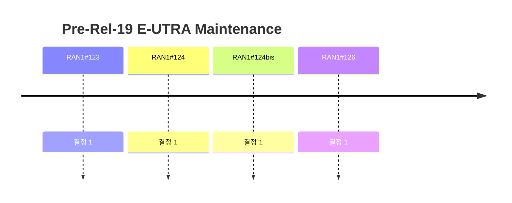

# 6 Pre-Rel-19 E-UTRA Maintenance

> 이 파일은 `scripts/generate_report.py`가 자동으로 생성합니다. 직접 수정하지 마세요.

공식 Agenda 기준으로 이 섹션의 결정을 모았습니다. 번호는 최신 회의 기준이며, 회의 간 연결은 같은 섹션 안의 같은 Agenda 제목으로 합니다.

## 회의별 결정 수

## 직전 회의 대비 (RAN1#125 → RAN1#126)

- 신규 결정 1건 (Agreement 1, Working Assumption 0, Conclusion 0)
- Agenda 신설: Pre-Rel-19 E-UTRA Maintenance
- Agenda 제외: 없음

## 6 Pre-Rel-19 E-UTRA Maintenance

회의별 결정 수 (하위 Agenda 포함): #122 0 · #122bis 0 · #123 1 · #124 1 · #124bis 1 · #125 0 · #126 1

| 회의 | 번호 | 구분 | 내용 | 출처 |
|---|---|---|---|---|
| RAN1#123 | 6 | Agreement | The following TP for TS36.211 for Rel-19 is endorsed. - Reason for change: Align RAN1 specifications to the field description of interferenceRandomisationConfig in TS 36.331 in Rel-19 IoT_NTN_Ph3. - Summary of Change: Add bullet “for NPDCCH associated with C-RNTI during random access procedure in a Type-2 CSS in an NB-IoT carrier configured by SystemInformationBlockType22-NB when interferenceRandomisationConfig is used, or” in Rel-19 IoT_NTN_Ph3. - Consequences if not approved: RAN1 specification is not aligned to the field description of interferenceRandomisationConfig in TS 36.331. - Other comments: Implementation of this CR aligns RAN1 procedures (TS 36.211 clause 10.2.5.5) with the field description of interferenceRandomisationConfig in TS 36.331 and therefore will not cause compatibility issues with Rel-14 implementations until the present release. \| 10.2.5.5 Mapping to resource elements ------------------------------------------------------------ Text Omitted ------------------------------------------------------------------------------ For frame structure type 1, - for NPDCCH associated with RA-RNTI, TC-RNTI or for P-RNTI and transmitted in an NB-IoT carrier configured by SystemInformationBlockType22-NB, or - for NPDCCH associated with C-RNTI in an NB-IoT carrier configured by SystemInformationBlockType22-NB when RadioResourceConfigDedicted-NB is not configured by higher layer, or - for NPDCCH associated with PUR-RNTI/G-RNTI/ SC-RNTI, or - for NPDCCH associated with C-RNTI or SPS C-RNTI when interferenceRandomisationConfig is used according to [9], or -------------------------------------------------------------- Text End --------------------------------------------------------------------------------------- \| The agreement above is captured and endorsed in the Final CR R1-2509559 for TS36.211 for Rel-19. | [Chair notes RAN1#123 - eom3](https://www.3gpp.org/ftp/tsg_ran/WG1_RL1/TSGR1_123/Inbox/Chair_notes/Chair%20notes%20RAN1%23123%20-%20eom3.docx) |
| RAN1#124 | 6 | Agreement | RAN1 aligns RAN1 specification to RAN4 NB-IoT NTN MAC-CE TA command timeline. Adopt the following TP for TS36.213 for Rel-19 for clause 16.1.2 with inclusion of the following text in the “other comment” field: - The implementation of this CR aligns the “MAC-CE TA command timeline” procedure in TS 36.213 clause 16.1.2 with the corresponding one in TS 36.133 clause 7.22A.2.1, this alignment will not cause compatibility issues with Rel-17 implementations until the present release. The corresponding final CR for Rel-19 TS 36.213 in R1-2601691 in endorsed. \| Spec \| TS 36.213 \| \| Reason for change: \| MAC-CE TA command timeline procedures are misaligned between TS 36.213 and TS 36.133. \| \|  \|  \| \| Summary of change: \| MAC-CE TA command timeline in clause 16.1.2 of TS 36.213 is aligned to that in TS 36.133 clause 7.22A.2.1 of the RAN4 specification. \| \|  \|  \| \| Consequences if not approved: \| MAC-CE TA command timeline procedures between TS 36.213 and TS 36.133 will remain inconsistent. \| \| Clauses affected \| 16.1.2 \| \| --------------------------------------------------------------- Text Start ----------------------------------------------------------------- 16.1.2 Timing synchronization -------------------------------------------------------------- Text Omitted --------------------------------------------------------------- For a timing advance command reception ending in DL subframe n, the corresponding adjustment of the uplink transmission timing shall apply the uplink s n+12. ---------------------------------------------------------------- Text End ------------------------------------------------------------------ \| --------------------------------------------------------------- Text Start ----------------------------------------------------------------- 16.1.2 Timing synchronization -------------------------------------------------------------- Text Omitted --------------------------------------------------------------- For a timing advance command reception ending in DL subframe n, the corresponding adjustment of the uplink transmission timing shall apply the uplink s n+12. ---------------------------------------------------------------- Text End ------------------------------------------------------------------ \| | [Chair notes RAN1#124 - eom_03](https://www.3gpp.org/ftp/tsg_ran/WG1_RL1/TSGR1_124/Inbox/Chair_notes/Chair%20notes%20RAN1%23124%20-%20eom_03.docx) [R1-2601579](https://www.3gpp.org/ftp/tsg_ran/WG1_RL1/TSGR1_124/Docs/R1-2601579.zip) |
| RAN1#124bis | 6 | Conclusion | It is RAN1’s understanding that when the UE performs segmented pre-compensation, the gap (of duration ) between two adjacent segments is contained within the second segment (of duration ). | [Chair notes RAN1#124bis_eom5](https://www.3gpp.org/ftp/tsg_ran/WG1_RL1/TSGR1_124b/Inbox/Chair_notes/Chair%20notes%20RAN1%23124bis_eom5.docx) [R1-2603351](https://www.3gpp.org/ftp/tsg_ran/WG1_RL1/TSGR1_124b/Docs/R1-2603351.zip) |
| RAN1#126 | 6 | Agreement | The following TP for Section 16 of Rel-17 of TS 36.213 is endorsed. The corresponding CRs for TS36.213 for Re1-17 (Cat F) , Rel-18 (Cat B), Re1-19 (Cat B) in R1-2606894,  R1-2606895 and R1-2606896, respectively, are endorsed. \| Reason for change: \| Current 3GPP specifications do not clarify the application time of the differential k-offset MAC-CE in NB-IoT NTN. Issues have been encountered during interoperability testing resulting from this lack of clarity. \| \|  \|  \| \| Summary of change: \| Clarify that the differential k-offset applies after subframe n+13, where n is the last subframe of the NPDSCH carrying the MAC-CE. Clarify that the applicable k-offset is the one active at the first subframe of the DCI for an NPUSCH transmission, and the first subframe of the NPDSCH for a TA command. \| \|  \|  \| \| Consequences if not approved: \| Potential misalignment between UE and eNB on the application time of the differential k-offset. \| 16	UE Procedures related to narrowband IoT Throughout this clause, -	for a NB-IoT UE in a IoT NTN TDD serving cell, -	the UE shall not assume any downlink physical signal or physical channel is present in any subframe other than within the D consecutive downlink subframes according to the frame structure type 1 for IoT NTN TDD and the value of D defined in [3], -	the UE shall not transmit any uplink physical signal or physical channel in any subframe other than within the U consecutive uplink subframes according to the frame structure type 1 for IoT NTN TDD and the value of U defined in [3]. -	the term “DL subframe” includes the 𝐷 consecutive downlink subframes, the 𝑈 consecutive uplink subframes and guard period subframes as defined in [3]. -	for a NB-IoT UE, the value of  is given by, -	if the UE is configured with the higher layer parameter k-Offset, -	 where is the parameter k-Offset provided by higher layers, and is the parameter Differential Koffset provided by higher layers, otherwise -	otherwise, -	. If the UE is configured with higher layer parameter k-Offset, for an NPUSCH (re)transmission associated with the TC-RNTI,  k-Offset. | [Chair notes RAN1#126_eom1](https://www.3gpp.org/ftp/tsg_ran/WG1_RL1/TSGR1_126/Inbox/Chair_notes/Chair%20notes%20RAN1%23126_eom1.docx) [R1-2606844](https://www.3gpp.org/ftp/tsg_ran/WG1_RL1/TSGR1_126/Docs/R1-2606844.zip) |
