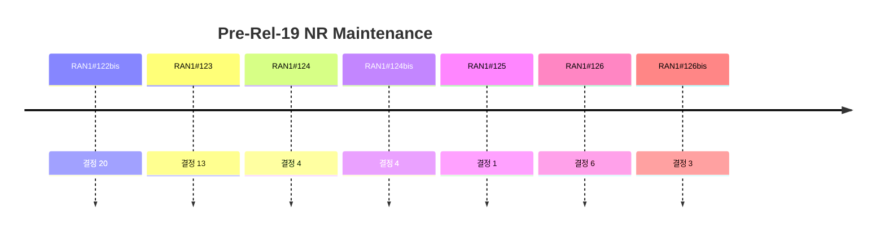

# 7 Pre-Rel-19 NR Maintenance

> 이 파일은 `scripts/generate_report.py`가 자동으로 생성합니다. 직접 수정하지 마세요.

공식 Agenda 기준으로 이 섹션의 결정을 모았습니다. 번호는 최신 회의 기준이며, 회의 간 연결은 같은 섹션 안의 같은 Agenda 제목으로 합니다.

## 회의별 결정 수

## 직전 회의 대비 (RAN1#126 → RAN1#126bis)

- 신규 결정 3건 (Agreement 3, Working Assumption 0, Conclusion 0)
- Agenda 신설: 없음
- Agenda 제외: 없음

## 7 Pre-Rel-19 NR Maintenance

회의별 결정 수 (하위 Agenda 포함): #122 0 · #122bis 20 · #123 13 · #124 4 · #124bis 4 · #125 1 · #126 6 · #126bis 3

| 회의 | 번호 | 구분 | 내용 | 출처 |
|---|---|---|---|---|
| RAN1#122bis | 7 | Agreement | The draft LS captured in R1-2507194 is endorsed in principle with the following update (addition of 37.355): “As this agreement is related to RAN2 specification (38.306, 38.331, 37.355), this liaison informs RAN2 about this agreement. The final LS in R1-2508188 is endorsed. LTM | [Chair notes RAN1#122b eom4](https://www.3gpp.org/ftp/tsg_ran/WG1_RL1/TSGR1_122b/Inbox/Chair_Notes/Chair%20notes%20RAN1%23122b%20eom4.docx) [R1-2508147](https://www.3gpp.org/ftp/tsg_ran/WG1_RL1/TSGR1_122b/Docs/R1-2508147.zip) |
| RAN1#122bis | 7 | Agreement | The draft LS in R1-2508123 in endorsed in principle. The final LS in R1-2508124 is endorsed. | [Chair notes RAN1#122b eom4](https://www.3gpp.org/ftp/tsg_ran/WG1_RL1/TSGR1_122b/Inbox/Chair_Notes/Chair%20notes%20RAN1%23122b%20eom4.docx) [R1-2508147](https://www.3gpp.org/ftp/tsg_ran/WG1_RL1/TSGR1_122b/Docs/R1-2508147.zip) |
| RAN1#122bis | 7 | Conclusion | It is RAN1 common understanding that LTM PRACH triggered by PDCCH order outside active BWP and legacy BWP change operation do not run simultaneously in the same band. | [Chair notes RAN1#122b eom4](https://www.3gpp.org/ftp/tsg_ran/WG1_RL1/TSGR1_122b/Inbox/Chair_Notes/Chair%20notes%20RAN1%23122b%20eom4.docx) [R1-2508147](https://www.3gpp.org/ftp/tsg_ran/WG1_RL1/TSGR1_122b/Docs/R1-2508147.zip) |
| RAN1#122bis | 7 | Agreement | The TP in R1-2507921 for TS38.212 is endorsed in principle as Alignment CR. RACH-less handover (Consider corresponding LS – Moderated by NEC Yingchao) | [Chair notes RAN1#122b eom4](https://www.3gpp.org/ftp/tsg_ran/WG1_RL1/TSGR1_122b/Inbox/Chair_Notes/Chair%20notes%20RAN1%23122b%20eom4.docx) [R1-2508147](https://www.3gpp.org/ftp/tsg_ran/WG1_RL1/TSGR1_122b/Docs/R1-2508147.zip) |
| RAN1#122bis | 7 | Agreement | The draft CR R1-2506779 is endorsed in principle as Alignment CR for 38.211. Note: In R1-2506779, in third line of the equation, “PUSCH” should be used instead of “layer” in . HARQ | [Chair notes RAN1#122b eom4](https://www.3gpp.org/ftp/tsg_ran/WG1_RL1/TSGR1_122b/Inbox/Chair_Notes/Chair%20notes%20RAN1%23122b%20eom4.docx) [R1-2508120](https://www.3gpp.org/ftp/tsg_ran/WG1_RL1/TSGR1_122b/Docs/R1-2508120.zip) |
| RAN1#122bis | 7 | Agreement | The draft CR in R1-2507200 is endorsed in principle for Rel-17 as Alignment CR for TS38.213 , clause 16.5.2.2 with the following update “, and sets”. Mirror CRs are needed for Rel-18 and Rel-19. -	For the pseudo-code for the HARQ-ACK codebook generation in clause 16.5.2.1, after the completion of the  loop, the UE sets  and setswhere  is the value of the SAI field in the DCI format according to Table 16.5.2.2-1. | [Chair notes RAN1#122b eom4](https://www.3gpp.org/ftp/tsg_ran/WG1_RL1/TSGR1_122b/Inbox/Chair_Notes/Chair%20notes%20RAN1%23122b%20eom4.docx) [R1-2508120](https://www.3gpp.org/ftp/tsg_ran/WG1_RL1/TSGR1_122b/Docs/R1-2508120.zip) |
| RAN1#122bis | 7 | Conclusion | When a UE is provided pdsch-TimeDomainAllocationListForMultiPDSCH and the value of maxNrofCodeWordsScheduledByDCI equals 2 for a serving cell, - If nrofHARQ-BundlingGroups is configured and harq-ACK-SpatialBundlingPUCCH is NOT configured for the serving cell,   - HARQ-ACK bits are ordered in TBG first and then TB index second. - If neither nrofHARQ-BundlingGroups nor harq-ACK-SpatialBundlingPUCCH is configured for the serving cell,   - HARQ-ACK bits are ordered in PDSCH first and then TB index second. - No spec change is necessary | [Chair notes RAN1#122b eom4](https://www.3gpp.org/ftp/tsg_ran/WG1_RL1/TSGR1_122b/Inbox/Chair_Notes/Chair%20notes%20RAN1%23122b%20eom4.docx) [R1-2508134](https://www.3gpp.org/ftp/tsg_ran/WG1_RL1/TSGR1_122b/Docs/R1-2508134.zip) |
| RAN1#122bis | 7 | Agreement | The draft CR in R1-2507923 is endorsed in principle as Alignment CR for TS38.214 for Rel-17. UE Power saving | [Chair notes RAN1#122b eom4](https://www.3gpp.org/ftp/tsg_ran/WG1_RL1/TSGR1_122b/Inbox/Chair_Notes/Chair%20notes%20RAN1%23122b%20eom4.docx) [R1-2508134](https://www.3gpp.org/ftp/tsg_ran/WG1_RL1/TSGR1_122b/Docs/R1-2508134.zip) |
| RAN1#122bis | 7 | Conclusion | When a UE is provided a timer value by searchSpaceSwitchTimer-r17 and the timer expires in a first slot, if PDCCH monitoring is required during PDCCH skipping duration, the UE monitors PDCCH on the serving cell according to search space sets with group index 0 starting in a second slot that -    is not earlier than  symbols after the first slot when , -    is a first slot in a slot group of  slots that is not earlier than  symbols after the first slot when No specification impact | [Chair notes RAN1#122b eom4](https://www.3gpp.org/ftp/tsg_ran/WG1_RL1/TSGR1_122b/Inbox/Chair_Notes/Chair%20notes%20RAN1%23122b%20eom4.docx) [R1-2508119](https://www.3gpp.org/ftp/tsg_ran/WG1_RL1/TSGR1_122b/Docs/R1-2508119.zip) |
| RAN1#122bis | 7 | Agreement | The draft CR in R1-2508145 is endorsed in principle for Rel-18 with the following change in cover page for the consequences: “Ambiguity in applied SSSG switching” The final CRs for Rel-18 and Rel-19 (mirror of Rel-18) in R1-2508192 and R1-2508193, respectively, are endorsed. | [Chair notes RAN1#122b eom4](https://www.3gpp.org/ftp/tsg_ran/WG1_RL1/TSGR1_122b/Inbox/Chair_Notes/Chair%20notes%20RAN1%23122b%20eom4.docx) [R1-2508119](https://www.3gpp.org/ftp/tsg_ran/WG1_RL1/TSGR1_122b/Docs/R1-2508119.zip) |
| RAN1#122bis | 7 | Agreement | The draft CR in R1-2507340 is endorsed in principle as Alignment CR for TS38.213 Clause 17.2 for Rel-17. Positioning | [Chair notes RAN1#122b eom4](https://www.3gpp.org/ftp/tsg_ran/WG1_RL1/TSGR1_122b/Inbox/Chair_Notes/Chair%20notes%20RAN1%23122b%20eom4.docx) [R1-2508119](https://www.3gpp.org/ftp/tsg_ran/WG1_RL1/TSGR1_122b/Docs/R1-2508119.zip) |
| RAN1#122bis | 7 | Agreement | The draft CR R1-2508126 for Rel-18 is endorsed in principle. Final CRs for Rel-18 and Rel-19 (mirror of Rel-18 CR) in R1-2508135 and R1-2508136, respectively, are endorsed. Channel modelling | [Chair notes RAN1#122b eom4](https://www.3gpp.org/ftp/tsg_ran/WG1_RL1/TSGR1_122b/Inbox/Chair_Notes/Chair%20notes%20RAN1%23122b%20eom4.docx) [R1-2508119](https://www.3gpp.org/ftp/tsg_ran/WG1_RL1/TSGR1_122b/Docs/R1-2508119.zip) |
| RAN1#122bis | 7 | Agreement | The draft CR in R1-2507926 for TS38.213 for Rel-18 is endorsed in principle as Alignment CR. MIMO | [Chair notes RAN1#122b eom4](https://www.3gpp.org/ftp/tsg_ran/WG1_RL1/TSGR1_122b/Inbox/Chair_Notes/Chair%20notes%20RAN1%23122b%20eom4.docx) [R1-2508171](https://www.3gpp.org/ftp/tsg_ran/WG1_RL1/TSGR1_122b/Docs/R1-2508171.zip) |
| RAN1#122bis | 7 | Agreement | The draft CR for TS 38.213 in R1-2506869 for Rel-18 is endorsed in principle. Final CR for Rel-18 and Rel-19 (mirror of Rel-18) are endorsed in R1-2508143 and R1-2508144, respectively. | [Chair notes RAN1#122b eom4](https://www.3gpp.org/ftp/tsg_ran/WG1_RL1/TSGR1_122b/Inbox/Chair_Notes/Chair%20notes%20RAN1%23122b%20eom4.docx) [R1-2508171](https://www.3gpp.org/ftp/tsg_ran/WG1_RL1/TSGR1_122b/Docs/R1-2508171.zip) |
| RAN1#122bis | 7 | Agreement | The draft CR in R1-2506960 for TS38.214 for Rel-18 is endorsed in principle with the following change: - Remove in the proposed TP “-r17” and “-18”. Final CR for Rel-18 and Rel-19 (mirror of Rel-18) are endorsed in R1-2508166 and R1-2508167, respectively. | [Chair notes RAN1#122b eom4](https://www.3gpp.org/ftp/tsg_ran/WG1_RL1/TSGR1_122b/Inbox/Chair_Notes/Chair%20notes%20RAN1%23122b%20eom4.docx) [R1-2508171](https://www.3gpp.org/ftp/tsg_ran/WG1_RL1/TSGR1_122b/Docs/R1-2508171.zip) |
| RAN1#122bis | 7 | Agreement | The draft CR for TS 38.213 in R1-2508177 for Rel-18 is endorsed in principle. Final CR for Rel-18 and Rel-19 (mirror of Rel-18) are endorsed in R1-2508194 and R1-2508195, respectively. | [Chair notes RAN1#122b eom4](https://www.3gpp.org/ftp/tsg_ran/WG1_RL1/TSGR1_122b/Inbox/Chair_Notes/Chair%20notes%20RAN1%23122b%20eom4.docx) [R1-2508171](https://www.3gpp.org/ftp/tsg_ran/WG1_RL1/TSGR1_122b/Docs/R1-2508171.zip) |
| RAN1#122bis | 7 | Agreement | The draft CR R1-2508165 is endorsed as Alignment CR for TS 38.213 for Rel-18. | [Chair notes RAN1#122b eom4](https://www.3gpp.org/ftp/tsg_ran/WG1_RL1/TSGR1_122b/Inbox/Chair_Notes/Chair%20notes%20RAN1%23122b%20eom4.docx) [R1-2508171](https://www.3gpp.org/ftp/tsg_ran/WG1_RL1/TSGR1_122b/Docs/R1-2508171.zip) |
| RAN1#122bis | 7 | Agreement | The draft CR in R1-2507132 is endorsed in principle as Alignment CR for TS38.214, Rel-18. | [Chair notes RAN1#122b eom4](https://www.3gpp.org/ftp/tsg_ran/WG1_RL1/TSGR1_122b/Inbox/Chair_Notes/Chair%20notes%20RAN1%23122b%20eom4.docx) [R1-2508171](https://www.3gpp.org/ftp/tsg_ran/WG1_RL1/TSGR1_122b/Docs/R1-2508171.zip) |
| RAN1#122bis | 7 | Agreement | The draft CR in R1-2507514 for TS38.214 for Rel-18 is endorsed in principle Final CR for Rel-18 and Rel-19 (mirror of Rel-18) are endorsed in R1-2508180 and R1-2508181, respectively. | [Chair notes RAN1#122b eom4](https://www.3gpp.org/ftp/tsg_ran/WG1_RL1/TSGR1_122b/Inbox/Chair_Notes/Chair%20notes%20RAN1%23122b%20eom4.docx) [R1-2508171](https://www.3gpp.org/ftp/tsg_ran/WG1_RL1/TSGR1_122b/Docs/R1-2508171.zip) |
| RAN1#122bis | 7 | Agreement | The draft CR in R1-2507093 for TS38.211 for Rel-18 is endorsed in principle Final CR for Rel-18 and Rel-19 (mirror of Rel-18) are endorsed in R1-2508196 and R1-2508197, respectively. | [Chair notes RAN1#122b eom4](https://www.3gpp.org/ftp/tsg_ran/WG1_RL1/TSGR1_122b/Inbox/Chair_Notes/Chair%20notes%20RAN1%23122b%20eom4.docx) [R1-2508171](https://www.3gpp.org/ftp/tsg_ran/WG1_RL1/TSGR1_122b/Docs/R1-2508171.zip) |
| RAN1#123 | 7 | Agreement | The draft CR R1-2508506 for TS38.212 is endorsed as Alignment CR for Rel-16. | [Chair notes RAN1#123 - eom3](https://www.3gpp.org/ftp/tsg_ran/WG1_RL1/TSGR1_123/Inbox/Chair_notes/Chair%20notes%20RAN1%23123%20-%20eom3.docx) [R1-2509546](https://www.3gpp.org/ftp/tsg_ran/WG1_RL1/TSGR1_123/Docs/R1-2509546.zip) |
| RAN1#123 | 7 | Agreement | The draft CR in R1-2508507 for TS38.214, Rel-18 is endorsed with the following changed highlighted in cyan. The final CRs for TS38.214 for Rel-18 and Rel-19 (mirror) in R1-2509563 and R1-2509564, respectively, are endorsed. ================================================ 6.2.3.1 	UE PT-RS transmission procedure when transform precoding is not enabled <Unchanged parts are omitted> The maximum number of configured PT-RS ports is given by the higher layer parameter maxNrofPorts in PTRS-UplinkConfig. The UE is not expected to be configured with a larger number of UL PT-RS ports than it has reported need for. If a UE has reported the capability of supporting full-coherent UL transmission with 2 or 4 antenna ports or the capability of codebook1-8TxPUSCH-r18 with 8 antenna ports, the UE shall expect maxNrofPorts in PTRS-UplinkConfig to be configured as one if UL PT-RS is configured. If a UE has reported the capability of supporting full-coherent UL transmission and when the higher layer parameter multipanelSchemeSDM is configured, subject to UE capability, the UE can be configured with maxNrofPorts-SDM in PTRS-UplinkConfig set to n2, where at most one PT-RS port is associated with each SRS resource set with higher layer parameter usage set to 'codebook'/'nonCodebook'. For codebook or non-codebook based UL transmission, the association between UL PT-RS port(s) and DM-RS port(s) is signalled by PTRS-DMRS association field(s) in DCI format 0_1, 0_2 and 0_3. For a PUSCH corresponding to a configured grant Type 1 transmission, the UE may assume the association between UL PT-RS port(s) and DM-RS port(s) defined by value 0 in Table 7.3.1.1.2-25, or value "00" in Table 7.3.1.1.1.2-26 or value "00" in Table 7.3.1.1.1.2-25a described in Clause 7.3.1 of [5, TS 38.212]. <Unchanged parts are omitted> ================================================ | [Chair notes RAN1#123 - eom3](https://www.3gpp.org/ftp/tsg_ran/WG1_RL1/TSGR1_123/Inbox/Chair_notes/Chair%20notes%20RAN1%23123%20-%20eom3.docx) [R1-2509537](https://www.3gpp.org/ftp/tsg_ran/WG1_RL1/TSGR1_123/Docs/R1-2509537.zip) |
| RAN1#123 | 7 | Agreement | The draft CR in R1-2508533 for TS38.214 for rel-18 is endorsed. The final CRs for TS38.214 for Rel-18 and Rel-19 (mirror) in R1-2509570 and R1-2509571, respectively, are endorsed. | [Chair notes RAN1#123 - eom3](https://www.3gpp.org/ftp/tsg_ran/WG1_RL1/TSGR1_123/Inbox/Chair_notes/Chair%20notes%20RAN1%23123%20-%20eom3.docx) [R1-2509540](https://www.3gpp.org/ftp/tsg_ran/WG1_RL1/TSGR1_123/Docs/R1-2509540.zip) |
| RAN1#123 | 7 | Agreement | The draft CR in R1-2508568 for Rel-18 TS 38.214 is endorsed in principal as an Alignment CR. The final wording is up to editor. | [Chair notes RAN1#123 - eom3](https://www.3gpp.org/ftp/tsg_ran/WG1_RL1/TSGR1_123/Inbox/Chair_notes/Chair%20notes%20RAN1%23123%20-%20eom3.docx) [R1-2509529](https://www.3gpp.org/ftp/tsg_ran/WG1_RL1/TSGR1_123/Docs/R1-2509529.zip) |
| RAN1#123 | 7 | Agreement | The draft CR in R1-2509257 for TS38.214 for Rel-18 is endorsed. The final CRs for TS38.214 for Rel-18 and Rel-19 (mirror) in R1-2509567 and R1-2509597, respectively, are endorsed. | [Chair notes RAN1#123 - eom3](https://www.3gpp.org/ftp/tsg_ran/WG1_RL1/TSGR1_123/Inbox/Chair_notes/Chair%20notes%20RAN1%23123%20-%20eom3.docx) [R1-2509553](https://www.3gpp.org/ftp/tsg_ran/WG1_RL1/TSGR1_123/Docs/R1-2509553.zip) |
| RAN1#123 | 7 | Agreement | The draft CR in R1-2509535 for TS38.211 for Rel-18 is endorsed. The final CRs for TS38.211 for Rel-18 and Rel-19 (mirror) in R1-2509538 and R1-2509539, respectively, are endorsed. | [Chair notes RAN1#123 - eom3](https://www.3gpp.org/ftp/tsg_ran/WG1_RL1/TSGR1_123/Inbox/Chair_notes/Chair%20notes%20RAN1%23123%20-%20eom3.docx) [R1-2509535](https://www.3gpp.org/ftp/tsg_ran/WG1_RL1/TSGR1_123/Docs/R1-2509535.zip) |
| RAN1#123 | 7 | Agreement | The draft CR in R1-2509556 for TS38.211 for Rel-18 is endorsed. The final CRs for TS38.211 for Rel-18 and Rel-19 (mirror) in R1-2509572 and R1-2509573, respectively, are endorsed. | [Chair notes RAN1#123 - eom3](https://www.3gpp.org/ftp/tsg_ran/WG1_RL1/TSGR1_123/Inbox/Chair_notes/Chair%20notes%20RAN1%23123%20-%20eom3.docx) [R1-2509542](https://www.3gpp.org/ftp/tsg_ran/WG1_RL1/TSGR1_123/Docs/R1-2509542.zip) |
| RAN1#123 | 7 | Agreement | The draft CR in R1-2509557 for TS38.211 for Rel-18 is endorsed. The final CRs for TS38.211 for Rel-18 and Rel-19 (mirror) in R1-2509575 and R1-2509576, respectively, are endorsed. | [Chair notes RAN1#123 - eom3](https://www.3gpp.org/ftp/tsg_ran/WG1_RL1/TSGR1_123/Inbox/Chair_notes/Chair%20notes%20RAN1%23123%20-%20eom3.docx) [R1-2509542](https://www.3gpp.org/ftp/tsg_ran/WG1_RL1/TSGR1_123/Docs/R1-2509542.zip) |
| RAN1#123 | 7 | Agreement | The draft CR in R1-2509376 for 38.901, Rel-18 is endorsed. The final CRs for 38.901 for Rel-18 and Rel-19 in R1-2509551 and R1-2509552, are endorsed, respectively. | [Chair notes RAN1#123 - eom3](https://www.3gpp.org/ftp/tsg_ran/WG1_RL1/TSGR1_123/Inbox/Chair_notes/Chair%20notes%20RAN1%23123%20-%20eom3.docx) [R1-2509542](https://www.3gpp.org/ftp/tsg_ran/WG1_RL1/TSGR1_123/Docs/R1-2509542.zip) |
| RAN1#123 | 7 | Agreement | The draft CR R1-2508558 for TS 38.214 for Rel-18 is endorsed. The final CRs for 38.214 for Rel-18 and Rel-19 (mirror) in R1-2509601 and R1-2509602, respectively, are endorsed. | [Chair notes RAN1#123 - eom3](https://www.3gpp.org/ftp/tsg_ran/WG1_RL1/TSGR1_123/Inbox/Chair_notes/Chair%20notes%20RAN1%23123%20-%20eom3.docx) [R1-2509534](https://www.3gpp.org/ftp/tsg_ran/WG1_RL1/TSGR1_123/Docs/R1-2509534.zip) |
| RAN1#123 | 7 | Agreement | The following TPs for TS38.213 for Rel.18 are endorsed. The final CRs capturing the following TPs for 38.213 for Rel-18 and Rel-19 (mirror) are R1-2509603 and R1-2509604, respectively, are endorsed. \| 7.1.1 UE behaviour ============== unchanged parts are omitted =============== - is a downlink pathloss estimate in dB calculated by the UE using reference signal (RS) index for the active DL BWP, as described in clause 12, of carrier of serving cell - If the UE is not provided PUSCH-PathlossReferenceRS and enableDefaultBeamPL-ForSRS, or before the UE is provided dedicated higher layer parameters, the UE calculates - using a RS resource from an SS/PBCH block with same SS/PBCH block index as the one the UE uses to obtain MIB, or using the SS/PBCH block the UE acquired the time and frequency synchronization for a secondary cell. - if the UE is provided RACH-LessHO in ReconfigurationWithSync [12. TS 38.331], using a RS resource from an SS/PBCH block with same SS/PBCH block index as the one with same quasi co-location properties as for PDCCH receptions for scheduling an initial PUSCH transmission, as described in Clause 10.1, in controlResourceSetZero provided in ServingCellConfigCommon of ReconfigurationWithSync, or using a RS resource from the pathlossReferenceRS-Id-r17 configured by a TCI state associated with tci-StateID. ============== unchanged parts are omitted =============== \| \| 22 PUSCH transmission in NTN RACH-less handover 22.1 Configured-grant PUSCH transmission ============== unchanged parts are omitted =============== A PUSCH occasion is valid if it does not overlap with a valid PRACH occasion as described in clause 8.1. For unpaired spectrum and for SS/PBCH blocks with indexes provided by rrc-SSB-Subset in cg-RRC-Configuration, or ssb-PositionsInBurst in ServingCellConfigCommon if rrc-SSB-Subset is not provided - if a UE is not provided tdd-UL-DL-ConfigurationCommon, a PUSCH occasion is valid if the PUSCH occasion - does not precede a SS/PBCH block in the PUSCH slot, and - starts at least symbols after a last SS/PBCH block symbol, where is provided in Table 8.1-2 - if a UE is provided tdd-UL-DL-ConfigurationCommon, a PUSCH occasion is valid if the PUSCH occasion - is within UL symbols - starts at least symbols after a last downlink symbol, and at least symbols after a last SS/PBCH block symbol, where is provided in Table 8.1-2. A UE determines a power of a PUSCH transmission as described in clause 7.1.1, where the UE obtains using a RS resource from an SS/PBCH block with index associated with the PUSCH transmission or the pathlossReferenceRS-Id-r17 configured by a TCI state associated with tci-StateID. \| \| 22.2 Dynamic-grant PUSCH transmission If ssb-Index or tci-StateID is provided in RACH-LessHO, the UE may assume that the DM-RS antenna port associated with the PDCCH receptions for scheduling initial PUSCH transmission and the SS/PBCH block indicated by ssb-Index or the DL RS configured by a TCI state associated with tci-StateID are quasi co-located with respect to average gain and quasi co-location 'typeA' or 'typeD' properties. \| | [Chair notes RAN1#123 - eom3](https://www.3gpp.org/ftp/tsg_ran/WG1_RL1/TSGR1_123/Inbox/Chair_notes/Chair%20notes%20RAN1%23123%20-%20eom3.docx) [R1-2509534](https://www.3gpp.org/ftp/tsg_ran/WG1_RL1/TSGR1_123/Docs/R1-2509534.zip) |
| RAN1#123 | 7 | Agreement | Send an LS to RAN2 to clarify that parallelTxPUCCH-PUSCH-r17 and parallelTxPUCCH-PUSCH-SamePriority-r17 only applies to different CCs belong to different bands in inter-band CA, with the following suggested TP for TS 38.306 for Rel-17. - Note: The following TP is just an exemplary suggestion to RAN2. It is up to RAN2 to decide the final TP to clarify the issue. \| parallelTxPUCCH-PUSCH-r17 Indicates whether the UE supports simultaneous PUCCH and PUSCH transmissions of different priority across different CCs belong to different bands in a an inter-band CA band combination for NR SA or NR SCG in (NG)EN-DC. \| BC \| No \| N/A \| N/A \| \| parallelTxPUCCH-PUSCH-SamePriority-r17 Indicates whether the UE supports simultaneous PUCCH and PUSCH transmissions of same priority across different CCs belong to different bands in a an inter-band CA band combination for NR SA or NR SCG in (NG)EN-DC as specified in clause 9 of TS 38.213 [11]. \| BC \| No \| N/A \| N/A \| The draft LS in R1-2509549 endorsed. The final LS in R1-2509550 is endorsed. | [Chair notes RAN1#123 - eom3](https://www.3gpp.org/ftp/tsg_ran/WG1_RL1/TSGR1_123/Inbox/Chair_notes/Chair%20notes%20RAN1%23123%20-%20eom3.docx) [R1-2509534](https://www.3gpp.org/ftp/tsg_ran/WG1_RL1/TSGR1_123/Docs/R1-2509534.zip) |
| RAN1#123 | 7 | Conclusion | RAN1 clarifies the interpretation of “dynamicWaveformSwitchIntraCA-r18” as the following: - It refers to the maximum number of intra-band UL CCs that supported by the UE in one band when the function is enabled in any of configured UL CCs in this band. | [Chair notes RAN1#123 - eom3](https://www.3gpp.org/ftp/tsg_ran/WG1_RL1/TSGR1_123/Inbox/Chair_notes/Chair%20notes%20RAN1%23123%20-%20eom3.docx) [R1-2509534](https://www.3gpp.org/ftp/tsg_ran/WG1_RL1/TSGR1_123/Docs/R1-2509534.zip) |
| RAN1#124 | 7 | Agreement | Draft CR in R1-2600722 is agreed with following update. --- If transform precoding is not enabled according to 6.1.3 of [6, TS38.214],  for each layer .,t --- Final CR is endorsed in R1-2601649 for Rel-18 and in R1-2601650 for Rel-19 | [Chair notes RAN1#124 - eom_03](https://www.3gpp.org/ftp/tsg_ran/WG1_RL1/TSGR1_124/Inbox/Chair_notes/Chair%20notes%20RAN1%23124%20-%20eom_03.docx) [R1-2600722](https://www.3gpp.org/ftp/tsg_ran/WG1_RL1/TSGR1_124/Docs/R1-2600722.zip) |
| RAN1#124 | 7 | Agreement | RAN1 will answer to RAN2 that “for the capabilities rach-EarlyTA-Measurement-r18, ta-IndicationCellSwitch-r18, and ue-TA-Measurement-r18, if the UE indicates this capability in one band of a FR, it indicates the same capability values for all supported bands in that FR”. | [Chair notes RAN1#124 - eom_03](https://www.3gpp.org/ftp/tsg_ran/WG1_RL1/TSGR1_124/Inbox/Chair_notes/Chair%20notes%20RAN1%23124%20-%20eom_03.docx) [R1-2600373](https://www.3gpp.org/ftp/tsg_ran/WG1_RL1/TSGR1_124/Docs/R1-2600373.zip) |
| RAN1#124 | 7 | Conclusion | There is no RAN1 impact to support 1Tx-1Tx switching capability for NR inter-band UL CA and SUL band combinations from Rel-16 if no new signaling for 1Tx-1Tx switching is introduced. | [Chair notes RAN1#124 - eom_03](https://www.3gpp.org/ftp/tsg_ran/WG1_RL1/TSGR1_124/Inbox/Chair_notes/Chair%20notes%20RAN1%23124%20-%20eom_03.docx) [R1-2600407](https://www.3gpp.org/ftp/tsg_ran/WG1_RL1/TSGR1_124/Docs/R1-2600407.zip) |
| RAN1#124 | 7 | Agreement | Send LS to RAN (CC: RAN2/RAN4) to inform above RAN1 conclusion. | [Chair notes RAN1#124 - eom_03](https://www.3gpp.org/ftp/tsg_ran/WG1_RL1/TSGR1_124/Inbox/Chair_notes/Chair%20notes%20RAN1%23124%20-%20eom_03.docx) [R1-2600407](https://www.3gpp.org/ftp/tsg_ran/WG1_RL1/TSGR1_124/Docs/R1-2600407.zip) |
| RAN1#124bis | 7 | Agreement | The draft CR R1-2601985 for Rel-18 is endorsed. The corresponding final CRs for Rel-18 and Rel-19 (shadow) are endorsed in R1-2603371 and R1-2603372, are endorsed. | [Chair notes RAN1#124bis_eom5](https://www.3gpp.org/ftp/tsg_ran/WG1_RL1/TSGR1_124b/Inbox/Chair_notes/Chair%20notes%20RAN1%23124bis_eom5.docx) |
| RAN1#124bis | 7 | Agreement | The draft LS in R1-2603382 is endorsed with the following modification: - For Issue#2, replace “peak rate target” with “max data rate”. - In Action section, add that “No action is needed for Isssue#3”. The above changes are applied in the final LS. The final LS in R1-2603424 is endorsed. | [Chair notes RAN1#124bis_eom5](https://www.3gpp.org/ftp/tsg_ran/WG1_RL1/TSGR1_124b/Inbox/Chair_notes/Chair%20notes%20RAN1%23124bis_eom5.docx) [R1-2603383](https://www.3gpp.org/ftp/tsg_ran/WG1_RL1/TSGR1_124b/Docs/R1-2603383.zip) |
| RAN1#124bis | 7 | Agreement | The draft CR in R1-2603387 Rel-18 TS38.214 is endorsed. The corresponding final CRs for TS38.214 for Rel-18 and Rel-19 (shadow) in R1-2603388 and R1-2603389, respectively, are endorsed. | [Chair notes RAN1#124bis_eom5](https://www.3gpp.org/ftp/tsg_ran/WG1_RL1/TSGR1_124b/Inbox/Chair_notes/Chair%20notes%20RAN1%23124bis_eom5.docx) [R1-2603383](https://www.3gpp.org/ftp/tsg_ran/WG1_RL1/TSGR1_124b/Docs/R1-2603383.zip) |
| RAN1#124bis | 7 | Conclusion | If unified TCI is configured, PUSCH can be scheduled with DCI format 0_0. | [Chair notes RAN1#124bis_eom5](https://www.3gpp.org/ftp/tsg_ran/WG1_RL1/TSGR1_124b/Inbox/Chair_notes/Chair%20notes%20RAN1%23124bis_eom5.docx) [R1-2603383](https://www.3gpp.org/ftp/tsg_ran/WG1_RL1/TSGR1_124b/Docs/R1-2603383.zip) |
| RAN1#125 | 7 | Conclusion | The issue raised in R1-2604674 is resolved by the following solution. - A UE does not expect NW triggering two aperiodic SRS resource sets with the same SRS trigger state for xTxR antenna switching. - No specification impact of the above. | [Chair notes RAN1#125_eom](https://www.3gpp.org/ftp/tsg_ran/WG1_RL1/TSGR1_125/Inbox/Chair_notes/Chair%20notes%20RAN1%23125_eom.docx) [R1-2605101](https://www.3gpp.org/ftp/tsg_ran/WG1_RL1/TSGR1_125/Docs/R1-2605101.zip) |
| RAN1#126 | 7 | Conclusion | The draft CR for Rel-18 in R1-2605550 is not necessary, and the draft CR for Rel-19 can be discussed in AI8.2. | [Chair notes RAN1#126_eom1](https://www.3gpp.org/ftp/tsg_ran/WG1_RL1/TSGR1_126/Inbox/Chair_notes/Chair%20notes%20RAN1%23126_eom1.docx) [R1-2605550](https://www.3gpp.org/ftp/tsg_ran/WG1_RL1/TSGR1_126/Docs/R1-2605550.zip) |
| RAN1#126 | 7 | Agreement | The draft CR for TS38.213 in R1-2605794/5795/5796 are endorsed in principle for alignment CR. | [Chair notes RAN1#126_eom1](https://www.3gpp.org/ftp/tsg_ran/WG1_RL1/TSGR1_126/Inbox/Chair_notes/Chair%20notes%20RAN1%23126_eom1.docx) [R1-2605794](https://www.3gpp.org/ftp/tsg_ran/WG1_RL1/TSGR1_126/Docs/R1-2605794.zip) |
| RAN1#126 | 7 | Agreement | The draft CR for TS38.213 in R1-2605797/5798 are endorsed in principle for alignment CR. | [Chair notes RAN1#126_eom1](https://www.3gpp.org/ftp/tsg_ran/WG1_RL1/TSGR1_126/Inbox/Chair_notes/Chair%20notes%20RAN1%23126_eom1.docx) [R1-2605797](https://www.3gpp.org/ftp/tsg_ran/WG1_RL1/TSGR1_126/Docs/R1-2605797.zip) |
| RAN1#126 | 7 | Conclusion | In TS38.211, RAR UL grant refers either RAR UL grant or fallbackRAR UL grant | [Chair notes RAN1#126_eom1](https://www.3gpp.org/ftp/tsg_ran/WG1_RL1/TSGR1_126/Inbox/Chair_notes/Chair%20notes%20RAN1%23126_eom1.docx) [R1-2605667](https://www.3gpp.org/ftp/tsg_ran/WG1_RL1/TSGR1_126/Docs/R1-2605667.zip) |
| RAN1#126 | 7 | Agreement | The draft CR for TS38.211 in R1-2606450/6451/6452 are endorsed in principle for alignment CR. | [Chair notes RAN1#126_eom1](https://www.3gpp.org/ftp/tsg_ran/WG1_RL1/TSGR1_126/Inbox/Chair_notes/Chair%20notes%20RAN1%23126_eom1.docx) [R1-2606450](https://www.3gpp.org/ftp/tsg_ran/WG1_RL1/TSGR1_126/Docs/R1-2606450.zip) |
| RAN1#126 | 7 | Agreement | The draft CR for TS38.214 in R1-2605800 is endorsed in principle with removing “'codebook'/” from the revision. Final CRs in R1-2606917 for Rel-18 and in R1-2606918 for Rel-19 are endorsed. | [Chair notes RAN1#126_eom1](https://www.3gpp.org/ftp/tsg_ran/WG1_RL1/TSGR1_126/Inbox/Chair_notes/Chair%20notes%20RAN1%23126_eom1.docx) [R1-2605800](https://www.3gpp.org/ftp/tsg_ran/WG1_RL1/TSGR1_126/Docs/R1-2605800.zip) |
| RAN1#126bis | 7 | Agreement | The draft CR for TS38.213 in R1-2608719 is endorsed in principle Final CRs in R1-2608738 for Rel-18 and in R1-2608739 for Rel-19 are agreed. | [Chair notes RAN1#126bis_eom1](https://www.3gpp.org/ftp/tsg_ran/WG1_RL1/TSGR1_126b/Inbox/Chair_notes/Chair%20notes%20RAN1%23126bis_eom1.docx) [R1-2608719](https://www.3gpp.org/ftp/tsg_ran/WG1_RL1/TSGR1_126b/Docs/R1-2608719.zip) `[126bis-R19-AI 7]` |
| RAN1#126bis | 7 | Agreement | The draft CR for TS38.214 in R1-2607238/7239/7240 are endorsed in principle for alignment CR. | [Chair notes RAN1#126bis_eom1](https://www.3gpp.org/ftp/tsg_ran/WG1_RL1/TSGR1_126b/Inbox/Chair_notes/Chair%20notes%20RAN1%23126bis_eom1.docx) [R1-2607238](https://www.3gpp.org/ftp/tsg_ran/WG1_RL1/TSGR1_126b/Docs/R1-2607238.zip) `[126bis-R19-AI 7]` |
| RAN1#126bis | 7 | Agreement | The draft CR for TS38.214 in R1-2608150/8151/8152 are endorsed in principle for alignment CR. | [Chair notes RAN1#126bis_eom1](https://www.3gpp.org/ftp/tsg_ran/WG1_RL1/TSGR1_126b/Inbox/Chair_notes/Chair%20notes%20RAN1%23126bis_eom1.docx) [R1-2608150](https://www.3gpp.org/ftp/tsg_ran/WG1_RL1/TSGR1_126b/Docs/R1-2608150.zip) `[126bis-R19-AI 7]` |
