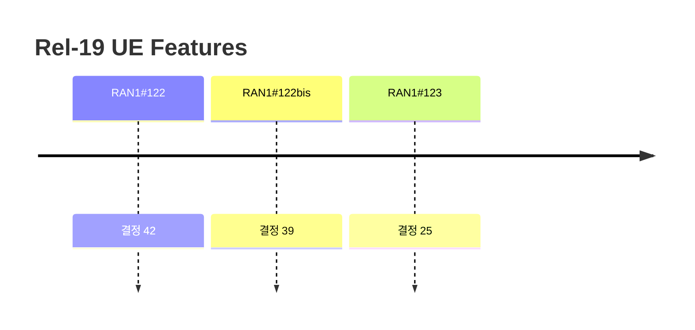

# 9 Rel-19 UE Features

> 이 파일은 `scripts/generate_report.py`가 자동으로 생성합니다. 직접 수정하지 마세요.

공식 Agenda 기준으로 이 섹션의 결정을 모았습니다. 번호는 최신 회의 기준이며, 회의 간 연결은 같은 섹션 안의 같은 Agenda 제목으로 합니다.

> 이 섹션은 RAN1#123 이후 Agenda에 없습니다.

## 회의별 결정 수

## 최신 회의에는 없는 Agenda

삭제됐거나 제목이 바뀐 Agenda입니다. 제목이 바뀐 경우에도 자동으로 잇지 않으니 위 목록과 비교해 보세요.

### 9 Rel-19 UE Features (마지막: RAN1#123)

회의별 결정 수: #122 6 · #122bis 4 · #123 4 · #124 0 · #124bis 0 · #125 0 · #126 0

| 회의 | 번호 | 구분 | 내용 | 출처 |
|---|---|---|---|---|
| RAN1#122 | 9 | Agreement | Updated RAN1 UE feature list in R1-2506627 is endorsed. | [Chair notes RAN1#122 eom](https://www.3gpp.org/ftp/tsg_ran/WG1_RL1/TSGR1_122/Inbox/Chair_notes/Chair%20notes%20RAN1%23122%20eom.zip) `[122-R19-UE_features]` |
| RAN1#122 | 9 | Agreement | Draft LS R1-2506628 is endorsed in principle. | [Chair notes RAN1#122 eom](https://www.3gpp.org/ftp/tsg_ran/WG1_RL1/TSGR1_122/Inbox/Chair_notes/Chair%20notes%20RAN1%23122%20eom.zip) `[122-R19-UE_features]` |
| RAN1#122 | 9 | Agreement | Final LS R1-2506426 is endorsed. | [Chair notes RAN1#122 eom](https://www.3gpp.org/ftp/tsg_ran/WG1_RL1/TSGR1_122/Inbox/Chair_notes/Chair%20notes%20RAN1%23122%20eom.zip) `[122-R19-UE_features]` |
| RAN1#122 | 9 | Agreement | Updated RAN1 UE feature list in R1-2506427 is endorsed. | [Chair notes RAN1#122 eom](https://www.3gpp.org/ftp/tsg_ran/WG1_RL1/TSGR1_122/Inbox/Chair_notes/Chair%20notes%20RAN1%23122%20eom.zip) `[122-R19-UE_features]` |
| RAN1#122 | 9 | Agreement | Draft LS R1-2506428 is endorsed in principle. | [Chair notes RAN1#122 eom](https://www.3gpp.org/ftp/tsg_ran/WG1_RL1/TSGR1_122/Inbox/Chair_notes/Chair%20notes%20RAN1%23122%20eom.zip) `[122-R19-UE_features]` |
| RAN1#122 | 9 | Agreement | Final LS R1-2506429 is endorsed. | [Chair notes RAN1#122 eom](https://www.3gpp.org/ftp/tsg_ran/WG1_RL1/TSGR1_122/Inbox/Chair_notes/Chair%20notes%20RAN1%23122%20eom.zip) `[122-R19-UE_features]` |
| RAN1#122bis | 9 | Agreement | Sent LS to RAN2 with attachment R1-2507979. Draft LS R1-2507980 is endorsed in principle. | [Chair notes RAN1#122b eom4](https://www.3gpp.org/ftp/tsg_ran/WG1_RL1/TSGR1_122b/Inbox/Chair_Notes/Chair%20notes%20RAN1%23122b%20eom4.docx) `[122bis-R19-UE_features]` |
| RAN1#122bis | 9 | Agreement | Final LS R1-2507981 is endorsed | [Chair notes RAN1#122b eom4](https://www.3gpp.org/ftp/tsg_ran/WG1_RL1/TSGR1_122b/Inbox/Chair_Notes/Chair%20notes%20RAN1%23122b%20eom4.docx) `[122bis-R19-UE_features]` |
| RAN1#122bis | 9 | Agreement | Sent LS to RAN2 with attachment R1-2507982. Draft LS R1-2507983 is endorsed in principle. | [Chair notes RAN1#122b eom4](https://www.3gpp.org/ftp/tsg_ran/WG1_RL1/TSGR1_122b/Inbox/Chair_Notes/Chair%20notes%20RAN1%23122b%20eom4.docx) `[122bis-R19-UE_features]` |
| RAN1#122bis | 9 | Agreement | Final LS R1-2507984 is endorsed | [Chair notes RAN1#122b eom4](https://www.3gpp.org/ftp/tsg_ran/WG1_RL1/TSGR1_122b/Inbox/Chair_Notes/Chair%20notes%20RAN1%23122b%20eom4.docx) `[122bis-R19-UE_features]` |
| RAN1#123 | 9 | Agreement | Draft LS R1-2509495 is endorsed in principle. | [Chair notes RAN1#123 - eom3](https://www.3gpp.org/ftp/tsg_ran/WG1_RL1/TSGR1_123/Inbox/Chair_notes/Chair%20notes%20RAN1%23123%20-%20eom3.docx) `[123-R19-UE_features]` |
| RAN1#123 | 9 | Agreement | Final LS R1-2509496 is endorsed. | [Chair notes RAN1#123 - eom3](https://www.3gpp.org/ftp/tsg_ran/WG1_RL1/TSGR1_123/Inbox/Chair_notes/Chair%20notes%20RAN1%23123%20-%20eom3.docx) `[123-R19-UE_features]` |
| RAN1#123 | 9 | Agreement | Draft LS R1-2509585 for adding additional agreement to R1-2509496 is endorsed in principle. | [Chair notes RAN1#123 - eom3](https://www.3gpp.org/ftp/tsg_ran/WG1_RL1/TSGR1_123/Inbox/Chair_notes/Chair%20notes%20RAN1%23123%20-%20eom3.docx) `[123-R19-UE_features]` |
| RAN1#123 | 9 | Agreement | Final LS R1-2509856 is endorsed. | [Chair notes RAN1#123 - eom3](https://www.3gpp.org/ftp/tsg_ran/WG1_RL1/TSGR1_123/Inbox/Chair_notes/Chair%20notes%20RAN1%23123%20-%20eom3.docx) `[123-R19-UE_features]` |

### 9.1 UE features Batch A (마지막: RAN1#123)

회의별 결정 수: #122 0 · #122bis 0 · #123 4 · #124 0 · #124bis 0 · #125 0 · #126 0

| 회의 | 번호 | 구분 | 내용 | 출처 |
|---|---|---|---|---|
| RAN1#123 | 9.1 | Agreement | Regarding FG 65-1-2 and 67-9, - Put “YES” in “Need for the gNB to know if the feature is supported” column - Confirm “Optional with capability signalling” in mandatory/optional column | [Chair notes RAN1#123 - eom3](https://www.3gpp.org/ftp/tsg_ran/WG1_RL1/TSGR1_123/Inbox/Chair_notes/Chair%20notes%20RAN1%23123%20-%20eom3.docx) |
| RAN1#123 | 9.1 | Agreement | Regarding FG 65-1-2/3 and 67-9/10: - Remove “FFS: whether to merge this FG with FG(s) for SIB1 PDSCH repetition” from FG 65-1-2 - Remove “FFS: whether to merge this FG with FG(s) for PDCCH repetition for other than Type0 PDCCH CSS” - Adopt Alt 1 below   - Alt 1: Confirm 65-1-3 and 67-10 (i.e., separate FG for Type 0A/0B/1/1A/2/2A PDCCH CSS)     - For FG 65-1-3, update the consequence column to “PDCCH repetition for Type 0A/0B/1/1A/2/2A PDCCH CSS is not supported”       - Add “conditionally mandatory with capability signalling for UE supporting FG 65-1-2”       - Add FG 65-1-2 as prerequisite FG     - For FG 67-10, update the consequence column to “PDCCH repetition for Type 0A/0B/1/1A/2/2A PDCCH CSS for TN is not supported”       - Add “conditionally mandatory with capability signalling for UE supporting FG 67-9”       - Add FG 67-9 as prerequisite FG | [Chair notes RAN1#123 - eom3](https://www.3gpp.org/ftp/tsg_ran/WG1_RL1/TSGR1_123/Inbox/Chair_notes/Chair%20notes%20RAN1%23123%20-%20eom3.docx) |
| RAN1#123 | 9.1 | Agreement | Confirm “optional with capability signaling” in FG 65-1-5 | [Chair notes RAN1#123 - eom3](https://www.3gpp.org/ftp/tsg_ran/WG1_RL1/TSGR1_123/Inbox/Chair_notes/Chair%20notes%20RAN1%23123%20-%20eom3.docx) |
| RAN1#123 | 9.1 | Agreement | Confirm [0A/0B/1/1A/2/2A] for FG 65-1-3 and 67-10 (both FG name and component) | [Chair notes RAN1#123 - eom3](https://www.3gpp.org/ftp/tsg_ran/WG1_RL1/TSGR1_123/Inbox/Chair_notes/Chair%20notes%20RAN1%23123%20-%20eom3.docx) |

### 9.2 UE features Batch B (마지막: RAN1#123)

회의별 결정 수: #122 0 · #122bis 0 · #123 16 · #124 0 · #124bis 0 · #125 0 · #126 0

| 회의 | 번호 | 구분 | 내용 | 출처 |
|---|---|---|---|---|
| RAN1#123 | 9.2 | Agreement | - Adopt the following updates in FG 60-3 and 60-4   - Add a new component: “X. Support of Msg.3 repetition with configuration 1”   - Add in Note column: “Component X applies only when the UE reports FG 30-6 in the same band” - Not confirm [FG 54-1] as prerequisite FG for FG 60-5a | [Chair notes RAN1#123 - eom3](https://www.3gpp.org/ftp/tsg_ran/WG1_RL1/TSGR1_123/Inbox/Chair_notes/Chair%20notes%20RAN1%23123%20-%20eom3.docx) |
| RAN1#123 | 9.2 | Agreement | For “FFS: Whether/how to capture maximum number of UL muting symbols per slot” in FG 60-7b/7c, adopt the following: - Remove FFS - Adopt Alt-1.2 below   - Alt-1.2: Add a component “Maximum number of UL muting symbols per slot”, with candidate values {2, 4} | [Chair notes RAN1#123 - eom3](https://www.3gpp.org/ftp/tsg_ran/WG1_RL1/TSGR1_123/Inbox/Chair_notes/Chair%20notes%20RAN1%23123%20-%20eom3.docx) |
| RAN1#123 | 9.2 | Agreement | - Confirm the following FFS for FG 60-8 component 4 candidate values   - [Candidate values for component 4 are {8, 16, 32, 64}] - Confirm the following FFS in FG 60-9 component 2 candidate values   - [Candidate values for component 2 are {4, 8, 16, 32}] | [Chair notes RAN1#123 - eom3](https://www.3gpp.org/ftp/tsg_ran/WG1_RL1/TSGR1_123/Inbox/Chair_notes/Chair%20notes%20RAN1%23123%20-%20eom3.docx) |
| RAN1#123 | 9.2 | Agreement | Support the following new components in FG 60-8 - Maximum number of aperiodic CSI report setting per BWP for L1-CLI-RSSI report   - Candidate values: {1, 2, 3, 4} - Maximum number of configured L1 CLI-RSSI measurement resources (sum of aperiodic/semi-persistent/periodic) per CC   - Candidate values: All integers from 1 to 32 - Maximum number of simultaneous L1 CLI-RSSI measurement resources with resource type #1/#2 (sum of aperiodic/semi-persistent/periodic) per CC   - Candidate values: All integers from 1 to 32 | [Chair notes RAN1#123 - eom3](https://www.3gpp.org/ftp/tsg_ran/WG1_RL1/TSGR1_123/Inbox/Chair_notes/Chair%20notes%20RAN1%23123%20-%20eom3.docx) |
| RAN1#123 | 9.2 | Agreement | For active resource counting for L1 CLI-RSSI measurement across two DL subbands, add the following note for FG 60-1: - Note for component 11: If the UE reporting component 11 as “with factor-of-two relaxation for active CSI-RS resource and port counting” also reports FG 60-8 in the same band, factor-of-two relaxation for active CSI-RS resource and port counting also applies to L1 CLI-RSSI measurement resource counting - resource and port counting also applies to L1 CLI-RSSI measurement resource counting \| 60-1 \| Basic feature for SBFD-aware UE TX/RX/measurement behaviour and procedures \| 1. Support of cell-common configuration of time and frequency location of SBFD subbands 2. Support of UL transmission in one UL subband and DL reception in one/two DL subband in SBFD symbols 3. Support of link direction determination based on configured/scheduled transmissions/receptions and collision handling 4. Support of UL transmissions or DL receptions across SBFD symbols and non-SBFD symbols in different slots, where the transmissions or receptions are restricted to SBFD symbols or non-SBFD symbols (Configuration 1) 5. Support of separate CSI reports for SBFD and non-SBFD symbols 6. Support of separate PUCCH frequency resource configuration in SBFD symbols and non-SBFD symbols 7. Support of separate UL power control parameters based on unified TCI framework in SBFD symbols and non-SBFD symbols 8. Support of separate PUSCH frequency hopping offset in SBFD symbols and non-SBFD symbols 9. Support of separate SRS resource set configuration in SBFD symbols and non-SBFD symbols 10. Number of partial PRGs supported 11. Supported CSI timeline, active CSI-RS ports counting and active CSI-RS resource counting for a single CSI-RS resource across two DL subbands 12. Maximum of one DL-UL switching point per SBFD slot for actual DL/UL transmission(s) 13. Determination of TBS of PDSCH/PUSCH in SBFD symbols \|  \| YES \| n/a \| Basic feature for SBFD-aware UE TX/RX/ measurement behaviour and procedures is not supported \| Per band \| TDD only \| n/a \| n/a \| Component 7 applies only to UEs supporting FG 23-1-1h Note: Component 9 is only applicable for SRS resource sets with usage codebook, nonCodebook and beamManagement Component 10 candidate values: {2, 4} Component 11 candidate values: {“with factor-of-two relaxation”, “with factor-of-two relaxation for active CSI-RS resource and port counting”, “no relaxation”} Note for component 11: If the UE reporting component 11 as “with factor-of-two relaxation for active CSI-RS resource and port counting” also reports FG 60-8 in the same band, factor-of-two relaxation for active CSI-RS resource and port counting also applies to L1 CLI-RSSI measurement resource counting \| Optional with capability signalling \| | [Chair notes RAN1#123 - eom3](https://www.3gpp.org/ftp/tsg_ran/WG1_RL1/TSGR1_123/Inbox/Chair_notes/Chair%20notes%20RAN1%23123%20-%20eom3.docx) |
| RAN1#123 | 9.2 | Agreement | Add the following new components in FG 60-9: - Maximum number of configured L1 SRS-RSRP measurement resources (sum of aperiodic/semi-persistent/periodic) per CC   - Candidate values: All integers from 1 to 16 - Maximum number of simultaneous L1 SRS-RSRP measurement resources (sum of aperiodic/semi-persistent/periodic) per CC   - Candidate values: All integers from 1 to 16 - Maximum number of aperiodic CSI report setting per BWP for L1-SRS-RSRP report   - Candidate values: {1, 2, 3, 4} - Maximum number of SRS-RSRP measurement resources across all CCs within a slot   - Candidate values: {1, 2, 4, 8} - Maximum number of aperiodic SRS-RSRP measurement resources across all CCs   - Candidate values: {1, 2, 3, 4} NR_LPWUS Conclusion 2.6-2-2 There is no consensus to adopt the following in Rel-19 - For FG 62-2/2a, add a new component “Nominal MO duration = actual LP-WUS duration” - Define new FG for supporting nominal MO duration > actual LP-WUS duration for LP-WUS operation in CONNECTED mode NR_MC_enh2 | [Chair notes RAN1#123 - eom3](https://www.3gpp.org/ftp/tsg_ran/WG1_RL1/TSGR1_123/Inbox/Chair_notes/Chair%20notes%20RAN1%23123%20-%20eom3.docx) |
| RAN1#123 | 9.2 | Agreement | - From RAN1 perspective, there is no issue identified on the following approach:   - “define new Rel-19 capability parameters for Rel-18 FG 49-4a/4b/4c/4d/5a/5b/6/7/8/9/10/12/12a/13/14, and FG66-1/66-2 will be defined as prerequisite for the new Rel-19 capability parameters” - Regarding “whether this new Rel-19 capability parameters can only have one prerequisite of FG66-1/66-2 (i.e., prerequisite of the corresponding Rel-18 FGs are not prerequisite of new Rel-19 capability parameters)”, RAN1 doesn’t define Rel-18 FGs as prerequisite for the new Rel-19 capability parameters - Capture this agreement in LS for the updated NR UE feature list up to RAN1#123 Wednesday | [Chair notes RAN1#123 - eom3](https://www.3gpp.org/ftp/tsg_ran/WG1_RL1/TSGR1_123/Inbox/Chair_notes/Chair%20notes%20RAN1%23123%20-%20eom3.docx) |
| RAN1#123 | 9.2 | Agreement | - Remove [FFS support of more than one unicast DL DCI for the case when the UE indicates support of more than one unicast DCI per slot based on Rel-16 capability] in component for FG 66-1/2 - Introduce the following two FGs: \| 66-5x \| Advanced UE capability for larger number of unicast DL DCI with different SCS and/or different carrier type \| Processing up to Y DCI formats 1_3 for the set of cells, and Processing up to X unicast DL DCI formats 1_0/1_1/1_2 (if supported) for each of the cells in the set of cells configured for multi-cell PDSCH scheduling by DCI format 1_3 For each cell in the set of cells, no more than X DCIs scheduling PDSCH for the cell X is based on pair of (SCS1, SCS2), Y is based on pair of (SCS1, SCS3): SCS1is the SCS for scheduling CC, SCS2 is the SCS of a cell in the set of cells, and SCS3 is the largest SCS among all cells in the cell set Candidate value(s) of X, Y X={2,4,8} for (15,120), X={2,4} for (15,60), (30,120) and X ={2} for (15,30), (30,60), X={1} for (30,30) Y={2,4,8} for (15,120), Y={2,4} for (15,60), (30,120) and Y ={2} for (15,30), (30,60), Y={1} for (30,30) X and Y apply per slot of scheduling CC \| 66-1 \| Yes \|  \|  \| Per BC \| N/A \| N/A \| N/A \|  \| Optional with capability signaling \| \| 66-5y \| Advanced UE capability for larger number of unicast UL DCI with different SCS and/or different carrier type \| Processing up to Y DCI formats 0_3 for the set of cells, and Processing up to X unicast UL DCI formats 0_0/0_1/0_2 (if supported) for each of the cells in the set of cells configured for multi-cell PUSCH scheduling by DCI format 0_3 For each cell in the set of cells, no more than X DCIs scheduling PUSCH for the cell X is based on pair of (SCS1, SCS2), Y is based on pair of (SCS1, SCS3): SCS1is the SCS for scheduling CC, SCS2 is the SCS of a cell in the set of cells, and SCS3 is the largest SCS among all cells in the cell set Candidate value(s) of X, Y X={2,4,8} for (15,120), X={2,4} for (15,60), (30,120) and X ={2} for (15,30), (30,60), X={1} for (30,30) Y={2,4,8} for (15,120), Y={2,4} for (15,60), (30,120) and Y ={2} for (15,30), (30,60), Y={1} for (30,30) X and Y apply per slot of scheduling CC \| 66-2 \| Yes \|  \|  \| Per BC \| N/A \| N/A \| N/A \|  \| Optional with capability signaling \| | [Chair notes RAN1#123 - eom3](https://www.3gpp.org/ftp/tsg_ran/WG1_RL1/TSGR1_123/Inbox/Chair_notes/Chair%20notes%20RAN1%23123%20-%20eom3.docx) |
| RAN1#123 | 9.2 | Agreement | Introduce the following FG 66-6a/6b/6c/6d: \| 66-6a \| Nominal RBG size of Configuration 3 for FDRA type 0 for DCI format 1_3 with different SCS and/or different carrier type \| 1) Support of nominal RBG size of Configuration 3 for FDRA type 0 for DCI format 1_3 \| 66-1 \| Yes \|  \|  \| Per UE \| No \| No \| No \|  \| Optional with capability signaling \| \| 66-6b \| Nominal RBG size of Configuration 3 for FDRA type 0 for DCI format 0_3 with different SCS and/or different carrier type \| 1) Support of nominal RBG size of Configuration 3 for FDRA type 0 for DCI format 0_3 \| 66-2 \| Yes \|  \|  \| Per UE \| No \| No \| No \|  \| Optional with capability signaling \| \| 66-6c \| Configurable Type-1A fields for DCI format 0_3/1_3 with different SCS and/or different carrier type \| 1) Support Type-1A for ‘Antenna port(s)’ field for DCI format 1_3 2) Support Type-1A for ‘Antenna port(s)’, ‘Precoding information and number of layers’ and ‘SRS resource indicator’ fields for DCI format 0_3 \| At least one of {66-1, 66-2} \| Yes \|  \|  \| Per UE \| No \| No \| No \|  \| Optional with capability signaling \| \| 66-6d \| FDRA Type 1 granularity of 2, 4, 8, or 16 consecutive RBs based RIV for DCI format 1_3/0_3 with different SCS and/or different carrier type \| 1) Support of FDRA Type 1 granularity of 2, 4, 8, or 16 consecutive RBs based RIV for DCI format 0_3 2) Support of FDRA Type 1 granularity of 2, 4, 8, or 16 consecutive RBs based RIV for DCI format 1_3 \| At least one of {66-1, 66-2} \| Yes \|  \|  \| Per UE \| No \| No \| No \|  \| Optional with capability signaling \| | [Chair notes RAN1#123 - eom3](https://www.3gpp.org/ftp/tsg_ran/WG1_RL1/TSGR1_123/Inbox/Chair_notes/Chair%20notes%20RAN1%23123%20-%20eom3.docx) |
| RAN1#123 | 9.2 | Agreement | Introduce the following FG 66-7a/7b \| 66-7a \| Trigger Type 3 HARQ CB based feedback using DCI format 1_3 with different SCS and/or different carrier type \| 1. Support feedback of type 3 HARQ-ACK codebook, triggered by a DCI 1_3 scheduling at least a PDSCH 2. Support feedback of type 3 HARQ-ACK codebook, triggered by a DCI 1_3 without scheduling a PDSCH using a reserved FDRA value \| 66-1 \| Yes \|  \| UE does not support HARQ feedback based on Type 3 HARQ codebook triggered by DCI format 1_3 \| Per BC \| N/A \| N/A \| N/A \| Upon triggering, UE reports A/N for all HARQ processes and all CCs in a PUCCH group. \| Optional with capability signaling \| \| 66-7b \| Trigger enhanced Type 3 HARQ CB based feedback using DCI format 1_3 with different SCS and/or different carrier type \| 1. Support feedback of enhanced type 3 HARQ-ACK codebook, triggered by a DCI 1_3 2. Support configuration of up to 8 enhanced type 3 HARQ-ACK codebooks. 3. Support feedback of a dynamically selected enhanced type 3 HARQ-ACK codebook based on triggering information in DCI 1_3 4. Support transmission of enhanced type 3 HARQ-ACK codebook using the first or second PUCCH configuration based on PHY priority indication in the triggering DCI (for a UE supporting two HARQ-ACK codebooks / PUCCH config in 66-8) 5. Supported maximum number of actual PUCCH transmissions for type 3 or enhanced type 3 HARQ-ACK codebook feedback within a slot \| 66-1 \| Yes \|  \| UE does not support HARQ feedback based on enhanced Type 3 HARQ codebook triggered by DCI format 1_3 \| Per BC \| N/A \| N/A \| N/A \| For component 2, the UE indicates its capability in the number of enhanced type 3 HARQ-ACK codebooks: {1, 2, 4, 8} For component 3, the dynamic indication is only supported if the UE for component 2 supports more than one enhanced type 3 HARQ-ACK codebook to be configured Candidate values for component 5 is: {1, 2, 3, 4, 5, 6, 7}. For component 2 and 5, same values as for FG25-6 are reported (if the UE also report FG25-6) \| Optional with capability signaling \| | [Chair notes RAN1#123 - eom3](https://www.3gpp.org/ftp/tsg_ran/WG1_RL1/TSGR1_123/Inbox/Chair_notes/Chair%20notes%20RAN1%23123%20-%20eom3.docx) |
| RAN1#123 | 9.2 | Agreement | Introduce the following FG 66-8/8a/8b: \| 66-8 \| Two HARQ-ACK codebooks with up to one sub-slot based HARQ-ACK codebook simultaneously constructed for supporting HARQ-ACK codebooks with different priorities by DCI format 1_3 with different SCS and/or different carrier type \| 1. Supports two HARQ-ACK codebooks with different priorities to be simultaneously constructed with the restriction up to one sub-slot based HARQ-ACK codebook. 2. Supports separate PUCCH configuration for different HARQ-ACK codebooks. 3. Supports 2-level priority of HARQ-ACK for dynamically scheduled PDSCH and SPS PDSCH. 4. Supports a DCI format 1_3 scheduling PDSCH with different HARQ-ACK priorities when only DCI format 0_3/1_3 is configured per BWP. 5. Supports separate configuration of parameters PDSCH-HARQ-ACK-Codebook, UCI-OnPUSCH and 'codeBlockGroupTransmission" for different HARQ-ACK codebooks. 6. Supported maximum number of actual PUCCH transmissions for HARQ-ACK within a slot Candidate values for the component 6 of this FG is: For NCP, {4, 5, 6, 7} for 2-symbol*7 sub-slot configuration; For ECP, the candidate value is {4,5,6} for 2-symbol*6 sub-slot configuration 7. Support intra-UE multiplexing/prioritization of UL overlapping channels/signals with two priority levels for HARQ-ACK \| 66-1 \| Yes \|  \|  \| Per FS \| N/A \| N/A \| N/A \| If a UE reports both 11-3 and this FG, it can support two slot-based HARQ-ACK codebooks, and one slot-based and one-sub-slot-based HARQ-ACK codebooks. If a UE reports this FG but not 11-3, it can only support two slot-based HARQ-ACK codebooks. The number of PUCCHs for CSI reporting per slot is not impacted compared with Rel-15 by introducing the new HARQ-ACK CBs Component 6 is applied to the sub-slot HARQ-ACK codebook. It is assumed that only 1 actual PUCCH transmission for HARQ-ACK within a slot for slot-based HARQ-ACK codebook. Component 6 is reported for 2-symbol*7 sub-slot configuration. For 7-symbol*2 sub-slot configuration, the value of component 6 is {2} for both NCP and ECP cases. For component 6, maximum of 1 actual PUCCH transmission for HARQ-ACK within a slot for slot-based HARQ-ACK codebook. Thus value reported for component 6 has no meaning for "slot-based + slot based". For component 6, same values as for FG11-4 are reported (if the UE also report FG11-4) \| Optional with capability signaling \| \| 66-8a \| Two HARQ-ACK codebooks with two sub-slot based HARQ-ACK codebook simultaneously constructed for supporting HARQ-ACK codebooks with different priorities by DCI format 1_3 with different SCS and/or different carrier type \| 1. Supports two subslot based HARQ-ACK codebooks with different priorities to be simultaneously constructed. 2. Supports separate PUCCH configuration for different HARQ-ACK codebooks. 3. Supports 2-level priority of HARQ-ACK for dynamically scheduled PDSCH and SPS PDSCH. 4. Supports a DCI format 1_3 scheduling PDSCH with different HARQ-ACK priorities when only DCI format 0_3/1_3 is configured in USS per BWP. 5. Supports separate configuration of parameters PDSCH-HARQ-ACK-Codebook, UCI-OnPUSCH and "codeBlockGroupTransmission" for different HARQ-ACK codebooks. 6. Supported maximum number of actual PUCCH transmissions for HARQ-ACK within a slot. Candidate values for the component 6 of this FG is: For NCP, {4, 5, 6, 7} for 2-symbol*7 sub-slot configuration; For ECP, the candidate value is {4,5,6} for 2-symbol*6 sub-slot configuration. \| 11-3, 66-8 \| Yes \|  \|  \| Per FS \| N/A \| N/A \| N/A \| The number of PUCCHs for CSI reporting per slot is not impacted compared with Rel-15 by introducing the new HARQ-ACK CBs Component 6 is applied to the two sub-slot HARQ-ACK codebooks, respectively. Component 6 is reported for 2-symbol*7 sub-slot configuration. For 7-symbol*2 sub-slot configuration, the value of component 6 is {2} for both NCP and ECP cases. For component 6, same values as for FG11-4a are reported (if the UE also report FG11-4a) \| Optional with capability signaling \| \| 66-8b \| DL priority indication in DCI with mixed DCI formats including DCI format 1_3 with different SCS and/or different carrier type \| Support of priority indicator field configured in DCI formats 1_3 and (1_1 or 1_2) in a BWP when configured to monitor both DCI formats 1_3 and (1_1 or 1_2) in the BWP \| 66-8 \|  \|  \|  \| Per UE \| No \| No \| N/A \|  \| Optional with capability signaling \| | [Chair notes RAN1#123 - eom3](https://www.3gpp.org/ftp/tsg_ran/WG1_RL1/TSGR1_123/Inbox/Chair_notes/Chair%20notes%20RAN1%23123%20-%20eom3.docx) |
| RAN1#123 | 9.2 | Agreement | Introduce the following FG 66-9/9a: \| 66-9 \| UL intra-UE multiplexing/prioritization of overlapping channel/signals with two priority levels in physical layer for DCI format 1_3/0_3 with different SCS and/or different carrier type \| Support intra-UE multiplexing/prioritization of overlapping PUCCH/PUCCH and PUCCH/PUSCH with two priority levels in physical layer (PHY) for DCI format 1_3/0_3 1) Configuration of PHY priority level for CG PUSCH and SR, and dynamic indication of priority level for dynamic PUSCH with a single DCI format 0_3 2) Multiplexing/prioritization between UL channels/signals with the same PHY priority level 3) Prioritization between UL channels/signals with different PHY priority levels 4) Additional number of symbols (d1) needed beyond the PUSCH preparation time for cancelling a low priority UL transmission. 5) Additional number of symbols (d2) of the preparation time needed for the high priority UL transmission that cancels a low priority UL transmission \| At least one of {66-1, 66-2} \|  \|  \|  \| Per FS \| N/A \| N/A \| N/A \| Candidate value set for component 4: {0, 1, 2} Candidate value set for component 5: {0, 1, 2} For component 4 and 5, same values as for FG12-1 are reported (if the UE also report FG12-1) \| Optional with capability signaling \| \| 66-9a \| UL priority indication in DCI with mixed DCI formats including DCI format 0_3 with different SCS and/or different carrier type \| Support of priority indicator field configured in DCI formats 0_3 and (0_1 or 0_2) in a BWP when configured to monitor both DCI formats 0_3 and (0_1 or 0_2) in the BWP \| 66-9 \|  \|  \|  \| Per UE \| No \| No \| N/A \|  \| Optional with capability signaling \| | [Chair notes RAN1#123 - eom3](https://www.3gpp.org/ftp/tsg_ran/WG1_RL1/TSGR1_123/Inbox/Chair_notes/Chair%20notes%20RAN1%23123%20-%20eom3.docx) |
| RAN1#123 | 9.2 | Agreement | Introduce the following FG 66-10/11/12/13: \| 66-10 \| Triggered HARQ-ACK codebook re-transmission for DCI format 1_3 with different SCS and/or different carrier type \| 1. Support HARQ-ACK re-transmission from an earlier PUCCH slot based on the triggering information in DCI format 1_3 2. Support the related PHY priority handling in terms of HARQ-ACK codebook selection and the applicable PUCCH configuration (for a UE supporting two HARQ-ACK codebooks / PUCCH config in 66-8) 3. Supported minimum value M for the HARQ re-tx offset 4. Supported maximum value N for the HARQ re-tx offset \| 66-1 \|  \|  \|  \| Per band \| N/A \| N/A \| N/A \| Candidate values for component 3 is: M = {-7, -5, …, 1} Candidate values for component 4 is: N= {4, 6, …, 24} Note: The minimum requirement for Component 3 and Component 4 of this FG is valid for HARQ CBs consisted of HARQ Processes with a single HARQ bit per HARQ Process ID For component 3 and 4, same values as for FG25-7 are reported (if the UE also report FG25-7) \| Optional with capability signaling \| \| 66-11 \| SCell dormancy indication within active time in DCI format 0_3/1_3 with different SCS and/or different carrier type \| Support for SCell dormancy indication sent within the active time on PCell with DCI format 0_3/1_3 \| 6-5, at least one of {66-1, 66-2} \|  \|  \|  \| Per BC \| N/A \| N/A \| N/A \| One dormant BWP and one non-dormant BWP is supported per carrier More than one non-dormant BWP per carrier is supported only if UE feature 6-3/6-4 is also supported One dormant BWP and one non-dormant BWP are UE specific BWPs even for UEs not supporting 6-2 or 6-3 \| Optional with capability signaling \| \| 66-12 \| Dynamic indication of applicable minimum scheduling restriction by DCI format 0_3/1_3 with different SCS and/or different carrier type \| 1) Dynamic indication of applicable minimum scheduling restriction by DCI format 0_3 and 1_3 2) minimumSchedulingOffset K0 configuration for PDSCH and aperiodic CSI-RS triggering offset 3) minimumSchedulingOffset K2 configuration for PUSCH 4) Support of extended value range for aperiodic CSI-RS triggering offset \| At least one of {66-1, 66-2} \|  \|  \|  \| Per UE \| No \| No \| N/A \|  \| Optional with capability signaling \| \| 66-13 \| PHY priority indication for one-shot HARQ-ACK feedback triggered by DCI format 1_3 with different SCS and/or different carrier type \| Support transmission of type 3 HARQ-ACK codebook using the first or second PUCCH configuration based on PHY priority indication in the triggering DCI format 1_3 \| 66-7a and 66-8 \|  \|  \|  \| Per UE \| No \| No \| N/A \|  \| Optional with capability signaling \| | [Chair notes RAN1#123 - eom3](https://www.3gpp.org/ftp/tsg_ran/WG1_RL1/TSGR1_123/Inbox/Chair_notes/Chair%20notes%20RAN1%23123%20-%20eom3.docx) |
| RAN1#123 | 9.2 | Agreement | Introduce the following FG 66-14/14a: \| 66-14 \| Unified TCI with joint DL/UL TCI update by DCI format 1_3 for intra-cell and inter-cell beam management with more than one MAC-CE activated joint TCI state per CC with different SCS and/or different carrier type \| 1: TCI state indication for update and activation MAC-CE+DCI-based TCI state indication (use of DCI formats 1_3 with DL assignment for at least one serving cell in a scheduledCellListDCI-1-3 to provide indicated unified TCI state(s) for the CC(s) in the scheduledCellListDCI-1-3) 2: The minimum beam application time in Y symbols per SCS 3: The maximum number of MAC-CE activated joint TCI states per CC in a band \| 23-1-1, 66-1 \|  \|  \|  \| Per band \| N/A \| N/A \| N/A \| Component 2 candidate values: {1, 2, 4, 7, 14, 28, 42, 56, 70, 84, 98, 112, 224, 336}, where {84, 98, 112, 224, 336} only can be indicated in FR2 Component 3 candidate values: {2, 3, 4, 5, 6, 7, 8} Note: The maximum number of MAC-CE activated joint TCI states across all CC(s) in a band for more than one MAC-CE activated joint TCI state is signaled in 23-1-1, component 5 Note: activated joint TCI state(s) include all PDCCH/PDSCH receptions and PUSCH/PUCCH Note: For component 2 and 3, same values as for FG23-1-1b are reported (if the UE also report FG23-1-1b) \| Optional with capability signaling \| \| 66-14a \| Unified TCI with separate DL/UL TCI update by DCI format 1_3 for intra-cell beam management with more than one MAC-CE activated separate TCI state per CC with different SCS and/or different carrier type \| 1. TCI state indication for update and activation MAC-CE+DCI-based TCI state indication (use of DCI formats 1_3 with DL assignment for at least one serving cell in a scheduledCellListDCI-1-3 to provide indicated unified TCI state(s) for the CC(s) in the scheduledCellListDCI-1-3) 2. The minimum beam application time in Y symbols per SCS 3. The maximum number of MAC-CE activated DL TCI states per CC in a band 4. The maximum number of MAC-CE activated UL TCI states per CC in a band \| 23-10-1, 66-1 \|  \|  \|  \| Per band \| N/A \| N/A \| N/A \| If a UE supports FG 23-10-1m, the signalled component values also apply to inter-cell beam management Candidate values of component 2: {n1, n2, n4, n7, n14, n28, n42, n56, n70, n84, n98, n112, n224, n336} Candidate values of component 3: {2, …, 8} Candidate values of component 4: {2, …, 8} Note: For component 2, 3 and 4, same values as for FG23-10-1b are reported (if the UE also report FG23-10-1b) \| Optional with capability signaling \| | [Chair notes RAN1#123 - eom3](https://www.3gpp.org/ftp/tsg_ran/WG1_RL1/TSGR1_123/Inbox/Chair_notes/Chair%20notes%20RAN1%23123%20-%20eom3.docx) |
| RAN1#123 | 9.2 | Agreement | Introduce the following FG 66-15/16: \| 66-15 \| Default QCL assumption for multi-cell scheduling by DCI format 1_3 with different SCS and/or different carrier type \| Indicates whether the UE can be configured with enabledDefaultBeamFormultiCellScheduling for default QCL assumption for multi-cell scheduling by DCI format 1_3 for same/different numerologies Candidate values are {different only, both} When "both" is reported, the UE supports this feature for same SCS and for different SCS combination(s) reported for 66-1 \| 66-1 \|  \|  \|  \| Per BC \| N/A \| N/A \| N/A \|  \| Optional with capability signaling \| \| 66-16 \| Support of BWP switch indication by DCI format 0_3/1_3 with different SCS and/or different carrier type \| Support of BWP switch indication by DCI format 0_3/1_3 \| At least one of {66-1, 66-2} for the BC At least one of {6-2, 6-3, 6-4} for at least one band of the BC \|  \|  \|  \| Per BC \| N/A \| N/A \| N/A \|  \| Optional with capability signaling \| NR_LBCA_Sw | [Chair notes RAN1#123 - eom3](https://www.3gpp.org/ftp/tsg_ran/WG1_RL1/TSGR1_123/Inbox/Chair_notes/Chair%20notes%20RAN1%23123%20-%20eom3.docx) |
| RAN1#123 | 9.2 | Conclusion | Conclude the following: - Given RAN4 FG covers features defined in RAN1 for Rel-19 NR low-band CA, no RAN1 FG is defined for Rel-19 NR low-band CA. | [Chair notes RAN1#123 - eom3](https://www.3gpp.org/ftp/tsg_ran/WG1_RL1/TSGR1_123/Inbox/Chair_notes/Chair%20notes%20RAN1%23123%20-%20eom3.docx) |

### 9.3 UE features Batch C (마지막: RAN1#123)

회의별 결정 수: #122 0 · #122bis 0 · #123 1 · #124 0 · #124bis 0 · #125 0 · #126 0

| 회의 | 번호 | 구분 | 내용 | 출처 |
|---|---|---|---|---|
| RAN1#123 | 9.3 | Agreement | - When UE indicates both per band and per BC capability, if the capability/component is counted across CCs and CA is not configured, then   - gNB only considers per Band capability regardless of reported per BC capability (i.e., per BC capability can be ignored in this case) - When UE indicates both per band and per BC capability, if the capability/component is counted across CCs and CA is configured, then   - if all CCs over the CA are within the same band (intra-band CA), the CA is restricted by the per band capability/component corresponding to the CA   - if the CCs of the CA are associated with a band combination (inter-band CA), the CA is restricted by the per BC capability/component corresponding to the CA Agreement: Adopt the following changes highlighted in chromatic fonts, while keeping the yellow highlighting, if any, as shown \| 58. NR_AIML_air \| 58-1-4 \| UE-side beam prediction for BM Case2 for inference \| 1. Support of beam prediction with reporting of predicted beam index for BM-Case2 for inference with UE-side model 3. Maximum number of inference report(s) configured for BM-Case2 per BWP 3a. Maximum number of inference report(s) configured for BM-Case2 across all CCs 6. Support of SSB as RS type for Set B 6a. Support of CSI-RS as RS type for Set B 6b. Support of SSB as RS type for Set A 6c. Support of CSI-RS as RS type for Set A 7a: Supported maximum number of resources for Set B 7b: Supported maximum number of resources for Set A 7c: Supported minimum number of received transmission occasions KBM for Set B 8. Supported CSI-RS resource types for Set B 9. Supported inference report types 11. Supported maximum number of predicted beams in each predicted time instance 12. Supported maximum number of predicted time instances 13. Supported maximum total number of reported predicted beams for predicted time instances in one report 15. Supported value(s) of time gap between predicted time instances and between reference time to the first future time instance 21. supported number of occupied CPU 22. supported number of occupied CPU,2/CPU,3 23. supported value of di for the relaxation of Z3 timeline, where i is the index of SCS, i=1,2,3,4,5,6 corresponding to 15,30,60,120,480,960 kHz SCS 24. supported value of d’i for the relaxation of Z’3 timeline, where i is the index of SCS, i=1,2,3,4,5,6 corresponding to 15,30,60,120,480,960 kHz SCS 25. Occupied resource pool between CPU,2 and CPU,3 \| 2-35 \| yes \| n/a \| UE-side beam prediction for BM-Case2 for inference is not supported \| Per band \| n/a \| n/a \| n/a \| Component 3 candidate values: - Periodic reporting: {1, 2, 3, 4} - Aperiodic reporting: {1, 2, 3, 4} - Semi-persistent reporting: {1, 2, 3, 4} Component 3a candidate values: {1, 2, 3, 4, 8, 10, 12, 16} Component 7a candidate values: {4, 8, 16, 32, 64} Component 7b candidate values: {4, 8, 16, 32, 64} Component 7c candidate values: {2, 4, 8} Component 8 candidate values: {Periodic CSI-RS, Semi-persistent CSI-RS} Component 9 candidate values: {Periodic CSI report, Aperiodic CSI report, semi-persistent CSI report} Component 11 candidate values: {1, 2, 3, 4} Component 12 candidate values: {1, 2, 4, 8} Component 13 candidate values: {1, 2, 4, 6, 8, 12, 16, 32} Component 15 candidate values: {10ms, 20ms, 40ms, 80ms, 160ms} Component 21 candidate values: {0, 1, 2, … 8} Component 22 candidate values: {0, 1, 2, … 8} Note: The values of component 21 and 22 are not allowed to be 0 simultaneously. Component 23 candidate values: d1 is {14, 28, 42, 56, 70, 84, 98} d2 is {28, 56, 84, 112, 140, 168, 196} d3 is {56, 112, 168, 224, 280, 336, 392} d4 is {112, 224, 336, 448} d5 is {448, 896, 1344, 1792} d6 is {896, 1792} Component 24 candidate values: d'1 is {14, 28, 42, 56, 70, 84, 98} d’2 is {28, 56, 84, 112, 140, 168, 196} d’3 is {56, 112, 168, 224, 280, 336, 392} d’4 is {112, 224, 336, 448} d’5 is {448, 896, 1344, 1792} d’6 is {896, 1792} Component 25 candidate values: {1, 2} representing the first CPU pool (i.e., CPU,2) and the second CPU pool (i.e., CPU,3), respectively Note: UE should not report non-zero value for Component 22 if FG 58-0-1 is not signalled \| Optional with capability signalling \| | [Chair notes RAN1#123 - eom3](https://www.3gpp.org/ftp/tsg_ran/WG1_RL1/TSGR1_123/Inbox/Chair_notes/Chair%20notes%20RAN1%23123%20-%20eom3.docx) |

### 9.3 UE features for evolution of NR duplex operation: SBFD (마지막: RAN1#122bis)

회의별 결정 수: #122 7 · #122bis 11 · #123 0 · #124 0 · #124bis 0 · #125 0 · #126 0

| 회의 | 번호 | 구분 | 내용 | 출처 |
|---|---|---|---|---|
| RAN1#122 | 9.3 | Agreement | For FG 60-1, “n/a” is adopted for “Need of FR1/FR2 differentiation” column | [Chair notes RAN1#122 eom](https://www.3gpp.org/ftp/tsg_ran/WG1_RL1/TSGR1_122/Inbox/Chair_notes/Chair%20notes%20RAN1%23122%20eom.zip) [R1-2506409](https://www.3gpp.org/ftp/tsg_ran/WG1_RL1/TSGR1_122/Docs/R1-2506409.zip) |
| RAN1#122 | 9.3 | Agreement | - FG 60-1 to include support of PDSCH/CSI-RS reception in two DL subbands Ø   Add a new component to report the number of partial PRGs supported Candidate values: {2, 4} Ø   Add a new component to report CSI timeline, active CSI-RS ports counting and active CSI-RS resource counting for a single CSI-RS resource across two DL subbands ²  Candidate values: {“with factor-of-two relaxation”, “without factor-of-two relaxation”} ²  Add a note: “FFS: details of counting” Ø   Add a new component of “maximum of one DL-UL switching point per SBFD slot for actual DL/UL transmission(s)” Ø   Add a new component of “Determination of TBS of PDSCH/PUSCH in SBFD symbols” - For FG 60-2, define another FG for Transmission across SBFD symbols and non-SBFD symbols in different slots (Configuration 2) - For FG 60-7 and 7a, confirm only one common pattern between DG/Type 2 CG PUSCH and Type 1 CG PUSCH - Introduce two FGs “separate UL resource muting for Type-1 CG PUSCH for CP-OFDM waveform” and “separate UL resource muting for Type-1 CG PUSCH for DFT-s-OFDM waveform”.   - FFS: Whether/how to capture maximum number of UL muting symbols per slot | [Chair notes RAN1#122 eom](https://www.3gpp.org/ftp/tsg_ran/WG1_RL1/TSGR1_122/Inbox/Chair_notes/Chair%20notes%20RAN1%23122%20eom.zip) [R1-2506409](https://www.3gpp.org/ftp/tsg_ran/WG1_RL1/TSGR1_122/Docs/R1-2506409.zip) |
| RAN1#122 | 9.3 | Agreement | Remove FFS: Other component(s) which may be separate FG from FG 60-3 \| 60-3 \| SBFD random access operation based on one single RACH configuration in RRC_IDLE/INACTIVE/CONNECTED mode \| Support of SBFD random access operation based on one single RACH configuration in RRC_IDLE/INACTIVE/CONNECTED mode (RACH configuration Option 1) FFS: Other component(s) which may be separate FG \| 60-1 \| YES \| n/a \| SBFD random access operation based on one single RACH configuration in RRC_IDLE/INACTIVE/CONNECTED mode is not supported \| Per band \| TDD only \| n/a \| n/a \|  \| Optional with capability signalling \| | [Chair notes RAN1#122 eom](https://www.3gpp.org/ftp/tsg_ran/WG1_RL1/TSGR1_122/Inbox/Chair_notes/Chair%20notes%20RAN1%23122%20eom.zip) [R1-2506409](https://www.3gpp.org/ftp/tsg_ran/WG1_RL1/TSGR1_122/Docs/R1-2506409.zip) |
| RAN1#122 | 9.3 | Agreement | - Add a new component “Support of valid RO across SBFD and non-SBFD symbols” - Remove “FFS: Other component(s) which may be separate FG” \| 60-4 \| SBFD random access operation based on two separate RACH configurations, including one legacy RACH configuration and one additional RACH configuration in RRC_IDLE/INACTIVE/CONNECTED mode \| 1. Support of SBFD random access operation based on two separate RACH configurations, including one legacy RACH configuration and one additional RACH configuration in RRC_IDLE/INACTIVE/CONNECTED mode (RACH configuration Option 2) 2. Support of valid RO across SBFD and non-SBFD symbols FFS: Other component(s) which may be separate FG \| | [Chair notes RAN1#122 eom](https://www.3gpp.org/ftp/tsg_ran/WG1_RL1/TSGR1_122/Inbox/Chair_notes/Chair%20notes%20RAN1%23122%20eom.zip) [R1-2506409](https://www.3gpp.org/ftp/tsg_ran/WG1_RL1/TSGR1_122/Docs/R1-2506409.zip) |
| RAN1#122 | 9.3 | Agreement | For prerequisite FG(s) for FG 60-4, adopt FG 60-1 only | [Chair notes RAN1#122 eom](https://www.3gpp.org/ftp/tsg_ran/WG1_RL1/TSGR1_122/Inbox/Chair_notes/Chair%20notes%20RAN1%23122%20eom.zip) [R1-2506409](https://www.3gpp.org/ftp/tsg_ran/WG1_RL1/TSGR1_122/Docs/R1-2506409.zip) |
| RAN1#122 | 9.3 | Agreement | - Confirm FG 54-1 as prerequisite FG for FG 60-5 | [Chair notes RAN1#122 eom](https://www.3gpp.org/ftp/tsg_ran/WG1_RL1/TSGR1_122/Inbox/Chair_notes/Chair%20notes%20RAN1%23122%20eom.zip) [R1-2506409](https://www.3gpp.org/ftp/tsg_ran/WG1_RL1/TSGR1_122/Docs/R1-2506409.zip) |
| RAN1#122 | 9.3 | Agreement | For FG 60-7 and 60-7a - No prerequisite FG is defined for FG 60-7 and 60-7a - Remove “FFS: other potential component/FG/additional restriction” | [Chair notes RAN1#122 eom](https://www.3gpp.org/ftp/tsg_ran/WG1_RL1/TSGR1_122/Inbox/Chair_notes/Chair%20notes%20RAN1%23122%20eom.zip) [R1-2506409](https://www.3gpp.org/ftp/tsg_ran/WG1_RL1/TSGR1_122/Docs/R1-2506409.zip) |
| RAN1#122bis | 9.3 | Agreement | Update FG 60-7b and 60-7c as follows: \| 60-7b \| Separate UL resource muting for Type-1 CG PUSCH for CP-OFDM waveform \| Support of separate UL resource muting for Type-1 CG PUSCH for CP-OFDM waveform \| FFS \| [YES] \| [n/a] \| [Separate UL resource muting for Type-1 CG PUSCH for CP-OFDM waveform is not supported] \| [Per Band] \| [TDD only] \| [n/a] \| [n/a] \| FFS: Whether/how to capture maximum number of UL muting symbols per slot \| [Optional with capability signalling] \| \| 60-7c \| Separate UL resource muting for Type-1 CG PUSCH for DFT-s-OFDM waveform \| Support of separate UL resource muting for Type-1 CG PUSCH for DFT-s-OFDM waveform \| FFS \| [YES] \| [n/a] \| [Separate UL resource muting for Type-1 CG PUSCH for DFT-s-OFDM waveform is not supported] \| [Per Band] \| [TDD only] \| [n/a] \| [n/a] \| FFS: Whether/how to capture maximum number of UL muting symbols per slot \| [Optional with capability signalling] \| | [Chair notes RAN1#122b eom4](https://www.3gpp.org/ftp/tsg_ran/WG1_RL1/TSGR1_122b/Inbox/Chair_Notes/Chair%20notes%20RAN1%23122b%20eom4.docx) [R1-2507966](https://www.3gpp.org/ftp/tsg_ran/WG1_RL1/TSGR1_122b/Docs/R1-2507966.zip) |
| RAN1#122bis | 9.3 | Agreement | - Adopt FG 60-7 and 5-19 for prerequisite FG(s) of FG 60-7b - Adopt FG 60-7a and 5-19 for prerequisite FG(s) of FG 60-7c | [Chair notes RAN1#122b eom4](https://www.3gpp.org/ftp/tsg_ran/WG1_RL1/TSGR1_122b/Inbox/Chair_Notes/Chair%20notes%20RAN1%23122b%20eom4.docx) [R1-2507966](https://www.3gpp.org/ftp/tsg_ran/WG1_RL1/TSGR1_122b/Docs/R1-2507966.zip) |
| RAN1#122bis | 9.3 | Agreement | Update FG 60-8 as follows: - Confirm “aperiodic” in FG name, and update the text for “consequence …” column accordingly - Define no prerequisite FG - Adopt n/a for FR1/FR2 differentiation and capability interpretation for mixture of FDD/TDD and/or FR1/FR2 - Add “[Candidate values for component 4 are {8, 16, 32, 64}]” - Remove “FFS: whether each of components within brackets is separate FG or require reporting” - Remove “FFS: other potential component/FG” \| 60-8 \| L1 CLI-RSSI measurement and [aperiodic] reporting \| 1. Aperiodic L1 CLI-RSSI reporting on PUSCH 2. Support of CLI-RSSI measurement resource configured in one UL subband only, in one DL subband only, or across two DL subbands only. 3. Periodic and aperiodic CLI-RSSI measurement resource 4. Maximum number of configured L1 CLI-RSSI measurement resources (sum of aperiodic and periodic, and semi-persistent if supported) across all CCs FFS: whether each of components within brackets is separate FG or require reporting FFS: other potential component/FG \| FFS \| YES \| n/a \| [Aperiodic] L1 CLI-RSSI measurement and aperiodic reporting is not supported \| Per band \| TDD only \| [n/a] \| [n/a] \| [Candidate values for component 4 are {8, 16, 32, 64}] \| Optional with capability signalling \| | [Chair notes RAN1#122b eom4](https://www.3gpp.org/ftp/tsg_ran/WG1_RL1/TSGR1_122b/Inbox/Chair_Notes/Chair%20notes%20RAN1%23122b%20eom4.docx) [R1-2507966](https://www.3gpp.org/ftp/tsg_ran/WG1_RL1/TSGR1_122b/Docs/R1-2507966.zip) |
| RAN1#122bis | 9.3 | Agreement | Update FG 60-8a as follows: \| 60-8a \| Support of periodic L1 CLI-RSSI reporting on PUCCH \| 1. Periodic L1 CLI-RSSI reporting on PUCCH \| 60-8 \| YES \| n/a \| Support of periodic L1 CLI-RSSI reporting on PUCCH is not supported \| Per band \| TDD only \| n/a \| n/a \|  \| Optional with capability signalling \| | [Chair notes RAN1#122b eom4](https://www.3gpp.org/ftp/tsg_ran/WG1_RL1/TSGR1_122b/Inbox/Chair_Notes/Chair%20notes%20RAN1%23122b%20eom4.docx) [R1-2507966](https://www.3gpp.org/ftp/tsg_ran/WG1_RL1/TSGR1_122b/Docs/R1-2507966.zip) |
| RAN1#122bis | 9.3 | Agreement | Update FG 60-9 as follows: - Remove “FFS: whether each of components within brackets is separate FG or require reporting” - Define no prerequisite FG - Revise consequence such as “[Aperiodic] L1 SRS-RSRP measurement and aperiodic reporting is not supported” - Add “[Candidate values for component 2 are {4, 8, 16, 32}]” in Note column - Remove “FFS: other potential component/FG” \| 60-9 \| L1 SRS-RSRP measurement and aperiodic reporting \| 1. Aperiodic L1 SRS-RSRP reporting on PUSCH, and periodic and aperiodic SRS-RSRP measurement resource 2. Maximum number of L1 SRS-RSRP measurement resources across all CCs FFS: whether each of components within brackets is separate FG or require reporting FFS: other potential component/FG \| FFS \| YES \| n/a \| [Aperiodic] L1 SRS-RSRP measurement and aperiodic reporting is not supported \| Per band \| TDD only \| n/a \| n/a \| Candidate values for component 2 are {4, 8, 16, 32} \| Optional with capability signalling \| | [Chair notes RAN1#122b eom4](https://www.3gpp.org/ftp/tsg_ran/WG1_RL1/TSGR1_122b/Inbox/Chair_Notes/Chair%20notes%20RAN1%23122b%20eom4.docx) [R1-2507966](https://www.3gpp.org/ftp/tsg_ran/WG1_RL1/TSGR1_122b/Docs/R1-2507966.zip) |
| RAN1#122bis | 9.3 | Agreement | For Msg.3 repetition in SBFD symbols, RAN1 to down-select one of the following alternatives below in RAN1#123: - Alt-1: A new FG for Msg.3 repetition in SBFD symbols is introduced as follows: \| 60-6 \| Msg.3 repetition in SBFD symbols \| Support of repetition of PUSCH transmission scheduled by RAR UL grant and DCI format 0_0 with CRC scrambled by TC-RNTI in SBFD symbols with separate power control parameter \| 60-3 or 60-4, 30-6 \| YES \| n/a \| Msg.3 repetition in SBFD symbols is not supported \| Per Band \| TDD only \| n/a \| n/a \|  \| Optional with capability signalling \| - Alt-2: Adopt the following updates in FG 60-3 and 60-4   - Add a new component: “X. Support of Msg.3 repetition in SBFD symbols”   - Add in Note column: “Component X applies only when the UE reports FG 30-6 in the same band” - Alt-3: Neither new component nor FG is added for support of Msg.3 repetition in SBFD symbols | [Chair notes RAN1#122b eom4](https://www.3gpp.org/ftp/tsg_ran/WG1_RL1/TSGR1_122b/Inbox/Chair_Notes/Chair%20notes%20RAN1%23122b%20eom4.docx) [R1-2507966](https://www.3gpp.org/ftp/tsg_ran/WG1_RL1/TSGR1_122b/Docs/R1-2507966.zip) |
| RAN1#122bis | 9.3 | Agreement | - Remove “[“ from Component 2 in FG 60-1 - Remove “FFS: Whether to include two DL subband support in component 2” | [Chair notes RAN1#122b eom4](https://www.3gpp.org/ftp/tsg_ran/WG1_RL1/TSGR1_122b/Inbox/Chair_Notes/Chair%20notes%20RAN1%23122b%20eom4.docx) [R1-2507966](https://www.3gpp.org/ftp/tsg_ran/WG1_RL1/TSGR1_122b/Docs/R1-2507966.zip) |
| RAN1#122bis | 9.3 | Agreement | Regarding “FFS: details of counting” in FG 60-1, adopt Alt1.1 - Alt-1: Update candidate values for Component 11   - Alt-1.1: Component 11 candidate values: {“with factor-of-two relaxation for CSI timeline”, “with factor-of-two relaxation for active CSI-RS resource and port counting”, “no relaxation”} | [Chair notes RAN1#122b eom4](https://www.3gpp.org/ftp/tsg_ran/WG1_RL1/TSGR1_122b/Inbox/Chair_Notes/Chair%20notes%20RAN1%23122b%20eom4.docx) [R1-2507966](https://www.3gpp.org/ftp/tsg_ran/WG1_RL1/TSGR1_122b/Docs/R1-2507966.zip) |
| RAN1#122bis | 9.3 | Agreement | Update FG 60-2 as follows: \| 60-2 \| Reception across SBFD symbols and non-SBFD symbols in different slots (Configuration 2) \| 1. Support of PDSCH reception across SBFD symbols and non-SBFD symbols (Configuration 2) FFS: Other component(s) FFS: whether component 2 is defined as separate FG \| 60-1 \| YES \| n/a \| Reception across SBFD symbols and non-SBFD symbols in different slots (Configuration 2) is not supported \| Per Band \| TDD only \| n/a \| n/a \|  \| Optional with capability signalling \| | [Chair notes RAN1#122b eom4](https://www.3gpp.org/ftp/tsg_ran/WG1_RL1/TSGR1_122b/Inbox/Chair_Notes/Chair%20notes%20RAN1%23122b%20eom4.docx) [R1-2507966](https://www.3gpp.org/ftp/tsg_ran/WG1_RL1/TSGR1_122b/Docs/R1-2507966.zip) |
| RAN1#122bis | 9.3 | Agreement | Update FG 60-2a as follows: \| 60-2a \| Transmission across SBFD symbols and non-SBFD symbols in different slots (Configuration 2) \| 1. Support of UL transmission across SBFD symbols and non-SBFD symbols (Configuration 2) \| FFS 60-1 \| [YES] \| [n/a] \| [Transmission across SBFD symbols and non-SBFD symbols in different slots (Configuration 2) is not supported] \| [Per band] \| [TDD only] \| [n/a] \| [n/a] \|  \| [Optional with capability signalling] \| | [Chair notes RAN1#122b eom4](https://www.3gpp.org/ftp/tsg_ran/WG1_RL1/TSGR1_122b/Inbox/Chair_Notes/Chair%20notes%20RAN1%23122b%20eom4.docx) [R1-2507966](https://www.3gpp.org/ftp/tsg_ran/WG1_RL1/TSGR1_122b/Docs/R1-2507966.zip) |
| RAN1#122bis | 9.3 | Agreement | - Remove “FFS: other component (which may be separate FG)” from FG 60-1 | [Chair notes RAN1#122b eom4](https://www.3gpp.org/ftp/tsg_ran/WG1_RL1/TSGR1_122b/Inbox/Chair_Notes/Chair%20notes%20RAN1%23122b%20eom4.docx) [R1-2507966](https://www.3gpp.org/ftp/tsg_ran/WG1_RL1/TSGR1_122b/Docs/R1-2507966.zip) |

### 9.5 UE features for LP-WUS/WUR for NR (마지막: RAN1#122bis)

회의별 결정 수: #122 7 · #122bis 3 · #123 0 · #124 0 · #124bis 0 · #125 0 · #126 0

| 회의 | 번호 | 구분 | 내용 | 출처 |
|---|---|---|---|---|
| RAN1#122 | 9.5 | Agreement | No prerequisite FG is defined for FG 62-1 and 62-1a | [Chair notes RAN1#122 eom](https://www.3gpp.org/ftp/tsg_ran/WG1_RL1/TSGR1_122/Inbox/Chair_notes/Chair%20notes%20RAN1%23122%20eom.zip) [R1-2506411](https://www.3gpp.org/ftp/tsg_ran/WG1_RL1/TSGR1_122/Docs/R1-2506411.zip) |
| RAN1#122 | 9.5 | Agreement | - Remove “[2. FFS: The support of LP-SS based RRM measurement. Support of all M values {1, 2, 4} for LP-SS]” in FG 62-1a - Regarding support of LP-SS based RRM measurement in IDLE/INACTIVE mode, adopt Alt-2:   - Alt-1: Capture a note that “It is up to UE implementation whether to support LP-SS based RRM measurement, for UE supporting FG 62-1a”   - Alt-2: Define separate FG for support of LP-SS based RRM measurement in IDLE/INACTIVE mode     - Define FG 62-1a as prerequisite FG     - Add a note: “If LP-SS is configured, and if both SSB based and LP-SS based thresholds are configured for RRM measurement, it is up to UE implementation which threshold to use”   - Alt-3: No explicit action | [Chair notes RAN1#122 eom](https://www.3gpp.org/ftp/tsg_ran/WG1_RL1/TSGR1_122/Inbox/Chair_notes/Chair%20notes%20RAN1%23122%20eom.zip) [R1-2506411](https://www.3gpp.org/ftp/tsg_ran/WG1_RL1/TSGR1_122/Docs/R1-2506411.zip) |
| RAN1#122 | 9.5 | Agreement | Remove “FFS: Other components and/or further FG separation” from FG 62-1/1a - Note: It is not precluded for RAN1 to discuss any other FG(s) and/or component(s) as essential corrections | [Chair notes RAN1#122 eom](https://www.3gpp.org/ftp/tsg_ran/WG1_RL1/TSGR1_122/Inbox/Chair_notes/Chair%20notes%20RAN1%23122%20eom.zip) [R1-2506411](https://www.3gpp.org/ftp/tsg_ran/WG1_RL1/TSGR1_122/Docs/R1-2506411.zip) |
| RAN1#122 | 9.5 | Agreement | No RAN1 FG is defined as prerequisite FG for FG 62-2/2a - Note: Whether to add RAN2 FG 3-3 as prerequisite FG for 62-2/2a is up to RAN2 | [Chair notes RAN1#122 eom](https://www.3gpp.org/ftp/tsg_ran/WG1_RL1/TSGR1_122/Inbox/Chair_notes/Chair%20notes%20RAN1%23122%20eom.zip) [R1-2506411](https://www.3gpp.org/ftp/tsg_ran/WG1_RL1/TSGR1_122/Docs/R1-2506411.zip) |
| RAN1#122 | 9.5 | Agreement | Add a new component “Maximum number of codepoints to be checked by UE per MO” in FG 62-2/2a: - Candidate values: {2, 4, 6, 8} | [Chair notes RAN1#122 eom](https://www.3gpp.org/ftp/tsg_ran/WG1_RL1/TSGR1_122/Inbox/Chair_notes/Chair%20notes%20RAN1%23122%20eom.zip) [R1-2506411](https://www.3gpp.org/ftp/tsg_ran/WG1_RL1/TSGR1_122/Docs/R1-2506411.zip) |
| RAN1#122 | 9.5 | Agreement | Remove “FFS: Other components and/or further FG separation” from FG 62-2/2a - Note: It is not precluded for RAN1 to discuss any other FG(s) and/or component(s) as essential corrections | [Chair notes RAN1#122 eom](https://www.3gpp.org/ftp/tsg_ran/WG1_RL1/TSGR1_122/Inbox/Chair_notes/Chair%20notes%20RAN1%23122%20eom.zip) [R1-2506411](https://www.3gpp.org/ftp/tsg_ran/WG1_RL1/TSGR1_122/Docs/R1-2506411.zip) |
| RAN1#122 | 9.5 | Agreement | For support of LP-SS based RRM measurement in IDLE/INACTIVE mode, support the following details \| 62-1b \| LP-SS based RRM measurement in IDLE/INACTIVE mode when LP-SS overlaid sequence is configured \| 1. Support of LP-SS based RRM measurement in IDLE/INACTIVE mode when LP-SS overlaid sequence is configured 2. Support of all M values {1,2,4} for LP-SS \| 62-1a \| YES \| n/a \| LP-SS based RRM measurement in IDLE/INACTIVE mode when LP-SS overlaid sequence is configured is not supported \| Per band \| n/a \| n/a \| n/a \| Note: If LP-SS overlaid sequence is configured, and if both SSB based and LP-SS based thresholds are configured for RRM measurement, it is up to UE implementation which threshold to use \| Optional with capability signalling \| | [Chair notes RAN1#122 eom](https://www.3gpp.org/ftp/tsg_ran/WG1_RL1/TSGR1_122/Inbox/Chair_notes/Chair%20notes%20RAN1%23122%20eom.zip) [R1-2506411](https://www.3gpp.org/ftp/tsg_ran/WG1_RL1/TSGR1_122/Docs/R1-2506411.zip) |
| RAN1#122bis | 9.5 | Agreement | Adopt Per FS for FG 62-2/2a/3’s type: | [Chair notes RAN1#122b eom4](https://www.3gpp.org/ftp/tsg_ran/WG1_RL1/TSGR1_122b/Inbox/Chair_Notes/Chair%20notes%20RAN1%23122b%20eom4.docx) [R1-2507968](https://www.3gpp.org/ftp/tsg_ran/WG1_RL1/TSGR1_122b/Docs/R1-2507968.zip) |
| RAN1#122bis | 9.5 | Conclusion | There is no consensus to support the following limitation for Component 5 between FG 62-1 and 62-1a: - Same value should be reported for component 5 between FG 62-1 and FG 62-1a, when a UE reports both FG 62-1 and 62-1a | [Chair notes RAN1#122b eom4](https://www.3gpp.org/ftp/tsg_ran/WG1_RL1/TSGR1_122b/Inbox/Chair_Notes/Chair%20notes%20RAN1%23122b%20eom4.docx) [R1-2507968](https://www.3gpp.org/ftp/tsg_ran/WG1_RL1/TSGR1_122b/Docs/R1-2507968.zip) |
| RAN1#122bis | 9.5 | Conclusion | There is no consensus to support the following limitation for Component 3 between FG 62-2 and 62-2a: - Same value should be reported for Component 3 between FG 62-2 and 62-2a, when a UE reports both FG 62-2 and 62-2a | [Chair notes RAN1#122b eom4](https://www.3gpp.org/ftp/tsg_ran/WG1_RL1/TSGR1_122b/Inbox/Chair_Notes/Chair%20notes%20RAN1%23122b%20eom4.docx) [R1-2507968](https://www.3gpp.org/ftp/tsg_ran/WG1_RL1/TSGR1_122b/Docs/R1-2507968.zip) |

### 9.8 UE features for NTN for NR Phase 3 (마지막: RAN1#122bis)

회의별 결정 수: #122 8 · #122bis 8 · #123 0 · #124 0 · #124bis 0 · #125 0 · #126 0

| 회의 | 번호 | 구분 | 내용 | 출처 |
|---|---|---|---|---|
| RAN1#122 | 9.8 | Agreement | Update FG 65-1-1 as follows, i.e., : - Remove [FFS: Other components] in Components column - Remove FFS in Prerequisite FGs column - Confirm “and 5.2.3-1” in Note column \| 65-1-1 \| 160 ms SSB periodicity assumed during initial access \| 1. Support additional default value (apart from 20 ms value) of 160ms periodicity of the half frames with SS/PBCH blocks during initial [cell selection or access] [FFS Other components] \| FFS \| FFS \| N/A \| FFS: UE may assume 20 ms periodicity of the half frames with SS/PBCH blocks during initial access \| Per band \| N/A \| N/A \| N/A \| Note: As described in the WID, this UE feature group is applicable only for bands in Tables 5.2.2-1 [and 5.2.3-1] in TS 38.101-5 \| Optional [with/without] capability signaling [FFS: A UE that supports Rel-19 NR-NTN must support this FG] \| | [Chair notes RAN1#122 eom](https://www.3gpp.org/ftp/tsg_ran/WG1_RL1/TSGR1_122/Inbox/Chair_notes/Chair%20notes%20RAN1%23122%20eom.zip) [R1-2506415](https://www.3gpp.org/ftp/tsg_ran/WG1_RL1/TSGR1_122/Docs/R1-2506415.zip) |
| RAN1#122 | 9.8 | Agreement | For Component 1 in FG 65-1-1, support Alt-1 below: - Alt-1: Confirm “cell selection”, i.e., “1. Support additional default value (apart from 20 ms value) of 160ms periodicity of the half frames with SS/PBCH blocks during initial [cell selection or access]” - Alt-2: Confirm “access”, i.e., “1. Support additional default value (apart from 20 ms value) of 160ms periodicity of the half frames with SS/PBCH blocks during initial [cell selection or access]” | [Chair notes RAN1#122 eom](https://www.3gpp.org/ftp/tsg_ran/WG1_RL1/TSGR1_122/Inbox/Chair_notes/Chair%20notes%20RAN1%23122%20eom.zip) [R1-2506415](https://www.3gpp.org/ftp/tsg_ran/WG1_RL1/TSGR1_122/Docs/R1-2506415.zip) |
| RAN1#122 | 9.8 | Agreement | Regarding “Consequence if the feature is not supported by the UE” column in FG 65-1-1, adopt Alt-2 below - Alt-1: UE may assume 20 ms periodicity of the half frames with SS/PBCH blocks during initial access - Alt-2: UE does not support an additional default value (apart from 20 ms value) of 160ms periodicity of the half frames with SS/PBCH blocks during initial cell selection - Alt-3: UE is not expected to be able to camp on a cell with SS/PBCH blocks periodicity larger than 160ms | [Chair notes RAN1#122 eom](https://www.3gpp.org/ftp/tsg_ran/WG1_RL1/TSGR1_122/Inbox/Chair_notes/Chair%20notes%20RAN1%23122%20eom.zip) [R1-2506415](https://www.3gpp.org/ftp/tsg_ran/WG1_RL1/TSGR1_122/Docs/R1-2506415.zip) |
| RAN1#122 | 9.8 | Agreement | Update FG 65-1-2 as follows. - Confirm “of searchSpaceZero configured within MIB pdcch-ConfigSIB1” in Component 1 - Remove [and 5.2.3-1] from Note column - Confirm “only” in Note Column - Remove [FFS: Applicabilitiy of this FG to TN] from Note column \| 65-1-2 \| PDCCH repetition for Type0 PDCCH CSS \| 1. Support reception of PDCCH repetition for Type0 PDCCH CSS [of searchSpaceZero configured within MIB pdcch-ConfigSIB1] FFS: whether to merge this FG with FG(s) for PDCCH repetition for other than Type0 PDCCH CSS FFS: whether to merge this FG with FG(s) for SIB1 PDSCH repetition \| FFS \| FFS \| N/A \| PDCCH repetition for Type0 PDCCH CSS is not supported \| Per band \| N/A \| N/A \| N/A \| Note: This UE feature group is applicable [only] for bands in Tables 5.2.2-1 [and 5.2.3-1] in TS 38.101-5 [FFS: Applicabilitiy of this FG to TN] \| Optional [with/without] capability signaling \| | [Chair notes RAN1#122 eom](https://www.3gpp.org/ftp/tsg_ran/WG1_RL1/TSGR1_122/Inbox/Chair_notes/Chair%20notes%20RAN1%23122%20eom.zip) [R1-2506415](https://www.3gpp.org/ftp/tsg_ran/WG1_RL1/TSGR1_122/Docs/R1-2506415.zip) |
| RAN1#122 | 9.8 | Agreement | - Update FG 65-1-3 as follows \| 65-1-3 \| PDCCH repetition for Type [0A/0B/1/1A/2/2A] PDCCH CSS \| 1. Support reception of PDCCH repetition for Type [0A/0B/1/1A/2/2A] PDCCH CSS 2. Required number of BDs for the two PDCCH candidates in RRC CONNECTED mode \| FFS \| FFS Yes \| N/A \| FFS \| Per band \| N/A \| N/A \| N/A \| Note: This UE feature group is applicable [only] for bands in Tables 5.2.2-1 [and 5.2.3-1] in TS 38.101-5 Candidate values for component 2: {1, 2} [FFS: Applicabilitiy of this FG to TN] \| Optional [with/without] capability signaling \| | [Chair notes RAN1#122 eom](https://www.3gpp.org/ftp/tsg_ran/WG1_RL1/TSGR1_122/Inbox/Chair_notes/Chair%20notes%20RAN1%23122%20eom.zip) [R1-2506415](https://www.3gpp.org/ftp/tsg_ran/WG1_RL1/TSGR1_122/Docs/R1-2506415.zip) |
| RAN1#122 | 9.8 | Agreement | Update FG 65-1-2 as follows, i.e., merge FG 65-1-2 with FG for SIB1 PDSCH repetition - FG name: Update such that “PDCCH repetition for Type0 PDCCH CSS and SIB1 PDSCH repetition within 20ms duration” - Components column: Add “Support reception of SIB1 PDSCH repetition within 20 ms duration” - Consequence column: “PDCCH repetition for Type0 PDCCH CSS and SIB1 PDSCH repetition within 20ms duration are not supported” | [Chair notes RAN1#122 eom](https://www.3gpp.org/ftp/tsg_ran/WG1_RL1/TSGR1_122/Inbox/Chair_notes/Chair%20notes%20RAN1%23122%20eom.zip) [R1-2506415](https://www.3gpp.org/ftp/tsg_ran/WG1_RL1/TSGR1_122/Docs/R1-2506415.zip) |
| RAN1#122 | 9.8 | Agreement | Update FG 65-1-2 as follows. - Remove FFS from Prerequisite column | [Chair notes RAN1#122 eom](https://www.3gpp.org/ftp/tsg_ran/WG1_RL1/TSGR1_122/Inbox/Chair_notes/Chair%20notes%20RAN1%23122%20eom.zip) [R1-2506415](https://www.3gpp.org/ftp/tsg_ran/WG1_RL1/TSGR1_122/Docs/R1-2506415.zip) |
| RAN1#122 | 9.8 | Agreement | Introduce the following FG for the support of Msg4 PDSCH repetition for Rel-19 NR-NTN: \| 65-1-5 \| Msg4 PDSCH repetition \| 1. Support reception of Msg4 PDSCH repetition 2. Support of repetition factors 2 and 4 [FFS other components] \| [FFS] \| YES \| N/A \| Msg4 PDSCH repetition is not supported \| Per band \| N/A \| N/A \| N/A \| A UE that includes [XXX (signaling to be defined in 38.321)] must support FG 65-1-5 Note: This UE feature group is applicable only for bands in Tables 5.2.2-1 in TS 38.101-5 \| Optional [with/without] capability signaling \| | [Chair notes RAN1#122 eom](https://www.3gpp.org/ftp/tsg_ran/WG1_RL1/TSGR1_122/Inbox/Chair_notes/Chair%20notes%20RAN1%23122%20eom.zip) [R1-2506415](https://www.3gpp.org/ftp/tsg_ran/WG1_RL1/TSGR1_122/Docs/R1-2506415.zip) |
| RAN1#122bis | 9.8 | Agreement | Update FG 65-3-1 as follows: - Type column is per band - Confirm “Note: This UE feature group is applicable only for bands in Tables 5.2.2-1 in TS 38.101-5”, i.e., FG 65-3-1 is applicable only to FR1-NTN bands | [Chair notes RAN1#122b eom4](https://www.3gpp.org/ftp/tsg_ran/WG1_RL1/TSGR1_122b/Inbox/Chair_Notes/Chair%20notes%20RAN1%23122b%20eom4.docx) [R1-2507970](https://www.3gpp.org/ftp/tsg_ran/WG1_RL1/TSGR1_122b/Docs/R1-2507970.zip) |
| RAN1#122bis | 9.8 | Agreement | Adopt Alt-1a for FG 65-3-1. - Alt-1a: Confirm Component 4 with the following update:   - [4. Support of keeping phase continuity and power consistency across one OCC group as per requirements defined by RAN4] | [Chair notes RAN1#122b eom4](https://www.3gpp.org/ftp/tsg_ran/WG1_RL1/TSGR1_122b/Inbox/Chair_Notes/Chair%20notes%20RAN1%23122b%20eom4.docx) [R1-2507970](https://www.3gpp.org/ftp/tsg_ran/WG1_RL1/TSGR1_122b/Docs/R1-2507970.zip) |
| RAN1#122bis | 9.8 | Agreement | Regarding FG 65-3-1, - Support GSO/NGSO differentiation - Adopt Alt-1 below   - Alt-1: Add component 6 of “Supported satellite orbit for PUSCH with OCC” in components column and add “Component 6 candidate values: {(GSO), (NGSO), (GSO and NGSO)}” in note column | [Chair notes RAN1#122b eom4](https://www.3gpp.org/ftp/tsg_ran/WG1_RL1/TSGR1_122b/Inbox/Chair_Notes/Chair%20notes%20RAN1%23122b%20eom4.docx) [R1-2507970](https://www.3gpp.org/ftp/tsg_ran/WG1_RL1/TSGR1_122b/Docs/R1-2507970.zip) |
| RAN1#122bis | 9.8 | Agreement | For FG 65-3-1, - Put 26-1 and at least one of {5-14, 5-16, 5-17} in prerequisite column | [Chair notes RAN1#122b eom4](https://www.3gpp.org/ftp/tsg_ran/WG1_RL1/TSGR1_122b/Inbox/Chair_Notes/Chair%20notes%20RAN1%23122b%20eom4.docx) [R1-2507970](https://www.3gpp.org/ftp/tsg_ran/WG1_RL1/TSGR1_122b/Docs/R1-2507970.zip) |
| RAN1#122bis | 9.8 | Agreement | Update FG 65-2-1 as follows: \| 65-2-1 \| Handling collision Case 3 [and collision Case 4] for half-duplex FDD operation for (e)RedCap UE \| 1. Support handling collision Case 3 [2. Support handling collision Case 4] FFS: whether to divide this FG into two separate FGs between case 3 and case 4 \| FFS: 26-1, 26-4, 28-1, 28-3, 48-1, 48-2 \| YES \| N/A \| Handling collision Case 3 and collision Case 4 for half-duplex FDD operation for (e)RedCap UE is not supported \| Per band \| N/A \| N/A \| N/A \| Note: This UE feature group is applicable only for bands in Tables 5.2.2-1 in TS 38.101-5 Note: collision Case 3: Semi-statically configured DL reception collides with semi-statically configured UL transmission [Note: collision Case 4: Dynamically scheduled DL reception collides with dynamic scheduled UL transmission] Note: this FG is for FR1 FDD only Note: collision Case 3 handling is for RRC CONNECTED and INACTIVE states[, and collision Case 4 is for RRC CONNECTED state only] \| Optional with capability signaling FFS: A UE that supports FG 28-3 in NTN band must support this FG \| | [Chair notes RAN1#122b eom4](https://www.3gpp.org/ftp/tsg_ran/WG1_RL1/TSGR1_122b/Inbox/Chair_Notes/Chair%20notes%20RAN1%23122b%20eom4.docx) [R1-2507970](https://www.3gpp.org/ftp/tsg_ran/WG1_RL1/TSGR1_122b/Docs/R1-2507970.zip) |
| RAN1#122bis | 9.8 | Agreement | For FG 65-1-1, - Put “see Note” in “Need for the gNB to know if the feature is supported” column - Confirm “Optional with capability signalling” in mandatory/optional column - Add in the Note column: “Note: The capability signalling is introduced to allow the NW to collect the statistics about the percentage of UEs that support this feature” | [Chair notes RAN1#122b eom4](https://www.3gpp.org/ftp/tsg_ran/WG1_RL1/TSGR1_122b/Inbox/Chair_Notes/Chair%20notes%20RAN1%23122b%20eom4.docx) [R1-2507970](https://www.3gpp.org/ftp/tsg_ran/WG1_RL1/TSGR1_122b/Docs/R1-2507970.zip) |
| RAN1#122bis | 9.8 | Agreement | Regarding FG 65-1-5: - Remove “[FFS other components]” | [Chair notes RAN1#122b eom4](https://www.3gpp.org/ftp/tsg_ran/WG1_RL1/TSGR1_122b/Inbox/Chair_Notes/Chair%20notes%20RAN1%23122b%20eom4.docx) [R1-2507970](https://www.3gpp.org/ftp/tsg_ran/WG1_RL1/TSGR1_122b/Docs/R1-2507970.zip) |
| RAN1#122bis | 9.8 | Agreement | Remove [A UE that includes [XXX (signaling to be defined in 38.321)] must support FG 65-1-5] from the Note column | [Chair notes RAN1#122b eom4](https://www.3gpp.org/ftp/tsg_ran/WG1_RL1/TSGR1_122b/Inbox/Chair_Notes/Chair%20notes%20RAN1%23122b%20eom4.docx) [R1-2507970](https://www.3gpp.org/ftp/tsg_ran/WG1_RL1/TSGR1_122b/Docs/R1-2507970.zip) |

### 9.9 UE features for NTN for Internet of Things (IoT) Phase 3 (마지막: RAN1#122bis)

회의별 결정 수: #122 0 · #122bis 1 · #123 0 · #124 0 · #124bis 0 · #125 0 · #126 0

| 회의 | 번호 | 구분 | 내용 | 출처 |
|---|---|---|---|---|
| RAN1#122bis | 9.9 | Agreement | Adopt the following changes in FG 1-1 and 1-2 \| 1-1 \| OCC for single-tone NPUSCH format 1 with 3.75 kHz SCS in RRC_CONNECTED \| 1. Support of symbol-level length-2 OCC for single-tone NPUSCH format 1 with 3.75 kHz SCS in RRC_CONNECTED 2. Support of TDM DMRS over 4 slots where DMRS are transmitted in the first 2 slots and DMRS REs are blanked in the next 2 slots, or vice-versa 3. Dynamic activation/deactivation of OCC feature via DCI 4. Whether to support combined operation of OCC and interleaved multi-TB scheduling \| Rel-17 2-1b \| Yes \| N/A \| UE does not support OCC for single-tone NPUSCH format 1 with 3.75 kHz SCS in RRC_CONNECTED \| Per UE \| FDD only \| N/A \| Note: This FG is applicable only to IoT-NTN FDD band Component 4 candidate values: {support, not support} \| Optional with capability signalling \| \| 1-2 \| OCC for single-tone NPUSCH format 1 with 15 kHz SCS in RRC_CONNECTED \| 1. Support of slot-level length-2 OCC for single-tone NPUSCH format 1 with 15 kHz SCS in RRC_CONNECTED 2. Support of CDM DMRS for NPUSCH format 1 with 15 kHz SCS 3. Dynamic activation/deactivation of OCC feature via DCI 4. Whether to support combined operation of OCC and interleaved multi-TB scheduling \| Rel-17 2-1b \| Yes \| N/A \| UE does not support OCC for single-tone NPUSCH format 1 with 15 kHz SCS in RRC_CONNECTED \| Per UE \| FDD only \| N/A \| Note: This FG is applicable only to IoT-NTN FDD band Component 4 candidate values: {support, not support} \| Optional with capability signalling \| | [Chair notes RAN1#122b eom4](https://www.3gpp.org/ftp/tsg_ran/WG1_RL1/TSGR1_122b/Inbox/Chair_Notes/Chair%20notes%20RAN1%23122b%20eom4.docx) [R1-2507972](https://www.3gpp.org/ftp/tsg_ran/WG1_RL1/TSGR1_122b/Docs/R1-2507972.zip) |

### 9.11 UE features for MCE for NR Phase 3 (마지막: RAN1#122bis)

회의별 결정 수: #122 6 · #122bis 11 · #123 0 · #124 0 · #124bis 0 · #125 0 · #126 0

| 회의 | 번호 | 구분 | 내용 | 출처 |
|---|---|---|---|---|
| RAN1#122 | 9.11 | Agreement | No prerequisite FG is defined for FG 66-1 and 66-2 | [Chair notes RAN1#122 eom](https://www.3gpp.org/ftp/tsg_ran/WG1_RL1/TSGR1_122/Inbox/Chair_notes/Chair%20notes%20RAN1%23122%20eom.zip) [R1-2506421](https://www.3gpp.org/ftp/tsg_ran/WG1_RL1/TSGR1_122/Docs/R1-2506421.zip) |
| RAN1#122 | 9.11 | Agreement | Update FG 66-1/2 as follows, i.e.: - Any of the following carrier type and/or SCS is not supported for the set of cells reported in FG 66-1/2 (i.e., FG 66-1 and 66-2 are updated as follows:):   - FR1 unlicensed band   - FR2-2 - No more (carrier type, SCS) is supported for the scheduling cell in FG 66-1/2 - Confirm [and/or different carrier type] from FG name and component 2 - Remove “FFS: Whether this FG can indicate two sets of (carrier type, SCS) for the cells in the set as (FR2, 60kHz) and (FR2, 120kHz)” from FG 66-1 and 66-2 \| 66-1 \| Multi-cell PDSCH scheduling by DCI format 1_3 with different SCS [and/or different carrier type] \| 1. UE supports monitoring DCI format 1_3 for DL scheduling with different SCS [and/or different carrier type] for the cells in the set 2. Supported applicable combinations of the following from the band combination: - Two [or three] sets of (carrier type, SCS) for the cells in the set: {(FR1 licensed FDD, 15kHz), (FR1 licensed TDD, 30kHz), (FR2-1, 60kHz), (FR2-1, 120kHz)} - A set of (carrier type, SCS) for scheduling cell: {(FR1 licensed FDD, 15kHz), (FR1 licensed TDD, 30kHz)} FFS: Other set of (carrier type, SCS) for the cells in the set and/or scheduling cell FFS: Whether this FG can indicate two sets of (carrier type, SCS) for the cells in the set as (FR2, 60kHz) and (FR2, 120kHz) FFS: Whether/how to define separate FG for reporting three sets of (carrier type, SCS) for the cells in the set FFS: Whether/how to define separate FG for reporting unlicensed band in the sets of (carrier type, SCS) for the cells in the set FFS: Other component(s) \| \| 66-2 \| Multi-cell PUSCH scheduling by DCI format 0_3 with different SCS [and/or different carrier type] \| 1. UE supports monitoring DCI format 0_3 for UL scheduling with different SCS [and/or different carrier type] for the cells in the set 2. Supported applicable combinations of the following from the band combination: - Two [or three] sets of (carrier type, SCS) for the cells in the set: {(FR1 licensed FDD, 15kHz), (FR1 licensed TDD, 30kHz), (FR2-1, 60kHz), (FR2-1, 120kHz)} - A set of (carrier type, SCS) for scheduling cell: {(FR1 licensed FDD, 15kHz), (FR1 licensed TDD, 30kHz)} FFS: Other set of (carrier type, SCS) for the cells in the set and/or scheduling cell FFS: Whether this FG can indicate two sets of (carrier type, SCS) for the cells in the set as (FR2, 60kHz) and (FR2, 120kHz) FFS: Whether/how to define separate FG for reporting three sets of (carrier type, SCS) for the cells in the set FFS: Whether/how to define separate FG for reporting unlicensed band in the sets of (carrier type, SCS) for the cells in the set FFS: Other component(s) \| | [Chair notes RAN1#122 eom](https://www.3gpp.org/ftp/tsg_ran/WG1_RL1/TSGR1_122/Inbox/Chair_notes/Chair%20notes%20RAN1%23122%20eom.zip) [R1-2506421](https://www.3gpp.org/ftp/tsg_ran/WG1_RL1/TSGR1_122/Docs/R1-2506421.zip) |
| RAN1#122 | 9.11 | Agreement | Regarding the number of sets of (carrier type, SCS) for the cells in the set, - Confirm 66-1/2 are for two sets of (carrier type, SCS) for the cells in the set, i.e.,   - Remove “or three” in FG 66-1/2   - Remove “FFS: Whether/how to define separate FG for reporting three sets of (carrier type, SCS) for the cells in the set” in FG 66-1/2 - Define separate two FGs (e.g., FG 66-1a and 66-2a, for multi-cell PDSCH scheduling and multi-cell PUSCH scheduling, respectively), for the support of three sets of (carrier type, SCS) for the cells in the set   - FG 66-1a and 2a have FG 66-1 and 2 as a prerequisite FG, respectively | [Chair notes RAN1#122 eom](https://www.3gpp.org/ftp/tsg_ran/WG1_RL1/TSGR1_122/Inbox/Chair_notes/Chair%20notes%20RAN1%23122%20eom.zip) [R1-2506421](https://www.3gpp.org/ftp/tsg_ran/WG1_RL1/TSGR1_122/Docs/R1-2506421.zip) |
| RAN1#122 | 9.11 | Agreement | Adopt the following update: - Re-index FG 66-4y to 66-4 - Confirm “one or” in component 1 of FG 66-3 and 66-4 | [Chair notes RAN1#122 eom](https://www.3gpp.org/ftp/tsg_ran/WG1_RL1/TSGR1_122/Inbox/Chair_notes/Chair%20notes%20RAN1%23122%20eom.zip) [R1-2506421](https://www.3gpp.org/ftp/tsg_ran/WG1_RL1/TSGR1_122/Docs/R1-2506421.zip) |
| RAN1#122 | 9.11 | Agreement | Regarding “FFS: 2. supported HARQ enhancement. details for component 2” in FG 66-3, adopt the following updates: FFS: 2. supported HARQ enhancement. details for component 2 2. Type 1 and Type 2 HARQ codebook for supporting multi-cell multi-PDSCH scheduling with single DCI | [Chair notes RAN1#122 eom](https://www.3gpp.org/ftp/tsg_ran/WG1_RL1/TSGR1_122/Inbox/Chair_notes/Chair%20notes%20RAN1%23122%20eom.zip) [R1-2506421](https://www.3gpp.org/ftp/tsg_ran/WG1_RL1/TSGR1_122/Docs/R1-2506421.zip) |
| RAN1#122 | 9.11 | Agreement | Regarding “FFS: Whether/how to define component to report the supported maximum total number of schedulable PDSCHs (or PUSCHs) per DCI”, adopt Alt-2 - Alt-1: remove the whole FFS from FG 66-3 and 66-4 - Alt-2: add the following component in FG 66-3 and 66-4:   - Add “Maximum number of PDSCHs that can be scheduled by a DCI format 1_3 for multi-cell multi-PDSCH scheduling” in FG 66-3   - Add “Maximum number of PUSCHs that can be scheduled by a DCI format 0_3 for multi-cell multi-PUSCH scheduling” in FG 66-4   - Candidate value for each of the components: {8, 12, 16, 32} Regarding “FFS: Whether/how to define component to report the supported number of maximum schedulable PDSCHs (or PUSCHs) in a cell”, adopt Alt-1 - Alt-1: remove the whole FFS from FG 66-3 and 66-4 | [Chair notes RAN1#122 eom](https://www.3gpp.org/ftp/tsg_ran/WG1_RL1/TSGR1_122/Inbox/Chair_notes/Chair%20notes%20RAN1%23122%20eom.zip) [R1-2506421](https://www.3gpp.org/ftp/tsg_ran/WG1_RL1/TSGR1_122/Docs/R1-2506421.zip) |
| RAN1#122bis | 9.11 | Agreement | For FG 66-3 and 66-4: - Adopt “Per BC” for Type column - Adopt “n/a” for FDD/TDD differentiation, FR1/FR2 differentiation and capability interpretation columns - Add the following note in FG 66-3 Note column   - “Note: Only cell(s) with {120kHz SCS, FR2-1} among the set of cells can be scheduled with more than one PDSCH” - Add the following note in FG 66-4 Note column   - “Note: Only cell(s) with {120kHz SCS, FR2-1}, {15kHz SCS, FR1} and/or {30kHz SCS, FR1} among the set of cells can be scheduled with more than one PUSCH” - Remove the following FFS in FG 66-3 and 66-4   - FFS: Whether to limit this FG to particular FR and/or SCS   - FFS: Whether to separate this FG per FR and/or SCS   - FFS: other component(s) - For FG 66-3, define “at least one of {49-1, 49-1b, 66-1}” as prerequisite FGs - For FG 66-4, define “at least one of {49-2, 49-2b, 66-2}” as prerequisite FGs | [Chair notes RAN1#122b eom4](https://www.3gpp.org/ftp/tsg_ran/WG1_RL1/TSGR1_122b/Inbox/Chair_Notes/Chair%20notes%20RAN1%23122b%20eom4.docx) [R1-2507976](https://www.3gpp.org/ftp/tsg_ran/WG1_RL1/TSGR1_122b/Docs/R1-2507976.zip) |
| RAN1#122bis | 9.11 | Agreement | Update FG 66-1 as follows: - Change FR2 to FR2-1 for Component 2 (as agreed in RAN1#122) - Introduce the following new components:   - “Scheduling cell is PCell if set of cells includes PCell, and scheduling cell is PCell or an SCell if set of cells includes only SCells.”   - “Max number of co-scheduled cells per set of cells supported by UE is reported with candidate value set of {2, 3, 4}”   - “Max number of sets of cells supported by UE across PUCCH groups: Candidate value set of {1, 2, 3, 4, 5, 6, 7, 8}”   - “Max number of sets of cells supported by UE for a same scheduling cell: Candidate value set of {1, 2, 3, 4}”   - “Supported HARQ feedback types, candidate values: {type 1, type2, type 1 and type 2}, Note: the UE shall report the same value for all supported BC for FG 66-1”   - “Supported co-scheduled cell indication schemes: Candidate value set of {FDRA field based, co-scheduled cell indicator field based, both}”   - “Support Type-2 for ‘Antenna port(s)’ field” | [Chair notes RAN1#122b eom4](https://www.3gpp.org/ftp/tsg_ran/WG1_RL1/TSGR1_122b/Inbox/Chair_Notes/Chair%20notes%20RAN1%23122b%20eom4.docx) [R1-2507976](https://www.3gpp.org/ftp/tsg_ran/WG1_RL1/TSGR1_122b/Docs/R1-2507976.zip) |
| RAN1#122bis | 9.11 | Agreement | Update FG 66-2 as follows: - Change FR2 to FR2-1 for Component 2 (as agreed in RAN1#122) - Introduce the following new components:   - “Scheduling cell is PCell if set of cells includes PCell, and scheduling cell is PCell or an SCell if set of cells includes only SCells”   - “Max number of co-scheduled cells per set of cells supported by UE is reported with candidate value set of {2, 3, 4}”   - “Max number of sets of cells supported by UE across PUCCH groups: Candidate value set of {1, 2, 3, 4, 5, 6, 7, 8}”   - “Max number of sets of cells supported by UE for a same scheduling cell: Candidate value set of {1, 2, 3, 4}”   - “Supported co-scheduled cell indication schemes: Candidate value set of {FDRA field based, co-scheduled cell indicator field based, both}”   - “Support Type-2 for ‘Antenna port(s)’ field” | [Chair notes RAN1#122b eom4](https://www.3gpp.org/ftp/tsg_ran/WG1_RL1/TSGR1_122b/Inbox/Chair_Notes/Chair%20notes%20RAN1%23122b%20eom4.docx) [R1-2507976](https://www.3gpp.org/ftp/tsg_ran/WG1_RL1/TSGR1_122b/Docs/R1-2507976.zip) |
| RAN1#122bis | 9.11 | Agreement | - Introduce the following new component in FG 66-1: \| Monitoring SS set(s) for DCI format 1_3 for a set of cells for the following cases 1) Search space set configuration for DCI format 1_3 for the set of cells is provided only on the scheduling cell, or; 2) Search space set configurations for DCI format 1_3 for the set of cells with the same searchSpaceId are provided on both the scheduling cell and a serving cell in the set of cells with the scheduling cell being NOT in the set of cells UE supporting FG 66-1 can additionally report whether the UE support following case 3) Search space set configurations for DCI format 1_3 for the set of cells with the same searchSpaceId are provided on both the scheduling cell and a serving cell in the set of cells with the scheduling cell being in the set of cells \| - Introduce the following new component in FG 66-2: \| Monitoring SS set(s) for DCI format 0_3 for a set of cells for the following cases 1) Search space set configuration for DCI format 0_3 for the set of cells is provided only on the scheduling cell, or; 2) Search space set configurations for DCI format 0_3 for the set of cells with the same searchSpaceId are provided on both the scheduling cell and a serving cell in the set of cells with the scheduling cell being NOT in the set of cells UE supporting FG 66-2 can additionally report whether the UE support following case 3) Search space set configurations for DCI format 0_3 for the set of cells with the same searchSpaceId are provided on both the scheduling cell and a serving cell in the set of cells with the scheduling cell being in the set of cells \| | [Chair notes RAN1#122b eom4](https://www.3gpp.org/ftp/tsg_ran/WG1_RL1/TSGR1_122b/Inbox/Chair_Notes/Chair%20notes%20RAN1%23122b%20eom4.docx) [R1-2507976](https://www.3gpp.org/ftp/tsg_ran/WG1_RL1/TSGR1_122b/Docs/R1-2507976.zip) |
| RAN1#122bis | 9.11 | Agreement | Introduce the following new component in FG 66-1: \| The number of unicast DL DCIs to process per N consecutive slots of scheduling cell for a set of cells configured for multi-cell PDSCH scheduling by DCI format 1_3 One DCI format 1_3 for the set of cells and, One unicast DL DCI formats 1_0/1_1/1_2 (if supported) for each of the cells that are not scheduled by DCI 1_3 FFS support of more than one unicast DL DCI for the case when the UE indicates support of more than one unicast DCI per slot based on Rel-16 capability SCS1 is the SCS of scheduling CC, and SCS2 is the smallest SCS among all cells in the cell set For SCS1 smaller than or equal to SCS2, N = 1 For SCS1 larger than SCS2: N=2 for (SCS1 equal to 30kHz, SCS2 equal to 15kHz) \| | [Chair notes RAN1#122b eom4](https://www.3gpp.org/ftp/tsg_ran/WG1_RL1/TSGR1_122b/Inbox/Chair_Notes/Chair%20notes%20RAN1%23122b%20eom4.docx) [R1-2507976](https://www.3gpp.org/ftp/tsg_ran/WG1_RL1/TSGR1_122b/Docs/R1-2507976.zip) |
| RAN1#122bis | 9.11 | Agreement | Introduce the following new component in FG 66-2: \| The number of unicast UL DCIs to process per N consecutive slots of scheduling cell for a set of cells configured for multi-cell PUSCH scheduling by DCI format 0_3 For FDD scheduling cell Up to one DCI format 0_3 for the set of cells and, Up to one unicast UL DCI formats 0_0/0_1/0_2 (if supported) for each of the cells FFS support of more than one unicast UL DCI for the case when the UE indicates support of more than one unicast DCI per slot based on Rel-16 capability For a cell in a set of cells, no more than one DCI scheduling PUSCH for the cell FFS support of more than one unicast UL DCI for the case when the UE indicates support of more than one unicast DCI per slot based on Rel-16 capability For TDD scheduling cell Up to two DCI format 0_3 for the set of cells and, Up to two unicast UL DCI formats 0_0/0_1/0_2 (if supported) for each of the cells FFS support of more than one unicast UL DCI for the case when the UE indicates support of more than one unicast DCI per slot based on Rel-16 capability For a cell in a set of cells, no more than two DCI scheduling PUSCH for the cell FFS support of more than one unicast UL DCI for the case when the UE indicates support of more than one unicast DCI per slot based on Rel-16 capability SCS1 is the SCS of scheduling CC, and SCS2 is the smallest SCS among all cells in the cell set For SCS1 smaller than or equal to SCS2, N = 1 For SCS1 larger than SCS2: N=2 for (SCS1 equal to 30kHz, SCS2 equal to 15kHz) \| | [Chair notes RAN1#122b eom4](https://www.3gpp.org/ftp/tsg_ran/WG1_RL1/TSGR1_122b/Inbox/Chair_Notes/Chair%20notes%20RAN1%23122b%20eom4.docx) [R1-2507976](https://www.3gpp.org/ftp/tsg_ran/WG1_RL1/TSGR1_122b/Docs/R1-2507976.zip) |
| RAN1#122bis | 9.11 | Agreement | Adopt the following updates in FG 66-1/2: - Consequence if the feature is not supported by the UE   - For FG 66-1: “Multi-cell PDSCH scheduling by DCI format 1_3 with different SCS and/or different carrier type of cells in the cell set is not supported”   - For FG 66-2: “Multi-cell PUSCH scheduling by DCI format 0_3 with different SCS and/or different carrier type of cells in the cell set is not supported” - Remove “FFS: Other component(s)” in FG 66-1/2 Component column - Remove FFS in FG 66-1/2 Note column | [Chair notes RAN1#122b eom4](https://www.3gpp.org/ftp/tsg_ran/WG1_RL1/TSGR1_122b/Inbox/Chair_Notes/Chair%20notes%20RAN1%23122b%20eom4.docx) [R1-2507976](https://www.3gpp.org/ftp/tsg_ran/WG1_RL1/TSGR1_122b/Docs/R1-2507976.zip) |
| RAN1#122bis | 9.11 | Agreement | Update the FG for “Support of three sets of (carrier type, SCS) for the cells in the set for multi-cell PDSCH scheduling by DCI format 1_3 with different SCS and/or different carrier type” as follows: \| 66-1a \| Support of three sets of (carrier type, SCS) for the cells in the set for multi-cell PDSCH scheduling by DCI format 1_3 with different SCS and/or different carrier type \| FFS Supported applicable combinations of the following from the band combination: - Three sets of (carrier type, SCS) for the cells in the set: {(FR1 licensed FDD, 15kHz), (FR1 licensed TDD, 30kHz), (FR2-1, 60kHz), (FR2-1, 120kHz)} - A set of (carrier type, SCS) for scheduling cell: {(FR1 licensed FDD, 15kHz), (FR1 licensed TDD, 30kHz)}, Note: the UE shall report the same value(s) as for FG 66-1 \| FFS 66-1 \| FFS Yes \| FFS n/a \| FFS Three sets of (carrier type, SCS) for the cells in the set for multi-cell PDSCH scheduling by DCI format 1_3 with different SCS and/or different carrier type of cells in the cell set is not supported \| FFS Per BC \| FFS n/a \| FFS n/a \| FFS n/a \| FFS \| FFS Optional with capability signalling \| | [Chair notes RAN1#122b eom4](https://www.3gpp.org/ftp/tsg_ran/WG1_RL1/TSGR1_122b/Inbox/Chair_Notes/Chair%20notes%20RAN1%23122b%20eom4.docx) [R1-2507976](https://www.3gpp.org/ftp/tsg_ran/WG1_RL1/TSGR1_122b/Docs/R1-2507976.zip) |
| RAN1#122bis | 9.11 | Agreement | Update FG 66-2a as follows: \| 66-2a \| Support of three sets of (carrier type, SCS) for the cells in the set for multi-cell PUSCH scheduling by DCI format 0_3 with different SCS and/or different carrier type \| FFS Supported applicable combinations of the following from the band combination: - Three sets of (carrier type, SCS) for the cells in the set: {(FR1 licensed FDD, 15kHz), (FR1 licensed TDD, 30kHz), (FR2-1, 60kHz), (FR2-1, 120kHz)} - A set of (carrier type, SCS) for scheduling cell: {(FR1 licensed FDD, 15kHz), (FR1 licensed TDD, 30kHz)}, Note: the UE shall report the same value(s) as for FG 66-2 \| FFS 66-2 \| FFS Yes \| FFS n/a \| FFS Three sets of (carrier type, SCS) for the cells in the set for multi-cell PUSCH scheduling by DCI format 0_3 with different SCS and/or different carrier type of cells in the cell set is not supported \| FFS Per BC \| FFS n/a \| FFS n/a \| FFS n/a \| FFS \| FFS Optional with capability signalling \| | [Chair notes RAN1#122b eom4](https://www.3gpp.org/ftp/tsg_ran/WG1_RL1/TSGR1_122b/Inbox/Chair_Notes/Chair%20notes%20RAN1%23122b%20eom4.docx) [R1-2507976](https://www.3gpp.org/ftp/tsg_ran/WG1_RL1/TSGR1_122b/Docs/R1-2507976.zip) |
| RAN1#122bis | 9.11 | Agreement | Ask RAN2 to feedback if it is possible to update prerequisite FG(s) for Rel-18 RAN1 FG 49-4a/4b/4c/4d/5a/5b/6/7/8/9/10/12/12a/13/14 in Rel-19 as follows (red fonts): \| Index \| Feature group \| Components \| Prerequisite feature groups \| \| 49-4a \| Nominal RBG size of Configuration 3 for FDRA type 0 for DCI format 1_3 \| 1) Support of nominal RBG size of Configuration 3 for FDRA type 0 for DCI format 1_3 \| At least one of {49-1, 49-1b, 66-1} \| \| 49-4b \| Nominal RBG size of Configuration 3 for FDRA type 0 for DCI format 0_3 \| 1) Support of nominal RBG size of Configuration 3 for FDRA type 0 for DCI format 0_3 \| At least one of {49-2, 49-2b, 66-2} \| \| 49-4c \| Configurable Type-1A fields for DCI format 0_3/1_3 \| 1) Support Type-1A for ‘Antenna port(s)’ field for DCI format 1_3 2) Support Type-1A for ‘Antenna port(s)’, ‘Precoding information and number of layers’ and ‘SRS resource indicator’ fields for DCI format 0_3 \| At least one of {49-1, 49-1b, 49-2, 49-2b, 66-1, 66-2} \| \| 49-4d \| FDRA Type 1 granularity of 2, 4, 8, or 16 consecutive RBs based RIV for DCI format 1_3/0_3 \| 1) Support of FDRA Type 1 granularity of 2, 4, 8, or 16 consecutive RBs based RIV for DCI format 0_3 2) Support of FDRA Type 1 granularity of 2, 4, 8, or 16 consecutive RBs based RIV for DCI format 1_3 \| At least one of {49-1, 49-1b, 49-2, 49-2b, 66-1, 66-2} \| \| 49-5a \| Trigger Type 3 HARQ CB based feedback using DCI format 1_3 \| 1. Support feedback of type 3 HARQ-ACK codebook, triggered by a DCI 1_3 scheduling at least a PDSCH 2. Support feedback of type 3 HARQ-ACK codebook, triggered by a DCI 1_3 without scheduling a PDSCH using a reserved FDRA value \| At least one of {49-1, 49-1b, 66-1} \| \| 49-5b \| Trigger enhanced Type 3 HARQ CB based feedback using DCI format 1_3 \| 1. Support feedback of enhanced type 3 HARQ-ACK codebook, triggered by a DCI 1_3 2. Support configuration of up to 8 enhanced type 3 HARQ-ACK codebooks. 3. Support feedback of a dynamically selected enhanced type 3 HARQ-ACK codebook based on triggering information in DCI 1_3 4. Support transmission of enhanced type 3 HARQ-ACK codebook using the first or second PUCCH configuration based on PHY priority indication in the triggering DCI (for a UE supporting two HARQ-ACK codebooks / PUCCH config in 49-6) 5. Supported maximum number of actual PUCCH transmissions for type 3 or enhanced type 3 HARQ-ACK codebook feedback within a slot \| At least one of {49-1, 49-1b, 66-1} \| \| 49-6 \| Two HARQ-ACK codebooks with up to one sub-slot based HARQ-ACK codebook simultaneously constructed for supporting HARQ-ACK codebooks with different priorities by DCI format 1_3 \| 1. Supports two HARQ-ACK codebooks with different priorities to be simultaneously constructed with the restriction up to one sub-slot based HARQ-ACK codebook. 2. Supports separate PUCCH configuration for different HARQ-ACK codebooks. 3. Supports 2-level priority of HARQ-ACK for dynamically scheduled PDSCH and SPS PDSCH. 4. Supports a DCI format 1_3 scheduling PDSCH with different HARQ-ACK priorities when only DCI format 0_3/1_3 is configured per BWP. 5. Supports separate configuration of parameters PDSCH-HARQ-ACK-Codebook, UCI-OnPUSCH and 'codeBlockGroupTransmission" for different HARQ-ACK codebooks. 6. Supported maximum number of actual PUCCH transmissions for HARQ-ACK within a slot Candidate values for the component 6 of this FG is: For NCP, {4, 5, 6, 7} for 2-symbol*7 sub-slot configuration; For ECP, the candidate value is {4,5,6} for 2-symbol*6 sub-slot configuration 7. Support intra-UE multiplexing/prioritization of UL overlapping channels/signals with two priority levels for HARQ-ACK \| At least one of {49-1, 49-1b, 66-1} \| \| 49-7 \| UL intra-UE multiplexing/prioritization of overlapping channel/signals with two priority levels in physical layer for DCI format 1_3/0_3 \| Support intra-UE multiplexing/prioritization of overlapping PUCCH/PUCCH and PUCCH/PUSCH with two priority levels in physical layer (PHY) for DCI format 1_3/0_3 1) Configuration of PHY priority level for CG PUSCH and SR, and dynamic indication of priority level for dynamic PUSCH with a single DCI format 0_3 2) Multiplexing/prioritization between UL channels/signals with the same PHY priority level 3) Prioritization between UL channels/signals with different PHY priority levels 4) Additional number of symbols (d1) needed beyond the PUSCH preparation time for cancelling a low priority UL transmission. 5) Additional number of symbols (d2) of the preparation time needed for the high priority UL transmission that cancels a low priority UL transmission \| At least one of {49-1, 49-1b, 49-2, 49-2b, 66-1, 66-2} \| \| 49-8 \| Triggered HARQ-ACK codebook re-transmission for DCI format 1_3 \| 1. Support HARQ-ACK re-transmission from an earlier PUCCH slot based on the triggering information in DCI format 1_3 2. Support the related PHY priority handling in terms of HARQ-ACK codebook selection and the applicable PUCCH configuration (for a UE supporting two HARQ-ACK codebooks / PUCCH config in 49-6) 3. Supported minimum value M for the HARQ re-tx offset 4. Supported maximum value N for the HARQ re-tx offset \| at least one of {49-1, 49-1b, 66-1} \| \| 49-9 \| SCell dormancy indication within active time in DCI format 0_3/1_3 \| Support for SCell dormancy indication sent within the active time on PCell with DCI format 0_3/1_3 \| 6-5, at least one of {49-1, 49-1b, 49-2,49-2b, 66-1, 66-2} \| \| 49-10 \| Dynamic indication of applicable minimum scheduling restriction by DCI format 0_3/1_3 \| 1) Dynamic indication of applicable minimum scheduling restriction by DCI format 0_3 and 1_3 2) minimumSchedulingOffset K0 configuration for PDSCH and aperiodic CSI-RS triggering offset 3) minimumSchedulingOffset K2 configuration for PUSCH 4) Support of extended value range for aperiodic CSI-RS triggering offset \| At least one of {49-1, 49-1b, 49-2,49-2b, 66-1, 66-2} \| \| 49-12 \| Unified TCI with joint DL/UL TCI update by DCI format 1_3 for intra-cell and inter-cell beam management with more than one MAC-CE activated joint TCI state per CC \| 1: TCI state indication for update and activation MAC-CE+DCI-based TCI state indication (use of DCI formats 1_3 with DL assignment for at least one serving cell in a scheduledCellListDCI-1-3 to provide indicated unified TCI state(s) for the CC(s) in the scheduledCellListDCI-1-3) 2: The minimum beam application time in Y symbols per SCS 3: The maximum number of MAC-CE activated joint TCI states per CC in a band \| 23-1-1, At least one of {49-1, 49-1b, 66-1} \| \| 49-12a \| Unified TCI with separate DL/UL TCI update by DCI format 1_3 for intra-cell beam management with more than one MAC-CE activated separate TCI state per CC \| TCI state indication for update and activation MAC-CE+DCI-based TCI state indication (use of DCI formats 1_3 with DL assignment for at least one serving cell in a scheduledCellListDCI-1-3 to provide indicated unified TCI state(s) for the CC(s) in the scheduledCellListDCI-1-3) 2. The minimum beam application time in Y symbols per SCS 3. The maximum number of MAC-CE activated DL TCI states per CC in a band 4. The maximum number of MAC-CE activated UL TCI states per CC in a band \| 23-10-1, At least one of {49-1, 49-1b, 66-1} \| \| 49-13 \| Default QCL assumption for multi-cell scheduling by DCI format 1_3 \| Indicates whether the UE can be configured with enabledDefaultBeamFormultiCellScheduling for default QCL assumption for multi-cell scheduling by DCI format 1_3 for same/different numerologies Candidate values are {different only, both} When "both" is reported, the UE supports this feature for same SCS and for different SCS combination(s) (low-to-high, high-to-low or both) reported for 49-1b \| At least one of {49-1, 49-1b, 66-1} \| \| 49-14 \| Support of BWP switch indication by DCI format 0_3/1_3 \| Support of BWP switch indication by DCI format 0_3/1_3 \| At least one of {49-1, 49-1b, 49-2, 49-2b, 66-1, 66-2} for the BC At least one of {6-2, 6-3, 6-4} for at least one band of the BC \| | [Chair notes RAN1#122b eom4](https://www.3gpp.org/ftp/tsg_ran/WG1_RL1/TSGR1_122b/Inbox/Chair_Notes/Chair%20notes%20RAN1%23122b%20eom4.docx) [R1-2507976](https://www.3gpp.org/ftp/tsg_ran/WG1_RL1/TSGR1_122b/Docs/R1-2507976.zip) |
| RAN1#122bis | 9.11 | Conclusion | Update a component in FG 66-2 “Support Type-2 for ‘Antenna port(s)’ field” as follows: “Support Type-2 for ‘Antenna port(s)’, ‘Precoding information and number of layers’ and ‘SRS resource indicator’ fields” | [Chair notes RAN1#122b eom4](https://www.3gpp.org/ftp/tsg_ran/WG1_RL1/TSGR1_122b/Inbox/Chair_Notes/Chair%20notes%20RAN1%23122b%20eom4.docx) [R1-2507976](https://www.3gpp.org/ftp/tsg_ran/WG1_RL1/TSGR1_122b/Docs/R1-2507976.zip) |

### 9.14 Others (마지막: RAN1#122bis)

회의별 결정 수: #122 3 · #122bis 1 · #123 0 · #124 0 · #124bis 0 · #125 0 · #126 0

| 회의 | 번호 | 구분 | 내용 | 출처 |
|---|---|---|---|---|
| RAN1#122 | 9.14 | Agreement | Introduce new FG 67-X as follows \| 67-X \| PDCCH repetition for Type0 PDCCH CSS in TN [Common_PDCCH_rep_TN] \| 1. Support reception of PDCCH repetition for Type0 PDCCH CSS of searchSpaceZero configured within MIB pdcch-ConfigSIB1 in TN FFS: whether to merge this FG with FG(s) for PDCCH repetition for other than Type0 PDCCH CSS \| FFS \| FFS \| N/A \| PDCCH repetition for Type0 PDCCH CSS in TN is not supported \| Per band \| N/A \| N/A \| N/A \| Note: This UE feature group is applicable only for FR1 TN \| Optional [with/without] capability signaling \| | [Chair notes RAN1#122 eom](https://www.3gpp.org/ftp/tsg_ran/WG1_RL1/TSGR1_122/Inbox/Chair_notes/Chair%20notes%20RAN1%23122%20eom.zip) [R1-2506439](https://www.3gpp.org/ftp/tsg_ran/WG1_RL1/TSGR1_122/Docs/R1-2506439.zip) |
| RAN1#122 | 9.14 | Agreement | \| 67-Y \| PDCCH repetition for Type [0A/0B/1/1A/2/2A] PDCCH CSS for TN \| 1. Support reception of PDCCH repetition for Type [0A/0B/1/1A/2/2A] PDCCH CSS for TN 2. Required number of BDs for the two PDCCH candidates in RRC CONNECTED mode \| FFS \| Yes \| N/A \| FFS \| Per band \| N/A \| N/A \| N/A \| Note: This UE feature group is applicable only for FR1 TN Candidate values for component 2: {1, 2} \| Optional with capability signaling \| | [Chair notes RAN1#122 eom](https://www.3gpp.org/ftp/tsg_ran/WG1_RL1/TSGR1_122/Inbox/Chair_notes/Chair%20notes%20RAN1%23122%20eom.zip) [R1-2506439](https://www.3gpp.org/ftp/tsg_ran/WG1_RL1/TSGR1_122/Docs/R1-2506439.zip) |
| RAN1#122 | 9.14 | Agreement | Confirm no prerequisite FG for FG 67-X | [Chair notes RAN1#122 eom](https://www.3gpp.org/ftp/tsg_ran/WG1_RL1/TSGR1_122/Inbox/Chair_notes/Chair%20notes%20RAN1%23122%20eom.zip) [R1-2506439](https://www.3gpp.org/ftp/tsg_ran/WG1_RL1/TSGR1_122/Docs/R1-2506439.zip) |
| RAN1#122bis | 9.14 | Agreement | - Delete/remove the following Rel. 19 NR UE FG \| 67. TEI19 [5GB_CASMuting] \| 67-7 \| 5GB_CAS Muting \| Muting of always-on signals in 5G broadcast \|  \| Yes \| n/a \| UE continually detects CAS subframes which may be muted by NW \| CAS Muting cannot be used \| Per band \| No \| No \| No \| For a MBMS-dedicated cell, there is no RAN4 impact from the above TEI proposal. \| - Introduce the following Rel. 19 LTE UE FG \| 4. TEI19 [5GB_CASMuting] \| 4-1 \| 5GB_CAS Muting \| Muting of always-on signals in 5G broadcast \|  \| Yes \| n/a \| UE continually detects CAS subframes which may be muted by NW \| Per band \| No \| No \| For a MBMS-dedicated cell, there is no RAN4 impact from the above TEI proposal. \| Optional with capability signaling \| Agreement: Adopt the following changes highlighted in chromatic fonts, while keeping the yellow highlighting, if any, as shown \| 67. TEI19 [Simul_SRSCS] \| 67-4 \| Support of simultaneous SRS carrier switching [Simul_SRSCS] \| 1.- Support simultaneous SRS carrier switches. Two SRS carrier switches are considered to be simultaneous if the SRS transmission (including RF retuning time) in both CCs overlap in time \| 2-56 \| Yes \| N/A \| Simultaneous SRS CS across multiple CC is not supported \| Per band pair per band combination \| N/A \| N/A \| N/A \| For each target band, the UE can indicate with which other target bands in the band combination can SRS carrier switching be simultaneously triggered \| Optional with capability signaling \| Agreement: Adopt the following changes highlighted in chromatic fonts, while keeping the yellow highlighting, if any, as shown \| 67. TEI19 [Pos_SRSHop] \| 67-2b \| UL Time Window and transmission of SRS for positioning with Tx Frequency hopping within the window for non-RedCap UEs [Pos_SRSHop] \| Support of UL Time Window and transmission of SRS for positioning with Tx Frequency hopping within the window \| 67-2 \| No Yes \| N.A. \| UE does not support the UL time window for SRS for positioning with Tx frequency hopping \| Per band \| N.A. \| N.A. \| N.A. \|  \| Optional with capability signaling \| | [Chair notes RAN1#122b eom4](https://www.3gpp.org/ftp/tsg_ran/WG1_RL1/TSGR1_122b/Inbox/Chair_Notes/Chair%20notes%20RAN1%23122b%20eom4.docx) [R1-2508085](https://www.3gpp.org/ftp/tsg_ran/WG1_RL1/TSGR1_122b/Docs/R1-2508085.zip) |

### 9.7 UE features for XR for NR Phase 3 (마지막: RAN1#122)

회의별 결정 수: #122 4 · #122bis 0 · #123 0 · #124 0 · #124bis 0 · #125 0 · #126 0

| 회의 | 번호 | 구분 | 내용 | 출처 |
|---|---|---|---|---|
| RAN1#122 | 9.7 | Agreement | Adopt the following updates for FG 64-1: \| 64-1 \| Enabling TX/RX during measurement gap scheduling restriction [by DCI format 0_1/1_1] \| 1. Reception/transmission during measurement gaps/scheduling restrictions is enabled based on explicit indication by DCI 2a. DCI format 0_1 and 1_1 for enabling reception/transmission in gap/restriction 2b. Additional supported DCI formats for enabling reception/transmission in gap/restriction 3. UE behaviour for indication field value of “0” - Option 1: For explicit indication by DCI, bit value equal to “0” means UE ignores the indication of this field in the DCI. - Option 2: For explicit indication by DCI, bit value equal to “0” means UE behaviour for the corresponding gap/restriction occasion is as of Rel-18 behaviour. 4. The minimum time offset from the end of PDCCH carrying the gap/restriction cancellation to the start of cancelled gap/restriction FFS: other component (which may be separate FG) \| FFS \| YES \| n/a \| UE does not support Enabling TX/RX during measurement gap scheduling restriction based on explicit indication [by DCI format 0_1/1_1] \| Per UE \|  \| Yes \|  \| Candidate values of component 2b: 3-bit bitmap {DCI 0_2 and 1_2, DCI 0_3, DCI 1_3} Candidate values of component 3: {Option 1, Option 2} Candidate values of component 4: {5ms, 3ms} Note: The behavior described in Component 1 is supported in per-UE basis (i.e., supported in any band(s) that the UE supports) with FR1/FR2 differentiation FFS: Candidate DCI formats for component 2 \| Optional with capability signalling \| | [Chair notes RAN1#122 eom](https://www.3gpp.org/ftp/tsg_ran/WG1_RL1/TSGR1_122/Inbox/Chair_notes/Chair%20notes%20RAN1%23122%20eom.zip) [R1-2506413](https://www.3gpp.org/ftp/tsg_ran/WG1_RL1/TSGR1_122/Docs/R1-2506413.zip) |
| RAN1#122 | 9.7 | Agreement | Adopt the following updates for FG 64-1: - Put “No” for FDD/TDD differentiation - Put “No” for capability interpretation for mixture of FDD/TDD and/or FR1/FR2 | [Chair notes RAN1#122 eom](https://www.3gpp.org/ftp/tsg_ran/WG1_RL1/TSGR1_122/Inbox/Chair_notes/Chair%20notes%20RAN1%23122%20eom.zip) [R1-2506413](https://www.3gpp.org/ftp/tsg_ran/WG1_RL1/TSGR1_122/Docs/R1-2506413.zip) |
| RAN1#122 | 9.7 | Agreement | Add the following in Note column for FG 64-1: - “If a UE indicates support for the reception of the indication with DCI format 0_3 and/or 1_3, the UE supports reception of the indication on a band with that DCI format if the UE also indicates support for that DCI format on that band.” | [Chair notes RAN1#122 eom](https://www.3gpp.org/ftp/tsg_ran/WG1_RL1/TSGR1_122/Inbox/Chair_notes/Chair%20notes%20RAN1%23122%20eom.zip) [R1-2506413](https://www.3gpp.org/ftp/tsg_ran/WG1_RL1/TSGR1_122/Docs/R1-2506413.zip) |
| RAN1#122 | 9.7 | Agreement | - Adopt no prerequisite FG for FG 64-1 | [Chair notes RAN1#122 eom](https://www.3gpp.org/ftp/tsg_ran/WG1_RL1/TSGR1_122/Inbox/Chair_notes/Chair%20notes%20RAN1%23122%20eom.zip) [R1-2506413](https://www.3gpp.org/ftp/tsg_ran/WG1_RL1/TSGR1_122/Docs/R1-2506413.zip) |

### 9.10 UE features for IoT-NTN TDD mode (마지막: RAN1#122)

회의별 결정 수: #122 1 · #122bis 0 · #123 0 · #124 0 · #124bis 0 · #125 0 · #126 0

| 회의 | 번호 | 구분 | 내용 | 출처 |
|---|---|---|---|---|
| RAN1#122 | 9.10 | Agreement | - Confirm “TDD only” in “Need of FDD/TDD differentiation” column in FG 2-1. - Confirm “N/A” in “Capability interpretation for mixture of FDD/TDD” column in FG 2-1. | [Chair notes RAN1#122 eom](https://www.3gpp.org/ftp/tsg_ran/WG1_RL1/TSGR1_122/Inbox/Chair_notes/Chair%20notes%20RAN1%23122%20eom.zip) [R1-2506419](https://www.3gpp.org/ftp/tsg_ran/WG1_RL1/TSGR1_122/Docs/R1-2506419.zip) |
