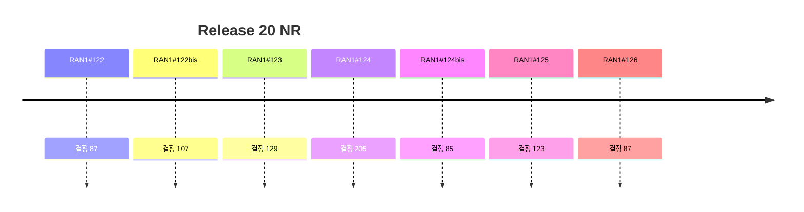

# 9 Release 20 NR

> 이 파일은 `scripts/generate_report.py`가 자동으로 생성합니다. 직접 수정하지 마세요.

공식 Agenda 기준으로 이 섹션의 결정을 모았습니다. 번호는 최신 회의 기준이며, 회의 간 연결은 같은 섹션 안의 같은 Agenda 제목으로 합니다.

## 회의별 결정 수

## 직전 회의 대비 (RAN1#125 → RAN1#126)

- 신규 결정 87건 (Agreement 82, Working Assumption 2, Conclusion 3)
- Agenda 신설: 없음
- Agenda 제외: Coverage enhancement, Semi-persistent scheduling for DL/UL data transmission for voice packets, Solutions for Ambient IoT (Internet of Things) in NR Phase 2

**Working Assumption 확정** (원문에 'Confirm ... working assumption' 문구가 있는 결정)

| Agenda | 내용 | 출처 |
|---|---|---|
| 9.2 NR MIMO Phase 6 | For CSI-RS frequency-domain density = 1/8, confirm the following working assumption made in RAN1#123: | [Chair notes RAN1#126_eom1](https://www.3gpp.org/ftp/tsg_ran/WG1_RL1/TSGR1_126/Inbox/Chair_notes/Chair%20notes%20RAN1%23126_eom1.docx) [R1-2606466](https://www.3gpp.org/ftp/tsg_ran/WG1_RL1/TSGR1_126/Docs/R1-2606466.zip) `[126-R20-MIMO]` |
| 9.3.3 Other procedures | Confirm the following working assumption with following update. \| Working assumption: RAN1#125 For one or multiple D2R resource set(s) provided by a periodic broadcast information A periodic broadcast information provides one or multiple “resource set configuration(s)” Each “resource set configuration” configures multiple resource sets that are periodic or a single resource set. At least the following configuration parameter can be different among the multiple “resource set configurations” Periodicity of resource set Time location of resource set Note: the content structure of the resource set configuration is same between the case of a single resource set and the case of multiple resource sets \| | [Chair notes RAN1#126_eom1](https://www.3gpp.org/ftp/tsg_ran/WG1_RL1/TSGR1_126/Inbox/Chair_notes/Chair%20notes%20RAN1%23126_eom1.docx) [R1-2606199](https://www.3gpp.org/ftp/tsg_ran/WG1_RL1/TSGR1_126/Docs/R1-2606199.zip) |

**FFS 후속 결정 후보** — RAN1#125 FFS와 키워드가 60% 이상 겹치는 같은 Agenda의 RAN1#126 결정입니다. 자동 매칭 후보이므로 FFS 해소 여부는 원문으로 확인하세요.

| Agenda | RAN1#125 FFS | RAN1#126 후보 결정 | 일치율 | 출처 |
|---|---|---|---|---|
| NR MIMO Phase 6 | FFS:  How to determine SRS resource set is spanned over two slots or confined within one slot | Regarding whether an SRS resource set spans two slots or is confined within one slot, - If the offset values of all the SRS resources within the SRS resource set are k' = 0,   - when all the SRS resources are entirely contained within the S slot, the SRS resource set is confined within one slot   - when at least one SRS resource crosses a slot boundary, the SRS resource set spans two slots. - If the SRS resources within the SRS resource set have different k' values (both 0 and 1), the SRS resource set spans two slots. - If the offset values of all the SRS resources within the SRS resource set are k' = 1, the SRS resource set is confined within one slot. | 75% | FFS: [Chair notes RAN1#125_eom](https://www.3gpp.org/ftp/tsg_ran/WG1_RL1/TSGR1_125/Inbox/Chair_notes/Chair%20notes%20RAN1%23125_eom.docx) [R1-2605073](https://www.3gpp.org/ftp/tsg_ran/WG1_RL1/TSGR1_125/Docs/R1-2605073.zip) `[125-R20-MIMO]` 후보: [Chair notes RAN1#126_eom1](https://www.3gpp.org/ftp/tsg_ran/WG1_RL1/TSGR1_126/Inbox/Chair_notes/Chair%20notes%20RAN1%23126_eom1.docx) [R1-2606467](https://www.3gpp.org/ftp/tsg_ran/WG1_RL1/TSGR1_126/Docs/R1-2606467.zip) `[126-R20-MIMO]` |
| R2D signals, channels, waveform and procedures | FFS: detail length of the time duration | For L1 R2D control information preceding periodic broadcast information (if supported), at least the following contents are included - TBS of subsequent periodic broadcast information payload - Transmission parameters for subsequent periodic broadcast information   - FEC, repetition and chip duration (M value)     - FFS: Whether separate or joint indication is needed - FFS: other contents, e.g.,   - [Presence of aperiodic CFO calibration signal after the data payload]   - [(part of) Physical layer Reader ID]   - [Message type]   - [Time duration of CFO calibration signal] - FFS: Content structure and payload size | 67% | FFS: [Chair notes RAN1#125_eom](https://www.3gpp.org/ftp/tsg_ran/WG1_RL1/TSGR1_125/Inbox/Chair_notes/Chair%20notes%20RAN1%23125_eom.docx) [R1-2603693](https://www.3gpp.org/ftp/tsg_ran/WG1_RL1/TSGR1_125/Docs/R1-2603693.zip) 후보: [Chair notes RAN1#126_eom1](https://www.3gpp.org/ftp/tsg_ran/WG1_RL1/TSGR1_126/Inbox/Chair_notes/Chair%20notes%20RAN1%23126_eom1.docx) [R1-2605362](https://www.3gpp.org/ftp/tsg_ran/WG1_RL1/TSGR1_126/Docs/R1-2605362.zip) |
| R2D signals, channels, waveform and procedures | FFS: whether the time duration includes time gap (if necessary) placed at the start and at the end | For the time duration of unmodulated sinusoid single tone CFO calibration signal transmission, at least 14 OFDM symbols duration including CP is selected - FFS other duration if necessary - Note: the time duration does not include time gap placed at the start and at the end if any | 88% | FFS: [Chair notes RAN1#125_eom](https://www.3gpp.org/ftp/tsg_ran/WG1_RL1/TSGR1_125/Inbox/Chair_notes/Chair%20notes%20RAN1%23125_eom.docx) [R1-2603693](https://www.3gpp.org/ftp/tsg_ran/WG1_RL1/TSGR1_125/Docs/R1-2603693.zip) 후보: [Chair notes RAN1#126_eom1](https://www.3gpp.org/ftp/tsg_ran/WG1_RL1/TSGR1_126/Inbox/Chair_notes/Chair%20notes%20RAN1%23126_eom1.docx) [R1-2605364](https://www.3gpp.org/ftp/tsg_ran/WG1_RL1/TSGR1_126/Docs/R1-2605364.zip) |
| R2D signals, channels, waveform and procedures | FFS: performance impact on non-periodic R2D transmission | From device perspective, RAN1 to further investigate the potential collision handling if any is needed at least for the following cases, and identify potential solutions if any is needed - Between periodic R2D reception and non-periodic D2R transmission - Between non-periodic R2D reception and periodic D2R transmission resource/occasion (e.g., for the first D2R transmission for DO-A) - Between periodic D2R transmission resource/occasion (e.g., for the first D2R transmission for DO-A) and non-periodic D2R transmission | 60% | FFS: [Chair notes RAN1#125_eom](https://www.3gpp.org/ftp/tsg_ran/WG1_RL1/TSGR1_125/Inbox/Chair_notes/Chair%20notes%20RAN1%23125_eom.docx) [R1-2603694](https://www.3gpp.org/ftp/tsg_ran/WG1_RL1/TSGR1_125/Docs/R1-2603694.zip) 후보: [Chair notes RAN1#126_eom1](https://www.3gpp.org/ftp/tsg_ran/WG1_RL1/TSGR1_126/Inbox/Chair_notes/Chair%20notes%20RAN1%23126_eom1.docx) [R1-2605365](https://www.3gpp.org/ftp/tsg_ran/WG1_RL1/TSGR1_126/Docs/R1-2605365.zip) |
| R2D signals, channels, waveform and procedures | FFS: performance impact on non-periodic R2D transmission | From device perspective, RAN1 to further investigate the potential collision handling if any is needed at least for the following cases, and identify potential solutions if any is needed - Between periodic R2D reception and non-periodic D2R transmission - Between non-periodic R2D reception and periodic D2R transmission resource/occasion (e.g., for the first D2R transmission for DO-A) - Between periodic D2R transmission resource/occasion (e.g., for the first D2R transmission for DO-A) and non-periodic D2R transmission | 60% | FFS: [Chair notes RAN1#125_eom](https://www.3gpp.org/ftp/tsg_ran/WG1_RL1/TSGR1_125/Inbox/Chair_notes/Chair%20notes%20RAN1%23125_eom.docx) [R1-2603694](https://www.3gpp.org/ftp/tsg_ran/WG1_RL1/TSGR1_125/Docs/R1-2603694.zip) 후보: [Chair notes RAN1#126_eom1](https://www.3gpp.org/ftp/tsg_ran/WG1_RL1/TSGR1_126/Inbox/Chair_notes/Chair%20notes%20RAN1%23126_eom1.docx) [R1-2605365](https://www.3gpp.org/ftp/tsg_ran/WG1_RL1/TSGR1_126/Docs/R1-2605365.zip) |
| D2R signals, channels, waveform and procedures | FFS: DO-A scheduling request | Regarding the applicability of PDRCH scrambling, the agreement is updated as follows: \| Agreement: PDRCH scrambling is applied to all PDRCH transmissions FFS: DO-A scheduling request \| | 100% | FFS: [Chair notes RAN1#125_eom](https://www.3gpp.org/ftp/tsg_ran/WG1_RL1/TSGR1_125/Inbox/Chair_notes/Chair%20notes%20RAN1%23125_eom.docx) [R1-2604162](https://www.3gpp.org/ftp/tsg_ran/WG1_RL1/TSGR1_125/Docs/R1-2604162.zip) 후보: [Chair notes RAN1#126_eom1](https://www.3gpp.org/ftp/tsg_ran/WG1_RL1/TSGR1_126/Inbox/Chair_notes/Chair%20notes%20RAN1%23126_eom1.docx) [R1-2605813](https://www.3gpp.org/ftp/tsg_ran/WG1_RL1/TSGR1_126/Docs/R1-2605813.zip) |
| D2R signals, channels, waveform and procedures | FFS: the details of Device ID-related information | For PDRCH scrambling sequence initialization, Device ID-related information is used for cinit calculation except for Msg1 in CBRA and first D2R transmission for DO-A. - For Msg1 in CBRA and first D2R transmission for DO-A, the device uses 0 as the device ID-related information input. | 100% | FFS: [Chair notes RAN1#125_eom](https://www.3gpp.org/ftp/tsg_ran/WG1_RL1/TSGR1_125/Inbox/Chair_notes/Chair%20notes%20RAN1%23125_eom.docx) [R1-2604163](https://www.3gpp.org/ftp/tsg_ran/WG1_RL1/TSGR1_125/Docs/R1-2604163.zip) 후보: [Chair notes RAN1#126_eom1](https://www.3gpp.org/ftp/tsg_ran/WG1_RL1/TSGR1_126/Inbox/Chair_notes/Chair%20notes%20RAN1%23126_eom1.docx) [R1-2605812](https://www.3gpp.org/ftp/tsg_ran/WG1_RL1/TSGR1_126/Docs/R1-2605812.zip) |
| D2R signals, channels, waveform and procedures | FFS: whether additional specification support (e.g., with limiting number of sequences) is needed to reduce the device complexity | For the initial offset Nc of the scrambling sequence generator, update the agreement as follows. \| Agreement: (RAN1#125) For the initial offset Nc of the scrambling sequence generator, Nc = 1600 as in NR FFS: whether additional specification support (e.g., with limiting number of sequences) is needed to reduce the device complexity \| | 100% | FFS: [Chair notes RAN1#125_eom](https://www.3gpp.org/ftp/tsg_ran/WG1_RL1/TSGR1_125/Inbox/Chair_notes/Chair%20notes%20RAN1%23125_eom.docx) [R1-2605125](https://www.3gpp.org/ftp/tsg_ran/WG1_RL1/TSGR1_125/Docs/R1-2605125.zip) 후보: [Chair notes RAN1#126_eom1](https://www.3gpp.org/ftp/tsg_ran/WG1_RL1/TSGR1_126/Inbox/Chair_notes/Chair%20notes%20RAN1%23126_eom1.docx) [R1-2605813](https://www.3gpp.org/ftp/tsg_ran/WG1_RL1/TSGR1_126/Docs/R1-2605813.zip) |
| Other procedures | FFS: whether power ramping is needed and for Msg1 and first D2R transmission for DO-A | Regarding Option 1 for D2R open-loop power control, fractional path-loss compensation parameter α is fixed to 1 at least for the first D2R transmission for DO-A. - FFS for the Msg1 transmission not for the first D2R transmission for DO-A | 86% | FFS: [Chair notes RAN1#125_eom](https://www.3gpp.org/ftp/tsg_ran/WG1_RL1/TSGR1_125/Inbox/Chair_notes/Chair%20notes%20RAN1%23125_eom.docx) [R1-2603966](https://www.3gpp.org/ftp/tsg_ran/WG1_RL1/TSGR1_125/Docs/R1-2603966.zip) 후보: [Chair notes RAN1#126_eom1](https://www.3gpp.org/ftp/tsg_ran/WG1_RL1/TSGR1_126/Inbox/Chair_notes/Chair%20notes%20RAN1%23126_eom1.docx) [R1-2606200](https://www.3gpp.org/ftp/tsg_ran/WG1_RL1/TSGR1_126/Docs/R1-2606200.zip) |
| Other procedures | FFS:  fixed to 1 for Msg1 and first D2R transmission for DO-A | Regarding Option 1 for D2R open-loop power control, fractional path-loss compensation parameter α is fixed to 1 at least for the first D2R transmission for DO-A. - FFS for the Msg1 transmission not for the first D2R transmission for DO-A | 100% | FFS: [Chair notes RAN1#125_eom](https://www.3gpp.org/ftp/tsg_ran/WG1_RL1/TSGR1_125/Inbox/Chair_notes/Chair%20notes%20RAN1%23125_eom.docx) [R1-2603966](https://www.3gpp.org/ftp/tsg_ran/WG1_RL1/TSGR1_125/Docs/R1-2603966.zip) 후보: [Chair notes RAN1#126_eom1](https://www.3gpp.org/ftp/tsg_ran/WG1_RL1/TSGR1_126/Inbox/Chair_notes/Chair%20notes%20RAN1%23126_eom1.docx) [R1-2606200](https://www.3gpp.org/ftp/tsg_ran/WG1_RL1/TSGR1_126/Docs/R1-2606200.zip) |
| Other procedures | FFS  range(s) and corresponding  threshold(s) and D2R transmission power value(s). | RSRP threshold(s) to determine RSRP range(s) to be used by device at least for the first D2R transmission for DO-A is/are provided by the remaining part of the periodic broadcast information - Up to 2 RSRP thresholds (corresponding to up to 3 RSRP ranges) can be configured. - FFS configuration details | 83% | FFS: [Chair notes RAN1#125_eom](https://www.3gpp.org/ftp/tsg_ran/WG1_RL1/TSGR1_125/Inbox/Chair_notes/Chair%20notes%20RAN1%23125_eom.docx) [R1-2603966](https://www.3gpp.org/ftp/tsg_ran/WG1_RL1/TSGR1_125/Docs/R1-2603966.zip) 후보: [Chair notes RAN1#126_eom1](https://www.3gpp.org/ftp/tsg_ran/WG1_RL1/TSGR1_126/Inbox/Chair_notes/Chair%20notes%20RAN1%23126_eom1.docx) [R1-2606199](https://www.3gpp.org/ftp/tsg_ran/WG1_RL1/TSGR1_126/Docs/R1-2606199.zip) |
| Other procedures | FFS D2R midamble/PDRCH is used for D2R RSRP-like measurement for device localization. | It is up to reader implementation to additionally use D2R midamble and/or PDRCH for D2R RSRP-like measurement for device localization. | 100% | FFS: [Chair notes RAN1#125_eom](https://www.3gpp.org/ftp/tsg_ran/WG1_RL1/TSGR1_125/Inbox/Chair_notes/Chair%20notes%20RAN1%23125_eom.docx) [R1-2603966](https://www.3gpp.org/ftp/tsg_ran/WG1_RL1/TSGR1_125/Docs/R1-2603966.zip) 후보: [Chair notes RAN1#126_eom1](https://www.3gpp.org/ftp/tsg_ran/WG1_RL1/TSGR1_126/Inbox/Chair_notes/Chair%20notes%20RAN1%23126_eom1.docx) [R1-2606201](https://www.3gpp.org/ftp/tsg_ran/WG1_RL1/TSGR1_126/Docs/R1-2606201.zip) |
| Other procedures | FFS details e.g., the D2R transmission power in a quantized value. | Regarding Option 1 for D2R open-loop power control, fractional path-loss compensation parameter α is fixed to 1 at least for the first D2R transmission for DO-A. - FFS for the Msg1 transmission not for the first D2R transmission for DO-A | 75% | FFS: [Chair notes RAN1#125_eom](https://www.3gpp.org/ftp/tsg_ran/WG1_RL1/TSGR1_125/Inbox/Chair_notes/Chair%20notes%20RAN1%23125_eom.docx) [R1-2603966](https://www.3gpp.org/ftp/tsg_ran/WG1_RL1/TSGR1_125/Docs/R1-2603966.zip) 후보: [Chair notes RAN1#126_eom1](https://www.3gpp.org/ftp/tsg_ran/WG1_RL1/TSGR1_126/Inbox/Chair_notes/Chair%20notes%20RAN1%23126_eom1.docx) [R1-2606200](https://www.3gpp.org/ftp/tsg_ran/WG1_RL1/TSGR1_126/Docs/R1-2606200.zip) |
| Other procedures | FFS: whether the modification periodicity can be same as or an integer multiple of broadcast periodicity. | From RAN1 perspective, support to introduce the modification periodicity of the remaining part of periodic broadcast information. - The modification periodicity is configured by periodic broadcast information and can be [same as or] an integer multiple (>1) of periodicity of the remaining part of periodic broadcast information. - FFS values of the modification periodicity from RAN1 perspective - Note: RAN2 can decide value range and exact values taking RAN1 agreements into account | 100% | FFS: [Chair notes RAN1#125_eom](https://www.3gpp.org/ftp/tsg_ran/WG1_RL1/TSGR1_125/Inbox/Chair_notes/Chair%20notes%20RAN1%23125_eom.docx) [R1-2603967](https://www.3gpp.org/ftp/tsg_ran/WG1_RL1/TSGR1_125/Docs/R1-2603967.zip) 후보: [Chair notes RAN1#126_eom1](https://www.3gpp.org/ftp/tsg_ran/WG1_RL1/TSGR1_126/Inbox/Chair_notes/Chair%20notes%20RAN1%23126_eom1.docx) [R1-2606199](https://www.3gpp.org/ftp/tsg_ran/WG1_RL1/TSGR1_126/Docs/R1-2606199.zip) |

## 9 Release 20 NR

회의별 결정 수 (하위 Agenda 포함): #122 19 · #122bis 7 · #123 76 · #124 136 · #124bis 70 · #125 92 · #126 87

### 9.1 Artificial Intelligence (AI)/Machine Learning (ML) for NR air interface enhancements

회의별 결정 수 (하위 Agenda 포함): #122 15 · #122bis 3 · #123 2 · #124 12 · #124bis 8 · #125 9 · #126 8

#### 9.1.1 CSI spatial/frequency compression without temporal aspects (“Case 0”)

회의별 결정 수 (하위 Agenda 포함): #122 10 · #122bis 0 · #123 0 · #124 7 · #124bis 5 · #125 4 · #126 4

번호 변경: #122: 10.1.1 → #124: 9.1.1

| 회의 | 번호 | 구분 | 내용 | 출처 |
|---|---|---|---|---|
| RAN1#122 | 10.1.1 | Agreement | For CSI feedback via two-sided model, support at least precoding matrix as target CSI type. - FFS whether consider raw channel matrix as further improvement, starting with evaluations, e.g. potential fusion with SRS measurement (SRS period/hopping, DL/UL reciprocity), frequency granularity of channel matrix, number of Rx antennas, etc. | [Chair notes RAN1#122 eom](https://www.3gpp.org/ftp/tsg_ran/WG1_RL1/TSGR1_122/Inbox/Chair_notes/Chair%20notes%20RAN1%23122%20eom.zip) [R1-2506496](https://www.3gpp.org/ftp/tsg_ran/WG1_RL1/TSGR1_122/Docs/R1-2506496.zip) |
| RAN1#122 | 10.1.1 | Agreement | Specify the precoding matrix feedback via two-sided model as follows: For a certain layer  and rank , - A precoding matrix is mapped with a latent message , with l = 1, ..., v where l is the layer index.   - The mapping is subject to [at least] a pairing ID configured by high-layer signalling.   - FFS  is common or specific for different layers or ranks   - Note: the terminology “latent message” is used for discussion purposes, the detailed name can be discussed further - is quantized and mapped to bit sequence before reporting. | [Chair notes RAN1#122 eom](https://www.3gpp.org/ftp/tsg_ran/WG1_RL1/TSGR1_122/Inbox/Chair_notes/Chair%20notes%20RAN1%23122%20eom.zip) [R1-2506496](https://www.3gpp.org/ftp/tsg_ran/WG1_RL1/TSGR1_122/Docs/R1-2506496.zip) |
| RAN1#122 | 10.1.1 | Agreement | For precoding matrix feedback, for a certain layer  of rank , the latent message  contains  real values - If scalar quantization (SQ) supported, it refers to the quantization of each real value independently,   - The payload size for layer  and rank  is determined by , where  is the number of bits per scalar. - If vector quantization (VQ) is supported, it refers to the quantization of a segment of L (L>1) consecutive real values jointly, and the segment(s) are separately quantized.   - The payload size for layer  and rank  is determined by , where  is the length of the vector segment,   is the number of bits per segment   - Note: Combining two real-values as a complex value and performing amplitude-phase quantization is precluded. | [Chair notes RAN1#122 eom](https://www.3gpp.org/ftp/tsg_ran/WG1_RL1/TSGR1_122/Inbox/Chair_notes/Chair%20notes%20RAN1%23122%20eom.zip) [R1-2506497](https://www.3gpp.org/ftp/tsg_ran/WG1_RL1/TSGR1_122/Docs/R1-2506497.zip) |
| RAN1#122 | 10.1.1 | Agreement | For precoding matrix feedback, consider the following aspects for payload determination - Support only SQ, or only VQ or both - and / or  and / or  are fixed values or determined from multiple values based on NW configuration or UE reporting. - and / or  is layer-common or layer-specific, rank-common or rank-specific. - If configured, and / or  and / or  above are configured separately from pairing ID, or configured by Pairing ID.   - The configuration may be via other parameters which are used to derive , L and . Note: Consider limiting the total number of possible payload sizes considering the inter-vendor training challenges. Note: ,  and  are independent on subband and port configurations, - FFS each combination of ,  and is applicable to a certain set of subband and port configurations | [Chair notes RAN1#122 eom](https://www.3gpp.org/ftp/tsg_ran/WG1_RL1/TSGR1_122/Inbox/Chair_notes/Chair%20notes%20RAN1%23122%20eom.zip) [R1-2506497](https://www.3gpp.org/ftp/tsg_ran/WG1_RL1/TSGR1_122/Docs/R1-2506497.zip) |
| RAN1#122 | 10.1.1 | Agreement | For inference report configuration, support separate configuration of subband, Tx port and payload size from pairing ID. | [Chair notes RAN1#122 eom](https://www.3gpp.org/ftp/tsg_ran/WG1_RL1/TSGR1_122/Inbox/Chair_notes/Chair%20notes%20RAN1%23122%20eom.zip) [R1-2506498](https://www.3gpp.org/ftp/tsg_ran/WG1_RL1/TSGR1_122/Docs/R1-2506498.zip) |
| RAN1#122 | 10.1.1 | Agreement | For quantization codebook used for quantizing the feedback, - For inter-vendor collaboration Direction A, select one of the following:   - Alt1: Exchange quantization codebook from NW-side to UE-side along with each exchanged dataset or model parameters   - Alt2: Use a standardized quantization codebook decided by RAN1. Including NW and UE data collection for training, performance monitoring, as well as model pairing related issues. | [Chair notes RAN1#122 eom](https://www.3gpp.org/ftp/tsg_ran/WG1_RL1/TSGR1_122/Inbox/Chair_notes/Chair%20notes%20RAN1%23122%20eom.zip) [R1-2506498](https://www.3gpp.org/ftp/tsg_ran/WG1_RL1/TSGR1_122/Docs/R1-2506498.zip) |
| RAN1#122 | 10.1.1 | Agreement | For model pairing procedure for inference, consider the applicability report procedure of Rel-19 AI/ML beam management for UE side model as a starting point. - Pairing ID(s) (i.e., ID for pairing related discussion) is indicated (e.g., in CSI-reportConfig) in Step 3.   - FFS whether/how to link the Pairing ID with the inter-vendor collaboration   - FFS whether/how Paring ID(s) are reported in Step 4 - FFS whether to support both Option A (CSI-ReportConfig for inference configuration) and Option B (sets of inference related parameters for applicability report only).   - FFS CSI compression specific inference configuration or inference related parameters. | [Chair notes RAN1#122 eom](https://www.3gpp.org/ftp/tsg_ran/WG1_RL1/TSGR1_122/Inbox/Chair_notes/Chair%20notes%20RAN1%23122%20eom.zip) [R1-2506482](https://www.3gpp.org/ftp/tsg_ran/WG1_RL1/TSGR1_122/Docs/R1-2506482.zip) |
| RAN1#122 | 10.1.1 | Agreement | For NW side data collection of CSI compression, discuss the content and format of the collected data by assuming higher layer based signalling. - Details on signaling is up to RAN2. | [Chair notes RAN1#122 eom](https://www.3gpp.org/ftp/tsg_ran/WG1_RL1/TSGR1_122/Inbox/Chair_notes/Chair%20notes%20RAN1%23122%20eom.zip) [R1-2506482](https://www.3gpp.org/ftp/tsg_ran/WG1_RL1/TSGR1_122/Docs/R1-2506482.zip) |
| RAN1#122 | 10.1.1 | Agreement | To enable UE side data collection, CSI-ReportConfig can be used for configuring the resources for data collection purpose without CSI report - P-CSI-RS and /SP CSI-RS are supported | [Chair notes RAN1#122 eom](https://www.3gpp.org/ftp/tsg_ran/WG1_RL1/TSGR1_122/Inbox/Chair_notes/Chair%20notes%20RAN1%23122%20eom.zip) [R1-2506482](https://www.3gpp.org/ftp/tsg_ran/WG1_RL1/TSGR1_122/Docs/R1-2506482.zip) |
| RAN1#122 | 10.1.1 | Agreement | For NW side data collection, study the solution for quantizing Target CSI, from the aspects of overhead, quantization loss/performance, and complexity. E.g.,: - Option 0: Reusing legacy e-Type II codebook - Option 1: Scalar quantization to the Target CSI. FFS number of bits for real/imaginary, whether coefficients for quantization are obtained from transformation of Target CSI. - Option 2: Enhanced methods to reduce the SVD/EVD decomposition complexity, reduce frequency/spatial/beam domain basis searching, with potentially relaxed overhead, e.g., Type II like codebook with scalar quantized W2 similar to Option 1 scalar quantization. - Option 3: Enhanced method for improved overhead saving, e.g., reporting the dominant eigenvalues/eigenvectors of per layer precoding matrix. - Option 4: eType II like codebook with new parameter values (e.g. larger L, pv, beta, amplitude, phase) - Note: the quantizaton format should consider the maximum payload size per reporting (e.g., 9KBytes) of the current higher layer signaling. - Note: At least take precoding matrix as Target CSI type. FFS channel matrix. - FFS: EVM, metric, benchmark (e.g., FP32, eT2 with PC6/8), by reusing R18 study EVM as baseline. | [Chair notes RAN1#122 eom](https://www.3gpp.org/ftp/tsg_ran/WG1_RL1/TSGR1_122/Inbox/Chair_notes/Chair%20notes%20RAN1%23122%20eom.zip) [R1-2506485](https://www.3gpp.org/ftp/tsg_ran/WG1_RL1/TSGR1_122/Docs/R1-2506485.zip) |
| RAN1#124 | 9.1.1 | Agreement | For precoding matrix feedback via two-sided model, support following payload combination for the payload of 384 bits of rank 1. The layers are reported in the order of decreasing strength. \| Rank1 \| Rank2 \| Rank3 \| Rank4 \| \| {192, 2} \| {192, 2}, {192, 2} \| {96, 2}, {96, 2}, {192, 2} \| {96, 2}, {96, 2}, {96, 2}, {96, 2} \| | [Chair notes RAN1#124 - eom_03](https://www.3gpp.org/ftp/tsg_ran/WG1_RL1/TSGR1_124/Inbox/Chair_notes/Chair%20notes%20RAN1%23124%20-%20eom_03.docx) |
| RAN1#124 | 9.1.1 | Agreement | For precoding matrix feedback via two-sided model, support following payload combination for the payload of 32/64 bits of rank 1. The layers are reported in the order of decreasing strength. \| Rank1 \| Rank2 \| Rank3 \| Rank4 \| \| {32, 1} \| {32, 1}, {32, 1} \| N/A \| N/A \| \| {32, 2} \| {32, 2}, {32, 2} \| {32, 1}, {32, 1}, {32, 2} \| {32, 1}, {32, 1}, {32, 1}, {32, 1} \| Note: UE should report whether or not the UE supports parameter combination or per-layer payload pair {32,1} or Q=1.  Details of the reporting method is to be discussed in corresponding UE feature discussion. | [Chair notes RAN1#124 - eom_03](https://www.3gpp.org/ftp/tsg_ran/WG1_RL1/TSGR1_124/Inbox/Chair_notes/Chair%20notes%20RAN1%23124%20-%20eom_03.docx) |
| RAN1#124 | 9.1.1 | Agreement | Down-select up to two options from the following options for target CSI format for NW side data collection at RAN1#124bis. - Option 1a-33: real / imaginary part quantization via 3-bit, i.e., k1=k2=3 - Option 1a-55: real / imaginary part quantization via 5-bit, i.e., k1=k2=5 - Option 1b-34: amplitude quantization via 3-bit, phase quantization via 4-bit, k1=3, k2=4 - Option 1b-46: amplitude quantization via 4-bit, phase quantization via 6-bit, k1=4, k2=6 Note1: SGCS metric 1 is used as the metric, i.e., SGCS between target CSI FL32 and reconstructed CSI inferred by model trained using target CSI of the respective format. Note2: Companies should try to optimize the normalization methods to minimize the quantization error, e.g., for each target CSI sample on a subband and a layer, normalized according to the amplitude of the strongest coefficients or real/imaginary part (Alt2-1). Note3: If two options are selected  they should belong to the same category (i.e. 1a or 1b). | [Chair notes RAN1#124 - eom_03](https://www.3gpp.org/ftp/tsg_ran/WG1_RL1/TSGR1_124/Inbox/Chair_notes/Chair%20notes%20RAN1%23124%20-%20eom_03.docx) [R1-2601253](https://www.3gpp.org/ftp/tsg_ran/WG1_RL1/TSGR1_124/Docs/R1-2601253.zip) |
| RAN1#124 | 9.1.1 | Agreement | Support layer-based UCI mapping and omission. - FFS the details of layer-grouping to facilitate CSI mapping and omission. - Note: Partial omission of layers is not supported. | [Chair notes RAN1#124 - eom_03](https://www.3gpp.org/ftp/tsg_ran/WG1_RL1/TSGR1_124/Inbox/Chair_notes/Chair%20notes%20RAN1%23124%20-%20eom_03.docx) [R1-2601253](https://www.3gpp.org/ftp/tsg_ran/WG1_RL1/TSGR1_124/Docs/R1-2601253.zip) |
| RAN1#124 | 9.1.1 | Agreement | For the evaluation of the target CSI format options for NW side data collection, consider following quantization values: - For real / image part quantization of option 1a, consider - CB1:  for , j=1, 2   - Companies are encouraged to apply different scaling factor for CB1. - For amplitude / phase quantization of option 1b, consider - Amplitude: Reuse e-Type II quantization tables. Replace the value of reserved codepoints to (1/2)15/4. - Phase: uniform distribution, , for | [Chair notes RAN1#124 - eom_03](https://www.3gpp.org/ftp/tsg_ran/WG1_RL1/TSGR1_124/Inbox/Chair_notes/Chair%20notes%20RAN1%23124%20-%20eom_03.docx) [R1-2601254](https://www.3gpp.org/ftp/tsg_ran/WG1_RL1/TSGR1_124/Docs/R1-2601254.zip) |
| RAN1#124 | 9.1.1 | Conclusion | There is no consensus on determining the actual payload size of the inference report based on UE indications other than RI. | [Chair notes RAN1#124 - eom_03](https://www.3gpp.org/ftp/tsg_ran/WG1_RL1/TSGR1_124/Inbox/Chair_notes/Chair%20notes%20RAN1%23124%20-%20eom_03.docx) [R1-2601254](https://www.3gpp.org/ftp/tsg_ran/WG1_RL1/TSGR1_124/Docs/R1-2601254.zip) |
| RAN1#124 | 9.1.1 | Conclusion | Configuration of pairing ID in the CSI report for inference is sufficient to distinguish the CSI feedback with two-sided model with other legacy CSI reports. | [Chair notes RAN1#124 - eom_03](https://www.3gpp.org/ftp/tsg_ran/WG1_RL1/TSGR1_124/Inbox/Chair_notes/Chair%20notes%20RAN1%23124%20-%20eom_03.docx) [R1-2601254](https://www.3gpp.org/ftp/tsg_ran/WG1_RL1/TSGR1_124/Docs/R1-2601254.zip) |
| RAN1#124bis | 9.1.1 | Agreement | For the standardized SQ codebook when NW does not exchange a codebook, support [1/8, 3/8, 5/8, 7/8] for Q=2 and [1/4, 3/4] for Q=1. | [Chair notes RAN1#124bis_eom5](https://www.3gpp.org/ftp/tsg_ran/WG1_RL1/TSGR1_124b/Inbox/Chair_notes/Chair%20notes%20RAN1%23124bis_eom5.docx) |
| RAN1#124bis | 9.1.1 | Agreement | For precoding matrix feedback via two-sided model, support upto 128 ports, upto rank 4 and upto 19 subbands. | [Chair notes RAN1#124bis_eom5](https://www.3gpp.org/ftp/tsg_ran/WG1_RL1/TSGR1_124b/Inbox/Chair_notes/Chair%20notes%20RAN1%23124bis_eom5.docx) |
| RAN1#124bis | 9.1.1 | Agreement | Support two-part UCI for CSI feedback via two-sided model, where - UCI part 1 contains CQI, RI and CRI - UCI part 2 contains the PMI (i.e., CSI feedback of all layers). - Layer 1 to  are mapped to Group 1, Layer  to layer  are mapped to Group 2 - Note: The bits sequence is mapped based on their indices inside each layer, followed by the bit sequence of the next layer. The layers are ordered from the strongest to the weakest. | [Chair notes RAN1#124bis_eom5](https://www.3gpp.org/ftp/tsg_ran/WG1_RL1/TSGR1_124b/Inbox/Chair_notes/Chair%20notes%20RAN1%23124bis_eom5.docx) |
| RAN1#124bis | 9.1.1 | Agreement | For NW side data collection, support target CSI quantization - Down-selection between 1a (real-imaginary) and 1b (amplitude-phase), i.e., {1a-33, 1b-34}. | [Chair notes RAN1#124bis_eom5](https://www.3gpp.org/ftp/tsg_ran/WG1_RL1/TSGR1_124b/Inbox/Chair_notes/Chair%20notes%20RAN1%23124bis_eom5.docx) |
| RAN1#124bis | 9.1.1 | Agreement | For performance monitoring: - Support using paired CSI feedback and target CSI samples for performance monitoring, and further investigate the feasibility of following options and downselect one,   - Option 1: Support using L3 signaling framework to collect target CSI samples.     - Companies to report details about how to associate target CSI sample with CSI feedback sample.   - Option 2: Support using L1 signalling, considering   - UE assisted monitoring   - CSI reporting via L1 signaling with legacy PMI codebook   - CSI reporting using L1 signaling with high resolution quantization of partial target CSI | [Chair notes RAN1#124bis_eom5](https://www.3gpp.org/ftp/tsg_ran/WG1_RL1/TSGR1_124b/Inbox/Chair_notes/Chair%20notes%20RAN1%23124bis_eom5.docx) |
| RAN1#125 | 9.1.1 | Agreement | For quantization of target CSI for NW side data collection, support amplitude and phase quantization with 3-bit for amplitude and 4-bit for phase for each complex number of the target CSI. - Reuse eType II amplitude quantization table. - Reuse eType II phase quantization table - Support normalization Alt2-1: - At least one element among the elements in the per-layer and per-subband target precoding matrix correspond to the strongest value in the amplitude quantization levels. | [Chair notes RAN1#125_eom](https://www.3gpp.org/ftp/tsg_ran/WG1_RL1/TSGR1_125/Inbox/Chair_notes/Chair%20notes%20RAN1%23125_eom.docx) [R1-2604677](https://www.3gpp.org/ftp/tsg_ran/WG1_RL1/TSGR1_125/Docs/R1-2604677.zip) |
| RAN1#125 | 9.1.1 | Agreement | Decide the necessity of target CSI restriction in RAN1 #126 considering the following cases: - Case A: No restriction on target CSI , NW further filter out the unwanted beams on the reconstructed CSI  such that , where  and - Case B: Target CSI restriction is applied on  unwanted beams such that , NW further filter out the unwanted beams on the reconstructed CSI  such that , where  and Metric: Investigate the resultant spectral efficiency or throughput of the two cases. Note1: Models in both cases are trained without considering target CSI restriction as baseline. Companies to report if target CSI restriction is assumed in training for Case B. Note2: Consider  as baseline (other values are not precluded) and different unwanted beams can be assumed for different samples (upto companies to report how to determine the unwanted beams for each sample) Note3: non-oversampling beams are considered. Note4: Companies to report UE side complexity analysis for both cases. | [Chair notes RAN1#125_eom](https://www.3gpp.org/ftp/tsg_ran/WG1_RL1/TSGR1_125/Inbox/Chair_notes/Chair%20notes%20RAN1%23125_eom.docx) [R1-2604677](https://www.3gpp.org/ftp/tsg_ran/WG1_RL1/TSGR1_125/Docs/R1-2604677.zip) |
| RAN1#125 | 9.1.1 | Agreement | In NW data collection, UE reports target CSI according to the configured rank by the NW. - FFS whether when the rank observed by UE is different from the configured rank, UE can report its suggested rank per reported target CSI sample - FFS whether define data logging event - FFS whether UE report data quality indicator and its type - Note: Companies are encouraged to justify the usefulness of the above suggested rank, data logging event or data quality indicator via evaluations. | [Chair notes RAN1#125_eom](https://www.3gpp.org/ftp/tsg_ran/WG1_RL1/TSGR1_125/Inbox/Chair_notes/Chair%20notes%20RAN1%23125_eom.docx) [R1-2604678](https://www.3gpp.org/ftp/tsg_ran/WG1_RL1/TSGR1_125/Docs/R1-2604678.zip) |
| RAN1#125 | 9.1.1 | Agreement | Support following configuration for candidate UE data collection - Pairing ID   - FFS:  whether it is optional or mandatory - Resources for channel and interference measurement   - Optional parameter - Port configuration including n1-n2 and port mapping method (for > 32 ports)   - If <=32 ports, configure N1-N2 from table 5.2.2.2.1-2 of TS38.214   - If > 32 ports, configure N1-N2 from table 5.2.2.2.5a-1 of TS38.214, and configure port mapping method   - Optional parameter - Subband configuration (i.e., csi-ReportingBand)   - Optional parameter | [Chair notes RAN1#125_eom](https://www.3gpp.org/ftp/tsg_ran/WG1_RL1/TSGR1_125/Inbox/Chair_notes/Chair%20notes%20RAN1%23125_eom.docx) [R1-2604679](https://www.3gpp.org/ftp/tsg_ran/WG1_RL1/TSGR1_125/Docs/R1-2604679.zip) |
| RAN1#126 | 9.1.1 | Agreement | Send LS to RAN2 to study, and if deemed feasible, specify L3 signaling for performance monitoring, including the following aspects - Reporting of pair-wise of target CSI sample and the corresponding CSI feedback sample of the corresponding inference report - Full and partial target CSI reporting is allowed, where partial target CSI = subset of subbands / layers of the CSI feedback of the inference report) - Same set of layers are considered for target CSI sample and CSI feedback sample. - Mechanism to collect multiple samples - Sample is a pair of target CSI and CSI feedback sample - Linking to corresponding inference configuration (detailed solution upto RAN2) | [Chair notes RAN1#126_eom1](https://www.3gpp.org/ftp/tsg_ran/WG1_RL1/TSGR1_126/Inbox/Chair_notes/Chair%20notes%20RAN1%23126_eom1.docx) [R1-2606361](https://www.3gpp.org/ftp/tsg_ran/WG1_RL1/TSGR1_126/Docs/R1-2606361.zip) |
| RAN1#126 | 9.1.1 | Agreement | Support L1 signaling for performance monitoring, down-selection from the following alternatives: - Alt1: NW side monitoring via legacy eType II format with potential spec impact - Alt2: NW side monitoring via partial / full target CSI reporting via same format as NW data collection - Alt3: UE assisted monitoring via SGCS / monitoring output reporting - Alt 4: NW side monitoring via legacy eType II without spec impact - Note: From RAN1 point of view, monitoring based on L3 signalling and L1 signalling are independently considered. | [Chair notes RAN1#126_eom1](https://www.3gpp.org/ftp/tsg_ran/WG1_RL1/TSGR1_126/Inbox/Chair_notes/Chair%20notes%20RAN1%23126_eom1.docx) [R1-2606361](https://www.3gpp.org/ftp/tsg_ran/WG1_RL1/TSGR1_126/Docs/R1-2606361.zip) |
| RAN1#126 | 9.1.1 | Agreement | The following text for Draft LS in R1-2606881 is endorsed. Regarding performance monitoring, RAN1 has the following agreement on using L3 signaling to collect pair-wise of target CSI sample and CSI feedback sample. \| Agreement: Send LS to RAN2 to study, and if deemed feasible, specify L3 signaling for performance monitoring, including the following aspects Reporting of pair-wise of target CSI sample and the corresponding CSI feedback sample of the corresponding inference report Full and partial target CSI reporting is allowed, where partial target CSI = subset of subbands / layers of the CSI feedback of the inference report) Same set of layers are considered for target CSI sample and CSI feedback sample. Mechanism to collect multiple samples Sample is a pair of target CSI and CSI feedback sample Linking to corresponding inference configuration (detailed solution upto RAN2) \| RAN1 asks RAN2 if they would be so kind as to consider the agreement above in their future work. The corresponding final LS in R1-2606893 is endorsed. | [Chair notes RAN1#126_eom1](https://www.3gpp.org/ftp/tsg_ran/WG1_RL1/TSGR1_126/Inbox/Chair_notes/Chair%20notes%20RAN1%23126_eom1.docx) [R1-2606362](https://www.3gpp.org/ftp/tsg_ran/WG1_RL1/TSGR1_126/Docs/R1-2606362.zip) |
| RAN1#126 | 9.1.1 | Agreement | Support following configuration for inference configuration - Pairing ID - Subband configuration (reuse csi-ReportingBand) - Resources for channel and interference measurement (reuse legacy configuration) - portMappingMethod (reuse legacy configuraiton) - codebookConfig-r20 - Payload parameter combination configuration - N1, N2 configuration - Rank restriction (reuse legacy) - FFS: reportQuantity | [Chair notes RAN1#126_eom1](https://www.3gpp.org/ftp/tsg_ran/WG1_RL1/TSGR1_126/Inbox/Chair_notes/Chair%20notes%20RAN1%23126_eom1.docx) [R1-2606362](https://www.3gpp.org/ftp/tsg_ran/WG1_RL1/TSGR1_126/Docs/R1-2606362.zip) |

#### 9.1.2 Inter-vendor training collaboration for two-sided AI/ML models

회의별 결정 수 (하위 Agenda 포함): #122 5 · #122bis 3 · #123 2 · #124 5 · #124bis 3 · #125 5 · #126 4

번호 변경: #122: 10.1.2 → #124: 9.1.2

| 회의 | 번호 | 구분 | 내용 | 출처 |
|---|---|---|---|---|
| RAN1#122 | 10.1.2 | Agreement | For Option 4-1 under Direction A in AI/ML based CSI compression, support at least target CSI and CSI feedback in the exchanged dataset(s). - FFS: Target CSI type and format - FFS: CSI feedback type and format - FFS: Association between Target CSI and CSI feedback, including mapping for different number of Tx port, number of sub bands, and CSI payload size. | [Chair notes RAN1#122 eom](https://www.3gpp.org/ftp/tsg_ran/WG1_RL1/TSGR1_122/Inbox/Chair_notes/Chair%20notes%20RAN1%23122%20eom.zip) [R1-2506468](https://www.3gpp.org/ftp/tsg_ran/WG1_RL1/TSGR1_122/Docs/R1-2506468.zip) |
| RAN1#122 | 10.1.2 | Agreement | For Option 4-1 under Direction A in AI/ML based CSI compression, consider  the following methods for performance target in the exchanged dataset, - SGCS   - FFS: Average SGCS   - FFS: SGCS values at X-percentiles - NMSE:   - FFS: When the exchanged CSI feedback is the floating-point values at the input of quantization   - FFS: When the exchanged CSI feedback is the binary bit sequence at the output of quantization, the binary sequence will be mapped back to the floating-point values via quantization codebook - FFS: Multiple performance targets for different layer when the target CSI type is precoding matrix, different configurations such as antenna ports, subband configuration and payload size configuration | [Chair notes RAN1#122 eom](https://www.3gpp.org/ftp/tsg_ran/WG1_RL1/TSGR1_122/Inbox/Chair_notes/Chair%20notes%20RAN1%23122%20eom.zip) [R1-2506468](https://www.3gpp.org/ftp/tsg_ran/WG1_RL1/TSGR1_122/Docs/R1-2506468.zip) |
| RAN1#122 | 10.1.2 | Agreement | For Option 4-1 under Direction A in AI/ML based CSI compression, for CSI feedback type and format, down select one of the following options: - Option 1: The exchanged CSI feedback is the latent message before quantization. - Option 2: The exchanged CSI feedback is the binary sequence at the output of quantization. - Note: Quantization codebook is exchanged in addition if not specified in the spec. - Note: Whether or not using the Quantization codebook for model training, is up to UE implementation. | [Chair notes RAN1#122 eom](https://www.3gpp.org/ftp/tsg_ran/WG1_RL1/TSGR1_122/Inbox/Chair_notes/Chair%20notes%20RAN1%23122%20eom.zip) [R1-2506470](https://www.3gpp.org/ftp/tsg_ran/WG1_RL1/TSGR1_122/Docs/R1-2506470.zip) |
| RAN1#122 | 10.1.2 | Agreement | For Option 4-1 under Direction A in AI/ML based CSI compression, support exchange of single pairing ID along with dataset exchange. - One pairing ID is assigned to one dataset.   - The dataset can have different number of Tx port, number of subbands, and CSI payload size configurations (including different quantization codebooks if needed). - From RAN1 perspective, the uniqueness of the pairing ID needs further studied. - FFS: the impact on pairing ID(s) when additional data samples are added to an exchanged dataset, if supported. | [Chair notes RAN1#122 eom](https://www.3gpp.org/ftp/tsg_ran/WG1_RL1/TSGR1_122/Inbox/Chair_notes/Chair%20notes%20RAN1%23122%20eom.zip) [R1-2506470](https://www.3gpp.org/ftp/tsg_ran/WG1_RL1/TSGR1_122/Docs/R1-2506470.zip) |
| RAN1#122 | 10.1.2 | Agreement | For Option 4-1 under Direction A in AI/ML based CSI compression,  if the quantization codebook for CSI feedback is not fixed by the specification, support exchange of quantization codebook along with dataset exchange, - FFS: Quantization codebook exchange method (e.g, look up table, , or how to exchange quantization codebook related information, or other methods) - FFS: Common or different quantization codebook for different CSI payload size - Note: leveraging the discussion in agenda item 10.1.1.1 when applied | [Chair notes RAN1#122 eom](https://www.3gpp.org/ftp/tsg_ran/WG1_RL1/TSGR1_122/Inbox/Chair_notes/Chair%20notes%20RAN1%23122%20eom.zip) [R1-2506470](https://www.3gpp.org/ftp/tsg_ran/WG1_RL1/TSGR1_122/Docs/R1-2506470.zip) |
| RAN1#122bis | 10.1.2 | Conclusion | For Option 4-1 under Direction A in AI/ML based CSI compression, there is no consensus to further study the necessity of sharing assisted information to align model design aspects. | [Chair notes RAN1#122b eom4](https://www.3gpp.org/ftp/tsg_ran/WG1_RL1/TSGR1_122b/Inbox/Chair_Notes/Chair%20notes%20RAN1%23122b%20eom4.docx) [R1-2507666](https://www.3gpp.org/ftp/tsg_ran/WG1_RL1/TSGR1_122b/Docs/R1-2507666.zip) |
| RAN1#122bis | 10.1.2 | Agreement | - For Option 4-1 under Direction A in AI/ML based CSI compression, both average SGCS and average NMSE as performance target in the exchanged dataset are supported. Both average SGCS and average NMSE are provided.   - NW side can optionally send NMSE and/or SGCS values at X-percentiles. | [Chair notes RAN1#122b eom4](https://www.3gpp.org/ftp/tsg_ran/WG1_RL1/TSGR1_122b/Inbox/Chair_Notes/Chair%20notes%20RAN1%23122b%20eom4.docx) [R1-2507666](https://www.3gpp.org/ftp/tsg_ran/WG1_RL1/TSGR1_122b/Docs/R1-2507666.zip) |
| RAN1#122bis | 10.1.2 | Agreement | For Option 4-1 under Direction A in AI/ML based CSI compression, for the association between target CSI and CSI feedback in the exchanged dataset. - Support 1:M mapping between one target CSI sample/set of samples to M CSI feedback samples/sets of samples associated with different CSI payload size configurations - FFS: Association between Target CSI and CSI feedback, including scalability related information for different number of Tx port, sub bands related information. - FFS: Whether/how Target CSI samples/set of samples within an exchanged dataset, with different Tx port and sub-band related information are organized. - FFS: Whether the Target CSI is per layer or per rank when Target CSI is precoder matrix. - FFS: Whether and how to support CSI feedback structure with different payload scalability options - FFS: Other details | [Chair notes RAN1#122b eom4](https://www.3gpp.org/ftp/tsg_ran/WG1_RL1/TSGR1_122b/Inbox/Chair_Notes/Chair%20notes%20RAN1%23122b%20eom4.docx) [R1-2507668](https://www.3gpp.org/ftp/tsg_ran/WG1_RL1/TSGR1_122b/Docs/R1-2507668.zip) |
| RAN1#123 | 10.1.2 | Agreement | When the target CSI is precoding matrix with port-subband domain representation, for the association between target CSI and CSI feedback in the exchanged dataset,     - A pairing ID has  target CSI sets,       - Each target CSI set has  target CSI samples, >1.       - Each target CSI sample within the same target CSI set k has a port dimension of N1x N2x2, and the maximum number of subbands, and a rank Vk       - Each target CSI sample within the same target CSI set k has Vk layers, ordered from the strongest to the weakest layer, where Vk is the rank     - Target CSI set k is associated with  CSI feedback sets,       - Each CSI feedback set corresponds to a specific per layer CSI payload size configuration for a rank and subband configuration   - FFS: rank (CSI feedback rank can be different compared to target CSI rank)   - FFS: whether per layer CSI payload size is the same for all the layers of all the samples of the same CSI feedback set.       - Each CSI feedback sample within the set includes CSI feedback per layer, ordered from the strongest to the weakest layer.       - The target CSI set and each of the corresponding CSI feedback set has the same number of samples     - Metadata:       - Per Target CSI set metadata: for each   set, number of samples , the port configuration of N1 and N2, subband size and BWP info (NR ARFCN of the lowest PRB of the BWP and BWP size and the SCS), rank Vk, number of associated CSI feedback set   - FFS: the number of aggregated CSI-RS resources for total number of antenna ports larger than 32, and the portMappingMethod applicable to aggregated resources - For each CSI feedback set metadata: CSI payload size configuration, subband configuration   - FFS: Additional CSI feedback metadata to indicate when specific scalability option is used in model design (e.g. truncation/masking) is used as CSI feedback payload scalability option.   - FFS: rank       - Other metadata are not precluded.       - How the association between the kth target CSI set and Mk CSI feedback sets is indicated is up to SA WG. | [Chair notes RAN1#123 - eom3](https://www.3gpp.org/ftp/tsg_ran/WG1_RL1/TSGR1_123/Inbox/Chair_notes/Chair%20notes%20RAN1%23123%20-%20eom3.docx) [R1-2509097](https://www.3gpp.org/ftp/tsg_ran/WG1_RL1/TSGR1_123/Docs/R1-2509097.zip) |
| RAN1#123 | 10.1.2 | Agreement | For Option 4-1 under Direction A in AI/ML based CSI compression: - Discuss whether to introduce linkage between multiple data sets having their own pairing IDs. - Discuss whether to introduce delivery of additional data set appending new samples on top of previously exchanged data set. | [Chair notes RAN1#123 - eom3](https://www.3gpp.org/ftp/tsg_ran/WG1_RL1/TSGR1_123/Inbox/Chair_notes/Chair%20notes%20RAN1%23123%20-%20eom3.docx) [R1-2509097](https://www.3gpp.org/ftp/tsg_ran/WG1_RL1/TSGR1_123/Docs/R1-2509097.zip) |
| RAN1#124 | 9.1.2 | Agreement | For Option 4-1 under Direction A in AI/ML based CSI compression, for target CSI format, adopt scalar quantization (same format as NW side data collection). - FFS: Larger k1 and k2 values can be considered as opposed to NW data collection. | [Chair notes RAN1#124 - eom_03](https://www.3gpp.org/ftp/tsg_ran/WG1_RL1/TSGR1_124/Inbox/Chair_notes/Chair%20notes%20RAN1%23124%20-%20eom_03.docx) [R1-2601150](https://www.3gpp.org/ftp/tsg_ran/WG1_RL1/TSGR1_124/Docs/R1-2601150.zip) |
| RAN1#124 | 9.1.2 | Agreement | For model pairing procedure at least for inference, a pairing ID corresponding to Direction C is associated with a fully standardized reference model. | [Chair notes RAN1#124 - eom_03](https://www.3gpp.org/ftp/tsg_ran/WG1_RL1/TSGR1_124/Inbox/Chair_notes/Chair%20notes%20RAN1%23124%20-%20eom_03.docx) [R1-2601150](https://www.3gpp.org/ftp/tsg_ran/WG1_RL1/TSGR1_124/Docs/R1-2601150.zip) |
| RAN1#124 | 9.1.2 | Agreement | For Direction A Option 3a-1, support exchange of single pairing ID along with model parameter exchange corresponding to the standardized reference encoder model structure. | [Chair notes RAN1#124 - eom_03](https://www.3gpp.org/ftp/tsg_ran/WG1_RL1/TSGR1_124/Inbox/Chair_notes/Chair%20notes%20RAN1%23124%20-%20eom_03.docx) [R1-2601151](https://www.3gpp.org/ftp/tsg_ran/WG1_RL1/TSGR1_124/Docs/R1-2601151.zip) |
| RAN1#124 | 9.1.2 | Conclusion | For the signaling discussion of direction A option 3a-1, RAN1 assumes the same model parameter description format for parameter exchange as RAN4 will use to describe the reference model in Direction C. Note: RAN1 will not discuss dedicated model parameter description format for option 3a-1. | [Chair notes RAN1#124 - eom_03](https://www.3gpp.org/ftp/tsg_ran/WG1_RL1/TSGR1_124/Inbox/Chair_notes/Chair%20notes%20RAN1%23124%20-%20eom_03.docx) [R1-2601152](https://www.3gpp.org/ftp/tsg_ran/WG1_RL1/TSGR1_124/Docs/R1-2601152.zip) |
| RAN1#124 | 9.1.2 | Agreement | The draft LS R1-2601717 is endorsed with the following changes and re-arrangement of the paragraph before the table. The final LS in R1-2601718 is endorsed. Based on the above RAN4 LS, RAN1 will work on the signaling design and parameter set exchange to support Direction A option 3a-1, RAN1 assumes that the RAN4 specified reference model structure(s) will be scalable across different number of Tx ports, and/or different subbands configurations, and/or different CSI payload size configurations. RAN1 agreed the following CSI payload size configurations of different {d, Q} for SQ, where d denotes the length of latent message and Q denotes the number of quantization bit(s) per element in the latent message. Support of {32,1} is up to UE capability. | [Chair notes RAN1#124 - eom_03](https://www.3gpp.org/ftp/tsg_ran/WG1_RL1/TSGR1_124/Inbox/Chair_notes/Chair%20notes%20RAN1%23124%20-%20eom_03.docx) [R1-2601152](https://www.3gpp.org/ftp/tsg_ran/WG1_RL1/TSGR1_124/Docs/R1-2601152.zip) |
| RAN1#124bis | 9.1.2 | Agreement | For Option 4-1 under Direction A in AI/ML based CSI compression, when the target CSI is precoding matrix with port-subband domain representation and the target CSI set k is associated with  set of CSI feedback set - Support per-layer CSI feedback payload parameter pair   - For layer 1/2/3, support {32, 2}, {64, 2}, {96,2}, {128, 2}, {192, 2}, {32,1}   - For layer 4, support {32, 2}, {64, 2}, {96,2}, {32,1}   - FFS: The number of layers in the CSI feedback set is <= the number of layers in the target CSI set. - Note: NW may only exchange a subset of the CSI feedback payload from the list. | [Chair notes RAN1#124bis_eom5](https://www.3gpp.org/ftp/tsg_ran/WG1_RL1/TSGR1_124b/Inbox/Chair_notes/Chair%20notes%20RAN1%23124bis_eom5.docx) |
| RAN1#124bis | 9.1.2 | Agreement | For Option 4-1 under Direction A in AI/ML based CSI compression, the performance targets are exchanged per layer  per CSI feedback set (), where the CSI feedback set () is the mth out of Mk CSI feedbacks set corresponding to the kth target CSI set. | [Chair notes RAN1#124bis_eom5](https://www.3gpp.org/ftp/tsg_ran/WG1_RL1/TSGR1_124b/Inbox/Chair_notes/Chair%20notes%20RAN1%23124bis_eom5.docx) |
| RAN1#124bis | 9.1.2 | Agreement | For Option 4-1 under Direction A in AI/ML based CSI compression, - One-to-one mapping between pairing ID and exchanged dataset. There is no linkage between different data sets. | [Chair notes RAN1#124bis_eom5](https://www.3gpp.org/ftp/tsg_ran/WG1_RL1/TSGR1_124b/Inbox/Chair_notes/Chair%20notes%20RAN1%23124bis_eom5.docx) [R1-2602692](https://www.3gpp.org/ftp/tsg_ran/WG1_RL1/TSGR1_124b/Docs/R1-2602692.zip) |
| RAN1#125 | 9.1.2 | Agreement | For Option 4-1 under Direction A in AI/ML based CSI compression, for CSI feedback type and format, supports: - The exchanged CSI feedback is the latent message before quantization represented using floating format, e.g., float 32. | [Chair notes RAN1#125_eom](https://www.3gpp.org/ftp/tsg_ran/WG1_RL1/TSGR1_125/Inbox/Chair_notes/Chair%20notes%20RAN1%23125_eom.docx) [R1-2603839](https://www.3gpp.org/ftp/tsg_ran/WG1_RL1/TSGR1_125/Docs/R1-2603839.zip) |
| RAN1#125 | 9.1.2 | Agreement | For Option 4-1 under Direction A in AI/ML based CSI compression, when the target CSI is precoding matrix with port-subband domain representation and the target CSI set k is associated with  set of CSI feedback set, - The number of layers in the CSI feedback set is <= the number of layers in the target CSI set. - Note: This does not mean network side data collection is rank agnostic. Data quality for network side data collection is a separate discussion. | [Chair notes RAN1#125_eom](https://www.3gpp.org/ftp/tsg_ran/WG1_RL1/TSGR1_125/Inbox/Chair_notes/Chair%20notes%20RAN1%23125_eom.docx) [R1-2603839](https://www.3gpp.org/ftp/tsg_ran/WG1_RL1/TSGR1_125/Docs/R1-2603839.zip) |
| RAN1#125 | 9.1.2 | Agreement | For Option 4-1, for a CSI feedback set associated with the -th Target CSI set andthe m-th payload size configuration, and a given subband configuration including N subbands, - the SGCS value associated with the l-th layer of the s-th CSI feedback sample is defined by where  is the reconstructed precoding vector for the l-th layer, the m-th payload size configuration, and the n-th subband, corresponding to  , and  is the precoder represented by the s-th Target CSI sample of the k-th Target CSI set for the same l-th layer and the n-th subband. The average SGCS and X-percentile of SGCS are derived based on the . | [Chair notes RAN1#125_eom](https://www.3gpp.org/ftp/tsg_ran/WG1_RL1/TSGR1_125/Inbox/Chair_notes/Chair%20notes%20RAN1%23125_eom.docx) [R1-2603839](https://www.3gpp.org/ftp/tsg_ran/WG1_RL1/TSGR1_125/Docs/R1-2603839.zip) |
| RAN1#125 | 9.1.2 | Agreement | Draft LS response in R1-2605088, is endorsed with the following changes in red, and updating the fields in heading for “to: SA5”, and “CC: RAN2/RAN3”. \| Regarding “Are there any requirements or assumptions related to scenarios where a gNB generates multiple datasets (e.g. impact on pairing ID association or reuse)”, and “Additionally, once a dataset is generated and transferred to the UE-side training entity, what is the expected behaviour of the pairing ID if the dataset is updated (e.g. unchanged, replaced, or re-assigned)?”, for the above questions, “Based on RAN1 agreements, a different pairing ID shall be assigned to each of the dataset, including the updated dataset. If the dataset is updated, the updated dataset is considered as a separate dataset from RAN1 perspective. “ \| The corresponding final LS in R1-2605089 is endorsed. | [Chair notes RAN1#125_eom](https://www.3gpp.org/ftp/tsg_ran/WG1_RL1/TSGR1_125/Inbox/Chair_notes/Chair%20notes%20RAN1%23125_eom.docx) [R1-2603840](https://www.3gpp.org/ftp/tsg_ran/WG1_RL1/TSGR1_125/Docs/R1-2603840.zip) |
| RAN1#125 | 9.1.2 | Agreement | Draft LS response in R1-2605099, is endorsed with the following changes in red, and updating the fields in heading for “to: RAN2”, CC: -”. \| Regarding “Q3: Besides the pairing ID, what other parameters are necessary in the candidate UE-side data collection configuration?”, RAN1 has the following agreement. On With respect to Q1 and Q2, RAN1 is currently discussing related aspects will reply once RAN1 reach agreement. \| The corresponding final LS in R1-2605100 is endorsed. | [Chair notes RAN1#125_eom](https://www.3gpp.org/ftp/tsg_ran/WG1_RL1/TSGR1_125/Inbox/Chair_notes/Chair%20notes%20RAN1%23125_eom.docx) [R1-2603840](https://www.3gpp.org/ftp/tsg_ran/WG1_RL1/TSGR1_125/Docs/R1-2603840.zip) |
| RAN1#126 | 9.1.2 | Agreement | For the association between Target CSI and CSI feedback in Option 4-1, support CSI feedback rank as part of each CSI feedback set metadata. | [Chair notes RAN1#126_eom1](https://www.3gpp.org/ftp/tsg_ran/WG1_RL1/TSGR1_126/Inbox/Chair_notes/Chair%20notes%20RAN1%23126_eom1.docx) [R1-2606012](https://www.3gpp.org/ftp/tsg_ran/WG1_RL1/TSGR1_126/Docs/R1-2606012.zip) |
| RAN1#126 | 9.1.2 | Agreement | For Option 4-1, for a CSI feedback set associated with the -th Target CSI set andthe m-th payload size configuration, - the NMSE value associated with the l-th layer of the s-th CSI feedback sample is defined by where  is the generated CSI feedback vector for the l-th layer, the m-th payload size configuration, and the -th Target CSI set corresponding to .  is the floating-point CSI feedback vector for the same l-th layer, the same m-th payload size configuration, and the same -th Target CSI set provided in the exchanged dataset. The average NMSE and X-percentile of NMSE are derived based on the  . | [Chair notes RAN1#126_eom1](https://www.3gpp.org/ftp/tsg_ran/WG1_RL1/TSGR1_126/Inbox/Chair_notes/Chair%20notes%20RAN1%23126_eom1.docx) [R1-2606012](https://www.3gpp.org/ftp/tsg_ran/WG1_RL1/TSGR1_126/Docs/R1-2606012.zip) |
| RAN1#126 | 9.1.2 | Agreement | For Option 4-1 under Direction A in AI/ML based CSI compression, for the format of the NMSE and SGCS performance target, use the 32-bit floating point representation. | [Chair notes RAN1#126_eom1](https://www.3gpp.org/ftp/tsg_ran/WG1_RL1/TSGR1_126/Inbox/Chair_notes/Chair%20notes%20RAN1%23126_eom1.docx) [R1-2606012](https://www.3gpp.org/ftp/tsg_ran/WG1_RL1/TSGR1_126/Docs/R1-2606012.zip) |
| RAN1#126 | 9.1.2 | Agreement | For Direction A, Option 3a-1, combination(s) of the configuration parameters to which the exchanged model parameters apply are provided along with the model parameters. These configuration parameters include: - The port number configuration of N1 and N2, subband size and BWP info (NR ARFCN of the lowest PRB of the BWP and BWP size and the SCS), - CSI payload size configuration per layer - Subband configuration - Rank Note: The port mapping method is separately discussed for both Option 3a-1 and Option 4-1 whether to be applied to either or both or none of them. | [Chair notes RAN1#126_eom1](https://www.3gpp.org/ftp/tsg_ran/WG1_RL1/TSGR1_126/Inbox/Chair_notes/Chair%20notes%20RAN1%23126_eom1.docx) [R1-2606012](https://www.3gpp.org/ftp/tsg_ran/WG1_RL1/TSGR1_126/Docs/R1-2606012.zip) |

### 9.2 NR MIMO Phase 6

회의별 결정 수 (하위 Agenda 포함): #122 0 · #122bis 0 · #123 0 · #124 0 · #124bis 11 · #125 17 · #126 17

| 회의 | 번호 | 구분 | 내용 | 출처 |
|---|---|---|---|---|
| RAN1#124bis | 9.2 | Agreement | For early aperiodic SRS/CSI/CSI-RS when UE transition from IDLE/INACTIVE to CONNECTED mode, support the followings: - Rel-15 SRS antenna switching pattern (i.e., 1T1R, 1T2R, 1T4R, 2T2R, 2T4R, and 4T4R) for aperiodic SRS-AS - Up to 32 CSI-RS ports for aperiodic CSI-RS associated with aperiodic CSI reporting - Up to 2 TRS bursts for aperiodic TRS | [Chair notes RAN1#124bis_eom5](https://www.3gpp.org/ftp/tsg_ran/WG1_RL1/TSGR1_124b/Inbox/Chair_notes/Chair%20notes%20RAN1%23124bis_eom5.docx) [R1-2602826](https://www.3gpp.org/ftp/tsg_ran/WG1_RL1/TSGR1_124b/Docs/R1-2602826.zip) `[124b-R20-MIMO]` |
| RAN1#124bis | 9.2 | Conclusion | For early aperiodic SRS/CSI/CSI-RS when UE transition from IDLE/INACTIVE to CONNECTED mode: - Aperiodic SRS-AS is not mandated to be triggered along with aperiodic CSI reporting and associated CSI-RS, via MAC-CE in MSG4 - Aperiodic TRS is not mandated to be triggered along with aperiodic CSI reporting and associated CSI-RS, via MAC-CE in MSG4 | [Chair notes RAN1#124bis_eom5](https://www.3gpp.org/ftp/tsg_ran/WG1_RL1/TSGR1_124b/Inbox/Chair_notes/Chair%20notes%20RAN1%23124bis_eom5.docx) [R1-2602826](https://www.3gpp.org/ftp/tsg_ran/WG1_RL1/TSGR1_124b/Docs/R1-2602826.zip) `[124b-R20-MIMO]` |
| RAN1#124bis | 9.2 | Agreement | For aperiodic CSI-RS associated with aperiodic CSI reporting triggered by MAC-CE in MSG4, down select one from the following options in RAN1#125: - Option-1: The triggered aperiodic CSI-RS is QCLed Type-C with the SSB the UE identified during the random access procedure when UE transition from IDLE/INACTIVE to CONNECTED mode - Option-2: If the aperiodic CSI-RS is triggered along with an aperiodic TRS by the same MAC-CE in MSG4 and the aperiodic TRS is transmitted before the aperiodic CSI-RS , the CSI-RS is QCLed Type-A with the triggered aperiodic TRS; otherwise, the CSI-RS is QCLed Type-C with the SSB the UE identified during the random access procedure when UE transition from IDLE/INACTIVE to CONNECTED mode.     - FFS whether/how there is impact on the time gap requirements between the triggered AP-TRS and AP-CSI-RS. FFS: Whether to consider QCL Type-D when applicable | [Chair notes RAN1#124bis_eom5](https://www.3gpp.org/ftp/tsg_ran/WG1_RL1/TSGR1_124b/Inbox/Chair_notes/Chair%20notes%20RAN1%23124bis_eom5.docx) [R1-2602826](https://www.3gpp.org/ftp/tsg_ran/WG1_RL1/TSGR1_124b/Docs/R1-2602826.zip) `[124b-R20-MIMO]` |
| RAN1#124bis | 9.2 | Agreement | On how to determine the serving cell(s) triggered with aperiodic SRS via ‘SRS request’ field in a DCI indicating switching out of dormancy based on legacy DCI formats, support Alt-1 with modification, i.e., - When Rel-20 SRS triggering for SCell switching out of dormancy is enabled, the SRS trigger state indicated in ‘SRS request’ field applies to,   - The SCell(s) which is indicated with switching out of dormancy and configured with aperiodic SRS resource set(s) for SRS-AS associated with the SRS trigger state.   - FFS: The cell(s) scheduled by legacy mechanism and configured with aperiodic SRS resource set(s) associated with the SRS trigger state;   - FFS: When DCI 0_1/1_1 is used for indicating switching out of dormancy, whether only one serving cell is triggered with SRS.     - Note: If only one serving cell is triggered with SRS, Alt 2 can be one of the candidate for DCI 0_1/1_1.   - FFS: How to enable Rel-20 SRS triggering for SCell switching out of dormancy | [Chair notes RAN1#124bis_eom5](https://www.3gpp.org/ftp/tsg_ran/WG1_RL1/TSGR1_124b/Inbox/Chair_notes/Chair%20notes%20RAN1%23124bis_eom5.docx) [R1-2602828](https://www.3gpp.org/ftp/tsg_ran/WG1_RL1/TSGR1_124b/Docs/R1-2602828.zip) `[124b-R20-MIMO]` |
| RAN1#124bis | 9.2 | Agreement | For CSI-RS frequency-domain density ρ = 1/3, 1/4, 1/6 or 1/8 to the K NZP CSI-RS resources aggregating 48/64/128 CSI-RS ports, support RRC-configured RB-level offset(s) to indicate the occupied RBs of NZP CSI-RS resources. - FFS: Candidate value(s) of the RB-level offset - FFS: Whether to introduce any RB location restriction for the K aggregated NZP CSI-RS resources. - FFS: Whether the RB-level offset(s) is configured per NZP CSI-RS resource or configured per NZP CSI-RS resource set. | [Chair notes RAN1#124bis_eom5](https://www.3gpp.org/ftp/tsg_ran/WG1_RL1/TSGR1_124b/Inbox/Chair_notes/Chair%20notes%20RAN1%23124bis_eom5.docx) [R1-2602829](https://www.3gpp.org/ftp/tsg_ran/WG1_RL1/TSGR1_124b/Docs/R1-2602829.zip) `[124b-R20-MIMO]` |
| RAN1#124bis | 9.2 | Agreement | For K NZP CSI-RS resources for 48/64/128 CSI-RS ports aggregation, configured with density = 1/3, 1/4, 1/6 or 1/8, - Study and decide in RAN1#125 whether to introduce the frequency-domain restriction of the occupied RBs of the NZP CSI-RS resources, e.g.,   - Option-1: The REs occupied by the aggregated NZP CSI-RS resources should be the same as those occupied by one or more ZP CSI-RS resources with frequency density of 1 or 1/2   - Option-2: The aggregated low-frequency-density NZP CSI-RS resources should be allocated in one or two consecutive RBs.   - Option-3: The K aggregated NZP CSI-RS resources are uniformly distributed evenly within every 1/ρ RBs - Study and decide in RAN1#125 whether to follow Rel-19 time-domain restriction, i.e., the K NZP CSI-RS resources should be allocated in one or two consecutive slots | [Chair notes RAN1#124bis_eom5](https://www.3gpp.org/ftp/tsg_ran/WG1_RL1/TSGR1_124b/Inbox/Chair_notes/Chair%20notes%20RAN1%23124bis_eom5.docx) [R1-2602829](https://www.3gpp.org/ftp/tsg_ran/WG1_RL1/TSGR1_124b/Docs/R1-2602829.zip) `[124b-R20-MIMO]` |
| RAN1#124bis | 9.2 | Conclusion | For early aperiodic SRS when UE transition from IDLE/INACTIVE to CONNECTED mode, there is no RAN1 consensus to support the dynamic indication of the comb offset, cyclic shift via MAC-CE in MSG4, i.e., the comb offset, cyclic shift are configured in SRS configuration(s) provided by SIBx. | [Chair notes RAN1#124bis_eom5](https://www.3gpp.org/ftp/tsg_ran/WG1_RL1/TSGR1_124b/Inbox/Chair_notes/Chair%20notes%20RAN1%23124bis_eom5.docx) [R1-2602829](https://www.3gpp.org/ftp/tsg_ran/WG1_RL1/TSGR1_124b/Docs/R1-2602829.zip) `[124b-R20-MIMO]` |
| RAN1#124bis | 9.2 | Conclusion | Decide in RAN1#125: - Whether to support dynamic indication of the repetition factor of a triggered SRS via MAC-CE in MSG4. - Whether to support dynamic indication of the number of TRS burst(s) via MAC-CE in MSG4. | [Chair notes RAN1#124bis_eom5](https://www.3gpp.org/ftp/tsg_ran/WG1_RL1/TSGR1_124b/Inbox/Chair_notes/Chair%20notes%20RAN1%23124bis_eom5.docx) [R1-2602829](https://www.3gpp.org/ftp/tsg_ran/WG1_RL1/TSGR1_124b/Docs/R1-2602829.zip) `[124b-R20-MIMO]` |
| RAN1#124bis | 9.2 | Agreement | For cross-slot SRS, support PUSCH transmission with a priority index 0 and corresponding DMRS in a serving cell after all the SRS resource(s) of the same resource set with time-domain resource allocation entirely in the U slot in the serving cell. | [Chair notes RAN1#124bis_eom5](https://www.3gpp.org/ftp/tsg_ran/WG1_RL1/TSGR1_124b/Inbox/Chair_notes/Chair%20notes%20RAN1%23124bis_eom5.docx) [R1-2602528](https://www.3gpp.org/ftp/tsg_ran/WG1_RL1/TSGR1_124b/Docs/R1-2602528.zip) `[124b-R20-MIMO]` |
| RAN1#124bis | 9.2 | Agreement | For the time-domain location determination of aperiodic SRS resources within the cross-slot resource set,   - per-resource slot offset of an AP SRS resource is included in the resource configuration. | [Chair notes RAN1#124bis_eom5](https://www.3gpp.org/ftp/tsg_ran/WG1_RL1/TSGR1_124b/Inbox/Chair_notes/Chair%20notes%20RAN1%23124bis_eom5.docx) [R1-2602528](https://www.3gpp.org/ftp/tsg_ran/WG1_RL1/TSGR1_124b/Docs/R1-2602528.zip) `[124b-R20-MIMO]` |
| RAN1#124bis | 9.2 | Conclusion | For intra-repetition hopping for SRS repetition symbols within each SRS frequency hop, whether phase continuity can be maintained is up to UE implementation. | [Chair notes RAN1#124bis_eom5](https://www.3gpp.org/ftp/tsg_ran/WG1_RL1/TSGR1_124b/Inbox/Chair_notes/Chair%20notes%20RAN1%23124bis_eom5.docx) [R1-2602529](https://www.3gpp.org/ftp/tsg_ran/WG1_RL1/TSGR1_124b/Docs/R1-2602529.zip) `[124b-R20-MIMO]` |
| RAN1#125 | 9.2 | Agreement | For early aperiodic SRS-AS/CSI-RS/CSI triggering when UE transition from IDLE/INACTIVE to CONNECTED mode, in Step-4, the UE performs aperiodic SRS-AS transmission, aperiodic CSI-RS reception, and/or aperiodic CSI reporting, if the UE Contention Resolution Identity in the MAC CE of MSG4 matches the CCCH SDU transmitted in Msg3. | [Chair notes RAN1#125_eom](https://www.3gpp.org/ftp/tsg_ran/WG1_RL1/TSGR1_125/Inbox/Chair_notes/Chair%20notes%20RAN1%23125_eom.docx) [R1-2603720](https://www.3gpp.org/ftp/tsg_ran/WG1_RL1/TSGR1_125/Docs/R1-2603720.zip) `[125-R20-MIMO]` |
| RAN1#125 | 9.2 | Agreement | When UE transition from IDLE/INACTIVE to CONNECTED mode, the pathloss RS for the MSG4-triggered UL signal (i.e., aperiodic SRS-AS and PUSCH for aperiodic CSI reporting) is the SSB the UE identified during the random-access procedure when UE transition from IDLE/INACTIVE to CONNECTED mode. | [Chair notes RAN1#125_eom](https://www.3gpp.org/ftp/tsg_ran/WG1_RL1/TSGR1_125/Inbox/Chair_notes/Chair%20notes%20RAN1%23125_eom.docx) [R1-2603720](https://www.3gpp.org/ftp/tsg_ran/WG1_RL1/TSGR1_125/Docs/R1-2603720.zip) `[125-R20-MIMO]` |
| RAN1#125 | 9.2 | Agreement | For a MSG4-triggered UL signal (i.e., aperiodic SRS-AS and PUSCH for aperiodic CSI reporting) when UE transition from IDLE/INACTIVE to CONNECTED mode, support the followings: - The open-loop power control parameters p0 and alpha for a MSG4-triggered UL signal the are configured in SIBx - FFS: Whether/how to support close-loop power control (CLPC) for the MSG4-triggered UL signal - FFS: Whether/How to determine UL TX spatial filter of MSG4-triggered UL signal if applicable | [Chair notes RAN1#125_eom](https://www.3gpp.org/ftp/tsg_ran/WG1_RL1/TSGR1_125/Inbox/Chair_notes/Chair%20notes%20RAN1%23125_eom.docx) [R1-2603720](https://www.3gpp.org/ftp/tsg_ran/WG1_RL1/TSGR1_125/Docs/R1-2603720.zip) `[125-R20-MIMO]` |
| RAN1#125 | 9.2 | Conclusion | For early TRS when UE transition from IDLE/INACTIVE to CONNECTED mode, there is no RAN1 consensus to support that UE additionally reports via MSG3 the number of TRS bursts that the UE needs. Note: Number of triggered TRS burst is up to network. | [Chair notes RAN1#125_eom](https://www.3gpp.org/ftp/tsg_ran/WG1_RL1/TSGR1_125/Inbox/Chair_notes/Chair%20notes%20RAN1%23125_eom.docx) [R1-2603720](https://www.3gpp.org/ftp/tsg_ran/WG1_RL1/TSGR1_125/Docs/R1-2603720.zip) `[125-R20-MIMO]` |
| RAN1#125 | 9.2 | Agreement | For aperiodic CSI-RS associated with aperiodic CSI reporting triggered by MAC-CE in MSG4, support Option-2, i.e., - If the aperiodic CSI-RS is triggered along with an aperiodic TRS by the same MAC-CE in MSG4 and the aperiodic TRS is transmitted before the aperiodic CSI-RS , the CSI-RS is QCLed Type-A with the triggered aperiodic TRS; otherwise, the CSI-RS is QCLed Type-C with the SSB the UE identified during the random access procedure when UE transition from IDLE/INACTIVE to CONNECTED mode. Note: Whether to have time gap requirement between aperiodic CSI-RS and aperiodic TRS is separately discussed | [Chair notes RAN1#125_eom](https://www.3gpp.org/ftp/tsg_ran/WG1_RL1/TSGR1_125/Inbox/Chair_notes/Chair%20notes%20RAN1%23125_eom.docx) [R1-2603722](https://www.3gpp.org/ftp/tsg_ran/WG1_RL1/TSGR1_125/Docs/R1-2603722.zip) `[125-R20-MIMO]` |
| RAN1#125 | 9.2 | Agreement | For K NZP CSI-RS resources for 48/64/128 CSI-RS ports aggregation, configured with density = 1/3, 1/4, 1/6 or 1/8: - The RB allocation of the NZP CSI-RS resources in frequency domain can only be either up to two consecutive RBs or uniform RB allocations. | [Chair notes RAN1#125_eom](https://www.3gpp.org/ftp/tsg_ran/WG1_RL1/TSGR1_125/Inbox/Chair_notes/Chair%20notes%20RAN1%23125_eom.docx) [R1-2603723](https://www.3gpp.org/ftp/tsg_ran/WG1_RL1/TSGR1_125/Docs/R1-2603723.zip) `[125-R20-MIMO]` |
| RAN1#125 | 9.2 | Agreement | For MSG4-triggered aperiodic SRS-AS when UE transition from IDLE/INACTIVE to CONNECTED mode, a same number of SRS symbol(s) for all the triggered SRS resource(s) is indicated via MAC-CE in MSG4. - The starting position, repetition factor and frequency hopping parameters of each SRS resource is configured in SIBx. | [Chair notes RAN1#125_eom](https://www.3gpp.org/ftp/tsg_ran/WG1_RL1/TSGR1_125/Inbox/Chair_notes/Chair%20notes%20RAN1%23125_eom.docx) [R1-2605114](https://www.3gpp.org/ftp/tsg_ran/WG1_RL1/TSGR1_125/Docs/R1-2605114.zip) `[125-R20-MIMO]` |
| RAN1#125 | 9.2 | Agreement | For MSG4-triggered aperiodic TRS when UE transition from IDLE/INACTIVE to CONNECTED mode, the MAC-CE in MSG4 can indicate triggering of one or two TRS burst(s). - In SIBx, only one CSI resource set for tracking is provided in the CSI resource configuration for aperiodic TRS - FFS: Whether the gap between two TRS bursts is configured in SIBx or indicated in MAC-CE | [Chair notes RAN1#125_eom](https://www.3gpp.org/ftp/tsg_ran/WG1_RL1/TSGR1_125/Inbox/Chair_notes/Chair%20notes%20RAN1%23125_eom.docx) [R1-2605114](https://www.3gpp.org/ftp/tsg_ran/WG1_RL1/TSGR1_125/Docs/R1-2605114.zip) `[125-R20-MIMO]` |
| RAN1#125 | 9.2 | Agreement | The K NZP CSI-RS resources for 48/64/128 CSI-RS ports aggregation, configured with density = 1/3, 1/4, 1/6 or 1/8, should follow Rel-19 time-domain restriction, i.e., the K NZP CSI-RS resources should be allocated in one or two consecutive slots. | [Chair notes RAN1#125_eom](https://www.3gpp.org/ftp/tsg_ran/WG1_RL1/TSGR1_125/Inbox/Chair_notes/Chair%20notes%20RAN1%23125_eom.docx) [R1-2605114](https://www.3gpp.org/ftp/tsg_ran/WG1_RL1/TSGR1_125/Docs/R1-2605114.zip) `[125-R20-MIMO]` |
| RAN1#125 | 9.2 | Conclusion | For CSI-RS frequency-domain densities ρ = 1/3 and 1/6, there is no RAN1 consensus to support the following new CSI subband sizes for different BWP sizes. \| Bandwidth part size (PRBs) \| CSI subband size (PRBs) \| \| 24-72 \| 12 \| \| 73-144 \| 6 \| \| 145-275 \| 30 \| | [Chair notes RAN1#125_eom](https://www.3gpp.org/ftp/tsg_ran/WG1_RL1/TSGR1_125/Inbox/Chair_notes/Chair%20notes%20RAN1%23125_eom.docx) [R1-2605114](https://www.3gpp.org/ftp/tsg_ran/WG1_RL1/TSGR1_125/Docs/R1-2605114.zip) `[125-R20-MIMO]` |
| RAN1#125 | 9.2 | Agreement | The RRC-configured RB-level offset(s) for K NZP CSI-RS resources configured with density  = 1/3, 1/4, 1/6 or 1/8 is configured per NZP CSI-RS resource, and candidate values of the RRC-configured RB-level offset(s) are . | [Chair notes RAN1#125_eom](https://www.3gpp.org/ftp/tsg_ran/WG1_RL1/TSGR1_125/Inbox/Chair_notes/Chair%20notes%20RAN1%23125_eom.docx) [R1-2605114](https://www.3gpp.org/ftp/tsg_ran/WG1_RL1/TSGR1_125/Docs/R1-2605114.zip) `[125-R20-MIMO]` |
| RAN1#125 | 9.2 | Agreement | The number of starting positions for SRS repetition symbols within each SRS frequency hop (i.e. K) is configured by higher layer signaling per resource configuration. | [Chair notes RAN1#125_eom](https://www.3gpp.org/ftp/tsg_ran/WG1_RL1/TSGR1_125/Inbox/Chair_notes/Chair%20notes%20RAN1%23125_eom.docx) [R1-2603898](https://www.3gpp.org/ftp/tsg_ran/WG1_RL1/TSGR1_125/Docs/R1-2603898.zip) `[125-R20-MIMO]` |
| RAN1#125 | 9.2 | Agreement | Reusing of a SRS resource configured with per resource slot offset k' in more than one SRS resource sets is supported. - FFS:  How to determine SRS resource set is spanned over two slots or confined within one slot | [Chair notes RAN1#125_eom](https://www.3gpp.org/ftp/tsg_ran/WG1_RL1/TSGR1_125/Inbox/Chair_notes/Chair%20notes%20RAN1%23125_eom.docx) [R1-2605073](https://www.3gpp.org/ftp/tsg_ran/WG1_RL1/TSGR1_125/Docs/R1-2605073.zip) `[125-R20-MIMO]` |
| RAN1#125 | 9.2 | Agreement | For the per-resource offset k’ of an AP SRS resource,     - If the SRS resource set is spanned over two slots:   - When k' = 0 or 1, the first slot of the SRS resource is the first or second of the two slots spanned by the SRS resource set, respectively     - If the SRS resource set is confined within one slot:   - When k' = 0 or 1, the slot of the SRS resource is the slot of the SRS resource set     - k' = 0 by default, if k' is not configured for an SRS resource Note: The first slot of the SRS resource set is determined by slot offset k and available slot offset t configured per SRS resource set. | [Chair notes RAN1#125_eom](https://www.3gpp.org/ftp/tsg_ran/WG1_RL1/TSGR1_125/Inbox/Chair_notes/Chair%20notes%20RAN1%23125_eom.docx) [R1-2605073](https://www.3gpp.org/ftp/tsg_ran/WG1_RL1/TSGR1_125/Docs/R1-2605073.zip) `[125-R20-MIMO]` |
| RAN1#125 | 9.2 | Conclusion | Simultaneous enabling of the R17 RPFS start RB index hopping across multiple legacy SRS frequency hopping periods and intra-repetition hopping for SRS repetition symbols within each SRS frequency hop for all the allowed combinations of PF and K (i.e.,PF=4/K=2, / and /) is supported. | [Chair notes RAN1#125_eom](https://www.3gpp.org/ftp/tsg_ran/WG1_RL1/TSGR1_125/Inbox/Chair_notes/Chair%20notes%20RAN1%23125_eom.docx) [R1-2605086](https://www.3gpp.org/ftp/tsg_ran/WG1_RL1/TSGR1_125/Docs/R1-2605086.zip) `[125-R20-MIMO]` |
| RAN1#125 | 9.2 | Agreement | Support RPFS start RB index hopping across multiple legacy SRS frequency hopping periods with the following patterns for intra-repetition hopping for SRS repetition symbols within each SRS frequency hop:   - For , , and , , start RB hopping across different SRS FH periods is determined by pseudo random sequence.   - For PF=4 and K=2, start RB hopping in each SRS FH period group including two adjacent periods is used to probe all subbands, and start RB hopping across different SRS FH period groups is determined by pseudo random sequence. FFS how the pseudo random sequence(s) are generated and indicated/configured | [Chair notes RAN1#125_eom](https://www.3gpp.org/ftp/tsg_ran/WG1_RL1/TSGR1_125/Inbox/Chair_notes/Chair%20notes%20RAN1%23125_eom.docx) [R1-2605086](https://www.3gpp.org/ftp/tsg_ran/WG1_RL1/TSGR1_125/Docs/R1-2605086.zip) `[125-R20-MIMO]` |
| RAN1#125 | 9.2 | Agreement | Allow SRS resource(s) in a non-cross-slot resource set to be transmitted in a serving cell before the same-slot transmission of PUSCH and corresponding DMRS in the serving cell. | [Chair notes RAN1#125_eom](https://www.3gpp.org/ftp/tsg_ran/WG1_RL1/TSGR1_125/Inbox/Chair_notes/Chair%20notes%20RAN1%23125_eom.docx) [R1-2605086](https://www.3gpp.org/ftp/tsg_ran/WG1_RL1/TSGR1_125/Docs/R1-2605086.zip) `[125-R20-MIMO]` |
| RAN1#126 | 9.2 | Agreement | In SIBx configuration for early aperiodic CSI reporting and associated CSI-RS, when UE transition from IDLE/INACTIVE to CONNECTED mode: - Only one CSI-RS resource set is provided in a CSI resource configuration for channel measurement; and - Only one CSI-IM resource set is provided in a CSI resource configuration for CSI-IM based interference measurement | [Chair notes RAN1#126_eom1](https://www.3gpp.org/ftp/tsg_ran/WG1_RL1/TSGR1_126/Inbox/Chair_notes/Chair%20notes%20RAN1%23126_eom1.docx) [R1-2606464](https://www.3gpp.org/ftp/tsg_ran/WG1_RL1/TSGR1_126/Docs/R1-2606464.zip) `[126-R20-MIMO]` |
| RAN1#126 | 9.2 | Agreement | In SIBx configuration for early SRS when UE transition from IDLE/INACTIVE to CONNECTED mode, up to two SRS resource sets can be provided in an SRS configuration, configured in SIBx. - Configuration of one or two SRS resource set(s) is the same as SRS antenna switching configuration rule supported in Rel-15. - Note: Each SRS configuration corresponds to one xTyR assumption. | [Chair notes RAN1#126_eom1](https://www.3gpp.org/ftp/tsg_ran/WG1_RL1/TSGR1_126/Inbox/Chair_notes/Chair%20notes%20RAN1%23126_eom1.docx) [R1-2606464](https://www.3gpp.org/ftp/tsg_ran/WG1_RL1/TSGR1_126/Docs/R1-2606464.zip) `[126-R20-MIMO]` |
| RAN1#126 | 9.2 | Agreement | On MAC-CE triggering indication in MSG4 for early SRS/CSI/CSI-RS when UE transition from IDLE/INACTIVE to CONNECTED mode, - For SRS-AS triggering, a MAC-CE in MSG4 includes an SRS configuration ID of an SRS configuration provided in SIBx and supported by the UE.   - All the SRS resource set(s) configured in the SRS configuration indicated by the  SRS configuration ID will be triggered. - For CSI and CSI-RS triggering, a MAC-CE in MSG4 includes an CSI report configuration ID of a CSI report configuration provided in SIBx and supported by the UE. | [Chair notes RAN1#126_eom1](https://www.3gpp.org/ftp/tsg_ran/WG1_RL1/TSGR1_126/Inbox/Chair_notes/Chair%20notes%20RAN1%23126_eom1.docx) [R1-2606464](https://www.3gpp.org/ftp/tsg_ran/WG1_RL1/TSGR1_126/Docs/R1-2606464.zip) `[126-R20-MIMO]` |
| RAN1#126 | 9.2 | Agreement | The MAC-CE in MSG4, when UE transition from IDLE/INACTIVE to CONNECTED mode, indicates whether aperiodic TRS is triggered or not. - Note: The corresponding MAC-CE indication design is up to RAN2. | [Chair notes RAN1#126_eom1](https://www.3gpp.org/ftp/tsg_ran/WG1_RL1/TSGR1_126/Inbox/Chair_notes/Chair%20notes%20RAN1%23126_eom1.docx) [R1-2606465](https://www.3gpp.org/ftp/tsg_ran/WG1_RL1/TSGR1_126/Docs/R1-2606465.zip) `[126-R20-MIMO]` |
| RAN1#126 | 9.2 | Agreement | For aperiodic CSI reporting triggered based on a SCell activation command, on how to determine the serving cell where the PUSCH for the aperiodic CSI reporting is transmitted in, support Alt-1, i.e., PUSCH must be scheduled for transmission in the serving cell from which the SCell activation command is received. | [Chair notes RAN1#126_eom1](https://www.3gpp.org/ftp/tsg_ran/WG1_RL1/TSGR1_126/Inbox/Chair_notes/Chair%20notes%20RAN1%23126_eom1.docx) [R1-2606465](https://www.3gpp.org/ftp/tsg_ran/WG1_RL1/TSGR1_126/Docs/R1-2606465.zip) `[126-R20-MIMO]` |
| RAN1#126 | 9.2 | Agreement | RAN1 conclude that which SIB is used to carry the resource/reporting configuration(s) for early SRS-AS/CSI/CSI-RS triggering when UE transition from IDLE/INACTIVE to CONNECTED mode is up to RAN2 decision, where RAN2 considers that RAN1 has agreed that UE receives the SIB containing configuration(s) for early SRS-AS/CSI-RS/CSI triggering before MSG3 as follows: \| Agreement: For a UE transition from IDLE to CONNECTED mode, support the following procedure at least for early aperiodic SRS-AS/CSI-RS/CSI triggering (i.e., early triggering of aperiodic SRS-AS transmission, aperiodic CSI-RS reception, aperiodic CSI reporting): Step-1: The UE receives the resource/reporting configuration(s) for early SRS-AS/CSI-RS/CSI triggering provided in the system information before MSG3. FFS: Which SIB is used to carry the resource/reporting configuration(s) for early SRS-AS/CSI/CSI-RS triggering Step-2: The UE reports its capability on early SRS/CSI-RS/CSI triggering through MSG3 Step-3: The UE receives MSG4 that triggers early SRS-AS/CSI-RS/CSI based on the capability reported by the UE. Step-4: The UE performs aperiodic SRS-AS transmission, aperiodic CSI-RS reception, and/or aperiodic CSI reporting. FFS: Timeline of the aperiodic SRS-AS transmission, aperiodic CSI-RS reception, aperiodic CSI reporting Note: The term “capability” above does not mean legacy RRC based UE capability. FFS: For a UE transition from INACTIVE to CONNECTED mode, whether above procedure can be reused at least for early aperiodic SRS-AS/CSI-RS/CSI triggering Note: Whether the aperiodic SRS-AS transmission, aperiodic CSI-RS reception, and/or aperiodic CSI reporting can be configured/triggered simultaneously will be discussed separately \| - Send a LS to RAN2 to inform the above | [Chair notes RAN1#126_eom1](https://www.3gpp.org/ftp/tsg_ran/WG1_RL1/TSGR1_126/Inbox/Chair_notes/Chair%20notes%20RAN1%23126_eom1.docx) [R1-2606466](https://www.3gpp.org/ftp/tsg_ran/WG1_RL1/TSGR1_126/Docs/R1-2606466.zip) `[126-R20-MIMO]` |
| RAN1#126 | 9.2 | Agreement | RAN1 conclude that how UE report through MSG3 which/whether the configuration(s), provided in SIB, for early CSI/CSI-RS/SRS is/are supported by UE is up to RAN2 decision, where RAN2 considers the following RAN1 agreements: \| Agreement For early triggering of SRS-AS when UE transition from IDLE/INACTIVE to CONNECTED mode, support Option-2 as follows: In Step-1, SIBx provides one or multiple SRS configurations based on one or multiple ‘xTyR’ UE capability assumptions. At least one SRS configuration(s) resource sets for SRS-AS in an SRS configuration is provided for a same ‘xTyR’ FFS: Information to be provided in SRS configuration(s) FFS: Whether Configuration information could be SRS configuration or the CSI report configuration for PMI-free report. FFS: Whether SRS configuration can be associated with CSI report configuration for PMI-free report. In Step-2, UE reports through MSG3 which/whether the SRS configuration(s) provided in SIBx is/are supported. FFS: How to report which/whether the SRS configuration(s) provided in SIBx is/are supported. Agreement: For early triggering of aperiodic CSI reporting and the associated CSI-RS for CSI when UE transition from IDLE/INACTIVE to CONNECTED mode, support Option-2 as follows: In Step-1, SIBx provides one or multiple CSI report configurations based on one or multiple UE capability assumptions Each CSI reporting configuration is associated with a CSI resource configuration for channel measurement. The CSI-RS resource set(s) in the CSI resource configuration for channel measurement is provided with a same number of CSI-RS ports Each CSI reporting configuration is associated with a CSI resource configuration for CSI-IM based interference measurement. FFS: Support of NZP CSI-RS based interference measurement FFS: Information to be provided in a CSI report/resource configuration In Step-2, UE reports through MSG3 which/whether the CSI report configuration(s) provided in SIBx is/are supported. FFS: How to report which/whether the CSI report configuration(s) provided in SIBx is/are supported. Agreement: For early triggering of aperiodic TRS when UE transition from IDLE/INACTIVE to CONNECTED mode, support Option-1, i.e., In Step-1, SIBx provides one CSI resource configuration for aperiodic TRS FFS: Whether to support more than one TRS resource sets provided in one CSI resource configuration (e.g., TRS resource sets can be provided with different triggering offsets, numbers of TRS bursts and/or gap between TRS bursts, etc) In Step-2, UE reports through MSG3 whether the CSI resource configuration for aperiodic TRS provided in SIBx is supported. FFS: Whether/How UE additionally reports via MSG3 the number of TRS bursts that the UE needs \| - Send a LS to RAN2 to inform the above | [Chair notes RAN1#126_eom1](https://www.3gpp.org/ftp/tsg_ran/WG1_RL1/TSGR1_126/Inbox/Chair_notes/Chair%20notes%20RAN1%23126_eom1.docx) [R1-2606466](https://www.3gpp.org/ftp/tsg_ran/WG1_RL1/TSGR1_126/Docs/R1-2606466.zip) `[126-R20-MIMO]` |
| RAN1#126 | 9.2 | Agreement | For CSI-RS frequency-domain density = 1/8, confirm the following working assumption made in RAN1#123: | [Chair notes RAN1#126_eom1](https://www.3gpp.org/ftp/tsg_ran/WG1_RL1/TSGR1_126/Inbox/Chair_notes/Chair%20notes%20RAN1%23126_eom1.docx) [R1-2606466](https://www.3gpp.org/ftp/tsg_ran/WG1_RL1/TSGR1_126/Docs/R1-2606466.zip) `[126-R20-MIMO]` |
| RAN1#126 | 9.2 | Working Assumption | - K=2 24-port NZP CSI-RS resources in a resource set aggregating 48 CSI-RS ports | [Chair notes RAN1#126_eom1](https://www.3gpp.org/ftp/tsg_ran/WG1_RL1/TSGR1_126/Inbox/Chair_notes/Chair%20notes%20RAN1%23126_eom1.docx) [R1-2606466](https://www.3gpp.org/ftp/tsg_ran/WG1_RL1/TSGR1_126/Docs/R1-2606466.zip) `[126-R20-MIMO]` |
| RAN1#126 | 9.2 | Agreement | For aperiodic CSI reporting associated with aperiodic CSI-RS triggered by MAC-CE in MSG4 when UE transition from IDLE/INACTIVE to CONNECTED mode, support the followings to define the corresponding timeline for UE CSI computation: - The duration between the starting symbol and the first symbol of PUSCH carrying the aperiodic CSI report should satisfy the legacy CSI computation  delay requirement.   - The starting symbol is the first symbol of the first slot that is 3ms after UE transmits HARQ-ACK for the MSG4 PDSCH carrying the MAC-CE. - The duration between the last symbol among the associated CSI-RS resource(s) for channel and associated CSI-IM resource for interference measurement and the first symbol of PUSCH carrying the aperiodic CSI report should satisfy the legacy CSI computation  delay requirement. | [Chair notes RAN1#126_eom1](https://www.3gpp.org/ftp/tsg_ran/WG1_RL1/TSGR1_126/Inbox/Chair_notes/Chair%20notes%20RAN1%23126_eom1.docx) [R1-2606466](https://www.3gpp.org/ftp/tsg_ran/WG1_RL1/TSGR1_126/Docs/R1-2606466.zip) `[126-R20-MIMO]` |
| RAN1#126 | 9.2 | Agreement | On how to indicate the slot offset of MSG4-scheduled PUSCH for aperiodic CSI reporting when UE transition from IDLE/INACTIVE to CONNECTED mode, support Alt-1, i.e., - Alt-1: A separate field in the MAC-CE indicates the slot offset for MSG4-scheduled PUSCH, and UE ignores the K2 indicated by PUSCH TDRA field in UL grant content. - Note: The new field has the same functionality as K2 obtained from TDRA field. Improvement of SRS capacity and coverage | [Chair notes RAN1#126_eom1](https://www.3gpp.org/ftp/tsg_ran/WG1_RL1/TSGR1_126/Inbox/Chair_notes/Chair%20notes%20RAN1%23126_eom1.docx) [R1-2606467](https://www.3gpp.org/ftp/tsg_ran/WG1_RL1/TSGR1_126/Docs/R1-2606467.zip) `[126-R20-MIMO]` |
| RAN1#126 | 9.2 | Conclusion | Regarding whether an SRS resource set spans two slots or is confined within one slot, - If the offset values of all the SRS resources within the SRS resource set are k' = 0,   - when all the SRS resources are entirely contained within the S slot, the SRS resource set is confined within one slot   - when at least one SRS resource crosses a slot boundary, the SRS resource set spans two slots. - If the SRS resources within the SRS resource set have different k' values (both 0 and 1), the SRS resource set spans two slots. - If the offset values of all the SRS resources within the SRS resource set are k' = 1, the SRS resource set is confined within one slot. | [Chair notes RAN1#126_eom1](https://www.3gpp.org/ftp/tsg_ran/WG1_RL1/TSGR1_126/Inbox/Chair_notes/Chair%20notes%20RAN1%23126_eom1.docx) [R1-2606467](https://www.3gpp.org/ftp/tsg_ran/WG1_RL1/TSGR1_126/Docs/R1-2606467.zip) `[126-R20-MIMO]` |
| RAN1#126 | 9.2 | Agreement | The pseudo-random sequence  for start RB hopping across different SRS FH period groups is generated using the Gold sequence adopted in NR. - For SRS FH period group , the pseudo-random sequence is given by     - Where  is the SRS counter,  is the  entry of the set  and  is the cardinality of the set . The hopping granularity is  adjacent frequency hopping period(s)     - Note: the set  and the hopping granularity  can be discussed separately. If there is no further agreement,       - For  and ,       - For ,   - FFS: X=2 or 8 - The initialization ID is determined by   - A newly introduced RRC configured ID with value range [0,1023] - The sequence is initialized   - At the beginning of radio frame | [Chair notes RAN1#126_eom1](https://www.3gpp.org/ftp/tsg_ran/WG1_RL1/TSGR1_126/Inbox/Chair_notes/Chair%20notes%20RAN1%23126_eom1.docx) [R1-2606467](https://www.3gpp.org/ftp/tsg_ran/WG1_RL1/TSGR1_126/Docs/R1-2606467.zip) `[126-R20-MIMO]` |
| RAN1#126 | 9.2 | Agreement | The definition of SRS transmission occasion for cross-slot SRS resource is as the following: a SRS transmission occasion is defined by two consecutive S and U slots, a first symbol s within S slot and a number of consecutive symbols L where the last symbol is within U slot. | [Chair notes RAN1#126_eom1](https://www.3gpp.org/ftp/tsg_ran/WG1_RL1/TSGR1_126/Inbox/Chair_notes/Chair%20notes%20RAN1%23126_eom1.docx) [R1-2606467](https://www.3gpp.org/ftp/tsg_ran/WG1_RL1/TSGR1_126/Docs/R1-2606467.zip) `[126-R20-MIMO]` |
| RAN1#126 | 9.2 | Agreement | Support adding a single aperiodic SRS resource set configuration for 1T8R via cross-slot, where eight SRS resources are transmitted in different symbols of two consecutive S and U slots, each mapped to a different UE antenna port. | [Chair notes RAN1#126_eom1](https://www.3gpp.org/ftp/tsg_ran/WG1_RL1/TSGR1_126/Inbox/Chair_notes/Chair%20notes%20RAN1%23126_eom1.docx) [R1-2606467](https://www.3gpp.org/ftp/tsg_ran/WG1_RL1/TSGR1_126/Docs/R1-2606467.zip) `[126-R20-MIMO]` |
| RAN1#126 | 9.2 | Agreement | Regarding the value of X in the pseudo-random sequence  for start RB hopping across different SRS FH period groups, X=8 is supported. | [Chair notes RAN1#126_eom1](https://www.3gpp.org/ftp/tsg_ran/WG1_RL1/TSGR1_126/Inbox/Chair_notes/Chair%20notes%20RAN1%23126_eom1.docx) [R1-2605712](https://www.3gpp.org/ftp/tsg_ran/WG1_RL1/TSGR1_126/Docs/R1-2605712.zip) `[126-R20-MIMO]` |
| RAN1#126 | 9.2 | Agreement | When intra-repetition hopping for SRS repetition symbols within each SRS frequency hop is enabled, support the following formula to determine the start RB hopping pattern: where - determines the exact patterns for starting position hopping within a hop across repetition symbols, and - is given by the following table, wherein K The quantity  as a function of \|  \|  \|  \|  \| \|  \| = K = 2 \| = 4 and K =2 \| = K = 4 \| \| 0 \| 0 \| 0 \| 0 \| \| 1 \| 1 \| 2 \| 2 \| \| 2 \| - \| - \| 1 \| \| 3 \| - \| - \| 3 \| - determines the new starting RB index hopping pattern {0,1} within each SRS FH period group for PF=4 and K=2, and R17 RPFS start RB index hopping pattern across SRS FH periods for = K = 2 and = K = 4 - is given by the following table, wherein The quantity  as a function of \|  \|  \|  \|  \| \|  \| = K = 2 \| = 4 and K =2 \| = K = 4 \| \| 0 \| 0 \| 0 \| 0 \| \| 1 \| 1 \| 1 \| 2 \| \| 2 \| - \| - \| 1 \| \| 3 \| - \| - \| 3 \| - determines the pattern generated by pseudo-random sequence and is discussed separately | [Chair notes RAN1#126_eom1](https://www.3gpp.org/ftp/tsg_ran/WG1_RL1/TSGR1_126/Inbox/Chair_notes/Chair%20notes%20RAN1%23126_eom1.docx) [R1-2606880](https://www.3gpp.org/ftp/tsg_ran/WG1_RL1/TSGR1_126/Docs/R1-2606880.zip) `[126-R20-MIMO]` |

### 9.3 Solutions for Ambient IoT (Internet of Things) in NR Phase 2

회의별 결정 수 (하위 Agenda 포함): #122 0 · #122bis 0 · #123 60 · #124 116 · #124bis 49 · #125 61 · #126 56

#### 9.3.1 R2D signals, channels, waveform and procedures

회의별 결정 수 (하위 Agenda 포함): #122 0 · #122bis 0 · #123 31 · #124 45 · #124bis 24 · #125 25 · #126 15

번호 변경: #123: 10.3.2.1 → #124: 9.3.2.1 → #124bis: 9.3.1

| 회의 | 번호 | 구분 | 내용 | 출처 |
|---|---|---|---|---|
| RAN1#123 | 10.3.2.1 | Agreement | For R2D Repetition, block-level repetition is considered for R20 AIoT. - bit-level and chip level repetition are not considered for further study. | [Chair notes RAN1#123 - eom3](https://www.3gpp.org/ftp/tsg_ran/WG1_RL1/TSGR1_123/Inbox/Chair_notes/Chair%20notes%20RAN1%23123%20-%20eom3.docx) [R1-2509511](https://www.3gpp.org/ftp/tsg_ran/WG1_RL1/TSGR1_123/Docs/R1-2509511.zip) |
| RAN1#123 | 10.3.2.1 | Agreement | At least for the functionality of initial frequency synchronization (including frequency acquisition) and initial timing synchronization, the periodic synchronization signal transmission is necessary. - Default transmission periodicity is predefined - FFS (in SI or WI): whether synchronization signal transmission is strictly periodic at reader | [Chair notes RAN1#123 - eom3](https://www.3gpp.org/ftp/tsg_ran/WG1_RL1/TSGR1_123/Inbox/Chair_notes/Chair%20notes%20RAN1%23123%20-%20eom3.docx) [R1-2509511](https://www.3gpp.org/ftp/tsg_ran/WG1_RL1/TSGR1_123/Docs/R1-2509511.zip) |
| RAN1#123 | 10.3.2.1 | Conclusion | There is no need to remove Manchester coding for Rel-20 AIoT PRDCH. | [Chair notes RAN1#123 - eom3](https://www.3gpp.org/ftp/tsg_ran/WG1_RL1/TSGR1_123/Inbox/Chair_notes/Chair%20notes%20RAN1%23123%20-%20eom3.docx) [R1-2509511](https://www.3gpp.org/ftp/tsg_ran/WG1_RL1/TSGR1_123/Docs/R1-2509511.zip) |
| RAN1#123 | 10.3.2.1 | Agreement | Regarding removal of M=24 for R2D: Capture following observations in TR 38.769 Sources [Huawei], [Ericsson], [Panasonic], [Xiaomi] and [vivo] state that it is not necessary to keep M value of 24 for R2D. - Source [Huawei], [Ericsson] and [Panasonic] state and provide evaluation results show that, M=24 cannot work well for outdoor scenarios as its chip length is too short to resist large multipath delay and channel fading.   - Source [Huawei] shows that M=24 cannot work for outdoor scenarios with BLER close to 1 under different SNRs   - Source [Ericsson] shows that 10% BLER cannot be achieved with M=24 (even with repetitions)   - Source [Panasonic] shows that, when M=24 (and M≥12), both Device 2b and Device C cannot achieve 1% BLER and have an error floor around CNR=10 dB or larger (even without SFO/CFO) - Source [vivo] states and provides evaluation results show that, R2D transmission with M=24 cannot achieve 1% BLER even with 2 block-level repetitions, and under similar data rates, the performance of M=24 (with 2 repetitions) is worse than that of M=12 (without repetition) Sources [Docomo], [Futurewei], [OPPO], [Samsung], [ZTE], [Qualcomm], [CATT] and [Nokia] state that it is necessary to keep M value of 24 for R2D. - Source [Docomo] states that M=24 can be supported for a device which is close to reader and beneficial for device power saving to reduce PRDCH reception duration with higher peak data rate - Source [Futurewei] provides evaluation results show that M=24 can still achieve 10% BLER with a reasonable SNR - Sources [Futurewei], [OPPO] and [Samsung] state that M=24 is needed to achieve data rates similar as R19. - Source [Nokia] states that, M=24 should not be removed, since it is still useful for indoor scenario, and the air interface for Device 2b/C studied for outdoor scenarios will be reused in indoor scenarios. Note: tdoc number is referred as source for the observation, and it can be updated in next meeting. | [Chair notes RAN1#123 - eom3](https://www.3gpp.org/ftp/tsg_ran/WG1_RL1/TSGR1_123/Inbox/Chair_notes/Chair%20notes%20RAN1%23123%20-%20eom3.docx) [R1-2509512](https://www.3gpp.org/ftp/tsg_ran/WG1_RL1/TSGR1_123/Docs/R1-2509512.zip) |
| RAN1#123 | 10.3.2.1 | Agreement | Regarding addition of M=32 for R2D: Capture following observations in TR 38.769 Sources [Futurewei], [Qualcomm], [LGE], [Spreadtrum], [Xiaomi], [Transsion] state it is beneficial to add M value of 32 for R2D. - Source [Futurewei] states and provide evaluation results shows that, for the TDL-C 300 ns environment, the BLER of M=32 is below 10% when CP handling method is used with 8RB resource allocation; - Source [Futurewei], [Qualcomm], [LGE], [Xiaomi], [Transsion] and [Spreadtrum] state that, the addition of M=32 could be considered for the purpose of achieving higher data rate. Qualcomm also states that it can increase peak data rate and reduce latency, and active devices can support it for TDL-A fading or LOS channel conditions, with the decision up to reader scheduling. - Source [Xiaomi] states that, from the energy consumption perspective, M = 32 can enable short transmission duration to avoid interruption. Sources [vivo], [Huawei], [OPPO], [CATT], [Samsung], [ZTE], [Panasonic], [Docomo] and [Ericsson] state that it is not necessary to add M value of 32 for R2D. - Sources [vivo], [Huawei], [Samsung], [CATT], [ZTE], [Docomo], [Panasonic], and [OPPO] state concern on feasibility of M=32 due to too short chip duration.   - Source [Huawei] provide evaluation results show that, M=32 cannot work for outdoor scenarios with BLER close to 1 under different SNRs, as its chip length is too short to resist large multi-path delay and channel fading, so addition of M=32 is not supported.   - Source [CATT] provide evaluation results show that, for Device 2b, M=32 cannot satisfy the 500m coverage requirement at 10% BLER, and for Device C, though it can reach 10% BLER, it has an error floor above 1% BLER.   - Source [vivo] provide evaluation results show that R2D transmission with M=32 cannot achieve 1% BLER even with 3 block-level repetitions, and under similar data rates, the performance of M=32 (with 3 repetitions) is worse than that of M=12 (without repetition)   - Source [Panasonic] provide evaluation results show that, when M =32, both Device 2b and Device C cannot achieve 1% BLER and have an error floor around CNR=10 dB and larger due to smaller chip duration.   - Source [Ericsson] provide evaluation results show that, for Device 2b and Device C, a 10% BLER cannot be achieved with M=32. - Sources [OPPO] and [Samsung] state that, higher data rate with M=32 lacks motivation. - [Docomo] states that, it would increase device complexity as devices need to blindly detect and differentiate M=24 and M=32 with certain FDR. Note: tdoc number is referred as source for the observation, and it can be updated in next meeting. | [Chair notes RAN1#123 - eom3](https://www.3gpp.org/ftp/tsg_ran/WG1_RL1/TSGR1_123/Inbox/Chair_notes/Chair%20notes%20RAN1%23123%20-%20eom3.docx) [R1-2509512](https://www.3gpp.org/ftp/tsg_ran/WG1_RL1/TSGR1_123/Docs/R1-2509512.zip) |
| RAN1#123 | 10.3.2.1 | Agreement | Regarding the order of channel coding (with interleaver, if supported) and block-level repetition: Capture following observations in TR 38.769 - Sources [vivo], [Huawei], [NEC], [CATT], [ZTE], [Futurewei], [Apple] and [Qualcomm] report that channel coding before block-level repetition should be supported, with following justifications   - Sources [vivo], [NEC], [CATT] and [Qualcomm] state that less memory is required by the channel coding before block-level repetition, compared with channel coding after block-level repetition.   - Source [Huawei] states that the order of the channel coding first, followed by block-level repetition should be supported because of the diversity gain achieved due to the increased distance of a given parity bit in the output stream when compared to the reverse order.   - Source [CATT] states that block-level repetition before FEC scheme requires Rblock times more interleaver memory as well as higher implementation complexity and processing delay for both devices and reader. - Sources [OPPO] and [LGE] state that channel coding after block-level repetition should be supported. | [Chair notes RAN1#123 - eom3](https://www.3gpp.org/ftp/tsg_ran/WG1_RL1/TSGR1_123/Inbox/Chair_notes/Chair%20notes%20RAN1%23123%20-%20eom3.docx) [R1-2509512](https://www.3gpp.org/ftp/tsg_ran/WG1_RL1/TSGR1_123/Docs/R1-2509512.zip) |
| RAN1#123 | 10.3.2.1 | Agreement | Regarding Addition M=1 for R2D: Capture following observations in TR 38.769 - Sources [Futurewei], [Spreadtrum], [Nokia], [CMCC], Huawei], [Ericsson], [Xiaomi], [CATT], [Transsion], [LGE], [Panasonic], [Apple], [TCL], [IIT Kanpur], and [Sequans] states that addition of M=1 is beneficial to improve R2D coverage.   - Source [Huawei] shows that, M = 1 provides ~3 dB performance gain compared with M = 2 using correlation detection with TBS 20 bits and 96 bits, and ~2.5dB performance gain with TBS 400 bits, when repetition and FEC is not applied, where the CINR/CNR for OOK4 signal, is calculated according to section 4.3.2 of TR 38.769.   - Source [Panasonic] shows that, M = 1 shows performance gain, when repetition and FEC is not applied, where the CINR/CNR for OOK4 signal, is calculated according to section 4.3.2 of TR 38.769.   - Source [CATT] states that, For M=1, the larger chip duration could reduce the DS impact and improve the detection performance for Device 2b/C in outdoor deployment scenario. - Sources [vivo], [ZTE], [OPPO], [Qualcomm], [DOCOMO] states that addition of M=1 is not necessary.   - Sources [vivo], [ZTE], [OPPO], [DOCOMO] states that, OOK with M=2 using together with repetition achieve the same data rates as M=1.   - Source [ZTE] further observed that OOK with M=2 using together with repetition can achieve better time-domain diversity gain and power boosting gain than OOK with M=1, where the CINR/CNR for OFDM symbol with non-zero power is calculated according to section 4.3.2 of TR 38.769, OFDM symbol with zero power is not counted.   - Source [ZTE] states that, OOK4 with M =2 and M=4 have better detection performance than OOK4 with M =1, where the CINR/CNR for OFDM symbol with non-zero power is calculated according to Section 4.3.2 of TR 38.769, OFDM symbol with zero power is not counted.   - Source [Qualcomm] shows that, M=1 cannot provide better performance than M=2, if the CINR/CNR for OFDM symbol with non-zero power is calculated according to Section 4.3.2 of TR 38.769, and OFDM symbol with zero power is not counted. Source [Qualcomm] also shows that M=1 provide less than 2dB performance gain than M=2, if the CINR/CNR, for OOK4 signal across all OFDM symbols, is calculated according to Section 4.3.2 of TR 38.769. | [Chair notes RAN1#123 - eom3](https://www.3gpp.org/ftp/tsg_ran/WG1_RL1/TSGR1_123/Inbox/Chair_notes/Chair%20notes%20RAN1%23123%20-%20eom3.docx) [R1-2509513](https://www.3gpp.org/ftp/tsg_ran/WG1_RL1/TSGR1_123/Docs/R1-2509513.zip) |
| RAN1#123 | 10.3.2.1 | Agreement | For the functionality of indicating the start of the R2D transmission that contains PRDCH, - At least, it is feasible to use binary sequence-based SIP (i.e., m-sequence or Golay sequence), and the binary sequence-based SIP can be used for timing synchronization/tracking. - Regarding Rel-19 SIP,   - Source [CATT] provide evaluation results show that R-TAS SIP defined in Rel-19 A-IoT can satisfy the detection requirements of target MDR of 10% for the FAR up to 1% in outdoor scenarios   - Source [vivo, Huawei, Qualcomm, ZTE] provide evaluation results to show R19 SIP cannot be reliably detected.     - Source [vivo] show that R19 SIP does not outperform sequence-based SIP in MDR, even if R19 is using sequence correlation detection instead of edge detection in R19.     - Source [Qualcomm] shows that, for Rel19 SIP using energy detection (Option 2), the required CNR at BLER=10% is about 8dB higher than PRDCH with 20bit+6bit CRC, M=2, TBCC 1/3 (e.g., for R2D L1 control), indicating that Rel19 SIP cannot be reused and enhancement is needed.     - Source [Huawei] show that if the same R-TAS design is used for a device C using correlation detection, the required SNR is 17.0 dB to achieve MDR ≤ 1% and FAR ≤ 1%, which is also not sufficient for the coverage enhancement for outdoor scenarios     - Source [ZTE] provide evaluation results shows that the Release 19 SIP sequence performance at BLER=1% cannot satisfy the coverage requirements, while the performance at BLER=10% can satisfy the coverage requirements. | [Chair notes RAN1#123 - eom3](https://www.3gpp.org/ftp/tsg_ran/WG1_RL1/TSGR1_123/Inbox/Chair_notes/Chair%20notes%20RAN1%23123%20-%20eom3.docx) [R1-2509513](https://www.3gpp.org/ftp/tsg_ran/WG1_RL1/TSGR1_123/Docs/R1-2509513.zip) |
| RAN1#123 | 10.3.2.1 | Agreement | R2D periodic synchronization signal is a binary sequence in time domain - The binary sequence reuses Rel-19 R2D waveform - The binary sequence has a pre-defined chip length - Device assumes that the binary sequence has a predefined length - The number of binary sequence(s) is less than or equal to 4   - If more than 1 sequence is supported, it is for potential reader identification/differentiation - Study whether Manchester coding is applied to the binary sequence - Study necessity of other aspects, including overlaid sequence | [Chair notes RAN1#123 - eom3](https://www.3gpp.org/ftp/tsg_ran/WG1_RL1/TSGR1_123/Inbox/Chair_notes/Chair%20notes%20RAN1%23123%20-%20eom3.docx) [R1-2509513](https://www.3gpp.org/ftp/tsg_ran/WG1_RL1/TSGR1_123/Docs/R1-2509513.zip) |
| RAN1#123 | 10.3.2.1 | Agreement | Regarding R2D FEC schemes, Capture following observations in TR 38.769 If FFC is supported for R2D, - Sources [vivo], [CMCC], [Huawei], [NEC], [CATT], [CTC], [Transsion], [LGE], [Apple], [TCL], [Sequans] [OPPO], [Panasonic], [Qualcomm] report LTE TBCC should be supported. - Sources [Futurewei], [Transsion] report tailed CC with same polynomial as LTE TBCC can be supported. - Source [Qualcomm] reports Reed-Muller coding can be supported. Source [CATT] reports Reed-Muller coding can be supported for L1 control, if L1 control is no larger than 11 bits, otherwise, TBCC is supported. The following are observations regarding comparison of LTE TBCC, Tailed CC with same polynomial as LTE TBCC and Reed-Muller coding For comparison between LTE TBCC and Tailed CC with same polynomial as LTE TBCC. - Source [Futurewei] states, for the same number of information bits N, a tailed convolutional code encodes L-1 additional bits (tail bits) to ensure the final state returns to 0. With tail bits, a typical decoder can operate on N+L-1 bits. With TBCC, no additional bits are needed but a typical decoder operates on at least 2N bits. For moderate and larger number of information bits, tailed convolutional codes and TBCC have the same performance. For smaller number of information bits, with additional decoding iterations, the performance of TBCC can approach the performance of tailed convolutional codes. - Source [vivo] states, compared with LTE TBCC, tailed convolutional code can reduce decoding complexity while increase the overhead. - Source [Huawei] states tailed convolutional codes with the same polynomial as LTE TBCC has a performance similar to LTE TBCC but suffers rate loss with zero bits padded at the end of the input bits. - Source [TCL] states, the decoding for Tailed convolutional code maybe simpler, but the tail bits need to be sent, and the actual effective code rate slightly decreases For comparison between LTE TBCC and RM - Source [vivo] states RM code suffers performance degradation and larger complexity at least for larger transport block size, without power reduction benefit - Source [CMCC] states, RM code is deprioritized due to the restricted operational range - Source [Huawei] states RM codes have a 4-5 times higher power consumption than convolutional codes due to the complicated fast Hadamard transform calculation for the FEC decoder, and has a 3-11 bit TBS restriction in the NR baseline design. - Source [TCL] states the combinations of code length and code rate for RM code are limited, which is less flexible than convolutional codes. And the evaluation for the performance of the RM code is needed under low signal-to-noise ratio conditions. - Source [Qualcomm] states RM codes performs worse than TBCC. RM with k=8 or 10, n=32 has lower decoding complexity, memory cost, hardware area cost and lower power consumption than Viterbi decoding for TBCC with 1/2 or 1/3 coding rate. - Source [Docomo] states decoding complexity of RM code is expected to be lower than Viterbi decoding for TBCC. RM is not supported for payload size larger than 11. Note: tdoc number is referred as source for the observation, and it can be updated in next meeting. | [Chair notes RAN1#123 - eom3](https://www.3gpp.org/ftp/tsg_ran/WG1_RL1/TSGR1_123/Inbox/Chair_notes/Chair%20notes%20RAN1%23123%20-%20eom3.docx) [R1-2509513](https://www.3gpp.org/ftp/tsg_ran/WG1_RL1/TSGR1_123/Docs/R1-2509513.zip) |
| RAN1#123 | 10.3.2.1 | Agreement | For Option a: unmodulated sinusoid single tone Sources [Futurewei], [Spreadtrum], [vivo], [CMCC], [Huawei], [Ericsson], [NEC], [CTC], [Xiaomi], [Samsung], [ZTE], [LGE], [Lenovo], [Apple], [MTK], [Sharp], [Quectel], [Qualcomm], [Docomo], [TCL], [IIT Kanpur], [CEWiT], [Sequans], [interDigital], and [Sony] state that, option-a unmodulated sinusoid single tone is feasible, and can be considered for CFO calibration signal. [Working principle] - Sources [vivo] and [Huawei] and [Docomo], report with references, and state that, the CFO calibration is based on injection lock mechanism, and the working principle of injection lock is to leverage the phase interaction between an external single-tone signal and the internal oscillation signal of an oscillator to lead the oscillator’s frequency lock to that of the unmodulated sinusoid single-tone signal. - Source [CMCC] report with simulation result, and states that, CFO calibration using unmodulated sinusoid is performed at intermediate frequency, where the reader transmits the CFO calibration signal with a pre-defined duration, the device mixes the CFO calibration signal with its internally generated wave, can then count the number of periodicities of the residual frequency within the duration to estimate and calibrate the CFO. [Positive views] - Source [CMCC] report that with a duration of 1 OFDM symbol, the CFO after calibration can be reduced to less than 10 ppm. - Sources [Futurewei], [Ericsson], [CTC], [Samsung], [ZTE], [LGE], [Qualcomm], [Lenovo] and [IIT Kanpur] state that unmodulated sinusoid single tone can achieve CFO calibration with low complexity. - Source [vivo] states that single tone signal is already supported in NB-IoT, (e.g., NPRACH), there is no co-existence issue. [Negative views] - Source [CATT] states that it will create the inter-channel interference to neighboring NR sub-bands. - Source [Qualcomm] states that this method may be vulnerable to deep fading, reducing reliability. For option b, unmodulated multiple sinusoid single tones Sources [LGE], [Qualcomm] and [TCL] report that option b con be considered for CFO calibration [Positive views] - Source [LGE] states that, option b provides frequency diversity gain while maintaining low complexity; considered as optional feature. It is preferable that the tones are sufficiently separated in frequency, e.g., by at least the Rx filter bandwidth. - Source [Qualcomm] states that, using multiple sinusoidal tones can improve robustness against fading by providing frequency diversity. - Source [TCL] states that, although option b is slightly more complex than a single tone, it is still a very simple waveform. [Negative views:] - Sources [Futurewei], [vivo], [Spreadtrum], [Sony], [TCL] and [Quectel] state that option b increases in detection complexity, and it may also complicate frequency resource allocation. - Sources [vivo] and [Huawei] raised feasibility concerns on option b   - Source [vivo] states that even with increased complexity, it is not clear how does it work, since frequency of each tone cannot be accurately determined, due to only frequency range of each can be determined if captured by Rx filter, and the target frequency for LO calibration cannot be accurately determined.   - Sources [Huawei] and [NEC] state that multiple frequency components would occur when mixed with the local RF frequency signal and it is difficult to lock the LO frequency. - Source [Sequans] state that multiple unmodulated tones increase PAPR and require FFT-based tone separation For Option c, modulated multiple tones, 3 different designs are reported by companies [Working principle] - Source [Ericsson] state that the unmodulated multiple tones are transmitted in different frequency locations in different time resources   - The reader transmits the synchronization signal using a centered bandwidth sweeping method, where each centered bandwidth covers a portion of the overall synchronization signal bandwidth   - The device detects the synchronization signal power at different strengths on each of the subsets and based on the subset with the strongest synchronization signal power, the device applies a frequency correction - Sources [CATT] and [MTK] report that, CFO calibration is done in baseband domain, and CFO Calibration is OOK sequence (Not R19 SIP or CAP). The CFO pre-compensation method is given as follows:   - Step 1: The received signals with pre-compensated CFO ±Δf is added in the received R2D signals to limited the frequency offset within ±1/2 Δf.   - Step 2: The correlation processing of the CFO calibration signal with the received signals, the precompensated received signals with additional Δf, and the pre-compensated received signals with additional-Δf.   - Step 3: The peak of the correlation values from the three correlation outputs would be selected as the received signals for the R2D signal processing. - Sources [Docomo] states that, the CFO calibration can be achieved by measuring chip length   - Source [Docomo] states that one possible implementation is devices calibrate CFO based on SFO calibration by counting the number of samples of 0s and 1s and comparing with the defined duration of a pattern. [Positive views] - Source [Ericsson] state that using the synchronization signal to perform the CFO calibration of device 2b is foreseen to be suitable (residual CFO of 100 ppm) - Source [CATT] state that the OFDM waveform-based CFO calibration signals would be orthogonal to neighboring NR channels - Sources [CATT] and [MTK] state that R2D synchronization signal can be used for CFO calibration signal - Source [Docomo] state that may be feasible if same clock (LO) is used for both carrier frequency generation and sampling. [Negative views] - Source [Ericsson] state that the CFO calibration of device C may require using unmodulated sinusoid single tone to meet a residual CFO of 10 ppm. - Sources [Futurewei], [vivo], [CMCC] and [CEWiT] state that the CFO hypothesis at AIoT receiver cannot be constructed in baseband due to phase information for received signal is not kept in envelop detector, and no I/Q path in receiver baseband. - Source [ZTE] report that, in multi-tone LP-SS discussion, the LP-WUR doesn’t have the capability to acquire good frequency calibration, similarly this method is not reliable. - Sources [Huawei] and [NEC] state that the LO frequency calibration cannot rely on the baseband clock to fulfil the calibration procedure and the calibration signal should be utilized for the RF-end clock. - Source [vivo] state that using ON chip duration to calibration Clock it not feasible, since according to RAN4 requirements on pulse width, Table 6.4.2-1 in section 6.4.2 of Ts 39.194, the pulse of a chip, the allowed chip length can be <=1.3 Tc when the nominal chip length is Tc, in this case, it is not feasible to use chip length/pulse width for CFO calibration. - Source [Lenovo] states that pulse width distortion analysis is possible to be used for A-IoT device due to simplicity, but timer resolution at device is required to be much less than the difference between estimated pulse width and the transmitted pulse width. Note: whether/how to capture blue parts can be up to editor | [Chair notes RAN1#123 - eom3](https://www.3gpp.org/ftp/tsg_ran/WG1_RL1/TSGR1_123/Inbox/Chair_notes/Chair%20notes%20RAN1%23123%20-%20eom3.docx) [R1-2509513](https://www.3gpp.org/ftp/tsg_ran/WG1_RL1/TSGR1_123/Docs/R1-2509513.zip) |
| RAN1#123 | 10.3.2.1 | Agreement | Regarding whether the CFO calibration signal is transmitted periodically and/or as needed (aperiodically), capture following in TR38.769 [Periodic transmission CFO calibration signal] Sources [Futurewei], [vivo], [CMCC], [Huawei], [CATT], [CTC], [Xiaomi], [ZTE], [Apple], [interdigital], [MTK], [Quectel], [Sequans], [Apple], [Qualcomm], [TCL], [Lenovo] and [CEWiT] state that the CFO calibration signal is periodically transmitted. [Positive observations] - Sources [vivo], [CMCC], [CTC] and [Sony] state that, CFO calibration signal with hundreds ms or 1 second periodicity is already sufficient. Aperiodic CFO calibration signal, e.g., on demand transmission with PRDCH is not needed due to slow frequency drift. Source [Ericsson] also states that the CFO calibration signal can be transmitted in very sparse manner. - Sources [CMCC], [Huawei], [CTC], [Lenovo] and [Quectel] states that, to support DO-A traffic, periodic CFO calibration signal is needed.   - Source [CMCC] states that, periodic CFO calibration is needed to avoid a device from keep monitoring the CFO calibration signal before transmitting the very first D2R transmission for DOA traffic. - Source [MTK] and [Spreadtrum] states that it is beneficial to provide regular opportunities for devices to perform frequency calibration and maintain accurate synchronization with the reader. [Aperiodic transmission CFO calibration signal] Sources [Huawei], [CATT], [Xiaomi], [ZTE], [LGE], [MTK], [Quectel], [Spreadtrum], [Lenovo], [Apple], [Sharp], [Qualcomm], [IIT Kanpur], [Samsung] and [CEWiT] state that the CFO calibration signal can be transmitted aperiodically. In which, Sources [Huawei], [CTC], and [Quectel] state that Aperiodic CFO calibration signal can be considered with periodic CFO calibration signal as baseline. [Positive observations] - Source [Huawei] state that with the DRX configuration, the device will miss several instances of the periodic CFO calibration signal. In this case, the CFO calibration signal can be considered to be transmitted as needed, e.g., transmitted after the PRDCH carrying the paging message. - Source [CATT] states that the R2D calibration signal should be transmitted before R2D reception and D2R transmission. Since R2D reception and D2R transmission may be either periodic or aperiodic, both periodic and aperiodic CFO calibration signals should be supported. - Sources [ZTE], [LGE], [Lenovo], and [MTK] states that, at least for D2R triggered by PRDCH, the on-demand transmission of CFO calibration signals is beneficial to keep the interval between the CFO calibration signal and the subsequent D2R transmission short for better CFO calibration accuracy. [Negative views] - Source [vivo] states that if CFO calibration totally relying on aperiodic signal, the CFO calibration accuracy cannot be guaranteed, which depends on traffic. Note: whether/how to capture blue parts can be up to editor | [Chair notes RAN1#123 - eom3](https://www.3gpp.org/ftp/tsg_ran/WG1_RL1/TSGR1_123/Inbox/Chair_notes/Chair%20notes%20RAN1%23123%20-%20eom3.docx) [R1-2509513](https://www.3gpp.org/ftp/tsg_ran/WG1_RL1/TSGR1_123/Docs/R1-2509513.zip) |
| RAN1#123 | 10.3.2.1 | Agreement | Capture following in TR38.769 Company reports that whether a time gap between L1 R2D control information and data payload in PRDCH, depends on following factors - Whether device buffers data part before finishing L1 control decoding, as reported by sources [vivo], [Huawei], [Samsung], [Spreadtrum], [Docomo], [CMCC], [OPPO], [Ericsson], [Qualcomm], [NEC], [Nokia], [Xiaomi], [ZTE] and [Apple].   - Sources [vivo], [Huawei], [Samsung], [Spreadtrum], [Docomo], [NEC] and [ZTE] state that gap between L1 R2D control and data is not needed, assuming device can buffer data part before finishing L1 R2D control decoding. Source [Huawei] further state that the time gap would increase the power consumption of the device.   - Sources [CMCC][OPPO] and [Xiaomi] state that time gap is needed to reduce/avoid buffer at AIoT device. - Whether frequency resource is different for L1 R2D control information and data payload, as reported by sources [OPPO] and [NOKIA] - Whether chip duration (M value) is different for L1 R2D control information and data payload, which is reported by sources [Futurewei], [Huawei] and [LGE] - Whether L1 R2D control information and data payload are separate channel, as reported by source [CMCC] - Whether CFO calibration signal is placed between L1 R2D control information and data payload, as reported by [Lenovo]. For Option 1, L1 R2D control information and data payload of PRDCH are contiguous in time, - Sources [Samsung] and [Apple] state that, transmit L1 R2D control information and data payload in the same PRDCH with contiguous time resources and same frequency resource is beneficial for low device complexity. [Apple] further report that this simplifies the timeline design. - Sources [vivo] and [NEC] report that the time gap is not long enough to introduce gap between L1 R2D control information and data payload. Sources [Huawei], [NEC] further states that decoding of L1 R2D control information the device can parallelly store the data payload in buffer, and receive L1 R2D control information, hence time gap is not needed. - Sources [vivo] and [ZTE] report that L1 R2D control transmitted in the same frequency as data payload in PRDCH, and time gap is not needed. - Source [LGE] report that no time gap needed if the chip length for L1 R2D control information is the same as that for data payload of PRDCH. For Option 2, L1 R2D control information and data payload of PRDCH are NOT contiguous in time, - Sources [FUTUREWEI], [Ericsson] and [Xiaomi] report that a short time gap is needed if the device is not capable of decoding L1 R2D control and buffering data payload of PRDCH. - Source [CMCC] state that, L1 R2D control and data payload are transmitted in separated physical channel, hence they are not contiguous. - Source [OPPO] state that, time gap is needed to switch the frequency if L1 R2D control is transmitted in different frequency from data payload. - Source [FUTUREWEI], [LGE] report that time gap maybe needed if the chip length for L1 R2D control information is different from that for data payload of PRDCH. - Source [Qualcomm] report that, if there is a gap, midamble can be inserted between L1 R2D control information and data payload. | [Chair notes RAN1#123 - eom3](https://www.3gpp.org/ftp/tsg_ran/WG1_RL1/TSGR1_123/Inbox/Chair_notes/Chair%20notes%20RAN1%23123%20-%20eom3.docx) [R1-2509513](https://www.3gpp.org/ftp/tsg_ran/WG1_RL1/TSGR1_123/Docs/R1-2509513.zip) |
| RAN1#123 | 10.3.2.1 | Agreement | Regarding frequency resource of L1 R2D control information - Sources [Futurewei], [Spreadtrum], [vivo], [Huawei], [Samsung], [NEC], [ZTE], [Apple] and [Qualcomm] report that same frequency resource for R2D preamble, L1 control and data part.   - Source [Futurewei] state that different frequency resource will cause additional latency as the transmission carrying control information must be first received followed by receiving the transmission carrying the payload. And unclear of the necessity of this option if FDM is not supported   - Sources [vivo] and [Huawei] state that frequency retuning can be avoided if L1 control information and the corresponding data payload are located with same frequency locations. Otherwise, it will lead to additional adjustment delay and power consumption.   - Sources [Spreadtrum] and [vivo] state that the motivation of transmitting L1 control and data payload in different frequency is not clear. - [OPPO] report that frequency resource for R2D preamble, L1 control and data part can be different such as to reduce the load in the frequency resource used for L1 control. | [Chair notes RAN1#123 - eom3](https://www.3gpp.org/ftp/tsg_ran/WG1_RL1/TSGR1_123/Inbox/Chair_notes/Chair%20notes%20RAN1%23123%20-%20eom3.docx) [R1-2509513](https://www.3gpp.org/ftp/tsg_ran/WG1_RL1/TSGR1_123/Docs/R1-2509513.zip) |
| RAN1#123 | 10.3.2.1 | Agreement | Capture following in TR 38.769 For the functionality of chip duration determination of the L1 R2D control information, the following options are studied For option 1, Fixed chip duration. No use of CAP for chip duration determination. [positive observations] - Sources [Ericsson], [CATT], [LGE] and [CTC] states that fixed chip duration for L1 R2D control information lowers the complexity and power consumption of chip duration detection. - Source [CATT] states that fixed chip duration for L1 R2D control information minimize the ambiguity of the chip duration detection, and thus enhance the success rate of L1 R2D control information reception. - Source [Ericsson] states that using fixed chip duration (using the smallest M value for optimal coverage) can achieve higher reliability for L1 R2D control information. [Negative observations] - Source [Qualcomm] and [Samsung] states that to achieve the largest coverage, L1 control would need to use the lowest M, which increases overhead for each R2D transmission. - Sources [FUTUREWEI], [Samsung], [ZTE], [Huawei], [vivo], [Docomo] and [CMCC] states that, if chip duration for L1 control information is fixed, the flexibility or transmission efficiency is restricted. For option 2, Blind detection from a predefined set of the chip durations of L1 R2D control information. No use of CAP for chip duration determination. [positive observations] - [CMCC] and [Panasonic] state that blind detection within configured set provide better flexibility for chip length for L1 R2D control information. - [CMCC] states that blind detection is viable if the number of predefined chip duration candidates is restricted. Additionally, [CMCC] states that Option 2 can be combined with device-specific configuration signaling to enhance flexibility without excessive complexity. [Negative observations] - Sources [FUTUREWEI], [Samsung], [vivo], [DOCOMO], [Ericsson] and [ZTE] state that Option 2 increases detection complexity. - Source [Qualcomm] states that it may be impractical due to constraints on power consumption and memory needed for buffering the incoming R2D L1 control information samples. - Sources [Huawei] and [LGE] state that option 2 would require additional time gap between the L1 control information and the data payload of the PRDCH to allow for decoding delay. - Sources [vivo] and [Ericsson] state that reliability is doubtful due to blind detection. - Source [vivo] states that repetition and FEC parameters should be indicated anyway to achieve flexibilities in coverage and resource overhead, no need to leave chip duration for blind detection. For option 3, Use CAP [positive observations] - For Alt.3-1 Rel-19 CAP pattern, Sources [Samsung] and [Sequans] state that Rel-19 CAP pattern to determine chip length of L1 R2D control part offer a balance between detection complexity and performance. - For Alt.3-2b, CAP pattern and the association between chip durations for CAP and chip durations of L1 R2D control information, Sources [LGE], [Apple] and [Qualcomm] report that this option can achieve better detection reliability compared with R19 CAP. Apple further states that this option maintains consistency with Release-19 design principles. Source [Qualcomm] report that R19 CAP with repetition using correlation-based detection improves reliability, with low detection flexibility. [Negative observations] - Source [Qualcomm] states option 3 requires blind detection; and MD/FA rates and CAP overhead needs to be considered. - Source [ZTE] states option 3 results in additional overhead due to transmission of CAP. - Sources [CMCC], [vivo] and [Huawei] state that Option 3 is based on edge detection to determine the chip duration by using CAP, so the performance is limited or unfeasible due to the use of edge detection to detect the CAP pattern. Sources [ZTE] and [Ericsson] also report the performance of this option should be further evaluated. - Source [Ericsson] states that option 3 would make the decoding of the L1 R2D control information more complicated for the device. - Source [vivo] states that repetition and FEC parameters should be indicated anyway, no need to leave chip duration for blind detection using CAP. For Option 4, Use a set of different binary sequences with fixed or variable length [positive observations] - For Alt 4-1, using binary sequences for SIP. No use of CAP for chip duration determination   - Sources [Nokia], [Huawei], [NEC], [LGE], [Docomo] and [Panasonic] state that this method can provide flexibility for R2D chip duration.   - Source [Huawei] state that a restricted set of binary sequences of differing lengths are mapped to different chip durations and coverage distances, which can be detected with limited blind detection complexity. Parallel processing for the blind detection of different sequence lengths avoids and processing delay. Besides, R-TAS design is simplified, which consist only sequence-based SIP.Alt.4-2: using binary sequences for CAP.   - Sources [Nokia] and [Panasonic] report that flexibility on chip length of L1 R2D control can be achieved. [Negative observations] - Sources [vivo], [Ericsson] and [Qualcomm] states that option 4 increases detection complexity. And Ericsson states that option 4 would make the decoding of the L1 R2D control information more complicated for the device. - Sources [ZTE] and [Ericsson] report that the performance of this option should be further evaluated. - Source [vivo] states that repetition and FEC parameters should be indicated anyway, no need to leave chip duration for blind detection; vivo further report that it leader more challenges on preamble design, requiring larger number of sequences to indicate four M values in addition to reader/cell ID differentiation; For option 5, Use broadcast information (if any) to indicate the chip duration [positive observations] - Sources [vivo], [ZTE] and [Qualcomm] state that better flexibility can be achieved without blind detection, and sources [vivo] and [ZTE] further state that the chip duration for L1 can be indicated together with other parameters for control information, e.g., repetition and FEC related parameters. Source [CMCC] state that this method can be used for L1 R2D control information common for devices, for example, the L1 R2D control information for scheduling paging message. - Source [OPPO] state that the chip length should be pre-known by device to minimize complexity and power consumption at AIoT device. [Negative observations] - Source [Qualcomm] states that it requires system info acquisition and memorization. - Source [Huawei] and [Samsung] states that only to indicate chip duration in broadcast information limits flexible time resource allocation from system perspective. - Source [Ericsson] states that this option is a simple solution but not applicable for paging and broadcast PRDCH. - Source [Docomo] states that state that option 5 has less flexibility on chip duration of L1 R2D control compared to option 2/3/4. Note: whether/how to capture blue parts can be up to editor | [Chair notes RAN1#123 - eom3](https://www.3gpp.org/ftp/tsg_ran/WG1_RL1/TSGR1_123/Inbox/Chair_notes/Chair%20notes%20RAN1%23123%20-%20eom3.docx) [R1-2509513](https://www.3gpp.org/ftp/tsg_ran/WG1_RL1/TSGR1_123/Docs/R1-2509513.zip) |
| RAN1#123 | 10.3.2.1 | Agreement | Regarding interleaving and LTE bit collection schemes for R2D, capture following observations in TR 38.769 Sources [vivo], [Huawei], [Qualcomm], [Docomo] and [ZTE] state that it is beneficial to support interleaving to improve coverage by obtaining time diversity gain. Sources [vivo], [Huawei] and [Docomo] state it is feasible to support LTE subblock interleaving and LTE bit collection. - Source [vivo] report with references to show that the power consumption for LTE de-interleaving for turbo decoding is tens of uW, even with multiple parallel (de)interleaving operation, and each operation with max number of bits of 6144. It can be expected that the power consumption for TBCC with LTE bit collection and with or without LTE sub-block interleaving can be even simpler. Hence, both LTE TBCC with bit collection with or without LTE sub-block interleaving are feasible. - Source [Huawei] and [Docomo] report that the additional power consumption can be supported by active devices due to higher peak power consumption, allowing them to support larger memory. Source [Huawei] further report that larger memory would enable these devices to support the use of a LTE de-interleaver, and can follow the same hardware as used for the LTE sub-block interleaver with LTE bit collection scheme in D2R. The following are observations regarding comparison of three alternatives. For Alt 1: reuse both LTE sub-block interleaver and LTE bit collection scheme - Sources [Futurewei], [Huawei], [OPPO], [CATT], [LGE] and [Panasonic] report LTE sub-block interleaver and LTE bit collection scheme can be supported, if FEC is supported.   - Source [Futurewei] states that, reusing both LTE sub-block interleaver and LTE bit collection scheme enables a device to eliminate the repetition block and associated memory as the bit collection scheme can use the memory for the sub-block interleaver for repeated bits. Another benefit is the various coding rates are achievable without modifying the encoder specification.   - Source [Huawei] states that, reusing the LTE sub-block interleaver and LTE bit collection scheme should be supported due to its performance gain especially for larger TBS transmissions, providing 1dB and 2.8 dB performance gain compared with Alt 2 for BLER 10% and BLER 1% respectively, for a TBS of 400 bits.   - Source [LGE] states that, Alt 1 and Alt 2 are beneficial as they reuse the LTE bit collection scheme and/or the LTE sub-block interleaver, enabling R2D coverage enhancement with minimal specification effort   - Source [Panasonic] states that, LTE sub-block interleaver could be beneficial for R2D to reduce the burst error caused by fading, especially for the longer message size with smaller values of M   - Source [Qualcomm] states that, Alt 1 and Alt 2 can achieve similar BLER performance, and both require buffering full-length coded bits. For Alt 2: reuse LTE bit collection scheme without LTE sub-block interleaver - Sources [vivo], [NEC], [ZTE], [LGE], [Apple] and [Qualcomm] report LTE bit collection scheme without LTE sub-block interleaver can be supported, if FEC is supported.   - Source [vivo] states that, Alt 1 and Alt 2 presents similar performance; thus Alt 2 is sufficient.   - Source [ZTE] states that, since bit collection does not require interleaving, the complexity of Alt 2 is lower than interleaving. FEC with bit collection and FEC with sub-block interleaver has similar performance compared with FEC with bit collection.   - Source [LGE] states that, Alt 1 and Alt 2 are beneficial as they reuse the LTE bit collection scheme and/or the LTE sub-block interleaver, enabling R2D coverage enhancement with minimal specification effort   - Source [Apple] states that, Alt 2 provides a good balance between performance and complexity for device 2b/C, reusing existing 3GPP designs while minimizing memory requirements.   - Source [Qualcomm] states that, for small number of coded bits, Alt2 can be used to improve interleaving gain For Alt 3: based on LTE bit collection scheme with some update (e.g., for memory reduction) without LTE sub-block interleaver - Source [Qualcomm] and [NEC] report that, LTE bit collection scheme with segment can be supported, if FEC is supported.   - Source [NEC] states that, Alt 3 can be adopted if memory size limitation exists in devices   - Source [Qualcomm] states that, Alt3 with two segmentations requires half of the buffering size versus Alt2 at price of 2.5dB performance loss, but still outperforms the no-FEC approach using three block-level repetitions. For large number of coded bits, Alt3 can be applied to reduce buffering requirements   - Source [vivo] and [Huawei] state that, Alt 3 degrades performance due to lower time diversity gain compared with Alt 1/2, and [vivo] observes that, Alt 3 with two segments for 1000 bits TBS also suffers loss compared with block-level repetition.   - Sources [vivo] and [Huawei] state that, since memory/power consumption by Alt 1 and Alt 2 is feasible for AIoT device, it is unnecessary to further reduce memory/power consumption by Alt 3.   - Source [LGE] states that, Alt 3 is potentially advantageous in terms of memory reduction for A-IoT devices, but is considered less favourable due to the extensive discussion required to evaluate the performance of various bit collection schemes | [Chair notes RAN1#123 - eom3](https://www.3gpp.org/ftp/tsg_ran/WG1_RL1/TSGR1_123/Inbox/Chair_notes/Chair%20notes%20RAN1%23123%20-%20eom3.docx) [R1-2509513](https://www.3gpp.org/ftp/tsg_ran/WG1_RL1/TSGR1_123/Docs/R1-2509513.zip) |
| RAN1#123 | 10.3.2.1 | Agreement | Capture following observations for sequence type for R2D SIP in the TR 38.769, that For binary sequence based R2D SIP, m-sequence and Golay sequence are studied. - Sources [Qualcomm] and [interdigital] provide evaluation results show that m-sequence and Golay sequence shows similar MDR/FAR and correlation property. [Docomo] states that both m-sequence and Golay sequence have good auto-correlation property. - Sources [vivo], [OPPO], [Apple], [interdigital], [Qualcomm] and [LGE] report that m-sequence can be considered as binary sequence for R2D SIP, with the following observations:   - Source [vivo] states that m-sequences with same length but different cyclic shifts/initial states can be considered to achieve good cross-correlation between different sequences.   - Sources [interdigital], [LGE] and [Qualcomm] state that m-sequence design can be expected to be implemented with lower complexity than a Golay sequence. Source [Qualcomm] further state that m-sequences can be generated by storing the initialization state of the polynomial, reducing memory requirements. - Sources [Huawei], [Qualcomm], [Docomo], [LGE] report that Golay sequence can be considered as binary sequence for R2D SIP, with the following observations:   - Source [Huawei] states that Golay sequence achieves lower operational and correlation complexity compared with m-sequence.   - Source [Docomo] states that Golay sequence with flexible sequence length may be beneficial for alignment with the OFDM symbol boundary.   - Sources [Qualcomm] and [LGE] states that Golay-sequence offers slightly better cross-correlation than m-sequence, and source [Qualcomm] further states cross-correlation depends on the choice of Golay pairs, and Golay sequences may be programmed into devices. | [Chair notes RAN1#123 - eom3](https://www.3gpp.org/ftp/tsg_ran/WG1_RL1/TSGR1_123/Inbox/Chair_notes/Chair%20notes%20RAN1%23123%20-%20eom3.docx) [R1-2509513](https://www.3gpp.org/ftp/tsg_ran/WG1_RL1/TSGR1_123/Docs/R1-2509513.zip) |
| RAN1#123 | 10.3.2.1 | Agreement | Capture following observations for number of sequences for binary sequence based R2D SIP in the TR 38.769, that For number of sequences for binary sequence based R2D SIP - Sources [Futurewei], [vivo], [Nokia], [Huawei], [Xiaomi], [Panasonic], [Lenovo] and [Qualcomm] report that multiple sequences can be used for a given length for R2D SIP.   - Sources [vivo], [Panasonic], [Lenovo] report the purpose of multiple sequences is for reader differentiation, Sources [vivo] and [Panasonic] suggest to consider 3 sequences.   - Source [Huawei] report that different length sequences are mapped to different coverage distances, in order to maximize the performance for each of the distances for outdoor scenarios while maintaining MDR and FAR to be ≤ 1%.   - Sources [Xiaomi], [Lenovo] report the purpose of multiple sequences is to indicate parameters of upcoming R2D transmission. [Xiaomi] [Lenovo]report that presence of CFO calibration signal can be indicated by SIP sequences, and [Lenovo] also report that inclusion or exclusion of L1 control information, synchronization signal, or PRDCH, can be indicated by SIP sequences. - Source [NEC] report that single length and single sequence is beneficial for lower complexity and power consumption. - Source [Docomo] report that device complexity on correlation-based detection for multiple sequences should be considered. | [Chair notes RAN1#123 - eom3](https://www.3gpp.org/ftp/tsg_ran/WG1_RL1/TSGR1_123/Inbox/Chair_notes/Chair%20notes%20RAN1%23123%20-%20eom3.docx) [R1-2509513](https://www.3gpp.org/ftp/tsg_ran/WG1_RL1/TSGR1_123/Docs/R1-2509513.zip) |
| RAN1#123 | 10.3.2.1 | Agreement | Regarding whether to apply Manchester coding to the binary sequence-based SIP, Capture following in TR38.769. Sources [vivo], [CTC], [Qualcomm] and [Sony] report that Manchester coding can be applied to binary sequence for R2D SIP - Source [vivo] and [Qualcomm] state that sequence Manchester coding achieves similar MDR and timing performance.   - Source [vivo] provide evaluation results show that for 31-bit m-sequence with Manchester coding, 31-bit m- sequence without Manchester coding, and 63-bit without Manchester coding, these three cases have comparable durations (~15 OFDM symbols), and shows similar MDR performance.   - Source [Qualcomm] provide evaluation results show that the 15-bit m-sequence with Manchester coding and the 31-bit m sequence without Manchester coding have comparable durations (~7.5 OFDM symbol), and both show similar MD performance. - Source [Sony] states that applying Manchester coding to the sequence is important in OOK modulation with low data rate where a long number of zeros and ones may result in the clock drift. - Source [vivo] also states that timing performance for sequence with Manchester coding is slightly better compared with longer sequence w/o Manchester coding (same overall duration), due to narrower main lobe of auto-correlation can be achieved with Manchester coding. Source [Futurewei] states that the disadvantages of applying Manchester coding include increasing complexity and decreasing the number of sequences. | [Chair notes RAN1#123 - eom3](https://www.3gpp.org/ftp/tsg_ran/WG1_RL1/TSGR1_123/Inbox/Chair_notes/Chair%20notes%20RAN1%23123%20-%20eom3.docx) [R1-2509513](https://www.3gpp.org/ftp/tsg_ran/WG1_RL1/TSGR1_123/Docs/R1-2509513.zip) |
| RAN1#123 | 10.3.2.1 | Agreement | Regarding whether to apply same or different chip duration for L1 R2D control and data payload, Capture following in TR38.769. Sources [Spreadtrum], [Huawei], [Ericsson], [Samsung], [LGE], [Apple] and [Sequans] report that, the use of the same chip duration for L1 R2D control information and data payload in the PRDCH, have the following benefits: - Sources [Spreadtrum], [Huawei], [Samsung], [Sequans] and [Apple] state that the use of the same chip duration simplifies device implementation, and [Huawei] further states that the L1 R2D control information can avoid any decoding delay and avoid the need for a time gap between the L1 R2D control information and the data payload of the PRDCH. - Sources [Ericsson] states that, for broadcast PRDCH and paging PRDCH, the R2D parameters, including chip length for data payload of PRDCH, can be fixed for cater to the cell-edge scenarios. - Sources [Samsung], [Sequans] and [LGE] state that using the same M value for the L1 R2D control part and the data payload avoids additional signaling overhead, and [Samsung] [Sequans] further states that this ensures consistent coverage for both control and data, and no clear benefit to use different chip length for L1 control part and data part. Sources [Futurewei], [vivo], [CMCC], [Ericsson], [NEC], [CTC], [Xiaomi], [ZTE], [LGE], [Panasonic],[Docomo], [Apple], [Qualcomm] and [CEWiT] report that, chip duration of the data payload in the PRDCH indicated by the corresponding L1 R2D control information, have the following benefits: - Sources [Futurewei], [vivo], [CMCC], [NEC], [CTC], [Xiaomi], [LGE], [ZTE], [Panasonic], [Docomo] and [CEWiT] state that chip duration indication through L1 control information provides better flexibility to meet diverse reliability and data rate needs. [ZTE] further states that it better coordinates with TB size, repetition rate, and code rate for improved link adaptation; [Futurewei] states that it allows tailoring data rates for specific devices and can improve efficiency; - Source [vivo] state that with better coverage for L1 control part using longer chip length, unnecessary data reception can be avoided due to more robust L1 control; - Sources [Apple] and [Ericsson] state that this option provides flexibility to adapt to different coverage conditions or message types, with [Ericsson] states this option provides benefits for PRDCH like Msg2 and Msg4. | [Chair notes RAN1#123 - eom3](https://www.3gpp.org/ftp/tsg_ran/WG1_RL1/TSGR1_123/Inbox/Chair_notes/Chair%20notes%20RAN1%23123%20-%20eom3.docx) [R1-2509513](https://www.3gpp.org/ftp/tsg_ran/WG1_RL1/TSGR1_123/Docs/R1-2509513.zip) |
| RAN1#123 | 10.3.2.1 | Agreement | Following update is applied to the agreement made at RAN1#122bis. \| Agreement For R2D signals, study the necessity for the functionality of SFO calibration, and study the feasibility of the following options: Option 1: Reuse CAP and/or Manchester encoding Option 2: sequence-based SIP with or without R2D midamble(s) Option 3: using the CFO calibration signal \| | [Chair notes RAN1#123 - eom3](https://www.3gpp.org/ftp/tsg_ran/WG1_RL1/TSGR1_123/Inbox/Chair_notes/Chair%20notes%20RAN1%23123%20-%20eom3.docx) [R1-2509513](https://www.3gpp.org/ftp/tsg_ran/WG1_RL1/TSGR1_123/Docs/R1-2509513.zip) |
| RAN1#123 | 10.3.2.1 | Agreement | Do not introduce a new R2D physical channel for L1 R2D control information, and update previous agreements as follows \| Agreement (in RAN1#122bis) For the L1 R2D control information preceding and scheduling the data payload of PRDCH, study the following aspects: Time location of L1 R2D control information: Option 1: L1 R2D control information and data payload of PRDCH are contiguous in time. Option 2: L1 R2D control information and data payload of PRDCH are not contiguous in time. Study frequency resource of L1 R2D control information Whether L1 R2D control information is included in the PRDCH that carries that data payload, or in another PRDCH, or in another channel \| | [Chair notes RAN1#123 - eom3](https://www.3gpp.org/ftp/tsg_ran/WG1_RL1/TSGR1_123/Inbox/Chair_notes/Chair%20notes%20RAN1%23123%20-%20eom3.docx) [R1-2509514](https://www.3gpp.org/ftp/tsg_ran/WG1_RL1/TSGR1_123/Docs/R1-2509514.zip) |
| RAN1#123 | 10.3.2.1 | Agreement | Capture following observations in TR 38.769 For R2D FDM from the same reader for Device 2b and for Device C, feasibility and necessity are studied [Feasibility] - Sources [FUTUREWEI], [Spreadtrum], [Huawei] and [DOCOMO] states that R2D FDM is feasible for Device 2b and for Device C, considering device equipped with IF/ZIF filters at the receiver. - Source [Ericsson] states that the total number of PRBs required to multiplex devices using FDM needs to be defined. [Necessity] - Source [vivo] reports that the transmission resource efficiency by using R2D FDM cannot be improved compared with R2D non-FDMA, when AIoT R2D bandwidth is no larger than 4 RBs. - Source [LGE] states that:   - If allows all devices to receive the initial paging message without FDM, while enabling efficient sub-band utilization using FDM for following messages, it will introduce complexity in managing mode transitions between FDM and non-FDM, and coordinating sub-band usage.   - If enables device-specific optimization and parallel reception across sub-bands, it will increase transmission resource usage due to duplication of paging messages. - Sources [vivo], [Ericsson], [NEC], [Samsung] and [TCL] state that guard band between FDMed transmissions need to be allocated to compensate the impact of CFO. - Source [Docomo] states that for R2D, FDM can be beneficial to extend multiplexing capacity. Sources [ZTE] and [Qualcomm] state that in A-IoT systems, the capacity bottleneck lies on the R2D link. And to enhance system capacity, FDM is a potential solution. [Device complexity] Regarding device complexity to support R2D FDM from the same reader for Device 2b and for Device C - Sources [CMCC], [CATT], [Xiaomi] and [Apple] state that R2D FDM will increase the device complexity since the adjustment of filter bandwidth and/or IF center frequency is required. - Source [Samsung] raises the related issue that whether different FDMed frequency resources can be supported by the same device, and if so, how the Rx filter architecture of IF/ZIF receivers can support such flexible determination. - Sources [ZTE], [Huawei] and [NEC] state that additional complexity is limited since device with IF/ZIF receiver can already support to distinguish different frequency resources. [Determines the frequency resource] Regarding how a device determines the frequency resource for receiving one of the FDMed R2D transmissions: - Sources [FUTUREWEI], [Huawei] [Spreadtrum] and [Qualcomm] state that the frequency resource of synchronization signal, CFO calibration signal or broadcast information need to be fixed or predefined. - Sources [Huawei], [Spreadtrum], [Qualcomm], [DOCOMO], [NEC], [ZTE] and [OPPO] state that some of R2D transmissions e.g., L1 control information or a R2D transmission other than sync signal or broadcast information can determine their frequency resources based on the indication. - Source [OPPO] state that the frequency resource for data payload is indicated by corresponding L1 R2D control. - Source [NEC] and [DOCOMO] state that the frequency resource of a R2D transmission can be associated with the previous corresponding D2R transmission. - Source [NEC] state that the exact frequency resource/channel for a R2D transmission can be associated with a specific coverage level from a set of candidates R2D frequency resources preconfigured. Note: whether/how to capture blue parts can be up to editor | [Chair notes RAN1#123 - eom3](https://www.3gpp.org/ftp/tsg_ran/WG1_RL1/TSGR1_123/Inbox/Chair_notes/Chair%20notes%20RAN1%23123%20-%20eom3.docx) [R1-2509514](https://www.3gpp.org/ftp/tsg_ran/WG1_RL1/TSGR1_123/Docs/R1-2509514.zip) |
| RAN1#123 | 10.3.2.1 | Agreement | Regarding R2D Repetition, Capture following observations in TR 38.769 Regarding R2D repetition, it is reported by sources [Futurewei], [vivo], [CMCC], [Huawei], [NEC], [CATT], [CTC],  [OPPO], [Transsion], [LGE], [Apple], [Qualcomm], [CEWiT], [Sequans], [Panasonic], [Quectel], [NTT DOCOMO] and [IIT Kanpur] state that R2D repetition is feasible and can be considered. Sources [vivo], [Huawei], [CMCC], [OPPO], [CATT], [Transsion], [Apple], and [IIT Kanpur] report that repetition schemes including block-level repetition are feasible. | [Chair notes RAN1#123 - eom3](https://www.3gpp.org/ftp/tsg_ran/WG1_RL1/TSGR1_123/Inbox/Chair_notes/Chair%20notes%20RAN1%23123%20-%20eom3.docx) [R1-2509514](https://www.3gpp.org/ftp/tsg_ran/WG1_RL1/TSGR1_123/Docs/R1-2509514.zip) |
| RAN1#123 | 10.3.2.1 | Agreement | Regarding how the L1 R2D control information is transmitted, capture following in TR 38.769. [FEC and repetition for L1 R2D control information] Regarding FEC and repetition for L1 R2D control part, sources [vivo], [OPPO], [CMCC], [Futurewei], [NEC], [CATT], [CTC], [ZTE] and [Qualcomm] report that FEC can also be applied L1 R2D control information. Source [Huawei] state that repetition is needed for L1 R2D control information. [Parameters for transmission of L1 R2D control information] Sources [vivo], [CMCC], [NEC], [OPPO], [CTC], [ZTE] and [Qualcomm] report methods to determine FEC, repetition related parameters for L1 R2D control information, if FEC/repetition is supported for L1 control. - Sources [vivo], [CMCC], [NEC], [ZTE] and [Qualcomm] report that the parameters for repetition and FEC for L1 R2D control information can be pre-configured, e.g., by broadcast information. [OPPO] report that these parameters should be pre-known by device. - Sources [NEC] and [CTC] states that parameters for repetition and FEC for L1 R2D control information can be fixed and pre-defined. Source [NEC] also state that these parameters can be indicated by a set of different binary sequences with fixed or variable length for indication. Source [NEC] report that a separate interleaving is needed for L1 R2D control. [information size] Regarding bit size for L1 control information - Sources [vivo], [OPPO], [Ericsson] and [Apple] report that device only detects one TBS at a given time. And [vivo] also report that up to two TBS can be considered and detected by preamble. [CRC Attachment] Regarding separate CRC for L1 control information - Source [Futurewei] state that, for Separate CRC on the L1 R2D control information, when the size of the L1 R2D control information is 24 bits or less, the existing CRC6 specification can be reused, if the size of the L1 R2D control information is between 25 and 57 bits, the existing CRC6 polynomial can be reused without impact to the undetected error rate. - Source [Xiaomi] and [Apple] state that, how to attach the separate CRC for L1 R2D control information needs to be considered, and a fixed length (equal to or larger than 16) of CRC is required to ensure the reliability and avoid unnecessary blind detection for L1 R2D control information. Note: whether/how to capture blue parts can be up to editor | [Chair notes RAN1#123 - eom3](https://www.3gpp.org/ftp/tsg_ran/WG1_RL1/TSGR1_123/Inbox/Chair_notes/Chair%20notes%20RAN1%23123%20-%20eom3.docx) [R1-2509613](https://www.3gpp.org/ftp/tsg_ran/WG1_RL1/TSGR1_123/Docs/R1-2509613.zip) |
| RAN1#123 | 10.3.2.1 | Agreement | Capture following observations in TR 38.769: For LTE TBCC Sources [vivo], [Huawei], [Qualcomm], [NOKIA], [CATT], [ZTE] and [Apple] report that the power consumption for TBCC decoding, as follows - Source [vivo] states power consumption is tens of uW to few hundreds of uW - Sources [Huawei] and [ZTE] state power consumption is less than 200uW. - Source [NOKIA] states power consumption can be less than 100uW. - Source [CATT] states power consumption is about 100uW - Source [Qualcomm] states power consumption is tens of percent higher than a few mWs or less, dependent on the clock frequency, with constraint length K=7. - Source [Apple] states power consumption is tens of uW. Sources [Futurewei] and [Qualcomm] also provide complexity and memory cost analysis for LTE TBCC - Source [Futurewei] states that, the decoding complexity depends on number of bits, constraint length K and number of iterations. - Source [Qualcomm] states that, the decoding complexity and memory depend on constraint length K and trackback depth D. For Tailed convolutional code with the same polynomial as LTE TBCC. - Source [Futurewei] states the complexity is no larger than LTE TBCC. - Source [Huawei] states that its performance is similar to LTE TBCC but suffers rate loss with zero bits padded at the end of the input bits. For RM - Sources [Qualcomm], [Docomo] and [Xiaomi] state memory and power consumption for RM is lower than TBCC, and it is feasible.   - Source [Qualcomm] further state that, the decoding complexity, power consumption, memory cost and hardware area cost of RM code is lower than that of LTE TBCC, and suitable for ultra-low power A-IoT devices. - Sources [Huawei] and [Transsion] state that, RM decoding based on fast Hadamard Transform incurs higher power consumption, compared with the short-constraint length convolutional codes. Source [Transsion] states that, the power consumption for RM decoding may not meet power consumption limit of device 2b/C. | [Chair notes RAN1#123 - eom3](https://www.3gpp.org/ftp/tsg_ran/WG1_RL1/TSGR1_123/Inbox/Chair_notes/Chair%20notes%20RAN1%23123%20-%20eom3.docx) [R1-2509613](https://www.3gpp.org/ftp/tsg_ran/WG1_RL1/TSGR1_123/Docs/R1-2509613.zip) |
| RAN1#123 | 10.3.2.1 | Agreement | Regarding the code rate for FEC: Capture following observations in TR 38.769 For R2D FEC, code rate 1/2, 1/3 and 1/4 are studied For Code rate R=1/3 - Sources [vivo], [NOKIA], [CMCC], [Huawei], [NEC], [LGE], [Panasonic], [Apple], [ZTE], [Qualcomm] and [TCL] state R=1/3 can be supported.   - Source [CMCC] states that, 1/3 code rate is supported when interleaving is not applied.   - Source [Huawei] states that, 1/3 code rate is necessary and feasible, and should be supported due to its performance gain and an increased power consumption for active devices.   - Source [LGE] states that, it is beneficial to reuse the LTE TBCC with a preferred code rate of 1/3 to ensure reliable transmission and reduce specification complexity   - Source [Panasonic] states that, for Device C, LTE TBCC with a coding rate of at least 1/3 could be beneficial to support for better coverage.   - Source [Qualcomm] states that, LTE TBCC with a coding rate of 1/3 could achieve better performance than 3 repetitions. For Code rate R=1/2, achieved by puncturing 3rd branch [Positive views] - For Code rate R=1/2, sources [vivo], [NOKIA], [NEC], [CATT] and [Apple] report that R=1/2 can be supported.   - Source [vivo] reports, 1/2 code rate can improve spectrum efficiency and reduce power consumption for decoding.   - Source [CATT] states that ,1/2 coding rate is preferable for TBCC, as it reduces device power consumption while achieving the same spectral efficiency as the Manchester coding in Rel-19 R2D.   - Sources [Apple] and [NEC] state that, 1/2 and 1/3 coding rate as baseline.   - Sources [Futurewei] state that, the performance difference between R=1/2 and R=1/3 is about 2 dB. [Negative views] - Source [Huawei] states that, the necessity of supporting other code rates apart from 1/3 for TBCC, which was supported in D2R for Rel-19, is not clear, because a 1/2 code rate performs worse than a 1/3 code rate For Code rate R=1/4, source [Docomo] reports that Code rate of R=1/4 can be achieved by repetition and puncturing based on LTE TBCC with 1/3 code rate. For Code rate R=1/4, obtained by adding a new polynomial for the fourth branch [Positive views] - Sources [Qualcomm], [Docomo] and [Apple] report that, Code rate R=1/4 obtained by adding a new polynomial for the fourth branch, can be supported.   - Source [Apple] states that, 1/4 coding rate can be considered for extreme coverage scenarios.   - Source [Qualcomm] states that, 1/4 coding rate can further improve the performance than that of 1/3 coding rate. The extra polynomial [133 171 165 137], nested to the existing LTE CC (K=7 and R=1/3), is used   - Source [Futurewei] states that, the performance difference between R=1/3 and R=1/4 is about 1.25 dB. [Negative views] - Source [vivo] states that, 1/4 mother code rate increases power consumption and larger buffer for decoding, and it requires large standard effort to determine new polynomial for the 4th branch. The coverage enhancement can also be achieved by 1/3 mother code rate with block-level repetition. - Source [NOKIA] states that, 1/4 code rate should be deprioritized since it increases complexity. [Coding scheme assumption] Source [Futurewei] provide views for above code rates using tailed convolutional code with the same polynomial as LTE TBCC; while other sources provide views for above code rates using LTE TBCC. Note: whether/how to capture blue parts can be up to editor | [Chair notes RAN1#123 - eom3](https://www.3gpp.org/ftp/tsg_ran/WG1_RL1/TSGR1_123/Inbox/Chair_notes/Chair%20notes%20RAN1%23123%20-%20eom3.docx) [R1-2509613](https://www.3gpp.org/ftp/tsg_ran/WG1_RL1/TSGR1_123/Docs/R1-2509613.zip) |
| RAN1#123 | 10.3.2.1 | Agreement | Capture following observations for sequence length for binary sequence based R2D SIP in the TR 38.769, that For sequence length for binary sequence based R2D SIP - Source [vivo] report that   - At least 31-length m-sequence with M=2 and with Manchester coding (i.e., 31 OFDM symbols), is needed for R2D SIP, assuming 38 dBm Tx power and 20 dB penetration.   - At least 127-length m-sequence with M=2 and with Manchester coding (i.e., 127 OFDM symbols), is needed for R2D SIP, assuming 33 dBm Tx power and 20 dB penetration. - Source [Huawei] report that   - 256, 64 and 16-length Golay sequence-based SIP can achieve an SNR performance of 4.0 dB, 8.2 dB and 12.0 dB, respectively, with the MDR ≤ 1%, FAR ≤ 1% and M=1 without Manchester coding. - Source [Apple] report that   - Consider m-sequence based SIP with length 15 or 31 to improve detection performance while maintaining reasonable overhead - Source [Qualcomm] report that SIP duration with at least 7 OFDM symbols by using 15-length and M=2 without Manchester coding or 31-length and M=2 with Manchester coding may be needed to achieve required SINR for PRDCH. - Source [NEC] report that single length and single sequence is beneficial for lower complexity and power consumption. - Source [ZTE] report that the Release 19 SIP sequence with a length of 8 can achieve a BLER of less than 10% at an SNR of 4 dB, and BLER of less than 1% at an SNR of 10 dB. | [Chair notes RAN1#123 - eom3](https://www.3gpp.org/ftp/tsg_ran/WG1_RL1/TSGR1_123/Inbox/Chair_notes/Chair%20notes%20RAN1%23123%20-%20eom3.docx) [R1-2509613](https://www.3gpp.org/ftp/tsg_ran/WG1_RL1/TSGR1_123/Docs/R1-2509613.zip) |
| RAN1#123 | 10.3.2.1 | Agreement | Capture following in TR38.769 Regarding whether L1 R2D control information is included in the PRDCH that carries that data payload, or in another PRDCH - Sources [vivo], [Qualcomm], [Huawei], [Samsung], [Futurewei], [Docomo], [NEC], [LGE], [Apple], and [Interdigital] state that L1 R2D control is transmitted in the same PRDCH carries data payload for simplicity for standard and device.   - [Huawei] states if L1 control and data are in different PRDCH, the time relationship design is complicated and the device needs to buffer the L1 control information for a long time which is hard for the device to implement. - Sources [ZTE], [CMCC], [Transsion], [Panasonic] and [MTK] state that L1 R2D control information is transmitted in a separate PRDCH   - Source [ZTE] report that, L1 R2D control information is encoded separately, it is more appropriate to transmit L1 R2D control information on a separate PRDCH   - Sources [CMCC] and [Transsion] state that, defining a new PRDCH format to carry L1 R2D control information only is more efficient for scheduling and resource utilization.   - Source [Panasonic] state that, L1 control information is transmitted in separated PRDCH since control part would require higher reliability, and one control information could be used for multiple PRDCH transmissions. | [Chair notes RAN1#123 - eom3](https://www.3gpp.org/ftp/tsg_ran/WG1_RL1/TSGR1_123/Inbox/Chair_notes/Chair%20notes%20RAN1%23123%20-%20eom3.docx) [R1-2509613](https://www.3gpp.org/ftp/tsg_ran/WG1_RL1/TSGR1_123/Docs/R1-2509613.zip) |
| RAN1#123 | 10.3.2.1 | Agreement | Regarding necessary information to be included in the L1 R2D control: capture following observations in TR 38.769 In addition to TBS for PRDCH data payload, the following L1 R2D control information, which potentially can be indicated to the device, is studied: - M value for PRDCH data payload chip duration, as reported by [vivo], [Qualcomm], [CMCC], [OPPO], [Futurewei], [Ericsson], [Docomo], [NOKIA], [NEC], [CATT], [CTC], [Xiaomi], [ZTE], [Transsion], [LGE], [Panasonic], [Apple], [Interdigital], [TCL] and [CEWiT].   - On the other hand, sources [Spreadtrum], [Huawei], [Ericsson] and [Sequans] suggest to use same chip duration between L1 R2D control information and data payload, hence M value indication is not needed in L1 R2D control. - Repetition/FEC related parameters for PRDCH data payload, as reported by sources [vivo], [Qualcomm], [Huawei], [CMCC], [OPPO], [Futurewei], [Spreadtrum], [ERICSSON], [Docomo], [NEC], [CATT], [CTC], [ZTE], [Transsion], [LGE], [Apple], [Interdigital], [TCL] and [CEWiT], if Repetition/FEC is supported for R2D. - Timing related information for PRDCH data payload, as reported by sources [Qualcomm], [CMCC], [OPPO], [NOKIA], [Transsion], [LGE], [Interdigital] and [CEWiT], considering potential need of gap between L1 R2D control and corresponding data payload.   - On the other hand, sources [vivo], [Huawei], [Samsung], [Spreadtrum], [Docomo], [NEC] and [ZTE] state that, this information is not included in L1 R2D control, because of no need of gap between L1 R2D control and corresponding data payload. - Timing gap between R2D and the corresponding D2R transmission, as reported by [Qualcomm] - Frequency resource for PRDCH data payload, as reported by sources [Ericsson], [Quectel] and [CEWiT], if FDM for R2D is supported. - Message types/Functional indication, as reported by Sources [Qualcomm], [vivo], [OPPO], [Samsung], [Futurewei], [NOKIA], [Xiaomi], [ZTE] and [CMCC], for the purpose of early termination of R2D detection. - ID related information, which potentially include at least one of reader ID, device ID or Transaction ID related information   - ID related information associated with device(s)     - Sources [Futurewei], [vivo], [Qualcomm], [OPPO], [Samsung] and [TCL] state that, ID related information associated with device(s), indicating for which device or group of devices the upcoming data is intended, can be included in L1 R2D control for early termination.   - Reader ID related information, if needed, as reported by Source [Qualcomm]. - Indication of next R2D transmission, as reported by Source [Futurewei], used to indicate when the next R2D transmission, can help non-intended devices have the opportunity to harvest energy. | [Chair notes RAN1#123 - eom3](https://www.3gpp.org/ftp/tsg_ran/WG1_RL1/TSGR1_123/Inbox/Chair_notes/Chair%20notes%20RAN1%23123%20-%20eom3.docx) [R1-2509613](https://www.3gpp.org/ftp/tsg_ran/WG1_RL1/TSGR1_123/Docs/R1-2509613.zip) |
| RAN1#123 | 10.3.2.1 | Agreement | Regarding the functionality of SFO calibration at device: capture following in TR 38.769 - It is reported by sources [Futurewei], [Spreadtrum], [vivo], [Huawei], [CTC], [CATT], [Samsung], [ZTE], [TCL], [Qualcomm], [Docomo] and [Quectel] that, SFO calibration is necessary for device 2b. And it is reported by sources [Futurewei], [Spreadtrum], [Huawei], [CATT], [TCL], [Qualcomm], [Docomo] and [Quectel] that, SFO calibration is necessary for device C. - Sources [Spreadtrum], [Huawei], [OPPO], [Samsung], [ZTE], [Apple], and [Quectel] state that the SFO calibration is feasible and can be achieved by Manchester coding for PRDCH. Additionally, source [Huawei] state that this method applies to device 2b. - Sources [CATT], [Samsung], [Apple], [Quectel] and [TCL] report that SFO is feasible and can be achieved by reusing CAP. - Sources [vivo], [NEC], [CTC] and [ZTE] report that SFO calibration is feasible and can be achieved by receiving sequence-based SIP. - Sources [Futurewei], [Spreadtrum], [Huawei], [CATT], [OPPO], [Apple], [Qualcomm], [Quectel], [Sony] and [Docomo] report that, SFO calibration is feasible and can be achieved by CFO calibration signal. Additionally, source [Huawei] state that this method applies to device C. | [Chair notes RAN1#123 - eom3](https://www.3gpp.org/ftp/tsg_ran/WG1_RL1/TSGR1_123/Inbox/Chair_notes/Chair%20notes%20RAN1%23123%20-%20eom3.docx) [R1-2509613](https://www.3gpp.org/ftp/tsg_ran/WG1_RL1/TSGR1_123/Docs/R1-2509613.zip) |
| RAN1#124 | 9.3.2.1 | Agreement | Regarding Necessity of R2D Block level repetition, Capture following in TR38.769. --- [Positive views] Sources [Futurewei], [Huawei], [CMCC], [ZTE], [OPPO], [vivo], [NEC], [Panasonic], [Apple], [Qualcomm], [InterDigital], [TCL], [Quectel], [Sequans], and [IITK] report that it is necessary or beneficial to support repetition for outdoor scenario. - Source [Huawei] provides evaluation results shows that, it is necessary to support R2D enhancements including block repetitions to ensure R2D transmissions with high reliability, facilitate early termination, and usability for outdoor scenarios considering co-site deployment.   - With M = 1, 1/3 TBCC, sub-block interleaver and LTE bit collection, it can achieve 334.7m - 431.3m for the target BLER 1% with the case of TX power 33dBm and 20 dB penetration loss, which shows significant gain for larger TBS transmissions, but still requires further enhancement for outdoor co-site deployment.   - With M = 1, 1/3 TBCC and LTE bit collection & sub-block interleaver, block repetition number 2, it can achieve 439.0m - 589.3m for the target BLER 1% with the case of TX power 33dBm and 20 dB penetration loss, which can approximately satisfy the outdoor co-site deployment requirement. - Source [vivo] provides evaluation results shows that R2D Block level repetition is necessary to achieve desirable coverage   - For UMa scenario, to achieve 500-meter coverage, repetition is necessary for the following cases:     - The coverage is 513.36m with 3 repetitions, while coverage is 373.46m without repetition, for {96bit payload size, 43dBm Tx power}     - The coverage is 616.24m with 3 repetitions, while coverage is 276.53m without repetition, for {400bit payload size, 43dBm Tx power}   - For UMa scenario, to achieve 334-meter coverage, repetition is necessary for the following cases:     - The coverage is 382.37m with 3 repetitions, while coverage is 278.17m without repetition, for {96bit payload size, 38dBm Tx power}     - The coverage is 458.99m with 3 repetitions, while coverage is 205.97m without repetition, for {400bit payload size, 38dBm Tx power}     - The coverage is 341.87m with 3 repetitions, while coverage is 153.41m without repetition, for {400bit payload size, 33dBm Tx power}   - For RMa scenario, to achieve 1154-meter coverage, repetition is necessary for the following cases:     - The coverage is 1205.07m with 6 repetitions, while coverage is 472.75m without repetition, for {400bit payload size, 43dBm Tx power}   - For RMa scenario, to achieve 500-meter coverage, repetition is necessary for the following cases:     - The coverage is 934.3m with 3 repetitions, while coverage is 472.75m without repetition, for {400bit payload size, 43dBm Tx power}     - The coverage is 595.03m with 3 repetitions, while coverage is 475.57m without repetition, for {96bit payload size, 38dBm Tx power}     - The coverage is 693.53m with 3 repetitions, while coverage is 350.92m without repetition, for {400bit payload size, 38dBm Tx power}     - The coverage is 514.81m with 3 repetitions, while coverage is 260.49m without repetition, for {400bit payload size, 33dBm Tx power} - Source [ZTE] provide evaluation results shows that 2 times repetition provides 2-3 dB performance gain @BLER = 0.1 compared with baseline. 3 times repetition provides 2-4 dB performance gain @BLER = 0.1 compared with baseline.   - The candidate values of the repetition number can be [1, 2, 4, 8] if FEC is supported for PRDCH, and [1, 2, 4, 6, 8, 12, 16, 32] is recommended if FEC is not supported for PRDCH. - Source [CMCC] provide evaluation results shows that, with 1/3 CC but without repetition, coverage of Device 2b degrades significantly when a practical 20dB penetration loss is considered, resulting in coverage distances of 712m (UMa) and 1231m (RMa), which do not provide a sufficient reliability margin. - Source [Futuerwei] states that, for the R2D link, block repetition will complement convolutional coding. - Source [OPPO] states that Block-level repetition(s) offers a straightforward mechanism to improve coverage without introducing substantial processing overhead, and it should be considered for R2D transmission at least for small TBS. - Source [Panasonic] states Block level repetition would be applied for data of any size although more benefit for small TBS. - Source [Apple] states that Block-level repetition provides additional coverage enhancement beyond FEC alone through time diversity and energy accumulation at the receiver. - Source [Qualcomm] states that, it is necessary to use block-level repetitions to improve the interference robustness. - Source [TCL] states that, R2D Block level repetition can be considered together with FEC encoding to further increase the performance. - Source [Sequans] states that block level repetitions offers gains via non-coherent combining at the reader and provides time/frequency diversitywhile keeping device complexity and occupancy low, and low (e.g., <=4) number of repetitions can be supported. - Source [IITK] States that Block-level repetition provides the highest diversity gain for R2D by enabling combining of multiple repetitions, and remains feasible for Device 2b/C despite increased memory and latency requirements. [Neutral views] Source [Nokia] states that, it may be beneficial for extending R2D coverage, but the necessity depends also on how R2D coverage compares with D2R coverage. Source [Samsung] states that, the necessity of R2D repetition depends on whether evaluation results can satisfy the coverage requirements. [Negative views] Source [Spreadtrum], [Ericsson] and [Xiaomi] state that R2D Block level repetition is not necessary, and the distance target can be fulfilled without repetition. --- | [Chair notes RAN1#124 - eom_03](https://www.3gpp.org/ftp/tsg_ran/WG1_RL1/TSGR1_124/Inbox/Chair_notes/Chair%20notes%20RAN1%23124%20-%20eom_03.docx) [R1-2600487](https://www.3gpp.org/ftp/tsg_ran/WG1_RL1/TSGR1_124/Docs/R1-2600487.zip) |
| RAN1#124 | 9.3.2.1 | Agreement | Regarding Necessity of R2D FEC, Capture following in TR38.769. --- [Positive views] Sources [FUTUREWEI], [Huawei], [CATT], [CMCC], [ZTE], [vivo], [NEC], [Apple], [InterDigital], [Qualcomm], [TCL], [Sequans], [Panasonic], [NTT DOCOMO] and [Quectel] report that it is feasible and necessary to support R2D FEC for outdoor scenario. - Source [Huawei] provides evaluation results shows that, it is necessary to support R2D enhancements including FEC to ensure R2D transmissions with high reliability, facilitate early termination, and usability for outdoor scenarios considering co-site deployment.   - With M = 1 and no FEC, interleaving or repetitions, it can only achieve 124.4m - 267.6m for the target BLER 1% with the case of TX power 33dBm and 20 dB penetration loss, which is not sufficient for outdoor scenarios with co-site deployment.   - Introducing FEC, specifically TBCC, provide ~4 dB performance gain for Rel-20 R2D transmissions, which is necessary for outdoor scenarios and beneficial for coverage enhancement. - Source [vivo] provides evaluation results shows that R2D FEC is necessary to achieve desirable coverage, compared with cases without FEC and without R2D repetition.   - For UMa scenario, to achieve 500-meter coverage, FEC is necessary for the following cases:     - The coverage is 591.34m with 1/3 FEC, while coverage is 373.46m without FEC, for {96bit payload size, 43dBm Tx power}.     - The coverage is 705.67m with 1/3 FEC, while coverage is 276.53m without FEC, for {400bit payload size, 43dBm Tx power}.     - The coverage is 525.6m with 1/3 FEC, while coverage is 205.97m without FEC, for {400bit payload size, 38dBm Tx power}.   - For UMa scenario, to achieve 334-meter coverage, FEC is necessary for the following cases:     - The coverage is 440.45m with 1/3 FEC, while coverage is 278.17m without FEC, for {96bit payload size, 38dBm Tx power}     - The coverage is 391.49m with 1/3 FEC, while coverage is 153.41m without FEC, for {400bit payload size, 33dBm Tx power}   - For RMa scenario, to achieve 500-meter coverage, FEC is necessary for the following cases:     - The coverage is 984.03m with 1/3 FEC, while coverage is 472.75m without FEC, for {400bit payload size, 43dBm Tx power}.     - The coverage is 652.24m with 1/3 FEC, while coverage is 475.57m without FEC, for {96bit payload size, 38dBm Tx power}.     - The coverage is 730.44m with 1/3 FEC, while coverage is 350.92m without FEC, for {400bit payload size, 38dBm Tx power}.     - The coverage is 542.2m with 1/3 FEC, while coverage is 260.49m without FEC, for {400bit payload size, 33dBm Tx power}. - Source [vivo] further provides evaluation results shows that R2D FEC is necessary to achieve desirable coverage, compared with cases with R2D repetition and without FEC, under the same data rate.   - For UMa scenario, to achieve 500-meter coverage, both repetition and FEC are necessary for the following cases:     - The coverage is 560.8m with 2 repetitions and 1/3 FEC, while coverage is 489.73m with 6 repetitions only for {96bit payload size, 38dBm Tx power}     - The coverage is 538.14m with 2 repetitions and 1/3FEC while coverage is 445.67m with 6 repetitions only for {400bit payload size, 33dBm Tx power}   - For UMa scenario, to achieve 334-meter coverage, both repetition and FEC are necessary for the following cases:     - The coverage is 347.97m with 2 repetitions and 1/2 FEC while coverage is 307.47m with 4 repetitions only for {96bit payload size, 33dBm Tx power}   - For RMa scenario, to achieve 1154-meter coverage, both repetition and FEC are necessary for the following cases:     - The coverage is 1219.52m with 2 repetitions and 1/2FEC while coverage is 1063.3m with 4 repetitions only for {400bit payload size, 43dBm Tx power}   - For RMa scenario, to achieve 500-meter coverage, both repetition and FEC are necessary for the following cases:     - The coverage is 561.94m with 2 repetitions and 1/2FEC while coverage is 487.05m with 4 repetitions only for {96bit payload size, 33dBm Tx power} - Source [CATT] provides evaluation results shows that, without LTE interleaving, TBCC codes with coding rate of 1/2 have more than 5dB coding gain over the Manchester code in TDL-C channel with 300ns delay spread, for OOK-4 with M=2, 6, 12 at BLER=10^-1, under the same data rate. - Source [Futurewei] states that, R2D FEC coding gains from convolutional codes far exceed the gains from repetition,and it is necessary to support any channel coding on the R2D link as errors due to long distance propagation, fading, and low SNR. - Source [CMCC] states that, to ensure the coverage targets are met under practical conditions and to support larger payloads, the adoption of FEC and repetition becomes beneficial and necessary. - Source [Docomo] states that, FEC offers additional coding gain and generally outperforms repetition at equivalent data rates, and FEC should be prioritized compared to repetition. - Source [Apple] states that, FEC based on LTE TBCC is essential for achieving outdoor coverage targets for device 2b/C given the transmission power constraints. - Source [Qualcomm] states that, it is necessary to use FEC, interleaver to improve the interference robustness. - Source [OPPO] states that FEC should only be considered if repetition proves insufficient. [Neutral views] Source [Nokia] states that, it may be beneficial for extending R2D coverage, but the necessity depends also on how R2D coverage compares with D2R coverage. [Negative views] Source [Spreadtrum], [Ericsson], [Xiaomi] and [IITK] state that R2D FEC is not necessary, and the distance target can be fulfilled without FEC. Source [Samsung] states that, R2D FEC requires decoding at the device side, which may significantly increase device complexity and energy consumption, while it provides limited benefit considering R2D is not bottleneck. --- | [Chair notes RAN1#124 - eom_03](https://www.3gpp.org/ftp/tsg_ran/WG1_RL1/TSGR1_124/Inbox/Chair_notes/Chair%20notes%20RAN1%23124%20-%20eom_03.docx) [R1-2600487](https://www.3gpp.org/ftp/tsg_ran/WG1_RL1/TSGR1_124/Docs/R1-2600487.zip) |
| RAN1#124 | 9.3.2.1 | Agreement | For the time location of the CFO calibration signal, capture following in TR38.769 --- Option 1: In relation to the L1 R2D control information - For CFO calibration signal preceding L1 R2D control information [Positive observations]   - Source [CATT] and [LGE] states that R2D CFO calibration signal should be located before the L1 R2D control information to enable frequency offset correction before reception of control and data, enhancing decoding performance.   - Source [LGE] states that option 1 provides benefits for potential R2D FDM operation, as the device can perform R2D processing with reduced residual CFO.   - Source [Panasonic] states that, if the PRDCH / L1 R2D control information is device specific, option 1 could be easier as other devices are not required to determine the TBS comparing with option 2.   - Source [Docomo] states that CFO calibration signal transmitted before L1 R2D control can be applied for CFO calibration for L1 R2D control (if needed), PRDCH (if needed), aperiodic D2R Tx triggered by the R2D, and first X occasions of periodic D2R Tx triggered by the R2D where X depending on periodicity and CFO drift. [Negative observations]   - Source [Huawei] states that, it is not necessary to transmit an CFO calibration signal prior to an R2D transmission after the periodic block since the device has already calibrated its LO using the CFO calibration signal transmitted along with the periodic synchronization signal and the MIB-like broadcast information, and can take advantage of the residual CFO and the minimal frequency drift.   - Source [vivo] states that, the start of CFO calibration signal cannot be reliably determined due to time drift if it is located before L1 control information and before SIP.   - Sourve [vivo] states that, CFO calibration signal immediately preceding L1 control could cause interruption to subsequent control or data payload reception due to calibration/RF switching delay.   - Source [TCL] states that option 1 may require the device's RF/baseband to have a high-speed frequency offset estimation loop that can be adjusted within a few symbol times, which would be a challenge for AIoT devices.   - Source [vivo] states that, the CFO calibration accuracy is unstable if PRDCH with L1 control transmission is aperiodic. Option 2: In relation to the data payload of the PRDCH - For CFO calibration signal preceding data payload of PRDCH [Positive observations]   - Source [LGE] states that transmitting the CFO calibration signal before PRDCH reception allows the device to update its CFO estimate immediately prior to the R2D transmission, and provides benefits for potential R2D FDM operation, as the device can perform R2D processing with reduced residual CFO, when CFO calibration signal is transmitted before the data payload of the PRDCH.   - Source [Docomo] states that CFO calibration signal transmitted after PRDCH can be applied for CFO calibration for aperiodic D2R Tx triggered by the R2D, and first X occasions of periodic D2R Tx triggered by the R2D where X depending on periodicity and CFO drift. [Negative observations]   - Source [CATT] states that R2D CFO calibration signal will not be able to apply to the detection of L1 R2D control information prior to time location of CFO calibration signal.   - Source [vivo] states that CFO calibration signal immediately before R2D data payload would cause interruption to the payload reception. - For CFO calibration signal after data payload of PRDCH at the end of a R2D transmission [Positive observations]   - Source [Samsung] states that the CFO calibration signal be placed right after the R2D data payload. This allows devices not requiring calibration to ignore the signal and enter sleep earlier, while avoiding interference with ongoing payload decoding. Besides, the impact of padding can be further studied.   - Source [Huawei], [Samsung] and [ETRI] state that an aperiodic CFO calibration signal transmitted after the PRDCH (e.g., paging message), with its presence indicated by L1 control.   - Source [TCL] states that placing the calibration signal after receiving the PRDCH has minor impact on timeliness and does not delay acquisition of control info.   - Source [vivo] observes that interruption of R2D transmission can be avoided if CFO calibration signal is transmitted at the end of the R2D block (after the data payload).   - Source [Qualcomm] supports aperiodic LO calibration using CFO calibration signal transmitted together with the PRDCH.   - Source [Sequans] and [ETRI] state that it is efficient to include CFO calibration signal together with PRDCH transmission.   - Source [Lenovo], [NEC], [Spreadtrum] and [Xiaomi] states that it is beneficial to place the CFO calibration signal after the PRDCH to improve performance of PDRCH. [Negative observations]   - Source [vivo] states that the availability of CFO calibration signal depends on traffic if not transmitted along with broadcast information. Option 3: In relation to the PDRCH (D2R transmission), - the following observations are made assuming the CFO calibration signal transmitted prior to the PDRCH (D2R transmission) [Positive observations]   - Source [ZTE], [LGE] and [Docomo] state that the periodic CFO calibration signal is transmitted before PDRCH/DO-A transmission, which is beneficial for ensuring frequency accuracy for D2R transmissions.   - Source [Apple] notes that independent transmission of the calibration signal (Option 3) can be considered as a viable but it requires additional device wakeup. [Negative observations]   - Sources [CATT] states that R2D CFO calibration signal is transmitted before the PDRCH, and it cannot be used for the calibration of the device clock for LO for carrier frequency for the reception of PRDCH.   - Source [vivo] states that, standalone CFO calibration signal in relation to PDRCH (not transmitted with R2D) causes resource fragmentation, and leads to high overhead of transmitted in relation to all PDRCH transmissions.   - Source [vivo] and [TCL] states that the start of CFO calibration signal cannot be reliably determined due to accumulated time drift after the previous synchronization.   - Source [ZTE] states that device power consumption may increase in this option, since the device needs to wake up twice to receive common signals.   - Source [Sequans] states that having a separate CFO calibration signal transmission will be inefficient for ultra-low-power AIoT devices due to extra monitoring and wake/sleep overhead.   - Sources [Huawei], [Ericsson], [vivo] and [CMCC] find that this location offers no remarkable difference or gain for D2R reception performance due to slow CFO drift. Source [Huawei] further states that periodic CFO calibration signal with a predefined period will always help to improve the D2R performance by maintaining the residual CFO level with very small additional frequency drift. Option 4: In relation to the synchronization signal - For CFO calibration signal transmitted preceding the synchronization signal [Negative observations]   - Source [vivo] states that CFO calibration signal preceding synchronization signal would cause interruption to synchronization signal reception. - For CFO calibration signal transmitted after the synchronization signal in a R2D block [Positive observations]   - Source [vivo] states that CFO calibration signal can be transmitted immediately after the periodic synchronization signal (if not with broadcast). This ensure a stable accuracy due to periodic transmission.   - Source [vivo], [ZTE] and [ETRI] state that this option minimizes resource overhead, and achieves higher resource efficiency.   - Source [ZTE] state that placing common signals within the same time period is beneficial for device power saving.   - Source [Huawei] states that periodic CFO calibration signals can be transmitted immediately after a periodic synchronization signal and MIB-like part.   - Source [Apple] recommends that the CFO calibration signal be transmitted at the end of the periodic synchronization signal as a baseline, efficiently utilizing device wake-up periods.   - Source [Qualcomm], [LGE] and [TCL]states that CFO calibration signal as part of the periodic synchronization signal. Source [TCL] states that periodic synchronization signals are very suitable for also performing frequency offset calibration at the same time.   - Source [CMCC] states that AIoT device can first search the periodic synchronization signal for time synchronization and frequency acquisition due to it is robust to CFO, and then receive the CFO calibration signal.   - Source [interDigital] states that periodic R2D synchronization signal contains at least one sequence for timing synchronization and one sequence for CFO calibration, which would reduce monitoring complexity.   - Source [NEC] and [ETRI] state that the CFO calibration is transmitted immediately after periodic synchronization signal is beneficial to D2R performance.   - Source [Docomo] and [OPPO] state that CFO calibration signal is transmitted after synchronization signal and can be applied for CFO calibration for broadcast information Rx (if needed), aperiodic D2R Tx and periodic D2R Tx. [Negative observations]   - Source [ZTE] states that the periodicity of CFO calibration signal along with periodic synchronization signal may not suitable for D2R. Option 5: In relation to broadcast information - For CFO calibration signal transmitted preceding broadcast information [Positive observations]   - Source [Docomo] states that R2D CFO calibration signal be received before broadcast information for better detection/decoding of PRDCH signals.   - Source [ZTE] states that periodic CFO calibration signal is scheduled after the synchronization signal and before the broadcast information, is beneficial for reliable reception of broadcast information, and also beneficial for power saving. And there is a gap between the synchronization signal and the CFO calibration signal, as well as another gap between the CFO calibration signal and the broadcast information. [Negative observations]   - Source [ZTE] states that CFO calibration signal is scheduled after the synchronization signal and before the broadcast information limits the flexibility for transmission of CFO calibration signal.   - Source [ZTE] states that the periodicity of CFO calibration signal along with broadcast information may not suitable for D2R.   - Source [Huawei] states that it is not necessary to transmit an CFO calibration signal prior to an MIB-like transmission of the periodic block since the device may need additional delay to calibrate its LO frequency and it will potentially introduce time gap between the CFO calibration signal, which will increase the resource overhead of the system and the implementation complexity of the device. - For CFO calibration signal transmitted after broadcast information at the end of the R2D block [Positive observations]   - Source [CMCC] states that the synchronization signal, CFO calibration signal, and MIB-like broadcast information can be transmitted as a block, with CFO calibration signal immediately after the synchronization signal or the MIB part, AIoT device can first search the periodic synchronization signal for time synchronization and frequency acquisition due to it is robust to CFO, and then receive the CFO calibration signal.   - Source [Huawei] states that periodic CFO calibration signals can be transmitted immediately after a periodic synchronization signal and MIB-like part, this enable the device calibrated its LO on receiving the CFO calibration signal initially along with the synchronization signal.   - Source [vivo] supports CFO calibration signal transmitted at the end of the R2D block with broadcast information (MIB-like or SIB1-like), ensuring stable calibration accuracy, and it provides common reference accessible to all devices, and resource overhead is minimized.   - Source [NEC] and [Docomo] state that the CFO calibration is transmitted along and immediately after broadcast information is beneficial to D2R performance. --- | [Chair notes RAN1#124 - eom_03](https://www.3gpp.org/ftp/tsg_ran/WG1_RL1/TSGR1_124/Inbox/Chair_notes/Chair%20notes%20RAN1%23124%20-%20eom_03.docx) [R1-2600487](https://www.3gpp.org/ftp/tsg_ran/WG1_RL1/TSGR1_124/Docs/R1-2600487.zip) |
| RAN1#124 | 9.3.2.1 | Agreement | Regarding other details of CFO calibration signal, capture following in TR 38.769 --- [Periodicty] For Periodicity of CFO calibration signal - Source [CMCC] states that, the periodicity of the CFO calibration signal can be the same as the periodic synchronization signal, i.e., use 160 ms as a starting point. - Source [ZTE] states that, the periodicity of CFO calibration signal should be same as or multiple of the periodicity of DO-A resources. - Source [DOCOMO] states that, considering low CFO drift rate, i.e., 1ppm/s or 0.1 ppm/s, and hundreds of ms periodicity, CFO calibration via periodic CFO calibration signal can be sufficient. - Source [Xiaomi] states that for the purpose of power saving at reader side, a large periodicity can be considered for CFO calibration signal transmission. - Source [Sequans] states that, support periodic transmission with sparse periodicity for CFO calibration signal. [Frequency location] For Frequency location of the CFO calibration signal - Source [NEC] state that exact frequency of CFO calibration signal may need to be explicitly indicated from reader and then determined by the device. - Source [vivo] state that in predefined frequency location within the transmission BW of the associated R2D transmission, e.g., center frequency of the periodic sync signal (AIoT-SSB) or one subcarrier adjacent to the center frequency of AIoT-SSB. - Source [Samsung] states that, it is preferred that frequency positions of the CFO calibration signal start with same frequency domain resource as of R2D transmission. - Source [Lenovo] suggest to study the following frequency-allocation alternatives for the CFO calibration signal, Alt 1. Transmit on the initial frequency used to provide initial access to A-IoT devices, and Alt 2. Transmit on the frequency that provides resources for D2R data payload transmission. [CFO calibration signal presence/absence] Regarding CFO calibration signal presence/absence - sources [Huawei], [Xiaomi] and [Samsung] state that the presence of CFO calibration signal can be indicated e.g., in L1 control signal, for flexibility and overhead reduction. Source [Huawei] additionally state that this indication is used in the case of aperiodic CFO calibration signals. --- | [Chair notes RAN1#124 - eom_03](https://www.3gpp.org/ftp/tsg_ran/WG1_RL1/TSGR1_124/Inbox/Chair_notes/Chair%20notes%20RAN1%23124%20-%20eom_03.docx) [R1-2600487](https://www.3gpp.org/ftp/tsg_ran/WG1_RL1/TSGR1_124/Docs/R1-2600487.zip) |
| RAN1#124 | 9.3.2.1 | Agreement | Regarding whether synchronization signal transmission is strictly periodic at reader, capture following in TR 38.769 --- Option 1: Synchronization signal transmission is strictly periodic at reader [Positive observations] - Source [Huawei] state that if the synchronization signal is periodic with respect to the reader, it will be transmitted with a pre-defined period and the device would be able to detect it periodically, enabling it to perform the timing synchronization every time in order to access to the network and maintain the timing tracking to obtain the accurate timeline. The synchronization signal is periodic in order to ensure that the device can perform time and frequency synchronization periodically in order to be able to access the network in a timely manner. - Source [Spreadtrum] states that for the reader, there is no additional cost/complexity for transmitting the sync signal strictly periodic, and for the device, it is beneficial for monitoring and energy-saving operations. - Source [Ericsson] states that the sync-signal should be strictly periodic to handle new devices attempting access at any time, which is a non-deterministic event. - Source [CMCC] states that strictly periodic transmission is necessary to avoid ambiguity in determining system timing, which is critical for RACH resources and DRX configurations. The overhead is low from the network perspective. - Source [Sony] and [Docomo] states that periodic transmission should be considered as baseline for frequency acquisition and timing synchronization/tracking. - Source [vivo] states that strictly periodic occasions help avoid blind searching within a transmission window, which would increase device power consumption. - Source [Lenovo] states that R20 AIoT systems require precise synchronization, with periodic synchronization signals playing a critical role. [Negative observations] - Source [Futurewei] states that it imposes unnecessary scheduling constraints for the reader and devices may not benefit from it. - Source [Samsung] states that strict periodicity could lead to overlaps with other signals and introduce blocking/collisions based on current resource determination methods. Option 2: Synchronization signal transmission is not strictly periodic at reader (e.g., window-based or flexible) [Positive observations] - Source [Samsung] states that prefer up to reader determination of resource position of periodic synchronization signal, which ensure at least one synchronization signal being transmitted within the time interval corresponding to synchronization periodicity. It is necessary to support reader side flexibility to adjust the position of periodic synchronization signal. If other signals which can be utilized for synchronization functionality are transmitted before the expected time position of periodic synchronization signal, it is feasible to cancel/postpone the transmission of periodic synchronization signal with no noticeable performance loss. - Source [CATT] and [Panasonic] states that R2D synchronization signal transmission should not be strictly periodic at reader to avoid collisions. [Negative observations] - Source [Huawei] states that the use of a window-based periodic transmission (not strictly periodic) will have a negative impact on the device's ability to perform initial frequency acquisition due to timing uncertainty since it cannot know when to expect the signals. - Source [vivo] states that a flexible time position within a window requires blind searching, increasing power consumption, and requires additional indication of the actual location. - Source [vivo] states that the flexibility to omit transmissions (while keeping occasions strictly periodic) is consistent with NR specification logic where BS is not mandated to transmit SSB periodically. - Source [CMCC] states that if the R2D synchronization signal is not strictly periodic, it will lead to ambiguity for a device to determine the timing information of the system. Without timing information, Rel-20 A-IoT system is difficult to configure RACH resources to support DO-A traffic, and DRX-like configuration for device power saving, etc. - Source [vivo] states that if transmission periodicity for periodic sync signal is long enough, e.g., longer than several hundred ms, there is no clear motivation to have flexibility for BS to adjust the transmission occasion within a window or omit for periodic sync signal. Source [NEC] and [Qualcomm] state that, RAN1 may only need to specify a default periodicity assumption from device perspective for the R2D sync signal. It is unnecessary to further discuss whether R2D sync signal transmission is strictly periodic at reader in RAN1, it can be totally up to reader’s implementation. --- | [Chair notes RAN1#124 - eom_03](https://www.3gpp.org/ftp/tsg_ran/WG1_RL1/TSGR1_124/Inbox/Chair_notes/Chair%20notes%20RAN1%23124%20-%20eom_03.docx) [R1-2600487](https://www.3gpp.org/ftp/tsg_ran/WG1_RL1/TSGR1_124/Docs/R1-2600487.zip) |
| RAN1#124 | 9.3.2.1 | Agreement | Capture following in TR 38.769 --- Periodicity of R2D periodic synchronization signal is studied, with following observations - Source [vivo] states that it is beneficial to consider a long periodicity for periodic sync signal block (AIoT-SSB) to avoid collision between R2D/D2R transmissions and AIoT-SSB. The periodicity can be in between [320ms, 1.28s], and short periodicity may lead to collision with other R2D transmissions. - Source [CMCC] states that frequency acquisition and reader identification latency, the timing drift due to SFO within the periodicity of the synchronization signal and the overhead of synchronization signal should be considered when determine the periodicity of the R2D periodic synchronization signal. And periodicity can be hundreds of ms, e.g., 160ms, as a starting point. - Source [Ericsson] states that dense periodic synchronization signal can accelerate reader/cell search and improve timing synchronization at the cost of increased resource consumption (and energy consumption at the device side) and signaling overhead, whereas sparse transmission may reduce resource usage but require extra preamble overhead for reliable PRDCH demodulation. The periodicity can be 160ms, and other value can be studied. - Source [Sequans] states that, periodicity in the order of 100s of ms can be considered, to support calibration for DO-A traffic case (i.e., device initiates D2R transmission after fast fix from such periodic R2D) without introducing large latency penalty. - Source [ZTE] states that 40ms can be a starting point , and the Periodic R2D synchronization signal can be transmitted at a specific frame boundary. - Source [Docomo] states that for time synchronization/tracking, additional synchronization signal without corresponding broadcast information can be beneficial for reducing accumulated time error due to SFO while avoiding additional overhead of broadcast information - Source [CATT] states that the transmission period of the periodic synchronization signals should be longer than 160 ms. --- | [Chair notes RAN1#124 - eom_03](https://www.3gpp.org/ftp/tsg_ran/WG1_RL1/TSGR1_124/Inbox/Chair_notes/Chair%20notes%20RAN1%23124%20-%20eom_03.docx) [R1-2600487](https://www.3gpp.org/ftp/tsg_ran/WG1_RL1/TSGR1_124/Docs/R1-2600487.zip) |
| RAN1#124 | 9.3.2.1 | Agreement | Capture the following in TR38.769 --- Regarding whether to apply manchester coding to periodic synchronization signal [Negative to apply manchester coding] - Source [Huawei] states that, applying Manchester coding to the sequence-based synchronization signal would result in a marginal performance loss with similar residual timing error performance, while increasing the complexity of the device if it is expected to remove the Manchester encoding before performing correlation with the original sequence. - Source [Qualcomm] states that, applying Manchester coding to synchronization signal could lead to an increased false alarm rate due to its resemblance to the PRDCH. [FFS to apply manchester coding] - Source [Ericsson] states that, before applying Manchester coding to the binary sequence, it needs to be verified/evaluated whether it outperforms or not the performance of a binary sequence designed with good auto-correlation and cross-correlation properties. [Positive to apply manchester coding] - Source [OPPO] states that, applying Manchester coding to the binary sequence of synchronization signal should be considered, and the application of Manchester coding to the binary sequence ensures continuous clock embedding, which mitigates timing drift, reduces DC offset issues, and facilitates accurate signal detection with lower complexity. - Source [CATT] states that, in order to prevent continuous 1s or 0s during the transmission of R2D synchronization signal and improving clock recovery, Manchester coding should be applied to the binary sequence of R2D periodic synchronization signal. - Source [vivo] provide evaluation results show that for 31-bit m-sequence with Manchester coding, 31-bit m- sequence without Manchester coding, and 63-bit without Manchester coding, these three cases have comparable durations (~15 OFDM symbols), and shows similar MDR performance.Besides, timing performance for sequence with Manchester coding is slightly better compared with longer sequence w/o Manchester coding (same overall duration), due to narrower main lobe of auto-correlation can be achieved with Manchester coding. - Source [Qualcomm] states that, there is no major impact on miss detection and timing performance if Manchester coding to synchronization signal, while this approach helps prevent consecutive 1s or 0s. --- | [Chair notes RAN1#124 - eom_03](https://www.3gpp.org/ftp/tsg_ran/WG1_RL1/TSGR1_124/Inbox/Chair_notes/Chair%20notes%20RAN1%23124%20-%20eom_03.docx) [R1-2600487](https://www.3gpp.org/ftp/tsg_ran/WG1_RL1/TSGR1_124/Docs/R1-2600487.zip) |
| RAN1#124 | 9.3.2.1 | Agreement | Capture following in TR38.769 regarding time and frequency resources for broadcast information: --- Time and frequency resources for broadcast information is studied, and the following observations are provided. For time location of broadcast information [immediately after periodic synchronization signal] Source [Huawei], [Spreadtrum], [OPPO], [Xiaomi], [vivo], [Apple], [CMCC], [ETRI], [Samsung], [Lenovo], [ZTE] and [Docomo] state that broadcast information can be transmitted immediately after periodic synchronization signal. - Source [Huawei], [Spreadtrum] and [vivo] states that this ensures the device can obtain system information (e.g., reader ID) as part of the reader identification/differentiation procedure. Source [Huawei] and [vivo] state that this applies to MIB-like broadcast information, and [CMCC] state that this can be one potential option. - Source [Xiaomi] states that the broadcast information can be transmitted at the end of the periodic synchronization signal with fixed time domain resources to simplify device implementation. - Source [vivo] state that it is beneficial to support periodic R2D sync signal block, aka., AIoT-SSB, which can be composed of periodic sync sequence, PRDCH for MIB-like broadcast information, and CFO calibration signal, and these parts are continuous in time. - Source [ZTE] states that periodic CFO calibration signal and broadcast information is placed after different synchronization signals. [Separated or have Gap from periodic synchronization signal] Source [Ericsson], [Samsung], [CMCC], [ZTE] and [Docomo] states that, the broadcast information can be transmitted not immediately after periodic synchronization signal. - Source [Ericsson] states that broadcast information can be transmitted with a different periodicity from the periodic sync signal and with pre-defined offset to the sync signal when transmitted. Source [CMCC] also state that, MIB-like part is transmitted separately with the synchronization signal - Source [Samsung] state that time resource can be derived by periodic synchronization signal with a fixed gap. - Source [Docomo] state that time resource of the broadcast information can be immediately after the R2D signal or with an L1 R2D control in between. - Source [ZTE] state that periodic CFO calibration signal is scheduled after the synchronization signal and before the broadcast information. There is a gap between the synchronization signal and the CFO calibration signal, as well as another gap between the CFO calibration signal and the broadcast information. [For SIB1-like broadcast information] Source [Huawei], [CMCC] and [vivo] further provide views on time domain resource for SIB1-like broadcast information - Source [Huawei] state that, for time resources to receive the SIB-like broadcast information, the start time resource information can either be indicated in the MIB-like broadcast information, or be fixed in relation to the periodic synchronization signal/MIB-like broadcast transmission. - Source [CMCC] state that, for the SIB1-like broadcast information, the time resources can be indicated by MIB-like part or scheduled by the corresponding L1 R2D control information - Source [vivo] state that, it is beneficial to support periodic SIB1-like transmitted separately from MIB-like broadcast information. The periodicity of SIB1-like broadcast information can be equal to or larger than that for AIoT-SSB. For whether the broadcast information transmission is strictly periodic Source [vivo] states that the transmission occasion for broadcast information is strictly periodic. Source [Docomo] states that periodic transmission should be considered as baseline, and aperiodic transmission can provide flexibility for reader while it may lead to additional workload, e.g., on how much time tolerance can be allowed for broadcast information transmission. Source [Docomo] further state that the periodicity of broadcast information, up to a few hundreds of ms can be feasible depending on energy storage assumption. Source [Samsung] states that it is preferred not to limit the broadcast information being strictly periodic at reader side. Source [Qualcomm] states that RAN1 may only need to specify a default periodicity assumption from device perspective for the R2D broadcast information. It is unnecessary to further discuss whether R2D broadcast information is strictly periodic at reader in RAN1. For frequency location of broadcast information [Same frequency as the periodic synchronization signal] Source [FUTUREWEI], [Huawei], [Spreadtrum], [Ericsson] [Xiaomi], [vivo], [OPPO], [NTT DOCOMO] [Qualcomm], [Samsung] and [Apple] state that the same frequency resource is used for broadcast information as the periodic synchronization signal. - Source [Huawei] states that the device has only acquired the frequency synchronization of the sync raster on which it detected the periodic synchronization signal, and same frequency resource as periodic synchronization signal applies to MIB-like broadcast information. - Source [OPPO] states that a device can assume the same center frequency for receiving both broadcast information and the periodic sync signal, as long as IF/ZIF receiver requirements are met. - Souce [vivo] state that M value should be ≤6 for periodic sync signal and PRDCH for broadcast to ensure applicability to deployment in 1 RB Tx BW. [Potential different frequency as the periodic synchronization signal] Source [Samsung] suggest to study whether system supports multiple frequency positions for sync signal (FDM among sync signals), and whether system supports multiple frequency positions for broadcast information (FDM among broadcast information), e.g. to support a raster-based search like sync/MIB acquisition. Source [Huawei] state that, for frequency resources to receive the SIB-like broadcast information, the frequency resource information can either be indicated in the MIB-like broadcast information, or be fixed in relation to the periodic synchronization signal/MIB-like broadcast transmission. Source [Lenovo] states that, upon synchronizing via signals broadcast on initial frequency, devices acquire system information that enumerates available frequencies for further reception/transmission. --- | [Chair notes RAN1#124 - eom_03](https://www.3gpp.org/ftp/tsg_ran/WG1_RL1/TSGR1_124/Inbox/Chair_notes/Chair%20notes%20RAN1%23124%20-%20eom_03.docx) [R1-2600487](https://www.3gpp.org/ftp/tsg_ran/WG1_RL1/TSGR1_124/Docs/R1-2600487.zip) |
| RAN1#124 | 9.3.2.1 | Agreement | Capture following in TR38.769 regarding transmission parameter for broadcast information. --- Transmission parameter for broadcast information is studied, and the following observations are provided. For transmission parameters for broadcast information, [Fixed and predefined parameters] Source [Futurewei], [Huawei], [Spreadtrum], [OPPO], [Xiaomi], [ZTE], [vivo], [Apple], [ETRI], [Lenovo], [Samsung] and [Panasonic] state that L1 R2D control information is not needed for broadcast information transmission, and parameters (e.g., M value, payload size, repetition, FEC related parameters) can be fixed and predefined. Hence, L1 control information is not needed. - Source [Huawei], [vivo] and [ETRI] state that fixed and predefined parameter applies for MIB-like broadcast information for the case broadcast information is split into MIB and SIB. - Source [Spreadtrum] and [Xiaomi] state that fixed and predefined parameter simplifies device implementation. - Source [Ericsson] also state that the M value, the number of repetitions, and the code rate are strictly not necessary and can cater to coverage-edge cases, i.e., corresponding to the values that provide the best coverage. - Source [Ericsson] state that the need for variable TBS can be discussed, e.g., considering potential needs to increase the contents of broadcast information in a future release. If needed, the TBS can be indicated via L1 R2D control information or postamble. Otherwise, the TBS can be fixed and predefined. For parameters for SIB1-like broadcast information when broadcast information is split into MIB-like broadcast information and SIB1-like broadcast information - Source [Huawei] state that the L1 R2D control information for the PRDCH carrying the SIB-like broadcast information is used to indicate information such as the TBS, FEC code rate and repetition number to save the indication overhead of the MIB-like broadcast information. - Source [vivo] state that L1 R2D control information is needed for SIB1-like broadcast information, and the parameters (including parameters of L1 control information of SIB1-like broadcast information, the start time offset and periodicity) can be predefined and/or indicated by MIB-like broadcast information. - Source [ETRI] state that if broadcast information is split into MIB and SIB, the transmission parameters of SIB may be fixed and predefined or indicated via MIB. [Potential flexibility for transmission parameters] Source [Qualcomm] state that for system information broadcast messages, L1 control is useful to indicate the transmission parameters, such as TBS and relevant fields for subsequent system information (SIB) within the same PRDCH. Device can perform SIB monitoring with a predefined periodicity and detect SIB scheduled by the L1 control in the same PRDCH, which is more straightforward and potentially more efficient than using a separate MIB. Source [NTT DOCOMO] state that for each parameter of the PRDCH with broadcast information, such as M value, TBS, etc., how much flexibility should be ensured can be further studied. Opt.1) fixed value is applied, Opt.2) indicated by R2D L1 control with/without restriction on applicable values. Source [ZTE] state that both broadcast information with or without L1 control can be studied. The code method, code rate, chip duration, and repetition can be a fixed and L1 control is not needed. The flexibility can be improved if L1 control is available for broadcast information, the chip duration of L1 control part in broadcast information, the chip duration of L1 control part is a fixed value. --- | [Chair notes RAN1#124 - eom_03](https://www.3gpp.org/ftp/tsg_ran/WG1_RL1/TSGR1_124/Inbox/Chair_notes/Chair%20notes%20RAN1%23124%20-%20eom_03.docx) [R1-2600487](https://www.3gpp.org/ftp/tsg_ran/WG1_RL1/TSGR1_124/Docs/R1-2600487.zip) |
| RAN1#124 | 9.3.2.1 | Agreement | Update TR 38.769 for the order of channel coding and block level repetition \| 6A.1.x.y PRDCH overall [Omit Unchanged part] Sources [R1-10321-123-3, vivo], [R1-10321-123-6, Huawei], [R1-10321-123-8, NEC], [R1-10321-123-9, CATT], [R1-10321-123-14, ZTE], [R1-10321-123-1, FUTUREWEI], [R1-10321-123-19, Apple] and, [R1-10321-123-24, Qualcomm], [Panasonic] , [IIT] and [Interdigital] report that channel coding before block-level repetition should be supported, as shown in Figure 6A.1.x.y-1, with following justifications: - Sources [R1-10321-123-3, vivo], [R1-10321-123-8, NEC], [R1-10321-123-9, CATT] and [R1-10321-123-24, Qualcomm] state that less memory is required by the channel coding before block-level repetition, compared with channel coding after block-level repetition. - Source [R1-10321-123-6, Huawei] states that the order of the channel coding first, followed by block-level repetition should be supported because of the diversity gain achieved due to the increased distance of a given parity bit in the output stream when compared to the reverse order. - Source [R1-10321-123-9, CATT] states that block-level repetition before FEC scheme requires Rblock times more interleaver memory as well as higher implementation complexity and processing delay for both devices and reader. - Source [Panasonic] and [IIT] state, block-level repetition after channel coding enables time diversity and the soft-combining gain. Figure 6A.1.x.y-1: PRDCH generation – block order 1 Sources [R1-10321-123-12, OPPO] and [R1-10321-123-16, LGE] state that channel coding after block-level repetition should be supported, as shown in Figure 6A-1.x.y-2. Figure 6A.1.x.y-2: PRDCH generation – block order 2 \| | [Chair notes RAN1#124 - eom_03](https://www.3gpp.org/ftp/tsg_ran/WG1_RL1/TSGR1_124/Inbox/Chair_notes/Chair%20notes%20RAN1%23124%20-%20eom_03.docx) [R1-2600487](https://www.3gpp.org/ftp/tsg_ran/WG1_RL1/TSGR1_124/Docs/R1-2600487.zip) |
| RAN1#124 | 9.3.2.1 | Agreement | For R2D, channel coding (with interleaving, if supported) is before block-level repetition (if supported). - Note: interleaving includes potential sub-block interleaving (if supported) and bit collection. | [Chair notes RAN1#124 - eom_03](https://www.3gpp.org/ftp/tsg_ran/WG1_RL1/TSGR1_124/Inbox/Chair_notes/Chair%20notes%20RAN1%23124%20-%20eom_03.docx) [R1-2600487](https://www.3gpp.org/ftp/tsg_ran/WG1_RL1/TSGR1_124/Docs/R1-2600487.zip) |
| RAN1#124 | 9.3.2.1 | Conclusion | Overlaid sequence on R2D periodic synchronization signal is not considered for R20 AIoT. | [Chair notes RAN1#124 - eom_03](https://www.3gpp.org/ftp/tsg_ran/WG1_RL1/TSGR1_124/Inbox/Chair_notes/Chair%20notes%20RAN1%23124%20-%20eom_03.docx) [R1-2600487](https://www.3gpp.org/ftp/tsg_ran/WG1_RL1/TSGR1_124/Docs/R1-2600487.zip) |
| RAN1#124 | 9.3.2.1 | Agreement | Update TR 38.769 for signal design for CFO calibration \| For the signal design, the following options are studied: Option A: Unmodulated single tone sinusoid. - Sources [R1-10321-123-1, FUTUREWEI], [R1-10321-123-2, Spreadtrum], [R1-10321-123-3, vivo], [R1-10321-123-5, CMCC], [R1-10321-123-6, Huawei], [R1-10321-123-7, Ericsson], [R1-10321-123-8, NEC], [R1-10321-123-10, CTC], [R1-10321-123-11, Xiaomi], [R1-10321-123-13, Samsung], [R1-10321-123-14, ZTE], [R1-10321-123-16, LGE ], [R1-10321-123-18, Lenovo], [R1-10321-123-19, Apple], [R1-10321-123-21, MediaTek], [R1-10321-123-22, Sharp], [R1-10321-123-23, Quectel], [R1-10321-123-24, Qualcomm], [R1-10321-123-25, NTT DOCOMO], [R1-10321-123-26, TCL], [R1-10321-123-27, IITK], [R1-10321-123-28, CEWiT], [R1-10321-123-29, Sequans], [R1-10321-123-20, InterDigital], and [R1-10321-123-30, Sony], [Nokia] and [Panasonic] state that Option A is feasible, and can be considered for CFO calibration signal. The following design principles for this option are described according to sources: - Sources [R1-10321-123-3, vivo], [R1-10321-123-6, Huawei] and [R1-10321-123-25, NTT DOCOMO], report with references, and state that, the CFO calibration is based on injection lock mechanism, and the working principle of injection lock is to leverage the phase interaction between an external single-tone signal and the internal oscillation signal of an oscillator to lead the oscillator’s frequency lock to that of the unmodulated sinusoid single-tone signal. - Source [R1-10321-123-5, CMCC] report with simulation result, and states that, CFO calibration using unmodulated sinusoid is performed at intermediate frequency, where the reader transmits the CFO calibration signal with a pre-defined duration, the device mixes the CFO calibration signal with its internally generated wave, can then count the number of periodicities of the residual frequency within the duration to estimate and calibrate the CFO. The following sources provide reasons to support this option: - Source [R1-10321-123-5, CMCC] report that with a duration of 1 OFDM symbol, the CFO after calibration can be reduced to less than 10 ppm. - Sources [R1-10321-123-1, FUTUREWEI], [R1-10321-123-7, Ericsson], [R1-10321-123-10, CTC], [R1-10321-123-13, Samsung], [R1-10321-123-14, ZTE], [R1-10321-123-16, LGE ], [R1-10321-123-24, Qualcomm], [R1-10321-123-18], and [R1-10321-123-27, IITK], [Xiaomi], [Nokia], [Apple], [Sharp], [Panasonic], [TCL], [Sequans] and [Quetel] state that unmodulated sinusoid single tone can achieve CFO calibration with low complexity. Source [ZTE] states that it allows CFO correction to be implemented using hardware circuits (e.g., AFC loop), making it well-suited for A-IoT devices. And Source [Sequans] states that the constant-amplitude single-tone allows simple phase-based CFO estimation without correlation or symbol detection. - Source [R1-10321-123-3, vivo] states that single tone signal is already supported in NB-IoT, (e.g., NPRACH), there is no co-existence issue. - Source [Qualcomm] provide evaluation results and show that, By using Option a, the CFO calibration signal with 2 OFDM symbol can achieve CFO calibrated from 1000ppm to 100ppm for Device 2b with 10% error at SNR=20dB and 1% error at SNR=30dB, and to achieve CFO calibrated from 50ppm to 10ppm for Device C with 10% error at SNR=0dB and 1% error at SNR=10dB. - Source [Qualcomm] provide evaluation results and show that Device 2b requires a higher CNR than Device C because of its larger SFO/CFO before/after calibration, e.g., by using Option a, the CFO calibration signal with 2 OFDM symbol can achieve CFO calibrated from 1000ppm to 100ppm for Device 2b with 10% error at SNR=8dB and 1% error at SNR=18dB, and to achieve CFO calibrated from 50ppm to 10ppm for Device C with 10% error at SNR=0dB and 1% error at SNR=10dB. - Source [Quectel] states that, the envelope of unmodulated signal for CFO calibration is constant, which provides higher calibration precision than modulated signal. The following sources provide reasons to not support this option: - Source [R1-10321-123-9, CATT] states that it will create the inter-channel interference to neighboring NR sub-bands. - Source [R1-10321-123-24, Qualcomm] and [CATT] states that this method may be vulnerable to deep fading, reducing reliability. - Source [CATT] states that, injection lock mechanism will consume huge energy of the device, which is unacceptable even for active devices. Option B: Unmodulated multiple single tone sinusoids. - Sources [R1-10321-123-16, LGE ], [R1-10321-123-24, Qualcomm], and [R1-10321-123-26, TCL] and [Panasonic] report that Option B can be considered for CFO calibration The following reasons were provided to support this option: - Source [R1-10321-123-16, LGE ] states that, Option B provides frequency diversity gain while maintaining low complexity; considered as optional feature. It is preferable that the tones are sufficiently separated in frequency, e.g., by at least the Rx filter bandwidth. - Source [R1-10321-123-24, Qualcomm] states that, using multiple sinusoidal tones can improve robustness against fading by providing frequency diversity. - Source [R1-10321-123-26, TCL] states that, although Option B is slightly more complex than a single tone, it is still a very simple waveform. The following reasons were provided to not support this option: - Sources [R1-10321-123-1, FUTUREWEI], [R1-10321-123-3, vivo], [R1-10321-123-2, Spreadtrum], [R1-10321-123-30, Sony], [R1-10321-123-26, TCL], and [R1-10321-123-23, Quectel]. [Spreadtrum], [ZTE], [NEC] and [Quectel] state that Option B increases in detection complexity, and it may also complicate frequency resource allocation. - Sources [R1-10321-123-3, vivo] and [R1-10321-123-6, Huawei] raised feasibility concerns on Option B - Source [R1-10321-123-3, vivo] states that even with increased complexity, it is not clear how does it work, since frequency of each tone cannot be accurately determined, due to only frequency range of each can be determined if captured by Rx filter, and the target frequency for LO calibration cannot be accurately determined. - Sources [R1-10321-123-6, Huawei], and [R1-10321-123-8, NEC], [Xiaomi] and [Quectel] state that multiple frequency components would occur when mixed with the local RF frequency signal and it is difficult to lock the LO frequency. - Source [R1-10321-123-29, Sequans] state that multiple unmodulated tones increase PAPR and require FFT-based tone separation - Source [ZTE] states that the benefit of using multiple sinusoid single tones for CFO calibration is unclear compared with single tone. - Source [vivo] states that Option b (unmodulated multiple sinusoid single tones), based on counting of number of cycles of envelop of frequency components of \|f1 – f2\|, is not feasible for achieving 10 ppm accuracy. It requires either an extremely long duration or an excessive transmission bandwidth, both of which are impractical for R20 AIoT. - Source [CATT] states that, for Options b sinusoidal signals for CFO calibration signals transmitted on NR DL spectrum, it will create the inter-channel interference to neighbouring NR sub-bands. Option C: Multiple modulated tones, where the CFO calibration signal may be the same as or different from the synchronization signal. The following three different design principles for this option are described according to sources: - Source [R1-10321-123-7, Ericsson] state that the unmodulated multiple tones are transmitted in different frequency locations in different time resources The reader transmits the synchronization signal using a centered bandwidth sweeping method, where each centered bandwidth covers a portion of the overall synchronization signal bandwidth The device detects the synchronization signal power at different strengths on each of the subsets and based on the subset with the strongest synchronization signal power, the device applies a frequency correction - Sources [R1-10321-123-9, CATT] and [R1-10321-123-21, MediaTek] report that, CFO calibration is done in baseband domain, and CFO Calibration is OOK sequence (not R19 SIP or CAP). The CFO pre-compensation method is given as follows: Step 1: The received signals with pre-compensated CFO ±Δf is added in the received R2D signals to limited the frequency offset within ±1/2 Δf. Step 2: The correlation processing of the CFO calibration signal with the received signals, the precompensated received signals with additional Δf, and the pre-compensated received signals with additional -Δf. Step 3: The peak of the correlation values from the three correlation outputs would be selected as the received signals for the R2D signal processing. - Source [R1-10321-123-25, NTT DOCOMO] states that, the CFO calibration can be achieved by measuring chip length, and that one possible implementation is devices calibrate CFO based on SFO calibration by counting the number of samples of 0s and 1s and comparing with the defined duration of a pattern. The following reasons were provided to support this option: - Source [R1-10321-123-7, Ericsson] state that using the synchronization signal to perform the CFO calibration of device 2b is foreseen to be suitable (residual CFO of 100 ppm) - Source [R1-10321-123-9, CATT] state that the OFDM waveform-based CFO calibration signals would be orthogonal to neighboring NR channels - Sources [R1-10321-123-9, CATT] and [R1-10321-123-21, MediaTek] state that R2D synchronization signal can be used for CFO calibration signal - Source [R1-10321-123-25, NTT DOCOMO] state that may be feasible if same clock (LO) is used for both carrier frequency generation and sampling. - Source [CATT] states that, modulated multiple tones, can be used for CFO calibration based on pre-compensation, R2D synchronization signal and M-sequence can be used for CFO calibration signal. - With the CFO pre-compensation method, if R2D CFO calibration signal adopts M-sequence with M value equals to 4 and its length equals to 7 bits, it will occupy only two OFDM symbols, the 90% CDF residual CFO after calibration at the device side is no more than 5ppm for Device C and 20ppm for Device 2b. - The pre-compensated CFO received signals should be used for CFO calibration to reduce the degradation of received signal detection and decoding performance due to frequency errors for Device 2b and Device C. The following reasons were provided to not support this option: - Source [R1-10321-123-7, Ericsson] state that the CFO calibration of device C may require using unmodulated sinusoid single tone to meet a residual CFO of 10 ppm. - Sources [R1-10321-123-1, FUTUREWEI], [R1-10321-123-3, vivo], [R1-10321-123-5, CMCC] and [R1-10321-123-28, CEWiT] state that the CFO hypothesis at AIoT receiver cannot be constructed in baseband due to phase information for received signal is not kept in envelop detector, and no I/Q path in receiver baseband. - Source [R1-10321-123-14, ZTE] and [vivo] report that, in multi-tone LP-SS discussion, the LP-WUR doesn’t have the capability to acquire good frequency calibration, similarly this method is not reliable. And source [vivo] further states that, according to agreements for LP-SS OOK sequence in LP-WUS WI (RAN1#118 meeting), the design metric only include time synchronization accuracy and RRM measurement accuracy, no design consideration and metric for frequency error calibration in LP-SS design. - Sources [R1-10321-123-6, Huawei] and [R1-10321-123-8, NEC] state that the LO frequency calibration cannot rely on the baseband clock to fulfil the calibration procedure and the calibration signal should be utilized for the RF-end clock. - Source [R1-10321-123-3, vivo] state that using ON chip duration to calibration Clock it not feasible, since according to RAN4 requirements on pulse width, Table 6.4.2-1 in section 6.4.2 of Ts 389.194, the pulse of a chip, the allowed chip length can be <=1.3 Tc when the nominal chip length is Tc, in this case, it is not feasible to use chip length/pulse width for CFO calibration. - Source [R1-10321-123-18, Lenovo] states that pulse width distortion analysis is possible to be used for A-IoT device due to simplicity, but timer resolution at device is required to be much less than the difference between estimated pulse width and the transmitted pulse width. - Source [vivo] states that it is not feasible to use option c, modulated multiple tones, i.e., OOK sequence for R2D CFO calibration, as that in D2R receiver. - Each CFO hypothesis or CFO compensation should be constructed by multiplying a phase rotation sequence to local sequence, and each phase rotation sequence corresponds to a CFO hypothesis. However, only envelop/amplitude of the Rx signal can be obtained in IF-ED detector, and there is no I/Q path in receiver, phase information which reflects frequency offset is lost in receiver. - Estimation or compensation using R2D OOK sequence is still not feasible, since the R2D waveform generation is not specified, which means the sample level amplitude (with ripples) and phase at transmitter is unknown to receiver when constructing local sequence, because OOK signal generation totally up to Reader implementation. - It is not feasible to use RSRP-like metric to determine CFO at receiver. To achieve 10ppm calibration accuracy, several filter covering different frequency point should be used which is too complex for AIoT devices. Even if using so many IF filter, the received power captured into each filter would be very close. The right hypothesis cannot be reliably determined, the accuracy of CFO calibration cannot be guaranteed. - Source [NEC] states that, since the CFO calibration is mainly applied to the LO in RF level, which cannot be based on the baseband clock, for the signal design, Option c is not feasible. \| | [Chair notes RAN1#124 - eom_03](https://www.3gpp.org/ftp/tsg_ran/WG1_RL1/TSGR1_124/Inbox/Chair_notes/Chair%20notes%20RAN1%23124%20-%20eom_03.docx) [R1-2600487](https://www.3gpp.org/ftp/tsg_ran/WG1_RL1/TSGR1_124/Docs/R1-2600487.zip) |
| RAN1#124 | 9.3.2.1 | Agreement | For CFO calibration signal, following option is not considered - Option b:unmodulated multiple sinusoid single tones | [Chair notes RAN1#124 - eom_03](https://www.3gpp.org/ftp/tsg_ran/WG1_RL1/TSGR1_124/Inbox/Chair_notes/Chair%20notes%20RAN1%23124%20-%20eom_03.docx) [R1-2600487](https://www.3gpp.org/ftp/tsg_ran/WG1_RL1/TSGR1_124/Docs/R1-2600487.zip) |
| RAN1#124 | 9.3.2.1 | Agreement | Update TR 38.768 on frequency location of L1 R2D control information \| Sources [R1-10321-123-1, FUTUREWEI], [R1-10321-123-2, Spreadtrum], [R1-10321-123-3, vivo], [R1-10321-123-6, Huawei], [R1-10321-123-13, Samsung], [R1-10321-123-8, NEC], [R1-10321-123-14, ZTE], [R1-10321-123-19, Apple], and [R1-10321-123-24, Qualcomm], [Xiaomi], [LGE], [interDigital] and [CATT] report that the same frequency resource for R2D preamble, L1 control and data part should be used. - Source [R1-10321-123-1, FUTUREWEI] states that different frequency resource will cause additional latency as the transmission carrying control information must be first received followed by receiving the transmission carrying the payload. And unclear of the necessity of this option if FDM is not supported - Sources [R1-10321-123-3, vivo], and [R1-10321-123-6, Huawei], [Xiaomi] and [CATT] state that frequency retuning can be avoided if L1 control information and the corresponding data payload are located with same frequency locations. Otherwise, it will lead to additional adjustment delay and power consumption. - Sources [R1-10321-123-2, Spreadtrum] and [R1-10321-123-3, vivo] state that the motivation of transmitting L1 control and data payload in different frequency is not clear. Source [interDigital] state that little benefit is expected in a PRDCH center frequency different from the center frequency of the L1 R2D control channel that configured it. Source [R1-10321-123-12, OPPO] reports that frequency resource for R2D preamble, L1 control and data part can be different such as to reduce the load in the frequency resource used for L1 control. \| | [Chair notes RAN1#124 - eom_03](https://www.3gpp.org/ftp/tsg_ran/WG1_RL1/TSGR1_124/Inbox/Chair_notes/Chair%20notes%20RAN1%23124%20-%20eom_03.docx) [R1-2600487](https://www.3gpp.org/ftp/tsg_ran/WG1_RL1/TSGR1_124/Docs/R1-2600487.zip) |
| RAN1#124 | 9.3.2.1 | Agreement | Update TR 38.769 for Chip duration determination of L1 R2D control information. \| 6A.1.x.y.2 Chip duration of L1 R2D control information The following options are identified for the functionality of the chip duration determination of the L1 R2D control information: Option 1-control: A fixed chip duration is used, with no use of CAP. Option 2-control: A set of pre-defined chip durations, blindly detected by a device with no use of CAP. Option 3-control: A CAP is used, where multiple alternatives are studied: Option 3-1-control: Using the pattern of CAP defined in TS 38.291 [228]. Option 3-2-control: Enhancing CAP by the following options: Option 3-2a-control: Using the pattern of CAP defined in TS 38.291 [228] with repetitions, Option 3-2b-control: Using a pattern that associates the chip duration of the clock acquisition part to different chip durations of the L1 R2D control information. Option 4-control: A set of binary sequences with fixed or variable length is used, where multiple alternatives are studied: Option 4-1-control: Use of the binary sequence-based SIP, with no use of CAP. Option 4-2-control: Use of binary sequences for the CAP. Option 5-control: Broadcast information is used to indicate the chip duration. For Option 1-control, the following points were reported as advantages: - Sources [R1-10321-123-7, Ericsson], [R1-10321-123-9, CATT], [R1-10321-123-16, LGE ] and [R1-10321-123-10, CTC] states that fixed chip duration for L1 R2D control information lowers the complexity and power consumption of chip duration detection. - Source [R1-10321-123-9, CATT] states that fixed chip duration for L1 R2D control information minimize the ambiguity of the chip duration detection, and thus enhance the success rate of L1 R2D control information reception. - Source [R1-10321-123-7, Ericsson] states that using fixed chip duration (using the smallest M value for optimal coverage) can achieve higher reliability for L1 R2D control information. - Source [ZTE] state that the chip duration of L1 control part for broadcast information, is a fixed value. For Option 1-control, the following points were reported as disadvantages: - Source [R1-10321-123-24, Qualcomm] and [R1-10321-123-13, Samsung] states that to achieve the largest coverage, L1 control would need to use the lowest M, which increases overhead for each R2D transmission. - Sources [R1-10321-123-1, FUTUREWEI], [R1-10321-123-13], [R1-10321-123-14], [R1-10321-123-6, Huawei], [R1-10321-123-3, vivo], [R1-10321-123-25, NTT DOCOMO], and [R1-10321-123-5, CMCC], [Sony] and [Xiaomi] states that, if chip duration for L1 control information is fixed, the flexibility or transmission efficiency is restricted. For Option 2-control, the following points were reported as advantages: - Sources [R1-10321-123-5, CMCC] and [R1-10321-123-17, Panasonic] state that blind detection within configured set provide better flexibility for chip length for L1 R2D control information. - Source [R1-10321-123-5, CMCC] states that blind detection is viable if the number of predefined chip duration candidates is restricted. Additionally, [R1-10321-123-5, CMCC] states that Option 2 can be combined with device-specific configuration signaling to enhance flexibility without excessive complexity. For Option 2-control, the following points were reported as disadvantages: - Sources [R1-10321-123-1, FUTUREWEI], [R1-10321-123-13, Samsung], [R1-10321-123-3, vivo], [R1-10321-123-25, NTT DOCOMO], [R1-10321-123-7, Ericsson], and [R1-10321-123-14, ZTE], [NEC], [Sony] and [Xiaomi] state that Option 2 increases detection complexity. - Source [R1-10321-123-24, Qualcomm] states that it may be impractical due to constraints on power consumption and memory needed for buffering the incoming R2D L1 control information samples. - Sources [R1-10321-123-6, Huawei] and [R1-10321-123-16, LGE ] state that option 2 would require additional time gap between the L1 control information and the data payload of the PRDCH to allow for decoding delay. - Sources [R1-10321-123-3, vivo] and [R1-10321-123-7, Ericsson] state that reliability is doubtful due to blind detection. - Source [R1-10321-123-3, vivo] states that repetition and FEC parameters should be indicated anyway to achieve flexibilities in coverage and resource overhead, no need to leave chip duration for blind detection. For Option 3-control, the following points were reported as advantages: - For Alt.3-1 Rel-19 CAP pattern, sources [R1-10321-123-13, Samsung] and [R1-10321-123-29, Sequans] state that Rel-19 CAP pattern to determine chip length of L1 R2D control part offer a balance between detection complexity and performance. - For Alt.3-2b, CAP pattern and the association between chip durations for CAP and chip durations of L1 R2D control information, sources [R1-10321-123-16, LGE ], [R1-10321-123-19, Apple] and [R1-10321-123-24, Qualcomm] report that this option can achieve better detection reliability compared with R19 CAP. Source [R1-10321-123-19, Apple] further states that this option maintains consistency with Release-19 design principles. Source [R1-10321-123-24, Qualcomm] report that R19 CAP with repetition using correlation-based detection improves reliability, with low detection flexibility. Source [Qualcomm] also provides simulation results that the CAP with 2bits and fixed length (fixed M=2 chip duration) can be detected with 10% false detection at an SNR lower than PRDCH with 20bit+6bit CRC, M=2, TBCC 1/3 (e.g., for R2D L1 control). - Source [Docomo] state that options 3 have an advantage as flexible chip duration of L1 R2D control. For Option 3-control, the following points were reported as disadvantages: - Source [R1-10321-123-24, Qualcomm] states option 3 requires blind detection; and MD/FA rates and CAP overhead needs to be considered. - Source [R1-10321-123-14 ZTE] states option 3 results in additional overhead due to transmission of CAP. - Sources [R1-10321-123-5, CMCC], [R1-10321-123-3, vivo], and [R1-10321-123-6, Huawei] and [NEC] state that Option 3 is based on edge detection to determine the chip duration by using CAP, so the performance is limited or unfeasible due to the use of edge detection to detect the CAP pattern. Sources [R1-10321-123-14, ZTE] and [R1-10321-123-7, Ericsson] also report the performance of this option should be further evaluated. - Source [vivo] provide evaluation result show that it is not feasible to use R19 CAP (Alt 3-1) and R19 CAP with repetitions (Alt 3-2a) to determine chip length for L1 control part. The BLER performance is not even close (more than 10dB performance gap) to meet coverage of 500 meters at 10% BLER in UMa scenario. - Source [R1-10321-123-7, Ericsson] states that option 3 would make the decoding of the L1 R2D control information more complicated for the device. - Source [R1-10321-123-3, vivo] states that repetition and FEC parameters should be indicated anyway, no need to leave chip duration for blind detection using CAP. - Source [Sony] state that using a CAP for chip length determination requires a two-part preamble design which is not necessary with a binary sequence based SIP design. For Option 4-control, the following points were reported as advantages: For Alt 4-1, using binary sequences for SIP. No use of CAP for chip duration determination - Sources [R1-10321-123-4, Nokia], [R1-10321-123-6, Huawei], [R1-10321-123-8, NEC], [R1-10321-123-16, LGE ], [R1-10321-123-25, NTT DOCOMO], and [R1-10321-123-17, Panasonic] and [Xiaomi] state that this method can provide flexibility for R2D chip duration. - Source [R1-10321-123-6, Huawei] state that a restricted set of binary sequences of differing lengths are mapped to different chip durations and coverage distances, which can be detected with limited blind detection complexity. Parallel processing for the blind detection of different sequence lengths avoids and processing delay. Besides, R-TAS design is simplified, which consist only sequence-based SIP.Alt.4-2: using binary sequences for CAP. - Sources [R1-10321-123-4, Nokia] and [R1-10321-123-17, Panasonic] report that flexibility on chip length of L1 R2D control can be achieved. Source [Nokia] state that sequence-based SIP can be effectively used to indicate chip duration of a PRDCH for L1 control with limited indication flexibility to keep low device complexity, and only limited flexibility is needed, e.g., up to 2 sequence is sufficient. - Source [Sony] state that single-part preamble where a sequence-based signal can not only provide start and synchronization functionality, but it can also be used to carry information with regard to chip length of the subsequent control and data payload, has an advantage over the other approaches in terms of low-complexity and power consumption. For Option 4-control, the following points were reported as disadvantages: - Sources [R1-10321-123-3, vivo], [R1-10321-123-7, Ericsson], and [R1-10321-123-24, Qualcomm] and [Docomo] states that option 4 increases detection complexity. And [R1-10321-123-7] states that option 4 would make the decoding of the L1 R2D control information more complicated for the device. - Sources [R1-10321-123-14, ZTE] and [R1-10321-123-7, Ericsson] report that the performance of this option should be further evaluated. - Source [R1-10321-123-3, vivo] states that repetition and FEC parameters should be indicated anyway, no need to leave chip duration for blind detection; source [R1-10321-123-3] further reports that it leader more challenges on preamble design, requiring larger number of sequences to indicate four M values in addition to reader/cell ID differentiation; For Option 5-control, the following points were reported as advantages: - Sources [R1-10321-123-3, vivo], [R1-10321-123-14, ZTE] and [R1-10321-123-24, Qualcomm] state that better flexibility can be achieved without blind detection, and sources [R1-10321-123-3, vivo] and [R1-10321-123-14, ZTE] further state that the chip duration for L1 can be indicated together with other parameters for control information, e.g., repetition and FEC related parameters. Source [R1-10321-123-5, CMCC] state that this method can be used for L1 R2D control information common for devices, for example, the L1 R2D control information for scheduling paging message. - Source [R1-10321-123-12, OPPO] state that the chip length should be pre-known by device to minimize complexity and power consumption at AIoT device. For Option 5-control, the following points were reported as disadvantages: - Source [R1-10321-123-24, Qualcomm] states that it requires system info acquisition and memorization. - Source [R1-10321-123-6, Huawei] and [R1-10321-123-13, Samsung] states that only to indicate chip duration in broadcast information limits flexible time resource allocation from system perspective. - Source [R1-10321-123-7, Ericsson] states that this option is a simple solution but not applicable for paging and broadcast PRDCH. - Source [R1-10321-123-25, NTT DOCOMO] states that state that option 5 has less flexibility on chip duration of L1 R2D control compared to option 2/3/4. - Source [Xiaomi] state that, as a common indication method, option 5 is an efficient way for chip duration indication of the L1 R2D control information but loses some flexibility for the L1 R2D control information transmission towards different Devices. \| | [Chair notes RAN1#124 - eom_03](https://www.3gpp.org/ftp/tsg_ran/WG1_RL1/TSGR1_124/Inbox/Chair_notes/Chair%20notes%20RAN1%23124%20-%20eom_03.docx) [R1-2600487](https://www.3gpp.org/ftp/tsg_ran/WG1_RL1/TSGR1_124/Docs/R1-2600487.zip) |
| RAN1#124 | 9.3.2.1 | Agreement | Following options are not considered for Chip duration determination for L1 R2D control information. - Option 2: Blind detection from a predefined set of the chip durations of L1 R2D control information. No use of CAP for chip duration determination. - Alt.3-2a: R19 CAP pattern with repetition | [Chair notes RAN1#124 - eom_03](https://www.3gpp.org/ftp/tsg_ran/WG1_RL1/TSGR1_124/Inbox/Chair_notes/Chair%20notes%20RAN1%23124%20-%20eom_03.docx) [R1-2600487](https://www.3gpp.org/ftp/tsg_ran/WG1_RL1/TSGR1_124/Docs/R1-2600487.zip) |
| RAN1#124 | 9.3.2.1 | Agreement | Update TR38.769, on addition of M=1, as follows \| 6A.1.x.1 Sources [R1-10321-123-1, FUTUREWEI], [R1-10321-123-2, Spreadtrum], [R1-10321-123-4, Nokia], [R1-10321-123-5, CMCC], [R1-10321-123-6, Huawei], [R1-10321-123-7, Ericsson], [R1-10321-123-11, Xiaomi], [R1-10321-123-9, CATT], [R1-10321-123-15, Transsion], [R1-10321-123-16, LGE ], [R1-10321-123-17, Panasonic], [R1-10321-123-19, Apple], [R1-10321-123-26, TCL], [R1-10321-123-27, IITK], and [R1-10321-123-29, Sequans] states that addition of =1 is beneficial to improve R2D coverage. - Source [R1-10321-123-6, Huawei] shows that, = 1 provides ~3 dB performance gain compared with = 2 using correlation detection with TBS 20 bits and 96 bits, and ~2.5dB performance gain with TBS 400 bits, when repetition and FEC is not applied, where the CINR/CNR for OOK4 signal, is calculated according to Clause 4.3.2. And Source [Xiaomi] states that longer chip length can enable better coverage performance than M=2 and the performance gain is ~3 dB. - Source [R1-10321-123-17, Panasonic] shows that, = 1 shows performance gain, when repetition and FEC is not applied, where the CINR/CNR for OOK4 signal, is calculated according to Clause 4.3.2. - Source [R1-10321-123-9, CATT] states that, for =1, the larger chip duration could reduce the DS impact and improve the detection performance for Device 2b/C in outdoor deployment scenario. Sources [R1-10321-123-3, vivo], [R1-10321-123-14, ZTE], [R1-10321-123-12, OPPO], [R1-10321-123-24, Qualcomm], [R1-10321-123-25, NTT DOCOMO] and [Samsung] states that addition of =1 is not necessary. - Sources [R1-10321-123-3, vivo], [R1-10321-123-14, ZTE], [R1-10321-123-12, OPPO], [R1-10321-123-25, NTT DOCOMO] and [Samsung] states that, OOK with M=2 using together with repetition achieve the same data rates as =1. - Source [R1-10321-123-14, ZTE] further observed that OOK with M=2 using together with repetition can achieve better time-domain diversity gain and power boosting gain than OOK with =1, where the CINR/CNR for OFDM symbol with non-zero power is calculated according to Clause 4.3.2, OFDM symbol with zero power is not counted. - Source [R1-10321-123-14, ZTE] states that, OOK4 with =2 and =4 have better detection performance than OOK4 with =1, where the CINR/CNR for OFDM symbol with non-zero power is calculated according to Clause 4.3.2, OFDM symbol with zero power is not counted. - Source [R1-10321-123-24, Qualcomm] shows that, =1 cannot provide better performance than =2, if the CINR/CNR for OFDM symbol with non-zero power is calculated according to Clause 4.3.2, and OFDM symbol with zero power is not counted. Source [R1-10321-123-24, Qualcomm] also shows that =1 provide less than 2dB performance gain than =2, if the CINR/CNR, for OOK4 signal across all OFDM symbols, is calculated according to Clause 4.3.2. - Source [Docomo] states that, M=1 does not offer performance improvements relative to M=2, unless power boosting during the ON duration are allowed \| | [Chair notes RAN1#124 - eom_03](https://www.3gpp.org/ftp/tsg_ran/WG1_RL1/TSGR1_124/Inbox/Chair_notes/Chair%20notes%20RAN1%23124%20-%20eom_03.docx) [R1-2600487](https://www.3gpp.org/ftp/tsg_ran/WG1_RL1/TSGR1_124/Docs/R1-2600487.zip) |
| RAN1#124 | 9.3.2.1 | Agreement | Update TR38.769, on removal of M=24, as follows \| 6A.1.x.2 Sources [R1-10321-123-6, Huawei], [R1-10321-123-7, Ericsson], [R1-10321-123-17, Panasonic], [R1-10321-123-11, Xiaomi] and [R1-10321-123-3, vivo] state that it is not necessary to keep = 24 for R2D can be removed. - Sources [R1-10321-123-6, Huawei], [R1-10321-123-7, Ericsson] and [R1-10321-123-17, Panasonic] state and provide evaluation results showing that = 24 cannot work well for outdoor scenarios as its chip length is too short to resist large multipath delay and channel fading. - Source [R1-10321-123-6, Huawei] shows that = 24 cannot work for outdoor scenarios with BLER close to 1 under different SNRs - Source [R1-10321-123-7, Ericsson] shows that 10% BLER cannot be achieved with = 24 (even with repetitions) - Source [R1-10321-123-17, Panasonic] shows that, when = 24 (and ), both Device 2b and Device C cannot achieve 1% BLER and have an error floor around CNR=10 dB or larger (even without SFO/CFO) - Source [R1-10321-123-3, vivo] states and provides evaluation results show that, R2D transmission with = 24 cannot achieve 1% BLER even with 2 block-level repetitions, and under similar data rates, the performance of = 24 (with 2 repetitions) is worse than that of M=12 (without repetition). Source [Xiaomi] states and provides evaluation results show that, there is an error floor at BLER of 10^-1 for M=24. - Source [vivo] states that CP handling method 2 is not needed for M=24 values in R20 due to better clock accuracy. Sources [R1-10321-123-25, NTT DOCOMO], [R1-10321-123-1, FUTUREWEI], [R1-10321-123-12, OPPO], [R1-10321-123-13, Samsung], [R1-10321-123-14, ZTE], [R1-10321-123-24, Qualcomm], [R1-10321-123-9, CATT], [TCL] and [R1-10321-123-4, Nokia] state that it is necessary to keep = 24 for R2D. - Source [R1-10321-123-25, NTT DOCOMO] states that = 24 can be supported for a device which is close to reader and beneficial for device power saving to reduce PRDCH reception duration with higher peak data rate - Source [R1-10321-123-1, FUTUREWEI] provides evaluation results show that = 24 can still achieve 10% BLER with a reasonable SNR, and Source [CATT] provides evaluation results show that the coverage requirement of 500m at 10% BLER. - Sources [R1-10321-123-1, FUTUREWEI], [R1-10321-123-12, OPPO], [CATT] and [R1-10321-123-13, Samsung] state that = 24 is needed to achieve data rates similar as R19. - Source [R1-10321-123-4, Nokia] states that, = 24 should not be removed, since it is still useful for indoor scenario, and the air interface for Device 2b/C studied for outdoor scenarios will be reused in indoor scenarios. \| | [Chair notes RAN1#124 - eom_03](https://www.3gpp.org/ftp/tsg_ran/WG1_RL1/TSGR1_124/Inbox/Chair_notes/Chair%20notes%20RAN1%23124%20-%20eom_03.docx) [R1-2600487](https://www.3gpp.org/ftp/tsg_ran/WG1_RL1/TSGR1_124/Docs/R1-2600487.zip) |
| RAN1#124 | 9.3.2.1 | Agreement | Update TR38.769, on addition of M=32, as follows \| 6A.1.x.3 [omit unchanged part] Sources [R1-10321-123-3, vivo], [R1-10321-123-6, Huawei], [R1-10321-123-12, OPPO], [R1-10321-123-9, CATT], [R1-10321-123-13, Samsung], [R1-10321-123-14, ZTE], [R1-10321-123-17, Panasonic], [R1-10321-123-25, NTT DOCOMO] and [R1-10321-123-7, Ericsson] state that it is not necessary to add for R2D. - Sources [R1-10321-123-3, vivo], [R1-10321-123-6, Huawei], [R1-10321-123-13, Samsung], [R1-10321-123-9, CATT], [R1-10321-123-14, ZTE], [R1-10321-123-25, NTT DOCOMO], [R1-10321-123-17, Panasonic], and [R1-10321-123-12, OPPO] state concern on feasibility of =32 due to too short chip duration. - Source [R1-10321-123-6, Huawei] provide evaluation results show that, =32 cannot work for outdoor scenarios with BLER close to 1 under different SNRs, as its chip length is too short to resist large multi-path delay and channel fading, so addition of =32 is not supported. - Source [R1-10321-123-9, CATT] provide evaluation results show that, for Device 2b, =32 cannot satisfy the 500m coverage requirement at 10% BLER, and for Device C, though it can reach 10% BLER, it has an error floor above 1% BLER. - Source [R1-10321-123-3, vivo] provide evaluation results show that R2D transmission with =32 cannot achieve 1% BLER even with 3 block-level repetitions, and under similar data rates, the performance of M=32 (with 3 repetitions) is worse than that of =12 (without repetition). Source [vivo] further states that M=32 can not be distinguished from M=24 at AIoT device. According to RAN4 requirements, when the nominal chip length is Tc, the allowed chip length can be 0.7*Tc to 1.3*Tc, which makes AIoT device difficult to differentiate M=32 from M=24. - Source [R1-10321-123-17, Panasonic] provide evaluation results show that, when =32, both Device 2b and Device C cannot achieve 1% BLER and have an error floor around CNR=10 dB and larger due to smaller chip duration. - Source [R1-10321-123-7, Ericsson] provide evaluation results show that, for Device 2b and Device C, a 10% BLER cannot be achieved with =32. Source [Xiaomi] provides evaluation results show that, there is an error floor at BLER of 10^-1 for M = 32. Source [IITK] provides evaluation results show that that BLER for M = 32 is close to 1 in outdoor scenarios across SNRs and failing to meet the 10% BLER target even with FEC and block-level repetitions - Sources [R1-10321-123-12, OPPO] and [R1-10321-123-13, Samsung] state that, higher data rate with =32 lacks motivation. - Source [R1-10321-123-25, NTT DOCOMO] states that, it would increase device complexity as devices need to blindly detect and differentiate =24 and =32 with certain FDR. \| | [Chair notes RAN1#124 - eom_03](https://www.3gpp.org/ftp/tsg_ran/WG1_RL1/TSGR1_124/Inbox/Chair_notes/Chair%20notes%20RAN1%23124%20-%20eom_03.docx) [R1-2600487](https://www.3gpp.org/ftp/tsg_ran/WG1_RL1/TSGR1_124/Docs/R1-2600487.zip) |
| RAN1#124 | 9.3.2.1 | Agreement | Update TR 38.679 on feasibility of R2D block level repetition. \| 6A.1.x.y Repetition Block-level repetition as defined in Clause 6.1.0.1 is considered for the study; other types of repetition are not considered. It is reported by sources [R1-10321-123-1, FUTUREWEI], [R1-10321-123-3, vivo], [R1-10321-123-5, CMCC], [R1-10321-123-6, Huawei], [R1-10321-123-8, NEC], [R1-10321-123-9, CATT], [R1-10321-123-10, CTC], [R1-10321-123-12, OPPO], [R1-10321-123-15, Transsion], [R1-10321-123-16, LGE ], [R1-10321-123-19, Apple], [R1-10321-123-24, Qualcomm], [R1-10321-123-28, CEWiT], [R1-10321-123-29, Sequans], [R1-10321-123-17, Panasonic], [R1-10321-123-23, Quectel], [R1-10321-123-25, NTT DOCOMO], [Samsung], [ZTE] and [R1-10321-123-27, IITK] that R2D repetition is feasible and can be considered. Sources [R1-10321-123-3, vivo], [R1-10321-123-6, Huawei], [R1-10321-123-5, CMCC], [R1-10321-123-12, OPPO], [R1-10321-123-9, CATT], [R1-10321-123-15, Transsion], [R1-10321-123-19, Apple], [Samsung], [ZTE] and [R1-10321-123-27, IITK] report that repetition schemes including block-level repetition are feasible. Source [Ericsson] and [OPPO] state that, block-level repetition requires a large volatile memory to store received repetitions of a block, Source [OPPO] further states that block-level repetition should be feasible for small TBS. whether block-level repetition(s) can be applied to large TBS e.g., thousands of bits, should be further studied. \| | [Chair notes RAN1#124 - eom_03](https://www.3gpp.org/ftp/tsg_ran/WG1_RL1/TSGR1_124/Inbox/Chair_notes/Chair%20notes%20RAN1%23124%20-%20eom_03.docx) [R1-2600487](https://www.3gpp.org/ftp/tsg_ran/WG1_RL1/TSGR1_124/Docs/R1-2600487.zip) |
| RAN1#124 | 9.3.2.1 | Agreement | Update TR 38.679 on R2D coding scheme. \| 6A.1.x.y.1 Coding schemes FEC for R2D is studied, with code rates of 1/2, 1/3 and 1/4 and the following candidate coding schemes: Coding scheme 1: LTE tail biting convolutional code Coding scheme 2: Tailed convolutional codes with the same polynomials as LTE tail biting convolutional codes Coding scheme 3: Reed-Muller codes For comparison between Coding scheme 1 and Coding scheme 2: - Source [R1-10321-123-1, FUTUREWEI] states, for the same number of information bits N, a tailed convolutional code encodes L-1 additional bits (tail bits) to ensure the final state returns to 0. With tail bits, a typical decoder can operate on N+L-1 bits. With TBCC, no additional bits are needed but a typical decoder operates on at least 2N bits. For moderate and larger number of information bits, tailed convolutional codes and TBCC have the same performance. For smaller number of information bits, with additional decoding iterations, the performance of TBCC can approach the performance of tailed convolutional codes. - Source [R1-10321-123-3, vivo] states, compared with LTE TBCC, tailed convolutional code can reduce decoding complexity while increase the overhead. - Source [R1-10321-123-6, Huawei] states tailed convolutional codes with the same polynomial as LTE TBCC has a performance similar to LTE TBCC but suffers rate loss with zero bits padded at the end of the input bits. - Source [R1-10321-123-26, TCL] states, the decoding for Tailed convolutional code maybe simpler, but the tail bits need to be sent, and the actual effective code rate slightly decreases. - Source [NOKIA] states, TBCC is prioritized over tailed CC, provided that the decoding complexity is acceptable for device 2b/C. - Source [ZTE] states, tailed CC results in a code rate loss, making the code rate less than 1/n, where n is the number of polynomials, TBCC encoding does not require additional complexity or registers compared with tailed CC. And, TBCC encoding has larger code rate compared with Zero-tail CC. - Source [Samsung] states, tailed convolutional codes suffer from reduced spectral efficiency due to zero padding. For comparison between Coding scheme 1 and Coding scheme 3: - Source [R1-10321-123-3, vivo] states RM code suffers performance degradation and larger complexity at least for larger transport block size, without power reduction benefit - Source [R1-10321-123-5, CMCC] states, RM code is deprioritized due to the restricted operational range - Source [R1-10321-123-6, Huawei] states RM codes have a 4-5 times higher power consumption than convolutional codes due to the complicated fast Hadamard transform calculation for the FEC decoder, and has a 3-11 bit TBS restriction in the NR baseline design. - Source [R1-10321-123-26, TCL] states the combinations of code length and code rate for RM code are limited, which is less flexible than convolutional codes. And the evaluation for the performance of the RM code is needed under low signal-to-noise ratio conditions. - Source [R1-10321-123-24, Qualcomm] states RM codes performs worse than TBCC. RM with k=8 or 10, n=32 has lower decoding complexity, memory cost, hardware area cost and lower power consumption than Viterbi decoding for TBCC with 1/2 or 1/3 coding rate. - Source [R1-10321-123-25, NTT DOCOMO] states decoding complexity of RM code is expected to be lower than Viterbi decoding for TBCC. RM is not supported for payload size larger than 11. - Source [ZTE] states the RM codes used for PUCCH in 5G can not satisfy the requirement of A-IoT. - Source [Xiaomi] states, TBCC is corresponding to high decoding complexity at device side than RM. - Source [Samsung] states that RM codes provide limited coding gain for long data lengths and incur exponentially increasing decoding complexity as the input length increases. If FFC is supported for R2D: - Sources [R1-10321-123-3, vivo], [R1-10321-123-5, CMCC], [R1-10321-123-6, Huawei], [R1-10321-123-8, NEC], [R1-10321-123-9, CATT], [R1-10321-123-10, CTC], [R1-10321-123-15, Transsion], [R1-10321-123-16, LGE ], [R1-10321-123-19, Apple], [R1-10321-123-26, TCL], [R1-10321-123-29, Sequans] [R1-10321-123-12, OPPO], [R1-10321-123-17, Panasonic], [R1-10321-123-24, Qualcomm], [NOKIA], [ZTE] [Samsung] and [Sequans] report LTE TBCC (Coding scheme 1) should be supported. Source [FUTUREWEI] report LTE TBCC (Coding scheme 1) can be supported when the number of information bits is small. - Sources [R1-10321-123-1, FUTUREWEI], [R1-10321-123-15, Transsion] report tailed CC with same polynomial as LTE TBCC (Coding scheme 2) can be supported. Source [FUTUREWEI] report tailed CC with same polynomial as LTE TBCC (Coding scheme 2) can be supported when the number of information bits is large. - Source [R1-10321-123-24, Qualcomm] reports Reed-Muller coding (Coding scheme 3) can be supported. Source [R1-10321-123-9, CATT] reports Reed-Muller coding can be supported for L1 control, if L1 control is no larger than 11 bits, otherwise, TBCC is supported. \| | [Chair notes RAN1#124 - eom_03](https://www.3gpp.org/ftp/tsg_ran/WG1_RL1/TSGR1_124/Inbox/Chair_notes/Chair%20notes%20RAN1%23124%20-%20eom_03.docx) [R1-2600487](https://www.3gpp.org/ftp/tsg_ran/WG1_RL1/TSGR1_124/Docs/R1-2600487.zip) |
| RAN1#124 | 9.3.2.1 | Agreement | Update TR 38.769 for interleaving and LTE bit collection for R2D \| Interleaving for PRDCH with FEC and the use of the LTE bit collection scheme with the following candidate methods are studied: Alt 1: Both the LTE sub-block interleaver and the LTE bit collection scheme are used. - Sources [R1-10321-123-1, FUTUREWEI], [R1-10321-123-6, Huawei], [R1-10321-123-12, OPPO], [R1-10321-123-9, CATT], [R1-10321-123-16, LGE ] and [R1-10321-123-17, Panasonic] report LTE sub-block interleaver and LTE bit collection scheme can be supported, if FEC is supported. - Source [R1-10321-123-1, FUTUREWEI] states that, reusing both LTE sub-block interleaver and LTE bit collection scheme enables a device to eliminate the repetition block and associated memory as the bit collection scheme can use the memory for the sub-block interleaver for repeated bits. Another benefit is the various coding rates are achievable without modifying the encoder specification. - Source [R1-10321-123-6, Huawei] states that, reusing the LTE sub-block interleaver and LTE bit collection scheme should be supported due to its performance gain especially for larger TBS transmissions, providing 1dB and 2.8 dB performance gain compared with Alt 2 for BLER 10% and BLER 1% respectively, for a TBS of 400 bits. - Source [R1-10321-123-16, LGE ] states that, Alt 1 and Alt 2 are beneficial as they reuse the LTE bit collection scheme and/or the LTE sub-block interleaver, enabling R2D coverage enhancement with minimal specification effort - Source [R1-10321-123-17, Panasonic] states that, LTE sub-block interleaver could be beneficial for R2D to reduce the burst error caused by fading, especially for the longer message size with smaller values of M - Source [R1-10321-123-24, Qualcomm] states that, Alt 1 and Alt 2 can achieve similar BLER performance, and both require buffering full-length coded bits. - Source [CATT] states that, R2D interleaving performance is correlated with both M (for OOK-4) and K (information bit length) values; the smaller the M and the larger the K, the better the interleaving performance. Alt 1 significantly outperforms Alt 2 and Alt 3, especially for smaller M values and larger information bit lengths. - Sources [R1-10321-123-3, vivo], [R1-10321-123-6, Huawei] and [R1-10321-123-25, NTT DOCOMO] state it is feasible to support LTE subblock interleaving and LTE bit collection. - Source [R1-10321-123-3, vivo] report with references to show that the power consumption for LTE de-interleaving for turbo decoding is tens of uW, even with multiple parallel (de)interleaving operation, and each operation with max number of bits of 6144. It can be expected that the power consumption for TBCC with LTE bit collection and with or without LTE sub-block interleaving can be even simpler. [vivo] also report that, LTE bit-collection w/ or w/o sub-block interleaving can be implemented with low power consumption (~10 uW), low latency (a few micro seconds), and limited complexity (area of hundreds μm2). Hence, both LTE TBCC with bit collection with or without LTE sub-block interleaving are feasible. - Source [R1-10321-123-6, Huawei] and [R1-10321-123-25, NTT DOCOMO] report that the additional power consumption can be supported by active devices due to higher peak power consumption, allowing them to support larger memory. Source [R1-10321-123-6, Huawei] further report that larger memory would enable these devices to support the use of a LTE de-interleaver, and can follow the same hardware as used for the LTE sub-block interleaver with LTE bit collection scheme in D2R. Alt 2: Only the LTE bit collection scheme is used. - Sources [R1-10321-123-3, vivo], [R1-10321-123-8, NEC], [R1-10321-123-14, ZTE], [R1-10321-123-16, LGE ], [R1-10321-123-19, Apple] and [R1-10321-123-24, Qualcomm] report LTE bit collection scheme without LTE sub-block interleaver can be supported, if FEC is supported. - Source [R1-10321-123-3, vivo] states that, Alt 1 and Alt 2 presents similar performance; thus Alt 2 is sufficient. Source [vivo] report that, LTE bit-collection w/o sub-block interleaving can be implemented with low power consumption (~10 uW), low latency (a few micro seconds), and limited complexity (area of hundreds μm2). Hence, LTE TBCC without LTE sub-block interleaving is feasible. - Source [R1-10321-123-14, ZTE] states that, since bit collection does not require interleaving, the complexity of Alt 2 is lower than interleaving. FEC with bit collection and FEC with sub-block interleaver has similar performance compared with FEC with bit collection. - Source [R1-10321-123-16, LGE ] states that, Alt 1 and Alt 2 are beneficial as they reuse the LTE bit collection scheme and/or the LTE sub-block interleaver, enabling R2D coverage enhancement with minimal specification effort - Source [R1-10321-123-19, Apple] states that, Alt 2 provides a good balance between performance and complexity for device 2b/C, reusing existing 3GPP designs while minimizing memory requirements. - Source [R1-10321-123-24, Qualcomm] states that, for small number of coded bits, Alt2 can be used to improve interleaving gain Alt 3: Only an updated bit collection scheme based on the LTE bit collection scheme is used. - Source [R1-10321-123-24, Qualcomm] and [R1-10321-123-8, NEC] report that, LTE bit collection scheme with segment can be supported, if FEC is supported. - Source [R1-10321-123-8, NEC] states that, Alt 3 can be adopted if memory size limitation exists in devices - Source [R1-10321-123-24, Qualcomm] states that, Alt3 with two segmentations requires half of the buffering size versus Alt2 at price of 2.5dB performance loss, but still outperforms the no-FEC approach using three block-level repetitions. For large number of coded bits, Alt3 can be applied to reduce buffering requirements - Source [R1-10321-123-3, vivo], and [R1-10321-123-6, Huawei] and [CATT] state that, Alt 3 degrades performance due to lower time diversity gain compared with Alt 1/2, and [R1-10321-123-3, vivo] observes that, Alt 3 with two segments for 1000 bits TBS also suffers loss compared with block-level repetition. - Sources [R1-10321-123-3, vivo] and [R1-10321-123-6, Huawei] state that, since memory/power consumption by Alt 1 and Alt 2 is feasible for AIoT device, it is unnecessary to further reduce memory/power consumption by Alt 3. - Source [R1-10321-123-16, LGE ] states that, Alt 3 is potentially advantageous in terms of memory reduction for A-IoT devices, but is considered less favourable due to the extensive discussion required to evaluate the performance of various bit collection schemes Sources [R1-10321-123-3, vivo], [R1-10321-123-6, Huawei], [R1-10321-123-24, Qualcomm], [R1-10321-123-25, NTT DOCOMO] and [R1-10321-123-14, ZTE] state that it is beneficial to support interleaving to improve coverage by obtaining time diversity gain. Source [Huawei] states that it is necessary to support the sub-block interleaver and bit collection scheme to overcome the significant performance loss for large TBS transmissions due to the lack of time diversity gain. With M = 1 and only 1/3 TBCC, it can achieve 160.3m - 319.3m for the target BLER 1% with the case of TX power 33dBm and 20 dB penetration loss. While with M = 1, 1/3 TBCC, sub-block interleaver and LTE bit collection, it can achieve 334.7m -431.3m for the target BLER 1% with the case of TX power 33dBm and 20 dB penetration loss, which shows significant gain for larger TBS transmissions. \| | [Chair notes RAN1#124 - eom_03](https://www.3gpp.org/ftp/tsg_ran/WG1_RL1/TSGR1_124/Inbox/Chair_notes/Chair%20notes%20RAN1%23124%20-%20eom_03.docx) [R1-2600487](https://www.3gpp.org/ftp/tsg_ran/WG1_RL1/TSGR1_124/Docs/R1-2600487.zip) |
| RAN1#124 | 9.3.2.1 | Agreement | Update TR 38.769 for R2D FEC code rate: \| For Code rate R=1/3: - Sources [R1-10321-123-3, vivo], [R1-10321-123-4, Nokia], [R1-10321-123-5, CMCC], [R1-10321-123-6, Huawei], [R1-10321-123-8, NEC], [R1-10321-123-16, LGE ], [R1-10321-123-17, Panasonic], [R1-10321-123-19, Apple], [R1-10321-123-14, ZTE], [R1-10321-123-24, Qualcomm] and [R1-10321-123-26, TCL] state R=1/3 can be supported. - Source [R1-10321-123-5, CMCC] states that, 1/3 code rate is supported when interleaving is not applied. - Source [R1-10321-123-6, Huawei] states that, 1/3 code rate is necessary and feasible, and should be supported due to its performance gain and an increased power consumption for active devices. - Source [R1-10321-123-16, LGE ] states that, it is beneficial to reuse the LTE TBCC with a preferred code rate of 1/3 to ensure reliable transmission and reduce specification complexity - Source [R1-10321-123-17, Panasonic] states that, for Device C, LTE TBCC with a coding rate of at least 1/3 could be beneficial to support for better coverage. - Source [R1-10321-123-24, Qualcomm] states that, LTE TBCC with a coding rate of 1/3 could achieve better performance than 3 repetitions. - Source [CATT] states that, the coding rate of TBCC should be selected between R=1/2 and R=1/3 based on the R2D coverage target. The BLER performance of TBCC with a code rate of 1/3 is significantly better than that of TBCC with a code rate of 1/2, with a gain ranging from 1.14 to 2.32 dB at a BLER of 10⁻¹. - Source [Samsung] states that, if FEC is supported for R2D, R=1/3 can be supported because LTE TBCC with code rate 1/3 is a well-established coding scheme and is already used in Rel-19 D2R. - Source [Xiaomi] states that additional code rates can be realized by LTE bit collection scheme based on 1/3 TBCC, and the puncturing and repetition ways are not flexible for realizing multiple values of cade rates. For code rate R=1/2, achieved by puncturing 3rd branch - For Code rate R=1/2, sources [R1-10321-123-3, vivo], [R1-10321-123-4, Nokia], [R1-10321-123-8, NEC], [R1-10321-123-9, CATT] and [R1-10321-123-19, Apple] report that R=1/2 can be supported. - Source [R1-10321-123-3, vivo] reports, 1/2 code rate can improve spectrum efficiency and reduce power consumption for decoding. - Source [R1-10321-123-9, CATT] states that ,1/2 coding rate is preferable for TBCC, as it reduces device power consumption while achieving the same spectral efficiency as the Manchester coding in Rel-19 R2D. [CATT] states that, without LTE interleaving, TBCC codes with coding rate of 1/2 have more than 5dB coding gain over the Manchester code in TDL-C channel with 300ns delay spread, for OOK-4 with M=2, 6, 12 at BLER=10-1. - Sources [R1-10321-123-19, Apple] and [R1-10321-123-8, NEC] state that, 1/2 and 1/3 coding rate as baseline. - Sources [R1-10321-123-1, FUTUREWEI] state that, the performance difference between R=1/2 and R=1/3 is about 2 dB. - Source [R1-10321-123-6, Huawei] states that, the necessity of supporting other code rates apart from 1/3 for TBCC, which was supported in D2R for Rel-19, is not clear, because a 1/2 code rate performs worse than a 1/3 code rate - Source [Samsung] states that, 1/2 coding rate should not be supported because its coding gain is lower than 1/3 and it may even degrade R2D coverage, while its benefit is unclear For code rate R=1/4, source [R1-10321-123-25, NTT DOCOMO] reports that Code rate of R=1/4 can be achieved by repetition and puncturing based on LTE TBCC with 1/3 code rate. For code rate R=1/4, obtained by adding a new polynomial for the fourth branch - Sources [R1-10321-123-24, Qualcomm], [R1-10321-123-25, NTT DOCOMO] and [R1-10321-123-19, Apple] report that, Code rate R=1/4 obtained by adding a new polynomial for the fourth branch, can be supported. - Source [R1-10321-123-19, Apple] states that, 1/4 coding rate can be considered for extreme coverage scenarios. - Source [R1-10321-123-24, Qualcomm] states that, 1/4 coding rate can further improve the performance than that of 1/3 coding rate. The extra polynomial [133 171 165 137], nested to the existing LTE CC (K=7 and R=1/3), is used - Source [R1-10321-123-1, FUTUREWEI] states that, the performance difference between R=1/3 and R=1/4 is about 1.25 dB. - Source [R1-10321-123-3, vivo] states that, 1/4 mother code rate increases power consumption and larger buffer for decoding, and it requires large standard effort to determine new polynomial for the 4th branch. The coverage enhancement can also be achieved by 1/3 mother code rate with block-level repetition. [vivo] states that, 1/2 code rate with 2 repetitions achieves similar performance of 1/4 mother code rate or even better performance than 1/4 code rate by repetition of bits from virtual circular buffer based on mother code rate 1/3. - Source [R1-10321-123-4, Nokia] states that, 1/4 code rate should be deprioritized since it increases complexity. - Source [CATT] states that, due to its higher decoding complexity and negligible coding gain, 1/4 coding rate should not be considered. - Source [Samsung] states that, 1/4 coding rate derived by repeating TBCC branch outputs should not be supported, because its benefit largely overlaps with R2D block-level repetition. R=1/4 achieved by adding a new coding polynomial should not be supported, because it would impose additional implementation burden at the gNB and require extra specification effort - Source [NEC] states that if code rate 1/4 is adopted in both R2D and D2R, same generation method should be applied. Source [R1-10321-123-1, FUTUREWEI] provide views for above code rates using tailed convolutional code with the same polynomial as LTE TBCC; while other sources provide views for above code rates using LTE TBCC. \| | [Chair notes RAN1#124 - eom_03](https://www.3gpp.org/ftp/tsg_ran/WG1_RL1/TSGR1_124/Inbox/Chair_notes/Chair%20notes%20RAN1%23124%20-%20eom_03.docx) [R1-2600487](https://www.3gpp.org/ftp/tsg_ran/WG1_RL1/TSGR1_124/Docs/R1-2600487.zip) |
| RAN1#124 | 9.3.2.1 | Agreement | Update TR 38.769 for periodic or aperiodic CFO calibration signal transmission \| 6A.1.x.3 Transmission Sources [R1-10321-123-1, FUTUREWEI], [R1-10321-123-3, vivo], [R1-10321-123-5, CMCC], [R1-10321-123-6, Huawei], [R1-10321-123-9, CATT], [R1-10321-123-10, CTC], [R1-10321-123-11, Xiaomi], [R1-10321-123-14, ZTE], [R1-10321-123-19, Apple], [R1-10321-123-20, InterDigital], [R1-10321-123-21, MediaTek], [R1-10321-123-23, Quectel], [R1-10321-123-29, Sequans], [R1-10321-123-19, Apple], [R1-10321-123-24, Qualcomm], [R1-10321-123-26, TCL], [R1-10321-123-18, Lenovo] and [R1-10321-123-28, CEWiT] state that the CFO calibration signal is periodically transmitted. - Sources [R1-10321-123-3, vivo], [R1-10321-123-5, CMCC], [R1-10321-123-10, CTC] and [R1-10321-123-30, Sony] state that, CFO calibration signal with hundreds ms or 1 second periodicity is already sufficient. Aperiodic CFO calibration signal, e.g., on demand transmission with PRDCH is not needed due to slow frequency drift. Source [R1-10321-123-7, Ericsson] also states that the CFO calibration signal can be transmitted in very sparse manner. - Sources [R1-10321-123-5, CMCC], [R1-10321-123-6, Huawei], [R1-10321-123-10, CTC], [R1-10321-123-18, Lenovo] and [R1-10321-123-23, Quectel] states that, to support DO-A traffic, periodic CFO calibration signal is needed. - Source [R1-10321-123-5, CMCC] states that, periodic CFO calibration is needed to avoid a device from keep monitoring the CFO calibration signal before transmitting the very first D2R transmission for DOA traffic. - Source [R1-10321-123-21, MediaTek] and [R1-10321-123-2, Spreadtrum] states that it is beneficial to provide regular opportunities for devices to perform frequency calibration and maintain accurate synchronization with the reader. - Source [Samsung] suggest to study the condition that CFO calibration signal transmitted with a specific periodicity. Sources [R1-10321-123-6, Huawei], [R1-10321-123-9, CATT], [R1-10321-123-11, Xiaomi], [R1-10321-123-14, ZTE], [R1-10321-123-16, LGE ], [R1-10321-123-21, MediaTek], [R1-10321-123-23, Quectel], [R1-10321-123-2, Spreadtrum], [R1-10321-123-18, Lenovo], [R1-10321-123-19, Apple], [R1-10321-123-22, Sharp], [R1-10321-123-24, Qualcomm], [R1-10321-123-27, IITK], [R1-10321-123-13, Samsung] and [R1-10321-123-28, CEWiT] state that the CFO calibration signal can be transmitted aperiodically. In which, Sources [R1-10321-123-6, Huawei], [R1-10321-123-10, CTC], and [R1-10321-123-23, Quectel] state that an aperiodic CFO calibration signal can be considered with periodic CFO calibration signal as baseline. - Source [R1-10321-123-6, Huawei] state that with the DRX configuration, the device will miss several instances of the periodic CFO calibration signal. In this case, the CFO calibration signal can be considered to be transmitted as needed, e.g., transmitted after the PRDCH carrying the paging message. Source [Samsung] suggest to study the condition that CFO calibration signal can be together with specific R2D message types (e.g.,paging) - Source [R1-10321-123-9, CATT] states that the R2D calibration signal should be transmitted before R2D reception and D2R transmission. Since R2D reception and D2R transmission may be either periodic or aperiodic, both periodic and aperiodic CFO calibration signals should be supported. - Sources [R1-10321-123-14, ZTE], [R1-10321-123-16, LGE ], [R1-10321-123-18, Lenovo], and [R1-10321-123-21, MediaTek] states that, at least for D2R triggered by PRDCH, the on-demand transmission of CFO calibration signals is beneficial to keep the interval between the CFO calibration signal and the subsequent D2R transmission short for better CFO calibration accuracy. Source [Qualcomm] states that aperiodic CFO calibration signal may be needed in addition to periodic CFO calibration to ensure the device's CFO calibration accuracy for D2R transmission. - Source [R1-10321-123-3, vivo] states that if CFO calibration totally relying on aperiodic signal, the CFO calibration accuracy cannot be guaranteed, which depends on traffic. - Source [Samsung] suggest to study the condition that CFO calibration signal transmitted in every R2D transmission. Source [Panasonic] states that, the synchronization signal transmission can be quasi periodic at reader if these are within the limit on variance and the device is assumed not to use the relation between synchronization signals. \| | [Chair notes RAN1#124 - eom_03](https://www.3gpp.org/ftp/tsg_ran/WG1_RL1/TSGR1_124/Inbox/Chair_notes/Chair%20notes%20RAN1%23124%20-%20eom_03.docx) [R1-2600487](https://www.3gpp.org/ftp/tsg_ran/WG1_RL1/TSGR1_124/Docs/R1-2600487.zip) |
| RAN1#124 | 9.3.2.1 | Agreement | Update TR 38.769 for R2D signal for start indication. \| 6A.1.x R2D timing 6A.1.x.y Start of R2D [omit unchanged part] Option 1 was found to be feasible and it can be used for timing synchronization/tracking. - Source [Samsung] states, due to CFO/SFO drift, sequence-based SIP may not always achieve ideal detection performance. - Source [CATT] states for Option 1, the CP handling issue should be considered for the design of R-TAS SIP. The insertion of CP in the binary sequence will seriously affect the detection performance of binary sequence-based SIP if the CP is not removed before correlation-based SIP detector. When the device detects the binary sequence-based SIP, it does not know the location of CP and cannot remove it. For binary sequence-based SIP, it occupies more than a dozen or even dozens of OFDM symbols, it will seriously affects the detection performance of the binary sequence without CP removal and leading to a degradation in the detection performance of the start of the R2D transmission. Option 2: A SIP as per TS 38.291 [228] - Source [R1-10321-123-9, CATT] [CATT] provides evaluation results show that R-TAS SIP defined in Rel-19 A-IoT can satisfy the detection requirements of target MDR of 10% for the FAR up to 1% in outdoor scenarios - Reusing Rel-19 SIP will not introduce the CP handling issue. For binary sequence-based SIP, the insertion of CP in the binary sequence will seriously affect the detection performance of SIP. - Source [Spreadtrum] states that, the Rel-19 SIP can be reused in Rel-20 without any enhancement. Sequence-based design will increase the complexity for device to perform coherent detection. - Source [Sequans] states that, it is reasonable to expect equal or better detection performance by re-using the existing SIP design, considering that Rel-20 Device 2b/C types will feature improved oscillator stability and processing capability. - Sources [R1-10321-123-3 vivo], [R1-10321-123-6 Huawei], [R1-10321-123-24 Qualcomm], [R1-10321-123-14 ZTE], [Xiaomi] and [vivo] provide evaluation results to show R19 SIP cannot be reliably detected. - Source [R1-10321-123-3, vivo] and [vivo] shows that R19 SIP does not outperform sequence-based SIP in MDR, even if R19 SIP uses is using sequence correlation detection instead of edge detection in R19. Source [vivo] show that R19 SIP cannot achieve coverage of 500 meters in UMa Scenario. MDR of Rel-19 SIP using edge detection method (with LNA, mixer, IF amplifier/filter, BB amplifier enabled, no power saving benefits) is not even close to meet coverage of 500 meters at 10% MDR. Even if sequence correlation is used for Rel-19 SIP detection, the coverage of 500meters cannot be met at the 10% MDR when BS Tx power is 33dBm. - Source [R1-10321-123-24, Qualcomm] shows that, for Rel19 SIP using energy detection (Option 2), the required CNR at BLER=10% is about 8dB higher than PRDCH with 20bit+6bit CRC, M=2, TBCC 1/3 (e.g., for R2D L1 control), indicating that Rel19 SIP cannot be reused and enhancement is needed. - Source [R1-10321-123-6, Huawei] shows that if the same R-TAS design is used for a device C using correlation detection, the required SNR is 17.0 dB to achieve MDR ≤ 1% and FAR ≤ 1%, which is also not sufficient for the coverage enhancement for outdoor scenarios. - Source [R1-10321-123-14, ZTE] provides evaluation results shows that the Release 19 SIP sequence performance at BLER=1% cannot satisfy the coverage requirements, while the performance at BLER=10% can satisfy the coverage requirements. - Source [Xiaomi] states that Sequence-based SIP outperforms Rel-19 SIP with ~6 dB gain at BLER of 10% and ~3dB gain at BLER of 1%. - Source [NEC], [Apple], [Sharp] and [Nokia] states that, binary sequence-based SIP is beneficial and necessary to provide better coverage performance for device 2b/C. In addition to detection performance, observations for power consumption and complexity for these two options were provided. - Source [CATT] states that energy/edge detection-based Rel-19 SIP can significantly reduce the complexity and power consumptions of SIP detection, compared with sequence-based SIP. Source [Samsung] states, sequence-based SIP may introduce increased complexity and higher power consumption compared to Rel-19 SIP. - Source [vivo] states that using Rel-19 SIP detection at AIoT device cannot provide power saving benefits. - In R19, the reason of low power consumption for SIP detection originated from the inherent low power consumption for device 1, in which there is no LNA, no mixer, no IF Amplifier, no IF-filter, and no BB amplifier in envelop detector, thus the SIP can be detection with low power consumption. - For R20 Active device, only (Z)IF-ED receiver is considered, in which LNA, mixer, IF amplifier, IF filters and BB amplifiers are enabled in detector of active device, and these components are most power consuming components in receiver. Device should enable all these power-hungry components to obtain the transition edge for Rel-19 SIP detection. - Complexity of sequence correlation in binary-sequence based detection is limited, and the multiplications in sequence correlation are simplified to add operations thanks to binary sequence. - Source [Sony] states that binary sequence-based SIP design allows for a lower complexity of the preamble design and lower processing and therefore lower power consumption at the device side - Binary sequence-based SIP, m-sequence or Golay sequence, has an advantage over release 19 SIP design as it can be designed such that it can also provide clock acquisition and is used for synchronization purposes, allowing for a one-part low-complexity preamble design. \| | [Chair notes RAN1#124 - eom_03](https://www.3gpp.org/ftp/tsg_ran/WG1_RL1/TSGR1_124/Inbox/Chair_notes/Chair%20notes%20RAN1%23124%20-%20eom_03.docx) [R1-2600487](https://www.3gpp.org/ftp/tsg_ran/WG1_RL1/TSGR1_124/Docs/R1-2600487.zip) |
| RAN1#124 | 9.3.2.1 | Agreement | Update TR 38.769 for sequence number for binary sequence based R2D SIP, as follows \| 6A.1.x.y Start of R2D [Omit Unchanged part] For number of sequences for binary sequence based R2D SIP - Sources [R1-10321-123-1, FUTUREWEI], [R1-10321-123-3, vivo], [R1-10321-123-4, Nokia], [R1-10321-123-6, Huawei], [R1-10321-123-11, Xiaomi], [R1-10321-123-17, Panasonic], [R1-10321-123-18, Lenovo], and [R1-10321-123-24, Qualcomm] and [LGE] report that multiple sequences can be used for a given length for R2D SIP. - Sources [R1-10321-123-3, vivo], [R1-10321-123-17, Panasonic], [R1-10321-123-18, Lenovo], [Sony] and [LGE] report the purpose of multiple sequences is for reader differentiation, Sources [R1-10321-123-3, vivo] and [R1-10321-123-17, Panasonic] suggest to consider 3 sequences. - Source [R1-10321-123-6, Huawei] report that different length sequences are mapped to different coverage distances, in order to maximize the performance for each of the distances for outdoor scenarios while maintaining MDR and FAR to be ≤ 1%. Source [Sony] state that multiple sequences allow for different required coverage range. - Sources [R1-10321-123-11, Xiaomi], [R1-10321-123-18, Lenovo] report the purpose of multiple sequences is to indicate parameters of upcoming R2D transmission. [R1-10321-123-11, Xiaomi] [R1-10321-123-18, Lenovo]report that presence of CFO calibration signal can be indicated by SIP sequences, and [R1-10321-123-18, Lenovo] also report that inclusion or exclusion of L1 control information, synchronization signal, or PRDCH, can be indicated by SIP sequences. - Source [R1-10321-123-8, NEC] and [ZTE] report that single length and single sequence is beneficial for lower complexity and power consumption. - Source [ZTE] report that due to the use of OOK modulation in the downlink, multiple sequences for SIP will not reduce inter cell interference. - Source [R1-10321-123-25, NTT DOCOMO] report that device complexity on correlation-based detection for multiple sequences should be considered. [Omit Unchanged part] \| | [Chair notes RAN1#124 - eom_03](https://www.3gpp.org/ftp/tsg_ran/WG1_RL1/TSGR1_124/Inbox/Chair_notes/Chair%20notes%20RAN1%23124%20-%20eom_03.docx) [R1-2600487](https://www.3gpp.org/ftp/tsg_ran/WG1_RL1/TSGR1_124/Docs/R1-2600487.zip) |
| RAN1#124 | 9.3.2.1 | Agreement | Update TR 38.769 for sequence length for binary sequence based R2D SIP, as follows \| 6A.1.x.y Start of R2D [omit unchanged part] For sequence length for binary sequence based R2D SIP - Source [R1-10321-123-3, vivo] report that: - At least 31-length m-sequence with M=2 and with Manchester coding (i.e., 31 OFDM symbols), is needed for R2D SIP, assuming 38 dBm Tx power and 20 dB penetration. - At least 127-length m-sequence with M=2 and with Manchester coding (i.e., 127 OFDM symbols), is needed for R2D SIP, assuming 33 dBm Tx power and 20 dB penetration. - Source [R1-10321-123-6, Huawei] report that: - 256, 64 and 16-length Golay sequence-based SIP can achieve an SNR performance of 4.0 dB, 8.2 dB and 12.0 dB, respectively, with the MDR ≤ 1%, FAR ≤ 1% and M=1 without Manchester coding. - Source [R1-10321-123-19, Apple] report that: - Consider m-sequence based SIP with length 15 or 31 to improve detection performance while maintaining reasonable overhead - Source [R1-10321-123-24, Qualcomm] report that SIP duration with at least 7 OFDM symbols by using 15-length and M=2 without Manchester coding or 31-length and M=2 with Manchester coding may be needed to achieve required SINR for PRDCH. - Source [R1-10321-123-8, NEC] report that single length and single sequence is beneficial for lower complexity and power consumption. - Source [R1-10321-123-14, ZTE] report that the Release 19 SIP sequence with a length of 8 can achieve a BLER of less than 10% at an SNR of 4 dB, and BLER of less than 1% at an SNR of 10 dB. Source [ZTE] report that 16-length sequence has 2-4dB performance gain @BLER = 0.1 compared with 8-length sequence, and the maximum sequence length of R2D SIP is determined based on R20 coverage target. - Source [Xiaomi] report that the sequence type can be m-sequence and the sequence length can be 7. [omit unchanged part] \| | [Chair notes RAN1#124 - eom_03](https://www.3gpp.org/ftp/tsg_ran/WG1_RL1/TSGR1_124/Inbox/Chair_notes/Chair%20notes%20RAN1%23124%20-%20eom_03.docx) [R1-2600487](https://www.3gpp.org/ftp/tsg_ran/WG1_RL1/TSGR1_124/Docs/R1-2600487.zip) |
| RAN1#124 | 9.3.2.1 | Agreement | Update TR 38.769 for sequence type for binary sequence based R2D SIP, as follows \| 6A.1.x.y Start of R2D For the functionality of indicating the start of the R2D transmission containing PRDCH, the following options are studied. Option 1: A binary sequence-based SIP, where the candidate sequence types are as follows: Option 1-1: m-sequence - Sources [R1-10321-123-3, vivo], [R1-10321-123-12, OPPO], [R1-10321-123-19, Apple], [R1-10321-123-20, InterDigital], [R1-10321-123-24, Qualcomm] and [R1-10321-123-16, LGE] [Xiaomi] and [NEC]report that m-sequence can be considered as binary sequence for R2D SIP, with the following observations: - Source [R1-10321-123-3, vivo] states that m-sequences with same length but different cyclic shifts/initial states can be considered to achieve good cross-correlation between different sequences. - Sources [R1-10321-123-20, InterDigital], [R1-10321-123-16, LGE ] and [R1-10321-123-24, Qualcomm] state that m-sequence design can be expected to be implemented with lower complexity than a Golay sequence. Source [R1-10321-123-24, Qualcomm] further state that m-sequences can be generated by storing the initialization state of the polynomial, reducing memory requirements. Option 1-2: Golay sequence - Sources [R1-10321-123-6, Huawei], [R1-10321-123-24, Qualcomm], [R1-10321-123-25, NTT DOCOMO], [R1-10321-123-16, LGE ], [NEC] report that Golay sequence can be considered as binary sequence for R2D SIP, with the following observations: - Source [R1-10321-123-6, Huawei] states that Golay sequence achieves lower operational and correlation complexity compared with m-sequence. - Source [R1-10321-123-25, NTT DOCOMO] states that Golay sequence with flexible sequence length may be beneficial for alignment with the OFDM symbol boundary. - Sources [R1-10321-123-24, Qualcomm] and [R1-10321-123-16, LGE ] states that Golay-sequence offers slightly better cross-correlation than m-sequence, and source [R1-10321-123-24, Qualcomm] further states cross-correlation depends on the choice of Golay pairs, and Golay sequences may be programmed into devices. - Sources [R1-10321-123-24, Qualcomm] and [R1-10321-123-20, InterDigital] provide evaluation results showing that m-sequence and Golay sequence shows similar MDR/FAR and correlation property. [R1-10321-123-25, NTT DOCOMO] states that both m-sequence and Golay sequence have good auto-correlation property. Source [ZTE] report that Different sequences with same length have similar performance @BLER = 0.01. Source [Docomo] states that the sequence of SIP should be distinguishable from other R2D in case the sequence length is short. [omit unchanged part] \| | [Chair notes RAN1#124 - eom_03](https://www.3gpp.org/ftp/tsg_ran/WG1_RL1/TSGR1_124/Inbox/Chair_notes/Chair%20notes%20RAN1%23124%20-%20eom_03.docx) [R1-2600487](https://www.3gpp.org/ftp/tsg_ran/WG1_RL1/TSGR1_124/Docs/R1-2600487.zip) |
| RAN1#124 | 9.3.2.1 | Agreement | Update TR 38.769 on whether to apply manchester coding to binary sequence based R2D SIP \| 6A.1.x.y Start of R2D [omit unchanged part] Regarding whether to apply Manchester coding to the binary sequence-based SIP, sources [R1-10321-123-3, vivo], [R1-10321-123-10, CTC], [R1-10321-123-24, Qualcomm] and [R1-10321-123-30, Sony] report that Manchester coding can be applied to binary sequence for R2D SIP - Source [R1-10321-123-3, vivo] and [R1-10321-123-24, Qualcomm] state that sequence Manchester coding achieves similar MDR and timing performance. - Source [R1-10321-123-3, vivo] provide evaluation results show that for 31-bit m-sequence with Manchester coding, 31-bit m- sequence without Manchester coding, and 63-bit without Manchester coding, these three cases have comparable durations (~15 OFDM symbols), and shows similar MDR performance. - Source [R1-10321-123-24, Qualcomm] provide evaluation results show that the 15-bit m-sequence with Manchester coding and the 31-bit m sequence without Manchester coding have comparable durations (~7.5 OFDM symbol), and both show similar MD performance. - Source [R1-10321-123-30, Sony] states that applying Manchester coding to the sequence is important in OOK modulation with low data rate where a long number of zeros and ones may result in the clock drift. - Source [R1-10321-123-3, vivo] also states that timing performance for sequence with Manchester coding is slightly better compared with longer sequence w/o Manchester coding (same overall duration), due to narrower main lobe of auto-correlation can be achieved with Manchester coding. Sources [Huawei] [Xiaomi] [LGE] and [ZTE] report that Manchester coding is not applied to binary sequence for R2D SIP - Source [Huawei] state that Golay sequence with Manchester encoding with M = 2 yield ~1 dB performance loss when compared with same length Golay sequence without Manchester encoding with M = 1; and Golay sequence with Manchester encoding with M = 2 has very close residual timing error performance with the same length Golay sequence without Manchester encoding with M = 1. - Source [Huawei] state that Removing Manchester encoding from the R2D SIP before performing correlation with the original sequence will increase the complexity of the device. - Xiaomi states that for a same sequence, applying Manchester coding to the sequence-based SIP will consume twice the time domain resources to without Manchester. - ZTE states that, if correlation-based detection is used for SIP, Manchester coding provides no benefit in decoding performance and limits the selection of sequences, although 8-length sequence with Manchester coding has similar performance as 16-length sequence without Manchester coding.. - Source [R1-10321-123-1, FUTUREWEI] and [LGE] states that the disadvantages of applying Manchester coding include increasing complexity and decreasing the number of sequences. [omit unchanged part] \| | [Chair notes RAN1#124 - eom_03](https://www.3gpp.org/ftp/tsg_ran/WG1_RL1/TSGR1_124/Inbox/Chair_notes/Chair%20notes%20RAN1%23124%20-%20eom_03.docx) [R1-2600487](https://www.3gpp.org/ftp/tsg_ran/WG1_RL1/TSGR1_124/Docs/R1-2600487.zip) |
| RAN1#124 | 9.3.2.1 | Agreement | Update TR 38.769 on SFO calibration \| 6A.1.x.y SFO calibration It is reported by sources [R1-10321-123-1, FUTUREWEI], [R1-10321-123-2, Spreadtrum], [R1-10321-123-3, vivo], [R1-10321-123-6, Huawei], [R1-10321-123-10, CTC], [R1-10321-123-9, CATT], [R1-10321-123-13, Samsung], [R1-10321-123-14, ZTE], [R1-10321-123-26, TCL], [R1-10321-123-24, Qualcomm], [R1-10321-123-25, NTT DOCOMO], and [R1-10321-123-23, Quectel] and [LGE] that SFO calibration is necessary for device 2b. And it is reported by sources [R1-10321-123-1, FUTUREWEI], [R1-10321-123-2, Spreadtrum], [R1-10321-123-6, Huawei], [R1-10321-123-9, CATT], [R1-10321-123-26, TCL], [R1-10321-123-24, Qualcomm], [R1-10321-123-25, NTT DOCOMO], and [R1-10321-123-23, Quectel] and [LGE] that SFO calibration is necessary for device C. The functionality of SFO calibration using the following options is studied: Option 1: CAP defined in TS 38.291 [228] and/or Manchester encoding. - Sources [R1-10321-123-9, CATT], [R1-10321-123-13, Samsung], [R1-10321-123-19, Apple], [R1-10321-123-23, Quectel], and [R1-10321-123-26, TCL], [LGE] and [Ericsson] report that SFO is feasible and can be achieved by reusing CAP. - Sources [R1-10321-123-2, Spreadtrum], [R1-10321-123-6, Huawei], [R1-10321-123-12, OPPO], [R1-10321-123-13, Samsung], [R1-10321-123-14, ZTE], [R1-10321-123-19, Apple], and [R1-10321-123-23, Quectel] [LGE] and [Ericsson] state that the SFO calibration is feasible and can be achieved by Manchester coding for PRDCH. Additionally, source [R1-10321-123-6, Huawei] state that this method applies to device 2b. Option 2: A sequence-based SIP. - Sources [R1-10321-123-3, vivo], [R1-10321-123-8, NEC], [R1-10321-123-10, CTC], and [R1-10321-123-14, ZTE] and [LGE] report that SFO calibration is feasible and can be achieved by receiving sequence-based SIP. Option 3: A CFO calibration signal. - Sources [R1-10321-123-1, FUTUREWEI], [R1-10321-123-2, Spreadtrum], [R1-10321-123-6, Huawei], [R1-10321-123-9, CATT], [R1-10321-123-12, OPPO], [R1-10321-123-19, Apple], [R1-10321-123-24, Qualcomm], [R1-10321-123-23, Quectel], [R1-10321-123-30, Sony] and [R1-10321-123-25, NTT DOCOMO] report that SFO calibration is feasible and can be achieved by CFO calibration signal. Additionally, source [R1-10321-123-6, Huawei] state that this method applies to device C. \| | [Chair notes RAN1#124 - eom_03](https://www.3gpp.org/ftp/tsg_ran/WG1_RL1/TSGR1_124/Inbox/Chair_notes/Chair%20notes%20RAN1%23124%20-%20eom_03.docx) [R1-2600487](https://www.3gpp.org/ftp/tsg_ran/WG1_RL1/TSGR1_124/Docs/R1-2600487.zip) |
| RAN1#124 | 9.3.2.1 | Agreement | AIoT device assumes the centre of the frequency resource used for the transmission of R-TAS, L1 R2D control information and corresponding data payload of PRDCH by the reader are the same. | [Chair notes RAN1#124 - eom_03](https://www.3gpp.org/ftp/tsg_ran/WG1_RL1/TSGR1_124/Inbox/Chair_notes/Chair%20notes%20RAN1%23124%20-%20eom_03.docx) [R1-2600488](https://www.3gpp.org/ftp/tsg_ran/WG1_RL1/TSGR1_124/Docs/R1-2600488.zip) |
| RAN1#124 | 9.3.2.1 | Agreement | Capture the following diagram to TR 38.769 to illustrate the Channel coding before R2D block level repetition in PRDCH generation. | [Chair notes RAN1#124 - eom_03](https://www.3gpp.org/ftp/tsg_ran/WG1_RL1/TSGR1_124/Inbox/Chair_notes/Chair%20notes%20RAN1%23124%20-%20eom_03.docx) [R1-2600488](https://www.3gpp.org/ftp/tsg_ran/WG1_RL1/TSGR1_124/Docs/R1-2600488.zip) |
| RAN1#124 | 9.3.2.1 | Agreement | For sequence design for periodic synchronization signal, capture the following in TR38.769 --- Regarding sequence type for periodic synchronization signal - Source [vivo] and [CATT] state, that m sequence can be considered as sequence type for periodic sync signal. - Source [Ericsson] states, a set of unique patterns of the binary sequences can be used for periodic sync signal - Source [Apple] states that, M-sequence with length 31 should be considered as baseline for periodic synchronization signal, with Manchester coding applied for SFO tracking. - Source [Docomo] states that, for sequence type of R2D synchronization signal for frequency synchronization, m sequence or Golay sequence with good auto-correlation property should be considered. - Source [R1-10321-123-6, Huawei] state that the periodic synchronization signal is binary sequence-based, using a Golay sequence with good auto-correlation characteristic and low correlation complexity, with a fixed maximum length, in order to reduce the blind detection effort by the device for the time and frequency synchronization. Regarding sequence length for periodic synchronization signal - Source [vivo] states that, for sequence length of periodic sync sequence, to achieve target coverage for outdoor scenario.   - The m-sequence with length 31 with Manchester coding using M=2, occupied 31 OFDM symbols can be considered for periodic sync sequence, assuming 38 dBm Tx power and 20 dB penetration.   - The m-sequence with length 127 with Manchester coding using M=2, occupied 127 OFDM symbols can be considered for periodic sync sequence, assuming 33 dBm Tx power and 20 dB penetration. - Source [Qualcomm] states that, for R2D synchronization signal (SS), Device 2b requires a longer length than Device C because of its larger initial SFO/CFO.   - For Device C with initial SFO/CFO of 50ppm     - The SS sequence with 7.5 symbols (with 63-length m-sequence and M=2) can achieve MD of 10% at an SNR lower than PRDCH with 20bit+6bit CRC, M=2, TBCC 1/3 (e.g., for R2D L1 control).   - For Device 2b with an initial SFO/CFO of 1000ppm,     - The SS sequence with 31.5 symbols (with 15-length m-sequence and M=2) can achieve MD of 10% at an SNR lower than PRDCH with 20bit+6bit CRC, M=2, TBCC 1/3 (e.g., for R2D L1 control). - Source [R1-10321-123-6, Huawei] state that the periodic synchronization signal should be the maximum length e.g., 256 for the binary sequence to guarantee all the devices with the maximum coverage distance can access the network. Regarding the number of sequences for periodic synchronization signal - Sources [R1-10321-123-3, vivo], [R1-10321-123-5, CMCC], [R1-10321-123-7, Ericsson], [R1-10321-123-9, CATT] and [R1-10321-123-24, Qualcomm] report that a predefined number, e.g., 3~4 sequences can be considered for reader differentiation   - Source [CATT] states that, the reader identification information, which indicates the identifier of the reader, should be carried by R2D synchronization signal. The number of binary sequence(s) of R2D synchronization signal should be equal to 4 for reader identification.   - Source [vivo] states that, it is benificial to consider m-sequence with ~3 sequences for reader differentiation - Sources [R1-10321-123-6, Huawei], [R1-10321-123-8, NEC], [R1-10321-123-5, CMCC] and [R1-10321-123-21, MTK] report that Single sequence can be considered.   - Source [Huawei] further state that if multiple sequences of the periodic synchronization signal are used, it will increase the complexity and power consumption of the device. - Source [ZTE] states that, the blind decoding using multiple 8-length sequences has ~2dB performance loss compared with single-sequence detection. The necessity of synchronization signal with multiple sequences needs to be discussed. - Source [Docomo] states that, for the number of sequences of R2D synchronization signal for frequency synchronization, device complexity on correlation-based detection should be considered assuming that device performs correlation-based detection to detect the signal on multiple candidate frequencies at least for initial frequency acquisition. --- | [Chair notes RAN1#124 - eom_03](https://www.3gpp.org/ftp/tsg_ran/WG1_RL1/TSGR1_124/Inbox/Chair_notes/Chair%20notes%20RAN1%23124%20-%20eom_03.docx) [R1-2600488](https://www.3gpp.org/ftp/tsg_ran/WG1_RL1/TSGR1_124/Docs/R1-2600488.zip) |
| RAN1#124 | 9.3.2.1 | Agreement | Update TR 38.769 on how the L1 R2D control information is transmitted \| 6A.1.x.4 FEC and repetition Regarding FEC and repetition for L1 R2D control part, sources [R1-10321-123-3, vivo], [R1-10321-123-12, OPPO], [R1-10321-123-5, CMCC], [R1-10321-123-1, FUTUREWEI], [R1-10321-123-8, NEC], [R1-10321-123-9, CATT], [R1-10321-123-10, CTC], [R1-10321-123-14, ZTE], and [R1-10321-123-24, Qualcomm], and [Huawei] report that FEC and repetition can also be applied to L1 R2D control information. Source [R1-10321-123-6, Huawei] state that repetition is needed for L1 R2D control information. Source [R1-10321-123-1, FUTUREWEI] and [R1-10321-123-9, CATT] report that FEC can be applied to L1 R2D control information. Sources [R1-10321-123-3, vivo], [R1-10321-123-5, CMCC], [R1-10321-123-8, NEC], [R1-10321-123-12, OPPO], [R1-10321-123-10, CTC], [R1-10321-123-14, ZTE] and [R1-10321-123-24, Qualcomm] report methods to determine FEC, repetition related parameters for L1 R2D control information, if FEC/repetition is supported for L1 control. - Sources [R1-10321-123-3, vivo], [R1-10321-123-5, CMCC], [R1-10321-123-8, NEC], [R1-10321-123-14, ZTE] and [R1-10321-123-24, Qualcomm] report that the parameters for repetition and FEC for L1 R2D control information can be pre-configured, e.g., by broadcast information. [R1-10321-123-12, OPPO] report that these parameters should be pre-known by device. - Sources [R1-10321-123-8, NEC] and [R1-10321-123-10, CTC] states that parameters for repetition and FEC for L1 R2D control information can be fixed and pre-defined. Source [R1-10321-123-8, NEC] also state that these parameters can be indicated by a set of different binary sequences with fixed or variable length for indication. Source [R1-10321-123-8, NEC] report that a separate interleaving is needed for L1 R2D control. - Source [Huawei] state that The FEC and repetition parameters of the L1 R2D control information of the SIB-like broadcast information is predefined or indicated by the MIB-like broadcast information. The FEC and repetition parameters of the L1 R2D control information after the SIB-like broadcast information is indicated by the SIB-like broadcast information. 6A.1.x.5 Payload size of control Sources [R1-10321-123-3, vivo], [R1-10321-123-12, OPPO], [R1-10321-123-7, Ericsson], and [R1-10321-123-19, Apple], and [LGE] report that device only detects one payload size at a given time. And [R1-10321-123-3, vivo] also report that up to two payload sizes can be considered and detected by preamble. Source [Qualcomm] state that two different sizes for L1 control can be considered for unicast and non-unicast. Source [Xiaomi] states that only one payload size for L1 control information should be considered to reduce the reception complexity. Source [Huawei] state that the size of the L1 control information is 10~12 bits considering at least the FEC code rate, repetition number and TBS. Source [Samsung] state that R2D L1 control information is variable, and within 24 bits for 6-bit CRC attachment. Source [ZTE] state that L1 control occupies one or multiple full OFDM symbols. [Omit unchanged part] 6A.1.x.7 CRC R2D control information with a separate CRC from data is studied. Source [R1-10321-123-1, FUTUREWEI] states that, for separate CRC on the L1 R2D control information, when the size of the L1 R2D control information is 24 bits or less, the existing CRC6 specification can be reused, if the size of the L1 R2D control information is between 25 and 57 bits, the existing CRC6 polynomial can be reused without impact to the undetected error rate. Sources [R1-10321-123-11, Xiaomi], and [R1-10321-123-19, Apple], [Huawei] and [LGE] state that how to attach the separate CRC for L1 R2D control information needs to be considered, and a fixed length (equal to or larger than 16) of CRC is required to ensure the reliability and avoid unnecessary blind detection for L1 R2D control information. Source [Ericsson], [vivo], [Qualcomm] and [TCL] suggest to use the same rule as R19, 6 bits for < 25 TBS and 16 bits otherwise. Source [vivo] state that this provides sufficient CRC protection and reasonable overhead. Source [Samsung] suggest to always use 6 bits, assuming no larger than 24 bits payload for L1 control information. \| | [Chair notes RAN1#124 - eom_03](https://www.3gpp.org/ftp/tsg_ran/WG1_RL1/TSGR1_124/Inbox/Chair_notes/Chair%20notes%20RAN1%23124%20-%20eom_03.docx) [R1-2600488](https://www.3gpp.org/ftp/tsg_ran/WG1_RL1/TSGR1_124/Docs/R1-2600488.zip) |
| RAN1#124 | 9.3.2.1 | Agreement | Update TR 38.768 on whether L1 R2D control information and data payload of PRDCH are contiguous in time \| 6A.1.x.2 Time location L1 control information precedes the data payload of the PRDCH. Option 1: L1 R2D control information and data payload of PRDCH are contiguous in time. - Sources [R1-10321-123-13 Samsung] and [R1-10321-123-19, Apple] state that, transmit L1 R2D control information and data payload in the same PRDCH with contiguous time resources and same frequency resource is beneficial for low device complexity. [R1-10321-123-19, Apple] further report that this simplifies the timeline design. - Sources [R1-10321-123-3, vivo] and [R1-10321-123-8, NEC] report that the time gap is not long enough to introduce gap between L1 R2D control information and data payload. Sources [R1-10321-123-6, Huawei], [R1-10321-123-8, NEC] further states that decoding of L1 R2D control information the device can parallelly store the data payload in buffer, and receive L1 R2D control information, hence time gap is not needed. Source [vivo] provide the analysis with reference show that the decoding latency of L1 control signaling (assuming ~30bits payload size) is a few tens of us, less than one OFDM symbol. The memory required for buffer signal during one OFDM symbol is limited(~2000bits), and feasible even for passive device, according to product datasheet, and also feasible for active device. - Sources [R1-10321-123-3, vivo], and [R1-10321-123-14, ZTE], [Spreadtrum] and [CATT] report that L1 R2D control transmitted in the same frequency as data payload in PRDCH, and time gap is not needed. - Source [R1-10321-123-16, LGE] report that no time gap needed if the chip length for L1 R2D control information is the same as that for data payload of PRDCH. Source [vivo] state that different chip length for L1 control and data part does not require clock rate change. Option 2: L1 R2D control information and data payload of PRDCH are not contiguous in time. - Sources [R1-10321-123-1, FUTUREWEI], [R1-10321-123-7, Ericsson] and [R1-10321-123-11, Xiaomi] report that a short time gap is needed if the device is not capable of decoding L1 R2D control and buffering data payload of PRDCH. - Source [R1-10321-123-5, CMCC] state that, L1 R2D control and data payload are transmitted in separated physical channel, hence they are not contiguous. - Source [R1-10321-123-12, OPPO] state that, time gap is needed to switch the frequency if L1 R2D control is transmitted in different frequency from data payload. - Source [R1-10321-123-1, FUTUREWEI], [R1-10321-123-16] report that time gap maybe needed if the chip length for L1 R2D control information is different from that for data payload of PRDCH. - Source [R1-10321-123-24, Qualcomm] report that, if there is a gap, midamble can be inserted between L1 R2D control information and data payload. - Source [interDigital] and [Quectel] time gap is needed for flexibility for R2D data payload transmission in time. Factors affecting the choice between the above options were reported as follows: - Whether device buffers data part before finishing L1 control decoding, as reported by sources [R1-10321-123-3, vivo], [R1-10321-123-6, Huawei], [R1-10321-123-13, Samsung], [R1-10321-123-2, Spreadtrum], [R1-10321-123-25, NTT DOCOMO], [R1-10321-123-5, CMCC], [R1-10321-123-12, OPPO], [R1-10321-123-7, Ericsson], [R1-10321-123-24, Qualcomm], [R1-10321-123-8, NEC], [R1-10321-123-4, Nokia], [R1-10321-123-11, Xiaomi], [R1-10321-123-14, ZTE] and [R1-10321-123-19, Apple]. - Sources [R1-10321-123-3, vivo], [R1-10321-123-6, Huawei], [R1-10321-123-13, Samsung], [R1-10321-123-2, Spreadtrum], [R1-10321-123-25, NTT DOCOMO], [R1-10321-123-8, NEC] and [R1-10321-123-14, ZTE] state that gap between L1 R2D control and data is not needed, assuming device can buffer data part before finishing L1 R2D control decoding. Source [R1-10321-123-6, Huawei] further state that the time gap would increase the power consumption of the device. - Sources [R1-10321-123-5, CMCC], [R1-10321-123-12, OPPO], and [R1-10321-123-11, Xiaomi], [Nokia], [interDigital], [Sony] and [Quectel] state that time gap is needed to reduce/avoid buffer at AIoT device. - Whether frequency resource is different for L1 R2D control information and data payload, as reported by sources [R1-10321-123-12, OPPO], and [R1-10321-123-4, Nokia], and [Quectel]. - Whether chip duration (M value) is different for L1 R2D control information and data payload, which is reported by sources [R1-10321-123-1, FUTUREWEI], [R1-10321-123-6, Huawei] and [R1-10321-123-16, LGE ] - Whether L1 R2D control information and data payload are separate channel, as reported by source [R1-10321-123-5, CMCC] - Whether CFO calibration signal is placed between L1 R2D control information and data payload, as reported by [R1-10321-123-18, Lenovo]. - Whether flexibility for time location for PRDCH data payload in relation to L1 R2D control information is necessary, as reported by [R1-10321-123-18, Lenovo], [vivo], [interDigital] and [Quectel]. \| | [Chair notes RAN1#124 - eom_03](https://www.3gpp.org/ftp/tsg_ran/WG1_RL1/TSGR1_124/Inbox/Chair_notes/Chair%20notes%20RAN1%23124%20-%20eom_03.docx) [R1-2600488](https://www.3gpp.org/ftp/tsg_ran/WG1_RL1/TSGR1_124/Docs/R1-2600488.zip) |
| RAN1#124 | 9.3.2.1 | Agreement | Update TR 38.769 for whether L1 control and data payload is transmitted in the same PRDCH, or Separate PRDCH. \| 6A.1.x.6 Physical channel No new R2D physical channel for L1 R2D control information is introduced. Sources [R1-10321-123-3, vivo], [R1-10321-123-24, Qualcomm], [R1-10321-123-6, Huawei], [R1-10321-123-13, Samsung], [R1-10321-123-1, FUTUREWEI], [R1-10321-123-25, NTT DOCOMO], [R1-10321-123-8, NEC], [R1-10321-123-16, LGE ], [R1-10321-123-19, Apple], and [R1-10321-123-20, InterDigital] and [Spreadtrum]state that L1 R2D control is transmitted in the same PRDCH carries data payload for simplicity for standard and device. - [R1-10321-123-6, Huawei] states if L1 control and data are in different PRDCH, the time relationship design is complicated and the device needs to buffer the L1 control information for a long time which is hard for the device to implement. - Source [NEC] state that the coding/repetition scheme for the control information is like the data payload, and also no specific reference RS would be dedicatedly introduced for the control information. Sources [R1-10321-123-14, ZTE], [R1-10321-123-5, CMCC], [R1-10321-123-15, Transsion], [R1-10321-123-17, Panasonic], and [R1-10321-123-21, MediaTek] and [Xiaomi] state that L1 R2D control information is transmitted in a separate PRDCH - Source [R1-10321-123-14] report that, L1 R2D control information is encoded separately, it is more appropriate to transmit L1 R2D control information on a separate PRDCH - Sources [R1-10321-123-5, CMCC] and [R1-10321-123-15, Transsion] state that, defining a new PRDCH format to carry L1 R2D control information only is more efficient for scheduling and resource utilization. - Source [R1-10321-123-17, Panasonic] state that, L1 control information is transmitted in separated PRDCH since control part would require higher reliability, and one control information could be used for multiple PRDCH transmissions. - Source [Xiaomi] state that separated transmission should be adopted if option 2(non-contiguous) for time location of L1 R2D control information and R2D data payload. \| | [Chair notes RAN1#124 - eom_03](https://www.3gpp.org/ftp/tsg_ran/WG1_RL1/TSGR1_124/Inbox/Chair_notes/Chair%20notes%20RAN1%23124%20-%20eom_03.docx) [R1-2600488](https://www.3gpp.org/ftp/tsg_ran/WG1_RL1/TSGR1_124/Docs/R1-2600488.zip) |
| RAN1#124 | 9.3.2.1 | Agreement | Update TR38.769 on chip duration determination for data payload \| 6A.1.x.y.1 Chip duration of data payload The chip duration determination of the data payload in the PRDCH and the L1 control information are studied. The following options are studied for the functionality of the chip duration determination of the data payload in the PRDCH: Option 1-data: The chip duration of the corresponding L1 R2D control information is used. [omit unchanged part] Option 2-data: The chip duration indicated by the corresponding L1 R2D control information is used. - Sources [R1-10321-123-1, FUTUREWEI], [R1-10321-123-3, vivo], [R1-10321-123-5, CMCC], [R1-10321-123-7, Ericsson], [R1-10321-123-8, NEC], [R1-10321-123-10, CTC], [R1-10321-123-11, Xiaomi], [R1-10321-123-14, ZTE], [R1-10321-123-16, LGE ], [R1-10321-123-17, Panasonic],[R1-10321-123-25, NTT DOCOMO], [R1-10321-123-19, Apple], [R1-10321-123-24, Qualcomm], and [R1-10321-123-28, CEWiT], and [CATT] report that, chip duration of the data payload in the PRDCH indicated by the corresponding L1 R2D control information, have the following benefits: [omit unchanged part] - Sources [R1-10321-123-19, Apple] and [R1-10321-123-7, Ericsson] state that this option provides flexibility to adapt to different coverage conditions or message types, with [R1-10321-123-7, Ericsson] states this option provides benefits for PRDCH like Msg2 and Msg4. Source [ZTE] state that the chip duration of an R2D data payload without L1 control (if supported), if present, is a fixed value. \| | [Chair notes RAN1#124 - eom_03](https://www.3gpp.org/ftp/tsg_ran/WG1_RL1/TSGR1_124/Inbox/Chair_notes/Chair%20notes%20RAN1%23124%20-%20eom_03.docx) [R1-2600488](https://www.3gpp.org/ftp/tsg_ran/WG1_RL1/TSGR1_124/Docs/R1-2600488.zip) |
| RAN1#124 | 9.3.2.1 | Agreement | Update TR 38.769 for content in L1 R2D control information. \| 6A.1.x R2D control information 6A.1.x.1 Content In addition to TBS for PRDCH data payload, the following L1 R2D control information, which potentially can be indicated to the device, is studied: - M value for PRDCH data payload chip duration, as reported by [R1-10321-123-3, vivo], [R1-10321-123-24, Qualcomm], [R1-10321-123-5, CMCC], [R1-10321-123-12, OPPO], [R1-10321-123-1, FUTUREWEI], [R1-10321-123-7, Ericsson], [R1-10321-123-25, NTT DOCOMO], [R1-10321-123-4, Nokia], [R1-10321-123-8, NEC], [R1-10321-123-9, CATT], [R1-10321-123-10, CTC], [R1-10321-123-11, Xiaomi], [R1-10321-123-14, ZTE], [R1-10321-123-15, Transsion], [R1-10321-123-16, LGE ], [R1-10321-123-17, Panasonic], [R1-10321-123-19, Apple], [R1-10321-123-20, InterDigital], [R1-10321-123-26, TCL] and [R1-10321-123-28, CEWiT]. - On the other hand, sources [R1-10321-123-2, Spreadtrum], [R1-10321-123-6, Huawei], [R1-10321-123-7, Ericsson] and [R1-10321-123-29, Sequans] suggest to use same chip duration between L1 R2D control information and data payload, hence M value indication is not needed in L1 R2D control. - Repetition/FEC related parameters for PRDCH data payload, as reported by sources [R1-10321-123-3, vivo], [R1-10321-123-24, Qualcomm], [R1-10321-123-6, Huawei], [R1-10321-123-5, CMCC], [R1-10321-123-12, OPPO], [R1-10321-123-1, FUTUREWEI], [R1-10321-123-2, Spreadtrum], [R1-10321-123-7, Ericsson], [R1-10321-123-25, NTT DOCOMO], [R1-10321-123-8, NEC], [R1-10321-123-9, CATT], [R1-10321-123-10, CTC], [R1-10321-123-14, ZTE], [R1-10321-123-15, Transsion], [R1-10321-123-16, LGE ], [R1-10321-123-19, Apple], [R1-10321-123-20, InterDigital], [R1-10321-123-26, TCL], and [R1-10321-123-28, CEWiT], and [Quectel], if Repetition/FEC is supported for R2D. - Timing related information for PRDCH data payload, as reported by sources [R1-10321-123-24, Qualcomm], [R1-10321-123-5, CMCC], [R1-10321-123-12, OPPO], [R1-10321-123-4, Nokia], [R1-10321-123-15, Transsion], [R1-10321-123-16, LGE ], [R1-10321-123-20, InterDigital] and [R1-10321-123-28, CEWiT], considering potential need of gap between L1 R2D control and corresponding data payload. - On the other hand, sources [R1-10321-123-3, vivo], [R1-10321-123-6, Huawei], [R1-10321-123-13, Samsung], [R1-10321-123-2, Spreadtrum], [R1-10321-123-25, NTT DOCOMO], [R1-10321-123-8, NEC] and [R1-10321-123-14, ZTE] state that, this information is not included in L1 R2D control, because of no need of gap between L1 R2D control and corresponding data payload. - Timing gap between R2D and the corresponding D2R transmission, as reported by [R1-10321-123-24, Qualcomm] - Frequency resource for PRDCH data payload, as reported by sources [R1-10321-123-7, Ericsson], [R1-10321-123-23, Quectel] and [R1-10321-123-28, CEWiT], if FDM for R2D is supported. - Message types/Functional indication, as reported by Sources [R1-10321-123-24, Qualcomm], [R1-10321-123-3, vivo], [R1-10321-123-12, OPPO], [R1-10321-123-13, Samsung], [R1-10321-123-1, FUTUREWEI], [R1-10321-123-4, Nokia], [R1-10321-123-11, Xiaomi], [R1-10321-123-14, ZTE] and [R1-10321-123-5, CMCC], for the purpose of early termination of R2D detection. Source [Qualcomm] state that it can be used to indicate which system information is transmitted. Besides, source [Samsung] state that if message type is included in L1 R2D control information, TBS is not necessary to be explicitly indicated in L1 R2D control information. - ID related information, which potentially include at least one of reader ID, device ID or Transaction ID related information - ID related information associated with device(s) - Sources [R1-10321-123-1, FUTUREWEI], [R1-10321-123-3, vivo], [R1-10321-123-24, Qualcomm], [R1-10321-123-12, OPPO], [R1-10321-123-13, Samsung] and [R1-10321-123-26, TCL] state that, ID related information associated with device(s), indicating for which device or group of devices the upcoming data is intended, can be included in L1 R2D control for early termination. - Reader ID related information, if needed, as reported by source [R1-10321-123-24, Qualcomm]. - Indication of next R2D transmission, as reported by source [R1-10321-123-1, FUTUREWEI], [Quectel] and [Panasonic], used to indicate when the next R2D transmission. Source [R1-10321-123-1, FUTUREWEI] state that the indication can help non-intended devices have the opportunity to harvest energy. Source [Panasonic] states that starting time for PRDCH for multi PRDCH scheduling should be indicated. - D2R resources to send ACK/NACK feedback for unicast R2D command reception, as reported by source [Qualcomm]. - Frequency adjustment information indicated to AIoT device for CFO calibration, as reported by source [vivo]. - Indicator relevant to DO-A access, as reported by source [Nokia]. And Indicator relevant to first D2R of scheduling request for DO-A, as reported by source [Lenovo]. - Indication of round number in access trigger, as reported by [Qualcomm]. \| | [Chair notes RAN1#124 - eom_03](https://www.3gpp.org/ftp/tsg_ran/WG1_RL1/TSGR1_124/Inbox/Chair_notes/Chair%20notes%20RAN1%23124%20-%20eom_03.docx) [R1-2600488](https://www.3gpp.org/ftp/tsg_ran/WG1_RL1/TSGR1_124/Docs/R1-2600488.zip) |
| RAN1#124 | 9.3.2.1 | Agreement | Capture the following in TR38.769 --- Regarding the necessity and feasibility on scrambling for PRDCH, [Negative to apply scrambling] - Source [R1-10321-123-3, vivo] states that, it is unnecessary to support scrambling for PRDCH, as interference randomization is limited for OOK modulation with Manchester coding. - Source [R1-10321-123-3, vivo] states that, continuous 1s or 0s cannot be effectively reduced by scrambling, while Manchester coding can guarantee no larger than 2 continuous 1s or 0s and simplify gNB transmission power adjustment. Source [vivo] states that Manchester coding already guarantees no larger than 2 continuous 1s or 0s. - Source [R1-10321-123-6, Huawei] states that, R2D scrambling should not be supported since it cannot work for intra-frequency interference handling as the receiver cannot detect the signals received from multiple readers of the same frequency locations. - Source [R1-10321-123-9, CATT] and [R1-10321-123-11, Xiaomi] state that, for PRDCH, scrambling should not be supported to avoid increasing A-IoT complexity and power consumption. - Source [Xiaomi] states that, the scrambling for PRDCH is unnecessary for interference randomization and continuous 1s or 0s avoidance, and should be deprioritized. [Positive to apply scrambling] - Source [R1-10321-123-12, OPPO], [R1-10321-123-25, Docomo], [R1-10321-123-26, TCL], [R1-10321-123-13, Samsung], [R1-10321-123-24, Qualcomm] and [IITK] state that, scrambling should be applied to R2D transmissions for mitigating interference among R2D transmissions from different readers. - Source [R1-10321-123-24, Qualcomm] states that, it is feasible and necessary to apply PRDCH scrambling for interference randomization and inter-cell interference reduction, especially for dense deployments with frequency reuse. Scrambling sequences can be initialized using parameters like reader ID, device ID or partial ID for PRDCH, which can be implemented efficiently even in constrained devices. The scrambling can be applied to the bits after coding and repetitions. - Source [R1-10321-123-7, Ericsson] states that, R2D scrambling is necessary to reduce inter-cell interference and ensure statistical uniformity, preventing long runs of identical bits and improving clock recovery. R2D scrambling is feasible, requiring only a small LFSR and one XOR per bit , leading to negligible hardware complexity. --- | [Chair notes RAN1#124 - eom_03](https://www.3gpp.org/ftp/tsg_ran/WG1_RL1/TSGR1_124/Inbox/Chair_notes/Chair%20notes%20RAN1%23124%20-%20eom_03.docx) [R1-2600488](https://www.3gpp.org/ftp/tsg_ran/WG1_RL1/TSGR1_124/Docs/R1-2600488.zip) |
| RAN1#124 | 9.3.2.1 | Agreement | It is feasible to support R2D FEC and block level repetition for R20 AIoT. | [Chair notes RAN1#124 - eom_03](https://www.3gpp.org/ftp/tsg_ran/WG1_RL1/TSGR1_124/Inbox/Chair_notes/Chair%20notes%20RAN1%23124%20-%20eom_03.docx) [R1-2600488](https://www.3gpp.org/ftp/tsg_ran/WG1_RL1/TSGR1_124/Docs/R1-2600488.zip) |
| RAN1#124 | 9.3.2.1 | Agreement | It is necessary to support R2D FEC and/or block level repetitions for AIoT device in R2D to achieve maximum coverage (e.g., 200 m with penetration loss for Device 2b, 500 m with penetration loss for Device C) as observed in [Refer the TP on Necessity of R2D FEC], and it can be enabled under certain condition. - This does not preclude reader to disable FEC and/or block level repetition. | [Chair notes RAN1#124 - eom_03](https://www.3gpp.org/ftp/tsg_ran/WG1_RL1/TSGR1_124/Inbox/Chair_notes/Chair%20notes%20RAN1%23124%20-%20eom_03.docx) [R1-2600488](https://www.3gpp.org/ftp/tsg_ran/WG1_RL1/TSGR1_124/Docs/R1-2600488.zip) |
| RAN1#124 | 9.3.2.1 | Agreement | Update TR38.769, on R2D multiplexing, as follows \| FDM for R2D from the same reader is studied, considering the complexity of a device required to support FDM, and how a device determines the frequency resource to receive the FDMed R2D transmissions. In assessing feasibility of such FDM: - Sources [R1-10321-123-1, FUTUREWEI], [R1-10321-123-2, Spreadtrum], [R1-10321-123-6, Huawei, HiSilicon] , [ZTE], [InterDigital (R1-2507754)] and [R1-10321-123-25, NTT DOCOMO] state that R2D FDM is feasible for Device 2b and for Device C, considering device equipped with IF/ZIF filters at the receiver. - Source [R1-10321-123-7, Ericsson] states that the total number of PRBs required to multiplex devices using FDM needs to be defined. Source [Ericsson] further states that if multiplexing UEs using FDM requires a larger transmission bandwidth (ergo channel bandwidth) than in Rel-19, then to minimize the specification impacts, the smallest channel bandwidths available in NR i.e., 3 MHz CBW (15-PRBs) and 5 MHz CBW (25-PRBs) can be considered. - Source [vivo] states when AIoT R2D bandwidth is less than 4 RBs, it is not feasible to support R2D FDM for device 2b with large residual CFO, i.e., 100ppm. [Omit Unchanged part] Regarding how a device determines the frequency resource for receiving one of the FDMed R2D transmissions: - Sources [R1-10321-123-1 FUTUREWEI], [R1-10321-123-6 Huawei, HiSilicon] [R1-10321-123-2 Spreadtrum] and [R1-10321-123-24 Qualcomm] state that the frequency resource of synchronization signal, CFO calibration signal or broadcast information need to be fixed or predefined. - Sources [R1-10321-123-6 Huawei, HiSilicon], [R1-10321-123-2 Spreadtrum], [R1-10321-123-24 Qualcomm], [R1-10321-123-25 NTT DOCOMO], [R1-10321-123-8 NEC], [R1-10321-123-14 ZTE], [Xiaomi] and [R1-10321-123-12 OPPO] state that some of R2D transmissions e.g., L1 control information or a R2D transmission other than sync signal or broadcast information can determine their frequency resources based on the indication. - Source [R1-10321-123-12 OPPO] state that the frequency resource for data payload is indicated by corresponding L1 R2D control. - Source [R1-10321-123-8 NEC] and [R1-10321-123-25 NTT DOCOMO] state that the frequency resource of a R2D transmission can be associated with the previous corresponding D2R transmission. - Source [R1-10321-123-8 NEC] state that the exact frequency resource/channel for a R2D transmission can be associated with a specific coverage level from a set of candidates R2D frequency resources preconfigured. - Source [Sharp] states that a Device 2b or Device C is not required to receive more than one of the FDM’ed R2D transmissions. \| | [Chair notes RAN1#124 - eom_03](https://www.3gpp.org/ftp/tsg_ran/WG1_RL1/TSGR1_124/Inbox/Chair_notes/Chair%20notes%20RAN1%23124%20-%20eom_03.docx) [R1-2600488](https://www.3gpp.org/ftp/tsg_ran/WG1_RL1/TSGR1_124/Docs/R1-2600488.zip) |
| RAN1#124 | 9.3.2.1 | Agreement | Regarding CP handling for M value larger than or equal to 24, Capture the following in TR 38.769 --- For CP handling for M value larger than or equal to 24 if supported, [Negative to reuse R19 CP handling method] - Source [vivo], [R1-10321-123-24, Qualcomm], [Honor, R1-2507210] state that, with improved SFO accuracy, special CP handling may not be necessary for all supported values of M. - Source [CATT] states that, if the CP handling does not impact the R2D reception performance, the additional two chips with “ON” would not be needed. In this case, the transmission efficiency would be further improved for R2D transmission in Rel- 20. [Positive to reuse R19 CP handling method or new CP handling method] - Source [R1-10321-123-1, Futurewei] proposes to adopt the same CP handling method used for M=24 to the case of M=32. - Source [R1-10321-123-2, Spreadtrum] states that, for M = 32, CP handling issue should be further considered. - Source [R1-10321-123-16, LGE] states that, Regarding the large M value, additional CP handling solutions may be required. For example, mapping the last N chips (e.g., N = 3 or 4) of the OOK chip part to ON chips could be considered as a potential solution. [End of TP] --- | [Chair notes RAN1#124 - eom_03](https://www.3gpp.org/ftp/tsg_ran/WG1_RL1/TSGR1_124/Inbox/Chair_notes/Chair%20notes%20RAN1%23124%20-%20eom_03.docx) [R1-2600489](https://www.3gpp.org/ftp/tsg_ran/WG1_RL1/TSGR1_124/Docs/R1-2600489.zip) |
| RAN1#124 | 9.3.2.1 | Agreement | Capture the following in TR 38.769 on periodic synchronization signal and aperiodic synchronization signal. -- At least for the functionality of initial frequency synchronization (including frequency acquisition) and initial timing synchronization, source [R1-10321-123-3, vivo], [R1-10321-123-5, CMCC], [R1-10321-123-6, Huawei], [R1-10321-123-9, CATT], [R1-10321-123-11, Xiaomi], [R1-10321-123-14, ZTE], [R1-10321-123-15, Transsion], [R1-10321-123-16, LGE], [R1-10321-123-17, Panasonic], [R1-10321-123-19, Apple], [R1-10321-123-21, MTK], [R1-10321-123-23, Quectel], [R1-10321-123-24, Qualcomm], [R1-10321-123-25, Docomo], [R1-10321-123-28, CEWiT] , [R1-10321-123-7, Ericsson] and [R1-10321-123-28, Sequans] state that the periodic sync signal is needed, following details are stated by companies - Sources [R1-10321-123-3, vivo] and [R1-10321-123-6, Huawei] report that the synchronization signal allows the device to acquire the frequency in which the reader is intending to transmit, and thereby attains coarse frequency synchronization. [R1-10321-123-6, Huawei], and [R1-10321-123-16, LGE] state that periodic sync signal ensures that the device can perform time and frequency synchronization periodically in order to be able to access the network in a timely manner. - Source [R1-10321-123-7, Ericsson] state that the sync-signal should be strictly periodic because new devices can attempt to access the reader anytime, therefore it is an unpredictable event that requires a synchronization signal to be transmitted periodically as to deal with this non-deterministic event. - Sources [R1-10321-123-3, vivo], [R1-10321-123-11, Xiaomi], [R1-10321-123-14, ZTE] and [R1-10321-123-19, Apple] states that periodic sync signal is needed to determine time domain resource for DOA transmission. Sources [R1-10321-123-5, CMCC], [R1-10321-123-21, MTK], [R1-10321-123-14, ZTE], [R1-10321-123-23, Quectel], [R1-10321-123-24, Qualcomm], [R1-10321-123-28, CEWiT] and [R1-10321-123-28, Sequans] states that periodic sync signal is needed to for time and frequency synchronization before DOA transmission. - Sources [R1-10321-123-3, vivo], [R1-10321-123-5, CMCC] and [R1-10321-123-6, Huawei] states that, with timing alignment between reader and AIoT device achieved through periodic sync signal, DRX monitoring can be performed. - Sources [R1-10321-123-3, vivo] and [R1-10321-123-25, Docomo] states that, periodic sync signal is needed for AIoT device to obtain broadcast information to access to reader within certain duration. - Sources [R1-10321-123-9, CATT] and [R1-10321-123-17, Panasonic] states that, both periodic and aperiodic R2D synchronization signals could be supported with the presumption that the A-IoT devices do not require to maintain synchronization with the reader. - Source [R1-10321-123-24, Qualcomm] states that additional periodic sync signal can be configured which is associated with D2R transmission. Following views on aperiodic synchronization signals are provided [Postivie views] - Source [R1-10321-123-16, LGE] state that aperiodic synchronization signal, selectively skipping some of the configured periodic signal is beneficial in terms of resource utilization and reader power consumption, and aperiodic synchronization signal can be considered with periodic synchronization signal as baseline. - Source [R1-10321-123-19, Apple] state that, aperiodic synchronization signal can be additionally supported for reader-triggered scenarios, with periodic synchronization signal as baseline. - Source [R1-10321-123-23, Quectel] state that the aperiodic sync signal is request by AIoT device, and aperiodic synchronization signal can be considered as lower priority. - Source [ZTE] state that aperiodic R2D synchronization signal can also be considered to increase the synchronization accuracy for DO-A traffic transmission. - Source [CATT] and [Panasonic] state that both periodic and aperiodic R2D synchronization signals could be supported with the presumption that the A-IoT devices do not require to maintain synchronization with the reader in Rel-20 to support A-IoT device synchronization to the reader. [Negative views] - Source [R1-10321-123-6, Huawei] state that, with the aperiodic synchronization signal, the device can only perform the timing synchronization and maintain timing tracking at a specific time range. If the device fails to detect the synchronization signal at this time range, then it will fail to access to the network. - Sources [R1-10321-123-3, vivo] and [R1-10321-123-5, CMCC] state that, if the synchronization signal is aperiodic, or there is no default assumption of a periodicity from a device perspective to monitor the synchronization signal, a device has to keep monitoring, which is not feasible for Device 2b/C with limited energy storage. [End of TP] --- | [Chair notes RAN1#124 - eom_03](https://www.3gpp.org/ftp/tsg_ran/WG1_RL1/TSGR1_124/Inbox/Chair_notes/Chair%20notes%20RAN1%23124%20-%20eom_03.docx) [R1-2600490](https://www.3gpp.org/ftp/tsg_ran/WG1_RL1/TSGR1_124/Docs/R1-2600490.zip) |
| RAN1#124bis | 9.3.1 | Conclusion | If no agreement on any change to aspects specified in Rel-19, they are assumed to be supported and reused in Rel-20. - It does not preclude RAN1 can make explicit agreement/conclusion on certain aspects to confirm no change from Rel-19. | [Chair notes RAN1#124bis_eom5](https://www.3gpp.org/ftp/tsg_ran/WG1_RL1/TSGR1_124b/Inbox/Chair_notes/Chair%20notes%20RAN1%23124bis_eom5.docx) [R1-2602281](https://www.3gpp.org/ftp/tsg_ran/WG1_RL1/TSGR1_124b/Docs/R1-2602281.zip) |
| RAN1#124bis | 9.3.1 | Conclusion | For R2D, RAN1 conclude that the R2D minimum transmission BW associated with M values of {2, 6, 12, 24} are not changed from Rel-19. | [Chair notes RAN1#124bis_eom5](https://www.3gpp.org/ftp/tsg_ran/WG1_RL1/TSGR1_124b/Inbox/Chair_notes/Chair%20notes%20RAN1%23124bis_eom5.docx) [R1-2602281](https://www.3gpp.org/ftp/tsg_ran/WG1_RL1/TSGR1_124b/Docs/R1-2602281.zip) |
| RAN1#124bis | 9.3.1 | Agreement | For R2D, regarding disabling of FEC and/or block-level repetition, - For periodic broadcast information, support at least one from the following options   - Option 1: FEC and repetitions are always applied   - Option 2: Either or both of FEC and repetitions can be disabled - For L1 R2D control information, support at least one from the following options   - Option 1: FEC and repetitions are always applied   - Option 2: Either or both of FEC and repetitions can be disabled - For PRDCH carrying data payload   - Either or both of FEC and repetitions can be disabled | [Chair notes RAN1#124bis_eom5](https://www.3gpp.org/ftp/tsg_ran/WG1_RL1/TSGR1_124b/Inbox/Chair_notes/Chair%20notes%20RAN1%23124bis_eom5.docx) [R1-2602281](https://www.3gpp.org/ftp/tsg_ran/WG1_RL1/TSGR1_124b/Docs/R1-2602281.zip) |
| RAN1#124bis | 9.3.1 | Agreement | For R2D FEC, code rate 1/3 is supported - FFS: code rate 1/2 and 1/4 | [Chair notes RAN1#124bis_eom5](https://www.3gpp.org/ftp/tsg_ran/WG1_RL1/TSGR1_124b/Inbox/Chair_notes/Chair%20notes%20RAN1%23124bis_eom5.docx) [R1-2602281](https://www.3gpp.org/ftp/tsg_ran/WG1_RL1/TSGR1_124b/Docs/R1-2602281.zip) |
| RAN1#124bis | 9.3.1 | Agreement | For R2D, repetition number(s) are to be selected from the following candidate values, - {1, 2, 4, 8, 16} | [Chair notes RAN1#124bis_eom5](https://www.3gpp.org/ftp/tsg_ran/WG1_RL1/TSGR1_124b/Inbox/Chair_notes/Chair%20notes%20RAN1%23124bis_eom5.docx) [R1-2602282](https://www.3gpp.org/ftp/tsg_ran/WG1_RL1/TSGR1_124b/Docs/R1-2602282.zip) |
| RAN1#124bis | 9.3.1 | Agreement | For R2D FEC, RAN1 further select from the following candidate coding schemes - Coding scheme 1: LTE tail biting convolutional code - Coding scheme 2: Tailed convolutional codes with the same polynomials as LTE tail biting convolutional codes is used for TB size > [200], otherwise LTE tail biting convolutional code is used | [Chair notes RAN1#124bis_eom5](https://www.3gpp.org/ftp/tsg_ran/WG1_RL1/TSGR1_124b/Inbox/Chair_notes/Chair%20notes%20RAN1%23124bis_eom5.docx) [R1-2602282](https://www.3gpp.org/ftp/tsg_ran/WG1_RL1/TSGR1_124b/Docs/R1-2602282.zip) |
| RAN1#124bis | 9.3.1 | Agreement | For R2D periodic sync signal, the pre-defined transmission periodicity (Psync) is at least hundreds of milliseconds and to be selected from the following candidate values, - {160ms, 320ms, 640ms} - FFS: whether other values to be considered as candidate values | [Chair notes RAN1#124bis_eom5](https://www.3gpp.org/ftp/tsg_ran/WG1_RL1/TSGR1_124b/Inbox/Chair_notes/Chair%20notes%20RAN1%23124bis_eom5.docx) [R1-2602282](https://www.3gpp.org/ftp/tsg_ran/WG1_RL1/TSGR1_124b/Docs/R1-2602282.zip) |
| RAN1#124bis | 9.3.1 | Agreement | For R2D periodic transmission of broadcast information, - For single-step acquisition (if supported), the transmission periodicity (Pbc) is a pre-defined value. The value of Pbc is to be selected from the followings   - Option B1: same as the pre-defined transmission periodicity (Psync) of R2D periodic sync signal   - Option B2: integer multiple of Psync - For two-steps acquisition (if supported),   - For MIB-like broadcast information, the transmission periodicity (Pmib) is a pre-defined value. The value of Pmib is to be selected from the followings     - Option M1: same as the pre-defined transmission periodicity (Psync) of R2D periodic sync signal     - Option M2: integer multiple of Psync   - For SIB1-like broadcast information, the transmission periodicity (Psib) is a pre-defined value or indicated by MIB-like broadcast information. The value of Psib is to be selected from the followings     - Option S1: same as the pre-defined transmission periodicity (Psync) of R2D periodic sync signal     - Option S2: integer multiple of Psync | [Chair notes RAN1#124bis_eom5](https://www.3gpp.org/ftp/tsg_ran/WG1_RL1/TSGR1_124b/Inbox/Chair_notes/Chair%20notes%20RAN1%23124bis_eom5.docx) [R1-2602282](https://www.3gpp.org/ftp/tsg_ran/WG1_RL1/TSGR1_124b/Docs/R1-2602282.zip) |
| RAN1#124bis | 9.3.1 | Agreement | For R2D periodic transmission of broadcast information, PRDCH is used to carry broadcast information | [Chair notes RAN1#124bis_eom5](https://www.3gpp.org/ftp/tsg_ran/WG1_RL1/TSGR1_124b/Inbox/Chair_notes/Chair%20notes%20RAN1%23124bis_eom5.docx) [R1-2602282](https://www.3gpp.org/ftp/tsg_ran/WG1_RL1/TSGR1_124b/Docs/R1-2602282.zip) |
| RAN1#124bis | 9.3.1 | Working Assumption | For R2D CFO calibration signal, unmodulated single tone sinusoid is supported. | [Chair notes RAN1#124bis_eom5](https://www.3gpp.org/ftp/tsg_ran/WG1_RL1/TSGR1_124b/Inbox/Chair_notes/Chair%20notes%20RAN1%23124bis_eom5.docx) [R1-2602282](https://www.3gpp.org/ftp/tsg_ran/WG1_RL1/TSGR1_124b/Docs/R1-2602282.zip) |
| RAN1#124bis | 9.3.1 | Agreement | For R2D periodic transmission of broadcast information, the time resource of a broadcast information transmission is to be selected from the followings - For single-step acquisition (if supported),   - Option B1: immediately after a R2D periodic sync signal transmission   - Option B2: after a R2D periodic sync signal transmission and a pre-defined time     - FFS: details regarding the pre-defined time - For two-step acquisition (if supported),   - For MIB-like broadcast information,     - Option M1: immediately after a periodic R2D sync signal transmission     - Option M2: after a periodic R2D sync signal transmission and a pre-defined time       - FFS: details regarding the pre-defined time   - For SIB1-like broadcast information,     - Option S1: explicitly indicated or derived from the indication in MIB-like broadcast information     - Option S2: pre-defined in relation to the time resource of MIB-like broadcast information | [Chair notes RAN1#124bis_eom5](https://www.3gpp.org/ftp/tsg_ran/WG1_RL1/TSGR1_124b/Inbox/Chair_notes/Chair%20notes%20RAN1%23124bis_eom5.docx) [R1-2602283](https://www.3gpp.org/ftp/tsg_ran/WG1_RL1/TSGR1_124b/Docs/R1-2602283.zip) |
| RAN1#124bis | 9.3.1 | Agreement | For R2D periodic transmission of broadcast information, at least the following transmission parameters for broadcast information are included - For single-step acquisition (if supported),   - Alt1: there is no L1 R2D control information preceding the transmission of broadcast information (if supported)     - M value is a pre-defined value as M=2     - FEC code rate of periodic broadcast information is a pre-defined value     - Repetition number of periodic broadcast information is a pre-defined value   - Alt2: there is L1 R2D control information preceding the transmission of broadcast information (if supported)     - M value, FEC code rate and repetition number are indicated by the L1 R2D control information - For two-step acquisition (if supported),   - For MIB-like broadcast information, there is no L1 R2D control information preceding the transmission of MIB-like broadcast information     - M value is a pre-defined value as M=2     - FEC code rate of periodic broadcast information is a pre-defined value     - Repetition number of periodic broadcast information is a pre-defined value   - For SIB1-like broadcast information, M value, FEC code rate and repetition number     - Option 1: are same as MIB-like broadcast information, and there is no L1 R2D control information preceding the transmission of SIB1-like broadcast information     - Option 2: indicated by L1 R2D control information preceding the transmission of SIB1-like broadcast information     - Option 3: indicated by MIB-like broadcast information, and there is no L1 R2D control information preceding the transmission of SIB1-like broadcast information | [Chair notes RAN1#124bis_eom5](https://www.3gpp.org/ftp/tsg_ran/WG1_RL1/TSGR1_124b/Inbox/Chair_notes/Chair%20notes%20RAN1%23124bis_eom5.docx) [R1-2602283](https://www.3gpp.org/ftp/tsg_ran/WG1_RL1/TSGR1_124b/Docs/R1-2602283.zip) |
| RAN1#124bis | 9.3.1 | Agreement | For R2D periodic sync signal, - Binary sequence type   - Option 1: m-sequence   - Option 2: Golay sequence - A pre-defined sequence length is in the range from [15 or 31 or 127] to 512   - FFS: detail value   - Note: the value of sequence length refers to the original sequence length with no Manchester coding   - Companies are encouraged to investigate achievable MDR of up to 1% for FAR of up to {1, 10}% - A pre-defined chip length is corresponding to M=2 - The number of binary sequence(s) is   - Option 1: 1   - Option 2: one value from {2, 3, 4} - FFS: Whether Manchester coding is applied to binary sequence   - Companies are encouraged to compare performance between with and without Manchester coding under same total transmission time duration | [Chair notes RAN1#124bis_eom5](https://www.3gpp.org/ftp/tsg_ran/WG1_RL1/TSGR1_124b/Inbox/Chair_notes/Chair%20notes%20RAN1%23124bis_eom5.docx) [R1-2602283](https://www.3gpp.org/ftp/tsg_ran/WG1_RL1/TSGR1_124b/Docs/R1-2602283.zip) |
| RAN1#124bis | 9.3.1 | Agreement | For chip duration determination of the L1 R2D control information, RAN1 select from the following options: - Option 1: Fixed chip duration. No use of CAP for chip duration determination. - Option 4: Use a set of different binary sequences with fixed or variable length   - Alt.4-1: using binary sequences for SIP. No use of CAP for chip duration determination.   - Alt.4-2: using binary sequences for CAP - Option 5: Use periodic broadcast information to indicate the chip duration | [Chair notes RAN1#124bis_eom5](https://www.3gpp.org/ftp/tsg_ran/WG1_RL1/TSGR1_124b/Inbox/Chair_notes/Chair%20notes%20RAN1%23124bis_eom5.docx) [R1-2602284](https://www.3gpp.org/ftp/tsg_ran/WG1_RL1/TSGR1_124b/Docs/R1-2602284.zip) |
| RAN1#124bis | 9.3.1 | Agreement | For R2D, support that unmodulated sinusoid single tone CFO calibration signal is transmitted both periodically and as needed (aperiodically) | [Chair notes RAN1#124bis_eom5](https://www.3gpp.org/ftp/tsg_ran/WG1_RL1/TSGR1_124b/Inbox/Chair_notes/Chair%20notes%20RAN1%23124bis_eom5.docx) [R1-2602284](https://www.3gpp.org/ftp/tsg_ran/WG1_RL1/TSGR1_124b/Docs/R1-2602284.zip) |
| RAN1#124bis | 9.3.1 | Agreement | For R2D, for the transmission of periodic unmodulated sinusoid single tone CFO calibration signal - The periodicity is to be selected from the followings   - Option 1: same as the pre-defined transmission periodicity (Psync) of R2D periodic sync signal   - Option 2: integer multiple of Psync - The time location is to be selected from the followings   - Option 4-2: after a periodic R2D sync signal transmission     - Alt1: immediately after the periodic R2D sync signal transmission including padding if any     - Alt2: a gap between the periodic R2D sync signal transmission including padding if any and the CFO calibration signal   - Option 5-2: after a periodic broadcast information transmission(s)     - Alt1: immediately after the periodic broadcast information transmission(s) including padding if any     - Alt2: a gap between the periodic broadcast information transmission including padding if any and the CFO calibration signal | [Chair notes RAN1#124bis_eom5](https://www.3gpp.org/ftp/tsg_ran/WG1_RL1/TSGR1_124b/Inbox/Chair_notes/Chair%20notes%20RAN1%23124bis_eom5.docx) [R1-2602284](https://www.3gpp.org/ftp/tsg_ran/WG1_RL1/TSGR1_124b/Docs/R1-2602284.zip) |
| RAN1#124bis | 9.3.1 | Agreement | For R2D, for the transmission of as needed (aperiodic) unmodulated sinusoid single tone CFO calibration signal - The time location is to be selected from the followings   - Option 1: preceding the L1 R2D control information   - Option 2-2: after the data payload of PRDCH at the end of a R2D transmission     - Alt1: immediately after the data payload of PRDCH at the end of a R2D transmission (including padding if any)     - Alt2: a gap between the data payload of PRDCH at the end of a R2D transmission (including padding if any) and the CFO calibration signal   - Option 3: prior to a D2R transmission | [Chair notes RAN1#124bis_eom5](https://www.3gpp.org/ftp/tsg_ran/WG1_RL1/TSGR1_124b/Inbox/Chair_notes/Chair%20notes%20RAN1%23124bis_eom5.docx) [R1-2602284](https://www.3gpp.org/ftp/tsg_ran/WG1_RL1/TSGR1_124b/Docs/R1-2602284.zip) |
| RAN1#124bis | 9.3.1 | Working Assumption | For R2D, device assumes that the frequency location of the unmodulated sinusoid single tone CFO calibration signal transmission is within the frequency resource used for the periodic synchronization signal transmission - FFS: detail frequency location | [Chair notes RAN1#124bis_eom5](https://www.3gpp.org/ftp/tsg_ran/WG1_RL1/TSGR1_124b/Inbox/Chair_notes/Chair%20notes%20RAN1%23124bis_eom5.docx) [R1-2602285](https://www.3gpp.org/ftp/tsg_ran/WG1_RL1/TSGR1_124b/Docs/R1-2602285.zip) |
| RAN1#124bis | 9.3.1 | Agreement | For R2D, at least following aspects are further considered for the time duration of the unmodulated single tone sinusoid CFO calibration signal transmission, - the time duration and its unit (e.g. millisecond, chip, or OFDM symbol, etc.) of the CFO calibration signal | [Chair notes RAN1#124bis_eom5](https://www.3gpp.org/ftp/tsg_ran/WG1_RL1/TSGR1_124b/Inbox/Chair_notes/Chair%20notes%20RAN1%23124bis_eom5.docx) [R1-2602285](https://www.3gpp.org/ftp/tsg_ran/WG1_RL1/TSGR1_124b/Docs/R1-2602285.zip) |
| RAN1#124bis | 9.3.1 | Agreement | For R2D sequence-based SIP, - Binary sequence type   - Option 1: m-sequence   - Option 2: Golay sequence - Pre-defined sequence length(s) in the range from [7 or 15 or 31 or 127] to 512   - Option 1: single length   - Option 2: multiple lengths   - Note: the value of sequence length refers to the original sequence length with no Manchester coding   - Companies are encouraged to investigate achievable MDR of up to 1% for FAR of up to {1, 10}% - Chip length is   - Option 1: pre-defined and corresponding to M=2   - Option 2: determined from multiple M values     - FFS: how to determine - The number of binary sequence(s)   - Option 1: single sequence for a given length   - Option 2: multiple sequences for a given length - FFS: Whether Manchester coding is applied to binary sequence   - Companies are encouraged to compare performance between with and without Manchester coding under same total transmission time duration | [Chair notes RAN1#124bis_eom5](https://www.3gpp.org/ftp/tsg_ran/WG1_RL1/TSGR1_124b/Inbox/Chair_notes/Chair%20notes%20RAN1%23124bis_eom5.docx) [R1-2602285](https://www.3gpp.org/ftp/tsg_ran/WG1_RL1/TSGR1_124b/Docs/R1-2602285.zip) |
| RAN1#124bis | 9.3.1 | Agreement | For L1 R2D control information, in addition to chip duration, at least the following transmission parameters for L1 R2D control information are to be determined - For the L1 R2D control information preceding data payload in PRDCH   - Option 1: FEC code rate and repetition number are indicated in periodic broadcast information   - Option 2: FEC code rate is a pre-defined value and repetition number is indicated in periodic broadcast information   - Option 3: repetition number is a pre-defined value and FEC code rate is indicated in periodic broadcast information   - FFS: whether paging can be used to update the transmission parameters or not - For the L1 R2D control information preceding broadcast information in the single-step acquisition (if supported)   - FEC code rate of the L1 R2D control information is a pre-defined value   - Repetition number of the L1 R2D control information is a pre-defined value - For the L1 R2D control information preceding SIB1-like broadcast information in the two-step acquisition (if supported)   - Option 1: FEC code rate and repetition number of the L1 R2D control information are indicated in the MIB-like broadcast information   - Option 2: FEC code rate is a pre-defined value and repetition number is indicated in MIB-like broadcast information   - Option 3: Repetition number is a pre-defined value and FEC code rate is indicated in MIB-like broadcast information   - Option 4: FEC code rate is a pre-defined value and repetition number is a pre-defined value | [Chair notes RAN1#124bis_eom5](https://www.3gpp.org/ftp/tsg_ran/WG1_RL1/TSGR1_124b/Inbox/Chair_notes/Chair%20notes%20RAN1%23124bis_eom5.docx) [R1-2603435](https://www.3gpp.org/ftp/tsg_ran/WG1_RL1/TSGR1_124b/Docs/R1-2603435.zip) |
| RAN1#124bis | 9.3.1 | Agreement | For CRC attachment of L1 R2D control information, the CRC calculation is to be selected from the followings - Option 1: same as Rel-19 - Option 2: always using CRC-16 - Option 3: CRC-6 is used for the L1 R2D control information payload up to [56] bits, otherwise CRC-16 is used | [Chair notes RAN1#124bis_eom5](https://www.3gpp.org/ftp/tsg_ran/WG1_RL1/TSGR1_124b/Inbox/Chair_notes/Chair%20notes%20RAN1%23124bis_eom5.docx) [R1-2603435](https://www.3gpp.org/ftp/tsg_ran/WG1_RL1/TSGR1_124b/Docs/R1-2603435.zip) |
| RAN1#124bis | 9.3.1 | Agreement | For R2D, for interleaving for PRDCH with FEC, RAN1 further select one from the followings: - Alt 1: reuse both LTE sub-block interleaver and LTE bit collection scheme - Alt 2: reuse LTE bit collection scheme without LTE sub-block interleaver - Alt 3: based on LTE bit collection scheme with some update (e.g., for memory reduction) without LTE sub-block interleaver   - Each sub-block is divided into one or two segments according to TB size. For one segment case, it is the same as Alt 2. For two segments case, the bit collection is performed such that 1st segment bits from each sub-block are collected first and then 2nd segment bits from each sub-block are collected - Note: for performance comparison between above alternatives, companies are encouraged to investigate for both small and large TBS, both BLER 10% and 1% | [Chair notes RAN1#124bis_eom5](https://www.3gpp.org/ftp/tsg_ran/WG1_RL1/TSGR1_124b/Inbox/Chair_notes/Chair%20notes%20RAN1%23124bis_eom5.docx) [R1-2603435](https://www.3gpp.org/ftp/tsg_ran/WG1_RL1/TSGR1_124b/Docs/R1-2603435.zip) |
| RAN1#124bis | 9.3.1 | Agreement | For R2D periodic sync signal, a device may assume that synchronization signal is transmitted with the pre-defined transmission periodicity (Psync) - FFS: whether there is any additional spec impact | [Chair notes RAN1#124bis_eom5](https://www.3gpp.org/ftp/tsg_ran/WG1_RL1/TSGR1_124b/Inbox/Chair_notes/Chair%20notes%20RAN1%23124bis_eom5.docx) [R1-2603435](https://www.3gpp.org/ftp/tsg_ran/WG1_RL1/TSGR1_124b/Docs/R1-2603435.zip) |
| RAN1#125 | 9.3.1 | Agreement | For R2D periodic sync signal, binary sequence type is m-sequence | [Chair notes RAN1#125_eom](https://www.3gpp.org/ftp/tsg_ran/WG1_RL1/TSGR1_125/Inbox/Chair_notes/Chair%20notes%20RAN1%23125_eom.docx) [R1-2603690](https://www.3gpp.org/ftp/tsg_ran/WG1_RL1/TSGR1_125/Docs/R1-2603690.zip) |
| RAN1#125 | 9.3.1 | Agreement | For sequence-based SIP, binary sequence type is m-sequence | [Chair notes RAN1#125_eom](https://www.3gpp.org/ftp/tsg_ran/WG1_RL1/TSGR1_125/Inbox/Chair_notes/Chair%20notes%20RAN1%23125_eom.docx) [R1-2603690](https://www.3gpp.org/ftp/tsg_ran/WG1_RL1/TSGR1_125/Docs/R1-2603690.zip) |
| RAN1#125 | 9.3.1 | Agreement | For R2D FEC, RAN1 select the following as coding scheme - Coding scheme 1: LTE tail biting convolutional code | [Chair notes RAN1#125_eom](https://www.3gpp.org/ftp/tsg_ran/WG1_RL1/TSGR1_125/Inbox/Chair_notes/Chair%20notes%20RAN1%23125_eom.docx) [R1-2603690](https://www.3gpp.org/ftp/tsg_ran/WG1_RL1/TSGR1_125/Docs/R1-2603690.zip) |
| RAN1#125 | 9.3.1 | Agreement | For R2D, for interleaving for PRDCH with FEC, deprioritize the following - Alt 3: based on LTE bit collection scheme with some update (e.g., for memory reduction) without LTE sub-block interleaver | [Chair notes RAN1#125_eom](https://www.3gpp.org/ftp/tsg_ran/WG1_RL1/TSGR1_125/Inbox/Chair_notes/Chair%20notes%20RAN1%23125_eom.docx) [R1-2603690](https://www.3gpp.org/ftp/tsg_ran/WG1_RL1/TSGR1_125/Docs/R1-2603690.zip) |
| RAN1#125 | 9.3.1 | Agreement | For R2D periodic sync signal, the pre-defined transmission periodicity (Psync) is 640ms | [Chair notes RAN1#125_eom](https://www.3gpp.org/ftp/tsg_ran/WG1_RL1/TSGR1_125/Inbox/Chair_notes/Chair%20notes%20RAN1%23125_eom.docx) [R1-2603690](https://www.3gpp.org/ftp/tsg_ran/WG1_RL1/TSGR1_125/Docs/R1-2603690.zip) |
| RAN1#125 | 9.3.1 | Agreement | For R2D periodic sync signal, a pre-defined sequence length is in the range from 63 to 511 Note: there is no SIP prior to periodic sync signal Note: evaluation results on sequence length can be provided at least with correlation detection mechanism | [Chair notes RAN1#125_eom](https://www.3gpp.org/ftp/tsg_ran/WG1_RL1/TSGR1_125/Inbox/Chair_notes/Chair%20notes%20RAN1%23125_eom.docx) [R1-2603691](https://www.3gpp.org/ftp/tsg_ran/WG1_RL1/TSGR1_125/Docs/R1-2603691.zip) |
| RAN1#125 | 9.3.1 | Agreement | For R2D periodic sync signal, the number of binary sequence(s) is, - Option 1: 1 - Option 2: 3 - Note: For the selection of the number of binary sequence(s), both the sequence correlation performance and the performance of the following periodic PRDCH transmission (including periodic L1 control, if supported, and broadcast information) are considered under the same interference assumptions from multiple readers. | [Chair notes RAN1#125_eom](https://www.3gpp.org/ftp/tsg_ran/WG1_RL1/TSGR1_125/Inbox/Chair_notes/Chair%20notes%20RAN1%23125_eom.docx) [R1-2603692](https://www.3gpp.org/ftp/tsg_ran/WG1_RL1/TSGR1_125/Docs/R1-2603692.zip) |
| RAN1#125 | 9.3.1 | Agreement | Previous agreement is updated as below. \| For R2D periodic transmission of broadcast information, For single-step acquisition (if supported), the transmission periodicity (Pbc) is a pre-defined value. The value of Pbc is to be selected from the followings Option B1: same as the pre-defined transmission periodicity (Psync) of R2D periodic sync signal Option B2: integer multiple (>1) of Psync For two-steps acquisition (if supported), For MIB-like broadcast information, the transmission periodicity (Pmib) is a pre-defined value. The value of Pmib is to be selected from the followings Option M1: same as the pre-defined transmission periodicity (Psync) of R2D periodic sync signal Option M2: integer multiple of Psync For SIB1-like broadcast information, the transmission periodicity (Psib) is a pre-defined value or indicated by MIB-like broadcast information. The value of Psib is to be selected from the followings Option S1: same as the pre-defined transmission periodicity (Psync) of R2D periodic sync signal Option S2: integer multiple (>1) of Psync \| | [Chair notes RAN1#125_eom](https://www.3gpp.org/ftp/tsg_ran/WG1_RL1/TSGR1_125/Inbox/Chair_notes/Chair%20notes%20RAN1%23125_eom.docx) [R1-2603692](https://www.3gpp.org/ftp/tsg_ran/WG1_RL1/TSGR1_125/Docs/R1-2603692.zip) |
| RAN1#125 | 9.3.1 | Agreement | Previous agreement is updated as below. \| For R2D periodic transmission of broadcast information, at least the following transmission parameters for broadcast information are included For single-step acquisition (if supported), Alt1: there is no L1 R2D control information preceding the transmission of broadcast information (if supported) M value is a pre-defined value as M=2 FEC code rate of periodic broadcast information is a pre-defined value Repetition number of periodic broadcast information is a pre-defined value Alt2: there is L1 R2D control information preceding the transmission of broadcast information (if supported) M value, FEC code rate and repetition number are indicated by the L1 R2D control information For two-step acquisition (if supported), For MIB-like broadcast information, there is no L1 R2D control information preceding the transmission of MIB-like broadcast information M value is a pre-defined value as M=2 FEC code rate of periodic broadcast information is a pre-defined value Repetition number of periodic broadcast information is a pre-defined value For SIB1-like broadcast information, M value, FEC code rate and repetition number Option 1: are same as MIB-like broadcast information, and there is no L1 R2D control information preceding the transmission of SIB1-like broadcast information Option 2: indicated by L1 R2D control information preceding the transmission of SIB1-like broadcast information Option 3: indicated by MIB-like broadcast information, and there is no L1 R2D control information preceding the transmission of SIB1-like broadcast information \| | [Chair notes RAN1#125_eom](https://www.3gpp.org/ftp/tsg_ran/WG1_RL1/TSGR1_125/Inbox/Chair_notes/Chair%20notes%20RAN1%23125_eom.docx) [R1-2603692](https://www.3gpp.org/ftp/tsg_ran/WG1_RL1/TSGR1_125/Docs/R1-2603692.zip) |
| RAN1#125 | 9.3.1 | Agreement | If single-step acquisition is supported, previous agreement is updated as below for down-selection between version 1 and 2 for single-step acquisition \| Version 1: For R2D, for the transmission of periodic unmodulated sinusoid single tone CFO calibration signal The periodicity is to be selected from the followings Option 1: same as the pre-defined transmission periodicity (Psync) of R2D periodic sync signal Option 2: integer multiple of Psync and same as Pbc The time location is to be selected from the followings Option 4-2: after a periodic R2D sync signal transmission Alt1: immediately after the periodic R2D sync signal transmission including padding if any Alt2: a gap between the periodic R2D sync signal transmission including padding if any and the CFO calibration signal Option 5-2: after a periodic broadcast information transmission(s) Alt1: immediately after the periodic broadcast information transmission(s) including padding if any Alt2: a gap between the periodic broadcast information transmission including padding if any and the CFO calibration signal Version 2: For R2D, for the transmission of periodic unmodulated sinusoid single tone CFO calibration signal The periodicity is to be selected from the followings Option 1: same as the pre-defined transmission periodicity (Psync) of R2D periodic sync signal Option 2: integer multiple of Psync and same as Pbc The time location is to be selected from the followings Option 4-2: after a periodic R2D sync signal transmission Alt1: immediately after the periodic R2D sync signal transmission including padding if any Alt2: a gap between the periodic R2D sync signal transmission including padding if any and the CFO calibration signal Option 5-2: after a periodic broadcast information transmission(s) Alt1: immediately after the periodic broadcast information transmission(s) including padding if any Alt2: a gap between the periodic broadcast information transmission including padding if any and the CFO calibration signal \| | [Chair notes RAN1#125_eom](https://www.3gpp.org/ftp/tsg_ran/WG1_RL1/TSGR1_125/Inbox/Chair_notes/Chair%20notes%20RAN1%23125_eom.docx) [R1-2603693](https://www.3gpp.org/ftp/tsg_ran/WG1_RL1/TSGR1_125/Docs/R1-2603693.zip) |
| RAN1#125 | 9.3.1 | Agreement | If two-step acquisition is supported, previous agreement is updated as below for two-step acquisition. \| For R2D, for the transmission of periodic unmodulated sinusoid single tone CFO calibration signal The periodicity is to be selected from the followings Option 1: same as the pre-defined transmission periodicity (Psync) of R2D periodic sync signal Option 2: integer multiple of Psync The time location is to be selected from the followings Option 4-2: after a periodic R2D sync signal transmission Alt1: immediately after the periodic R2D sync signal transmission including padding if any Alt2: a gap between the periodic R2D sync signal transmission including padding if any and the CFO calibration signal Option 5-2: after a periodic MIB-like broadcast information transmission(s) Alt1: immediately after the periodic broadcast information transmission(s) including padding if any Alt2: a gap between the periodic broadcast information transmission including padding if any and the CFO calibration signal \| | [Chair notes RAN1#125_eom](https://www.3gpp.org/ftp/tsg_ran/WG1_RL1/TSGR1_125/Inbox/Chair_notes/Chair%20notes%20RAN1%23125_eom.docx) [R1-2603693](https://www.3gpp.org/ftp/tsg_ran/WG1_RL1/TSGR1_125/Docs/R1-2603693.zip) |
| RAN1#125 | 9.3.1 | Agreement | For the unmodulated sinusoid single tone CFO calibration signal transmission, the time duration is integer multiple (>=1) of OFDM symbol duration, i.e., the start and the end of the unmodulated sinusoid single tone CFO calibration signal transmission are aligned at the OFDM symbol boundaries, - at least if the end of the periodic R2D sync signal transmission or periodic broadcast information transmission(s) prior to the unmodulated sinusoid single tone CFO calibration signal transmission is aligned at the OFDM symbol boundary - FFS: detail length of the time duration - FFS: whether the time duration includes time gap (if necessary) placed at the start and at the end | [Chair notes RAN1#125_eom](https://www.3gpp.org/ftp/tsg_ran/WG1_RL1/TSGR1_125/Inbox/Chair_notes/Chair%20notes%20RAN1%23125_eom.docx) [R1-2603693](https://www.3gpp.org/ftp/tsg_ran/WG1_RL1/TSGR1_125/Docs/R1-2603693.zip) |
| RAN1#125 | 9.3.1 | Agreement | Confirm the working assumption with the following update \| Working assumption: For R2D, device assumes that the frequency location of the unmodulated sinusoid single tone CFO calibration signal transmission is within the frequency resource used for the periodic synchronization signal transmission FFS: detail frequency location The center frequency of CFO calibration signal is on a sync raster which mapped to one subcarrier within the R2D sync signal transmission bandwidth Details design of sync raster is up to RAN4 \| | [Chair notes RAN1#125_eom](https://www.3gpp.org/ftp/tsg_ran/WG1_RL1/TSGR1_125/Inbox/Chair_notes/Chair%20notes%20RAN1%23125_eom.docx) [R1-2603693](https://www.3gpp.org/ftp/tsg_ran/WG1_RL1/TSGR1_125/Docs/R1-2603693.zip) |
| RAN1#125 | 9.3.1 | Agreement | For R2D unmodulated sinusoid single tone CFO calibration signal, the waveform generation is selected from the followings - Option 1: DFT-s-OFDM waveform generation is used to generate unmodulated sinusoid single tone CFO calibration signal   - FFS: necessary specification change for DFT-s-OFDM waveform generation from Rel-19 - Option 2: Waveform generation is up to implementation which needs to retain subcarrier orthogonality of OFDM symbols   - FFS: how to retain subcarrier orthogonality of OFDM symbols | [Chair notes RAN1#125_eom](https://www.3gpp.org/ftp/tsg_ran/WG1_RL1/TSGR1_125/Inbox/Chair_notes/Chair%20notes%20RAN1%23125_eom.docx) [R1-2603693](https://www.3gpp.org/ftp/tsg_ran/WG1_RL1/TSGR1_125/Docs/R1-2603693.zip) |
| RAN1#125 | 9.3.1 | Agreement | Previous agreement is updated with the following update \| Agreement: For R2D, for the transmission of as needed (aperiodic) unmodulated sinusoid single tone CFO calibration signal The time location is to be selected from the followings Option 1: preceding the L1 R2D control information Option 2-2: after the data payload of PRDCH at the end of a R2D transmission Alt1: immediately after the data payload of PRDCH at the end of a R2D transmission (including padding if any) The presence of the CFO calibration signal transmission is indicated by the L1 R2D control information preceding the payload of PRDCH Alt2: a gap between the data payload of PRDCH at the end of a R2D transmission (including padding if any) and the CFO calibration signal Option 3: prior to a D2R transmission \| | [Chair notes RAN1#125_eom](https://www.3gpp.org/ftp/tsg_ran/WG1_RL1/TSGR1_125/Inbox/Chair_notes/Chair%20notes%20RAN1%23125_eom.docx) [R1-2603693](https://www.3gpp.org/ftp/tsg_ran/WG1_RL1/TSGR1_125/Docs/R1-2603693.zip) |
| RAN1#125 | 9.3.1 | Agreement | For sequence-based SIP, multiple pre-defined sequence lengths are to be selected in the range from 31 to 511 | [Chair notes RAN1#125_eom](https://www.3gpp.org/ftp/tsg_ran/WG1_RL1/TSGR1_125/Inbox/Chair_notes/Chair%20notes%20RAN1%23125_eom.docx) [R1-2603694](https://www.3gpp.org/ftp/tsg_ran/WG1_RL1/TSGR1_125/Docs/R1-2603694.zip) |
| RAN1#125 | 9.3.1 | Agreement | For sequence-based SIP, the number of sequences for a given length is - Option 1: Single sequence for a given length - Option 2: At least 3 sequences for a given length - Note: For the selection of the number of sequence(s) for a given length, both the sequence correlation performance and the performance of the following PRDCH transmission (including L1 control information and subsequent data payload) are considered under the same interference assumptions from multiple readers. | [Chair notes RAN1#125_eom](https://www.3gpp.org/ftp/tsg_ran/WG1_RL1/TSGR1_125/Inbox/Chair_notes/Chair%20notes%20RAN1%23125_eom.docx) [R1-2603694](https://www.3gpp.org/ftp/tsg_ran/WG1_RL1/TSGR1_125/Docs/R1-2603694.zip) |
| RAN1#125 | 9.3.1 | Agreement | For R2D, for interleaving for PRDCH with FEC, Alt1 is supported. - Alt 1: reuse both LTE sub-block interleaver and LTE bit collection scheme | [Chair notes RAN1#125_eom](https://www.3gpp.org/ftp/tsg_ran/WG1_RL1/TSGR1_125/Inbox/Chair_notes/Chair%20notes%20RAN1%23125_eom.docx) [R1-2603694](https://www.3gpp.org/ftp/tsg_ran/WG1_RL1/TSGR1_125/Docs/R1-2603694.zip) |
| RAN1#125 | 9.3.1 | Agreement | L1 R2D control information and the subsequent scheduled data payload are included in the same PRDCH - If repetitions applied, L1 R2D control information and the scheduled data payload are repeated separately within the PRDCH (i.e., repetition of L1 R2D control information followed by repetition of scheduled data) - L1 R2D control information (including padding if any) and the scheduled data payload (including padding if any) are contiguous in time | [Chair notes RAN1#125_eom](https://www.3gpp.org/ftp/tsg_ran/WG1_RL1/TSGR1_125/Inbox/Chair_notes/Chair%20notes%20RAN1%23125_eom.docx) [R1-2603694](https://www.3gpp.org/ftp/tsg_ran/WG1_RL1/TSGR1_125/Docs/R1-2603694.zip) |
| RAN1#125 | 9.3.1 | Agreement | Previous agreement is updated as below. \| For L1 R2D control information, in addition to chip duration, at least the following transmission parameters for L1 R2D control information are to be determined For the L1 R2D control information preceding data payload in PRDCH Option 1: FEC code rate and repetition number are indicated in periodic broadcast information Option 2: FEC code rate is a pre-defined value and repetition number is indicated in periodic broadcast information Option 3: repetition number is a pre-defined value and FEC code rate is indicated in periodic broadcast information FFS: whether paging can be used to update the transmission parameters or not For the L1 R2D control information preceding broadcast information in the single-step acquisition (if supported) FEC code rate of the L1 R2D control information is a pre-defined value Repetition number of the L1 R2D control information is a pre-defined value For the L1 R2D control information preceding SIB1-like broadcast information in the two-step acquisition (if supported) Option 1: FEC code rate and repetition number of the L1 R2D control information are indicated in the MIB-like broadcast information Option 2: FEC code rate is a pre-defined value and repetition number is indicated in MIB-like broadcast information Option 3: Repetition number is a pre-defined value and FEC code rate is indicated in MIB-like broadcast information Option 4: FEC code rate is a pre-defined value and repetition number is a pre-defined value \| | [Chair notes RAN1#125_eom](https://www.3gpp.org/ftp/tsg_ran/WG1_RL1/TSGR1_125/Inbox/Chair_notes/Chair%20notes%20RAN1%23125_eom.docx) [R1-2603694](https://www.3gpp.org/ftp/tsg_ran/WG1_RL1/TSGR1_125/Docs/R1-2603694.zip) |
| RAN1#125 | 9.3.1 | Agreement | For R2D periodic sync signal, if number of sequences for R2D periodic sync signal is 1, Manchester coding is applied to binary sequence | [Chair notes RAN1#125_eom](https://www.3gpp.org/ftp/tsg_ran/WG1_RL1/TSGR1_125/Inbox/Chair_notes/Chair%20notes%20RAN1%23125_eom.docx) [R1-2603694](https://www.3gpp.org/ftp/tsg_ran/WG1_RL1/TSGR1_125/Docs/R1-2603694.zip) |
| RAN1#125 | 9.3.1 | Agreement | From device perspective, for the reception of non-periodic R2D transmission, RAN1 select from the following options for potential collision handling with periodic R2D transmission - Option 1: Device assumes non-periodic R2D transmission does not collide with periodic R2D transmission - Option 2: Device assumes non-periodic R2D transmission is postponed if any part of the non-periodic R2D transmission collides with periodic R2D transmission   - Note: Device assumes to also receive the periodic transmission   - FFS: Only the collision part and the followings of non-periodic R2D transmission is postponed or the whole non-periodic R2D transmission is postponed - Option 2a: Device assumes the collision part of non-periodic R2D transmission is dropped if it collides with periodic R2D transmission   - Note: Device assumes to also receive the periodic transmission   - FFS: performance impact on non-periodic R2D transmission - Option 2b: Device assumes at least the collision part of non-periodic R2D transmission is dropped if it collides with periodic R2D transmission   - Note: Device assumes to also receive the periodic transmission   - FFS: performance impact on non-periodic R2D transmission - Option 3: Device assumes to receive non-periodic R2D transmission if it collides with periodic R2D transmission, and at least the collision part of the periodic R2D transmission is dropped   - FFS: Impact to other devices which assume to receive the dropped periodic R2D transmission - Option 4: If non-periodic R2D transmission collides with periodic R2D transmission, it is up to device implementation which to receive   - Note: It implies the Reader can transmit either of periodic R2D transmission or non-periodic R2D transmission   - FFS: Impact to other devices which assume to receive the dropped periodic R2D transmission - Note: It does not preclude that above different options may apply to different collision cases if any needed | [Chair notes RAN1#125_eom](https://www.3gpp.org/ftp/tsg_ran/WG1_RL1/TSGR1_125/Inbox/Chair_notes/Chair%20notes%20RAN1%23125_eom.docx) [R1-2603694](https://www.3gpp.org/ftp/tsg_ran/WG1_RL1/TSGR1_125/Docs/R1-2603694.zip) |
| RAN1#125 | 9.3.1 | Agreement | For L1 R2D control information preceding broadcast information for single-step acquisition (if supported), the chip duration determination of L1 R2D control information is - Option 1: Fixed chip duration. No use of CAP for chip duration determination. | [Chair notes RAN1#125_eom](https://www.3gpp.org/ftp/tsg_ran/WG1_RL1/TSGR1_125/Inbox/Chair_notes/Chair%20notes%20RAN1%23125_eom.docx) [R1-2603694](https://www.3gpp.org/ftp/tsg_ran/WG1_RL1/TSGR1_125/Docs/R1-2603694.zip) |
| RAN1#125 | 9.3.1 | Agreement | For L1 R2D control information preceding SIB1-like broadcast information for two-step acquisition (if supported), the chip duration determination of L1 R2D control information is - Option 5: Use periodic broadcast information to indicate the chip duration   - MIB-like broadcast information is used | [Chair notes RAN1#125_eom](https://www.3gpp.org/ftp/tsg_ran/WG1_RL1/TSGR1_125/Inbox/Chair_notes/Chair%20notes%20RAN1%23125_eom.docx) [R1-2603694](https://www.3gpp.org/ftp/tsg_ran/WG1_RL1/TSGR1_125/Docs/R1-2603694.zip) |
| RAN1#125 | 9.3.1 | Agreement | For L1 R2D control information preceding unicast scheduled data payload, the chip duration determination of L1 R2D control information is - Option 4: Use a set of different binary sequences with fixed or variable length   - Alt.4-1: using binary sequences for SIP. No use of CAP for chip duration determination.   - Alt.4-2: using binary sequences for CAP - Option 5: Use periodic broadcast information to indicate the chip duration | [Chair notes RAN1#125_eom](https://www.3gpp.org/ftp/tsg_ran/WG1_RL1/TSGR1_125/Inbox/Chair_notes/Chair%20notes%20RAN1%23125_eom.docx) [R1-2603694](https://www.3gpp.org/ftp/tsg_ran/WG1_RL1/TSGR1_125/Docs/R1-2603694.zip) |
| RAN1#126 | 9.3.1 | Agreement | The chip duration determination of data payload is - Option 2: indicated by the corresponding L1 R2D control information | [Chair notes RAN1#126_eom1](https://www.3gpp.org/ftp/tsg_ran/WG1_RL1/TSGR1_126/Inbox/Chair_notes/Chair%20notes%20RAN1%23126_eom1.docx) [R1-2605362](https://www.3gpp.org/ftp/tsg_ran/WG1_RL1/TSGR1_126/Docs/R1-2605362.zip) |
| RAN1#126 | 9.3.1 | Agreement | For L1 R2D control information preceding scheduled data payload, the chip duration determination of L1 R2D control information is - Option 5: Use periodic broadcast information carried in data payload to indicate the chip duration   - FFS: detail of indication - No use of CAP for chip duration determination of PRDCH - Note: “scheduled data payload” includes all cases other than periodic broadcast information | [Chair notes RAN1#126_eom1](https://www.3gpp.org/ftp/tsg_ran/WG1_RL1/TSGR1_126/Inbox/Chair_notes/Chair%20notes%20RAN1%23126_eom1.docx) [R1-2605362](https://www.3gpp.org/ftp/tsg_ran/WG1_RL1/TSGR1_126/Docs/R1-2605362.zip) |
| RAN1#126 | 9.3.1 | Agreement | For L1 R2D control information preceding periodic broadcast information (if supported), at least the following contents are included - TBS of subsequent periodic broadcast information payload - Transmission parameters for subsequent periodic broadcast information   - FEC, repetition and chip duration (M value)     - FFS: Whether separate or joint indication is needed - FFS: other contents, e.g.,   - [Presence of aperiodic CFO calibration signal after the data payload]   - [(part of) Physical layer Reader ID]   - [Message type]   - [Time duration of CFO calibration signal] - FFS: Content structure and payload size | [Chair notes RAN1#126_eom1](https://www.3gpp.org/ftp/tsg_ran/WG1_RL1/TSGR1_126/Inbox/Chair_notes/Chair%20notes%20RAN1%23126_eom1.docx) [R1-2605362](https://www.3gpp.org/ftp/tsg_ran/WG1_RL1/TSGR1_126/Docs/R1-2605362.zip) |
| RAN1#126 | 9.3.1 | Agreement | For R2D periodic transmission of broadcast information, for single-step acquisition (if supported), deprioritize the following - Alt1: there is no L1 R2D control information preceding the transmission of broadcast information (if supported) | [Chair notes RAN1#126_eom1](https://www.3gpp.org/ftp/tsg_ran/WG1_RL1/TSGR1_126/Inbox/Chair_notes/Chair%20notes%20RAN1%23126_eom1.docx) [R1-2605363](https://www.3gpp.org/ftp/tsg_ran/WG1_RL1/TSGR1_126/Docs/R1-2605363.zip) |
| RAN1#126 | 9.3.1 | Agreement | For R2D periodic transmission of broadcast information, RAN1 select following design   - The periodic broadcast information is transmitted in two parts   - The first part of broadcast information is transmitted with     - Transmission periodicity: same as Psync     - Time resource: immediately after a R2D periodic sync signal transmission including padding if any     - Transmission parameters: pre-defined     - The content of the first part at least includes       - (part of) physical layer Reader ID       - Transmission parameters of the remaining part       - FFS: other content of the first part       - Note: the content structure of the first part is same between the following cases         - The first part is preceding the remaining part of broadcast information         - The first part is not preceding the remaining part of broadcast information   - The remaining part of broadcast information is transmitted with     - Transmission periodicity: integer multiple (>1) of Psync     - Time resource: immediately after a first part transmission including padding if any     - Transmission parameters: indicated by the first part   - Note: the time location where periodic sinusoid single-tone CFO calibration signal is transmitted can be further discussed | [Chair notes RAN1#126_eom1](https://www.3gpp.org/ftp/tsg_ran/WG1_RL1/TSGR1_126/Inbox/Chair_notes/Chair%20notes%20RAN1%23126_eom1.docx) [R1-2605363](https://www.3gpp.org/ftp/tsg_ran/WG1_RL1/TSGR1_126/Docs/R1-2605363.zip) |
| RAN1#126 | 9.3.1 | Agreement | For L1 R2D control information preceding scheduled data payload, at least the following contents are carried - TBS (same as Rel-19) - Transmission parameters for subsequent data payload   - FEC, repetition and chip duration (M value)     - FFS: Whether separate or joint indication is needed - Presence of aperiodic CFO calibration signal after the data payload - (part of) Physical layer Reader ID - Device ID for device monitoring unicast transmission, or pre-defined ID for device monitoring non-unicast transmission e.g. paging - FFS: other contents, e.g.,   - [Message type]   - [Time duration of CFO calibration signal] - FFS: Content structure and payload size   - Whether some content needs to be carried in CRC mask | [Chair notes RAN1#126_eom1](https://www.3gpp.org/ftp/tsg_ran/WG1_RL1/TSGR1_126/Inbox/Chair_notes/Chair%20notes%20RAN1%23126_eom1.docx) [R1-2605363](https://www.3gpp.org/ftp/tsg_ran/WG1_RL1/TSGR1_126/Docs/R1-2605363.zip) |
| RAN1#126 | 9.3.1 | Agreement | For R2D periodic sync signal and sequence-based SIP,   - For R2D periodic sync signal     - The number of binary sequence(s) is 3     - Manchester coding is applied to binary sequence   - For sequence-based SIP     - The number of binary sequence(s) is 3 for a give length     - (Working assumption) Manchester coding is not applied to binary sequence | [Chair notes RAN1#126_eom1](https://www.3gpp.org/ftp/tsg_ran/WG1_RL1/TSGR1_126/Inbox/Chair_notes/Chair%20notes%20RAN1%23126_eom1.docx) [R1-2605364](https://www.3gpp.org/ftp/tsg_ran/WG1_RL1/TSGR1_126/Docs/R1-2605364.zip) |
| RAN1#126 | 9.3.1 | Agreement | For R2D periodic sync signal, a pre-defined sequence length is 255 | [Chair notes RAN1#126_eom1](https://www.3gpp.org/ftp/tsg_ran/WG1_RL1/TSGR1_126/Inbox/Chair_notes/Chair%20notes%20RAN1%23126_eom1.docx) [R1-2605364](https://www.3gpp.org/ftp/tsg_ran/WG1_RL1/TSGR1_126/Docs/R1-2605364.zip) |
| RAN1#126 | 9.3.1 | Agreement | For R2D sequence-based SIP, the maximum sequence length is 511 (based on working assumption) | [Chair notes RAN1#126_eom1](https://www.3gpp.org/ftp/tsg_ran/WG1_RL1/TSGR1_126/Inbox/Chair_notes/Chair%20notes%20RAN1%23126_eom1.docx) [R1-2605364](https://www.3gpp.org/ftp/tsg_ran/WG1_RL1/TSGR1_126/Docs/R1-2605364.zip) |
| RAN1#126 | 9.3.1 | Agreement | For R2D periodic transmission of broadcast information, - The transmission periodicity of the remaining part of broadcast information is indicated by the first part of broadcast information   - Multiple integer values are supported, with a maximum value of 16     - FFS: detail values | [Chair notes RAN1#126_eom1](https://www.3gpp.org/ftp/tsg_ran/WG1_RL1/TSGR1_126/Inbox/Chair_notes/Chair%20notes%20RAN1%23126_eom1.docx) [R1-2605364](https://www.3gpp.org/ftp/tsg_ran/WG1_RL1/TSGR1_126/Docs/R1-2605364.zip) |
| RAN1#126 | 9.3.1 | Agreement | For R2D, for the transmission of periodic unmodulated sinusoid single tone CFO calibration signal - The periodicity is to be selected from the followings   - Option P1: same as the pre-defined transmission periodicity (Psync) of R2D periodic sync signal   - Option P2: integer multiple (>1) of Psync and same as transmission periodicity of the remaining part of broadcast information - The time location(s) is to be selected from the followings   - Option T1: immediately after a periodic R2D sync signal transmission including padding if any   - Option T2: immediately after a first part of periodic broadcast information transmission including padding if any   - Option T3: immediately after a remaining part of periodic broadcast information transmission including padding if any | [Chair notes RAN1#126_eom1](https://www.3gpp.org/ftp/tsg_ran/WG1_RL1/TSGR1_126/Inbox/Chair_notes/Chair%20notes%20RAN1%23126_eom1.docx) [R1-2605364](https://www.3gpp.org/ftp/tsg_ran/WG1_RL1/TSGR1_126/Docs/R1-2605364.zip) |
| RAN1#126 | 9.3.1 | Agreement | For the time duration of unmodulated sinusoid single tone CFO calibration signal transmission, at least 14 OFDM symbols duration including CP is selected - FFS other duration if necessary - Note: the time duration does not include time gap placed at the start and at the end if any | [Chair notes RAN1#126_eom1](https://www.3gpp.org/ftp/tsg_ran/WG1_RL1/TSGR1_126/Inbox/Chair_notes/Chair%20notes%20RAN1%23126_eom1.docx) [R1-2605364](https://www.3gpp.org/ftp/tsg_ran/WG1_RL1/TSGR1_126/Docs/R1-2605364.zip) |
| RAN1#126 | 9.3.1 | Agreement | For R2D, the repetition number(s) are {1, 2, 4} | [Chair notes RAN1#126_eom1](https://www.3gpp.org/ftp/tsg_ran/WG1_RL1/TSGR1_126/Inbox/Chair_notes/Chair%20notes%20RAN1%23126_eom1.docx) [R1-2605365](https://www.3gpp.org/ftp/tsg_ran/WG1_RL1/TSGR1_126/Docs/R1-2605365.zip) |
| RAN1#126 | 9.3.1 | Agreement | For R2D sequence-based SIP, - The sequence length is determined from {511, 255, 127, 63, 31} - The chip length is determined from two or three M values of {2, [6, 12]}   - Device obtains sequence length and M value from periodic broadcast information, the followings are to be further selected     - Option 1: Periodic broadcast information indicates one sequence length and one M value per RSRP range     - Option 2: Periodic broadcast information indicates one sequence length and one M value - FFS: supported combination between sequence length and chip length | [Chair notes RAN1#126_eom1](https://www.3gpp.org/ftp/tsg_ran/WG1_RL1/TSGR1_126/Inbox/Chair_notes/Chair%20notes%20RAN1%23126_eom1.docx) [R1-2605365](https://www.3gpp.org/ftp/tsg_ran/WG1_RL1/TSGR1_126/Docs/R1-2605365.zip) |
| RAN1#126 | 9.3.1 | Agreement | From device perspective, RAN1 to further investigate the potential collision handling if any is needed at least for the following cases, and identify potential solutions if any is needed - Between periodic R2D reception and non-periodic D2R transmission - Between non-periodic R2D reception and periodic D2R transmission resource/occasion (e.g., for the first D2R transmission for DO-A) - Between periodic D2R transmission resource/occasion (e.g., for the first D2R transmission for DO-A) and non-periodic D2R transmission | [Chair notes RAN1#126_eom1](https://www.3gpp.org/ftp/tsg_ran/WG1_RL1/TSGR1_126/Inbox/Chair_notes/Chair%20notes%20RAN1%23126_eom1.docx) [R1-2605365](https://www.3gpp.org/ftp/tsg_ran/WG1_RL1/TSGR1_126/Docs/R1-2605365.zip) |

#### 9.3.2 D2R signals, channels, waveform and procedures

회의별 결정 수 (하위 Agenda 포함): #122 0 · #122bis 0 · #123 20 · #124 45 · #124bis 16 · #125 23 · #126 23

번호 변경: #123: 10.3.2.2 → #124: 9.3.2.2 → #124bis: 9.3.2

| 회의 | 번호 | 구분 | 내용 | 출처 |
|---|---|---|---|---|
| RAN1#123 | 10.3.2.2 | Agreement | Rel-19 SFS is not necessary in Rel-20 A-IoT D2R. | [Chair notes RAN1#123 - eom3](https://www.3gpp.org/ftp/tsg_ran/WG1_RL1/TSGR1_123/Inbox/Chair_notes/Chair%20notes%20RAN1%23123%20-%20eom3.docx) [R1-2509464](https://www.3gpp.org/ftp/tsg_ran/WG1_RL1/TSGR1_123/Docs/R1-2509464.zip) |
| RAN1#123 | 10.3.2.2 | Agreement | Regarding D2R modulation schemes, capture following observations based on the table as a starting point. - Companies are encouraged to report their analysis/observation with assumptions on each modulation/aspect in the table. - RAN1 does not need to reach consensus on particular value for the observation. \|  \| BPSK \| OOK \| DBPSK \| MSK \| \| Sensitivity to CFO \| [Qualitative observation based on analysis on other aspects] \| [Qualitative observation based on analysis on other aspects] \| [Qualitative observation based on analysis on other aspects] \| [Qualitative observation based on analysis on other aspects] \| \| Required SNR Performance \| Required SNR = [X-Y]dB @ 10% BLER Required SNR = [X]dB @ 1% BLER \| Required SNR = [X-Y]dB @ 10% BLER Required SNR = [X]dB @ 1% BLER Theoretical BER performance is 6 dB worse than BPSK \| Required SNR = [X-Y]dB @ 10% BLER Required SNR = [X]dB @ 1% BLER Theoretical BER performance is 3 dB worse than BPSK \| Required SNR = [X-Y]dB @ 10% BLER Required SNR = [X]dB @ 1% BLER \| \| Receiver detection type \| Coherent only \| Non-coherent \| Non-coherent \| Coherent/non-coherent \| \| Overhead \| [X-Y]% (Note 1) \| [X-Y]% (Note 1) \| [X-Y]% (Note 1) \| [X-Y]% (Note 1) \| \| Spectrum \| [Observation in terms of pulse shaping and/or guard band] \| [Observation in terms of pulse shaping and/or guard band] \| [Observation in terms of pulse shaping and/or guard band] \| [Observation in terms of pulse shaping and/or guard band] \| \| Transmitter complexity \| Medium complexity. [Differential LO.] \| Lower complexity \| Medium complexity [Differential encoding. Differential LO] \| Higher transmitter complexity (modulation index, rapid frequency shift or IQ branches needed) \| \| Receiver complexity \| Higher CFO estimation / compensation complexity (e.g., large # of hypothesis needed). Supporting coherent detection is not so complex for reader. \| Lower complexity for non-coherent detection. \| Medium complexity for CFO estimation / non-coherent detection. Phase estimation is still required for differential detection. \| Accurate CFO estimation / compensation required for coherent detection increasing receiver complexity e.g., large # of hypothesis needed \| \| Note 1: X-amble overhead is computed for (96+16)bits payload \| Note 1: X-amble overhead is computed for (96+16)bits payload \| Note 1: X-amble overhead is computed for (96+16)bits payload \| Note 1: X-amble overhead is computed for (96+16)bits payload \| Note 1: X-amble overhead is computed for (96+16)bits payload \| | [Chair notes RAN1#123 - eom3](https://www.3gpp.org/ftp/tsg_ran/WG1_RL1/TSGR1_123/Inbox/Chair_notes/Chair%20notes%20RAN1%23123%20-%20eom3.docx) [R1-2509464](https://www.3gpp.org/ftp/tsg_ran/WG1_RL1/TSGR1_123/Docs/R1-2509464.zip) |
| RAN1#123 | 10.3.2.2 | Agreement | For the study of 1SB/2SB without small frequency shift (SFS), consider two options and capture following observations. - Option 1) 1SB   - [HW]1SB signal has only one side band, i.e., lower side band or upper side band, on either side of center frequency.   - [Xiaomi] [HW][vivo] described 1SB signal generation methods based on phase shift, i.e., Hilbert transform of 2SB baseband signal and filtering of one side band signal from 2SB signal.   - [vivo] [HW] [ZTE] reported that filtering method could be challenging since two sides are adjacent to each other and it is hard to realize filter with steep roll off.   - [ZTE] [HW] reported that phase shift method could be challenging because it requires a precise 90-degree phase-shift network, which is non-ideal and highly sensitive to circuit matching and stability.   - [QC] [Samsung] reported that Tx LO re-tuning to different frequency points may require additional LO retuning/stabilization time and/or power, especially when frequent change is needed.   - [ZTE] reported that BLER performance is more sensitive to phase errors and frequency offset. - Option 2) 2SB   - [HW] 2SB signal has two sidebands, i.e., lower sideband and upper sideband, on either side of center frequency.   - [QC] [ZTE] [vivo] [CATT] [DCM] [Xiaomi] pointed out that the transmission signal bandwidth of 2SB signal is two times that for 1SB signal in transmitting the same number of bits; 2SB has lower spectral efficiency than 1SB.   - [ZTE] reported that 2SB modulation is more tolerant to phase error and CFO, offering relatively more robust demodulation performance, due to its symmetric spectrum structure.   - [QC] [Samsung] reported that Tx LO re-tuning to different frequency points may require additional LO retuning/stabilization time and/or power, especially when frequent change is needed. Following figure is provided to help the understanding of the two options. | [Chair notes RAN1#123 - eom3](https://www.3gpp.org/ftp/tsg_ran/WG1_RL1/TSGR1_123/Inbox/Chair_notes/Chair%20notes%20RAN1%23123%20-%20eom3.docx) [R1-2509465](https://www.3gpp.org/ftp/tsg_ran/WG1_RL1/TSGR1_123/Docs/R1-2509465.zip) |
| RAN1#123 | 10.3.2.2 | Agreement | Regarding D2R preamble for PDRCH, preamble supports at least following functionality. - D2R timing acquisition - FFS: D2R SFO estimation - D2R CFO estimation considering modulation schemes   - Companies can report assumed reader CFO estimation/compensation mechanism(s) and its feasibility especially in relation to detection method of modulation schemes. | [Chair notes RAN1#123 - eom3](https://www.3gpp.org/ftp/tsg_ran/WG1_RL1/TSGR1_123/Inbox/Chair_notes/Chair%20notes%20RAN1%23123%20-%20eom3.docx) [R1-2509465](https://www.3gpp.org/ftp/tsg_ran/WG1_RL1/TSGR1_123/Docs/R1-2509465.zip) |
| RAN1#123 | 10.3.2.2 | Agreement | Regarding D2R preamble for PDRCH, study at least one part structure. - Note: other structure is not precluded. | [Chair notes RAN1#123 - eom3](https://www.3gpp.org/ftp/tsg_ran/WG1_RL1/TSGR1_123/Inbox/Chair_notes/Chair%20notes%20RAN1%23123%20-%20eom3.docx) [R1-2509465](https://www.3gpp.org/ftp/tsg_ran/WG1_RL1/TSGR1_123/Docs/R1-2509465.zip) |
| RAN1#123 | 10.3.2.2 | Agreement | Regarding D2R preamble for PDRCH, at least following preamble sequence types are considered. - M-sequence - Gold sequence | [Chair notes RAN1#123 - eom3](https://www.3gpp.org/ftp/tsg_ran/WG1_RL1/TSGR1_123/Inbox/Chair_notes/Chair%20notes%20RAN1%23123%20-%20eom3.docx) [R1-2509465](https://www.3gpp.org/ftp/tsg_ran/WG1_RL1/TSGR1_123/Docs/R1-2509465.zip) |
| RAN1#123 | 10.3.2.2 | Agreement | Regarding D2R preamble for PDRCH, following aspects are considered for preamble sequence length. - Additional longer preamble length than Rel-19 - Multiple length values considering dependency of required length on modulation schemes, coverage level, etc | [Chair notes RAN1#123 - eom3](https://www.3gpp.org/ftp/tsg_ran/WG1_RL1/TSGR1_123/Inbox/Chair_notes/Chair%20notes%20RAN1%23123%20-%20eom3.docx) [R1-2509465](https://www.3gpp.org/ftp/tsg_ran/WG1_RL1/TSGR1_123/Docs/R1-2509465.zip) |
| RAN1#123 | 10.3.2.2 | Agreement | Regarding D2R preamble for PDRCH, sequence differentiation is considered considering - Differentiation across e.g., multiple readers, devices, etc. - 3 or more sequences | [Chair notes RAN1#123 - eom3](https://www.3gpp.org/ftp/tsg_ran/WG1_RL1/TSGR1_123/Inbox/Chair_notes/Chair%20notes%20RAN1%23123%20-%20eom3.docx) [R1-2509465](https://www.3gpp.org/ftp/tsg_ran/WG1_RL1/TSGR1_123/Docs/R1-2509465.zip) |
| RAN1#123 | 10.3.2.2 | Agreement | Regarding D2R midamble for PDRCH, midamble supports at least one or more of following functionalities. - Channel estimation - Time tracking - FFS: SFO estimation - CFO estimation   - Companies can report assumed reader CFO estimation/compensation mechanism(s) and its feasibility especially in relation to detection method of modulation schemes. - FFS: Interference estimation | [Chair notes RAN1#123 - eom3](https://www.3gpp.org/ftp/tsg_ran/WG1_RL1/TSGR1_123/Inbox/Chair_notes/Chair%20notes%20RAN1%23123%20-%20eom3.docx) [R1-2509465](https://www.3gpp.org/ftp/tsg_ran/WG1_RL1/TSGR1_123/Docs/R1-2509465.zip) |
| RAN1#123 | 10.3.2.2 | Agreement | Regarding D2R midamble for PDRCH, study following midamble sequence types. - m-sequence - All 1 sequence - Hadamard sequence | [Chair notes RAN1#123 - eom3](https://www.3gpp.org/ftp/tsg_ran/WG1_RL1/TSGR1_123/Inbox/Chair_notes/Chair%20notes%20RAN1%23123%20-%20eom3.docx) [R1-2509466](https://www.3gpp.org/ftp/tsg_ran/WG1_RL1/TSGR1_123/Docs/R1-2509466.zip) |
| RAN1#123 | 10.3.2.2 | Agreement | Regarding D2R midamble for PDRCH, study following sequence length and interval considering different functionality. - Additional lengths shorter/longer than that for Rel-19   - The length for preamble and midamble within a PDRCH can be different. - Additional intervals shorter/longer than that for Rel-19 | [Chair notes RAN1#123 - eom3](https://www.3gpp.org/ftp/tsg_ran/WG1_RL1/TSGR1_123/Inbox/Chair_notes/Chair%20notes%20RAN1%23123%20-%20eom3.docx) [R1-2509466](https://www.3gpp.org/ftp/tsg_ran/WG1_RL1/TSGR1_123/Docs/R1-2509466.zip) |
| RAN1#123 | 10.3.2.2 | Agreement | D2R scrambling is necessary for randomizing interference and preventing long runs of identical bits when Manchester code is not applied. For D2R scrambling, take following factors into consideration. - Sequence types: Gold sequence, m-sequence - Complexity - Scrambling is applied after FEC and repetition, if any. - Applicable channel/signal: PDRCH, FFS midamble | [Chair notes RAN1#123 - eom3](https://www.3gpp.org/ftp/tsg_ran/WG1_RL1/TSGR1_123/Inbox/Chair_notes/Chair%20notes%20RAN1%23123%20-%20eom3.docx) [R1-2509466](https://www.3gpp.org/ftp/tsg_ran/WG1_RL1/TSGR1_123/Docs/R1-2509466.zip) |
| RAN1#123 | 10.3.2.2 | Agreement | For D2R interleaving and bit-collection, companies can provide evaluation results with observations on performance gain and required memory according to following form and study the feasibility of supporting additional memory for Rel-20 active device. - LTE subblock interleaving and/or LTE bit collection can provide additional performance gain with increased time diversity gain.   - [Source] reports that Alt1 provides performance gain of [A~B] dB over Rel-19 scheme   - [Source] reports that Alt2 provides performance gain of [C~D] dB over Rel-19 scheme.   - [Source] reports that Alt3 provides performance gain of [E~F] dB over Rel-19 scheme. - LTE sub-block interleaving and/or LTE bit collection requires additional memory for sub-block interleaving and buffering (i.e., virtual circular buffer)   - [Source] reports that Alt1 requires memory size [P~Q] times of max TBS.   - [Source] reports that Alt2 requires memory size [R~S] times of max TBS.   - [Source] reports that Alt3 requires memory size [T~U] times of max TBS. - Companies report A, B, C, D, E, F, P, Q, R, S, T, U - Companies can use following assumption for their evaluation and report other assumptions.   - TBS = 96 bits, 400 bits | [Chair notes RAN1#123 - eom3](https://www.3gpp.org/ftp/tsg_ran/WG1_RL1/TSGR1_123/Inbox/Chair_notes/Chair%20notes%20RAN1%23123%20-%20eom3.docx) [R1-2509466](https://www.3gpp.org/ftp/tsg_ran/WG1_RL1/TSGR1_123/Docs/R1-2509466.zip) |
| RAN1#123 | 10.3.2.2 | Agreement | Revise the agreement from #122bis as follows. \| Agreement Study interleaving for PDRCH with FEC, including the necessity and feasibility of the following: Alt 1: reuse both LTE sub-block interleaver and LTE bit collection scheme Alt 2: reuse LTE bit collection scheme without LTE sub-block interleaver Alt 3: based on LTE bit collection scheme with the following update (e.g., for memory reduction) without LTE sub-block interleaver. Each sub-block is divided into one or two segments. For one segment case, it is the same as Alt 2. For two segments case, the bit collection is performed such that 1st segment bits from each sub-block are collected first and then 2nd segment bits from each sub-block are collected. Combination of alternatives can be studied \| | [Chair notes RAN1#123 - eom3](https://www.3gpp.org/ftp/tsg_ran/WG1_RL1/TSGR1_123/Inbox/Chair_notes/Chair%20notes%20RAN1%23123%20-%20eom3.docx) [R1-2509466](https://www.3gpp.org/ftp/tsg_ran/WG1_RL1/TSGR1_123/Docs/R1-2509466.zip) |
| RAN1#123 | 10.3.2.2 | Agreement | Further study D2R sequence based Msg1, considering following aspects. - Msg1 sequence type   - m-sequence   - Gold sequence   - others - Length of sequences   - 31, 63, others - Number of sequences   - <64, 64, 128 - Performance aspect compared Rel-19, e.g.,   - Impact of CFO and SFO on sequence-based Msg1 detection performance   - Impact of power control   - MDR/FAR   - Modulation   - Impact to random access procedure   - Access efficiency gain (e.g., inventory procedure, Msg1) | [Chair notes RAN1#123 - eom3](https://www.3gpp.org/ftp/tsg_ran/WG1_RL1/TSGR1_123/Inbox/Chair_notes/Chair%20notes%20RAN1%23123%20-%20eom3.docx) [R1-2509466](https://www.3gpp.org/ftp/tsg_ran/WG1_RL1/TSGR1_123/Docs/R1-2509466.zip) |
| RAN1#123 | 10.3.2.2 | Agreement | For D2R FEC scheme, study the necessity of a coding rate of 1/2 based on puncturing. - Puncturing pattern: The third polynomial bits are punctured. | [Chair notes RAN1#123 - eom3](https://www.3gpp.org/ftp/tsg_ran/WG1_RL1/TSGR1_123/Inbox/Chair_notes/Chair%20notes%20RAN1%23123%20-%20eom3.docx) [R1-2509466](https://www.3gpp.org/ftp/tsg_ran/WG1_RL1/TSGR1_123/Docs/R1-2509466.zip) |
| RAN1#123 | 10.3.2.2 | Agreement | For D2R FEC scheme, study the necessity of introducing a lower final coding rate e.g., - Option 1) mother code rate 1/4 based on an additional polynomial - Option 2) repetition of bits from virtual circular buffer based on mother code rate 1/3 | [Chair notes RAN1#123 - eom3](https://www.3gpp.org/ftp/tsg_ran/WG1_RL1/TSGR1_123/Inbox/Chair_notes/Chair%20notes%20RAN1%23123%20-%20eom3.docx) [R1-2509466](https://www.3gpp.org/ftp/tsg_ran/WG1_RL1/TSGR1_123/Docs/R1-2509466.zip) |
| RAN1#123 | 10.3.2.2 | Agreement | For D2R repetition, consider introducing additional number of D2R repetitions larger than 2. - additional numbers of repetitions can be further discussed - maximum repetition number can be further discussed | [Chair notes RAN1#123 - eom3](https://www.3gpp.org/ftp/tsg_ran/WG1_RL1/TSGR1_123/Inbox/Chair_notes/Chair%20notes%20RAN1%23123%20-%20eom3.docx) [R1-2509466](https://www.3gpp.org/ftp/tsg_ran/WG1_RL1/TSGR1_123/Docs/R1-2509466.zip) |
| RAN1#123 | 10.3.2.2 | Agreement | Further study following modulation schemes. - BPSK: The input bit “1” is mapped to the real-valued modulation symbol “1” and input bit “0” is mapped to the real-valued modulation symbol “-1” in the baseband. - OOK: The input bit “1” is mapped to the real-valued modulation symbol “1” and input bit “0” is mapped to the real-valued modulation symbol “0” in the baseband. - DBPSK: The -th input bit  is differentially encoded as , where  and  are the -th and -1-th differentially encoded input bit and  is XOR operation. Then, the differentially encoded bits  are modulated by BPSK. - MSK: The input bit “1” is mapped to frequency  and input bit “0” is mapped to frequency , with , where  is a symbol duration. | [Chair notes RAN1#123 - eom3](https://www.3gpp.org/ftp/tsg_ran/WG1_RL1/TSGR1_123/Inbox/Chair_notes/Chair%20notes%20RAN1%23123%20-%20eom3.docx) [R1-2509467](https://www.3gpp.org/ftp/tsg_ran/WG1_RL1/TSGR1_123/Docs/R1-2509467.zip) |
| RAN1#123 | 10.3.2.2 | Conclusion | The number of TDM resources for Msg1 is to be discussed in 10.3.2.3. Timing offset is to be discussed in 10.3.2.3. | [Chair notes RAN1#123 - eom3](https://www.3gpp.org/ftp/tsg_ran/WG1_RL1/TSGR1_123/Inbox/Chair_notes/Chair%20notes%20RAN1%23123%20-%20eom3.docx) [R1-2509467](https://www.3gpp.org/ftp/tsg_ran/WG1_RL1/TSGR1_123/Docs/R1-2509467.zip) |
| RAN1#124 | 9.3.2.2 | Agreement | Update previous agreement from RAN1#123 as follows. --- | [Chair notes RAN1#124 - eom_03](https://www.3gpp.org/ftp/tsg_ran/WG1_RL1/TSGR1_124/Inbox/Chair_notes/Chair%20notes%20RAN1%23124%20-%20eom_03.docx) [R1-2601453](https://www.3gpp.org/ftp/tsg_ran/WG1_RL1/TSGR1_124/Docs/R1-2601453.zip) |
| RAN1#124 | 9.3.2.2 | Agreement | For the study of 1SB/2SB without small frequency shift (SFS), consider two options and capture following observations. - Option 1) 1SB   - [HW]1SB signal has only one side band, i.e., lower side band or upper side band, on either side of center frequency.   - [Xiaomi] [HW][vivo][IITK][Oppo] described 1SB signal generation methods based on phase shift, i.e., Hilbert transform of 2SB baseband signal and filtering of one side band signal from 2SB signal.   - [vivo] [HW] [ZTE][LGE] reported that filtering method could be challenging since two sides are adjacent to each other and it is hard to realize filter with steep roll off.   - [ZTE] [HW][Oppo][LGE] reported that phase shift method could be challenging because it requires a precise 90-degree phase-shift network, which is non-ideal and highly sensitive to circuit matching and stability.   - [QC] [Samsung] reported that Tx LO re-tuning to different frequency points may require additional LO retuning/stabilization time and/or power, especially when frequent change is needed.   - [ZTE] reported that BLER performance is more sensitive to phase errors and frequency offset.   - [E///][IITK][QC][Apple][Samsung][Xiaomi] reported 1SB is spectrum efficient than 2SB, but it is more complex requiring precise filtering.   - [TCL] reported that single sideband output might require the device to have an I/Q modulator or a filtering mechanism to suppress the image frequency.   - [ID] reported that implementing such a sharp filter for generating 1SB signal would not be practical for AIoT devices.   - [CATT] reported that based on the ability of Device 2b/C, the 1SB modulation should be considered to improve the spectrum utilization. - Option 2) 2SB   - [HW] 2SB signal has two sidebands, i.e., lower sideband and upper sideband, on either side of center frequency.   - [QC] [ZTE] [vivo] [CATT] [DCM] [Xiaomi][IITK] pointed out that the transmission signal bandwidth of 2SB signal is two times that for 1SB signal in transmitting the same number of bits; 2SB has lower spectral efficiency than 1SB.   - [ZTE] reported that 2SB modulation is more tolerant to phase error and CFO, offering relatively more robust demodulation performance, due to its symmetric spectrum structure.   - [QC] [Samsung] reported that Tx LO re-tuning to different frequency points may require additional LO retuning/stabilization time and/or power, especially when frequent change is needed.   - [E///][IITK][QC][Samsung] reported that 2SB is simpler to implement/demodulate, yet requires larger bandwidth resulting lower spectral efficiency compared to 1SB.   - [Apple] reported that 2SB transmission provides optimal balance between implementation complexity and spectral efficiency --- | [Chair notes RAN1#124 - eom_03](https://www.3gpp.org/ftp/tsg_ran/WG1_RL1/TSGR1_124/Inbox/Chair_notes/Chair%20notes%20RAN1%23124%20-%20eom_03.docx) [R1-2601453](https://www.3gpp.org/ftp/tsg_ran/WG1_RL1/TSGR1_124/Docs/R1-2601453.zip) |
| RAN1#124 | 9.3.2.2 | Agreement | - Capture following companies’ observations on small frequency shift for active devices. - --- - Multiple sources have provided views on sinewave based SFS for Rel-20 in aspects including implementation, LO tuning, relation to 1SB with SFS, etc. - [vivo] reported that, for “2SB without SFS” and “1SB with SFS”, whether to have SFS or not is an implementation issue and 2SB with SFS has the worst spectrum efficiency. - [Spredtrum] reported that SFS followed by up-conversion is more friendly for low complexity and cost devices since it does not need frequent retuning. - [QC] reported that sinewave-based SFS allows device LO tuning to common carrier frequency, whereas devices without sinewave-based SFS should tune to device-specific carrier frequency. - [DCM] reported that 2SB without SFS is feasible. - [Xiaomi] Replacing target frequency fc with (fc-fSFS) in (1SB RF signal without SFS) can generate almost same 1SB RF signal as (1SB RF signal with SFS) but requires lower implementation complexity. - [ASUSTek] reported that the reference frequency can be commonly provided to all targeted A-IoT active devices, e.g., via broadcast information or paging-like R2D message. The small frequency shift can be provided by D2R scheduling information in corresponding R2D transmission. - [Samsung] reported that supporting SFS (especially Rel-20 SFS) may introduce additional signal processing blocks beyond LO re-tuning, potentially increasing device-side complexity. Based on it, we state that, in Rel-20, D2R FDMA is supported only by adjusting the LO frequency (i.e., LO re-tuning). - [NEC] reported that the SFS operation for Rel-19 device is not required for device 2b and C, since the baseband signal can be directly adjusted to the intended frequency by up-conversion. - [LGE] reported that sinewave based SFS is more feasible than without SFS because without SFS method requires frequency retuning and may experience increased CFO. --- | [Chair notes RAN1#124 - eom_03](https://www.3gpp.org/ftp/tsg_ran/WG1_RL1/TSGR1_124/Inbox/Chair_notes/Chair%20notes%20RAN1%23124%20-%20eom_03.docx) [R1-2601453](https://www.3gpp.org/ftp/tsg_ran/WG1_RL1/TSGR1_124/Docs/R1-2601453.zip) |
| RAN1#124 | 9.3.2.2 | Agreement | - Gold sequence is used for D2R scrambling. - Capture following companies’ views on D2R scrambling sequence type. - --- - Scrambling Sequence Type: - Following sources support Gold sequence for PDRCH scrambling due to its good pseudo-random properties, better cross-correlation characteristics compared to m-sequences, and the benefit of reusing existing NR/LTE designs. Companies - [OPPO], [Nokia], [vivo], [ZTE], [QC], and [HW] propose using (length-31) Gold sequence as in NR/LTE. - [CATT] proposes that scrambling sequence can be pseudo-random sequence, e.g., Gold sequence. - [NEC] proposes that Gold sequence with length shorter than 2^31-1 should be applied, and Nc with smaller value can be equipped with the Gold sequence to reduce complexity/computation burden of scrambling. --- | [Chair notes RAN1#124 - eom_03](https://www.3gpp.org/ftp/tsg_ran/WG1_RL1/TSGR1_124/Inbox/Chair_notes/Chair%20notes%20RAN1%23124%20-%20eom_03.docx) [R1-2601453](https://www.3gpp.org/ftp/tsg_ran/WG1_RL1/TSGR1_124/Docs/R1-2601453.zip) |
| RAN1#124 | 9.3.2.2 | Agreement | - Capture following companies’ views on D2R scrambling sequence initialization. - --- - Scrambling Sequence Initialization: - Following sources reported that the sequence generator should be initialized based on Device ID and Reader/Cell ID, with some also suggesting the inclusion of time-based parameters (e.g., SFN, parameter which varies based on periodic R2D signal or parameter signaled by control information). - [CATT][ZTE] proposes that the scrambling sequence generator can be initialized with the device ID and/or the reader ID. - [Nokia][vivo][LG] proposes initializing the scrambling sequence generator with a value which depends on reader identity, device identity and/or time. - [Apple] proposes supporting scrambling for PDRCH using device-specific scrambling sequences initialized with device ID. - [Sharp] proposes that for scrambling of PDRCH, the scrambling sequence initialization is controlled by the Reader, e.g., on a per-higher-layer-session basis. --- | [Chair notes RAN1#124 - eom_03](https://www.3gpp.org/ftp/tsg_ran/WG1_RL1/TSGR1_124/Inbox/Chair_notes/Chair%20notes%20RAN1%23124%20-%20eom_03.docx) [R1-2601453](https://www.3gpp.org/ftp/tsg_ran/WG1_RL1/TSGR1_124/Docs/R1-2601453.zip) |
| RAN1#124 | 9.3.2.2 | Agreement | - Capture following companies’ views on D2R scrambling sequence application to midamble. - --- - Scrambling application to midamble: - Companies provided views on whether to apply scrambling sequence to midamble. Sources [HW], [OPPO], [vivo], [ZTE] and [QC] suggested not to apply scrambling sequence since it could degrade its correlation property which may be needed for timing estimation and/or frequency offset estimation. One source [CATT] suggested applying scrambling for interference randomization. --- | [Chair notes RAN1#124 - eom_03](https://www.3gpp.org/ftp/tsg_ran/WG1_RL1/TSGR1_124/Inbox/Chair_notes/Chair%20notes%20RAN1%23124%20-%20eom_03.docx) [R1-2601453](https://www.3gpp.org/ftp/tsg_ran/WG1_RL1/TSGR1_124/Docs/R1-2601453.zip) |
| RAN1#124 | 9.3.2.2 | Agreement | D2R scrambling is not applied to midamble. | [Chair notes RAN1#124 - eom_03](https://www.3gpp.org/ftp/tsg_ran/WG1_RL1/TSGR1_124/Inbox/Chair_notes/Chair%20notes%20RAN1%23124%20-%20eom_03.docx) [R1-2601453](https://www.3gpp.org/ftp/tsg_ran/WG1_RL1/TSGR1_124/Docs/R1-2601453.zip) |
| RAN1#124 | 9.3.2.2 | Agreement | - Capture following companies’ views on D2R preamble length. --- Preamble Length Multiple sources have provided inputs on preamble length from 31bits up to 511 bits to support larger coverage. Following observations capture the necessities / motivations for longer preamble. - [Apple] proposed supporting m-sequence preamble with length 31, 63, or 127 chips for BPSK for outdoor scenario. - [Huawei] propose candidate preamble lengths of {31-bit, 127-bit, 511-bit} corresponding to different coverage levels. - [Xiaomi] proposes additional longer preamble lengths than Rel-19 can be 63 and 127 considering required SNR performance and sequence overhead. - [IITK] supported a longer preamble sequence for outdoor devices in D2R transmission. - [NEC] proposed that longer sequence or denser interval for preamble/ midamble can be supported when coverage bottleneck is identified using the Rel-19 preamble and midamble design. It was noted that multiple lengths of D2R preamble can be considered for different coverage target. However, different sources have slightly different views regarding the maximum length due to its dependency on considered target data rate, presence of midamble, modulation type, target functionality, etc. Following observations were reported from companies. - [CMCC] reported that that the residual CFO of 0.1ppm can be achieved at SNR around 0dB / -13.5dB / -12.5dB / -15dB for 31, 63, 127, >127-bit length m-sequence, respectively. [CMCC] proposed multiple D2R preamble sequence lengths for different coverage levels with three sets: short sequence: {31-bit, smaller than 31-bit}, medium sequence: {64-bit, 127-bit}, and long sequence: {255-bit, 511-bit}. - [vivo] reported that the required preamble length for BPSK is longer than DBPSK to ensure the performance degradation is less than 1 dB; e.g., for ~5 kbps data rate configuration with bit duration of 66.67 us, the required preamble length is 31 bits for BPSK and 15 bits for DBPSK; for ~1 kbps data rate configuration with bit duration of 133.33 us, the required preamble length is 63 bits for BPSK and 15 bits for DBPSK; for ~0.1 kbps data rate configuration with bit duration of 266.67 us, the required preamble length is 255 bits for BPSK and 127 bits for DBPSK. It was suggested that m-sequence with 63, 127 and 255 bits for additional longer preamble length than Rel-19. - [QC] reported that, with midamble (interval = 266us, length=16.67us), preamble length 31bits provides similar performance as no CFO case and preamble length 127bits does not provide additional gain. It was reported that preamble length 7bits does not provide good CFO estimation resulting in poor performance. It was suggested considering multiple preamble lengths including 31, [63], [127], with shorter values used with midamble and longer values without midamble, if necessary. - [Spreadtrum] reported that whether to introduce the longer X-ambles in Rel-20 compared with those in Rel-19 should be decided based on the evaluation result for the target performance in outdoor scenarios. - [LG] reported that depending on the D2R modulation scheme (e.g. OOK or BPSK) or whether coherent detection is required at the receiver, the length and sequence type of the D2R preamble can be configured differently. - [CATT] reported that SFO estimation should be done by preamble and since the initial SFO of Device 2b/C is much smaller than that of Device 1, the existing Rel-19 D2R ambles should be sufficient for SFO estimation and PDRCH decoding. - [HONOR] suggests the correlation between D2R coverage and R2D coverage could be considered in the design of D2R preamble sequence lengths and R2D SIP sequence lengths. - [NEC] Considering same chip duration/bit duration, length-255, 127, 63 sequence offers about 9dB, 6dB, 3dB gain over length-31 sequence. --- | [Chair notes RAN1#124 - eom_03](https://www.3gpp.org/ftp/tsg_ran/WG1_RL1/TSGR1_124/Inbox/Chair_notes/Chair%20notes%20RAN1%23124%20-%20eom_03.docx) [R1-2601454](https://www.3gpp.org/ftp/tsg_ran/WG1_RL1/TSGR1_124/Docs/R1-2601454.zip) |
| RAN1#124 | 9.3.2.2 | Agreement | - Capture following companies’ views on D2R preamble sequence type. - --- Preamble Sequence Types Multiple sources mentioned m-sequence and Gold sequence for preamble. There is strong preference on m-sequence due to its good auto-correlation performance. One source mentioned that the number of required sequences for sequence differentiation can affect the sequence type selection. - [Spreadtrum] propose m-sequence for D2R X-ambles, including preamble and midamble. - [ZTE] suggest M-sequence for D2R preamble and midamble, with three sequences supported per sequence length. - [LG] reported that M-sequence can be considered for preamble since the M‑sequence exhibits good correlation properties, multiple cyclic‑shifted versions of the D2R preamble can be utilized to distinguish different readers/devices. - [TCL] suggested longer Preamble (e.g., 16 bit or 32 bit) and sequence with good autocorrelation (e.g., m-sequence or Gold sequence). - [NEC] reported that the number of sequences for differentiation should be identified first, since the number may affect the choice of sequence type of D2R preamble. For example, length-31 sequence, if the required sequence for differentiation is larger than 31, only Gold sequence can fulfill the requirement. However, if only 3 or 4 sequences are required, both m-sequence and Gold sequence can fulfill the task, and m-sequence offer slightly low computation burden. --- | [Chair notes RAN1#124 - eom_03](https://www.3gpp.org/ftp/tsg_ran/WG1_RL1/TSGR1_124/Inbox/Chair_notes/Chair%20notes%20RAN1%23124%20-%20eom_03.docx) [R1-2601454](https://www.3gpp.org/ftp/tsg_ran/WG1_RL1/TSGR1_124/Docs/R1-2601454.zip) |
| RAN1#124 | 9.3.2.2 | Agreement | - Capture following companies’ views on D2R preamble functionality. - --- Preamble Functionality Sources [HW][OPPO][Ericsson][Xiaomi][Lenovo][InterDigital] reported CFO estimation as one of important functionalities for D2R preamble together with timing acquisition. - [HW] observe that D2R SFO estimation is not necessary for Device C, D2R CFO estimation is feasible for reader to ensure coherent detection with BPSK, and one-part structure preamble is enough for both CFO estimation and timing acquisition. - [OPPO] proposes that if preamble with length longer than those supported in Rel-19 is introduced for CFO estimation, CFO estimation is not considered for midamble design again as the CFO drift rate of device 2b/C is slow. - [Ericsson] proposes D2R preamble can be used for fine CFO calibration and re-using Rel-19 preamble design for timing acquisition, indicating the start of D2R transmission, for SFO estimation, channel and interference estimation. It was also noted that there is no need to differentiate the traffic types based on physical layer aspects, rather it should be left to higher layer. - [Xiaomi] proposes that D2R preamble for PDRCH should support functionalities of D2R timing acquisition, D2R SFO estimation, and D2R CFO estimation. - [Lenovo] proposed D2R CFO calibration signal (CSS) for reader side CFO estimation, where CSS follows preamble. - [InterDigital] proposes studying whether to support a two-part D2R preamble (one part for CFO estimation and one part for timing/channel estimation). There are diverging views on SFO estimation – whether it is necessary ([CATT][Xiaomi][DCM]) or not ([HW][CMCC][vivo]). - [CATT] proposes D2R SFO estimation should be done by D2R preamble and D2R midamble. - [Xiaomi] Regarding D2R preamble for PDRCH, the functionalities of D2R timing acquisition, D2R SFO estimation, and D2R CFO estimation are supported. - [DCM] suggests D2R preamble and midamble should support SFO estimation functionality at least for device 2b. - [CMCC] suggests SFO estimation is not necessary for D2R preamble, especially for Device C. - [vivo] reported that for active device 2b with up to 1000 ppm SFO and device C with up to 10 ppm SFO, SFO can be hardly estimated more accurately by preamble and the timing drift caused by SFO can be eliminated by re-synchronization based on midamble. Two sources [Spreadtrum], [ZTE] mentioned that preamble could be also used for D2R measurement purposes. - [Spreadtrum] reported that D2R X-amble(s) could be used for measurement, (e.g., signal strength, interference estimation) at reader side. - [ZTE] reported that for the D2R preamble and midamble, the use of multiple sequences per sequence length is beneficial to mitigate cross-cell/inter-reader detection ambiguity and avoid inter-cell interference. --- | [Chair notes RAN1#124 - eom_03](https://www.3gpp.org/ftp/tsg_ran/WG1_RL1/TSGR1_124/Inbox/Chair_notes/Chair%20notes%20RAN1%23124%20-%20eom_03.docx) [R1-2601454](https://www.3gpp.org/ftp/tsg_ran/WG1_RL1/TSGR1_124/Docs/R1-2601454.zip) |
| RAN1#124 | 9.3.2.2 | Agreement | - Capture following companies’ views on D2R preamble differentiation. - --- Preamble Differentiation Multiple sources mentioned that multiple (e.g., 3) preambles can be used for reader differentiation or device identification, etc. The reported example method for generating multiple sequences includes using multiple cyclic shifts. - [Huawei][Ericsson] reported that preamble differentiation across cells or for reader identification, can be considered based on e.g., different cyclic shifts, e.g., 3 for three sectors. - [ZTE] proposes that considering the limited complexity and storage capability of A-IoT devices, it is proposed that three distinct preamble sequences be supported for each sequence length. - [LG] observes that since M-sequence exhibits good correlation properties, multiple cyclic-shifted versions of the D2R preamble can be utilized to distinguish different readers/devices. - [NEC] proposes the number of sequences for differentiation should be identified first, since it may affect the choice of sequence type of D2R preamble. - [TCL] suggests considering the impact of different D2R Preamble sequence on reader differentiation, identifying device types, or CDMA. - [Qualcomm] proposes for D2R preamble, N different sequences are considered to differentiate devices to different readers, where N>=3. - [DOCOMO] reports that multiple sequences for D2R preamble using same length can have potential usage for multi-reader scenario that multiple sequences for reader differentiation can be used for early termination at reader, i.e., if unexpected D2R preamble is detected, reader can skip D2R Rx, and for interference alleviation. --- | [Chair notes RAN1#124 - eom_03](https://www.3gpp.org/ftp/tsg_ran/WG1_RL1/TSGR1_124/Inbox/Chair_notes/Chair%20notes%20RAN1%23124%20-%20eom_03.docx) [R1-2601454](https://www.3gpp.org/ftp/tsg_ran/WG1_RL1/TSGR1_124/Docs/R1-2601454.zip) |
| RAN1#124 | 9.3.2.2 | Agreement | - Capture following companies’ views on D2R preamble structure. - --- Preamble structure Two sources proposed to study two parts preamble structure to support different functionality. One source reported that one part structure is enough for multiple functionalities. - [Lenovo] proposes studying a two-part D2R preamble structure where the first part indicates the start of D2R transmission and the second part carries information for quick identification of the device or D2R transmission structure. - [InterDigital] proposes studying whether to support a two-part D2R preamble (one part for CFO estimation and one part for timing/channel estimation). - [HW] observed that one-part structure preamble is enough for both CFO estimation and timing acquisition. --- | [Chair notes RAN1#124 - eom_03](https://www.3gpp.org/ftp/tsg_ran/WG1_RL1/TSGR1_124/Inbox/Chair_notes/Chair%20notes%20RAN1%23124%20-%20eom_03.docx) [R1-2601454](https://www.3gpp.org/ftp/tsg_ran/WG1_RL1/TSGR1_124/Docs/R1-2601454.zip) |
| RAN1#124 | 9.3.2.2 | Agreement | - Capture following companies’ views on D2R midamble length. - --- - Midamble Length - For both midamble length and interval, three different types of values were suggested; values shorter than Rel-19 (to increase the density of midamble), same values as Rel-19(to reuse previous design), longer values than Rel-19. - Sources [HW], [CMCC], [vivo], [QC], [Oppo], [ZTE], [InterDigital] mentioned shorter mid-amble length and interval for channel estimation/channel tracking functionality. - [Huawei] proposed candidate intervals of {4-bit, 6-bit, 8-bit} and candidate midamble length of 1 bit. - [CMCC] proposed studying enhancements on D2R midamble including shorter midamble length than Rel-19 and shorter interval than Rel-19. - [vivo] suggested for BPSK modulation with coherent detection, 1 ms amble interval and 0.25 ms time duration of midamble (e.g., 16 bits interval and 4 bits length for bit duration of 66.67 µs) can be considered for D2R midamble design. And for time tracking and CFO estimation, reuse 7 bits or 31 bits m-sequence used in Rel-19 midamble design and the interval depends on the SFO and frequency drift rate. - [Qualcomm] proposed multiple values for D2R midamble interval and considering at least 2, 4 bits for midamble length. - [Oppo] reported that short midamble type optimized primarily for channel estimation can be used in midamble design for BPSK. - [ZTE] reported that, for a calibrated CFO of 10 ppm, reducing the D2R midamble insertion interval from 48 bits to 20 bits provides an approximate 5 dB improvement in D2R BLER performance for a TBS of 96 bits at 10% BLER proposing smaller midamble insertion interval for CFO estimation in D2R transmission. - [InterDigital] supports a mid-amble placement scheme in D2R with denser, and shorter mid-ambles in Rel-20 for frequent estimate of phase rotation due to CFO. - Sources [Spreadtrum], [Ericsson], [CATT] proposed to reuse Rel-19 design. - [Spreadtrum] reported that the value of interval between X-ambles (i.e., interval between preamble and first midamble, and between midambles) defined in Rel-19 could be the baseline for that in Rel-20. - [Ericsson] reported that the D2R midamble design for Rel-20 A-IoT can re-use the same configurations (sequence type “m-sequence”, explicit indications of midamble presence via R2D control information, separation between preamble and midamble, and consecutive midambles) as Rel-19 A-IoT devices. - [CATT] reported that SFO estimation should be done by preamble and since the initial SFO of Device 2b/C is much smaller than that of Device 1, the existing Rel-19 D2R ambles should be sufficient for SFO estimation and PDRCH decoding. - Source [NEC], [Apple] suggested to allow longer interval to allow for accumulated timing error for correction. These observations are captured below in detail. - [NEC] suggested regarding D2R midamble of PDRCH, additional longer length and/or longer intervals than those of Rel-19 should be supported. - [Apple] proposes supporting midamble with length 31 or 63 chips, noting midamble length does not need to match preamble length. - Source [LGE] mentions midamble configuration could depend on D2R modulation scheme. - [LGE] proposed that depending on the D2R modulation scheme (e.g. OOK or BPSK) or whether coherent detection is required at the receiver, the length and sequence type of the D2R midamble can be configured differently. --- | [Chair notes RAN1#124 - eom_03](https://www.3gpp.org/ftp/tsg_ran/WG1_RL1/TSGR1_124/Inbox/Chair_notes/Chair%20notes%20RAN1%23124%20-%20eom_03.docx) [R1-2601454](https://www.3gpp.org/ftp/tsg_ran/WG1_RL1/TSGR1_124/Docs/R1-2601454.zip) |
| RAN1#124 | 9.3.2.2 | Agreement | - Capture following companies’ views on D2R midamble sequence type. - --- - Midamble Sequence Types - Multiple types of sequences for midamble were reported with diverging views. Companies’ observations/proposals were captured below. - Hadamard sequence: - [Huawei] reported that orthogonal sequences, e.g., Hadamard sequences, can be considered for midambles, with sequence differentiation considered with at least 3 sequences. - All-1 sequence: - [Tejas] proposes multiple options for D2R midamble sequence; long strings of 1's, long strings of 0's, m-sequence, or Golay sequence. - [vivo] proposed that all-1 sequence for midamble design for channel estimation purpose and reusing 7 bits or 31 bits m-sequence used in Rel-19 amble design for midamble design for time tracking and CFO estimation in Rel-20. - M-sequence: - [LG] suggested M-sequence for D2R midamble and proposed multiple cyclic-shifted versions of the same m-sequence for D2R midamble. - [ZTE] proposes that M-sequence is used for D2R midamble, with three distinct sequences supported per sequence length. - [NEC] suggested that All 1 sequence and Hadamard sequence should be de-prioritized and preferred using the same methodology as Rel-19 A-IoT. - [CATT] reported that SFO estimation should be done by preamble and since the initial SFO of Device 2b/C is much smaller than that of Device 1, the existing Rel-19 D2R ambles should be sufficient for SFO estimation and PDRCH decoding. --- | [Chair notes RAN1#124 - eom_03](https://www.3gpp.org/ftp/tsg_ran/WG1_RL1/TSGR1_124/Inbox/Chair_notes/Chair%20notes%20RAN1%23124%20-%20eom_03.docx) [R1-2601454](https://www.3gpp.org/ftp/tsg_ran/WG1_RL1/TSGR1_124/Docs/R1-2601454.zip) |
| RAN1#124 | 9.3.2.2 | Agreement | - Capture following companies’ views on D2R midamble functionality. - --- - Midamble Functionality - Multiple sources [Xiaomi], [QC], [HW], [CMCC], [vivo], [HONOR] reported that midamble could be used for channel estimation/tracking purpose which handles residual CFO. [LG], [HONOR], [Ericsson], and [vivo] reported time tracking functionality. According to [Lenovo], [HW], [Spreadtrum], [CATT], interference estimation is yet another functionality which can be supported by midamble. - Regarding SFO estimation, there are diverging views; sources [CATT], [DCM] reported that midamble could be used for SFO estimation. Whereas sources [HW], [CMCC], [vivo] reported that SFO estimation is not necessary since SFO has negligible impact on performance. [Oppo]’s view is conditional depending on the assumed preamble length. - Companies’ detailed observations were captured below. - [Oppo] reported that BSPK requires a higher density of midamble in PDRCH to track the channel. In this case, a short midamble type optimized primarily for channel estimation is necessary. This type of midamble should be designed to minimize overhead while maintaining BPSK demodulation performance. It was reported that the necessity of SFO estimation/time tracking depends on preamble length; long preamble might not require midamble based SFO estimation/time tracking, whereas short preamble might require that. - [Huawei] observe that SFO estimation is not necessary for Device C, CFO estimation can be realized by channel estimation, and interference estimation can be realized by midambles with channel estimation. - [CATT] proposes interference estimation can be done by D2R midamble. - Tejas Network Limited proposes the midamble of the PDRCH for Msg1 may contain a few bits of known reference signals decoded by the reader to estimate the channel. - [CMCC] suggests SFO estimation is not necessary for D2R midamble, especially for Device C. - [vivo] proposes for BPSK modulation with coherent detection, two types of midamble are needed:   - Type-1 midamble: for channel estimation purpose, which is about 0.25 ms time duration and about 1 ms interval, required for both device 2b and device C   - Type-2 midamble:     - For device 2b: for time tracking and CFO estimation purposes     - For device C: for CFO estimation purpose when frequency drift rate is 1 ppm/s - It was also suggested that for DBPSK modulation with non-coherent detection, only one type of midamble is needed for time tracking for device 2b. - [HONOR] proposes introducing different types of D2R midamble to support different functionalities. - [TCL] suggests considering same functions of D2R Midamble like Rel-19 and studying the impact of modulation on D2R Midamble, e.g., MSK or DBPSK. - [Lenovo] proposes studying using D2R midamble resource for interference estimation and suggested, when multiple functionalities are supported on the D2R midamble resources, explicit/implicit indication may be needed for functionality identification/differentiation. - [Xiaomi] states that sequence-based midamble is needed for Device 2b to perform timing tracking and SFO estimation, while it is not needed for Device C. 1-bit midamble can be used for finer CFO estimation and channel estimation when coherent demodulation is performed. Otherwise, 1-bit midamble is not required. --- | [Chair notes RAN1#124 - eom_03](https://www.3gpp.org/ftp/tsg_ran/WG1_RL1/TSGR1_124/Inbox/Chair_notes/Chair%20notes%20RAN1%23124%20-%20eom_03.docx) [R1-2601454](https://www.3gpp.org/ftp/tsg_ran/WG1_RL1/TSGR1_124/Docs/R1-2601454.zip) |
| RAN1#124 | 9.3.2.2 | Agreement | Capture following companies’ observations on the performance of modulation schemes. --- - Performance (BPSK):   - [CMCC][ZTE] reported that BPSK provides superior detection performance with its coherent detection mechanism.   - [TCL] BPSK provides lowest SNR for target BLER.   - [ID] The BLER performance of the BPSK and DBPSK is not meaningfully different when proper CFO estimation/mitigation is applied at the reader.   - [Apple] reported that BPSK can provide better coverage than OOK.   - [QC] reported that BPSK provide better performance yet at the cost of high overhead for preamble and midamble.   - [vivo] reported that the required SNR is about -7.7 dB @ 10% BLER and -4.8 dB @ 1% BLER   - [LG] reported that the required SNR to achieve the target BLER of 10% and 1% of BPSK modulation was observed as follows: 10%: 1.7 dB and 1%: 6 dB.   - [HW] The performance of DBPSK is worse than BPSK with the same reference data rate especially for lower data rate and low SNR region. In detail, the performance gap is ~ 6 dB with reference data rate 0.1 kbps for both BLER 10% and BLER 1%. - Performance (OOK):   - [ZTE] reported that OOK incurs an inherent theoretical link performance penalty of approximately 6 dB compared to BPSK under the same transmit power.   - [TCL] reported that Needs ~1–2 dB higher SNR than BPSK under typical conditions. Non-coherent OOK is slightly less power-efficient due to “off” symbols.   - [vivo] reported that, if Manchester coding is not used, for 96 bits payload size, OOK has more than 5 dB performance loss @1% BLER compared with the OOK case with Manchester coding, and for 400 bits payload size, there is an error floor and 1% BLER cannot be achieved. If Manchester coding is used, the required SNR is about -2.1 dB @ 10% BLER and 1.2 dB @ 1% BLER.   - [Xiaomi] reported that, for device 2b/C, SNR performance of OOK is worst among all three modulation schemes, and OOK shows obvious performance loss (>3 dB) than BPSK and DBPSK.   - [LG] reported that the required SNR to achieve the target BLER of 10% and 1% of OOK modulation was observed as follows: 10%: 11.5 dB and 1%: 15.7 dB.   - [HW] reported that the performance of OOK with non-coherent receiver is much worse than BPSK, i.e., ~ 17 dB performance gap with reference data rate 0.1 kbps. - Performance (DBPSK):   - [CMCC] reported that the convenience of non-coherent detection in DBPSK comes at a cost: the differential detection mechanism is inherently sub-optimal because each decision is based on comparing two noisy symbols, leading to a degradation in detection performance.   - [ZTE] reported DBPSK is more sensitive to noise and requires a higher SNR compared to BPSK for successful demodulation.   - [ZTE] reported the issue of error propagation, which can lead to further performance deterioration of D2R transmission. Theoretically, under high CFO estimation accuracy, DBPSK exhibits a BLER performance degradation of more than 3 dB compared to BPSK.   - [TCL] reported that DBPSK needs ~3 dB higher SNR than BPSK for the same error rate in theory.   - [vivo] reported the required SNR is about -5 dB @ 10% BLER and -1.7 dB @ 1% BLER.   - [Xiaomi] reported that, for device 2b, DBPSK without 1-bit midamble (slightly higher data rate) outperforms BPSK with 1-bit midamble (slightly lower data rate) in which there is ~5dB gain for BLER of 10^-1 and ~1.5dB gain for BLER of 10^-2. For device C, it was reported that SNR performance of DBPSK without 1-bit midamble (slightly higher data rate) is quite close to that of BPSK with 1-bit midamble (slightly lower data rate) and BPSK outperforms than DBPSK ~1 dB at BLER of 10^-1. - Performance (MSK):   - [FW][ZTE][TCL] reported that MSK can have the same/similar detection performance as BPSK under good CFO estimation with coherent detection.   - [CATT] reported that when the SFO and CFO estimation and compensation are both considered, the BLER performance of MSK would be similar as that of BPSK.   - [vivo] reported that, for MSK with non-coherent detection, the required SNR is about 0.7 dB @ 10% BLER and 3.7 dB @ 1% BLER. --- | [Chair notes RAN1#124 - eom_03](https://www.3gpp.org/ftp/tsg_ran/WG1_RL1/TSGR1_124/Inbox/Chair_notes/Chair%20notes%20RAN1%23124%20-%20eom_03.docx) [R1-2601454](https://www.3gpp.org/ftp/tsg_ran/WG1_RL1/TSGR1_124/Docs/R1-2601454.zip) |
| RAN1#124 | 9.3.2.2 | Agreement | Capture following companies’ observations on the sensitivity to CFO of modulation schemes. --- - Sensitivity to CFO (BPSK):   - [FW][QC] reported that BPSK suffers detection performance degradation when there is a carrier frequency offset (CFO) between the actual carrier frequency and expected carrier frequency.   - [ZTE][TCL] reported that BPSK is highly sensitive to CFO and its CFO impact can be mitigated by preamble/midamble based CFO estimation and compensation.   - [vivo] reported that BPSK requires residual CFO ≤0.3 ppm for about ~1 ms midamble interval is considered to achieve 1dB degradation.   - [Xiaomi] reported that BPSK is sensitive to phase error (CFO impact) and requires accurate CFO estimation (≤ 0.1 ppm).   - [DCM] reported that BPSK is sensitive to CFO, e.g., frequency error tolerance can be up to 0.5ppm or less. Sensitivity to CFO leads the performance impact and demodulation complexity at reader.   - [HW] reported that enhancements on preamble and midamble can ensure good performance with coherent detection and address the impact of CFO. - Sensitivity to CFO (OOK):   - [FW][vivo] reported that OOK modulation provides robust performance against CFO due to its non-coherent envelope detection method.   - [ZTE][QC][DCM] reported that OOK is more robust to CFO than (D)BPSK and MSK.   - [Xiaomi] reported that OOK is more robust to phase error (CFO impact) and the tolerable residual CFO can be up 100 ppm. - Sensitivity to CFO (DBPSK):   - [ZTE][TCL][Apple][QC] reported the medium sensitivity; it is more tolerant to CFO than BPSK but less than OOK.   - [CMCC] reported that given that the phase rotation caused by CFO between adjacent symbols is relatively small, DBPSK can tolerate large CFO by using non-coherent detection.   - [vivo] reported that DBPSK is not sensitive to CFO and tolerance can be increased by decreasing bit duration.   - [Xiaomi] reported that DBPSK is robust to phase error (CFO impact) and the tolerable residual CFO can be up 1.5 ppm. - Sensitivity to CFO (MSK):   - [FW][QC] reported that detection performance with large CFO is unclear since it is challenging differentiate two tones at receiver side with CFO.   - [ZTE] reported that MSK has high sensitivity to CFO. The CFO impact can be significantly mitigated through X-amble-based D2R CFO estimation.   - [TCL] reported that CFO must be calibrated to achieve the ideal performance. --- | [Chair notes RAN1#124 - eom_03](https://www.3gpp.org/ftp/tsg_ran/WG1_RL1/TSGR1_124/Inbox/Chair_notes/Chair%20notes%20RAN1%23124%20-%20eom_03.docx) [R1-2601454](https://www.3gpp.org/ftp/tsg_ran/WG1_RL1/TSGR1_124/Docs/R1-2601454.zip) |
| RAN1#124 | 9.3.2.2 | Agreement | Capture following companies’ observations on the preamble/midamble overhead /design of modulation schemes. --- - Preamble/midamble design and overhead (BPSK):   - [FW] The D2R preamble and midamble sequences should be designed to support CFO estimation at the receiver of the reader to maintain BPSK reception performance.   - [CMCC] BPSK demands additional overhead in the amble design to enable accurate CFO estimation and accurate channel estimation.   - [ZTE] reported that large X-amble overhead is needed to ensure high precision CFO estimation   - [TCL] reported that for a 96-bit payload plus 16-bit CRC (112 bits total), a preamble on the order of 8–16 bits might be used, corresponding to roughly 7–15% overhead.   - [QC] reported that BPSK requires overhead of around 30% to provide reasonable performance   - [vivo] reported that the required x-amble overhead is 25.58% for 1kbps data rate, 96bits of payload.   - [HW] reported that BPSK requires 39% to 21% of overhead for data rate of 0.1kbps to 5~7kbps.   - [Xiaomi] reported amble overhead of 9%~17% for ~1 kbp and 96bits of payload. - Preamble/midamble design and overhead (OOK):   - [ZTE][TCL][QC] reported that overhead for OOK can be low (e.g., on the order of ~5–10% of the payload bits) since no complex CFO/channel estimation is needed.   - [vivo] reported that amble overhead of 2.18% for ~1 kbp and 96bits of payload.   - [HW] reported that OOK requires 4% of overhead (preamble only, no midamble) for data rate of 0.1kbps.   - [Xiaomi] reported amble overhead of 8%~16% for ~1 kbp and 96bits of payload. - Preamble/midamble design/overhead (DBPSK):   - [ZTE] reported that DBPSK needs medium X-amble overhead CFO estimation.   - [TCL][QC] reported that the overhead for DBPSK is mainly for packet detection and timing sync, similar to OOK. This might be on the order of ~5–10% overhead.   - [vivo] reported that required amble overhead is 2.18% for 1kbps of data rate and 96bits of payload.   - [Xiaomi] reported amble overhead of 8%~16% for ~1 kbp and 96bits of payload. - Preamble/midamble design/overhead (MSK):   - [CMCC] noted that accurate CFO estimation and channel estimation are not needed and amble design overhead is reduced.   - [ZTE] reported that MSK requires large X-amble overhead to ensure high precision CFO estimation.   - [TCL] reported that MSK’s overhead could be higher to confidently calibrate CFO and phase before demodulation, e.g., on the order of around 15–20% due to its high sensitivity to CFO.   - [vivo] reported that the phase of midamble depends on previous data bit, which is unknown before decoding and coherent detection based on channel estimation with midamble cannot be performed for MSK because of midamble phase ambiguity in MSK modulation. The MSK’s amble overhead is 2.18%.   - [HW] reported that it’s not clear for MSK how the channel estimation can be performed based on midamble due to the nature of phase continuity between data and midamble bit.   - [CATT] reported that reader could detect the midamble at the specified location in PDRCH with the compensation of timing, frequency and channel response using the estimates obtained from preamble. The midamble can be coherently demodulated to obtain the phase shift of MSK from the previous PDRCH chip after channel compensation. The estimated phase offset contains the possible initial phase offset and phase offset caused by non-ideal factors. --- | [Chair notes RAN1#124 - eom_03](https://www.3gpp.org/ftp/tsg_ran/WG1_RL1/TSGR1_124/Inbox/Chair_notes/Chair%20notes%20RAN1%23124%20-%20eom_03.docx) [R1-2601454](https://www.3gpp.org/ftp/tsg_ran/WG1_RL1/TSGR1_124/Docs/R1-2601454.zip) |
| RAN1#124 | 9.3.2.2 | Agreement | Capture following companies’ observations on the transmitter complexity of modulation schemes. --- - Transmitter Complexity (BPSK):   - [DCM] reported that BPSK has lower PAPR than OOK and its PA efficiency can be improved. - Transmitter Complexity (OOK):   - [FW][ZTE][QC] reported that the OOK transmitter offers lower complexity and low power consumption.   - [CATT] reported that, from the A-IoT device implementation point of view, the OOK modulation could be the better choice than BPSK modulation for its lower power/energy consumption and lower complexity. - Transmitter Complexity (DBPSK):   - [ZTE][QC] reported that DBPSK transmitters require additional XOR operations, slightly increasing complexity compared to BPSK. - Transmitter Complexity (MSK):   - [FW] reported that the higher complexity in transmitter implementation makes it an unattractive solution for low power A-IoT devices.   - [CMCC] reported that optimal performance of MSK depends on a specific modulation index of exactly 0.5, which ensures the two frequencies are perfectly distinguishable and phase continuity is maintained. However, maintaining this exact 0.5 value is challenging for low-cost IoT devices like Device 2b/C due to inherent hardware limitations.   - [ZTE][Apple] reported that transmitters require high-precision frequency shift and phase continuity control, leading to a high complexity.   - [CATT] reported that MSK modulation can be designed to avoid the need for a power consuming external or explicit RF mixer by using direct digital frequency synthesis or other techniques.   - [vivo][HW] reported that OQPSK based MSK transmitter with square pulse replaced by half-cycle sinusoid pulse in I/Q path has following challenges; I/Q imbalance (intermodulation and degradation of EVM), inaccurate control of T/2 delay (phase continuity), quadrature receiver. --- | [Chair notes RAN1#124 - eom_03](https://www.3gpp.org/ftp/tsg_ran/WG1_RL1/TSGR1_124/Inbox/Chair_notes/Chair%20notes%20RAN1%23124%20-%20eom_03.docx) [R1-2601454](https://www.3gpp.org/ftp/tsg_ran/WG1_RL1/TSGR1_124/Docs/R1-2601454.zip) |
| RAN1#124 | 9.3.2.2 | Agreement | Capture following companies’ observations on the receiver complexity of modulation schemes. --- - Receiver Complexity (BPSK):   - [CMCC][ZTE][QC] reported that BPSK requires coherent detection and channel estimation to correct the phase rotation induced by CFO resulting in higher receiver complexity.   - [HW] report that receiver complexity caused by the CFO estimation can be reduced with e.g., FFT-based method. - Receiver Complexity (OOK):   - [ZTE][QC] reported that OOK has lower receiver complexity due to relatively simple CFO estimation and non-coherent detection compared to BPSK, DBPSK, and MSK.   - [vivo] reported that OOK modulation with non-coherent detection requries Manchester coding for reliable threshold training. - Receiver Complexity (DBPSK):   - [ZTE][QC] reported that medium receiver complexity is required mainly due to the need for moderately accurate CFO estimation and compensation.   - [vivo] reported that the CFO estimation complexity for BPSK modulation is much higher than DBPSK; BPSK requires 63bits preamble with 106/1053 hypotheses for device C/2b and DBPSK requires 15bits preamble with 28/274 hypotheses for device C/2b. - Receiver Complexity (MSK):   - [ZTE] High receiver complexity due to the need for precise CFO estimation and compensation   - [HW] reports that MSK has not been implemented in NR BSs, hence, the implementation complexity at the reader side is high.   - [CATT] reported that MSK modulation has better BLER performance than BPSK modulation for the less SFO sensitivity, when the SFO is considered. BPSK requires more precise SFO estimation than MSK. --- | [Chair notes RAN1#124 - eom_03](https://www.3gpp.org/ftp/tsg_ran/WG1_RL1/TSGR1_124/Inbox/Chair_notes/Chair%20notes%20RAN1%23124%20-%20eom_03.docx) [R1-2601454](https://www.3gpp.org/ftp/tsg_ran/WG1_RL1/TSGR1_124/Docs/R1-2601454.zip) |
| RAN1#124 | 9.3.2.2 | Agreement | Capture following companies’ observations on the spectrum of modulation schemes. --- - Spectrum (BPSK):   - [ZTE][QC] reported that The D2R transmission bandwidth is 1/Tb for single-sideband (1SB) and 2/Tb for double-sideband (2SB). A Tx filtering for spectrum is required to suppress out-of-band emission.   - [TCL] reported that BPSK’s occupied bandwidth is relatively tight but its sidelobes are higher than MSK’s unless additional filtering is used.   - [HW] reported that filter can be further applied to reduce the leakage. - Spectrum (OOK):   - [ZTE] reported that the D2R transmission bandwidth is 1/Tb for 1SB and 2/Tb for 2SB. A Tx filter is required to suppress out-of-band emission.   - [TCL] reported that the on/off pattern can create spectral lines at the symbol rate and substantial side lobes and its main lobe bandwidth is roughly similar to BPSK for a given bit rate, but the side lobes are typically even higher.   - [HW] reported that filter can be further applied to reduce the leakage. - Spectrum (DBPSK):   - [TCL] reported that similar spectral characteristics to BPSK.   - [ZTE][QC] reported that DBPSK requires a Tx filter to suppress out-of-band emission.   - [HW] reported that filter can be further applied to reduce the leakage. - Spectrum (MSK):   - [TCL] reported that MSK inherently produces a narrow power spectrum concentrating energy in a very compact main lobe.   - [QC] reported that MSK has the lowest sidelobe in its spectrum and may need less stringent tx filtering.   - [CATT] reported that MSK has narrower spectral occupancy than that of BPSK.   - [vivo] reported that tx filter may be needed anyway to meet RF requirement.   - [HW] reported that MSK has the best performance.   - [ZTE] reported that the mainlobe bandwidth of MSK is similar to that of BPSK/OOK/DBPSK due to its phase continuity. A Tx filter is required to suppress out-of-band emission. --- | [Chair notes RAN1#124 - eom_03](https://www.3gpp.org/ftp/tsg_ran/WG1_RL1/TSGR1_124/Inbox/Chair_notes/Chair%20notes%20RAN1%23124%20-%20eom_03.docx) [R1-2601454](https://www.3gpp.org/ftp/tsg_ran/WG1_RL1/TSGR1_124/Docs/R1-2601454.zip) |
| RAN1#124 | 9.3.2.2 | Agreement | Capture following company provided table in TR. --- Source: [FW] \|  \| BPSK \| OOK \| DBPSK \| MSK \| \| Sensitivity to CFO \| High \| Not sensitive \| Medium \| High \| \| Required SNR Performance \| Theoretical BER performance is 6 dB better than OOK \| Required SNR = 14.3dB @ 10% BLER Required SNR = 3.0 dB @ 1% BLER \| Theoretical BER performance is 3 dB worse than BPSK \| Theoretical BER performance is about same as BPSK \| \| Receiver detection type \| Coherent \| Non-coherent \| Non-coherent \| Coherent \| \| Overhead \| Medium \| Low \| Medium \| Unclear \| \| Spectrum \| The power spectral density of BPSK has higher side lobes \| The power spectral density of OOK has higher side lobes \| DBPSK requires a larger bandwidth to transmit \| The power spectral density of MSK has lower side lobes \| \| Transmitter complexity \| Medium \| Low \| Medium \| High \| \| Receiver complexity \| Medium \| Low \| Medium \| Medium \| \| Note 1: X-amble overhead is computed for (96+16) bits payload \| Note 1: X-amble overhead is computed for (96+16) bits payload \| Note 1: X-amble overhead is computed for (96+16) bits payload \| Note 1: X-amble overhead is computed for (96+16) bits payload \| Note 1: X-amble overhead is computed for (96+16) bits payload \| - Source: [CMCC] \|  \| BPSK \| OOK \| DBPSK \| MSK \| \| Sensitivity to CFO \| sensitive \| roubust \| robust \| sensitive \| \| Required SNR Performance \|  \| Theoretical BER performance is 6 dB worse than BPSK \| Theoretical BER performance is 3 dB worse than BPSK The differential detection mechanism is inherently sub-optimal compared with BPSK, because each decision is based on comparing two noisy symbols, leading to a degradation in detection performance. \|  \| \| Receiver detection type \| Coherent only \| Non-coherent \| Non-coherent \| Coherent/non-coherent \| \| Transmitter complexity \| Medium complexity. [Differential LO.] \| Lower complexity \| Medium complexity [Differential encoding. Differential LO] \| Maintaining a specific modulation index of exactly 0.5 is challenging for low-cost IoT devices like Device 2b/C due to inherent hardware limitations. \| \| Receiver complexity \| Additional overhead in the amble design to enable accurate CFO estimation and accurate channel estimation. Supporting coherent detection is not so complex for reader. \| Lower complexity for non-coherent detection. \| Accurate CFO estimation and channel estimation are not needed, and amble design overhead is reduced. Phase estimation is still required for differential detection. \| Accurate CFO estimation / compensation required for coherent detection increasing receiver complexity e.g., large # of hypothesis needed \| \| Note 1: X-amble overhead is computed for (96+16) bits payload \| Note 1: X-amble overhead is computed for (96+16) bits payload \| Note 1: X-amble overhead is computed for (96+16) bits payload \| Note 1: X-amble overhead is computed for (96+16) bits payload \| Note 1: X-amble overhead is computed for (96+16) bits payload \| - Source: [ZTE] \|  \| BPSK \| OOK \| DBPSK \| MSK \| \| Sensitivity to CFO \| High \| Low \| Medium \| High \| \| Receiver detection type \| Coherent \| Non-coherent \| Non-coherent \| Coherent \| \| Required SNR Performance \| Required SNR = [-3.5] dB @ 10% BLER, [2.5] dB @ 1% BLER for TBS 96 bits \| Theoretical BER performance is 6 dB worse than BPSK \| Theoretical BLER performance is >3 dB worse than BPSK \| Similar to BPSK \| \| X-amble overhead \| High \| Low \| Medium \| High \| \| Spectrum \| Need Tx filter; D2R transmission bandwidth: 1/Tb for 1SB, 2/Tb for 2SB \| Need Tx filter; D2R transmission bandwidth: 1/Tb for 1SB, 2/Tb for 2SB \| Need Tx filter; D2R transmission bandwidth: 1/Tb for 1SB, 2/Tb for 2SB \| The mainlobe bandwidth of MSK is similar to that of BPSK/OOK/DBPSK due to its phase continuity. A Tx filter is required to suppress out-of-band emission. \| \| Transmitter complexity \| Low \| Low \| Higher than BPSK due to additional XOR operations \| High complexity caused by high-precision frequency shift and phase continuity control \| \| Receiver complexity \| High complexity due to high CFO estimation accuracy requirement. Supporting coherent detection is not so complex for reader. \| Low complexity for low CFO estimation accuracy requirement and non-coherent detection. \| Medium complexity for CFO estimation. Supporting coherent detection is not so complex for reader. \| High complexity due to high CFO estimation accuracy requirement. Supporting coherent detection is not so complex for reader. \| - Source: [TCL] \|  \| BPSK \| OOK \| DBPSK \| MSK \| \| Sensitivity to CFO \| High \| Low \| Medium \| High \| \| Required SNR Performance \| Baseline and serves as 0dB reference \| Required SNR = [1-2] dB @ 10% BLER Theoretical BER performance is 6 dB worse than BPSK \| Required SNR = [3] dB @ 10% BLER Theoretical BER performance is 3 dB worse than BPSK \| Required SNR = [0] dB @ 10% BLER for coherent detection Required SNR = [2-3] dB @ 10% BLER for non-coherent detection \| \| Receiver detection type \| Coherent only \| Non-coherent \| Non-coherent \| Coherent/non-coherent \| \| Overhead \| [10-15] % (Note 1) \| [5-10] % (Note 1) \| [5-10] % (Note 1) \| [15-20] % (Note 1) \| \| Spectrum \| Moderate bandwidth (main lobe ≈ 2× bit rate). \| Broad spectrum due to on/off transients. \| Similar to BPSK in spectral shape. \| High spectral containment. \| \| Transmitter complexity \| Medium complexity. [Differential LO.] \| Lower complexity \| Medium complexity [Differential encoding. Differential LO] \| Higher transmitter complexity (modulation index, rapid frequency shift or IQ branches needed) \| \| Receiver complexity \| Higher CFO estimation / compensation complexity (e.g., large # of hypothesis needed). Supporting coherent detection is not so complex for reader. \| Lower complexity for non-coherent detection. \| Medium complexity for CFO estimation / non-coherent detection. Phase estimation is still required for differential detection. \| Accurate CFO estimation / compensation required for coherent detection increasing receiver complexity e.g., large # of hypothesis needed \| \| Note 1: X-amble overhead is computed for (96+16) bits payload \| Note 1: X-amble overhead is computed for (96+16) bits payload \| Note 1: X-amble overhead is computed for (96+16) bits payload \| Note 1: X-amble overhead is computed for (96+16) bits payload \| Note 1: X-amble overhead is computed for (96+16) bits payload \| - Source: [QC] \|  \| BPSK \| OOK \| DBPSK \| MSK \| \| Sensitivity to CFO \| BPSK is quite sensitive to CFO. CFO estimation / compensation is necessary for successful decoding. Residual CFO should be handled by channel estimation \| Very robust. With non-coherent reception, performance is not sensitive to CFO. \| Robust Due to relative phase detection, detection performance is not sensitive to CFO. \| Very sensitive (for coherent). \| \| Required SNR Performance \| Required SNR = [8] dB @ 10% BLER Required SNR = [18.5] dB @ 1% BLER Note 2 Note 3 noise BW = 60kHz Required SNR = [X] dB @ 10% BLER Required SNR = [X] dB @ 1% BLER \| Required SNR = [17.5] dB @ 10% BLER Required SNR = [28] dB @ 1% BLER Note 2 Note 3 noise BW = 60kHz Required SNR = [X+3.5] dB @ 10% BLER Required SNR = [X+6.5] dB @ 1% BLER \| Required SNR = [13.5] dB @ 10% BLER Required SNR = [23] dB @ 1% BLER Note 2 Note 3 noise BW = 60kHz Required SNR = [X-1] dB @ 10% BLER Required SNR = [X]dB @ 1% BLER \| TBD \| \| Receiver detection type \| Coherent only \| Non-coherent \| Non-coherent \| Coherent \| \| Overhead \| [ ]% for midamble (Note 1) Preamble = 63 Midamble length = 4 Midamble interval = 12 Midamble overhead = 25% # of DMRS = 56 OH = (63 + 4*56) / (63 + 4*56 + 672) = 30% \| [ ]% for midamble (Note 1) Preamble = 63 Midamble length = 2 Midamble interval = 48 Midamble overhead = 4% # of DMRS = 14 OH = (63 + 4*14) / (63 + 4*14 + 672) = 15% \| [ ]% for midamble (Note 1) Preamble = 63 # of Midamble = 0 Midamble overhead = 0% OH = 63 / (63 + 672) = 8.5% \| [X-Y] % (Note 1) \| \| Spectrum \| Pulse shaping filter is necessary for spectrum shaping. \| Pulse shaping filter is necessary for spectrum shaping. \| Pulse shaping filter is necessary for spectrum shaping. \| MSK has the smallest sidelobe among these four modulations. \| \| Transmitter complexity \| Medium complexity LO to generate carrier waves out of phase. Single differential LO can generate them together. \| Lower complexity LO does not need to generate out of phase signal \| Medium complexity Almost the same as BPSK, yet there is additional XOR processing required. \| Higher complexity (modulation index, rapid frequency shift or IQ branches needed) \| \| Receiver complexity \| Higher CFO estimation / compensation complexity (e.g., large # of hypothesis needed). Supporting coherent detection is not so complex for reader. \| Lower complexity for non-coherent detection. For the detection of OOK symbol, receiver needs to maintain detection threshold, which needs to be trained. \| Medium complexity for CFO estimation and non-coherent detection. Phase estimation is still required for differential detection. But requirement is loose compared to that of BPSK. \| Accurate CFO estimation / compensation required for coherent detection increasing receiver complexity. (Due to CFO non-coherent detection seems difficult.) \| \| Note 1: X-amble overhead is computed for (96+16) bits payload Note 2: M=4 # of coded bits = 336, # of chips after MC = 672, \| Note 1: X-amble overhead is computed for (96+16) bits payload Note 2: M=4 # of coded bits = 336, # of chips after MC = 672, \| Note 1: X-amble overhead is computed for (96+16) bits payload Note 2: M=4 # of coded bits = 336, # of chips after MC = 672, \| Note 1: X-amble overhead is computed for (96+16) bits payload Note 2: M=4 # of coded bits = 336, # of chips after MC = 672, \| Note 1: X-amble overhead is computed for (96+16) bits payload Note 2: M=4 # of coded bits = 336, # of chips after MC = 672, \| - Source: [Vivo] \|  \| BPSK \| OOK \| DBPSK \| MSK \| \| Sensitivity to CFO \| ≤0.3 ppm for about ~1 ms midamble interval irrespective of bit duration \| not sensitive to CFO \| tolerance for CFO increases as the bit duration decreases, e.g., ≤1 ppm for bit duration of 133.33μs, ≤2 ppm for bit duration of 66.67μs \| tolerance for CFO increases as the bit duration decreases, e.g., ≤0.5 ppm for bit duration of 133.33μs, ≤1 ppm for bit duration of 66.67μs \| \| Required SNR Performance \| Required SNR=-7.7 dB @10% BLER Required SNR= -4.8 dB @1% BLER \| Required SNR=-2.1dB @10% BLER Required SNR=1.2dB @ 1% BLER \| Required SNR = -5 dB @ 10% BLER Required SNR = -1.7 dB @ 1% BLER \| Required SNR = 0.7 dB @ 10% BLER Required SNR = 3.7 dB @ 1% BLER \| \| Receiver detection type \| Coherent \| Non-coherent \| Non-coherent \| Non-coherent \| \| Overhead \| 25.58 % \| 2.18 % \| 2.18 % \| 2.18 % \| \| Spectrum \| / \| / \| / \| negligible as the transmission filter is anyway needed \| \| Transmitter complexity \| Medium complexity. \| Lower complexity \| Medium complexity \| Higher complexity (modulation index, or I/Q branches needed) \| \| Receiver complexity \| High complexity for CFO estimation and coherent detection based on channel estimation \| Lower complexity for non-coherent detection. \| Medium complexity for CFO estimation / non-coherent detection. \| Medium complexity for CFO estimation / non-coherent detection. \| \| Note 1: X-amble overhead is computed assuming (96+16) bits payload \| Note 1: X-amble overhead is computed assuming (96+16) bits payload \| Note 1: X-amble overhead is computed assuming (96+16) bits payload \| Note 1: X-amble overhead is computed assuming (96+16) bits payload \| Note 1: X-amble overhead is computed assuming (96+16) bits payload \| - Source: [Xiaomi] \|  \| BPSK \| OOK \| DBPSK \| \| Sensitivity to CFO \| BPSK is sensitive to phase error (CFO impact) and requires accurate CFO estimation (≤ 0.1 ppm). \| OOK is more robust to phase error (CFO impact) and the tolerable residual CFO can be up 100 ppm. \| DBPSK is robust to phase error (CFO impact) and the tolerable residual CFO can be up 1.5 ppm. \| \| Required SNR Performance \| For Device 2b, required SNR = 10.5 dB @ 10% BLER, required SNR = 20 dB @ 1% BLER. For Device C, required SNR = 4.8 dB @ 10% BLER, required SNR = 12.5 dB @ 1% BLER. \| For Device 2b, required SNR = 14.5 dB @ 10% BLER, required SNR = 22.5 dB @ 1% BLER. For Device C, required SNR = 10.2 dB @ 10% BLER, required SNR = 15 dB @ 1% BLER. Theoretical BER performance is 6 dB worse than BPSK \| For Device 2b, required SNR = 5.5 dB @ 10% BLER, required SNR = 17 dB @ 1% BLER. For Device C, required SNR = 5.8 dB @ 10% BLER, required SNR = 13 dB @ 1% BLER. Theoretical BER performance is 3 dB worse than BPSK \| \| Receiver detection type \| Coherent only \| Non-coherent \| Non-coherent \| \| Overhead \| For Device 2b, 16.6% For Device C, 9.7% (Note 1) \| For Device 2b, 15.6% For Device C, 8.4% (Note 1) \| For Device 2b, 15.6% For Device C, 8.4% (Note 1) \| \| Note 1: X-amble overhead is computed for (96+16) bits payload \| Note 1: X-amble overhead is computed for (96+16) bits payload \| Note 1: X-amble overhead is computed for (96+16) bits payload \| Note 1: X-amble overhead is computed for (96+16) bits payload \| - Source: [NEC] \|  \| BPSK \| OOK \| DBPSK \| MSK \| \| Sensitivity to CFO \| Some, phase changes due to CFO over time. \| Robust \| Robust \| Some \| \| Receiver detection type \| Coherent only \| Non-coherent \| Non-coherent \| Coherent/non-coherent \| \| Transmitter complexity \| Medium complexity. \| Lower complexity \| Medium complexity \| Higher transmitter complexity \| \| Receiver complexity \| Higher CFO estimation / compensation complexity. \| Lower complexity for non-coherent detection. \| Medium complexity for CFO estimation / non-coherent detection. Phase estimation is still required but not as sophisticated as BPSK. \| Accurate CFO estimation / compensation required for coherent detection increasing receiver complexity \| - Source: [E///] \|  \| BPSK \| OOK \| DBPSK \| MSK \| \| Required SNR Performance \| Theoretical BER performance is the same as MSK \| Theoretical BER performance is 6 dB worse than BPSK \| Theoretical BER performance is 3 dB worse than BPSK \| Theoretical BER performance is the same as BPSK \| \| Receiver detection type \| Coherent only \| Non-coherent \| Non-coherent \| Coherent/non-coherent \| \| Spectrum \| Pulse shaping is necessary to reduce spectral leakage. \|  \| Pulse shaping is necessary to reduce spectral leakage. \| The constant envelope and continuous phase property of MSK making it more spectrum efficient. \| \| Transmitter complexity \| Medium complexity. [Differential LO.] \| Lower complexity \| Medium complexity [Differential encoding. Differential LO] \|  \| \| Receiver complexity \| Higher CFO estimation / compensation complexity (e.g., large # of hypothesis needed). Supporting coherent detection is not so complex for reader. \| Lower complexity for non-coherent detection. \| Medium complexity for CFO estimation / non-coherent detection. Phase estimation is still required for differential detection. \| Accurate CFO estimation / compensation required for coherent detection increasing receiver complexity e.g., large # of hypothesis needed \| - Source: [HW] \|  \| BPSK \| OOK \| DBPSK \| MSK \| \| Sensitivity to CFO \| Sensitive to CFO for phase modulation but achieve better performance. \| Robust to CFO for amplitude modulation but achieve worse performance. \| Robust to CFO for differential modulation but achieve worse performance. \| Sensitive to CFO for phase modulation. \| \| Required SNR Performance \| For reference data rate ~ 0.1 kbps, required SNR = -17.3 dB @ 10% BLER, and -15.9 dB @ 1% BLER For reference data rate ~ 1 kbps, required SNR = -10.1 dB @ 10% BLER, and -7.2 dB @ 1% BLER For reference data rate ~ 5~7 kbps, required SNR = -5.0 dB @ 10% BLER, and -1.0 dB @ 1% BLER \| For reference data rate ~ 0.1 kbps, required SNR = -0.3 dB @ 10% BLER, and 2.2 dB @ 1% BLER For reference data rate ~ 1 kbps, required SNR = 4.3 dB @ 10% BLER, and 7.1 dB @ 1% BLER For reference data rate ~ 5~7 kbps, required SNR = 5.9 dB @ 10% BLER, and 9.3 dB @ 1% BLER Theoretical BER performance is 6 dB worse than BPSK \| For reference data rate ~ 0.1 kbps, required SNR = -11.7 dB @ 10% BLER, and -9.9 dB @ 1% BLER For reference data rate ~ 1 kbps, required SNR = -7.0 dB @ 10% BLER, and -4.1 dB @ 1% BLER For reference data rate ~ 5~7 kbps, required SNR = -5.0 dB @ 10% BLER, and -1.5 dB @ 1% BLER Theoretical BER performance is 3 dB worse than BPSK \| The feasibility with coherent detection is not clear with midamble phase ambiguity. The performance with non-coherent detection is poor. \| \| Receiver detection type \| Coherent only \| Non-coherent \| Non-coherent \| Coherent/non-coherent \| \| Overhead \| 39% for reference data rate ~ 0.1 kbps 27% for reference data rate ~ 1 kbps 21% for reference data rate ~ 5 ~ 7 kbps (Note 1) \| 4% for reference data rate ~ 0.1 kbps 5% for reference data rate ~ 1 kbps 9% for reference data rate ~ 5 ~ 7 kbps (Note 1) \| 4% for reference data rate ~ 0.1 kbps 5% for reference data rate ~ 1 kbps 9% for reference data rate ~ 5 ~ 7 kbps (Note 1) \|  \| \| Spectrum \| The power leaked outside the transmission bandwidth is acceptable. \| The power leaked outside the transmission bandwidth is acceptable. \| The power leaked outside the transmission bandwidth is acceptable. \| The power leaked outside the transmission bandwidth is acceptable. \| \| Transmitter complexity \| Medium complexity. \| Lower complexity. \| Medium complexity. Differential encoding. \| Higher transmitter complexity (modulation index, rapid frequency shift or IQ branches needed) \| \| Receiver complexity \| Higher CFO estimation / compensation complexity (e.g., large # of hypothesis needed). Supporting coherent detection is not so complex for reader. \| Lower complexity for non-coherent detection. \| Medium complexity for CFO estimation / non-coherent detection. Phase estimation is still required for differential detection. \| Accurate CFO estimation / compensation required for coherent detection increasing receiver complexity e.g., large # of hypothesis needed \| \| Note 1: X-amble overhead is computed for (96+16) bits payload and for same data rate for different modulations \| Note 1: X-amble overhead is computed for (96+16) bits payload and for same data rate for different modulations \| Note 1: X-amble overhead is computed for (96+16) bits payload and for same data rate for different modulations \| Note 1: X-amble overhead is computed for (96+16) bits payload and for same data rate for different modulations \| Note 1: X-amble overhead is computed for (96+16) bits payload and for same data rate for different modulations \| --- | [Chair notes RAN1#124 - eom_03](https://www.3gpp.org/ftp/tsg_ran/WG1_RL1/TSGR1_124/Inbox/Chair_notes/Chair%20notes%20RAN1%23124%20-%20eom_03.docx) [R1-2601454](https://www.3gpp.org/ftp/tsg_ran/WG1_RL1/TSGR1_124/Docs/R1-2601454.zip) |
| RAN1#124 | 9.3.2.2 | Conclusion | For D2R modulation scheme for Rel-20, most companies other than CATT do not prefer MSK. | [Chair notes RAN1#124 - eom_03](https://www.3gpp.org/ftp/tsg_ran/WG1_RL1/TSGR1_124/Inbox/Chair_notes/Chair%20notes%20RAN1%23124%20-%20eom_03.docx) [R1-2601454](https://www.3gpp.org/ftp/tsg_ran/WG1_RL1/TSGR1_124/Docs/R1-2601454.zip) |
| RAN1#124 | 9.3.2.2 | Agreement | - Capture following TP capturing companies’ observations on block level repetition. - --- Following sources reported that larger number of D2R repetitions are necessary to support larger coverage for device 2b and C than 2 which is the maximum number supported in Rel-19. - [CATT] reported that block repetition number of D2R could be selected from {1, 2, 4, 8} or {1, 2, 4, 8, 16} to meet the target coverage requirements in outdoor deployment scenarios. - [NEC] reported that larger repetition number (e.g., 4 or 8) can be supported only when the bottleneck still has been identified for the D2R coverage based on the Rel-19 FEC code rate and repetition number. - [Apple] reported that extended repetition factors are crucial for outdoor coverage which may require up to 16 repetitions to close link budget gap for 500m. - [vivo] reported that it is necessary to support larger number of repetitions, e.g., up to 16 for coverage, and sustainable time can be up to 1s, sufficient for tens of repetitions from storage and power consumption perspective. - [QC] stated that additional numbers (3, 4) are necessary to improve the limited D2R coverage. Proposed candidate numbers for Rel-20 includes 4, 8, 10, and 16, which can provide additional gain of about 1 to 3dB for every 2x increase in repetition numbers. - [HW] reported that performance with repetition factor 8 has ~ 2.3 dB gain compared with that of repetition factor 4 at BLER 10% and has ~ 2.4 dB gain at BLER 1% and it is feasible for device C to support 8 repetitions. - [Xiaomi] reported that, repetition number of 4 has ~3dB and 1 dB gain at BLER of 10^-1 compared with no repetition and 2x repetition, respectively. Larger repetition numbers, e.g., 4, 8, to enlarge the coverage distance for PDRCH were recommended. - [ZTE] reported that 1) 4 repetitions provide 2.7 dB gain for TBS 96 bits and 4.5 dB for 400 bits relative to the existing 2 repetitions, 2) 8 repetitions provide additional 1.5 dB gain for TBS 96 bits and 1 dB for 400 bits relative to 4 repetitions, and 3) 16 repetitions provide additional 0.5 dB gain for TBS 96 bits and 0.2 dB for 400 bits relative to 8 repetitions. - [CMCC] reported that, for device C, 10 repetitions are required to meet the coverage requirement under 20dB penetration loss. For device 2b, except for the UMa scenario with 0dB penetration loss, it fails to achieve coverage target in the remaining three scenarios, even with the maximum of 16 repetitions. The results indicate that the link budget gain provided by minimal repetition (e.g., 2 repetitions) is insufficient, and larger repetition numbers are required (>2, typically 10 or 16 as shown). Three sources pointed out that too long repetitions will require larger energy storage size, which is not desirable for energy harvesting A-IoT devices. - [QC] reported that long transmission duration makes devices spend power for longer duration with larger energy storage size. Hence, it was proposed to support additional D2R repetition numbers up to 4. - [OPPO] reported that larger number of repetitions directly extends D2R transmission duration, thereby leading to higher energy consumption at the device side. Since A-IoT devices are power-constrained, compared to FEC, too larger number of repetitions is not an efficient use of the limited energy storage proposing the maximum repetition number of up to 4. - [DOCOMO] reported that considering data rate at cell edge and corresponding transmission duration of PDRCH, at least 4 or 8 times of repetition is feasible while large number of repetitions such as 32 would not be feasible from energy assumption perspective Two sources presented the benefit of non-continuous repetitions which can potentially improve performance with increased time diversity. - [IITK] reported that enabling non-contiguous repetitions improves time diversity and allows for energy harvesting gaps, offering superior robustness for active devices compared to continuous transmission. It was proposed to support a repetition value of up to 4 to enhance reliability. - [Samsung] reported that studying D2R repetitions with time-separated transmissions for active devices and D2R segmentation for improved device transmission sustainability. - One source mentioned the joint considerations between FEC coding rate and repetition. - [Spreadtrum] reported that larger repetition number of block-level repetition can be considered if needed, and that supporting code rate for FEC and repetition number for D2R block-level repetition can be considered jointly for extending the coverage. - [FW] For D2R, for channel coding, support different coding rates using the bit collection procedure. --- | [Chair notes RAN1#124 - eom_03](https://www.3gpp.org/ftp/tsg_ran/WG1_RL1/TSGR1_124/Inbox/Chair_notes/Chair%20notes%20RAN1%23124%20-%20eom_03.docx) [R1-2601454](https://www.3gpp.org/ftp/tsg_ran/WG1_RL1/TSGR1_124/Docs/R1-2601454.zip) |
| RAN1#124 | 9.3.2.2 | Agreement | - Capture following companies’ observations on performance of interleaving and bit collection schemes (Alt1/2/3) \| Company \| Alt1 (LTE sub-block interleaver + LTE bit collection) \| Alt2 (LTE bit collection without interleaver) \| Alt3 (Segment-based bit collection) \| \| Qualcomm \| • 96-bit: 0.1 dB @ 10% BLER, 4 dB @ 1% BLER • 400-bit: 2 dB @ 10% BLER, 9 dB @ 1% BLER (vs. Rel-19 no FEC, 3 repetitions) \| • 96-bit: 0.1 dB @ 10% BLER, 4 dB @ 1% BLER • 400-bit: 2 dB @ 10% BLER, 9 dB @ 1% BLER (vs. Rel-19 no FEC, 3 repetitions) \| • 96-bit: 0.1 dB @ 10% BLER, 4 dB @ 1% BLER • 400-bit: 0.1 dB @ 10% BLER, 4 dB @ 1% BLER (vs. Rel-19 no FEC, 3 repetitions) • Provides less latency reduction \| \| NTT DOCOMO \| • Can provide robust performance against bursty error scenarios • More beneficial for D2R given longer coherent time, low data rate, and large TBS • Provides time diversity gain \| • Can provide similar functionality as interleaving for interference randomization • Different performance under burst error compared to Alt1 \| • Needs more clarification on memory reduction details \| \| Xiaomi \| 1.2 dB over Rel-19 scheme \| 0.5 dB over Rel-19 scheme \| 0.9 dB over Rel-19 scheme \| \| CMCC \| • 96-bit @ 10% BLER: ~1 dB gain • 400-bit @ 10% BLER: SNR = 5 dB (Rel-19 fails) (vs. Rel-19 scheme) \| • 96-bit @ 10% BLER: ~1 dB gain • 400-bit @ 10% BLER: SNR = 8.5 dB (Rel-19 fails) (vs. Rel-19 scheme) \| • 96-bit @ 10% BLER: ~0 dB gain • 400-bit @ 10% BLER: SNR = 9.5 dB (Rel-19 fails) (vs. Rel-19 scheme) \| \| FUTUREWEI \| • Provides two levels of distribution of errors: - Within encoder output stream - Between streams • Best performance from both complexity and performance perspective \| • Provides distribution between encoder output streams • Slightly worse than Alt1 because localized errors are not distributed before decoding \| • Provides less distribution than Alt2 • Less effective error distribution \| \| CATT \| • (16.67 μs, 96 bits): 0.1 dB gain • (16.67 μs, 400 bits): 1.25 dB gain • (133.33 μs, 96 bits): 1.79 dB gain • (133.33 μs, 400 bits): 6.46 dB gain (vs. Rel-19 scheme) \| • (16.67 μs, 96 bits): 0.15 dB gain • (16.67 μs, 400 bits): 1.2 dB gain • (133.33 μs, 96 bits): 1.61 dB gain • (133.33 μs, 400 bits): 5.91 dB gain (vs. Rel-19 scheme) \| • (16.67 μs, 96 bits): 0.05 dB gain • (16.67 μs, 400 bits): 0.57 dB gain • (133.33 μs, 96 bits): 0.61 dB gain • (133.33 μs, 400 bits): 3.71 dB gain (vs. Rel-19 scheme) \| \| ZTE \| • 0.2~2.4 dB gain over Rel-19 • Higher complexity but does not provide significant performance gains compared to Alt2 or Alt3 \| • 0.2~2.3 dB gain over Rel-19 • Lowest computational complexity \| • 0.2~2.3 dB gain over Rel-19 • Lowest memory requirement \| \| vivo \| • 96-bit: 1~4.7 dB gain over Rel-19 • 400-bit: 1~4.7 dB gain over Rel-19 • Outperforms Rel-19 FEC \| • 96-bit: 1~4.1 dB gain over Rel-19 • 400-bit: 1~4.1 dB gain over Rel-19 • Negligible difference (~0.5 dB) from Alt1 • Outperforms Rel-19 FEC \| • 96-bit: 0~2.8 dB gain over Rel-19 • 400-bit: 0~2.8 dB gain over Rel-19 • Same performance as Rel-19 for 96-bit • At least 1 dB less than Alt1/2 \| \| HW \| • 1/3 TBCC, 96/400 bits @ 10% BLER: 0.8~2.7 dB gain • 1/3 TBCC, 96/400 bits @ 1% BLER: 1.2~3.6 dB gain • 1/4 TBCC, 8 block repetitions @ 10% BLER: 0.4~1.4 dB gain • 1/4 TBCC, 8 block repetitions @ 1% BLER: 0.3~1.4 dB gain • Beneficial to improve coverage (vs. Rel-19 scheme) \| • 1/3 TBCC, 96/400 bits @ 10% BLER: 0.6~2.2 dB gain • 1/3 TBCC, 96/400 bits @ 1% BLER: 0.9~3.2 dB gain • 1/4 TBCC, 8 block repetitions @ 10% BLER: 0.1~0.6 dB gain • 1/4 TBCC, 8 block repetitions @ 1% BLER: 0.1~0.6 dB gain (vs. Rel-19 scheme) \| • 1/3 TBCC, 96/400 bits @ 10% BLER: 0.3~1.3 dB gain • 1/3 TBCC, 96/400 bits @ 1% BLER: 0.4~1.9 dB gain • 1/4 TBCC, 8 block repetitions @ 10% BLER: 0.1~0.4 dB gain • 1/4 TBCC, 8 block repetitions @ 1% BLER: 0.1~0.3 dB gain (vs. Rel-19 scheme) \| | [Chair notes RAN1#124 - eom_03](https://www.3gpp.org/ftp/tsg_ran/WG1_RL1/TSGR1_124/Inbox/Chair_notes/Chair%20notes%20RAN1%23124%20-%20eom_03.docx) [R1-2601454](https://www.3gpp.org/ftp/tsg_ran/WG1_RL1/TSGR1_124/Docs/R1-2601454.zip) |
| RAN1#124 | 9.3.2.2 | Agreement | - Capture following companies’ observations on memory requirement of interleaving and bit collection schemes (Alt1/2/3). \| Company \| Alt1 (LTE sub-block interleaver + LTE bit collection) \| Alt2 (LTE bit collection without interleaver) \| Alt3 (Segment-based bit collection) \| \| QC \| • 2TP = 6× max TBS (T = max TBS, P = 3 polynomials) • 96-bit TBS: 576 bits • 400-bit TBS: 2400 bits • Device requires full size buffer \| • TP = 3× max TBS • 96-bit TBS: 288 bits • 400-bit TBS: 1200 bits • 50% reduction vs. Alt1 \| • TP/2 = 1.5× max TBS • 96-bit TBS: 144 bits • 400-bit TBS: 600 bits • Device requires smaller size buffer \| \| Xiaomi \| 6 times of max TBS \| 3 times of max TBS \| 4.5 times of max TBS \| \| CMCC \| • >2× max TBS \| • ≥2× max TBS \| • ≥1× max TBS • Lowest memory requirement among three alternatives \| \| CATT \| • At least 3× max TBS for rate 1/3 TBCC \| • At least 3× max TBS for rate 1/3 TBCC \| • Theoretical minimum: 3/2× max TBS • Preferred: 3× max TBS to avoid timing conflicts \| \| vivo \| 2 times of max TBS \| 0 times of max TBS, i.e., memory-free \| at least 6 bits of memory corresponding to the tail bits of the first TB segment \| \| ZTE \| • Highest complexity and memory • Requires logic circuits for interleaved addresses • Non-sequential memory operations • Less favorable for power consumption and cost control \| • 3× max TBS • Significant memory requirements • Lowest computational complexity \| • 1.5× max TBS (with two segments) • Lowest memory requirement • Less favorable for power consumption and cost control vs. Rel-19 \| \| HW \| • ~3× max TBS when block repetition is larger than 1 \| • ~3× max TBS when block repetition is larger than 1 \| • ~3× max TBS when block repetition is larger than 1 \| \| FW \| • Supports Alt1 from complexity perspective • Requires memory for two-level error distribution \| • Requires memory for single-level error distribution \| • Same memory as Alt2 but provides less error distribution \| | [Chair notes RAN1#124 - eom_03](https://www.3gpp.org/ftp/tsg_ran/WG1_RL1/TSGR1_124/Inbox/Chair_notes/Chair%20notes%20RAN1%23124%20-%20eom_03.docx) [R1-2601454](https://www.3gpp.org/ftp/tsg_ran/WG1_RL1/TSGR1_124/Docs/R1-2601454.zip) |
| RAN1#124 | 9.3.2.2 | Agreement | Capture following companies’ observations on processing order. --- - If LTE bit collection and interleaving scheme are assumed in Rel-20, then the required memory size and time domain diversity gain for the following two cases become different: case 1) repetition followed by FEC (Rel-19), 2) FEC followed by repetition. The memory impact is captured in [FW] observation. - [FW] For the D2R link, when the repetition block is before TBCC encoding:   - Alt 1: memory estimates and processing times are proportional to the number of repetitions.   - Alt 2 and Alt 3: memory estimates and processing times are invariant to the number of repetitions. Each alternative has the same memory needs and processing times. - Following companies suggested changing the order of repetition and FEC for Rel-20 active device. - [HW] proposed that performing channel coding before block-level repetition is feasible and necessary. - [CATT] observes that compared with block-level repetition applied after FEC for D2R, block-level repetition applied before FEC scheme requires Rblock times more interleaver memory as well as higher implementation complexity and processing delay, and proposes that if interleaving schemes are supported for D2R with FEC, block-level repetition should be performed after FEC and interleaving. - [CMCC] recommends the order of channel coding first, followed by block-level repetition. - [vivo] proposes considering block-level repetition after channel coding (with LTE bit collection) for D2R transmission. - [QC] proposes that for PDRCH, block repetition is done after channel coding and bit collection. - [Samsung] proposes that D2R block-level repetition after channel coding should be a baseline for device-side complexity reduction and energy sustainability. - [IITK] proposes supporting block-level after FEC encoding for D2R transmissions. - [Xiaomi] proposes that for PDRCH generation in Rel-20, the channel coding will be followed by block repetition, and the block repetition will be followed by scrambling. --- | [Chair notes RAN1#124 - eom_03](https://www.3gpp.org/ftp/tsg_ran/WG1_RL1/TSGR1_124/Inbox/Chair_notes/Chair%20notes%20RAN1%23124%20-%20eom_03.docx) [R1-2601454](https://www.3gpp.org/ftp/tsg_ran/WG1_RL1/TSGR1_124/Docs/R1-2601454.zip) |
| RAN1#124 | 9.3.2.2 | Agreement | - Capture following companies’ observations on D2R FDM/FDMA. - --- - General Support for D2R FDM/FDMA - Multiple sources proposed the support of FDM(A) for Rel-20 D2R by LO tuning. One source suggested FDM support for device C only. One source suggested supporting FDM for D2R transmission beyond Msg1 and Msg3 to improve efficiency. - [Samsung] specifies that D2R FDMA should be supported only by adjusting the LO frequency (LO re-tuning). - [IITK] proposes enabling FDM through a large frequency shift (LFS) for D2R transmission by active device types by adjusting the LO. - [Apple] specifically proposes to support FDM for device C, while relying primarily on TDM for device 2b. - [ZTE] propose that extending FDM to D2R transmission types beyond Msg1 and Msg3 can enhance A-IoT system capacity and efficiency. - [vivo] reported that it is feasible and necessary to support D2R FDMed transmission by adjusting LO toward a target frequency. - [Docomo] reports that other than Msg1 and Msg3, FDMA for contention based D2R transmission in DO-A procedure is beneficial to ensure the multiplexing capacity in outdoor scenario, and it is beneficial for reducing collision probability of  D2R transmission and reducing latency of the DO-A procedure. --- | [Chair notes RAN1#124 - eom_03](https://www.3gpp.org/ftp/tsg_ran/WG1_RL1/TSGR1_124/Inbox/Chair_notes/Chair%20notes%20RAN1%23124%20-%20eom_03.docx) [R1-2601454](https://www.3gpp.org/ftp/tsg_ran/WG1_RL1/TSGR1_124/Docs/R1-2601454.zip) |
| RAN1#124 | 9.3.2.2 | Agreement | - Capture following companies’ observations on CDM. - --- - Sequence-based Msg1 CDM for Rel-20 - Different views are observed. Sources [Oppo], [CMCC], [TCL], [QC], [DCM], [Lenovo] support the introduction of sequence based Msg1 for Rel-20 to improve access efficiency of CBRA. Source [Ericsson], [Samsung], [Sharp] do not see necessity of introducing CDM for Rel-20. [FW], [HW], [ZTE], [ASUSTeK], [vivo] suggest further study on technical issues including synchronization, rx power variation, etc. - Companies supporting CDMA:   - [OPPO] proposes that D2R CDM(A) for Device 2b and for Device C with sequence-based Msg1 transmission should be considered in Rel-20 A-IoT. They mentioned that device’s potential lack of ability for accurate measurement and power adjustment may result in the deviation of the received power at reader side from the target received power, which can affect the feasibility of CDM-based Msg 1 transmission.   - [CMCC] reported that sequence-based Msg1 transmission, with CDMA (code domain multiplexing capability is 4), the collision probability is reduced to 10% and 2% from 70% and 30% of Rel-19 random access based on RN16, if 10% and 50% of time domain resources are reserved for Msg1 transmission, respectively. Hence, D2R sequence-based Msg1 with new physical random-access chancel is recommended for Rel-20 A-IoT.   - [TCL] proposed to consider CDMA for D2R Msg1 transmission at least for Device C and study if LTE PRACH with ZC sequences could be used as baseline for further study.   - [QC] provided evaluation results showing the improvement of the Msg1 access efficiency of CBRA up to 18 times compared to Rel-19 Msg1 under the assumption of +-6dB of rx power variation, length 63 Gold sequence, and modulation scheme not limited to BPSK.   - [Docomo] reported that D2R CDMA can be necessary to ensure the multiplexing capacity in outdoor scenario, and it is beneficial for reducing collision probability of Msg1 transmission and reducing the latency of random access procedure. CDMA can be feasible considering improved SFO for device 2b/C from device 1 and potential support of power control.   - [Lenovo] stated that applying CDM to Msg1 transmission increases access capacity by allowing more devices to transmit simultaneously. - Companies with positions against CDMA:   - [Ericsson] states there is no strong motivation to introduce CDMA from capacity perspective for Rel-20 A-IoT devices due to increased complexity at receiver side and high specification workload.   - [Samsung] observe that accurate CFO/SFO compensation and tight power control are difficult, so CDMA may not operate reliably due to synchronization errors and near-far effects.   - [Sharp] reported that CDMA has stringent synchronization requirements which may work with large CFO, and Rel-20 FDM/TDM could be further improved to provide sufficient multiplexing capability. - Following companies suggest further study potential benefits, sensitivity to power variation and SFO/CFO, etc. - [FW] observes that CDMA could increase the number of supported Msg1 transmissions. However, CDMA is not necessary for contention-based access procedure, as the bottleneck is Msg3 transmission, not Msg1. The sensitivity of rx power variation caused by near-far and CFO along with modified procedure needs additional study. - [Huawei] reported that the necessity of sequence-based Msg1 needs further study since access efficiency gain is limited in some cases (e.g., high data rate). They propose studying m-sequence for better autocorrelation performance, considering 255-bit-sequence, addressing near-far effect with power control, and updating random access procedures compared to Rel-19. - [ZTE] proposed evaluating the feasibility of D2R sequence-based Msg1, including sequence detection performance and complete inventory time for multiple devices. - [ASUSTeK] proposes studying whether it's necessary to support both Msg1 FDMA and sequence-based Msg1. - [vivo] provided input in following aspects:   - Feasibility of CDM through evaluation: In case of CDMed Msg1 with m-sequence and CDMed sequences are generated by different cyclic shifts with same m-sequence, for 31 bits m-sequence, 2 sequences can be CDMed without error floor in MDR performance; for 63 bits m-sequence, 3 sequences can be CDMed without error floor in MDR performance; for 127 bits m-sequence, 3 or 4 sequences can be CDMed without error floor in MDR performance.   - Required sequence length: to achieve similar performance as RN-16 based Msg1 with 1/3 TBCC and block level repetition 2, the required sequence length for sequence based Msg1 is 127 bits, and sequence based Msg1 from 3~4 devices can be CDM multiplexed.   - Considerations on the access efficiency gain evaluation:     - For CDMed sequence based Msg1, unnecessary Msg2 and Msg3 transmission resources will be caused by Msg1 collision, since reader can still successfully decode collided Msg1 sequence in some cases.     - Msg4 is needed to transmit for collision resolution for CDMed sequence based Msg1, but not needed for Rel-19 RN-16 based Msg1. - Following sources reported sequence characteristics such as length, sequence type, available sequence numbers, etc. - [CATT] proposes that sequence length for sequence-based Msg1 should not be shorter than 31  and that NR preamble number could be a starting point for Device 2b/C in outdoor scenarios for the number of sequence-based Msg1. - [OPPO] proposes limiting the number of binary sequences for Msg1 to 64 or fewer, with the exact number being configurable by the reader. - [NEC] suggests that Gold sequence offers more choices than m-sequence, and the number of supported sequences should be 2x (e.g., 16, 32, 64, 128). - [Docomo] reports that for sequence type for sequence-based Msg.1 transmission, both m-sequence and Gold sequence have good auto-correlation property. Gold sequence has better cross correlation property and can provide larger number of sequences with low cross correlation than m-sequence, which should be considered for Msg1 with CDMA. --- | [Chair notes RAN1#124 - eom_03](https://www.3gpp.org/ftp/tsg_ran/WG1_RL1/TSGR1_124/Inbox/Chair_notes/Chair%20notes%20RAN1%23124%20-%20eom_03.docx) [R1-2601454](https://www.3gpp.org/ftp/tsg_ran/WG1_RL1/TSGR1_124/Docs/R1-2601454.zip) |
| RAN1#124 | 9.3.2.2 | Agreement | - Capture following companies’ observations on bandwidth definitions. - --- - Bandwidth Definitions and Considerations - Companies reported the various aspects of bandwidth related definitions including transmission bandwidth, guard band, occupied bandwidth, and channel bandwidth. - [Spreadtrum], [OPPO], and [QC] suggest that the definition of D2R bandwidth in Rel-19 should be the baseline/starting point for Rel-20. - [Sharp] suggest to reuse the Rel-19 bit-duration definition for D2R channel bandwidth indication in Rel-20 A-IoT. - [Huawei] suggest that the detailed values of transmission bandwidth can be discussed by RAN1 in WI phase. - [Spreadtrum], and [CATT] suggest that the detailed values of guard band should be discussed by RAN4 in WI phase. - [Huawei], [CMCC], and [NEC] suggest that guard band is required for D2R transmissions due to CFO. - [CATT] suggests considering guard bands between A-IoT and NR in both DL and UL spectrum for outdoor scenarios. - [ID] proposes that guard bands for different device types should be considered in D2R frequency domain resource allocation. - [CATT] suggests that the occupied BW of each D2R transmission should consider the guard band in the allocated BW as (1+a) * BW_signal, where a is the effect factor related to the SFO and CFO and BW_signal is the bandwidth of the D2R signal. - [CMCC] and [NEC] suggest that the occupied bandwidth should include both the transmission bandwidth and guard band due to CFO. - [Xiaomi] states that guard band is required due to the impact of CFO and SFO for Device 2b, and guard band is required due to the impact of CFO for Device C. - [ZTE] states that the D2R transmission bandwidth should be defined in integer multiples of 15 kHz, with a minimum bandwidth of 15KHz. The maximum bandwidth is to be decided in WI. --- | [Chair notes RAN1#124 - eom_03](https://www.3gpp.org/ftp/tsg_ran/WG1_RL1/TSGR1_124/Inbox/Chair_notes/Chair%20notes%20RAN1%23124%20-%20eom_03.docx) [R1-2601454](https://www.3gpp.org/ftp/tsg_ran/WG1_RL1/TSGR1_124/Docs/R1-2601454.zip) |
| RAN1#124 | 9.3.2.2 | Agreement | - Capture following companies’ observations on frequency resource. - --- Frequency resource unit Multiple sources proposed to define basic frequency domain resource unit(s) considering tx signal bandwidth and required guard band, which are uniformly or equally spaced in frequency domain. - [TCL] proposes considering larger number of frequency domain resources for MSG1/Msg3 transmission for Device 2b/C. - [QC] suggests that frequency domain resource unit and spacing are determined considering tx signal bandwidth and required guard band (e.g., due to LO uncertainty). - [ZTE] propose that:   - D2R transmission bandwidth should be defined in integer multiples of 15 kHz, with a minimum bandwidth of 15KHz.   - D2R frequency-domain resource bandwidth is larger than D2D transmission bandwidth and is set to an integer multiple of 15 kHz.   - A uniform frequency-domain resource arrangement within the A-IoT bandwidth is recommended. - [OPPO] proposes to define a frequency resource as the transmission bandwidth and two-sides predefined guard band for D2R FDMA. - [HONOR] proposes to define D2R FDM resources across two levels: the RB level and the D2R channel level. - [CATT] proposes two options for FDMed channel allocation: equally spaced center frequencies with fixed bandwidth, or multiple sub-bands allocated with a number of resource units associated with the data rate. - [Xiaomi] proposed that the frequency resource unit can be defined by, e.g., the number of sub-channels or the size of guard band. --- | [Chair notes RAN1#124 - eom_03](https://www.3gpp.org/ftp/tsg_ran/WG1_RL1/TSGR1_124/Inbox/Chair_notes/Chair%20notes%20RAN1%23124%20-%20eom_03.docx) [R1-2601454](https://www.3gpp.org/ftp/tsg_ran/WG1_RL1/TSGR1_124/Docs/R1-2601454.zip) |
| RAN1#124 | 9.3.2.2 | Agreement | - Capture following companies’ observations on frequency resource determination. - --- Frequency resource determination Multiple sources reported the method for frequency resource determination. - [HW], [OPPO], [Samsung], [Sharp], [ID], [DCM], [ZTE] propose that the frequency location should be derived based on indication from reader, such as a reference frequency and offset. - [Spreadtrum] proposes that the D2R carrier frequency information should be indicated by reader directly. - [ZTE] noted two options for frequency-domain resource arrangement: symmetrically distributed on both sides of the reference frequency, or distributed on one side of the reference frequency. - [NEC] proposes two options for frequency resource indication: offset represented by k*f_offset indicated by reader, or (sub)-channels pre-defined according to the transmission BW indicated by reader. - [CMCC] proposes that broadcast information can be used to indicate FDMed frequency resources at least for Msg1 and Msg3, by providing reference frequency point, gap between FDMed frequency resources and the number of frequency resources. - [Xiaomi] proposed that the available frequency resources, the number of sub-channels or the size of guard band can be pre-configured, and the index of sub-channel or transmission bandwidth can be indicated dynamically. - [vivo] reported that for Msg1, a device determines the target frequency resource by reusing i.e., slot-aloha of Rel-19 AIoT design. And for other D2R transmissions, the frequency resource occasion for a device can follow the frequency resource selected for Msg1 or be indicated by the scheduling information of the corresponding R2D. - [CATT] reported that the frequency offset or the index of the pre-defined sub-channel could be indicated to device via the control information in PRDCH. --- | [Chair notes RAN1#124 - eom_03](https://www.3gpp.org/ftp/tsg_ran/WG1_RL1/TSGR1_124/Inbox/Chair_notes/Chair%20notes%20RAN1%23124%20-%20eom_03.docx) [R1-2601454](https://www.3gpp.org/ftp/tsg_ran/WG1_RL1/TSGR1_124/Docs/R1-2601454.zip) |
| RAN1#124 | 9.3.2.2 | Agreement | - Rel-20 active device supports 2SB waveform. - Sinewave based SFS is not supported in Rel-20 A-IoT. | [Chair notes RAN1#124 - eom_03](https://www.3gpp.org/ftp/tsg_ran/WG1_RL1/TSGR1_124/Inbox/Chair_notes/Chair%20notes%20RAN1%23124%20-%20eom_03.docx) [R1-2601455](https://www.3gpp.org/ftp/tsg_ran/WG1_RL1/TSGR1_124/Docs/R1-2601455.zip) |
| RAN1#124 | 9.3.2.2 | Agreement | - Capture following TP on D2R linecoding. - --- Companies have investigated pros and cons of applying linecoding for D2R. Following observation was made showing potential performance benefit of line coding. - [FW] reported that with Manchester line coding, decoding can be viewed as a relative amplitude comparison of two consecutive chips. This comparison is much more robust to the fading and noise effects. The evaluation was done in D2R configuration, 96 bits as the message size, 16-bit CRC, no FEC coding. It is observed that there is about 6 dB detection performance gain with Manchester line coding at 10% BLER. However, multiple companies noted that the original reasons for adopting Manchester (line) coding in Rel-19—such as aiding backscatter carrier suppression, providing timing robustness under severe SFO, ensuring transitions for symbol clocking, and avoiding long runs of identical bits - do not apply to Rel-20. In Rel-20, carrier waves are internally generated, scrambling can prevent long bit runs, and backscatter-related benefits are irrelevant for active A-IoT devices. Companies also highlighted that Manchester coding doubles the occupied bandwidth, reducing spectral efficiency and multiplexing capability. - [LG] reported that while Rel-19 Manchester encoding which increases the required signal bandwidth by a factor of two aids carrier suppression in backscattering systems by introducing a spectral gap near the carrier, this advantage is irrelevant for active A IoT devices that do not perform backscattering. - [Samsung] reported that Manchester line coding was adopted mainly to facilitate timing/synchronization robustness under severe SFO, since a transition is guaranteed within each bit and can assist timing/bit-boundary tracking. However, line coding increases the occupied bandwidth, which can reduce multiplexing capability. - [DCM] reported that the main motivation to support this Manchester coding in Rel-19 was 1) to shift frequency from carrier-wave externally provided and 2) to avoid contiguous 0s or 1s. However, for Rel-20, carrier-waves are internally generated, and externally generated carrier-waves no longer exist. In addition, contiguous 0s or 1s can be avoided by scrambling in Rel-20. - [QC] reported that the main reasons of having linecoding in Rel-19, which are to providing symbol clocking information, improving detection performance for backscatter communication does not apply to Rel-20. Furthermore, it was reported that linecoding lowers spectral efficiency by factor of 2 due to expanded bandwidth. - [Xiaomi] observed that Manchester line code without repetition shows a performance similar to that of bit-level repetition without Manchester, but slightly worse. --- | [Chair notes RAN1#124 - eom_03](https://www.3gpp.org/ftp/tsg_ran/WG1_RL1/TSGR1_124/Inbox/Chair_notes/Chair%20notes%20RAN1%23124%20-%20eom_03.docx) [R1-2601455](https://www.3gpp.org/ftp/tsg_ran/WG1_RL1/TSGR1_124/Docs/R1-2601455.zip) |
| RAN1#124 | 9.3.2.2 | Agreement | For Rel-20 D2R FEC, support Rel-19 TBCC with coding rate of, at least, 1/3. | [Chair notes RAN1#124 - eom_03](https://www.3gpp.org/ftp/tsg_ran/WG1_RL1/TSGR1_124/Inbox/Chair_notes/Chair%20notes%20RAN1%23124%20-%20eom_03.docx) [R1-2601455](https://www.3gpp.org/ftp/tsg_ran/WG1_RL1/TSGR1_124/Docs/R1-2601455.zip) |
| RAN1#124 | 9.3.2.2 | Agreement | Capture following companies’ observations regarding coding rate of ½. --- - Following sources reported that the introduction of coding rate ½ is necessary. - [Ericsson] reported that, in addition to the mother code rate of 1/3, a coding rate of 1/2 can be natively supported by Rel-19 A-IoT (or LTE) TBCC, offering additional benefits improving resource efficiency while providing coding gain. - [ZTE] reported that using FEC at a code rate of 1/2 with 1 repetition achieves approximately 2.5 dB gain for a TBS of 20 bits and 3.5 dB gain for a TBS of 96 bits, under the same data rate compared to the existing configuration with no FEC and 2 repetitions. - [Apple] reported that rate 1/2 through puncturing trades approximately 1.5 dB of coding gain for 50% improvement in spectral efficiency. This option is valuable when devices are closer to the reader. - [vivo] reported that 1/2 code rate by puncturing the third polynomial bits can improve spectrum efficiency compared with 2 repetitions or 1/3 code rate. - [FW] proposes supporting different coding rates using the bit collection procedure. - Following sources reported that coding rate ½ is not necessary. - [Samsung] reported that the CC with code rate 1/3 has already been validated and deployed for a long period of time. Furthermore, since the performance gap between code rate 1/3 and 1/2 is marginal, there is little motivation to support additional code rates beyond 1/3. - [HW] note that the necessity of coding rate 1/2 is not clear for outdoor scenario. - [CATT] states that since TBCC with rate 1/2 cannot satisfy D2R coverage requirements and different D2R chip durations can provide flexibility in D2R data rate, the justification for supporting R=1/2 is unclear and unnecessary. --- | [Chair notes RAN1#124 - eom_03](https://www.3gpp.org/ftp/tsg_ran/WG1_RL1/TSGR1_124/Inbox/Chair_notes/Chair%20notes%20RAN1%23124%20-%20eom_03.docx) [R1-2601455](https://www.3gpp.org/ftp/tsg_ran/WG1_RL1/TSGR1_124/Docs/R1-2601455.zip) |
| RAN1#124 | 9.3.2.2 | Agreement | Capture following TP with companies’ observations on lower coding rate of 1/4. --- Supporting new coding rate ¼  were proposed by companies with or without preference to specific option on how to realize lower coding rate. - Following sources mentioned general positive support of lower coding rate.   - [Spreadtrum] reported that D2R FEC with 1/4 code rate can be considered if needed.   - [TCL] reported that FEC lower coding rate can be realized through block level repetitions; sending the entire encoded packet multiple times.   - [NEC] proposes that additional lower FEC code rate (e.g., 1/4) can be supported only when the bottleneck still has been identified for the D2R coverage based on the Rel-19 FEC code rate and repetition number and Option 2 is preferred to reduce extra workload; the 4th sub-block could be generated by equally number of bits from the current three sub-blocks.   - [IITK] reported that further lowering the code rate to 1/4 can be achieved by enabling circular buffer-based repetition schemes as used in legacy NR systems. - Following sources reported performance evaluation results of Option 1) and Option 2) in terms of SNR gain.   - [HW] reported that the coverage for outdoor scenarios is much larger than that in Rel-19, therefore, lower FEC code rate, i.e., 1/4, is necessary and performance of Option 1 is 0.9dB better than Option 2 at 10% BLER.   - [QC] reported that for packet size of 96bits, and 400bits, there is no significant performance difference between Option 1 and Option 2. For packet size of 1000 bits, Option 1 has 0.5dB gain at 10% BLER and [~1]dB at 1% BLER.   - [ZTE] states for a code rate of 1/4, mother code rate 1/4 provides more than 1 dB performance gain compared to mother code rate 1/3 with repetition of bits. at 10% BLER.   - [Xiaomi] reported that for packet size of 96bits, compared with repeating the existing third polynomial (165), the simulation results for all the candidates (141,117,145,111,125) of option 1 show no significant performance gain (~0.5 dB), and all the results are similar. Option 2 is preferred for lower complexity. Following sources reported not to introduce lower coding rate. - [Ericsson] reported that a code rate of 1/4 is not natively supported by TBCC as specified in TS 36.212 and proposed not to support code rate of  ¼. - [Samsung] proposed not to consider additional coding rates due to reduce implementation burden. - [DCM] states that for D2R, lower code rate than 1/3 is not necessary unless meaningful gain compared to 1/3 code rate is observed; e.g., it was observed that 0.2dB gain is obtained for 1/4 code rate compared to 1/3 code rate @1% BLER according to TR38.769. - [CATT] reported that with four polynomials for TBCC with coding rate 1/4, its complexity and memory of encoder is about 1/4 higher than that of Rel-19 TBCC with coding rate 1/3. As block repetition could provide good BLER performance for TBCC with rate 1/3, TBCC with a coding rate 1/4 is unnecessary. - [vivo] reported that 1/2 code rate with 2 repetitions achieves similar performance of 1/4 code rate with less standard effort. --- | [Chair notes RAN1#124 - eom_03](https://www.3gpp.org/ftp/tsg_ran/WG1_RL1/TSGR1_124/Inbox/Chair_notes/Chair%20notes%20RAN1%23124%20-%20eom_03.docx) [R1-2601455](https://www.3gpp.org/ftp/tsg_ran/WG1_RL1/TSGR1_124/Docs/R1-2601455.zip) |
| RAN1#124 | 9.3.2.2 | Agreement | - Capture following companies’ views on three options for interleaving and bit collection. - --- - Preferred Interleaving / Bit Collection schemes - [FW] proposes supporting Alt 1 for encoding from both a complexity and performance perspective, with ordering: CRC encoding, convolutional encoding, LTE sub-block interleaving, and bit collection/repetition. - [TCL], [ID], [Huawei], and [IITK]  support Alt 1: reuse both LTE sub-block interleaver and LTE bit collection scheme. - [QC] proposes considering Alt 2 interleaving with lower required memory and improved performance. - [vivo] proposes considering Alt 2 interleaving: The performance of Alt 2 is comparable to Alt 1, better than Alt 3, and the buffer size requirement is smaller than Alt 1 and Alt 3, i.e., memory free for Alt 2 by polynomial sweeping implementation. - [NEC] proposes that when memory size is limited at device side, Alt 3 (LTE bit collection with two segments and without LTE sub-block interleaver) should be preferred. - [CMCC] proposes further studying additional alternatives: Alt. 4 (Rel-19 bit collection with interleaving) and Alt. 5 (Rel-19 bit collection with interleaving and row permutation). - [CATT] proposes two options for interleaving for PDRCH with TBCC: either reuse both LTE sub-block interleaver and LTE bit collection scheme, or no interleaver for D2R transmission with FEC. - [ZTE] reported that For D2R FEC interleaving and bit collection, Alt 2 has the lowest computational complexity and Alt 3 the lowest memory requirement among the three alternatives. Alt 1 exhibits higher complexity but does not provide significant performance gains compared to Alt 2 or Alt 3. - Companies Against Interleaving / Bit Collection scheme - [Spreadtrum] propose that considering the limited power consumption budget and cost, it should not support the interleaver and LTE bit collection scheme for TBCC. - [Ericsson] proposes not supporting interleaver or bit collection. - [Samsung] proposes no study on the interleaving for PDRCH with FEC for Device 2b and Device C. But, if it is supported, then, Alt1 is preferred. --- | [Chair notes RAN1#124 - eom_03](https://www.3gpp.org/ftp/tsg_ran/WG1_RL1/TSGR1_124/Inbox/Chair_notes/Chair%20notes%20RAN1%23124%20-%20eom_03.docx) [R1-2601455](https://www.3gpp.org/ftp/tsg_ran/WG1_RL1/TSGR1_124/Docs/R1-2601455.zip) |
| RAN1#124 | 9.3.2.2 | Agreement | - For PDRCH, FEC encoding is done before block level repetition, if Alt1/Alt2/Alt3 is used. - Note: Alt1/Alt2/Alt3 are defined in the following previous agreement. | [Chair notes RAN1#124 - eom_03](https://www.3gpp.org/ftp/tsg_ran/WG1_RL1/TSGR1_124/Inbox/Chair_notes/Chair%20notes%20RAN1%23124%20-%20eom_03.docx) [R1-2601455](https://www.3gpp.org/ftp/tsg_ran/WG1_RL1/TSGR1_124/Docs/R1-2601455.zip) |
| RAN1#124 | 9.3.2.2 | Agreement | Study interleaving for PDRCH with FEC, including the necessity and feasibility of the following: - Alt 1: reuse both LTE sub-block interleaver and LTE bit collection scheme - Alt 2: reuse LTE bit collection scheme without LTE sub-block interleaver - Alt 3: based on LTE bit collection scheme with some update (e.g., for memory reduction) without LTE sub-block interleaver - Combination of alternatives can be studied | [Chair notes RAN1#124 - eom_03](https://www.3gpp.org/ftp/tsg_ran/WG1_RL1/TSGR1_124/Inbox/Chair_notes/Chair%20notes%20RAN1%23124%20-%20eom_03.docx) [R1-2601455](https://www.3gpp.org/ftp/tsg_ran/WG1_RL1/TSGR1_124/Docs/R1-2601455.zip) |
| RAN1#124 | 9.3.2.2 | Agreement | Capture following companies’ views on D2R scrambling sequence complexity. - --- - Scrambling Sequence Generation Complexity: - Regarding initialization/generation complexity, it was also reported by three sources that NR/LTE sequence initialization requires 1600 operations for initializing sequence generator, which could be a burden for low complexity A-IoT device. One source reported that sequence generation based on XOR operation is simple. - [FW] reported that NR scrambling sequence initialization requires advancing 1600 additional operations, which is preferable to be reduced/eliminated. It was also pointed out that there are mathematical approaches to advance the 1600 clocks using a lookup table and ~30 exclusive ORs. - [QC] reported that advancing the initial Nc = 1600 steps could be a burden for A-IoT device can be avoided by storing the initial state of shift registers for sequence generations. The number of scrambling sequences could be limited by limiting the number of possible initialization seeds. - [NEC] By setting Nc=1600, at least 1600 computation burden is required. - [HW] reported that the generation of scrambling sequences is very simple, e.g., just some bit-level XOR operation, and the complexity is acceptable. - Two different views on sequence generation shift register length or polynomial order were reported; first approach is to use the length-31 as NR/LTE and the second approach is to reduce the length to (e.g., 16) given that A-IoT packet size is limited by 1000bits. The motivation for the second approach is to reduce complexity. - Sources including [OPPO], [Nokia], [vivo], [ZTE], [QC], and [HW] propose using length-31 Gold sequence as in NR/LTE. - [FW] reported that it is preferable to reduce the degree of the generator polynomial (e.g., the degree should be log2 of the maximum number of bits transmitted) for complexity considerations. For 1000 bits and an extreme value for the coding rate of 1/16, a degree 16 generator polynomial is more than adequate. - [NEC] reported that Gold sequence with length shorter than 2^31-1 should be applied, and Nc with smaller value than 1600 can be equipped with the Gold sequence to reduce complexity/computation burden of scrambling. --- | [Chair notes RAN1#124 - eom_03](https://www.3gpp.org/ftp/tsg_ran/WG1_RL1/TSGR1_124/Inbox/Chair_notes/Chair%20notes%20RAN1%23124%20-%20eom_03.docx) [R1-2601455](https://www.3gpp.org/ftp/tsg_ran/WG1_RL1/TSGR1_124/Docs/R1-2601455.zip) |
| RAN1#124 | 9.3.2.2 | Agreement | In D2R interleaving, one among Alt1, Alt2, and Alt3 is supported. | [Chair notes RAN1#124 - eom_03](https://www.3gpp.org/ftp/tsg_ran/WG1_RL1/TSGR1_124/Inbox/Chair_notes/Chair%20notes%20RAN1%23124%20-%20eom_03.docx) [R1-2601456](https://www.3gpp.org/ftp/tsg_ran/WG1_RL1/TSGR1_124/Docs/R1-2601456.zip) |
| RAN1#124 | 9.3.2.2 | Agreement | In D2R, FDM(A) is supported at least for Msg1 and Msg3. | [Chair notes RAN1#124 - eom_03](https://www.3gpp.org/ftp/tsg_ran/WG1_RL1/TSGR1_124/Inbox/Chair_notes/Chair%20notes%20RAN1%23124%20-%20eom_03.docx) [R1-2601456](https://www.3gpp.org/ftp/tsg_ran/WG1_RL1/TSGR1_124/Docs/R1-2601456.zip) |
| RAN1#124 | 9.3.2.2 | Agreement | For Rel-20 active device, D2R preamble supports at least following aspects. - Multiple lengths (same and/or longer length than Rel-19) - Sequence type: m-sequence - Number of sequences: at least 3 per length - Structure: one part | [Chair notes RAN1#124 - eom_03](https://www.3gpp.org/ftp/tsg_ran/WG1_RL1/TSGR1_124/Inbox/Chair_notes/Chair%20notes%20RAN1%23124%20-%20eom_03.docx) [R1-2601456](https://www.3gpp.org/ftp/tsg_ran/WG1_RL1/TSGR1_124/Docs/R1-2601456.zip) |
| RAN1#124 | 9.3.2.2 | Agreement | For Rel-20 active device, D2R midamble supports at least following aspects - Length(s) not longer than Rel-19 - Multiple Intervals | [Chair notes RAN1#124 - eom_03](https://www.3gpp.org/ftp/tsg_ran/WG1_RL1/TSGR1_124/Inbox/Chair_notes/Chair%20notes%20RAN1%23124%20-%20eom_03.docx) [R1-2601456](https://www.3gpp.org/ftp/tsg_ran/WG1_RL1/TSGR1_124/Docs/R1-2601456.zip) |
| RAN1#124bis | 9.3.2 | Agreement | For active devices, D2R line coding is not supported | [Chair notes RAN1#124bis_eom5](https://www.3gpp.org/ftp/tsg_ran/WG1_RL1/TSGR1_124b/Inbox/Chair_notes/Chair%20notes%20RAN1%23124bis_eom5.docx) |
| RAN1#124bis | 9.3.2 | Agreement | In Rel-20, FEC encoding is performed before block-level repetition for PDRCH. | [Chair notes RAN1#124bis_eom5](https://www.3gpp.org/ftp/tsg_ran/WG1_RL1/TSGR1_124b/Inbox/Chair_notes/Chair%20notes%20RAN1%23124bis_eom5.docx) |
| RAN1#124bis | 9.3.2 | Agreement | For the PDRCH scrambling sequence generator, down-select between the following options: - Option 1: Reuse the NR length-31 Gold sequence generator defined in Section 5.2.1 of TS 38.211 - Option 2: Use shorter Gold sequence generator(s) than NR (e.g., length-15 or length-16) - Option 3: Construct the Gold sequence by reusing the D2R preamble m-sequence generators Note: cinit and Nc are discussed separately. | [Chair notes RAN1#124bis_eom5](https://www.3gpp.org/ftp/tsg_ran/WG1_RL1/TSGR1_124b/Inbox/Chair_notes/Chair%20notes%20RAN1%23124bis_eom5.docx) |
| RAN1#124bis | 9.3.2 | Agreement | For Rel-20 D2R preamble, candidate sequence lengths of {7, 31, 63, 127, 255, 511} are considered. - FFS: supported sequence lengths are potentially down-selected from the candidate sequence lengths | [Chair notes RAN1#124bis_eom5](https://www.3gpp.org/ftp/tsg_ran/WG1_RL1/TSGR1_124b/Inbox/Chair_notes/Chair%20notes%20RAN1%23124bis_eom5.docx) |
| RAN1#124bis | 9.3.2 | Agreement | For Rel-20 D2R midamble, the following insertion structures are considered: - Option 1: the entire generated midamble sequence is inserted at each midamble position (i.e., as in Rel-19) - Option 2: the generated midamble sequence is divided and only part of sequence (e.g., 1 or 2 bit) is inserted at each midamble position - Option 3: A combination of the above options (i.e., both options are used) | [Chair notes RAN1#124bis_eom5](https://www.3gpp.org/ftp/tsg_ran/WG1_RL1/TSGR1_124b/Inbox/Chair_notes/Chair%20notes%20RAN1%23124bis_eom5.docx) |
| RAN1#124bis | 9.3.2 | Agreement | For PDRCH scrambling sequence initialization, cinit is calculated using at least one of the following: - Option 1: Reader ID-related information - Option 2: Device ID-related information - Option 3: Time-varying information - A combination of two or more of the above options is not precluded. | [Chair notes RAN1#124bis_eom5](https://www.3gpp.org/ftp/tsg_ran/WG1_RL1/TSGR1_124b/Inbox/Chair_notes/Chair%20notes%20RAN1%23124bis_eom5.docx) |
| RAN1#124bis | 9.3.2 | Agreement | For the initial offset Nc of the scrambling sequence generator, down-select between the following: - Option 1: Nc = 1600 as in NR   - FFS: whether additional specification support (e.g., with limiting number of sequences) is needed to reduce the device complexity - Option 2: Nc <1600   - FFS: the specific value of Nc | [Chair notes RAN1#124bis_eom5](https://www.3gpp.org/ftp/tsg_ran/WG1_RL1/TSGR1_124b/Inbox/Chair_notes/Chair%20notes%20RAN1%23124bis_eom5.docx) |
| RAN1#124bis | 9.3.2 | Agreement | For potential values of D2R bit duration (Tb), the Rel-19 bit duration set {266.67, 133.33, 66.67, 33.33, 16.67, 8.33, 4.17, 1.39} us is used as the starting point, with further discussion on potential down-selection or additional value(s). | [Chair notes RAN1#124bis_eom5](https://www.3gpp.org/ftp/tsg_ran/WG1_RL1/TSGR1_124b/Inbox/Chair_notes/Chair%20notes%20RAN1%23124bis_eom5.docx) [R1-2602169](https://www.3gpp.org/ftp/tsg_ran/WG1_RL1/TSGR1_124b/Docs/R1-2602169.zip) |
| RAN1#124bis | 9.3.2 | Agreement | For RAN1 discussion purpose, the D2R transmission bandwidth is 2/Tb. - Note: D2R transmission bandwidth to be specified in RAN4 specification will be discussed in RAN4. | [Chair notes RAN1#124bis_eom5](https://www.3gpp.org/ftp/tsg_ran/WG1_RL1/TSGR1_124b/Inbox/Chair_notes/Chair%20notes%20RAN1%23124bis_eom5.docx) [R1-2602169](https://www.3gpp.org/ftp/tsg_ran/WG1_RL1/TSGR1_124b/Docs/R1-2602169.zip) |
| RAN1#124bis | 9.3.2 | Agreement | For D2R FDM(A), consider the following two options: - Option 1 (Reference frequency + offset): The D2R frequency resource is determined based on a reference frequency (fref), an offset (foffset) and Tb.. - Option 2 (Sub-channel / resource index): The D2R frequency resource is determined based on a sub-channel or resource index. FFS: how the frequency resource is indicated to the device. FFS: Maximum number of FDM(A) transmissions/resources Note: RAN1 expects necessary guard band(s) for D2R FDM(A) are to be determined by RAN4. | [Chair notes RAN1#124bis_eom5](https://www.3gpp.org/ftp/tsg_ran/WG1_RL1/TSGR1_124b/Inbox/Chair_notes/Chair%20notes%20RAN1%23124bis_eom5.docx) [R1-2602169](https://www.3gpp.org/ftp/tsg_ran/WG1_RL1/TSGR1_124b/Docs/R1-2602169.zip) |
| RAN1#124bis | 9.3.2 | Agreement | For D2R interleaving and bit-collection, down-select from following alternatives - Alt 1: reuse both LTE sub-block interleaver and LTE bit collection scheme - Alt 2: reuse LTE bit collection scheme without LTE sub-block interleaver | [Chair notes RAN1#124bis_eom5](https://www.3gpp.org/ftp/tsg_ran/WG1_RL1/TSGR1_124b/Inbox/Chair_notes/Chair%20notes%20RAN1%23124bis_eom5.docx) [R1-2602169](https://www.3gpp.org/ftp/tsg_ran/WG1_RL1/TSGR1_124b/Docs/R1-2602169.zip) |
| RAN1#124bis | 9.3.2 | Agreement | For the maximum number of D2R block-level repetitions, the maximum value is to be down-selected from {4,8,12,16,24,32}. | [Chair notes RAN1#124bis_eom5](https://www.3gpp.org/ftp/tsg_ran/WG1_RL1/TSGR1_124b/Inbox/Chair_notes/Chair%20notes%20RAN1%23124bis_eom5.docx) [R1-2602169](https://www.3gpp.org/ftp/tsg_ran/WG1_RL1/TSGR1_124b/Docs/R1-2602169.zip) |
| RAN1#124bis | 9.3.2 | Agreement | For D2R preamble sequences with the same length, one of the following options is down-selected: - Option 1: Generation using single polynomial   - The sequences can be generated using different cyclic shift values/initial states.   - FFS: Cyclic shift values or initial states for each sequence - Option 2: Generation using different polynomials   - Option 2-1: Different polynomials with a single cyclic shift value/initial state   - Option 2-2: Different polynomials with multiple cyclic shift values/initial states   - FFS: the polynomials | [Chair notes RAN1#124bis_eom5](https://www.3gpp.org/ftp/tsg_ran/WG1_RL1/TSGR1_124b/Inbox/Chair_notes/Chair%20notes%20RAN1%23124bis_eom5.docx) [R1-2602170](https://www.3gpp.org/ftp/tsg_ran/WG1_RL1/TSGR1_124b/Docs/R1-2602170.zip) |
| RAN1#124bis | 9.3.2 | Agreement | Regarding the application of PDRCH scrambling, consider the following options: - Option 1: PDRCH scrambling is applied to all PDRCH transmissions. - Option 2: Whether PDRCH scrambling is applied depends on the PDRCH message type.   - FFS: Message type(s) for which PDRCH scrambling is not applied (e.g., Msg1 in CBRA or Msg1-like for DO-A). | [Chair notes RAN1#124bis_eom5](https://www.3gpp.org/ftp/tsg_ran/WG1_RL1/TSGR1_124b/Inbox/Chair_notes/Chair%20notes%20RAN1%23124bis_eom5.docx) [R1-2602170](https://www.3gpp.org/ftp/tsg_ran/WG1_RL1/TSGR1_124b/Docs/R1-2602170.zip) |
| RAN1#124bis | 9.3.2 | Agreement | For Rel-20 D2R midamble, the following details are assumed under the insertion structure Option 1: - Sequence length and type:   - Alt. 1: m-sequence, with sequence lengths to be selected from {3, 7, 15, 31}   - Alt. 2: Hadamard sequence, with sequence lengths to be selected from{2, 4 and other lengths if any} For Rel-20 D2R midamble, the following details are assumed under the insertion structure Option 2: - Inserted length per midamble occasion:   - Alt 1. 1 bit   - Alt 2. 2 bits - Base sequence type and length   - Alt. 1: Same as the preamble (i.e., m-sequence)     - FFS: If the total number of required midamble bits across the PDRCH exceeds the sequence length, the sequence is repeatedly mapped.   - Alt. 2: Hadamard sequence     - FFS: sequence length     - FFS: If the total number of required midamble bits across the PDRCH exceeds the sequence length, the sequence is repeatedly mapped.   - Alt. 3: All 1 sequence     - A sequence consisting entirely of '1's mapped to all required midamble occasions | [Chair notes RAN1#124bis_eom5](https://www.3gpp.org/ftp/tsg_ran/WG1_RL1/TSGR1_124b/Inbox/Chair_notes/Chair%20notes%20RAN1%23124bis_eom5.docx) [R1-2602170](https://www.3gpp.org/ftp/tsg_ran/WG1_RL1/TSGR1_124b/Docs/R1-2602170.zip) |
| RAN1#124bis | 9.3.2 | Agreement | For D2R FDM(A), the following details are considered for further discussion under Option 1: - Determination of the reference frequency (fref)   - Alt 1: The reference frequency is indicated by the reader     - Alt 1-1: via periodic broadcast information     - Alt 1-2: via paging message   - Alt 2: The reference frequency is derived from the sync raster point where the device detected the R2D synchronization signal   - Alt 3: The reference frequency is derived from the pre-defined frequency point(s)   - Note: combinations of alternatives are not precluded. - Unit of the offset (foffset): - Alt.1: The offset is represented as an integer multiple of a frequency resource unit (i.e., foffset=k×funit).   - Note: other frequency resource unit may be defined for different purpose   - FFS: funit - Alt.2: The set of offset values is defined and indicated.   - FFS: foffset - Meaning of the offset (foffset):   - Alt.1: The offset indicates the distance from the reference frequency to the center frequency of the D2R transmission.   - Alt 2: The offset indicates the distance from the reference frequency to the lowest frequency of the D2R transmission. - FFS: how to signal foffset For D2R FDM(A), the following details are considered for further discussion under Option 2: - How to derive sub-channels or resource indices:   - A device derives a set of sub-channels or resource indices based on reader-indicated and/or predefined parameters.     - FFS: Necessary information (e.g., transmission bandwidth, the total number of resources/sub-channels, starting frequency of the sub-channels/resources) for deriving the set of sub-channels or resource indices. - The frequency location of each sub-channel is derived based on the sub-channel index and a reference frequency (fref)   - Regarding fref, the alternatives under Option 1 can be considered | [Chair notes RAN1#124bis_eom5](https://www.3gpp.org/ftp/tsg_ran/WG1_RL1/TSGR1_124b/Inbox/Chair_notes/Chair%20notes%20RAN1%23124bis_eom5.docx) [R1-2603449](https://www.3gpp.org/ftp/tsg_ran/WG1_RL1/TSGR1_124b/Docs/R1-2603449.zip) |
| RAN1#125 | 9.3.2 | Agreement | For the PDRCH scrambling sequence generator, the NR length-31 Gold sequence generator defined in Section 5.2.1 of TS 38.211 is reused. Note: cinit and Nc are discussed separately. | [Chair notes RAN1#125_eom](https://www.3gpp.org/ftp/tsg_ran/WG1_RL1/TSGR1_125/Inbox/Chair_notes/Chair%20notes%20RAN1%23125_eom.docx) [R1-2604162](https://www.3gpp.org/ftp/tsg_ran/WG1_RL1/TSGR1_125/Docs/R1-2604162.zip) |
| RAN1#125 | 9.3.2 | Agreement | PDRCH scrambling is applied to all PDRCH transmissions FFS: DO-A scheduling request | [Chair notes RAN1#125_eom](https://www.3gpp.org/ftp/tsg_ran/WG1_RL1/TSGR1_125/Inbox/Chair_notes/Chair%20notes%20RAN1%23125_eom.docx) [R1-2604162](https://www.3gpp.org/ftp/tsg_ran/WG1_RL1/TSGR1_125/Docs/R1-2604162.zip) |
| RAN1#125 | 9.3.2 | Agreement | For PDRCH scrambling sequence initialization, at least Reader-ID related information (i.e., Option 1) is supported as an input to cinit. Note: the definition of Reader ID-related information is discussed under AI 9.3.3. | [Chair notes RAN1#125_eom](https://www.3gpp.org/ftp/tsg_ran/WG1_RL1/TSGR1_125/Inbox/Chair_notes/Chair%20notes%20RAN1%23125_eom.docx) [R1-2604162](https://www.3gpp.org/ftp/tsg_ran/WG1_RL1/TSGR1_125/Docs/R1-2604162.zip) |
| RAN1#125 | 9.3.2 | Agreement | For Rel-20 D2R modulation, consider the following options: - Option 1: The supported modulation scheme(s) is NOT determined based on device type.   - Option 1-A: the modulation scheme used for D2R transmission is indicated by the reader.     - 1-A-1: devices support both BPSK and OOK modulations     - 1-A-2: device can support only one of the modulations, and the device not supporting the indicated modulation scheme ignores the scheduling for D2R transmission   - Option 1-B: The modulation scheme used for D2R transmission is determined by device implementation, without reader indication. - Option 2: The modulation scheme is determined based on device type.   - Device 2b uses OOK modulation for D2R transmission   - Device C uses BPSK modulation for D2R transmission | [Chair notes RAN1#125_eom](https://www.3gpp.org/ftp/tsg_ran/WG1_RL1/TSGR1_125/Inbox/Chair_notes/Chair%20notes%20RAN1%23125_eom.docx) [R1-2604163](https://www.3gpp.org/ftp/tsg_ran/WG1_RL1/TSGR1_125/Docs/R1-2604163.zip) |
| RAN1#125 | 9.3.2 | Agreement | For PDRCH scrambling sequence initialization, consider the following options for the use of Device ID-related information in cinit: - Option 1: Device ID-related information is not used for any PDRCH message type. - Option 2: Device ID-related information is used for cinit calculation except for the following cases:   - Msg1 in CBRA and first D2R transmission for DO-A.   - FFS: Other cases - FFS: the details of Device ID-related information | [Chair notes RAN1#125_eom](https://www.3gpp.org/ftp/tsg_ran/WG1_RL1/TSGR1_125/Inbox/Chair_notes/Chair%20notes%20RAN1%23125_eom.docx) [R1-2604163](https://www.3gpp.org/ftp/tsg_ran/WG1_RL1/TSGR1_125/Docs/R1-2604163.zip) |
| RAN1#125 | 9.3.2 | Agreement | For D2R FDM(A) Option 1 and Option 2, the proposal on the determination of the reference frequency (fref) is updated as follows: \| Determination of the reference frequency (fref) Alt 1: The reference frequency is indicated by the reader. Alt 1-1: via periodic broadcast information Alt 1-2: via paging message FFS: Signaling details Alt 2: The reference frequency is derived from the sync raster point where the device detected the R2D synchronization signal fref = fR2D_sync_raster + foffset,2, where fR2D_sync_raster is the sync raster point associated with the detected R2D synchronization signal. Alt 2-1: The offset (foffset2) is indicated by the reader. Alt 2-2: The offset (foffset2) is derived by indication from the reader and the pre-defined rule FFS: details on signaling and pre-defined rule Alt 3: The reference frequency is derived from the pre-defined frequency point(s) Note: combinations of alternatives are not precluded. \| | [Chair notes RAN1#125_eom](https://www.3gpp.org/ftp/tsg_ran/WG1_RL1/TSGR1_125/Inbox/Chair_notes/Chair%20notes%20RAN1%23125_eom.docx) [R1-2604163](https://www.3gpp.org/ftp/tsg_ran/WG1_RL1/TSGR1_125/Docs/R1-2604163.zip) |
| RAN1#125 | 9.3.2 | Agreement | For D2R preamble sequences with the same length, update the following proposal from RAN1#124bis as follows: \| Agreement: For D2R preamble sequences with the same length, one of the following options is considered: Option 1: Generation using single polynomial The sequences can be generated using different cyclic shift values/initial states. FFS: Cyclic shift values or initial states for each sequence Option 2: Generation using different polynomials Option 2-1: Different polynomials with a single cyclic shift value/initial state Option 2-2: Different polynomials with multiple cyclic shift values/initial states FFS: the polynomials The use of different options depending on the preamble length is not precluded. \| | [Chair notes RAN1#125_eom](https://www.3gpp.org/ftp/tsg_ran/WG1_RL1/TSGR1_125/Inbox/Chair_notes/Chair%20notes%20RAN1%23125_eom.docx) [R1-2604163](https://www.3gpp.org/ftp/tsg_ran/WG1_RL1/TSGR1_125/Docs/R1-2604163.zip) |
| RAN1#125 | 9.3.2 | Agreement | For D2R FDM(A) Option 1, foffset represents the distance from the reference frequency to the center frequency of the D2R transmission. | [Chair notes RAN1#125_eom](https://www.3gpp.org/ftp/tsg_ran/WG1_RL1/TSGR1_125/Inbox/Chair_notes/Chair%20notes%20RAN1%23125_eom.docx) [R1-2604163](https://www.3gpp.org/ftp/tsg_ran/WG1_RL1/TSGR1_125/Docs/R1-2604163.zip) |
| RAN1#125 | 9.3.2 | Agreement | For D2R FDM(A) Option 2, the device determines the center frequency of the D2R frequency location based on the sub-channel/resource index and at least one of the following information: - a reference frequency - D2R transmission bandwidth - D2R channel bandwidth - guard band - the maximum number of FDMed D2R frequency locations FFS: How the device acquires the above information, e.g., whether it is fixed in the specification, predefined, or provided by the reader. | [Chair notes RAN1#125_eom](https://www.3gpp.org/ftp/tsg_ran/WG1_RL1/TSGR1_125/Inbox/Chair_notes/Chair%20notes%20RAN1%23125_eom.docx) [R1-2604163](https://www.3gpp.org/ftp/tsg_ran/WG1_RL1/TSGR1_125/Docs/R1-2604163.zip) |
| RAN1#125 | 9.3.2 | Agreement | For D2R interleaving and bit-collection, Alt 1 is supported. - Alt 1: reuse both LTE sub-block interleaver and LTE bit collection scheme | [Chair notes RAN1#125_eom](https://www.3gpp.org/ftp/tsg_ran/WG1_RL1/TSGR1_125/Inbox/Chair_notes/Chair%20notes%20RAN1%23125_eom.docx) [R1-2604164](https://www.3gpp.org/ftp/tsg_ran/WG1_RL1/TSGR1_125/Docs/R1-2604164.zip) |
| RAN1#125 | 9.3.2 | Agreement | For D2R FDM(A) Option 1, foffset = k × funit is supported, and the following alternatives are considered for the definition of funit: - Alt 1: funit is based on the occupied bandwidth (FFS: details on the occupied bandwidth, whether this alt1 is applicable to only same bit duration case) - Alt 2: funit is defined as 15 kHz - Alt 3: funit is set to the minimum D2R Tx bandwidth (FFS: with or without guard band) | [Chair notes RAN1#125_eom](https://www.3gpp.org/ftp/tsg_ran/WG1_RL1/TSGR1_125/Inbox/Chair_notes/Chair%20notes%20RAN1%23125_eom.docx) [R1-2604164](https://www.3gpp.org/ftp/tsg_ran/WG1_RL1/TSGR1_125/Docs/R1-2604164.zip) |
| RAN1#125 | 9.3.2 | Agreement | For determining the maximum value of D2R block-level repetition, either 16 or 24 repetitions is supported. | [Chair notes RAN1#125_eom](https://www.3gpp.org/ftp/tsg_ran/WG1_RL1/TSGR1_125/Inbox/Chair_notes/Chair%20notes%20RAN1%23125_eom.docx) [R1-2604164](https://www.3gpp.org/ftp/tsg_ran/WG1_RL1/TSGR1_125/Docs/R1-2604164.zip) |
| RAN1#125 | 9.3.2 | Agreement | If the generated midamble sequence is divided and only part of the sequence is inserted at each midamble position, the inserted length per midamble position is 1 bit at least for BPSK. | [Chair notes RAN1#125_eom](https://www.3gpp.org/ftp/tsg_ran/WG1_RL1/TSGR1_125/Inbox/Chair_notes/Chair%20notes%20RAN1%23125_eom.docx) [R1-2604164](https://www.3gpp.org/ftp/tsg_ran/WG1_RL1/TSGR1_125/Docs/R1-2604164.zip) |
| RAN1#125 | 9.3.2 | Agreement | For D2R midamble insertion structure Option 2, when m-sequence (Alt 1) or Hadamard sequence (Alt 2) is used as the base sequence, the base sequence is cyclically mapped if the total number of required midamble bits across the PDRCH exceeds the base sequence length. | [Chair notes RAN1#125_eom](https://www.3gpp.org/ftp/tsg_ran/WG1_RL1/TSGR1_125/Inbox/Chair_notes/Chair%20notes%20RAN1%23125_eom.docx) [R1-2604165](https://www.3gpp.org/ftp/tsg_ran/WG1_RL1/TSGR1_125/Docs/R1-2604165.zip) |
| RAN1#125 | 9.3.2 | Agreement | For D2R FDM(A), the following are assumed: - For the first D2R transmission for DO-A, FDMed resources within a resource group are assumed to have the same bit duration. - For other D2R transmissions, FDMed resources (within a resource group if configured) are assumed to have the same bit duration. | [Chair notes RAN1#125_eom](https://www.3gpp.org/ftp/tsg_ran/WG1_RL1/TSGR1_125/Inbox/Chair_notes/Chair%20notes%20RAN1%23125_eom.docx) [R1-2604165](https://www.3gpp.org/ftp/tsg_ran/WG1_RL1/TSGR1_125/Docs/R1-2604165.zip) |
| RAN1#125 | 9.3.2 | Agreement | For Rel-20 D2R midamble structure, Option [X] is supported for BPSK. FFS: X To facilitate the decision on X at RAN1#126, companies are encouraged to provide simulation results under the evaluation assumptions of TR 38.769 unless otherwise specified below: \| Modulation: BPSK with coherent detection Residual CFO at the start of PDRCH reception (i.e., after preamble reception): 0.1 or 0.2 or 1 ppm CFO drift: 0.1 ppm/s or 1 ppm/s Data rate: {0.1 kbps, 1 kbps, 5-7 kbps, 48-60 kbps} Configuration for Option 1: Midamble sequence length: {2, 3, 4, 7} bits Insertion interval: Companies’ report Sequence type: up to company Configuration for Option 2: Insertion interval: Companies’ report Sequence type: up to company Configuration for Option 3: Option 1 component: Midamble sequence length: {31} bits Insertion interval: Companies’ report Sequence type: up to company Option 2 component: Insertion interval: Companies’ report Sequence type: up to company Note: companies can additionally report at least followings Overhead Interference Preamble design \| Note: The above values are used only for evaluation purposes. | [Chair notes RAN1#125_eom](https://www.3gpp.org/ftp/tsg_ran/WG1_RL1/TSGR1_125/Inbox/Chair_notes/Chair%20notes%20RAN1%23125_eom.docx) [R1-2604165](https://www.3gpp.org/ftp/tsg_ran/WG1_RL1/TSGR1_125/Docs/R1-2604165.zip) |
| RAN1#125 | 9.3.2 | Agreement | Regarding when to (re)initialize the scrambling sequence generator for PDRCH, consider the following alternatives: - Alt 1: The scrambling sequence generator is initialized at the beginning of the PDRCH, and a scrambling sequence is generated over the entire PDRCH transmission. - Alt 2: The scrambling sequence generator is initialized at the beginning of the PDRCH, and, if repetition is applied, it is reinitialized at the beginning of each repetition. | [Chair notes RAN1#125_eom](https://www.3gpp.org/ftp/tsg_ran/WG1_RL1/TSGR1_125/Inbox/Chair_notes/Chair%20notes%20RAN1%23125_eom.docx) [R1-2604165](https://www.3gpp.org/ftp/tsg_ran/WG1_RL1/TSGR1_125/Docs/R1-2604165.zip) |
| RAN1#125 | 9.3.2 | Agreement | For D2R bit duration, the following are considered for further discussion: - Removal of Tb = 1.39 μs from the candidate set - Addition of Tb = [2.08 or 2.78] μs to the candidate set to fit into 1 MHz bandwidth including guardband | [Chair notes RAN1#125_eom](https://www.3gpp.org/ftp/tsg_ran/WG1_RL1/TSGR1_125/Inbox/Chair_notes/Chair%20notes%20RAN1%23125_eom.docx) [R1-2604165](https://www.3gpp.org/ftp/tsg_ran/WG1_RL1/TSGR1_125/Docs/R1-2604165.zip) |
| RAN1#125 | 9.3.2 | Agreement | For D2R FDM(A) Option 1, the offset indexing scheme is further discussed, including whether k includes zero, whether k can take both positive and negative values, and whether consecutive integer indexing or odd/even-value indexing is used. | [Chair notes RAN1#125_eom](https://www.3gpp.org/ftp/tsg_ran/WG1_RL1/TSGR1_125/Inbox/Chair_notes/Chair%20notes%20RAN1%23125_eom.docx) [R1-2604166](https://www.3gpp.org/ftp/tsg_ran/WG1_RL1/TSGR1_125/Docs/R1-2604166.zip) |
| RAN1#125 | 9.3.2 | Agreement | For Rel-20 D2R preamble maximum sequence length, 255 is supported. | [Chair notes RAN1#125_eom](https://www.3gpp.org/ftp/tsg_ran/WG1_RL1/TSGR1_125/Inbox/Chair_notes/Chair%20notes%20RAN1%23125_eom.docx) [R1-2605125](https://www.3gpp.org/ftp/tsg_ran/WG1_RL1/TSGR1_125/Docs/R1-2605125.zip) |
| RAN1#125 | 9.3.2 | Agreement | For Rel-20 D2R preamble, down-select between 3 and 6 sequences per supported preamble length. | [Chair notes RAN1#125_eom](https://www.3gpp.org/ftp/tsg_ran/WG1_RL1/TSGR1_125/Inbox/Chair_notes/Chair%20notes%20RAN1%23125_eom.docx) [R1-2605125](https://www.3gpp.org/ftp/tsg_ran/WG1_RL1/TSGR1_125/Docs/R1-2605125.zip) |
| RAN1#125 | 9.3.2 | Agreement | For the initial offset Nc of the scrambling sequence generator, Nc = 1600 as in NR   - FFS: whether additional specification support (e.g., with limiting number of sequences) is needed to reduce the device complexity | [Chair notes RAN1#125_eom](https://www.3gpp.org/ftp/tsg_ran/WG1_RL1/TSGR1_125/Inbox/Chair_notes/Chair%20notes%20RAN1%23125_eom.docx) [R1-2605125](https://www.3gpp.org/ftp/tsg_ran/WG1_RL1/TSGR1_125/Docs/R1-2605125.zip) |
| RAN1#125 | 9.3.2 | Agreement | For D2R preamble sequences with the same length, the following sequence generation procedure is considered: - Multiple base sequences are generated using different polynomials. - If additional sequences are needed to support the required number of D2R preamble sequences with the same length, the additional D2R preamble sequences are generated from the base sequences using different cyclic shift values or initial states. Note: The number of base sequences may depend on the preamble length. | [Chair notes RAN1#125_eom](https://www.3gpp.org/ftp/tsg_ran/WG1_RL1/TSGR1_125/Inbox/Chair_notes/Chair%20notes%20RAN1%23125_eom.docx) [R1-2605125](https://www.3gpp.org/ftp/tsg_ran/WG1_RL1/TSGR1_125/Docs/R1-2605125.zip) |
| RAN1#126 | 9.3.2 | Agreement | For PDRCH scrambling sequence initialization, Device ID-related information is used for cinit calculation except for Msg1 in CBRA and first D2R transmission for DO-A. - For Msg1 in CBRA and first D2R transmission for DO-A, the device uses 0 as the device ID-related information input. | [Chair notes RAN1#126_eom1](https://www.3gpp.org/ftp/tsg_ran/WG1_RL1/TSGR1_126/Inbox/Chair_notes/Chair%20notes%20RAN1%23126_eom1.docx) [R1-2605812](https://www.3gpp.org/ftp/tsg_ran/WG1_RL1/TSGR1_126/Docs/R1-2605812.zip) |
| RAN1#126 | 9.3.2 | Agreement | For PDRCH scrambling sequence initialization, Device ID-related information refers to the AS ID defined in TS 38.391, i.e., the AS ID used to address a specific device for R2D reception and D2R scheduling. | [Chair notes RAN1#126_eom1](https://www.3gpp.org/ftp/tsg_ran/WG1_RL1/TSGR1_126/Inbox/Chair_notes/Chair%20notes%20RAN1%23126_eom1.docx) [R1-2605812](https://www.3gpp.org/ftp/tsg_ran/WG1_RL1/TSGR1_126/Docs/R1-2605812.zip) |
| RAN1#126 | 9.3.2 | Agreement | Regarding when to (re)initialize the scrambling sequence generator for PDRCH, the scrambling sequence generator is initialized at the beginning of the PDRCH, and a scrambling sequence is generated over the entire PDRCH transmission. | [Chair notes RAN1#126_eom1](https://www.3gpp.org/ftp/tsg_ran/WG1_RL1/TSGR1_126/Inbox/Chair_notes/Chair%20notes%20RAN1%23126_eom1.docx) [R1-2605812](https://www.3gpp.org/ftp/tsg_ran/WG1_RL1/TSGR1_126/Docs/R1-2605812.zip) |
| RAN1#126 | 9.3.2 | Agreement | For Rel-20 D2R preamble, determine the supported sequence lengths from {7, 31, 63, 127, 255} based on the following alternatives: - Alt 1: All 5 sequence lengths are supported. - Alt 2: 4 sequence lengths are supported.   - Alt 2-1: Removal of 7   - Alt 2-2: Removal of 127   - Alt 2-3: Modulation-dependent removal of one sequence length, if applicable. | [Chair notes RAN1#126_eom1](https://www.3gpp.org/ftp/tsg_ran/WG1_RL1/TSGR1_126/Inbox/Chair_notes/Chair%20notes%20RAN1%23126_eom1.docx) [R1-2605812](https://www.3gpp.org/ftp/tsg_ran/WG1_RL1/TSGR1_126/Docs/R1-2605812.zip) |
| RAN1#126 | 9.3.2 | Agreement | For Rel-20 D2R midamble structure for BPSK, Option 2 structure is used as baseline, while Option 1 structure can be additionally enabled or disabled by the reader via D2R scheduling information. - Option 1: The entire generated midamble sequence is inserted at each midamble position. - Option 2: The generated midamble sequence is divided, and one bit of the sequence is inserted at each midamble position. - FFS: midamble at the end of the PDRCH | [Chair notes RAN1#126_eom1](https://www.3gpp.org/ftp/tsg_ran/WG1_RL1/TSGR1_126/Inbox/Chair_notes/Chair%20notes%20RAN1%23126_eom1.docx) [R1-2605812](https://www.3gpp.org/ftp/tsg_ran/WG1_RL1/TSGR1_126/Docs/R1-2605812.zip) |
| RAN1#126 | 9.3.2 | Agreement | For D2R FDM(A), Option 1, where the D2R frequency resource is determined based on a reference frequency (fref), an offset (foffset) and Tb, is supported. | [Chair notes RAN1#126_eom1](https://www.3gpp.org/ftp/tsg_ran/WG1_RL1/TSGR1_126/Inbox/Chair_notes/Chair%20notes%20RAN1%23126_eom1.docx) [R1-2605812](https://www.3gpp.org/ftp/tsg_ran/WG1_RL1/TSGR1_126/Docs/R1-2605812.zip) |
| RAN1#126 | 9.3.2 | Agreement | For determination of the reference frequency (fref), companies are encouraged to provide a comparison between Alt 1 and Alt 2 considering the following aspects: - For Alt 1,   - Alt 1-1: the reference frequency indicated by the reader is based on NREF (i.e., AIoT-ARFCN) defined in TS 38.191 Clause 5.4.1.1, requiring X bits for indication.   - Alt 1-2: the reference frequency indicated by the reader is based on D2R channel raster according to RAN4 discussion, requiring Y bits for indication. - For Alt 2,   - fR2D_sync_raster ​is determined by the device from the received R2D synchronization signal.   - foffset,2 ​has a range of [A, B] MHz and requires C bits for indication to the device.     - FFS: A, B, C, including whether A, B are band-dependent. | [Chair notes RAN1#126_eom1](https://www.3gpp.org/ftp/tsg_ran/WG1_RL1/TSGR1_126/Inbox/Chair_notes/Chair%20notes%20RAN1%23126_eom1.docx) [R1-2605812](https://www.3gpp.org/ftp/tsg_ran/WG1_RL1/TSGR1_126/Docs/R1-2605812.zip) |
| RAN1#126 | 9.3.2 | Agreement | The maximum number of D2R block-level repetitions is 16. | [Chair notes RAN1#126_eom1](https://www.3gpp.org/ftp/tsg_ran/WG1_RL1/TSGR1_126/Inbox/Chair_notes/Chair%20notes%20RAN1%23126_eom1.docx) [R1-2605812](https://www.3gpp.org/ftp/tsg_ran/WG1_RL1/TSGR1_126/Docs/R1-2605812.zip) |
| RAN1#126 | 9.3.2 | Agreement | For Rel-20 D2R preamble, three sequences are supported for each preamble length. | [Chair notes RAN1#126_eom1](https://www.3gpp.org/ftp/tsg_ran/WG1_RL1/TSGR1_126/Inbox/Chair_notes/Chair%20notes%20RAN1%23126_eom1.docx) [R1-2605812](https://www.3gpp.org/ftp/tsg_ran/WG1_RL1/TSGR1_126/Docs/R1-2605812.zip) |
| RAN1#126 | 9.3.2 | Agreement | The modulation scheme is determined based on device type. - Device 2b uses OOK modulation for D2R transmission. - Device C uses BPSK modulation for D2R transmission. - Note: RAN1 strives to minimize the design differences due to OOK and BPSK for D2R. | [Chair notes RAN1#126_eom1](https://www.3gpp.org/ftp/tsg_ran/WG1_RL1/TSGR1_126/Inbox/Chair_notes/Chair%20notes%20RAN1%23126_eom1.docx) [R1-2605813](https://www.3gpp.org/ftp/tsg_ran/WG1_RL1/TSGR1_126/Docs/R1-2605813.zip) |
| RAN1#126 | 9.3.2 | Conclusion | For PDRCH scrambling sequence initialization, time-varying information is not included in cinit. | [Chair notes RAN1#126_eom1](https://www.3gpp.org/ftp/tsg_ran/WG1_RL1/TSGR1_126/Inbox/Chair_notes/Chair%20notes%20RAN1%23126_eom1.docx) [R1-2605813](https://www.3gpp.org/ftp/tsg_ran/WG1_RL1/TSGR1_126/Docs/R1-2605813.zip) |
| RAN1#126 | 9.3.2 | Agreement | For the initial offset Nc of the scrambling sequence generator, update the agreement as follows. \| Agreement: (RAN1#125) For the initial offset Nc of the scrambling sequence generator, Nc = 1600 as in NR FFS: whether additional specification support (e.g., with limiting number of sequences) is needed to reduce the device complexity \| | [Chair notes RAN1#126_eom1](https://www.3gpp.org/ftp/tsg_ran/WG1_RL1/TSGR1_126/Inbox/Chair_notes/Chair%20notes%20RAN1%23126_eom1.docx) [R1-2605813](https://www.3gpp.org/ftp/tsg_ran/WG1_RL1/TSGR1_126/Docs/R1-2605813.zip) |
| RAN1#126 | 9.3.2 | Agreement | Regarding the applicability of PDRCH scrambling, the agreement is updated as follows: \| Agreement: PDRCH scrambling is applied to all PDRCH transmissions FFS: DO-A scheduling request \| | [Chair notes RAN1#126_eom1](https://www.3gpp.org/ftp/tsg_ran/WG1_RL1/TSGR1_126/Inbox/Chair_notes/Chair%20notes%20RAN1%23126_eom1.docx) [R1-2605813](https://www.3gpp.org/ftp/tsg_ran/WG1_RL1/TSGR1_126/Docs/R1-2605813.zip) |
| RAN1#126 | 9.3.2 | Agreement | For D2R block-level repetition, support one of the following: - Alt 1: {1, 2, 4, 16} - Alt 2: {1, 2, 4, 8, 16} - Alt 3: {1, 2, 8, 16} - Alt 4: {1, 2, 4, 6, 8, 10, 12, 16} | [Chair notes RAN1#126_eom1](https://www.3gpp.org/ftp/tsg_ran/WG1_RL1/TSGR1_126/Inbox/Chair_notes/Chair%20notes%20RAN1%23126_eom1.docx) [R1-2605813](https://www.3gpp.org/ftp/tsg_ran/WG1_RL1/TSGR1_126/Docs/R1-2605813.zip) |
| RAN1#126 | 9.3.2 | Agreement | For D2R preamble sequence generation, companies are encouraged to evaluate different polynomials and initial states for a given preamble sequence length, and RAN1 should strive to down-select at RAN1#126bis: - The preamble sequence is based on an m-sequence. - The companies can refer the following email discussion collecting polynomials and initial states. | [Chair notes RAN1#126_eom1](https://www.3gpp.org/ftp/tsg_ran/WG1_RL1/TSGR1_126/Inbox/Chair_notes/Chair%20notes%20RAN1%23126_eom1.docx) [R1-2605813](https://www.3gpp.org/ftp/tsg_ran/WG1_RL1/TSGR1_126/Docs/R1-2605813.zip) |
| RAN1#126 | 9.3.2 | Agreement | For Rel-20 D2R midamble structure, the following alternative is selected for OOK: - Alt 1: Option 1 structure only | [Chair notes RAN1#126_eom1](https://www.3gpp.org/ftp/tsg_ran/WG1_RL1/TSGR1_126/Inbox/Chair_notes/Chair%20notes%20RAN1%23126_eom1.docx) [R1-2605813](https://www.3gpp.org/ftp/tsg_ran/WG1_RL1/TSGR1_126/Docs/R1-2605813.zip) |
| RAN1#126 | 9.3.2 | Agreement | For D2R FDM(A) Option 1, funit is based on the occupied bandwidth. | [Chair notes RAN1#126_eom1](https://www.3gpp.org/ftp/tsg_ran/WG1_RL1/TSGR1_126/Inbox/Chair_notes/Chair%20notes%20RAN1%23126_eom1.docx) [R1-2605813](https://www.3gpp.org/ftp/tsg_ran/WG1_RL1/TSGR1_126/Docs/R1-2605813.zip) |
| RAN1#126 | 9.3.2 | Agreement | For D2R bit duration, consider following options. - Option 1: the bit duration set {266.67, 133.33, 66.67, 33.33, 16.67, 8.33, 4.17, 1.39} us is used. - Option 2: the bit duration set {266.67, 133.33, 66.67, 33.33, 16.67, 8.33, 4.17, 2.78, 1.39} us is used. - Option 3: the bit duration set {266.67, 133.33, 66.67, 33.33, 16.67, 8.33, 4.17, 2.78, 1.39} us is used. - Option 4: Option 1 for device 2b and Option 3 for device C. | [Chair notes RAN1#126_eom1](https://www.3gpp.org/ftp/tsg_ran/WG1_RL1/TSGR1_126/Inbox/Chair_notes/Chair%20notes%20RAN1%23126_eom1.docx) [R1-2605814](https://www.3gpp.org/ftp/tsg_ran/WG1_RL1/TSGR1_126/Docs/R1-2605814.zip) |
| RAN1#126 | 9.3.2 | Agreement | For D2R FDM(A) Option 1, down-select one of the following: - Alt 1. The offset index k is positive and odd (i.e., k = 1, 3, 5, 7, ...) and funit is half of the occupied bandwidth.   - FFS: k can be even number - Alt 2. The offset index k can be zero, positive and negative and funit is half of the occupied bandwidth.   - k is odd (i.e., k = ..., -5, -3, -1, 1, 3, 5, ...) when the number of FDM(A) resources is even.   - k is even (i.e., k = ..., -4, -2, 0, 2, 4, ...) when the number of FDM(A) resources is odd. | [Chair notes RAN1#126_eom1](https://www.3gpp.org/ftp/tsg_ran/WG1_RL1/TSGR1_126/Inbox/Chair_notes/Chair%20notes%20RAN1%23126_eom1.docx) [R1-2605815](https://www.3gpp.org/ftp/tsg_ran/WG1_RL1/TSGR1_126/Docs/R1-2605815.zip) |
| RAN1#126 | 9.3.2 | Agreement | For the D2R midamble insertion structure Option 2, update the agreement below as follows: \| Agreement: (…) For Rel-20 D2R midamble, the following details are assumed under the insertion structure Option 2: Inserted length per midamble occasion: Alt 1. 1 bit Alt 2. 2 bits Base sequence type and length Alt. 1: Same as the preamble (i.e., m-sequence) FFS: If the total number of required midamble bits across the PDRCH exceeds the sequence length, the sequence is repeatedly mapped. Alt. 2: Hadamard sequence FFS: sequence length: {4, 8, 16} FFS: If the total number of required midamble bits across the PDRCH exceeds the sequence length, the sequence is repeatedly mapped. Alt. 3: All 1 sequence A sequence consisting entirely of '1's mapped to all required midamble occasions Note: Companies are encouraged to discuss whether inter-reader midamble interference needs to be considered and whether it can be mitigated by the choice of base sequence type. \| | [Chair notes RAN1#126_eom1](https://www.3gpp.org/ftp/tsg_ran/WG1_RL1/TSGR1_126/Inbox/Chair_notes/Chair%20notes%20RAN1%23126_eom1.docx) [R1-2605815](https://www.3gpp.org/ftp/tsg_ran/WG1_RL1/TSGR1_126/Docs/R1-2605815.zip) |
| RAN1#126 | 9.3.2 | Agreement | For the D2R midamble for BPSK, the candidate insertion intervals for the Option 2 structure are {S/4, S/2, S, S×2, S×4, S×6, S×8} bits, where S is a scaling factor depending on the bit duration (i.e., S = 266.67/Tb). - FFS: Whether further down-selection among the above values and/or additional value(s) is needed. | [Chair notes RAN1#126_eom1](https://www.3gpp.org/ftp/tsg_ran/WG1_RL1/TSGR1_126/Inbox/Chair_notes/Chair%20notes%20RAN1%23126_eom1.docx) [R1-2605815](https://www.3gpp.org/ftp/tsg_ran/WG1_RL1/TSGR1_126/Docs/R1-2605815.zip) |
| RAN1#126 | 9.3.2 | Agreement | For the D2R midamble for BPSK, the insertion interval of the Option 1 structure is defined as N times the insertion interval of the Option 2 structure. - FFS: Value(s) of N. - FFS: Handling of the Option 1 and Option 2 structures when their insertion positions coincide. - Note: Option 2 structure is inserted first, and then Option 1 structure is inserted if applicable | [Chair notes RAN1#126_eom1](https://www.3gpp.org/ftp/tsg_ran/WG1_RL1/TSGR1_126/Inbox/Chair_notes/Chair%20notes%20RAN1%23126_eom1.docx) [R1-2605815](https://www.3gpp.org/ftp/tsg_ran/WG1_RL1/TSGR1_126/Docs/R1-2605815.zip) |
| RAN1#126 | 9.3.2 | Agreement | If Alt 1 is supported, for all DO-A, DT, and DO-DTT traffic, fref​ for D2R transmission is indicated via periodic broadcast information (i.e., Alt 1-1). | [Chair notes RAN1#126_eom1](https://www.3gpp.org/ftp/tsg_ran/WG1_RL1/TSGR1_126/Inbox/Chair_notes/Chair%20notes%20RAN1%23126_eom1.docx) [R1-2605815](https://www.3gpp.org/ftp/tsg_ran/WG1_RL1/TSGR1_126/Docs/R1-2605815.zip) |

#### 9.3.3 Other procedures

회의별 결정 수 (하위 Agenda 포함): #122 0 · #122bis 0 · #123 9 · #124 26 · #124bis 9 · #125 13 · #126 18

번호 변경: #123: 10.3.2.3 → #124: 9.3.2.3 → #124bis: 9.3.3

| 회의 | 번호 | 구분 | 내용 | 출처 |
|---|---|---|---|---|
| RAN1#123 | 10.3.2.3 | Agreement | Initial frequency acquisition procedure is necessary for Device 2b and for Device C, at least for flexible deployment of A-IoT frequency location(s) for outdoor scenario. | [Chair notes RAN1#123 - eom3](https://www.3gpp.org/ftp/tsg_ran/WG1_RL1/TSGR1_123/Inbox/Chair_notes/Chair%20notes%20RAN1%23123%20-%20eom3.docx) [R1-2508903](https://www.3gpp.org/ftp/tsg_ran/WG1_RL1/TSGR1_123/Docs/R1-2508903.zip) |
| RAN1#123 | 10.3.2.3 | Agreement | Reader identification/differentiation is necessary for Device 2b and for Device C, at least in outdoor scenario to differentiate R2D among different readers. | [Chair notes RAN1#123 - eom3](https://www.3gpp.org/ftp/tsg_ran/WG1_RL1/TSGR1_123/Inbox/Chair_notes/Chair%20notes%20RAN1%23123%20-%20eom3.docx) [R1-2508903](https://www.3gpp.org/ftp/tsg_ran/WG1_RL1/TSGR1_123/Docs/R1-2508903.zip) |
| RAN1#123 | 10.3.2.3 | Agreement | For initial frequency acquisition for Device 2b and for Device C, a device is expected to determine a frequency point from predefined sync raster points for reception of the periodic synchronization signal. - Details on the sync raster design is handled by RAN4. | [Chair notes RAN1#123 - eom3](https://www.3gpp.org/ftp/tsg_ran/WG1_RL1/TSGR1_123/Inbox/Chair_notes/Chair%20notes%20RAN1%23123%20-%20eom3.docx) [R1-2508905](https://www.3gpp.org/ftp/tsg_ran/WG1_RL1/TSGR1_123/Docs/R1-2508905.zip) |
| RAN1#123 | 10.3.2.3 | Agreement | - The functionality of broadcast information is to provide the device with at least necessary information for subsequent transmission and reception - On how A-IoT devices acquire the broadcast information, study the following two cases:   - Case B1: Single-step acquisition of the broadcast information   - Case B2: Two-step acquisition of the broadcast information (e.g., MIB-like and then SIB1-like broadcast information) - On whether to use PRDCH to carry the broadcast information,   - For Case B1, PRDCH is used to carry the broadcast information.   - For Case B2     - PRDCH is used to carry the SIB1-like broadcast information.     - A separate PRDCH or a new physical channel dedicated to MIB-like is used to carry the MIB-like broadcast information | [Chair notes RAN1#123 - eom3](https://www.3gpp.org/ftp/tsg_ran/WG1_RL1/TSGR1_123/Inbox/Chair_notes/Chair%20notes%20RAN1%23123%20-%20eom3.docx) [R1-2508907](https://www.3gpp.org/ftp/tsg_ran/WG1_RL1/TSGR1_123/Docs/R1-2508907.zip) |
| RAN1#123 | 10.3.2.3 | Agreement | Periodic transmission of broadcast information to provide at least necessary information for subsequent transmission and reception is necessary for Device 2b and for Device C. - FFS (in SI or WI): whether the transmission of broadcast information is strictly periodic at reader - FFS (in SI or WI): periodicity of the transmission of broadcast information | [Chair notes RAN1#123 - eom3](https://www.3gpp.org/ftp/tsg_ran/WG1_RL1/TSGR1_123/Inbox/Chair_notes/Chair%20notes%20RAN1%23123%20-%20eom3.docx) [R1-2508907](https://www.3gpp.org/ftp/tsg_ran/WG1_RL1/TSGR1_123/Docs/R1-2508907.zip) |
| RAN1#123 | 10.3.2.3 | Agreement | For the 3 options for the content of the first D2R transmission for DO-A for Device 2b and for Device C, study the following aspects: - Recommended scenarios (event-triggered or periodic) - Subsequent transmission(s)/reception(s)/procedure(s) if any after the first D2R transmission for DO-A - Other aspects | [Chair notes RAN1#123 - eom3](https://www.3gpp.org/ftp/tsg_ran/WG1_RL1/TSGR1_123/Inbox/Chair_notes/Chair%20notes%20RAN1%23123%20-%20eom3.docx) [R1-2508907](https://www.3gpp.org/ftp/tsg_ran/WG1_RL1/TSGR1_123/Docs/R1-2508907.zip) |
| RAN1#123 | 10.3.2.3 | Agreement | On D2R Tx power control for Device 2b and for Device C, capture the following in TR 38.769. The necessity of D2R Tx power control for Device 2b and Device C for outdoor scenarios were studied and the following observations were provided: - 22 sources (Futurewei, LGE, Spreadtrum, vivo, Nokia, Semtech, CMCC, CEWiT, BOSCH, NEC, InterDigital, TCL, Apple, China Telecom, ZTE, OPPO, Huawei, Docomo, Ericsson, Xiaomi, Samsung, Qualcomm) reported that the D2R Tx power control for Device 2b and Device C is necessary for outdoor scenarios.   - 20 sources (Futurewei, LGE, Spreadtrum, vivo, Nokia, Semtech, CMCC, CEWiT, BOSCH, Quectel, InterDigital, TCL, Apple, OPPO, Huawei, Docomo, Ericsson, Xiaomi, Samsung, ZTE) state that it can reduce the interference between different devices (i.e., the Near-Far problem).   - 14 sources (Futurewei, LGE, Spreadtrum, vivo, Semtech, CMCC, NEC, InterDigital, TCL, Apple, OPPO, Xiaomi, Samsung, ZTE) reported that it helps devices remain available longer.   - 4 sources (Futurewei, Semtech, Apple, Docomo) reported that the interference due to a transmission from a device to a reader can be reduced at an unintended reader   - 1 source (Qualcomm) added that depending on device’s peak power consumption and PA support, the D2R Tx power control may not be feasible. - 1 source (CATT) reported that the D2R Tx power control for Device 2b and Device C is not necessary mentioning in its contribution that the inter-channel interference from different devices is negligible, D2R coverage is limited, and the complexity and the power consumption required at the device side is high. | [Chair notes RAN1#123 - eom3](https://www.3gpp.org/ftp/tsg_ran/WG1_RL1/TSGR1_123/Inbox/Chair_notes/Chair%20notes%20RAN1%23123%20-%20eom3.docx) [R1-2509587](https://www.3gpp.org/ftp/tsg_ran/WG1_RL1/TSGR1_123/Docs/R1-2509587.zip) |
| RAN1#123 | 10.3.2.3 | Agreement | For reader identification/differentiation at least in outdoor scenario to differentiate R2D among different readers, a device acquires the reader ID-related information by at least one of the following options: - Option 1: Reader ID-related information is contained in the broadcast information. - Option 2: Reader ID-related information is derived from the periodic sync signal sequence(s). - Option 3: Reader ID-related information is carried by L1 R2D control information. - Option 4: Reader ID-related information is contained in the higher-layer information in the paging-like message. | [Chair notes RAN1#123 - eom3](https://www.3gpp.org/ftp/tsg_ran/WG1_RL1/TSGR1_123/Inbox/Chair_notes/Chair%20notes%20RAN1%23123%20-%20eom3.docx) [R1-2509587](https://www.3gpp.org/ftp/tsg_ran/WG1_RL1/TSGR1_123/Docs/R1-2509587.zip) |
| RAN1#123 | 10.3.2.3 | Agreement | For providing necessary information for the first D2R transmission for DO-A for Device 2b and for Device C, following options are considered feasible. - Option 1: necessary information provided by broadcast information - Option 2: necessary information provided by a paging-like R2D message - Option 3: necessary information derived from a synchronization signal and provided by broadcast information For providing necessary information for the first D2R transmission for DO-A for Device 2b and for Device C, study following option considering feasibility and applicability - Option 4: necessary information provided by device-specific R2D transmission | [Chair notes RAN1#123 - eom3](https://www.3gpp.org/ftp/tsg_ran/WG1_RL1/TSGR1_123/Inbox/Chair_notes/Chair%20notes%20RAN1%23123%20-%20eom3.docx) [R1-2509587](https://www.3gpp.org/ftp/tsg_ran/WG1_RL1/TSGR1_123/Docs/R1-2509587.zip) |
| RAN1#124 | 9.3.2.3 | Agreement | On the two open‑loop Tx power control methods for D2R, capture the following in TR 38.769. --- For Option 1, sources (FUTUREWEI, Xiaomi, LGE, DOCOMO, TCL, vivo) report that Option 1 is feasible. - [FUTUREWEI] mentions that Option 1 is feasible, indicating that a device can measure the received R2D power at RF and derive its D2R transmit power based on a pathloss estimate obtained from reader‑provided transmit power and target power level. - [Xiaomi] considers Option 1 feasible and prefers to support it due to its higher adjustment accuracy based on actual pathloss. - [LGE] notes that Option 1 provides higher‑accuracy and more adaptive open‑loop power control based on pathloss, and is therefore the preferred approach. - [DOCOMO] states that Option 1 offers finer‑granularity and more accurate D2R transmit‑power control, giving it an advantage for open‑loop operation. - [TCL] states that Option 1 provides precise pathloss‑based D2R transmit‑power control that improves reliability, reduces interference, and enables energy‑efficient operation. For Option 2, sources (FUTUREWEI, Xiaomi, LGE, DOCOMO, TCL, vivo) report that Option 2 is feasible, while source (Samsung) reports that Option 2 is not feasible. - [FUTUREWEI] mentions that Option 2 is feasible, indicating that a device can perform an RSRP‑like baseband measurement that includes AGC effects and determine its D2R transmit power using a lookup table provided by the reader. - [Xiaomi] notes that Option 2 is feasible due to its low complexity. - [LGE] notes that Option 2 offers lower complexity through RSRP‑based power selection but provides coarser and less adaptive power control. - [DOCOMO] states that Option 2 avoids device‑side formula computation, though the impact of such complexity remains unclear. - [TCL] states that Option 2 offers simple RSRP‑range‑based selection but may cause under‑ or over‑powering due to coarse power levels. - [Samsung] notes that Option 2 relies on an RSRP‑to‑power lookup table with coarse or dense quantization and is therefore not considered feasible for low‑complexity device operation. Between Option 1 and Option 2, sources (Xiaomi, ZTE, LGE, ETRI, ASUSTeK, Quectel, TCL, vivo, OPPO) report that they prefer Option 1 over Option 2, while sources (Panasonic, Apple, Qualcomm, KT, Fraunhofer) report that they prefer Option 2 over Option 1. For Option 1, following observations were also provided during the study. - [OPPO] mentions that in Option 1 the device needs to estimate the pathloss using the reader‑indicated Tx power and an R2D measurement, and that limited measurement accuracy and power‑adjustment capability may cause the received power at the reader to deviate from the configured P0, which can affect CDM‑based Msg1 transmission. - [Ericsson] mentions that under an open‑loop power‑control mechanism, a simplified NB‑IoT–like approach can be used as a baseline for Rel‑20 A‑IoT. - [Nokia] notes that Option 1 should cover cases where the device cannot use the required or indicated transmit power. - [ZTE] mentions that Option 1 provides smooth and adaptive power control based on real‑time pathloss and a predefined formula, is therefore the preferred approach. - [vivo] notes that Option 1 achieves better power‑control accuracy because each device derives its own transmit power using pathloss calculated from RSRP. - [NEC] notes that Option 1 for open‑loop power control follows a traditional pathloss‑based approach and can be studied for Rel‑20. - [Panasonic] notes that Option 1 can provide more precise transmit‑power control but increases the computational complexity of Device 2b/C. - [Samsung] notes that Option 1 enables open‑loop D2R power control using pathloss estimation based on comparing the average ON‑state power of known R2D signals with the configured ON‑state power. - [Apple] notes that Option 1 enables continuous Tx power adjustment and can be applied for device C. - [ETRI] states that Option 1 provides higher‑accuracy D2R transmit power adjustment based on pathloss and is therefore more suitable for A‑IoT operation. - [Qualcomm] states that Option 1 provides more precise pathloss‑based power control but may not be essential for ultra‑low‑power devices given their large transmit‑power tolerance and higher complexity. - [Quectel] states that Option 1 provides higher‑precision D2R transmit‑power control through pathloss‑based calculation, and the additional complexity is acceptable for device 2b/C. - [ASUSTeK] states that Option 1 allows pathloss‑based D2R transmit‑power calculation using reader‑configured parameters and is slightly preferred due to lower specification complexity. - [KT] states that Option 1 provides finer‑grained D2R transmit‑power control through pathloss‑based calculation. - [Fraunhofer] states that Option 1 performs pathloss‑based open‑loop power control but requires explicit pathloss calculation and higher device complexity. For Option 2, following observations were also provided during the study. - [OPPO] mentions that in Option 2 the device maps a measured RSRP to a D2R transmit power, but frequent updates of the mapping between RSRP ranges and D2R transmit powers are required when the reader’s Tx power changes, resulting in increased R2D signaling overhead. - [Ericsson] mentions that within the open‑loop power‑control framework, Option 2 can be considered alongside Option 1. - [Nokia] notes that Option 2 assumes that the corresponding D2R transmit power includes zero power. - [ZTE] notes that Option 2 uses an RSRP‑based mapping with complexity comparable to Option 1. - [vivo] notes that Option 2 provides worse power‑control accuracy, as devices rely only on RSRP ranges and may select identical transmit power within the same range, by which the power control is unachievable within each RSRP range. And suitable RSRP thresholds are difficult for the reader to configure. For example, the reader cannot be aware of the certain range of RSRP for devices. To reach all the devices, reader has to consider a very wide total RSRP range, leading to the inventory or service latency. - [NEC] notes that Option 2 can also be studied, but it relies on the underlying assumption that the reader’s transmit power remains constant. - [Panasonic] notes that Option 2 offers a simpler RSRP‑based implementation and is therefore the preferred approach for Device 2b/C. - [Apple] notes that Option 2 offers a simpler implementation suitable for device 2b, making it a more practical choice. - [ETRI] states that Option 2 reduces complexity but offers only coarse power control due to its RSRP‑range‑based design. - [Qualcomm] states that Option 2 offers a simpler RSRP‑range‑based approach that aligns well with the practicality of ultra‑low‑power devices and is generally more suitable for such deployments. - [Quectel] states that Option 2 avoids pathloss calculation but offers only lower‑precision power control despite having similar measurement requirements. - [ASUSTeK] states that Option 2 uses RSRP‑range‑based power control with lower calculation complexity but involves a trade‑off between required information overhead and power‑control performance. - [KT] states that Option 2 offers a simpler RSRP‑range‑based method that aligns well with low‑complexity A‑IoT devices and can be enhanced through refined RSRP range design. - [Fraunhofer] states that Option 2 provides a simpler RSRP‑range‑based open‑loop power control method with configurable power‑ramping behavior, making it suitable for A‑IoT devices with intermittent availability. --- | [Chair notes RAN1#124 - eom_03](https://www.3gpp.org/ftp/tsg_ran/WG1_RL1/TSGR1_124/Inbox/Chair_notes/Chair%20notes%20RAN1%23124%20-%20eom_03.docx) [R1-2600548](https://www.3gpp.org/ftp/tsg_ran/WG1_RL1/TSGR1_124/Docs/R1-2600548.zip) |
| RAN1#124 | 9.3.2.3 | Agreement | On the necessity and feasibility of closed‑loop Tx power control for D2R, capture the following in TR 38.769. --- Necessity and feasibility of closed‑loop Tx power control for D2R are studied. Sources (DOCOMO, Spreadtrum, OPPO, Nokia, ZTE, Samsung, KT) indicate that closed‑loop Tx power control is necessary and source (DOCOMO) further states that it is feasible and necessary. - [DOCOMO] states that closed‑loop power control can effectively mitigate interference in multi‑reader scenarios, with only minimal additional R2D overhead. - [Spreadtrum] mentions that because device‑side measurement is difficult, at least closed‑loop D2R power control should be supported, with the reader measuring the D2R signal, determining the appropriate transmit power, and indicating it to the device for power control. - [OPPO] mentions that closed‑loop power control is suitable for Msg 3 and other D2R data transmissions, where the reader measures the preceding D2R transmission and indicates a power‑control command to the device through the D2R scheduling message. - [Nokia] observes that in a stationary environment, closed‑loop power control can achieve significantly higher accuracy than open‑loop power control due to device measurement errors, device power‑setting tolerance, and FDD uplink/downlink pathloss differences. - [ZTE] notes that closed‑loop power control enables devices to transmit at a configured power level through R2D control signaling. - [Samsung] notes that closed‑loop D2R power control should be studied, as reader feedback can refine device transmit power beyond OLPC accuracy. - [KT] states that closed‑loop power control should be studied for D2R transmission, as it enables real‑time power adjustment based on reader feedback. Source (LGE) states that closed‑loop Tx power control is feasible but not necessary. - [LGE] notes that closed‑loop power control is feasible but not essential compared to open‑loop power control. Source (Qualcomm) states that closed‑loop Tx power control is feasible and can be beneficial. - [Qualcomm] states that the closed-loop power control is feasible and can be beneficial for interference management of device-specific D2R transmission at the price of higher overhead and complexity. Sources (FUTUREWEI, Xiaomi) state that closed‑loop Tx power control is not feasible. - [FUTUREWEI] mentions that closed‑loop power control is not feasible, noting that it introduces additional signaling overhead for power adjustment, is limited by device availability, and still requires support for open‑loop power control for the initial D2R transmission. - [Xiaomi] notes that closed‑loop power control increases device power consumption due to continuous monitoring and is therefore not feasible for A‑IoT devices with limited power and low complexity. Sources (vivo, ETRI) state that closed‑loop Tx power control is not necessary. - [vivo] notes that closed‑loop power control is unnecessary for R20 A‑IoT devices if open‑loop power control is introduced, given the added design complexity and unclear HARQ‑ACK feedback mechanism. - [ETRI] states that closed‑loop power control is not considered for Rel‑20 A‑IoT due to its signaling and energy overhead. Source (Panasonic) states that the closed-loop power control would increase the signaling overhead and the device complexity, but a device/group-specific correction parameter could be considered along with the open-loop power control for better power control flexibility. Source (Ericsson) states that the benefit of having in place a power control mechanism for A-IoT devices must be pondered with respect to any measurements, power consumption and signalling required for it to work, which are aspects that may go against the necessity of it. --- | [Chair notes RAN1#124 - eom_03](https://www.3gpp.org/ftp/tsg_ran/WG1_RL1/TSGR1_124/Inbox/Chair_notes/Chair%20notes%20RAN1%23124%20-%20eom_03.docx) [R1-2600548](https://www.3gpp.org/ftp/tsg_ran/WG1_RL1/TSGR1_124/Docs/R1-2600548.zip) |
| RAN1#124 | 9.3.2.3 | Agreement | On the necessary information for D2R Tx power control and its provisioning, capture the following in TR 38.769. --- On the required information for D2R Tx power control at the reader and device, sources (OPPO, Samsung, Qualcomm, DOCOMO, Panasonic) state that Tx‑power–related parameters can be considered. - Sources (OPPO, Samsung, Qualcomm) state that the Tx power of the reader can be set by the reader. - Source (DOCOMO) states that coefficient of pathloss can be beneficial for balancing between inter-cell interference and performance at cell edge for Option 1. - Sources (Qualcomm, Panasonic) state that the target received power at the reader can be configured by the reader for Option 1. - Sources (Qualcomm, Panasonic) state that the RSRP thresholds and the Tx‑power mapping per RSRP range can be configured by the reader for Option 2. Sources (Nokia, InterDigital) state that device power/energy‑related information is needed for closed-loop Tx power control for D2R. - Source (Nokia) states that at least the available power of an A‑IoT device can be reported by the device. - Source (InterDigital) states that D2R power control depends on the device energy level. --- | [Chair notes RAN1#124 - eom_03](https://www.3gpp.org/ftp/tsg_ran/WG1_RL1/TSGR1_124/Inbox/Chair_notes/Chair%20notes%20RAN1%23124%20-%20eom_03.docx) [R1-2600548](https://www.3gpp.org/ftp/tsg_ran/WG1_RL1/TSGR1_124/Docs/R1-2600548.zip) |
| RAN1#124 | 9.3.2.3 | Agreement | On potential impact of D2R CDM(A) for Msg1 on random access procedure for Device 2b and for Device C, capture the following in TR 38.769. --- Potential impact of D2R CDM(A) for Msg1 on random access procedure for Device 2b and for Device C is studied and following observations were provided during the study. - [FUTUREWEI] mentions that although CDMA can increase the number of supported Msg1 transmissions in the contention‑based access procedure, it would modify the handling of Msg2 and the scheduling of Msg3, while the dominant bottleneck remains the much larger Msg3 transmission. - [Huawei] mentions that if sequence‑based Msg1 is introduced, the RA procedure becomes very similar to the legacy NR 4‑step RACH procedure and can be handled by RAN2 during the WI phase. - [LGE] notes that the necessity of Msg1 CDMA remains unclear given existing Msg1 TDMA/FDMA designs, but if required, binary sequence–based Msg1 and related procedural enhancements—including sequence indication via Msg2 and predefined D2R modulation—should be considered. - [NEC] notes that D2R CDM(A) for sequence‑based Msg1 may impact the random‑access procedure, requiring consideration of a four‑step RA process. - [DOCOMO] states that collision handling for sequence‑based Msg1 should be studied and can be resolved with minimal enhancements in the RAN2 random‑access procedure. - [Qualcomm] states that explicit or implicit contention resolution using Msg3 and Msg4 should be considered when sequence‑based CDMA is used for Msg1 in the CBRA procedure. - [vivo] states that if msg1 is sequence-based, instead of RN16, contention resolution i.e., msg4 is needed for random access procedure, aiming to deal with the msg1 collision. - [CMCC] states that contention resolution using Msg3 and Msg4 should be considered when sequence‑based CDMA is used for Msg1 in the CBRA procedure. --- | [Chair notes RAN1#124 - eom_03](https://www.3gpp.org/ftp/tsg_ran/WG1_RL1/TSGR1_124/Inbox/Chair_notes/Chair%20notes%20RAN1%23124%20-%20eom_03.docx) [R1-2600548](https://www.3gpp.org/ftp/tsg_ran/WG1_RL1/TSGR1_124/Docs/R1-2600548.zip) |
| RAN1#124 | 9.3.2.3 | Agreement | At least for CBRA for DT and DO-DTT, regarding the changes to existing timing offset value b/w R2D and corresponding subsequent D2R (e.g., Toffset1/2/3/4) for Device 2b and for Device C, capture the following observations in TR 38.769: --- Sources (FUTUREWEI, CATT, CMCC, Xiaomi, ZTE, LGE, NEC, ETRI, TCL, DOCOMO, OPPO, Qualcomm, Ericsson) state that changes to existing timing offset values Toffset1/2/3/4 are necessary. Following observations were provided. - [FUTUREWEI] mentions that the values of Toffset1, Toffset3, and Toffset4 may vary depending on the PRDCH and PDRCH payload lengths, while Toffset2 is expected to be smaller due to improved SFO but may still reflect propagation‑delay effects. - [CATT] observes that the timing‑offset configuration should be updated in Rel‑20 to reflect the revised maximum numbers of time‑domain resources for Msg1/Msg3, the improved SFO accuracy of Device 2b/C, and the FEC scheme for R2D transmission. - [CMCC] notes that the corresponding Toffset values need to be updated for occasions with X1 > 2 and X3 > 1. - [Xiaomi] notes that the existing timing‑offset values (e.g., Toffset1/2) need to be updated for Device 2b/C, given their smaller SFO values and the potential additional R2D decoding time when R2D FEC is considered. - [ZTE] notes that new values of Toffset1/2/3/4 need to be considered for Device 2b/C, as their R2D/D2R processing characteristics and SFO values differ from those of Device 1. - [LGE] notes that supporting multiple TDM resources may require increasing TR→D for reliable reception and synchronization, and that introducing R2D FEC may further increase the minimum TR→D due to device‑side decoding time and the minimum TD→R due to reader‑side PRDCH encoding time. - [NEC] notes that timing coefficients and related parameters should be refined in Rel‑20 due to improved SFO for Device 2b, enhanced processing capability of active devices, the use of multiple Msg1/Msg3 transmissions, and the additional delay introduced by R2D FEC decoding. - [ETRI] states that Toffset2 as well as Toffset1, Toffset3, and Toffset4 should be revised in Rel‑20 A‑IoT to reflect improved device SFO performance and updated R2D/D2R air‑interface assumptions. - [TCL] states that the timing offset TR→D​ for MSG1, MSG3, and upper‑layer data should be updated for device 2b/C due to different processing time compared with device 1. - [DOCOMO] states that timing offsets between R2D and the corresponding D2R should be revisited in Rel‑20 considering improved device capabilities, potential new processing requirements, updated chip duration, and RTT/SFO impacts, and that using reader‑provided timing offsets can offer better scheduling flexibility. - [OPPO] states that if the same self-calculated approach is reused for device 2b/C, at least Toffset1/2/3/4 can be redefined to optimize both the latency and capacity. However, when the X number of time domain resources is increased (e.g., X=4) for Msg1 or Msg3 transmission for device 2b/C, additional timing offset would be needed for the 3rd and 4th time domain resources. - [Ericsson] states that for Device 2b/C in Rel-20, a more flexible and dynamic time interval between R2D transmission and D2R reception, and vice-versa, are necessary. Sources (Huawei, vivo) state that existing timing offset values Toffset1/2/3/4 should not be supported. Following observations were provided. - [Huawei] mentions that if the number of time‑domain resources for Msg1 or Msg3 exceeds that in Rel‑19, additional timing offsets would be required, making the use of predefined timing offsets overly complex and therefore not supportable. - [vivo] notes that active A‑IoT devices should operate in half‑duplex mode, and the minimum timing offset between R2D and the subsequent D2R (e.g., Toffset1/2/3/4) for Device 2b/C should account for Rx–Tx switching delay—around 1 ms as referenced from NB‑IoT—and any R2D FEC processing delay if supported. --- | [Chair notes RAN1#124 - eom_03](https://www.3gpp.org/ftp/tsg_ran/WG1_RL1/TSGR1_124/Inbox/Chair_notes/Chair%20notes%20RAN1%23124%20-%20eom_03.docx) [R1-2600548](https://www.3gpp.org/ftp/tsg_ran/WG1_RL1/TSGR1_124/Docs/R1-2600548.zip) |
| RAN1#124 | 9.3.2.3 | Agreement | At least for DT and DO-DTT, regarding the necessity and feasibility of timing offset provided by a reader for Device 2b and for Device C, capture the following observations in TR 38.769: --- Sources (FUTUREWEI, Huawei, vivo, ETRI, Qualcomm) state that the timing offset provided by a reader is both feasible and necessary. - [FUTUREWEI] mentions that determining the timing values is better handled at the reader side due to their dependence on PRDCH and PDRCH payload lengths, and that the reader‑computed value(s) can be included in the PRDCH payload portion and stored for contention‑based procedures. - [Huawei] mentions that indicating the time offset between R2D and the corresponding D2R at the reader side is feasible, beneficial, and should be supported, whereas providing the timing offset between a D2R transmission and the subsequent R2D transmission is unnecessary since the device is expected to continuously receive the corresponding R2D message after transmitting the D2R message subject to processing‑delay requirements. - [vivo] notes that a reader‑indicated timing offset between R2D and the subsequent D2R transmission is both feasible, given achievable timing alignment in Rel‑20 A‑IoT, and necessary to accommodate new R2D transmission types (e.g., periodic sync signal) and improve scheduling flexibility. - [ETRI] states that reader‑indicated dynamic timing offsets between R2D and the corresponding D2R transmission are feasible in Rel‑20 A‑IoT. - [Qualcomm] states that a configurable time offset between R2D and the corresponding D2R, and between D2R and the corresponding R2D, should be considered, as delayed scheduling with such an offset is noted as feasible and beneficial for supporting active devices. Following observations were also provided during the study. - [Ericsson] mentions that the reader can indicate Toffset1 through broadcast information and can also indicate Toffset3 and Toffset4 via higher layer or L1 control information in the corresponding PRDCH. - [CMCC] states that the Rel‑20 timing design between R2D and the subsequent D2R transmission should support time‑offset indication in the R2D message. - [Samsung] notes that indicating TR2D/TD2R timing relationships, including the timing of each access occasion in TDMA‑based access, in the preceding PRDCH should be studied to provide flexibility beyond the fixed and overly pessimistic timing defined in Rel‑19. - [DOCOMO] states that device 2b/C can save energy if the R2D reception timing is indicated by the reader. Sources (Spreadtrum, CATT, LGE) state that the timing offset provided by a reader is not necessary. - [Spreadtrum] mentions not supporting the indication of existing timing offsets between R2D and the corresponding D2R, or between D2R and the corresponding R2D, for Device 2b/C. - [CATT] considers that dynamic signaling for indicating the timing offset for R2D and D2R transmission is unnecessary in Rel‑20. - [LGE] notes that providing the timing offset between R2D and the subsequent D2R (or vice versa) helps the device anticipate the next event for timely CFO calibration and synchronization, but a long interval may introduce frequency drift and degrade the accuracy of the subsequent transmission or reception. --- | [Chair notes RAN1#124 - eom_03](https://www.3gpp.org/ftp/tsg_ran/WG1_RL1/TSGR1_124/Inbox/Chair_notes/Chair%20notes%20RAN1%23124%20-%20eom_03.docx) [R1-2600548](https://www.3gpp.org/ftp/tsg_ran/WG1_RL1/TSGR1_124/Docs/R1-2600548.zip) |
| RAN1#124 | 9.3.2.3 | Agreement | At least for CBRA for DT and DO-DTT, regarding the changes to existing timing offset value b/w D2R and corresponding subsequent R2D (e.g., T_D2R_min) for Device 2b and for Device C, capture the following observations in TR 38.769: --- Sources (FUTUREWEI, OPPO, vivo, TCL) state that changes to existing timing offset T_D2R_min are necessary. - [FUTUREWEI] mentions that TD2Rmin is expected to change due to the RF switch occurring. - [OPPO] provides to RAN4 that TD2R_min may be impacted by increased D2R resource usage, the introduction of FDM for R2D, higher R2D‑generation complexity (e.g., FEC/repetition), and device frequency switching between UL and DL. - [vivo] notes that the Tx–Rx switching delay imposed by half‑duplex operation should be an additional factor affecting TD2R_min for Device 2b/C. - [TCL] states that the minimum timing offset TD2R_min​ should also be changed for device 2b/C relative to device 1. On the other hand, sources (ZTE, DOCOMO) state that there is no need to change. Following observations were provided. - [ZTE] notes that the value of TD2R_min for Device 2b/C is determined by RAN4, as no additional RAN1‑side factors affecting this parameter are introduced in Rel‑20. - [DOCOMO] states that the value of T_D2R_min for device 2b/C does not need to change from Rel‑19. --- | [Chair notes RAN1#124 - eom_03](https://www.3gpp.org/ftp/tsg_ran/WG1_RL1/TSGR1_124/Inbox/Chair_notes/Chair%20notes%20RAN1%23124%20-%20eom_03.docx) [R1-2600548](https://www.3gpp.org/ftp/tsg_ran/WG1_RL1/TSGR1_124/Docs/R1-2600548.zip) |
| RAN1#124 | 9.3.2.3 | Agreement | At least for DT and DO-DTT, regarding the necessity and feasibility of introduction of new timing offsets for Device 2b and for Device C, capture the following observations in TR 38.769: --- On the timing offset between two consecutive R2D transmissions for the same device (TR2D_R2D_min), sources (FUTUREWEI, vivo, LGE, OPPO, ZTE, DOCOMO) state that introduction of the new timing offset (TR2D_R2D_min) is feasible and necessary, while source (ETRI) states that it is not necessary. Sources (Xiaomi, Ericsson) state that the necessity depends on the detailed procedure design. Following observations on the new timing offset (TR2D_R2D_min) were provided during the study. - [FUTUREWEI] mentions that TR2D_R2D_min is needed when consecutive R2D transmissions for the same device are supported, as the device requires time to process the first R2D transmission before receiving the next, and that the corresponding value functions as a scheduling constraint at the reader side that is not provided to the device. - [vivo] notes that introducing a minimum timing offset TR2D_R2D_min between two consecutive R2D transmissions for the same device is both feasible and necessary, given that devices cannot decode the latter R2D transmission if the interval is shorter than the required processing time. - [LGE] notes that the timing offset between two consecutive R2D transmissions (TR2D_R2D) should be studied to support scenarios where multiple Msg2 PRDCHs are transmitted in succession. - [OPPO] mentions that a minimum time gap between L1 R2D control information and the corresponding R2D data should be defined if they are not always consecutive. - [ZTE] notes that a time interval TR2D_R2D between two consecutive R2D transmissions, along with the associated transmission details, should be considered in Rel‑20 A‑IoT. - [DOCOMO] states that the timing offset between two consecutive R2Ds should be studied for cases where R2D control information is encoded with a separate CRC from R2D data. - [Ericsson] mentions that the timing relationship between the R2D sync signal and the R2D broadcast information can be hardcoded in the specification or derived from a predefined rule, and that the start of the paging/Msg0 monitoring window can be defined relative to the R2D sync signal and indicated to devices through the broadcast information. - [Xiaomi] states that whether to introduce new timing offset(s) between two consecutive R2D or D2R transmissions for the same device is depending on the definition of Rel-20 A-IoT procedures. - [ETRI] states that defining a new minimum timing offset T_R2D_R2D_min is not considered because no use cases require consecutive R2D transmissions. --- | [Chair notes RAN1#124 - eom_03](https://www.3gpp.org/ftp/tsg_ran/WG1_RL1/TSGR1_124/Inbox/Chair_notes/Chair%20notes%20RAN1%23124%20-%20eom_03.docx) [R1-2600548](https://www.3gpp.org/ftp/tsg_ran/WG1_RL1/TSGR1_124/Docs/R1-2600548.zip) |
| RAN1#124 | 9.3.2.3 | Agreement | On the D2R signal(s)/channel(s) applicable to A-IoT device localization, capture the following observations in TR 38.769. --- D2R signal(s)/channel(s) which is/are feasible and applicable for A-IoT device localization is/are studied. For the D2R signal(s)/channel(s) which is/are feasible and applicable for A-IoT device localization, sources (FUTUREWEI, Apple, vivo) mention D2R preamble. - [FUTUREWEI] For D2R RSRP-like measurement, the reader can use the D2R preamble for the reference signal and measure the power between the end of R2D transmission and start of the D2R transmission to estimate the noise and interference. - [Apple] D2R preamble is the applicable signal for RSRP-like measurement. D2R RSRP-like measurement can be performed on existing D2R preamble without requiring dedicated positioning signals, enabling proximity determination for outdoor device localization. - [vivo] D2R preamble can be used for the positioning purpose. Sources (Huawei, Ericsson, DCM) mention D2R preamble and midamble(s) for the D2R signal(s)/channel(s) which is/are feasible and applicable for A-IoT device localization. - [Huawei] D2R preamble and midamble signals are used for D2R RSRP-like measurement for device localization. - [Ericsson] D2R-amble-RSRP is defined as the linear average over the power contributions (in [W]) of chips that carry the D2R preamble over PDRCH. A secondary measurement can be defined as the linear averaging over the power contributions of chips that carry D2R preamble and D2R midambles over PDRCH. - [DCM] For positioning, at least D2R RSRP measurement on D2R preamble and D2R midamble when m sequence is used for midamble are feasible. In the previous meetings, it was agreed to consider m sequence and Gold sequence for D2R preamble, and it was agreed to consider m sequence, all 1 sequence and Hadamard sequence for D2R midamble. From our perspective, m sequence and Gold sequence can be used for RSRP measurement at reader thanks to good auto-correlation property, and RSRP measurement based on m sequence and Gold sequence has been widely used in NR and should be feasible. Sources (OPPO, Xiaomi, ZTE) indicate D2R preamble and/or midamble(s). - [OPPO] D2R preamble and/or mid-amble, which is applicable for all of D2R transmissions even for sequence-based Msg 1 without associated PDRCH, can be considered for D2R RSRP measurement. - [Xiaomi] The current D2R signal structure including a preamble, midamble(s), and PDRCH, where preamble and midamble(s) are sequence based on the current agreements. Therefore, for RSRP-like measurement, it is feasible for Reader to measure the D2R preamble or midamble(s). - [ZTE] Based on introduction of open loop or closed loop power control for D2R, reader is feasible to use D2R preamble or midamble to obtain more accurate localization information. Source (CATT) states D2R signals (sequence embedded in the PDRCH) and D2R preamble, and source (Qualcomm) states D2R preamble and/or midamble(s), and PDRCH. - [CATT] A sequence with length 127, which is designed for the A-IoT device positioning, was embedded in the PDRCH for the D2R RSRP-like measurements. For the study of sequence length and type, we conducted the following length-31, length-63 and length-127 of M-sequence and Gold sequence with evaluation results. From the evaluation results, it can be seen length-127 M-sequence or Gold-sequence show a lower residual SFO error comparing to that of length-31 M-sequences or Gold-sequence and length-63 M-sequences or Gold-sequence. Since SFO is one of the main factors to measurement accuracy of RSRP, gold sequences or m-sequences with a length of 127 can be used as candidates. - [Qualcomm] For D2R RSRP-measurement based positioning and proximity determination, PDRCH and D2R preamble/midamble with sufficient time duration and stable transmit power can be considered for D2R measurement. Using multiple measurements or extending D2R transmission increases accuracy. For D2R measurement, unicast D2R transmission can be used: Alt1: D2R Preamble/Midamble, Alt2: PDRCH. For Alt.1, the preamble and/or midamble can be used for RSRP measurement, provided they have sufficient transmission time and combined appropriately. For Alt.2, the PDRCH carries D2R control or data payload and repetitions for reliability can be used to improve power measurement accuracy. --- | [Chair notes RAN1#124 - eom_03](https://www.3gpp.org/ftp/tsg_ran/WG1_RL1/TSGR1_124/Inbox/Chair_notes/Chair%20notes%20RAN1%23124%20-%20eom_03.docx) [R1-2600550](https://www.3gpp.org/ftp/tsg_ran/WG1_RL1/TSGR1_124/Docs/R1-2600550.zip) |
| RAN1#124 | 9.3.2.3 | Agreement | On the measurement aspects (e.g., metric) for A-IoT device localization, capture the following observations in TR 38.769. --- Regarding the D2R RSRP-like measurement for A-IoT device localization, following observations were provided during the study. - [FUTUREWEI] Use NR measurements (SL PRS-RSRP and UL-SRS-RSRP) as a reference. For D2R RSRP-like measurement, the reader can use the D2R preamble for the reference signal and measure the power between the end of R2D transmission and start of the D2R transmission to estimate the noise and interference. To estimate proximity, a reader can also consider the effects of propagation delay based on when the D2R transmission is received. - [Huawei] D2R RSRP-like measurement is defined as the time domain linear average over the power contributions (in [W]) of preamble and midamble signals within the signal transmission bandwidth during the D2R transmission. - [Ericsson] D2R-amble-RSRP is defined as the linear average over the power contributions (in [W]) of chips that carry the D2R preamble over PDRCH. A secondary measurement can be defined as the linear averaging over the power contributions of chips that carry D2R preamble and D2R midambles over PDRCH. - [CATT] The definition of RSRP-like and AOA measurement quantity can refer to TR 38.215(NR; Physical layer measurements). - [Xiaomi] The RSRP-like definition in A-IoT is the linear average of the received power in occupied chips and over the frequency resources that carry the measured signal. For example, if D2R is applied with OOK modulation, referring to the definition of LP-RSRP where measured signal is also an OOK waveform, RSRP-like definition in A-IoT is the linear average of the received power in OOK ON chips over the frequency resources that carry the measured signal. - [Qualcomm] At reader side, how to measure the RSRP may be up to reader implementation. However, it may require the averaging of the D2R measurements based on D2R signals/channels with sufficient time duration and stable transmit power from device side. - [NEC] D2R RSRP based measurement and positioning is feasible. R20 AIoT should support D2R RSRP based measurement. --- | [Chair notes RAN1#124 - eom_03](https://www.3gpp.org/ftp/tsg_ran/WG1_RL1/TSGR1_124/Inbox/Chair_notes/Chair%20notes%20RAN1%23124%20-%20eom_03.docx) [R1-2600550](https://www.3gpp.org/ftp/tsg_ran/WG1_RL1/TSGR1_124/Docs/R1-2600550.zip) |
| RAN1#124 | 9.3.2.3 | Agreement | On A-IoT device localization methods, capture the following observations in TR 38.769. --- On A-IoT device localization for Device 2b/Device C for more accurate outdoor Device localization than based on Reader-ID, following observations on device localization methods were reported. - [FUTUREWEI] A reader can combine timing and power measurements for proximity determination. A reader can estimate the distance to the device based on the delay measurement and accounting for the SFO. - [Huawei] D2R RSRP measurement based on preamble and midamble, and fingerprint-based positioning scheme is adopted. The positioning algorithm is Weighted K-Nearest Neighbor (WKNN). - [Ericsson] Assuming Tx power of the device is known by the reader and LOS between A-IoT and the reader, one approach for having a more granular outdoor device localization than the reader-based is that the reader can compare the RSRP of D2R signal with different RSRP threshold values, and estimate the zone that the device is located in. - [CATT] Joint estimation of distance from RSRP-like measurements and AOA estimation with reader-based beam sweeping in the implementation is proposed. - [Xiaomi] Reader determines whether A-IoT device is far from or close to itself by comparing the measured RSRP value with an RSRP threshold. Reader determines a corresponding distance range when the measured RSRP value falls in an RSRP range. - [NEC] D2R RSRP is a feasible approach at the current stage. Base on D2R RSRP value, at least device could be grouped into near group or far group roughly. - [Apple] Proximity determination based on D2R RSRP measurement is sufficient for outdoor use-cases requiring several tens of meters accuracy, without needing dedicated positioning architecture. Further consider more finer granularity of proximity including, very near, near and far depending up on the measurement strength. - [Fraunhofer] Introduce an explicit mechanism to set a context for positioning-related signaling. Even when high-accuracy positioning is not required, establishing a coarse spatial relationship such as a coverage zone is beneficial. To enable this, it is important that measurements and signaling exchanges are interpreted within a clear operational context. In particular, devices should be able to distinguish whether a reception instance is intended for regular inventory or command operation, or for positioning-related measurement purposes. Such contextual awareness will prevent unnecessary activity or energy consumption at the device. - [ZTE] In Rel-20 Ambient IoT, based on D2R preamble or midamble, it is possible for reader to use these ambles to do the RSRP-like measurement and obtain the localization information if the power control including open loop or closed loop power control is introduced. - [Qualcomm] Multi-reader positioning based on RSRP measurement is evaluated using weighted-centroid algorithm. The position estimate is given by a weighted average of BS reader locations, wherein the weights are a function of the RSRP measurement at each of the BS/readers and the same D2R transmission using a 63-length m-sequence is measured per reader. --- | [Chair notes RAN1#124 - eom_03](https://www.3gpp.org/ftp/tsg_ran/WG1_RL1/TSGR1_124/Inbox/Chair_notes/Chair%20notes%20RAN1%23124%20-%20eom_03.docx) [R1-2600550](https://www.3gpp.org/ftp/tsg_ran/WG1_RL1/TSGR1_124/Docs/R1-2600550.zip) |
| RAN1#124 | 9.3.2.3 | Agreement | On A-IoT device localization methods, capture the following observations in TR 38.769. --- On A-IoT device localization for Device 2b/Device C for more accurate outdoor Device localization than based on Reader-ID, sources (Huawei, CATT, Qualcomm) provided evaluation results. - [Huawei] D2R RSRP-like measurement is feasible for Device C to achieve more accurate outdoor Device localization than based on Reader-ID. D2R RSRP measurement based on preamble and midamble, and fingerprint-based positioning scheme is adopted. The positioning algorithm is Weighted K-Nearest Neighbor (WKNN). Achieved localization performance, i.e., 82m@90%. - [CATT] After SFO/CFO calibration, the positioning accuracy of RSRP+AOA method is about 17m (90% CDF) for Device 2b and is about 13m (90% CDF) for Device C. - [Qualcomm] Multi-reader positioning based on RSRP measurement is evaluated using weighted-centroid algorithm. The position estimate is given by a weighted average of BS reader locations, wherein the weights are a function of the RSRP measurement at each of the BS/readers and the same D2R transmission using a 63-length m-sequence is measured per reader. For outdoor positioning, Outdoor BS/reader can achieve position estimation about 72~114% of cell radius at 80~90% percentage error for Device 2b in UMi layout, and about 84~110% of cell radius estimation at 80~90% percentage error for Device C in UMa layout. For proximity determination to identify a unique device relative to a reader, in Outdoor scenario, UE/reader can reach 95~98% success rate with 2 to 6 nearby devices; BS reader can achieve 48~80%. In Indoor scenario, UE/reader can reach 77~92% success rate with 2 to 6 nearby devices; BS/reader can achieve 56~83%. BS/readers generally perform worse, primarily because fixed BS/reader cannot approach the devices as flexible as UE/reader. --- | [Chair notes RAN1#124 - eom_03](https://www.3gpp.org/ftp/tsg_ran/WG1_RL1/TSGR1_124/Inbox/Chair_notes/Chair%20notes%20RAN1%23124%20-%20eom_03.docx) [R1-2600550](https://www.3gpp.org/ftp/tsg_ran/WG1_RL1/TSGR1_124/Docs/R1-2600550.zip) |
| RAN1#124 | 9.3.2.3 | Agreement | On the options for how a device acquires the reader ID-related information, capture the following in TR 38.769: --- For Option 1, Sources (Huawei, Spreadtrum, CMCC, ZTE, NEC, China Telecom, Sharp, ETRI, DOCOMO, Qualcomm, Fraunhofer) state that Option 1 should be supported. - [Huawei] The device can receive reader ID-related information in the initial part of the access procedure, enabling it to be able to use the reader ID for both reader differentiation and for the initial D2R transmission for DO-A. In the case of 2-step broadcast information acquisition, the reader ID can be included in the first step itself to ensure that the device receives the reader ID-related information in time to perform reader differentiation and DO-A transmissions, while not impacting the overhead significantly. - [Spreadtrum] Considering reducing the complexity of sequence detection for device, only one sequence of R2D periodic synchronization signal is supported. It’s not suitable to carry reader-ID using sync signal, so option 1 should be supported that Reader ID-related information is contained in the broadcast information. - [CMCC] This relaxes synchronization signal detection complexity, but since the device cannot identify the cell before decoding the channel for broadcast, cell-specific parameters cannot be applied to physical channel carrying broadcast information, so inter-Reader interference randomization cannot be used. - [ZTE] Considering outdoor networking requirements, additional information such as the Cell or reader ID and Transaction ID also needs to be included in the broadcast information to help the device identify the serving cell or reader. - [NEC] Due to the poor anti-interference capability of OOK and Manchester coding, it is difficult to enable different readers to be deployed on the same frequency point. Then, if in a certain area, there can only be one reader at a specific frequency point, i.e., there will be no adjacent readers deployed on the same frequency point, reader ID is unnecessary to be indicated along with each of the R2D transmission, it is enough to only indicate it during the initial frequency acquisition procedure, i.e., indicated by broadcast information. - [China Telecom] Placing the reader ID outside the broadcast information would affect measurement and camp operations, which means measurement is only performed after synchronization procedure and waiting for the related signaling. Therefore, the reader ID should be included in the broadcast information. - [Sharp] Option 1 (broadcast-based reader ID) should be adopted as a baseline mechanism for reader identification, ensuring that all devices can obtain basic reader identification information with minimal complexity. Options 2, 3, and 4 may be additionally supported and used by devices to further identify and differentiate the corresponding reader, especially in outdoor scenarios where multiple readers coexist and enhanced differentiation is required. - [ETRI] [Sharp] Option 1 (broadcast-based reader ID) should be adopted as a baseline mechanism for reader identification, ensuring that all devices can obtain basic reader identification information with minimal complexity. Options 2, 3, and 4 may be additionally supported and used by devices to further identify and differentiate the corresponding reader, especially in outdoor scenarios where multiple readers coexist and enhanced differentiation is required. - [DOCOMO] For initial broadcast information acquisition, reader ID-related information is contained in the broadcast information or carried by L1 R2D control information, i.e., option 1 or option 3 in the agreement should be considered. - [Qualcomm] Periodic system information (SIB) can provide necessary information including at least: Reader ID-related information, e.g., higher layer reader ID, R2D-related configuration, D2R-related configuration, etc. - [Fraunhofer] Mechanisms that provide reader‑ID‑related information during the discovery phase are more suitable than those relying on later‑stage control or higher‑layer signaling. Options 1 and 2, which convey or derive reader identification from broadcast information or periodic synchronization signals, respectively, align naturally with this requirement. Embedding or deriving reader‑ID‑related information from these early signals therefore minimizes delay, reduces energy consumption, and supports rapid reader selection in multi‑reader and mobility scenarios. On the other hand, source (CATT) states that Option 1 should not be supported. - [CATT] Reader identification information is best stored in non-volatile memory to ensure A-IoT device can use the information in all the subsequent transmissions after the first reception of reader identification information. The only option is NOT feasible is including in the broadcast information in Option 1, which requires to store the reader identification. Following observations were also provided for Option 1. - [FUTUREWEI] A device obtains reader ID-related information in a higher layer message without physical layer impact at the rate of broadcast information transmission. - [Xiaomi] According to the discussion on broadcast acquisition (i.e., single-step or two-step), MIB-like information and/or SIB-like information can be the potential broadcast information that contains reader ID. The complexity of option 1 is low since device can obtain the reader ID directly by decoding broadcast information without any blind detection on the sequence. If the reader ID is contained only by MIB-like information, a device can simply get it by one-step decoding. However, when the total number of reader IDs is large by referring to PCID (1008), the payload size of MIB-like information will be large. Considering about the limited payload size for MIB-like information, the reader ID can be divided into two parts. One part of reader ID-related information is contained by MIB-like information, and the other part is contained by SIB-like information (if defined). By referring to the legacy design, MIB along with PSS/SSS and SIB are separately transmitted. The transmission gap between MIB-like information and SIB-like information can be large, and their transmission periodicities may also be different. A device can obtain the whole reader ID until it receives a MIB and a SIB-like information, which leads to higher latency and processing time compared to single-step. - [LGE] Reader identification via broadcast information requires no additional signal design but forces the device to decode broadcast information even for undesired readers. - [Samsung] Options 1, 2, and 4 are not necessarily transmitted with every R2D transmission. Therefore, they cannot provide reader identification/differentiation for every R2D transmission. To support reader differentiation, for every R2D transmission, it should be considered to either assume that Option 3 is always included in all R2D transmissions, apply an association rule when reader information is obtained via Options 1/2/4, or leverage the always-present R2D signal (e.g., SIP or CAP) to carry a reader-specific signature for differentiation. - [Ericsson R1-2600210] If the Reader ID were not too long, “Option 2: Reader ID-related information is derived from the periodic sync signal sequence(s)” can be used aiming at performing an earlier reader identification. Otherwise, “Option 1: Reader ID-related information is contained in the broadcast information” can be considered. --- | [Chair notes RAN1#124 - eom_03](https://www.3gpp.org/ftp/tsg_ran/WG1_RL1/TSGR1_124/Inbox/Chair_notes/Chair%20notes%20RAN1%23124%20-%20eom_03.docx) [R1-2600550](https://www.3gpp.org/ftp/tsg_ran/WG1_RL1/TSGR1_124/Docs/R1-2600550.zip) |
| RAN1#124 | 9.3.2.3 | Agreement | On the options for how a device acquires the reader ID-related information, capture the following in TR 38.769: --- For Option 2, Sources (CATT, CMCC, LGE, Panasonic, Fraunhofer) state that Option 2 should be supported. - [CATT] To facilitate the device in identifying readers and selecting the one with the strongest signal for access, the reader identification information, which indicates the identifier of the reader, should be carried by R2D synchronization signal. - [CMCC] This is similar as NR. But detecting different sequences during initial cell search increases device energy consumption. So, the number of IDs should be limited for this option. - [LGE] Reader identification via a periodic sync signal sequence helps avoiding unnecessary broadcast decoding but increases detection complexity as the number of reader IDs grows. - [Fraunhofer] Mechanisms that provide reader‑ID‑related information during the discovery phase are more suitable than those relying on later‑stage control or higher‑layer signaling. Options 1 and 2, which convey or derive reader identification from broadcast information or periodic synchronization signals, respectively, align naturally with this requirement. Embedding or deriving reader‑ID‑related information from these early signals therefore minimizes delay, reduces energy consumption, and supports rapid reader selection in multi‑reader and mobility scenarios. On the other hand, sources (Huawei, Spreadtrum, NEC, China Telecom) state that Option 2 should not be supported. - [Huawei] Option 2 would increase the device complexity and power consumption since the device would have to blindly detect multiple sequences when performing the initial frequency acquisition procedure to determine the frequency location and reader ID-related information simultaneously. - [NEC] For reader identification/differentiation, Option 2 is precluded because the number of sequences of R2D sync signal should be limited. - [China Telecom] If only the reader ID is carried in the sync signal without accompanying broadcast information containing the SFN or time‑unit index, the device would be unable to report measurements accurately, and the reader could not perform proper camp control. This would make measurements become meaningless. Consequently, it is preferable to include reader ID within the broadcast information. Following observations were also provided for Option 2. - [FUTUREWEI] A device may have to perform detection of the periodic sync signal sequence to derive the reader ID-related information. It is unclear how a device can determine the better-quality sync signal sequence when sequences from multiple readers are received. This reader ID-related information is provided at the rate of periodic sync signal transmission. - [Xiaomi] This is similar to NR PCID acquisition method based on PSS and SSS detection. Option 2 helps a device to get reader ID at the very beginning step before following steps such as system-like information acquisition and PRDCH reception. As it is agreed, R2D periodic synchronization signal is a binary sequence in time domain. If the number of binary sequence(s) is larger than 1 and no larger than 4, the sequence(s) can be used for potential reader identification/differentiation. However, 4 binary sequence(s) are too limited to identify different readers by considering that outdoor scenario may exist even larger number of cells/readers. In order to support large number of reader ID, two-level indication can be considered by combining Option 2 and Option 1. A device needs to derive the first-level of reader ID by detecting the sequence of periodic synchronization signal and obtain the second-level of reader ID from MIB-like or SIB-like information. Compared to Option 2 only, this combination method requires the device to process two steps to get the reader ID. - [Samsung] Options 1, 2, and 4 are not necessarily transmitted with every R2D transmission. Therefore, they cannot provide reader identification/differentiation for every R2D transmission. To support reader differentiation, for every R2D transmission, it should be considered to either assume that Option 3 is always included in all R2D transmissions, apply an association rule when reader information is obtained via Options 1/2/4, or leverage the always-present R2D signal (e.g., SIP or CAP) to carry a reader-specific signature for differentiation. - [Sharp] Option 1 (broadcast-based reader ID) should be adopted as a baseline mechanism for reader identification, ensuring that all devices can obtain basic reader identification information with minimal complexity. Options 2, 3, and 4 may be additionally supported and used by devices to further identify and differentiate the corresponding reader, especially in outdoor scenarios where multiple readers coexist and enhanced differentiation is required. - [DOCOMO] For initial broadcast information acquisition, reader identification/differentiation based on periodic sync signal which device needs to blindly search on multiple candidate frequencies increases device complexity considering correlation-based detection. After broadcast information acquisition, reader ID-related information is derived from periodic sync signal or carried by L1 R2D control information. - [Ericsson R1-2600210] If the Reader ID were not too long, “Option 2: Reader ID-related information is derived from the periodic sync signal sequence(s)” can be used aiming at performing an earlier reader identification. Otherwise, “Option 1: Reader ID-related information is contained in the broadcast information” can be considered. --- | [Chair notes RAN1#124 - eom_03](https://www.3gpp.org/ftp/tsg_ran/WG1_RL1/TSGR1_124/Inbox/Chair_notes/Chair%20notes%20RAN1%23124%20-%20eom_03.docx) [R1-2600550](https://www.3gpp.org/ftp/tsg_ran/WG1_RL1/TSGR1_124/Docs/R1-2600550.zip) |
| RAN1#124 | 9.3.2.3 | Agreement | On the options for how a device acquires the reader ID-related information, capture the following in TR 38.769: --- For Option 3, Sources (CATT, Panasonic, Samsung, DOCOMO, Qualcomm) state that Option 3 should be supported. - [Samsung] To support reader differentiation, the study on reader identification should proceed by selecting one of the following directions. Direction 1: Assume that Option 3 (L1 R2D control information) is always included in every R2D transmission. Direction 2: Acquire reader-related information via at least one of Options 1/2/4, and handle R2D transmissions without reader ID-related information based on an association rule (i.e., assume they originate from the same reader based on prior information). - [DOCOMO] For initial broadcast information acquisition, reader ID-related information is contained in the broadcast information or carried by L1 R2D control information, i.e., option 1 or option 3 in the agreement should be considered. After broadcast information acquisition, reader ID-related information is derived from periodic sync signal or carried by L1 R2D control information. - [Qualcomm] For flexible and reliable broadcast transmission, SIB-L1 control can be used to indicate the physical reader ID-related information, types of broadcast information, TBS, coding/repetitions for different coverage and device types, etc. - [CATT] Since the reader identification information is only used in the scenario of the A-IoT receiving the PRDCH information from more than one reader, the retrieval of the reader identification is not critical whether is included in the periodic synchronization signal of Option 2, the L1-control information of Option 3, or the paging-like message of Option 4. On the other hand, sources (vivo, NEC, Huawei) state that Option 3 should not be supported. - [vivo] At least for initial reader search, a device anyway needs to acquire all the information to finish the reader search and camp on it, so no big different to carry reader ID information via L1 control information or payload part. It will also increase the payload of L1 control information and result in the loss of L1 control detection performance. - [NEC] For reader identification/differentiation, there is no need to further indicating the Reader ID-related information after initial frequency acquisition procedure because there cannot be multiple adjacent readers in a same frequency point. Therefore, Option 3 is precluded. - [Huawei] The device would receive the reader ID only during an R2D transmission, which would mean that the device would not be able to use the reader ID for reader differentiation, nor for the D2R transmissions for DO-A. It would also increase the overhead of the control information as it is not necessary to be transmitted along with every R2D transmission. Following observations were also provided for Option 3. - [FUTUREWEI] A device obtains reader ID-related information in the L1 R2D control information, either as a specific field or as a mask applied to the CRC. The mask in combination of option 1, option 2, or option 4 can be used to accept / reject the PRDCH. - [Xiaomi] Potential R2D signals with L1 R2D control information are SIB-like information, paging-like information, Msg2, R2D command (if these signals are supported). It is simple for a device to obtain the reader ID from L1 R2D control. When a device gets the reader ID, the device can determine whether to decode the corresponding data in PRDCH that is scheduled by this L1 R2D control. To support Option 3, a pre-condition is that the periodic synchronization signal and/or MIB-like information should also contain the reader ID. For example, a device should be synchronized to a reader and acquired its MIB-like information. If the reader ID in L1 R2D control of the following up R2D transmission(s) is not matched/same with the reader ID of the synchronized reader, the device can determine not to decode the corresponding PRDCH data part scheduled by this L1 R2D control. - [LGE] Conveying the reader ID in L1 R2D control information enables explicit identification but introduces signaling overhead when applied to every PRDCH transmission. For Option 3, including the cell/reader ID in the L1 R2D control information is beneficial only when the broadcast information is transmitted on PRDCH and the L1 R2D control information is transmitted prior to the PRDCH. However, transmitting the cell/reader ID in the L1 R2D control information for every PRDCH used for inventory/command procedures is not desirable due to signaling overhead. - [Sharp] Option 1 (broadcast-based reader ID) should be adopted as a baseline mechanism for reader identification, ensuring that all devices can obtain basic reader identification information with minimal complexity. Options 2, 3, and 4 may be additionally supported and used by devices to further identify and differentiate the corresponding reader, especially in outdoor scenarios where multiple readers coexist and enhanced differentiation is required. - [Fraunhofer] Options 3 and 4 inherently assume that the device has already achieved synchronization and is actively monitoring reader‑specific control or paging occasions. As a result, reader identification becomes available only after the device has already committed resources to a particular reader context, which increases both latency and energy expenditure. --- | [Chair notes RAN1#124 - eom_03](https://www.3gpp.org/ftp/tsg_ran/WG1_RL1/TSGR1_124/Inbox/Chair_notes/Chair%20notes%20RAN1%23124%20-%20eom_03.docx) [R1-2600550](https://www.3gpp.org/ftp/tsg_ran/WG1_RL1/TSGR1_124/Docs/R1-2600550.zip) |
| RAN1#124 | 9.3.2.3 | Agreement | On the options for how a device acquires the reader ID-related information, capture the following in TR 38.769: --- For Option 4, Source (CATT) states that Option 4 should be supported. - [CATT] Since the reader identification information is only used in the scenario of the A-IoT receiving the PRDCH information from more than one reader, the retrieval of the reader identification is not critical whether is included in the periodic synchronization signal of Option 2, the L1-control information of Option 3, or the paging-like message of Option 4. On the other hand, sources (vivo, NEC, Huawei) state that Option 4 should not be supported. - [vivo] It is infeasible since it cannot provide reader ID-related information during initial reader search. At least Option4 cannot operate as a standalone solution. - [NEC] For reader identification/differentiation, there is no need to further indicating the Reader ID-related information after initial frequency acquisition procedure because there cannot be multiple adjacent readers in a same frequency point. Therefore, Option 4 is precluded. - [Huawei] The device would not be able to use the reader ID for reader differentiation, nor for the D2R transmissions for DO-A. It will result in devices that want to transmit D2R DO-A traffic missing out on receiving the reader-ID related information and not being able to transmit the first D2R transmission for DO-A. Following observations were also provided for Option 4. - [FUTUREWEI] A device obtains reader ID-related information in a higher layer message without physical layer impact at the rate of paging-like messages. - [Xiaomi] If paging-like message is supported, all of paging related information should be contained by higher-layer (e.g., MAC CE) and mapping to the data part of PRDCH in PHY-layer. Not like Option 3 that device can get the reader ID in L1 R2D control before decoding data part, Option 4 requires the device to decode both L1 R2D control and data part, and then the device can get the reader ID. Furthermore, Option 4 also prerequisites that the reader ID should be contained in periodic synchronization signal and/or MIB-like information. - [LGE] Reader identification via higher‑layer information simplifies physical-layer operations but prevents early identification prior to acquiring higher‑layer signaling. - [Samsung] Options 1, 2, and 4 are not necessarily transmitted with every R2D transmission. Therefore, they cannot provide reader identification/differentiation for every R2D transmission. To support reader differentiation, for every R2D transmission, it should be considered to either assume that Option 3 is always included in all R2D transmissions, apply an association rule when reader information is obtained via Options 1/2/4, or leverage the always-present R2D signal (e.g., SIP or CAP) to carry a reader-specific signature for differentiation. - [Sharp] Option 1 (broadcast-based reader ID) should be adopted as a baseline mechanism for reader identification, ensuring that all devices can obtain basic reader identification information with minimal complexity. Options 2, 3, and 4 may be additionally supported and used by devices to further identify and differentiate the corresponding reader, especially in outdoor scenarios where multiple readers coexist and enhanced differentiation is required. - [Fraunhofer] Options 3 and 4 inherently assume that the device has already achieved synchronization and is actively monitoring reader‑specific control or paging occasions. As a result, reader identification becomes available only after the device has already committed resources to a particular reader context, which increases both latency and energy expenditure. --- | [Chair notes RAN1#124 - eom_03](https://www.3gpp.org/ftp/tsg_ran/WG1_RL1/TSGR1_124/Inbox/Chair_notes/Chair%20notes%20RAN1%23124%20-%20eom_03.docx) [R1-2600550](https://www.3gpp.org/ftp/tsg_ran/WG1_RL1/TSGR1_124/Docs/R1-2600550.zip) |
| RAN1#124 | 9.3.2.3 | Agreement | On the options for how a device acquires the reader ID-related information, capture the following in TR 38.769: --- Sources (CMCC, vivo, LGE, China Telecom) provided observations that combination of Option 1 and 2 should be supported. - [CMCC] This option offers a trade-off between synchronization signal detection complexity and subsequent broadcast decoding performance. Finial determination may depend on the number of Reader IDs and sequence design of synchronization signal. If only a few IDs can be carried by sync signal sequence(s), the remaining can be contained in broadcast information. - [vivo] For Option1+Option2, i.e., partial reader identification information is derived from the periodic sync signal sequence (3~4 candidate sequences) and the remaining information is carried in SIB1 broadcast information, the following benefits are observed. Compared to adopting option 1 only, after the initial search, a device can differentiate readers only via synchronization signal without decoding the following broadcast information, thereby reducing power consumption. And different periodic sync signal sequences can also reduce interference from different readers. Compared to adopting option 2 only, due to the limited number (e.g., 3~4) of candidate sequences of periodic synchronization signal, device blind detection complexity and design complexity can be reduced, and also the detection performance loss caused by large number of candidate sync sequences can be avoided. Based on these observations, it is proposed to support Option1+Option2 i.e., partial reader identification information is derived from the periodic sync signal sequence (3~4 candidate sequences) and the remaining information is carried by SIB1 broadcast information. - [LGE] When determining the sequence length of the periodic sync signal, the number of cell/reader IDs that the device is required to distinguish needs to be considered. However, if the number of cell/reader IDs increases, either the number of periodic sync signal sequences or the sequence length increases, which results in higher detection complexity at the device side. Therefore, it may be necessary to consider Option 1 or Option 4 together with Option 2. In this case, the periodic sync signal may be used to distinguish cell/reader ID groups, and the actual cell/reader ID within the group may then be identified through broadcast information and/or higher-layer information. - [China Telecom] If the synchronization signal and broadcast information are transmitted together, the reader ID could potentially be derived from the periodic synchronization signal sequences. Sources (FUTUREWEI, Panasonic) provided observations that combination of Option1 and 3 should be supported. - [FUTUREWEI] If the goal is to identify PRDCH from intended readers, then option 3 plus option 1 provides a check on each message using information provided in a broadcast while having limited impact on processing complexity. - [Panasonic] To reduce the device’s monitoring time, the device needs to be synchronized with the serving reader(s). For this purpose, the periodic sync signal can carry reader ID-related information (e.g., Option 2). The sync signal does not need to carry the actual reader ID. For instance, 3 or 4 different sync signal sequences could be considered, while each sequence is used by one reader. The sequence can be assigned by NW to the reader. Once the device is synchronized with the serving reader, it will follow the reader for the PRDCH transmissions. Since the subcarrier might be used by other reader(s), the PRDCH should also carry the reader ID-related information. Although such information can be carried by the L1 control information or higher-layer information, using the L1 control information enables the device to only decode the control part to determine whether the message is from the serving reader. The L1 control information can carry the reader ID or a shorter ID dedicated to the reader assigned by the NW. Sources (Sharp, Qualcomm) provided observations that combination of Option1 and 2/3/4 should be supported. - [Sharp] Option 1 (broadcast-based reader ID) should be adopted as a baseline mechanism for reader identification, ensuring that all devices can obtain basic reader identification information with minimal complexity. Options 2, 3, and 4 may be additionally supported and used by devices to further identify and differentiate the corresponding reader, especially in outdoor scenarios where multiple readers coexist and enhanced differentiation is required. - [Qualcomm] All Options could be needed and not contradictory to each other. For Option 1 and Option 4, the reader-related information, i.e., higher-layer reader ID with long length used to uniquely identify a reader, could be included in the MAC IE. For Option 2 and Option 3, the reader-related information, i.e., PHY reader ID with short length used to differentiate the readers for RAN-level network management, could be included in the PHY signal/channel. Partial information can be carried by periodic SS (Option 2) and remaining information can be included in L1 R2D control per PRDCH. Source (LGE) provided observations that combination of Option1 and 4 should be supported. - [LGE] When determining the sequence length of the periodic sync signal, the number of cell/reader IDs that the device is required to distinguish needs to be considered. However, if the number of cell/reader IDs increases, either the number of periodic sync signal sequences or the sequence length increases, which results in higher detection complexity at the device side. Therefore, it may be necessary to consider Option 1 or Option 4 together with Option 2. In this case, the periodic sync signal may be used to distinguish cell/reader ID groups, and the actual cell/reader ID within the group may then be identified through broadcast information and/or higher-layer information. --- | [Chair notes RAN1#124 - eom_03](https://www.3gpp.org/ftp/tsg_ran/WG1_RL1/TSGR1_124/Inbox/Chair_notes/Chair%20notes%20RAN1%23124%20-%20eom_03.docx) [R1-2600550](https://www.3gpp.org/ftp/tsg_ran/WG1_RL1/TSGR1_124/Docs/R1-2600550.zip) |
| RAN1#124 | 9.3.2.3 | Agreement | On the potential necessary information to be included in the broadcast information, capture the following observations in TR 38.769: --- On the potential necessary information included in the broadcast information, following observations were provided during the study. - [OPPO] Broadcast information can contain time/frequency resource for L1 R2D control monitoring, time and frequency resources and related configurations for the initial DO-A transmission, etc. - [Ericsson] Time offset (and possibly frequency resource) of the random-access occasions (RO) for the first D2R transmission (Msg1) for all traffic types (DO-A, DO-DTT, and DT). Cell-specific power control parameters. Time offset (and possibly frequency resource) of the paging occasions for Msg0 transmission of DT and DO-DTT traffic. Reader/cell selection information including certain RSRP level for reader selection/re-selection. D2R transmission configurations/parameters, e.g., size of preambles/midambles. Reader/network related information. Other information deemed necessary by RAN2. - [CATT] It’s not necessary to include reader identification information, SFN, DO-A resource configuration, power control related parameters, device (un)availability related parameters and transmission parameters for L1 control information in broadcast information. - [Nokia] Broadcast information, if supported, includes power control parameters such as target received power, allowed increment of transmission power, one or more chip duration values for a PRDCH for L1 control - [CMCC] Study the following information to be included in broadcast information. Timing information, e.g. SFN-like info. Periodic random access resource configuration, e.g. periodicity, offset, available resource in each periodicity, and frequency resources for FDM transmission. DRX configuration for paging monitoring. Configurations of cell/reader-common L1 R2D control information. Cell ID related information. - [Xiaomi] The number of Cell/Reader ID can be larger than 4, e.g., 1008, which may consider acquisition method based on synchronization signal sequence(s) in addition to MIB-like and/or SIB-like information. Timing information can be contained in broadcast information. Whether to use SFN or timing offset indication can be study by avoiding over-designing. Broadcast information containing L1 R2D control related information can provide configuration/updating flexibility. - [ZTE] The following information can be considered included in the broadcast information: Paging-related information, timing information, e.g., SFN, frequency information for DL FDM, UL reference frequency position, DO-A resource related information, i.e., time and frequency resource information, parameters of R2D L1 control, e.g., chip duration, repetition number, code rate, cell/Reader/Transaction ID, SIP length information. - [vivo] Study Case B2: Two-step acquisition of the broadcast information including both MIB-like and SIB1-like: The information can be carried by MIB-like: SFN information, AIoT SIB scheduling information. The information can be carried by SIB1-like: DOA resource configuration, L1 control related information configuration(s), R2D preamble configuration, The frequency information of AIOT carrier, DRX configuration for device power saving, Criteria for cell-(re)selection, Reader ID related information, Power control related information, Periodicity of sync signal (and the payload i.e., MIB). Note: other information is subject to RAN2 study. - [LGE] Regarding the purpose and necessary information of broadcast information, it is observed that following information is needed: Cell/reader ID‑related information to enable reader identification. Resource‑allocation information for DO‑A transmissions. Timing information indicating the allocation timing of the D2R resources. D2R power‑control parameters for device transmit‑power control. - [NEC] At least the following information can be carried in the A-IoT broadcast information. Scheduling Info for the first DO-A D2R transmission; Reader ID-related information; FFS: other information to be carried in A-IoT broadcast information. - [China Telecom] In Rel-20, study the necessity and feasibility of the following scheduling information for device 2b/C: T/F resource configuration for SIB-like message and/or MSG1, SFN value, repetition index or period index of synchronization signal, time unit index (e.g., half-frame index), frequency offset between the synchronization signal and the SIB-like message or MSG1. - [Samsung] Broadcast information is transmitted for the following purposes: Purpose #1: Triggering the inventory procedure (i.e., paging-like message for device discovery/presence checking), Purpose #2: Providing DO-A resources so that a device can initiate RA by itself, and Purpose #3: Providing reference information for open-loop power control. Broadcast information can carry at least one of the following information sets, depending on the purpose: Information for the inventory procedure trigger, DO-A resource information (e.g., periodicity, access occasion configuration, resource pool information, etc.) and Reference information related to R2D Tx power for power control. - [ETRI] The broadcast information should include at least the following information elements: Cell/reader ID-related information, power control-related information, periodic D2R resource configuration for DO-A, and timing information (e.g., SFN-like information). - [DOCOMO] For broadcast information, following information should be considered. Information for reader differentiation/identification such as reader ID. Parameters for first D2R transmission for DO-A such as D2R resource, physical layer design related parameters such as chip duration, FEC, repetition, etc., and power control information. Parameters for subsequent R2D reception such as potential R2D reception resources of R2D sync signal, L1 R2D control, A-IoT paging, R2D command and corresponding physical layer design related parameters such as M value, FEC, repetition, etc. - [Qualcomm] Periodic system information (SIB) can provide necessary information including at least: Reader ID-related information (e.g., higher layer reader ID), R2D-related configuration (frequency location(s) for R2D carriers, configuration of periodic R2D monitoring occasions for SS and paging, L1 control information per coverage level), D2R-related configuration (frequency location(s) for D2R carriers, configuration of periodic DO-A D2R resources, power control per coverage level). - [Lenovo] states a two-step method for acquiring broadcast information. In the first step, the broadcast provides a list of available frequencies for device access. In the second step, further time–frequency resources are supplied for device transmission/reception, along with possible reader ID information. - [Huawei] For the broadcast information, the MIB-like transmission contains the reader identifier, SFN and the time and frequency resource allocation information for the SIB-like transmission. The SIB-like broadcast transmission contains the time and frequency resource allocation of DO-A, power control parameters, ARFCN-like frequency location information, RSRP threshold/level for the R2D measurement and other necessary parameters for DO-A and the active device. --- | [Chair notes RAN1#124 - eom_03](https://www.3gpp.org/ftp/tsg_ran/WG1_RL1/TSGR1_124/Inbox/Chair_notes/Chair%20notes%20RAN1%23124%20-%20eom_03.docx) [R1-2600550](https://www.3gpp.org/ftp/tsg_ran/WG1_RL1/TSGR1_124/Docs/R1-2600550.zip) |
| RAN1#124 | 9.3.2.3 | Agreement | On whether to use a separate PRDCH or a new physical channel to carry the MIB-like broadcast information for Case B2, capture the following in TR 38.769: --- For Case B2, sources (Huawei, vivo, China Telecom, LGE) state that PRDCH should be used to carry the MIB-like broadcast information. - [Huawei] PRDCH is used to carry the MIB-like broadcast information as there is no additional motivation to define a separate or new channel like NR SSB, in which 8 information bits are carried in the physical layer payload. Secondly, carrying the MIB-like broadcast information on an additional channel would increase the workload in terms of specification work for the WI. - [China Telecom] If case B2 is selected for the broadcast information transmission scheme, support to reuse a separate PRDCH for the MIB-like broadcast information. While using PRDCH may require a new R2D message format for MIB-like information, defining an entirely new broadcast channel would be significantly a larger workload. Given the limited TU before the SID is completed, reusing the PRDCH to carry MIB-like information would be more feasible and simpler to achieve. - [vivo] Use PRDCH as the transmission channel for both MIB-like and SIB1-like broadcast information. Do not introduce a new channel to carry MIB-like broadcast information. - [LGE] If the introduction of a new physical channel for the partial broadcast information is considered, the specification work may significantly increase. Sources (CMCC, FUTUREWEI) are also open to use a new physical channel dedicated to MIB-like information. - [CMCC] MIB-like broadcast information can be carried by a separate PRDCH or a new physical channel dedicated to MIB-like information. For MIB-like part, the R2D parameters such as TBS, payload size, FEC or repetition number can be predefined. - [FUTUREWEI] Whether the MIB-like information is carried in its own channel can follow the concept of the PBCH, which is a separate channel for the MIB. This separate channel can simplify the specifications. --- | [Chair notes RAN1#124 - eom_03](https://www.3gpp.org/ftp/tsg_ran/WG1_RL1/TSGR1_124/Inbox/Chair_notes/Chair%20notes%20RAN1%23124%20-%20eom_03.docx) [R1-2600550](https://www.3gpp.org/ftp/tsg_ran/WG1_RL1/TSGR1_124/Docs/R1-2600550.zip) |
| RAN1#124 | 9.3.2.3 | Agreement | On the content of the first D2R transmission for DO-A traffic, capture the following in TR 38.769: --- Study results in terms of recommended scenarios, i.e. event-triggered or periodic, and the subsequent transmissions/receptions/procedures (if any), and other aspects are summarized in Table 6A.4-x. Table 6A.4-x: Study of the content of the first D2R transmission for DO-A traffic \|  \| Recommended scenarios (event-triggered or periodic) \| Subsequent transmission(s)/reception(s)/procedure(s) \| Other aspects \| \| Option 1 Msg1-like content \| Both event-triggered and periodic: FUTUREWEI, Huawei, Ericsson, Nokia, CMCC, Xiaomi, ZTE, vivo, Qualcomm Event-triggered: LGE, ETRI, DCM, Samsung Periodic: Lenovo \| [FUTUREWEI] Procedure after first transmission: The reader transmits a Msg2-like transmission in response to successful reception of the first transmission. The Msg2-like transmission can provide scheduling parameters (e.g., size of payload). [Huawei] The subsequent procedure follows the CBRA procedure defined in Rel-19, where a random ID response message transmitted by the reader echoes the RN16 for contention resolution. [Spreadtrum] Device needs to perform random access first and then send DO-A data payload according to the reader's schedule. [OPPO] The reader transmits a response to each of identified the Msg1-like transmission and allocates subsequent D2R transmission resource to convey DO-A data and/or further identification information of the A-IoT device accordingly. The A-IoT device transmits the DO-A data and/or further identification information on the allocated D2R transmission resource. Reader transmits an echoed identification to the corresponding A-IoT device for acknowledgement. [Ericsson] Option 1 is essentially reusing the random access (RA) messages specified in Rel-19 for DT and DO-DTT also for DO-A, but without being triggered by a preceding R2D transmission (paging message/Msg0), i.e., the device accesses the reader through Msg1 triggered by DO-A traffic. [CATT] The reader will respond to the detected Msg1-like transmission (containing DO-A SR) and send out the resource allocation on PRDCH for DO-A traffic transmission. The A-IoT device transmits the DO-A traffic according to the resource allocation from reader. [Nokia] Contention-based random access procedure, can be based on the Rel-19 procedure. [CMCC] Random access procedure, e.g.Msg.2/3/4, and DOA data transmission [Xiaomi] A random access procedure is needed before the transmission of exact sensing result(s). [ZTE] CBRA defined in Rel-19 [vivo] (1) msg2 response to msg1 transmission, (2) msg3 transmission (3) msg4 for contention resolution. [LGE] 1) Devices transmit Msg1 like content in a contention-based manner. 2) Successful devices are granted D2R resources and transmit DO-A payload [NEC] Devices monitor Msg2 message for resource allocation to transmit D2R Upper Layer Data which contains DO-A traffic. [China Telecom] The device acquire ACK message contained in the MSG2 as well as other necessary information, such as the scheduling information for next D2R transmission. [Apple] Reuses random access procedure, device transmits preamble to request resources. [Sharp] Rel-19 CBRA [ETRI] The data payload is transmitted in the form of DO-DTT after the random access procedure. [Lenovo] CBRA-like procedure. Applying CDM to Msg1 transmission increases access capacity by allowing more devices to transmit simultaneously. [DCM] 1) Msg.2 in response to Msg.1. 2) Msg.3 with DO-A data, and ID for contention resolution (if sequence-based Msg.1 is applied). 3) contention resolution (if sequence-based Msg.1 is applied). [Qualcomm] To receive Msg2 for the following Msg3, Msg4 similar as CBRA [Quectel] The same procedure for random access in Rel-19 can be adopted, that device receives Msg2 and transmits Msg3 carrying DO-A data payload. [Samsung] RA-based access/registration procedure \| [FUTUREWEI] Other aspects: Mimicking contention-based access can simplify the procedure after first transmission. [Huawei] Reusing the random-access procedure defined in Rel-19 without triggering message reduces the standardization effort. If the resource allocation information is also periodic, the device can determine the required resources to transmit Msg1 irrespective of the transmission being periodic or event triggered without any delay or increased latency. This periodicity can also be configurable based on the use cases to avoid unnecessary wastage of resources. [CMCC] Pre-step: Periodic random access resource is configured by broadcast information. This option is anyway needed either for option3 after paging message or for option2 before periodic D2R resource is configured. [vivo] The first D2R transmission resources is indicated by broadcast information for Msg 1 transmission. A CBRA based procedure by using sequence-based msg1 as the first D2R transmission content. Compared to R19 CBRA based random access procedure with additional contention resolution msg4, less specification effort will be. [LGE] Inventory follows a slotted ALOHA based procedure Higher latency due to inventory before DO-A No need for prior inventory [NEC] For Option 1, DO-A and DO-DTT can use unified procedure, i.e., starting with CBRA and then performing D2R transmission for the traffic. It is possible to share resources for the two types of traffic. [Lenovo] The collision between Msg1 transmissions can be resolved by echoing Msg1 content within Msg2. Applying CDM to Msg1 transmission increases access capacity by allowing more devices to transmit simultaneously. [Qualcomm] The reader does not know which device to access and can configure a set of Msg1-like resources for random access to support large capacity. The CBRA supported in Rel19 can be used as starting point with enhanced collision handling. However, for event-triggered DO-A, which may have tighter latency requirements than periodic DO-A, the reader must allocate resources with shorter periodicity. This approach may lead to significant overhead and inefficient resource utilization, particularly when events occur infrequently. [Samsung] The device initiates the procedure using DO-A traffic. Contention-based resources are assumed. [vivo] For procedure 1 as provided in the column of Subsequent transmission(s)/reception(s)/procedure(s) for option1, it is a reliable way for a device to access to reader and then perform device-specific transmission. And compared with procedure 1, procedure 4 (i.e., SR as the first D2R content to trigger R2D command and the R2D command schedules msg1-like resource for CBRA) which has additional two steps (scheduling request (SR) and R2D command) is unnecessary and overdesigned. [DCM] It requires the highest R2D signaling overhead. \| \| Option 2 DO-A data payload \| Both event-triggered and periodic: FUTUREWEI, Xiaomi, Samsung, Xiaomi Periodic: CMCC, ZTE, vivo, LGE, ETRI, Lenovo, DCM, Qualcomm None: Huawei \| [FUTUREWEI] Procedure after first transmission: The reader transmits a Msg2-like transmission in response to successful reception of the first transmission. Instead of the random number, the CRC of the first transmission can be used. The Msg2-like transmission can provide scheduling parameters (e.g., size of additional payload resources). [Huawei] CFA-like procedure [CATT] The content of subsequent transmission/reception after the first D2R transmission is to indicate the desired resource payload of DO-A data. [Nokia] None [CMCC] Possible feedback and re-transmission [Xiaomi] None [ZTE] CFA defined in Rel-19 [vivo] None [LGE] 1) Reader allocates device specific D2R resource. 2) Device directly transmits DO-A data payload (contention free). [ETRI] A collision resolution mechanism may be considered [Lenovo] CFA-like procedure. Acknowledgment mechanism to mitigate collisions among DO-A data payloads and ensure reliability. [DCM] Contention resolution (ID for contention resolution is provided in the first D2R transmission for DO-A.) [Qualcomm] If Option 2 is for device-specific resources, to receive the acknowledgement for D2R reception, similar as for paging with CFA indication. If Option 2 is for non-device-specific resources, to receive the acknowledgement for D2R reception, similar as for paging with CFA indication. \| [FUTUREWEI] Other aspects: Procedure can mix physical layer and upper layer elements are the reader and device. Large payload sizes can lead to unused resources when no device has DO-A content to transmit while small payload sizes can lead to unequal error detection if multiple segments are needed. [Huawei] Low resource utilization and resource wastage due to the reader having to allocate a large number of resources in the absence of a scheduling request, to attempt to minimize the collision probability and factor in the large DO-A payload sizes. System performance deteriorates in the absence of a collision resolution mechanism when there are more devices wanting to transmit than available resources. [Nokia] Option 2 is suitable and can be very efficient if the following specific conditions are met: 1. Payload size is small and has an upper bound that is known beforehand (e.g. fixed size for a sensor measurement report). 2. Predictable message rate (e.g. periodic traffic generated by a known number of devices) If the conditions are not met, then this is likely to be extremely inefficient since the network would have to vastly over-dimension the resources for the first D2R transmission. [CMCC] Pre-step: Periodic D2R resource is configured to device. If device common D2R resource is configured, collision may happen for DOA reporting. If device dedicated D2R resource is configured, the resource overhead is large. For this case, the device has to keep a connection state to maintain D2R synchronization, which means high power consumption for long interval, e.g. 5~15 minutes traffic interval in TR22.840. [vivo] The first D2R transmission resources is indicated by broadcast information for CG resource for DOA. A CFRA based procedure by using DoA data as the first D2R transmission content. For whether device ID should be transmitted together with DoA data, for a reader to distinguish the DoA data from multiple devices, device ID needs to be transmitted together with DoA data. [LGE] Suitable for low latency or urgent DO-A delivery Requires prior inventory [Lenovo] To enhance access capacity, the number of resources indicated by the R2D paging message must be increased. Applying acknowledgment mechanism to mitigate collisions among DO-A data payloads and ensure reliability. [Sony] Supporting a grant-free channel access for DO-A traffic for active devices in Rel-20 reduces overhead and latency. In our view, a grant-free D2R, where the device is allowed to initiate its transmission on resources it chooses itself is a viable choice. [Qualcomm] If Option 2 is for device-specific resources: The reader already knows the device and can use device-specific R2D transmission to trigger DO-A data reporting. CFA with fewer steps reduces latency and prevents collisions, but it also results in large overhead and low capacity. The CFA supported in Rel19 can be used as starting point. If Option 2 is for non-device-specific resources: The reader does not know the device and configure a set of MsgA-like resources for random access to support large capacity. Two-step CBRA reduces latency but has higher probability of collisions than Msg1-like random access. Two-step CBRA, not supported in Rel19 AIoT, may have specification impact. [Samsung] Depending on whether the DO-A traffic is periodic data transmission or event-triggered transmission, the resources may be contention-free or contention-based. For periodic reporting, DO-A traffic is transmitted over configured (dedicated) D2R resources. For event-triggered reporting, DO-A traffic is transmitted using contention-based resources. [vivo] For procedure 2 as provided in the column of Subsequent transmission(s)/reception(s)/procedure(s) for option 2, the target scenario is latency-insensitive periodic DoA traffic with sparse transmission period e.g., in minute level. Due to the low data collision probability, using broadcast information to directly schedule CG-like resource for data transmissions will be efficient. Regarding device ID under option 2, for a reader to distinguish the DoA data from multiple devices, device ID needs to be transmitted together with DoA data. [Xiaomi] None For Option 2, DO-A data payload is transmitted by the first D2R. It is simple that device can directly use the configured resource(s) for sensing result transmission whenever it has, and it simplifies the whole procedure by eliminating random access from DO-A. [DCM] It requires the lowest R2D signal overhead and shortest latency of DO-A procedure. On the other hand, it requires the largest size of pre-allocated periodic D2R resources and may lead to waste of the pre-allocated resources if device does not have frequent DO-A traffic to transmit considering event-triggered DO-A traffic. \| \| Option 3 DO-A scheduling request \| Both event-triggered and periodic: Huawei, Nokia, CMCC, Xiaomi, ZTE, Sharp Event-triggered: FUTUREWEI, vivo, LGE, DCM, TCL, Qualcomm, NEC Periodic: Lenovo \| [FUTUREWEI] Procedure after first transmission: Procedure after first transmission: The reader transmits a paging-like transmission for inventory in response to determining the first transmission contains a scheduling request. Instead of the random number, the CRC of the first transmission can be used. [Huawei] An additional D2R message, i.e., DO-A scheduling request, and a corresponding additional R2D paging message, i.e., DO-A specific paging message carrying the resource allocation information, are required, following which CBRA procedure can be used. [Spreadtrum] Device needs to perform random access first and then send DO-A data payload according to the reader's schedule. [Nokia] It depends on exact usage of the resource for the first D2R transmission. If that resource is e.g., dedicated to a device then no contention resolution is needed, the reader provides a resource grant for a subsequent D2R transmission. Otherwise, contention resolution is required (e.g. reader transmits a paging message which indicates paging only for devices with DO-A to transmit, followed by the legacy CBRA). [CMCC] Paging-like R2D transmission to allocate random access resource, random access procedure, e.g., Msg.2/3/4, and DOA data transmission. [Xiaomi] It requires additional procedures and extending the latency to transmit sensing result. [ZTE] DO-A specific Paging + Msg1 + CBRA defined in Rel-19 [vivo] (1) An R2D command to trigger CG-like D2R resource for DOA data transmission, then, (2) following DoA data transmission. [LGE] 1) Reader allocates common D2R resource for SR. 2) Upon SR reception, reader grants D2R resource. 3) Device transmits DO-A data payload. [NEC] Devices monitor A-IOT paging message for Msg1 resource allocation and then follow the Rel-19 CBRA procedure to transmit D2R Upper Layer Data which contains DO-A traffic. [Panasonic] Once the reader detects the SR, it can initiate the random-access procedure, and data would be transmitted like the DO-DTT procedure. [Sharp] A-IoT paging triggers CBRA by mostly reusing the design in Rel-19. Collision of the “first D2R transmission” from different devices does not matter as the “first D2R transmission” does not serve any purpose other than triggering A-IoT paging. [Lenovo] The R2D paging message triggers the subsequent D2R transmission for scheduling requests. Following this, the R2D response message is used to indicate the resources allocated for the DO-A data payload. [DCM] 1) R2D schedules contention-based D2R data Tx, 2) DO-A data and ID for contention resolution. 3) Contention resolution. [TCL] After the reader receives the SR-like, the DO-A procedure falls back to the inventory procedure. [Qualcomm] To receive paging for the following Msg1, Msg2, Msg3, Msg4 similar as CBRA \| [FUTUREWEI] Other aspects: Procedure can mix physical layer and upper layer elements are the reader and device. Large payload sizes can lead to unused resources when no device has DO-A content to transmit while small payload sizes can lead to unequal error detection if multiple segments are needed. A small number of devices can improve resource efficiency for contention. [Huawei] Increase in signalling overhead due to the additional DO-A scheduling request and the corresponding DO-A specific paging message required to be provided by the reader to each device that requested resources, as compared to using Msg1. [CMCC] Pre-step: Periodic scheduling request resource is configured by broadcast information. If SR resource is device common, it is hard for Reader to determine how many RO resource to be allocated by paging. If the scheduling request rate is high for devices, following paging overhead will be large, the overhead reduction benefit compared to option1 will be reduced. The delay is larger than option1. [vivo] The SR resources is indicated by broadcast information to avoid the CG-like resource overhead for directly data transmission. [LGE] Only small D2R resource needed for SR Multiple SRs may cause DO-A collisions Randomized SR resource or post grant inventory may mitigate collisions [NEC] Multiple devices can share resource for the scheduling request transmission, which can improve the resource efficiency for DO-A first D2R transmission and more applicable to the event-trigger type of traffic. [Lenovo] Study the design of R2D paging message, D2R for scheduling request, and R2D response message. Frequency separation between periodic and aperiodic transmissions helps reduce both the interval for periodic transmissions and their associated transmission latency [vivo] To avoid the CG-like resource overhead of procedure 2 as provided in the column of Subsequent transmission(s)/reception(s)/procedure(s) for option 2, procedure 3 as provided in the column of Subsequent transmission(s)/reception(s)/procedure(s) for option 3 with broadcast information to schedule SR resource instead of CG-like resource could be useful. Once SR is detected by reader, it can schedule the CG-like resource for data transmission by using R2D command. [Qualcomm] The reader does not know which device to access and can use shared common resources for different devices to send same SR without random access. Only if the reader detects the SR, it will send paging to configure additional resources for any devices who transmits the DO-A SR, where the CBRA supported in Rel19 can be used as starting point after receiving the SR. For event-triggered DO-A, it can save the overhead than Msg1-like D2R (Option 1) when events occur infrequently. [DCM] It requires the smallest size of pre-allocated periodic D2R resources. \| --- | [Chair notes RAN1#124 - eom_03](https://www.3gpp.org/ftp/tsg_ran/WG1_RL1/TSGR1_124/Inbox/Chair_notes/Chair%20notes%20RAN1%23124%20-%20eom_03.docx) [R1-2600550](https://www.3gpp.org/ftp/tsg_ran/WG1_RL1/TSGR1_124/Docs/R1-2600550.zip) |
| RAN1#124 | 9.3.2.3 | Agreement | On the necessary information and its provisioning for the first D2R transmission for DO-A, capture the following in TR 38.769: --- On whether the reader provides the necessary information for the first D2R transmission for DO-A traffic periodically and/or aperiodically, sources (Spreadtrum, OPPO) state that it is provided periodically without mentioning specific option, and source (Samsung) states that it is provided either periodically or aperiodically. Sources (Huawei, ZTE, vivo, LGE, DCM, Qualcomm, China Telecom) state that it is periodic for Option 1. For Option 2, sources (Xiaomi, ZTE, China Telecom) state that it is periodic, while sources (ZTE, vivo, LGE, Qualcomm) state that it is aperiodic. For Option 3, sources (ZTE, vivo, LGE, Qualcomm) state that it is periodic, while source (ZTE) states that it is aperiodic. For Option 4, source (ZTE) states that it is provided periodically. Following options were provided during the study. - [Xiaomi] R2D message carrying DO-A indication information can be sent periodically. For example, the R2D message can be paging, and the occasion is used for Msg1 transmission. - [ZTE] Option 1 is a periodic DO-A resource allocation scheme that provides predictable and reliable access opportunities with bounded access latency. Option 2 supports periodic and aperiodic DO-A resource allocation. For the aperiodic allocation, the network can dynamically configure DO-A resources to enable more flexible scheduling and reducing both signaling and resource overhead. Through network coordination, Option 2 can effectively avoid resource conflicts between DO-A traffic and DT traffic and mitigate network congestion. Option 3 supports periodic and aperiodic DO-A resource allocation. For Option 4, the DO-A traffic/resource periodicity is indicated to a connected device via the dedicated device-specific R2D transmission. The device then transmits its DO-A data payload directly based on the period. - [vivo] By using option 1 or option3, necessary information is periodically provided by broadcast information. And for option2, a paging-like R2D message is more like an aperiodic transmitted polling message. - [Qualcomm] For providing necessary information for the first D2R transmission for DO-A, combining Option 1/3 with Option 2 is feasible, where Option 1/3 can be considered for periodic D2R resources and Option 2 can be used to adjust the D2R resources. For Option 1/3: periodic broadcast information to indicate periodic resources for first D2R. For Option 2: periodic broadcast information to indicate periodic monitoring occasions for paging message(s) and the paging message can indicate one-time resources for first D2R. - [China Telecom] A strictly periodic broadcast information transmission scheme is supported at the reader side, and a paging-like message is used as the broadcast information. - [Samsung] The necessary information for the D2R transmission(s) for DO-A for Deivce 2b and for Device C is provided by the reader either periodically or aperiodically. Considering that the necessary information for DO-A can be conveyed via broadcast information, paging-like signaling, or device specific R2D message, such information can be delivered by the reader either periodically or aperiodically. --- | [Chair notes RAN1#124 - eom_03](https://www.3gpp.org/ftp/tsg_ran/WG1_RL1/TSGR1_124/Inbox/Chair_notes/Chair%20notes%20RAN1%23124%20-%20eom_03.docx) [R1-2600550](https://www.3gpp.org/ftp/tsg_ran/WG1_RL1/TSGR1_124/Docs/R1-2600550.zip) |
| RAN1#124 | 9.3.2.3 | Agreement | On Case B1 and Case B2 for how A-IoT devices acquire the broadcast information, capture the following in TR 38.769: --- On how A-IoT devices acquire the broadcast information, sources (Spreadtrum, Ericsson, OPPO, ZTE, Panasonic, Samsung, Qualcomm, Quectel, Fraunhofer) state that Case B1 (Single-step acquisition of the broadcast information) should be supported. - [Spreadtrum] For broadcast information, single-step acquisition of the broadcast information is supported. PRDCH is used to carry the broadcast information. - [Ericsson] It is simpler and more efficient to transmit all the necessary information in a single step using a single PRDCH. Case B1 may also be better from reader and A-IoT device energy consumption perspectives. - [OPPO] Due to the limited battery capacity of A-IoT devices, it is desirable to provide all necessary system information to A-IoT devices at one time rather than introducing extra dedicated message for system information delivering (e.g., SIB1 like message), unless the payload size of the broadcast information identified at the end may result in an unacceptable A-IoT SSB length. - [ZTE] For Case B1-1, the broadcast information includes L1 control, broadcast information scheduling is more flexible. For Case B1-2, the broadcast information does not include L1 control, the design is simpler and makes it easier for the device to detect the broadcast information. - [Panasonic] A single-step acquisition of broadcast signal using PRDCH should be considered. - [Samsung] A single-step approach (i.e., Case B1) should be used for broadcast information, and introducing a two-step structure (i.e., Case B2) is not strongly motivated from an information-size perspective. - [Qualcomm] For Case B1, devices may perform SIB monitoring with a predefined periodicity and detect the SIB directly. This approach is more straightforward and potentially more efficient. - [Quectel] For the acquisition method of broadcast information, study single-step acquisition, i.e., Case B1 as baseline. Single-step acquisition of broadcast is simpler and costs less standardization efforts than two-step acquisition method. MIB-like in Ambient IoT is not necessary since ambient IoT devices do not require precise synchronization like SFN information and carrier offset. Another reason is the message size of broadcast information may be fixed and is not as large as SIB information. - [Fraunhofer] For broadcast information acquisition prioritize Case B1. Single‑step acquisition minimizes the number of decoding tasks, and therefore, reducing the device activation time and avoiding the need to coordinate multiple acquisition stages. On the contrary, Case B2 introduces additional operational steps, requiring devices to decode two separate layers of system information, potentially from different physical channels. While this structure allows for modularity and independent periodicities for MIB‑like and SIB1‑like information, it also increases decoding complexity and extends the time during which devices must remain active. Therefore, Case B1 should be prioritized given the energy constrains of A-IoT devices. For Case B1, following neutral or negative observations were also provided during the study. - [LGE] The single‑step acquisition allows simple and fast acquisition at the device side but incurs signaling overhead and may introduce reader‑identification timing delay. - [Sharp] For Case B1, the broadcast PRDCH should always be preceded by a synchronizing signal to facilitate detection and acquisition. - [FUTUREWEI] Potential for high system overhead with frequent broadcast information transmission. Possible increase of device unavailability as a device may need to perform blind decoding of the L1 R2D control information before obtaining broadcast information. - [vivo] If the periodicity of single broadcast information is same as that of periodic sync signal, larger resource overhead will be caused since some of the information is only used after initial reader search and don’t need to be transmission as frequent as periodic sync signal. If the periodicity of single broadcast information is larger than that of periodic sync signal, during initial search, a device needs to do more blind detection to find the potential broadcast information to obtain the essential information for completing the initial search e.g., SFN for timing alignment. This will increase the initial search complexity and latency. If the single broadcast information is SIB1-like information, the starting time location of SIB1-like broadcast information has to be fixed, which is less flexible for reader resource allocation. - [Huawei] Since the necessary information for the DO-A transmission includes many parameters, e.g., time and frequency resource, power control, etc., using a single-step acquisition of the broadcast information would result in a large overhead which would degrade the transmission efficiency. Sources (FUTUREWEI, Huawei, CMCC, vivo, Lenovo) state that Case B2 (Two-step acquisition of the broadcast information) should be supported. Following observations were provided during the study. - [FUTUREWEI] Allows the PRDCH containing broadcast information to be similar to other PRDCH by providing parameters to decode L1 R2D control information. Allows a device to know whether to process PRDCH containing broadcast information and whether the PRDCH containing broadcast information is scheduled. Allows a reader to coordinate device availability of all devices it serves. - [Huawei] The two-step split acquisition of the broadcast information is to facilitate an efficient method to provide the required information to the device at the required time - the system information carried by the MIB-like transmission is required by the device more frequently than the DO-A resource allocation information carried by the SIB-like broadcast information since it does not need to change frequently. The overhead of the resource allocation information for DO-A is larger than the other system information, and transmitting this in the SIB-like transmission with a longer periodic interval as compared to the MIB-like broadcast information can avoid a degradation of transmission efficiency. The impact of overhead is reduced when compared with Case B1 where a single-step acquisition of the broadcast information is used. - [CMCC] The payload to be carried in the broadcast information is expected to be large, it is more reasonable to split the broadcast information into two parts, i.e., a MIB-like part and a SIB1-like part. - [vivo] MIB-like is regarded as the payload of periodic sync signal to carry the minimum required information for device to complete the initial reader search, which has the same periodicity as that of periodic sync signal. Thus, it is less complex for a device to finish the initial reader search within the periodic sync signal cycle. With two-step acquisition of the broadcast information, the periodicity of SIB1-like can be more flexible e.g., larger than that of MIB-like to avoid unnecessary resource overhead. MIB-like can flexibly indicate the scheduling information of SIB1 e.g., the start time location of SIB1, which is benefit for reader resource allocation. - [Lenovo] Support two-step acquisition of the broadcast information (i.e., Case B2). In the first step, broadcast information transmitted on initial frequency provides a list of available frequencies for devices to access. In the second step, broadcast information transmitted on the available frequencies provides further resource occasions for devices to access. For Case B2, following neutral or negative observations were also provided during the study. - [ZTE] For Case B2, the design is more complex compared with Case B1, and incurs higher signaling overhead, which increases downlink blockage probability and consequently degrades inventory efficiency. - [LGE] The two‑step acquisition reduces signaling overhead and allows early reader identification but may cause acquisition delay and may require additional specification work for a new physical channel. - [Sharp] For Case B2, the MIB-like channel should be designed to be as simple as possible, in order to minimize device complexity. - [Qualcomm] For Case B2, devices may perform MIB monitoring with a predefined periodicity. Devices first detect the MIB to obtain the SIB monitoring configuration and then acquire the SIB. - [Quectel] For case B2, i.e., two step acquisition of the broadcast information results in more complexity comparing with single step acquisition. For Case B1 and Case B2, following observations were also provided during the study. - [Xiaomi] If the payload size of broadcast information is small and fixed, there is no need to split it into two parts. - [NEC] RAN1 can further decide whether single-step or two-step acquisition is required for broadcast information in Rel-20 A-IoT after all the information carried by broadcast information and corresponding size have been clearly identified. - [Sharp] The down-selection between Case B1 and Case B2 may depend on how much broadcast information needs to be carried, as well as the resulting impact on device complexity, coverage, and power consumption. - [ETRI] The introduction of an MIB/SIB-based structure for broadcast information should be decided after the contents of the broadcast information are agreed. - [DCM] Whether the broadcast information acquisition is single-step or two-step depends on the payload size of whole broadcast information, i.e., two-step is necessary if it would be expected to be large, otherwise, single-step is sufficient. --- | [Chair notes RAN1#124 - eom_03](https://www.3gpp.org/ftp/tsg_ran/WG1_RL1/TSGR1_124/Inbox/Chair_notes/Chair%20notes%20RAN1%23124%20-%20eom_03.docx) [R1-2600552](https://www.3gpp.org/ftp/tsg_ran/WG1_RL1/TSGR1_124/Docs/R1-2600552.zip) |
| RAN1#124 | 9.3.2.3 | Agreement | On timing and frequency synchronization for DO-A transmission, capture the following in TR 38.769: --- For the time and frequency synchronization required for the device to transmit DO-A traffic, sources (Xiaomi, Sharp, ETRI, IIT, LGE, TCL, vivo, Qualcomm, Lenovo, Huawei) report that the time and frequency synchronization can be achieved by at least R2D periodic synchronization signal. Sources (LGE, TCL, vivo, Huawei) further state that in addition to the R2D periodic synchronization signal, CFO calibration signal can also be used for frequency synchronization. Source (FUTUREWEI) reports that the time and frequency synchronization can be achieved by PRDCH transmission preceding the DO-A resources, while source (Samsung, China Telecom) states that it can be achieved by periodic or semi-periodic PRDCH transmission. Following observations were provided during the study. - [Xiaomi] To decrease the residual SFO, R2D periodic synchronization signal can be studied. For example, the R2D periodic synchronization signal can be inserted between adjacent DO-A indication messages or Msg0s. - [Sharp] For Device 2b and Device C with periodic DO-A traffic, a periodic synchronization signal is expected to precede the DO-A transmission. - [ETRI] The device acquires time and frequency synchronization for DO-A by using the periodic synchronization signal. - [IIT] A periodic synchronization signal should be used to provide timing and frequency synchronization for DO-A traffic for device 2b and device C. - [LGE] A CFO calibration signal may need to be transmitted close to the DO‑A transmission occasion depending on whether the periodic sync signal includes a CFO calibration signal and on the period of the periodic sync signal. - [TCL] Considering periodic synchronization signal/calibration signal to provide R2D synchronization and timing for DO-A traffic. - [vivo] The timing and frequency synchronization for DoA traffic is provided by periodic sync signal and CFO calibration signal. - [FUTUREWEI] A PRDCH transmission precedes the DO-A resources providing timing and frequency synchronization for the first D2R transmission and can be used to mark the beginning of DO-A resources. - [Samsung] A PRDCH is periodically transmitted, which provides a basis for synchronization for DO-A transmission. This periodic PRDCH provides synchronization for DO-A transmission, system-information-like information for DO-A transmission, etc. Synchronization for DO-A can be obtained using at least one of the elements included in a PRDCH transmission, such as a preamble, a synchronization signal, or broadcast information. - [Huawei] For initial frequency acquisition, the device uses a set of pre-defined sync rasters to blindly detect the periodic synchronization signal. On detecting the synchronization signal, it obtains coarse frequency synchronization and calibrates its clock accuracy, and on decoding the following MIB-like broadcast information carried on the PRDCH, it obtains the reader ID and SFN information. The device then detects the following CFO calibration signal to obtain fine frequency synchronization and calibrates the CFO/SFO to the residual level, e.g., 10 ppm, hence acquiring time and frequency synchronization. - [China Telecom] A period PRDCH transmission that contains broadcast information will indicate the common MSG1 resource that allow all types of devices to occupy and sent the first D2R transmission for DO-A. --- | [Chair notes RAN1#124 - eom_03](https://www.3gpp.org/ftp/tsg_ran/WG1_RL1/TSGR1_124/Inbox/Chair_notes/Chair%20notes%20RAN1%23124%20-%20eom_03.docx) [R1-2600552](https://www.3gpp.org/ftp/tsg_ran/WG1_RL1/TSGR1_124/Docs/R1-2600552.zip) |
| RAN1#124 | 9.3.2.3 | Agreement | For resource allocation/determination method for the first D2R transmission for DO-A for Device 2b and for Device C, capture the following in TR 38.769: --- On whether the resource for the first D2R transmission for DO-A traffic should be periodic or aperiodic, sources (Huawei, OPPO, Ericsson, CMCC, vivo, NEC, Panasonic, Samsung, Lenovo, DCM, Quectel, IIT, Fraunhofer, Spreadtrum) report that it should be periodic. - [Huawei] The resource allocation information provided in the SIB-like broadcast information is periodic for both periodic and event-triggered D2R transmissions for DO-A. If the resource allocation information is provided aperiodically, it is possible that the number of resources indicated is less than the actual number of devices wanting to transmit D2R transmissions for DO-A, and is not aware of when the next SIB-like transmission containing the resource allocation information can be expected, resulting in a decreased access capability due to the limited resources. - [OPPO] Because whether to transmit DO-A data is fully up to device, which is different from DT or DO-DTT where the device should transmit data whenever triggered by R2D. Thus, aperiodic D2R resource allocation for DO-A cannot timely adapt to the real DO-A transmission demand and will exacerbate the issue that the traffic of DO-A is available but lack of allocated D2R candidate resources. - [Ericsson] For resource allocation method for Option 1 (Msg1-like content) for DO-A for Device 2b and for Device C, consider only periodic Msg1 resource allocation. - [CMCC] For resource allocation method for the first D2R transmission for DO-A for Device 2b and for Device C, support Option 1: Periodic D2R resource allocation. For Option 1, as long as device acquires cell synchronization and reads broadcast information, it can get the access resource allocation and initiate random access any time it has D2R traffic to report, this option is simple and more straightforward. Option 2: Aperiodic D2R resource allocation for the first D2R transmission for DO-A requires more standard effort and consumes more energy before device can send DOA traffic. - [vivo] Pros of Option 1 (Periodic D2R resource allocation): 1) For periodic DoA traffic, periodic D2R resource is naturally needed. Otherwise, by using R2D message to trigger every D2R resource will cause heavy signaling overhead. 2) For event trigger DoA traffic type, since reader cannot be aware of when the urgent event will happen, providing a periodic D2R resource occasions will be more guaranteed. Cons of Option 2 (Aperiodic D2R resource allocation): 1) Aperiodic D2R resource cannot support periodic DoA traffic type. 2) A reader cannot know when the need for event-triggered DoA traffic will happen, so using aperiodic D2R resource will cause either traffic transmission latency or resource overhead. - [NEC] For resource allocation/determination method for DO-A transmission, at least a subset of periodic signals can have associated PRDCH to carry the scheduling information for the first D2R transmission. - [Panasonic] Support periodic resources for DO-A transmission within a valid time period, indicated by the reader or preconfigured for the device. - [Samsung] For resource allocation method for the D2R transmission(s) for DO-A for Device 2b and for Device C, periodic D2R resource allocation is feasible. For event-triggered DO-A transmission, the device randomly selects one resource from the configured periodic resource and initiates DO-A transmission via RA. For periodic DO-A transmission, the device transmits DO-A data directly using the configured periodic resource, without RA. - [Lenovo] Periodic resource allocation is recommended. In aperiodic resource allocation, resources are assigned only when a specific predefined event occurs - for example, when a device has DO-A data ready for transmission. Such allocation must be initiated through prior signaling, meaning it cannot be applied until after the first D2R transmission within the DO-A process. Consequently, this approach is not suitable for the very first D2R transmission of DO-A. Dedicated band or broadcasting a set of resource can be further considered for resource allocation in supporting DO-A traffic. - [DCM] For resource allocation method for the first D2R transmission for DO-A, periodic D2R resource allocation has an advantage of reducing R2D signalling overhead. - [IIT] The resources required for transmitting the first DO-A message can be scheduled after the periodic synchronization signal. These resources do not require explicit scheduling information; instead, they can be implicitly indicated through a defined timing and frequency relationship with the periodic synchronization signal. - [Fraunhofer] From the device’s perspective, an aperiodic resource allocation may impose a significant burden, as devices would need to continuously monitor R2D signals and wait for dynamically indicated transmission opportunities. In our view, a periodic resource allocation is preferred, as it provides predictable transmission opportunities that both the reader and devices can rely on. - [Spreadtrum] For supporting DO-A, at least following information should be provided by reader: Time domain resource information for DO-A, timeline (for determining the exact location in time domain, including the timeline for determining the first time domain resource), interval between two time domain resource, length of a time domain resource, number of DO-A resource (i.e., number of TDMed DO-A resource), frequency domain resource information for DO-A, frequency location of a typical resource (i.e., a reference frequency resource which can be used for determining other frequency domain resources), number of frequency domain resource (i.e., number of FDMed DO-A resource). On the other hand, source (CATT) states that it should be aperiodic. - [CATT] The polling-based mechanism for aperiodic resource allocation is an on-demand resource allocation and would allocate the resource efficiently by the reader polling the A-IoT device for query of any DO-A traffic arrival. Compared to aperiodic resource allocation, the periodic resource allocation for DO-A transmission would have a lot of resources not used and wasteful. Most of periodically configured resources for DO-A are not used when the device has no data to transmit. Sources (ZTE, Apple, InterDigital, Qualcomm, Xiaomi) state that both periodic and aperiodic resource allocation should be supported. - [ZTE] Periodic resource allocation provides predictable and reliable access opportunities with bounded access latency. Aperiodic resource allocation can dynamically configure DO-A resources to enable more flexible scheduling and reducing both signaling and resource overhead. Through network coordination, Option 2a/2b can effectively avoid resource conflicts between DO-A traffic and DT traffic, and mitigate network congestion. - [Apple] Support both periodic and aperiodic resource allocation for DO-A. Periodic allocation for devices with regular reporting patterns and aperiodic allocation using contention-based access for event-triggered traffic. - [InterDigital] For resource allocation method for the first D2R transmission for DO-A for Device 2b and for Device C, both periodic D2R resource allocation and aperiodic D2R resource allocation are supported with further study on: 1) Periodic resource allocation with reference to an R2D periodic sync signal. 2) Aperiodic resource allocation multiplexed with other D2R transmissions. Periodic resource allocation may be useful to accommodate periodic traffic while aperiodic resource allocation may be useful for transmission of event-triggered traffic. - [Qualcomm] Periodic resources are needed at least for the first D2R transmission for DO-A. Periodic Access occasion (AO) resources for device random access to support periodic DO-A traffic. Periodic Access request (AR) resources for device common request to support for event-triggered DO-A traffic. Aperiodic resources can be additionally configured by on-demand paging for the following DO-A transmissions. Consider resource sharing for DO-A and DO-DTT/DT to improve resource utilization. - [Xiaomi] For DO-A resources determination in Rel-20, resource pool-based method and Msg3-associated method can be studied. For resource pool-based method, R2D message carrying DO-A indication information can be sent periodically. Between two adjacent R2D messages, several DO-A occasions can be pre-allocated by the adjacent R2D message. For the device who has DO-A data to transmit, it can choose one of the DO-A occasions to send DO-A transmission. For Msg3-associated method, Msg0 can be sent periodically, and each DO-A procedure following an inventory procedure. After the inventory procedure, the R2D message carrying DO-A indication can be sent to allocate several DO-A occasions. For the device who has DO-A data to transmit, it can choose one of the DO-A occasions to send DO-A transmission. Sources (LGE, China Telecom) submitted observations without mentioning their preferences. - [LGE] For the resource allocation method for the first D2R transmission for DO-A, periodic allocation provides predictable resource availability but may waste resources when device activity is low, whereas polling-based aperiodic allocation improves efficiency by assigning resources only when DO-A traffic is detected. - [China Telecom] Support a SR scheduling mechanism for the device to report its data actively in the DO-A service. Support a DO-A data payload D2R transmission mechanism for the device to report its data actively in the DO-A service. Support a SR mechanism without access step (SR without MSG1) for the device to report its data actively in the DO-A service. --- | [Chair notes RAN1#124 - eom_03](https://www.3gpp.org/ftp/tsg_ran/WG1_RL1/TSGR1_124/Inbox/Chair_notes/Chair%20notes%20RAN1%23124%20-%20eom_03.docx) [R1-2600552](https://www.3gpp.org/ftp/tsg_ran/WG1_RL1/TSGR1_124/Docs/R1-2600552.zip) |
| RAN1#124 | 9.3.2.3 | Agreement | On Option 1/2/3/4 for providing necessary information for the first D2R transmission for DO-A, capture the following in TR 38.769: --- On the feasibility and applicability of Option 4 for providing necessary information for the first D2R transmission for DO-A, sources (LGE, Samsung) state that Option 4 is feasible and applicable after inventory procedure/registration. - [LGE] Option 4 is feasible and considered applicable when the device completes the inventory procedure prior to the DO‑A data transmission. - [Samsung] Study should include cases where a device autonomously triggers registration and/or data transmission. In practical deployments, a reader generally collects sensing data only from devices already associated/paired/registered with it, and requiring random access for each transmission would severely impact device energy consumption. Hence, enabling autonomous transmissions via device-specific resource configuration after registration (Option 4) is feasible and necessary. On the other hand, sources (CATT, Lenovo, vivo) state that it is or may be infeasible. - [CATT] Reader cannot know which device would require resource for DO-A transmission. Thus, it is very unlikely that Reader can provide the necessary information by device-specific R2D transmission. - [Lenovo] Not support Option 4. In event-triggered resource allocation, resources are assigned only when a specific predefined event occurs - for example, when a device has DO-A data ready for transmission. Such allocation must be initiated through prior signaling, meaning it cannot be applied until after the first D2R transmission within the DO-A process. Consequently, this approach is not suitable for the very first D2R transmission of DO-A. Moreover, device-specific R2D transmissions are unavailable at this stage, so they cannot supply the necessary information for the first DO A D2R transmission. - [vivo] For option4, if the first D2R transmission for DoA is provided by device-specific R2D transmission, it means that DoA traffic can only be served for a device after it is identified/inventoried by a reader, which is one kind of Do-DTT operation in fact. That is, option 4 is infeasible to support DoA traffic to some extent. For devices only oriented to DoA traffic, performing this device identification before the first D2R transmission of DoA traffic is also unnecessary, since it confers no concrete benefit and instead incurs unnecessary resource overhead and power consumption. On Option 1/2/3/4 for providing necessary information for the first D2R transmission for DO-A, sources (Huawei, Spreadtrum, OPPO, Ericsson, CMCC, ETRI, DCM, Qualcomm, Quectel, Fraunhofer, vivo) support Option 1 based on the following observations. - [Huawei] Broadcast information should be used to provide the necessary information for the first D2R transmission for DO-A because it was agreed to be periodically transmitted, thereby ensuring that the device can receive this information regardless of the availability status of the device and the type of DO-A transmission (event-triggered or periodic) and guarantees the device to have the opportunity to transmit the first D2R transmission for DO-A. In the case of a two-step acquisition procedure, the necessary information is included in the SIB-like broadcast information, and the device can use the last received broadcast information to determine the necessary information. - [OPPO] Candidate D2R resources for the first D2R transmission of DO-A traffic should be indicated by the broadcast information in the A-IoT SSB rather than paging like aperiodic R2D signal (i.e., Option 2). Because whether to transmit DO-A data is fully up to device, which is different from DT or DO-DTT where the device should transmit data whenever triggered by R2D. Thus, aperiodic D2R resource allocation for DO-A cannot timely adapt to the real DO-A transmission demand and will exacerbate the issue that the traffic of DO-A is available but lack of allocated D2R candidate resources. - [Ericsson] For providing necessary information for the first D2R transmission for DO-A for Device 2b and for Device C, the necessary information is provided by broadcast information. - [CMCC] For Option 1, as long as device acquires cell synchronization and reads broadcast information, it can get the access resource allocation and initiate random access any time it has D2R traffic to report, this option is simple and more straightforward. - [ETRI] From an initial DO-A transmission perspective, it is desirable for a device to obtain the required resource allocation and related parameters in a simple and deterministic manner, without relying on device-specific signaling or additional interaction with the reader. In this context, broadcast information naturally serves as a suitable mechanism for conveying such information. Providing the necessary information via broadcast information enables the device to acquire all required parameters after synchronization, without waiting for a paging-like message or performing additional decoding procedures. This approach is particularly beneficial for periodic DO-A transmission, where predictable transmission behavior and low latency are desired. - [DCM] Necessary information for the first D2R transmission for DO-A provided by periodic broadcast information should be considered. - [Qualcomm] For providing necessary information for the first D2R transmission for DO-A, combining Option 1/3 with Option 2 is feasible, where Option 1/3 can be considered for periodic D2R resources and Option 2 can be used to adjust the D2R resources. - [Quectel] The resource allocation information of the first D2R transmission for DO-A is included in paging-like message or broadcast information. - [Fraunhofer] Select between Option 1 and Option 3 to provide necessary information for the first D2R transmission for DO-A. Among the options under study for determining the initial set of resources for DO-A, Option 1 and 3 should be prioritized. These approaches not only minimize signaling overhead but also provides greater flexibility. - [vivo] As agreed in RAN1, broadcast information is necessary for subsequent transmission and reception by all devices, so it is more signaling efficiency for periodic broadcast information to provide information of D2R transmission for both periodic DoA and event-triggered DoA traffics, compared to option2. For event-triggered DoA traffics, Option1 provide more guaranteed and stable DoA traffic service compared to option2 aperiodic paging-like triggering. Option 1 will not impact on the detection performance of periodic sync signal, compared to option3 that since necessary information derived from a synchronization signal e.g., by increase the number of sync signal sequences. Following neutral or negative observations were also provided for Option 1. - [LGE] Delivering the necessary information through broadcast information is simple and straightforward, but it increases signaling overhead when the broadcast information is transmitted together with a short‑period sync signal. - [FUTUREWEI] Broadcast information contains at least one resource allocation. After a device obtains an ID for a DO-A group, the device can select the resource allocation associated with the group. This option offers the reader control to set the allocation globally. - [ZTE] Option 1 is a periodic DO-A resource allocation scheme that provides predictable and reliable access opportunities with bounded access latency. [Negative views] - [CATT] For Options 1 and 3, the resource overhead and energy consumption are high with periodic transmission of the broadcast information. The A-IoT device also needs to store the information in non-volatile memory and count the time interval with the decoded broadcast information. On Option 1/2/3/4 for providing necessary information for the first D2R transmission for DO-A, sources (CATT, Xiaomi, InterDigital, Qualcomm, Quectel, ASUSTeK) support Option 2 based on the following observations. - [CATT] For Option 2‌, a paging-like indicator can be used as a polling message to query the A-IoT devices on the need of resource for first D2R transmission. This mechanism triggers device response to indicate whether DO-A message transmission is required. - [Xiaomi] R2D message carrying DO-A indication information can be sent periodically. Between two adjacent R2D messages, several DO-A occasions can be pre-allocated by the adjacent R2D message. For the device who has DO-A data to transmit, it can choose one of the DO-A occasions to send DO-A transmission. For the DO-A occasion, it can be interpreted as a direct transmission occasion, or a transmission occasion for transmission request. For example, the R2D message can be paging, and the occasion is used for Msg1 transmission. - [InterDigital] Since AIoT devices may have significant SFO, over long intervals, timing synchronization would be degraded. Therefore, to locate the resources accurately, a reference point such as a synchronization signal or a paging-like R2D message would be beneficial. A paging-like R2D message may incur higher overhead depending on the signal design but it would provide higher flexibility in resource allocation. - [Qualcomm] For providing necessary information for the first D2R transmission for DO-A, combining Option 1/3 with Option 2 is feasible, where Option 1/3 can be considered for periodic D2R resources and Option 2 can be used to adjust the D2R resources. For Option 2: periodic broadcast information to indicate periodic monitoring occasions for paging message(s) and the paging message can indicate one-time resources for first D2R. - [Quectel] The resource allocation information of the first D2R transmission for DO-A is included in paging-like message or broadcast information. - [ASUSTeK] For providing necessary information for the first D2R transmission for DO-A for Device 2b and for Device C, at least support Option 2 and Option 4. For the first D2R transmission autonomously triggered by active device, reader implements CBRA triggering which targets devices with pending DO-A data. Following neutral or negative observations were also provided for Option 2. - [FUTUREWEI] Paging-like information also contains at least one resource allocation. After a device obtains an ID for a DO-A group, the device can select the resource allocation associated with the group. This option offers the reader control to set the allocation globally. - [ZTE] Option 2 supports periodic and aperiodic DO-A resource allocation. For the aperiodic allocation, the network can dynamically configure DO-A resources to enable more flexible scheduling and reducing both signaling and resource overhead. Through network coordination, Option 2 can effectively avoid resource conflicts between DO-A traffic and DT traffic and mitigate network congestion. - [LGE] Delivering the necessary information through a paging‑like R2D message reduces signaling overhead at the reader side, but it introduces transmission delay because DO‑A transmission can only occur after the device receives the paging message. [Negative views] - [Huawei] If the necessary information is provided by a paging-like R2D message (Option 2), if this message is used for polling, there would be an increase in the transmission overhead due to the additional DO-A scheduling request and another paging message to provide resource allocation information for the first D2R transmission. If the message is intended to be triggered by the device, it is unclear how the device can do so without any resource allocation information for such a trigger to be transmitted. - [CMCC] “Option2: necessary information provided by a paging-like R2D message” means more energy consumption before DOA traffic report than option 1 and has a risk of not enough energy for traffic report. - [vivo] Since broadcast information is necessary for subsequent transmission and reception of all devices, if the necessary information is provided by the paging-like R2D message, additional signaling overhead and more power consumption will be caused for a device to get the first D2R resource, compared to option1. For periodic DoA traffic, using option2 aperiodic paging-like R2D message to trigger D2R resource of every periodicity will obviously cause signaling waste. For event-triggered DoA traffic, a reader cannot know when to do the first D2R resource scheduling via paging-like R2D message, thereby resulting in D2R transmission latency and maybe discontinuity of services. - [ETRI] Paging-like R2D messages introduce additional signaling steps and may not be well suited for devices that have not yet established any access context. On Option 1/2/3/4 for providing necessary information for the first D2R transmission for DO-A, sources (NEC, InterDigital, Sony, Qualcomm, Fraunhofer) support Option 3 based on the following observations. - [NEC] For providing necessary information for the first D2R transmission for DO-A for Device 2b and for Device C, Option 3 should be adopted as following: TR->D for time resource determination is pre-defined and the end of the corresponding R2D sync signal or the PRDCH carrying broadcast information is used for the device to determine the time resource for the first D2R transmission. - [InterDigital] Since AIoT devices may have significant SFO, over long intervals, timing synchronization would be degraded. Therefore, to locate the resources accurately, a reference point such as a synchronization signal or a paging-like R2D message would be beneficial. - [Sony] Option 3 has advantage over the others. When DO-A resources are conveyed via broadcast information, waiting for the next broadcast to detect changes may introduce unnecessary delays. Frequent monitoring of broadcast information to detect updates is inefficient for both devices and the system. Therefore, indicating updates to broadcast information via a field associated with a periodic synchronization signal can reduce unnecessary monitoring. - [Qualcomm] For providing necessary information for the first D2R transmission for DO-A, combining Option 1/3 with Option 2 is feasible, where Option 1/3 can be considered for periodic D2R resources and Option 2 can be used to adjust the D2R resources. - [Fraunhofer] Select between Option 1 and Option 3 to provide necessary information for the first D2R transmission for DO-A. Among the options under study for determining the initial set of resources for DO-A, Option 1 and 3 should be prioritized. These approaches not only minimize signaling overhead but also provides greater flexibility. Following neutral or negative observations were also provided for Option 3. - [LGE] Delivering the resource information through synchronization signals is less desirable because blind detection of synchronization signals is required, which increases device complexity. - [ZTE] Option 3 supports periodic and aperiodic DO-A resource allocation. - [FUTUREWEI] This option can use MIB-like information and broadcast information. It combines control as well as allocation. - [CMCC] Option 3 is still based on option 1, and details can be further studied. [Negative views] - [vivo] If the necessary information is derived by sync signal e.g., by increasing the number of sync signal sequences, it will have impact on the detection performance of sync signal. What necessary information for the first D2R transmission for DO-A should be carried by periodic synchronization signal and also the corresponding benefit are unclear. - [ETRI] Deriving information from synchronization signals may impose constraints on signal design and limit flexibility in conveying resource configuration details. - [Huawei] If the necessary information is derived from a synchronization signal and provided by broadcast information (Option 3), it would require multiple sequences to be used to design the synchronization signal and the device to blindly detect these multiple sequences when performing the initial frequency acquisition procedure, which will add to the complexity and power consumption of the device. - [CATT] For Options 1 and 3, the resource overhead and energy consumption are high with periodic transmission of the broadcast information. The A-IoT device also needs to store the information in non-volatile memory and count the time interval with the decoded broadcast information. On Option 1/2/3/4 for providing necessary information for the first D2R transmission for DO-A, source (ASUSTeK) supports Option 4. - [ASUSTeK] For providing necessary information for the first D2R transmission for DO-A for Device 2b and for Device C, at least support Option 2 and Option 4. For the first D2R transmission autonomously triggered by active device, reader implements CBRA triggering which targets devices with pending DO-A data. Following neutral or negative observations were also provided for Option 4. - [ZTE] The DO-A traffic/resource periodicity is indicated to a connected device via the dedicated device-specific R2D transmission. The device then transmits its DO-A data payload directly based on the period. This option is appropriate for connected devices that have periodic DO-A reporting requirements. For example, when a connected device is configured to periodically report sensor data or status updates. [Negative views] - [Qualcomm] For Option 4: the first D2R transmission may be interpreted differently but the resource allocation for the first D2R transmission can be based on paging message in Option 2. If a device needs to go through inventory procedure before DO-A data reporting, the paging message with CBRA indication (as in Option 2) is used to trigger the inventory procedure (Msg1 is the first D2R), and after inventory procedure the device-specific R2D message can trigger DO-A reporting. If a device is known by the reader and does not need to go through inventory procedure, the paging message with CFA indication (as in Option 2) can be used to trigger the DO-A data reporting (DO-A data is the first DO-A). - [vivo] For option4, if the first D2R transmission for DoA is provided by device-specific R2D transmission, it means that DoA traffic can only be served for a device after it is identified/inventoried by a reader, which is one kind of Do-DTT operation in fact. That is, option 4 is infeasible to support DoA traffic to some extent. For devices only oriented to DoA traffic, performing this device identification before the first D2R transmission of DoA traffic is also unnecessary, since it confers no concrete benefit and instead incurs unnecessary resource overhead and power consumption. - [Lenovo] Not support Option 4. In event-triggered resource allocation, resources are assigned only when a specific predefined event occurs - for example, when a device has DO-A data ready for transmission. Such allocation must be initiated through prior signaling, meaning it cannot be applied until after the first D2R transmission within the DO-A process. Consequently, this approach is not suitable for the very first D2R transmission of DO-A. Moreover, device-specific R2D transmissions are unavailable at this stage, so they cannot supply the necessary information for the first DO A D2R transmission. - [Huawei] If the necessary information is contained in a device-specific R2D transmission (Option 4), it is necessary for the device to transmit an additional scheduling request which also increases the transmission overhead. - [CATT] Reader cannot know which device would require resource for DO-A transmission. Thus, it is very unlikely that Reader can provide the necessary information by device-specific R2D transmission. - [CMCC] Option 4 is based on RACH procedure ahead, and is not the first D2R transmission for DOA. --- | [Chair notes RAN1#124 - eom_03](https://www.3gpp.org/ftp/tsg_ran/WG1_RL1/TSGR1_124/Inbox/Chair_notes/Chair%20notes%20RAN1%23124%20-%20eom_03.docx) [R1-2600552](https://www.3gpp.org/ftp/tsg_ran/WG1_RL1/TSGR1_124/Docs/R1-2600552.zip) |
| RAN1#124 | 9.3.2.3 | Agreement | On enhancements of D2R TDM(A) for Device 2b and for Device C for CBRA for DT and DO-DTT, capture the following in TR 38.769. --- On enhancements to increase the number of time domain resources indicated by the corresponding R2D message for the Access Random ID message (Msg1) to greater than 2, sources (FUTUREWEI, LGE, ETRI, DOCOMO, ASUSTeK, InterDigital, Qualcomm, Samsung, Panasonic, NEC, CATT, Sharp) state that it is feasible. Sources (FUTUREWEI, ETRI, LGE, DOCOMO, ASUSTeK, NEC, Sharp) further state that it is feasible and necessary, and sources (vivo, ZTE, CMCC) state that it is feasible but not necessary. Sources (Huawei, Xiaomi, Ericsson) report that it is not necessary. Following observations were provided during the study. - [FUTUREWEI] mentions that increasing X1 for Msg1 transmission is necessary, as the larger PRDCH overhead can be mitigated by allocating more time‑domain resources. - [LGE] notes that the smaller residual SFO of Device 2b/C may enable the use of more than two TDM resources for Msg1. (e.g., X1 > 2). - [ETRI] states that supporting more than two Msg1 time‑domain access occasions (X1 > 2) is feasible and necessary for device 2b and device C. - [DOCOMO] states that supporting X1 > 2 for Msg1 can enhance multiplexing capacity and shorten the overall random‑access procedure. - [ASUSTeK] states that supporting X1 = {1, 2, 4, 8} for Msg1 is reasonable given the larger coverage and improved SFO capability of active devices. - [Samsung] notes that with the improved timing accuracy of Device 2b/C, X1 for Msg1 transmission can be increased (e.g., 4) though it must remain limited due to A‑IoT device constraints. - [InterDigital] states that supporting X1 > 2 for Msg1 is feasible in Rel‑20 because active devices have higher capability and more accurate clocks. - [Qualcomm] states that supporting X1 > 2 for Msg1 is feasible because device 2b/C can use more accurate clocks and calibration to reduce the required time gap between TDMed D2Rs. - [ZTE] notes that increasing X1 is feasible due to smaller SFO and reduced guard time for Device 2b/C, but its necessity remains unclear because a larger X1 introduces multiple drawbacks and therefore requires further evaluation. - [vivo] notes that although X1 > 2 for Msg1 is feasible due to the reduced SFO in Rel‑20, its necessity is low because the resulting latency‑reduction gain is very limited. - [Huawei] mentions that larger values of X1 for Msg1 are unnecessary because the performance gain is limited and further decreases as X1 increase. - [Xiaomi] notes that it is not necessary to support X1 > 2 for Msg1, as the 16 Msg1 transmission resources enabled by 8 FDM + 2 TDM D2R in Rel‑19 are already sufficient. - [CATT] notes that the maximum number of time domain resources for Msg1 transmission should be limited to 11 for Device 2b/C, as larger values provide limited performance gain. - [CMCC] notes that supporting X1 > 2 for Msg1 can be studied only if Rel-19 Random access procedure is reused. - [Panasonic] notes that supporting X1 > 2 for Msg1 transmissions could be considered due to the lower SFO of Device 2b/C. - [Apple] states that configurable X1 values such as 2, 4, and 8 help reduce Msg1 collision probability in high‑density environments. - [Ericsson] mentions that it should be determined whether X1 = 2 is sufficient for outdoor capacity and latency requirements, and that any need for enhancement beyond X1 = 2 for Msg1 should be justified with supporting evaluations. - [Panasonic] states that the Device types 2b and C have more accurate oscillators with lower SFO. To reduce the signaling overhead for Msg1 trigger signal and Msg2, larger transmission occasions could be considered, i.e., X1>2 and X3>1. - [NEC] states that X1 values such as 4 and 8 to provide more efficient access. On enhancements to increase the number of time domain resources indicated by the corresponding R2D message for the D2R Upper Layer Data Transfer message (Msg3) to greater than 1, sources (FUTUREWEI, LGE, ETRI, DOCOMO, ASUSTeK, Samsung, InterDigital, Qualcomm, vivo, CMCC, Panasonic, NEC) state that it is feasible. Sources (FUTUREWEI, LGE, ETRI, DOCOMO, ASUSTeK) further state that it is feasible and necessary, and source (vivo) states that it is feasible but not necessary. Source (Huawei) reports that it is not necessary, source (Xiaomi) states that it is not feasible, and source (ZTE) states that is neither feasible nor necessary. Following observations were provided during the study. - [FUTUREWEI] mentions that supporting X3 > 1 is feasible due to the higher clock accuracy of Device 2b/C, although increasing X3 beyond 2 is unlikely because of Msg3 length and clock drift. - [LGE] notes that the smaller residual SFO of Device 2b/C may enable the use of multiple TDM resources for Msg3 (e.g., X3 > 1). - [ETRI] states that supporting more than one Msg3 time‑domain access occasion (X3 > 1) is feasible and necessary for device 2b and device C. - [DOCOMO] states that supporting X3 > 1 for Msg3 can improve random‑access efficiency and reduce total access time. - [ASUSTeK] states that enhancements on X3 > 1 should be limited to X3 = 2, since supporting higher X3 adds design and signaling complexity without clear benefit. - [Samsung] notes that the X3 capacity for Msg3 transmission should match that of Msg1 and can likewise be increased (e.g., 4) rather than being restricted to half as in Rel‑19. - [InterDigital] states that supporting X3 > 1 for Msg3 is feasible in Rel‑20 with shorter gaps between time resources compared to Rel‑19. - [Qualcomm] states that supporting X3 > 1 for Msg3 is feasible since improved clock accuracy of device 2b/C makes the time‑gap overhead marginal even for longer Msg3 durations. - [vivo] notes that although X3 > 1 for Msg3 is feasible, its necessity is low given the similarly limited latency‑reduction benefit. - [Huawei] mentions that larger values of X3 for Msg3 are unnecessary because the performance gain is limited and further decreases as X3 increase. - [Xiaomi] notes that it is not feasible to support X3 > 1 for Msg3, as the device ID can be several hundred bits long. - [ZTE] notes that supporting X3 > 1 is technically feasible but brings significant performance and scheduling penalties, so its necessity is weak and requires further study. - [CATT] notes that TDMA support for Msg3 can reduce transmission latency, though the latency‑reduction benefit diminishes as the TDMA size increases, and at least X3 = 2 should be supported for Device 2b/C. - [CMCC] notes that supporting X3 > 1 for Msg3 can be studied. - [Panasonic] notes that supporting X3 > 1 for Msg3 transmissions could also be considered given the improved oscillator accuracy of Device 2b/C. - [Apple] states that configurable X3 values greater than 1 allow parallel Msg3 processing and improve random‑access performance. - [Ericsson] mentions that from the device perspective, X3 should be 1. - [Panasonic] states that the Device types 2b and C have more accurate oscillators with lower SFO. To reduce the signaling overhead for Msg1 trigger signal and Msg2, larger transmission occasions could be considered, i.e., X1>2 and X3>1. - [NEC] states that X3 values such as 2 and 4 to provide more efficient access. --- | [Chair notes RAN1#124 - eom_03](https://www.3gpp.org/ftp/tsg_ran/WG1_RL1/TSGR1_124/Inbox/Chair_notes/Chair%20notes%20RAN1%23124%20-%20eom_03.docx) [R1-2600552](https://www.3gpp.org/ftp/tsg_ran/WG1_RL1/TSGR1_124/Docs/R1-2600552.zip) |
| RAN1#124bis | 9.3.3 | Agreement | Periodic R2D synchronization signal is used by a device for timing acquisition to determine - Start timing for reception of periodic broadcast information - FFS: Other timing information | [Chair notes RAN1#124bis_eom5](https://www.3gpp.org/ftp/tsg_ran/WG1_RL1/TSGR1_124b/Inbox/Chair_notes/Chair%20notes%20RAN1%23124bis_eom5.docx) [R1-2602558](https://www.3gpp.org/ftp/tsg_ran/WG1_RL1/TSGR1_124b/Docs/R1-2602558.zip) |
| RAN1#124bis | 9.3.3 | Agreement | - A-IoT device assumes the same centre of the frequency resources is used for R2D periodic synchronization signal, R2D periodic broadcast information transmission and all other R2D transmissions.   - FFS: CFO calibration signal | [Chair notes RAN1#124bis_eom5](https://www.3gpp.org/ftp/tsg_ran/WG1_RL1/TSGR1_124b/Inbox/Chair_notes/Chair%20notes%20RAN1%23124bis_eom5.docx) [R1-2602558](https://www.3gpp.org/ftp/tsg_ran/WG1_RL1/TSGR1_124b/Docs/R1-2602558.zip) |
| RAN1#124bis | 9.3.3 | Agreement | Define a physical layer ID as the reader ID-related information for reader identification/differentiation in physical layer. - The value range of the physical layer ID is 0~X, FFS X. A device initially acquires the reader ID-related information by - Alt. 1: Only periodic broadcast information - Alt. 2: Periodic sync signal sequences and periodic broadcast information - FFS how reader ID-related information is contained in periodic broadcast information. | [Chair notes RAN1#124bis_eom5](https://www.3gpp.org/ftp/tsg_ran/WG1_RL1/TSGR1_124b/Inbox/Chair_notes/Chair%20notes%20RAN1%23124bis_eom5.docx) [R1-2602558](https://www.3gpp.org/ftp/tsg_ran/WG1_RL1/TSGR1_124b/Docs/R1-2602558.zip) |
| RAN1#124bis | 9.3.3 | Agreement | RAN1 has the following answer to the question from SA2: - MICO-like mode is outside RAN1’s expertise. - RAN1 is working on device (un)availability solutions (led by RAN2) as a power saving feature that is required for A-IoT devices. | [Chair notes RAN1#124bis_eom5](https://www.3gpp.org/ftp/tsg_ran/WG1_RL1/TSGR1_124b/Inbox/Chair_notes/Chair%20notes%20RAN1%23124bis_eom5.docx) [R1-2603386](https://www.3gpp.org/ftp/tsg_ran/WG1_RL1/TSGR1_124b/Docs/R1-2603386.zip) |
| RAN1#124bis | 9.3.3 | Agreement | To provide the necessary information (i.e., resource allocation related information) for the first D2R transmission for DO-A to start DO-A traffic transmission, support at least one of the following options: - Option 1: The first D2R transmission for DO-A is Msg1-like content, and the necessary information is provided by periodic broadcast information. - Option 3: The first D2R transmission for DO-A is DO-A scheduling request, and the necessary information is provided by periodic broadcast information. - Note: how to provide the necessary information (i.e., resource allocation related information) for the subsequent D2R transmission for DO-A after the first D2R transmission for DO-A will be discussed | [Chair notes RAN1#124bis_eom5](https://www.3gpp.org/ftp/tsg_ran/WG1_RL1/TSGR1_124b/Inbox/Chair_notes/Chair%20notes%20RAN1%23124bis_eom5.docx) [R1-2602559](https://www.3gpp.org/ftp/tsg_ran/WG1_RL1/TSGR1_124b/Docs/R1-2602559.zip) |
| RAN1#124bis | 9.3.3 | Agreement | For resource allocation for the first D2R transmission for DO-A, support to have multiple D2R resource sets that are periodic or a single D2R resource set provided by a periodic broadcast information. - FFS: modification periodicity of periodic broadcast information at least to indicate the resource allocation information - FFS: details of the D2R resource set   - E.g., the D2R resource set contains one or multiple resource groups that contain one or more resources | [Chair notes RAN1#124bis_eom5](https://www.3gpp.org/ftp/tsg_ran/WG1_RL1/TSGR1_124b/Inbox/Chair_notes/Chair%20notes%20RAN1%23124bis_eom5.docx) [R1-2602560](https://www.3gpp.org/ftp/tsg_ran/WG1_RL1/TSGR1_124b/Docs/R1-2602560.zip) |
| RAN1#124bis | 9.3.3 | Agreement | Support at least the following necessary information (i.e., resource allocation related information) determined by device for the first D2R transmission for DO-A - Time domain   - Starting location of the resource set   - Periodicity of the multiple resource sets   - FFS: Number of resource set(s) provided by a periodic broadcast information   - FFS: Number of resource group(s) in each resource set   - FFS: Number of resource(s) in each resource group/set   - Time location of each time domain resource group within each resource set   - Transmission parameters including bit duration, FEC, repetition number - Frequency domain   - Number of FDMA resource(s) in each resource group   - Frequency location of each frequency domain resource - FFS: RSRP threshold(s) for coverage level(s) - FFS: other parameters | [Chair notes RAN1#124bis_eom5](https://www.3gpp.org/ftp/tsg_ran/WG1_RL1/TSGR1_124b/Inbox/Chair_notes/Chair%20notes%20RAN1%23124bis_eom5.docx) [R1-2602560](https://www.3gpp.org/ftp/tsg_ran/WG1_RL1/TSGR1_124b/Docs/R1-2602560.zip) |
| RAN1#124bis | 9.3.3 | Agreement | At least support D2R open-loop power control, where device determines the Tx power at least based on R2D RSRP measurement. | [Chair notes RAN1#124bis_eom5](https://www.3gpp.org/ftp/tsg_ran/WG1_RL1/TSGR1_124b/Inbox/Chair_notes/Chair%20notes%20RAN1%23124bis_eom5.docx) [R1-2602561](https://www.3gpp.org/ftp/tsg_ran/WG1_RL1/TSGR1_124b/Docs/R1-2602561.zip) |
| RAN1#124bis | 9.3.3 | Agreement | Consider following options for determining timing offset value(s) between R2D and corresponding subsequent D2R. - Option 1: provided by a reader - Option 2: pre-defined or derived by pre-defined formula - Combination of above options can also be considered | [Chair notes RAN1#124bis_eom5](https://www.3gpp.org/ftp/tsg_ran/WG1_RL1/TSGR1_124b/Inbox/Chair_notes/Chair%20notes%20RAN1%23124bis_eom5.docx) [R1-2602561](https://www.3gpp.org/ftp/tsg_ran/WG1_RL1/TSGR1_124b/Docs/R1-2602561.zip) |
| RAN1#125 | 9.3.3 | Agreement | The value range of the physical layer reader ID is 0~X, and the X value is - Option 1: X=63 - Option 2: X=503 - Option 3: X=1007 | [Chair notes RAN1#125_eom](https://www.3gpp.org/ftp/tsg_ran/WG1_RL1/TSGR1_125/Inbox/Chair_notes/Chair%20notes%20RAN1%23125_eom.docx) [R1-2603964](https://www.3gpp.org/ftp/tsg_ran/WG1_RL1/TSGR1_125/Docs/R1-2603964.zip) |
| RAN1#125 | 9.3.3 | Agreement | Regarding timing related information to be included in periodic broadcast information, down-select one of the following options: - Option 1: support introducing broadcast information index   - FFS: value range of the index - Option 2: support introducing SFN   - FFS: whether to introduce H-SFN.     - If H-SFN is supported, H-SFN is also contained in periodic broadcast information   - Note: SFN and H-SFN (if supported) has the same meaning as in NR - Option 3: Do not support introducing broadcast information index nor SFN | [Chair notes RAN1#125_eom](https://www.3gpp.org/ftp/tsg_ran/WG1_RL1/TSGR1_125/Inbox/Chair_notes/Chair%20notes%20RAN1%23125_eom.docx) [R1-2603965](https://www.3gpp.org/ftp/tsg_ran/WG1_RL1/TSGR1_125/Docs/R1-2603965.zip) |
| RAN1#125 | 9.3.3 | Agreement | For initial Reader ID-related information acquisition, Reader ID-related information is contained in - Alt. 1: Only periodic broadcast information   - Alt. 1-1: L1 R2D control information of periodic broadcast information (if supported)   - Alt. 1-2: Data payload of periodic broadcast information - Alt. 2: Periodic sync signal sequences (if multiple sync signal sequences are supported) and periodic broadcast information   - Alt. 2-1: Periodic sync signal sequences and L1 R2D control information of periodic broadcast information (if supported)   - Alt. 2-2: Periodic sync signal sequences and data payload of periodic broadcast information - Note: Whether the periodic broadcast information is MIB-like or SIB1-like is depending on discussion in AI 9.3.1. | [Chair notes RAN1#125_eom](https://www.3gpp.org/ftp/tsg_ran/WG1_RL1/TSGR1_125/Inbox/Chair_notes/Chair%20notes%20RAN1%23125_eom.docx) [R1-2603965](https://www.3gpp.org/ftp/tsg_ran/WG1_RL1/TSGR1_125/Docs/R1-2603965.zip) |
| RAN1#125 | 9.3.3 | Agreement | For D2R open-loop power control, down-select from one of the following options: - Option 1: Device calculates Tx power based on measured pathloss, a predefined formula, and some configured parameters from reader.     - PCMAX is the [configured or predefined] maximum device output power to be defined by RAN4.     - MD2R is the D2R transmission bandwidth normalized by the minimum D2R transmission bandwidth       - Note: the D2R transmission bandwidth is 2/Tb from RAN1 perspective.     - P0 is the target Rx power at reader which can be provided by reader       - FFS: whether power ramping is needed and for Msg1 and first D2R transmission for DO-A       - FFS: whether/how to set/adjust P0       - FFS: whether/how to introduce device-specific component in P0     - is coefficient of PL which can be provided by reader       - FFS:  fixed to 1 for Msg1 and first D2R transmission for DO-A     - , where  is provided by reader,  is measured based on at least periodic R2D synchronization signal     - FFS additional parameter, e.g.,     - FFS other conditions - Option 2: Device measures RSRP, and uses a corresponding Tx power when the  falls in an  range.   - is measured based on at least periodic R2D synchronization signal   - The  range is based on  threshold(s) configured or predefined.     - FFS  range(s) and corresponding  threshold(s) and D2R transmission power value(s).       - D2R transmission power value(s) is configured, FFS value(s) | [Chair notes RAN1#125_eom](https://www.3gpp.org/ftp/tsg_ran/WG1_RL1/TSGR1_125/Inbox/Chair_notes/Chair%20notes%20RAN1%23125_eom.docx) [R1-2603966](https://www.3gpp.org/ftp/tsg_ran/WG1_RL1/TSGR1_125/Docs/R1-2603966.zip) |
| RAN1#125 | 9.3.3 | Agreement | At least D2R preamble is used for D2R RSRP-like measurement for device localization. - FFS D2R midamble/PDRCH is used for D2R RSRP-like measurement for device localization. - RAN1 assumes D2R RSRP measurement accuracy is to be handled by RAN4. | [Chair notes RAN1#125_eom](https://www.3gpp.org/ftp/tsg_ran/WG1_RL1/TSGR1_125/Inbox/Chair_notes/Chair%20notes%20RAN1%23125_eom.docx) [R1-2603966](https://www.3gpp.org/ftp/tsg_ran/WG1_RL1/TSGR1_125/Docs/R1-2603966.zip) |
| RAN1#125 | 9.3.3 | Agreement | For device localization, - For OOK modulation, the D2R RSRP is defined as the linear average over the power contributions (in Watts) of the ON-state chips of preamble [and midamble/PDRCH] over D2R transmission bandwidth. - For BPSK modulation, the D2R RSRP is defined as the linear average over the power contribution (in Watts) of the chips of preamble [and midamble/PDRCH] over D2R transmission bandwidth. | [Chair notes RAN1#125_eom](https://www.3gpp.org/ftp/tsg_ran/WG1_RL1/TSGR1_125/Inbox/Chair_notes/Chair%20notes%20RAN1%23125_eom.docx) [R1-2603966](https://www.3gpp.org/ftp/tsg_ran/WG1_RL1/TSGR1_125/Docs/R1-2603966.zip) |
| RAN1#125 | 9.3.3 | Agreement | For device localization RSRP-like measurement, support one of the following options - Option 1: Reader indicates a power value from set of values to device, and device uses the corresponding power for D2R transmission.   - FFS set of values - Option 2: Device reports resulting D2R transmission power based on open loop power control   - FFS details e.g., the D2R transmission power in a quantized value. - Option 3: Reader indicates Device transmits D2R with a pre-defined power value   - FFS the pre-defined value of power e.g., PCMAX. | [Chair notes RAN1#125_eom](https://www.3gpp.org/ftp/tsg_ran/WG1_RL1/TSGR1_125/Inbox/Chair_notes/Chair%20notes%20RAN1%23125_eom.docx) [R1-2603966](https://www.3gpp.org/ftp/tsg_ran/WG1_RL1/TSGR1_125/Docs/R1-2603966.zip) |
| RAN1#125 | 9.3.3 | Agreement | For resource allocation for the first D2R transmission for DO-A, down select one from the following options - Option 1: Each D2R resource set contains one resource group   - If RSRP threshold(s) for the RSRP range(s) is provided by a periodic broadcast information, the resource group is associated with a RSRP range   - Note: If a D2R resource set contains one resource group, the resource group and the resource set are same - Option 2: Each D2R resource set contains one or multiple D2R resource group(s)   - If RSRP threshold(s) for the RSRP range(s) is provided by a periodic broadcast information, each resource group is associated with a RSRP range | [Chair notes RAN1#125_eom](https://www.3gpp.org/ftp/tsg_ran/WG1_RL1/TSGR1_125/Inbox/Chair_notes/Chair%20notes%20RAN1%23125_eom.docx) [R1-2603967](https://www.3gpp.org/ftp/tsg_ran/WG1_RL1/TSGR1_125/Docs/R1-2603967.zip) |
| RAN1#125 | 9.3.3 | Agreement | - Within a modification period (if supported), devices assume that at least the time/frequency resources and transmission parameters of the one or multiple D2R resource set(s) provided by each of periodic broadcast information do not change.   - FFS: whether the modification periodicity can be same as or an integer multiple of broadcast periodicity.   - FFS: how to achieve above | [Chair notes RAN1#125_eom](https://www.3gpp.org/ftp/tsg_ran/WG1_RL1/TSGR1_125/Inbox/Chair_notes/Chair%20notes%20RAN1%23125_eom.docx) [R1-2603967](https://www.3gpp.org/ftp/tsg_ran/WG1_RL1/TSGR1_125/Docs/R1-2603967.zip) |
| RAN1#125 | 9.3.3 | Working Assumption | For one or multiple D2R resource set(s) provided by a periodic broadcast information - A periodic broadcast information provides one or multiple “resource set configuration(s)” - Each “resource set configuration” configures multiple resource sets that are periodic or a single resource set. - At least the following configuration parameter can be different among the multiple “resource set configurations”   - Periodicity of resource set   - Time location of resource set | [Chair notes RAN1#125_eom](https://www.3gpp.org/ftp/tsg_ran/WG1_RL1/TSGR1_125/Inbox/Chair_notes/Chair%20notes%20RAN1%23125_eom.docx) [R1-2605111](https://www.3gpp.org/ftp/tsg_ran/WG1_RL1/TSGR1_125/Docs/R1-2605111.zip) |
| RAN1#125 | 9.3.3 | Agreement | The timing offset value(s) between R2D and corresponding subsequent D2R is provided by a reader. | [Chair notes RAN1#125_eom](https://www.3gpp.org/ftp/tsg_ran/WG1_RL1/TSGR1_125/Inbox/Chair_notes/Chair%20notes%20RAN1%23125_eom.docx) [R1-2605111](https://www.3gpp.org/ftp/tsg_ran/WG1_RL1/TSGR1_125/Docs/R1-2605111.zip) |
| RAN1#125 | 9.3.3 | Agreement | For simultaneous operation or collision handling between Uu and A-IoT at intermediate UE in D2T2, consider the following cases - Case 1: Simultaneous Rx of Uu DL and Rx of A-IoT D2R - Case 2: Simultaneous Tx of Uu UL and Tx of A-IoT R2D - Case 3: Simultaneous Tx of Uu UL and Rx of A-IoT D2R - Case 4: Simultaneous Rx of Uu DL and Tx of A-IoT R2D For the cases above, study at least - whether collision handling solution is needed, if intermediate UE is not capable of simultaneous operation. - whether a solution is needed, if intermediate UE is capable of simultaneous transmission of Uu UL and A-IoT R2D but the total UE transmission power would exceed PCMAX. | [Chair notes RAN1#125_eom](https://www.3gpp.org/ftp/tsg_ran/WG1_RL1/TSGR1_125/Inbox/Chair_notes/Chair%20notes%20RAN1%23125_eom.docx) [R1-2605112](https://www.3gpp.org/ftp/tsg_ran/WG1_RL1/TSGR1_125/Docs/R1-2605112.zip) |
| RAN1#125 | 9.3.3 | Agreement | Following update on previous agreement is made for further analysis. \| Agreement: RAN1#124bis To provide the necessary information (i.e., resource allocation related information) for the first D2R transmission for DO-A to start DO-A traffic transmission, support at least one of the following options: Option 1: The first D2R transmission for DO-A is Msg1-like content, and the necessary information is provided by periodic broadcast information. In Option 1, the assumption is that the CBRA access procedure is used as defined by RAN2 Option 3: The first D2R transmission for DO-A is DO-A scheduling request, and the necessary information is provided by periodic broadcast information. FFS: details of scheduling request In Option 3, the assumption is that after the scheduling request, the CBRA access procedure is used as defined by RAN2 FFS: other assumption Note: how to provide the necessary information (i.e., resource allocation related information) for the subsequent D2R transmission for DO-A after the first D2R transmission for DO-A will be discussed Consider at least following aspects for above options (including combination) Traffic type (periodic, event-triggered) System/Signaling/resource overhead, including how resource is configured/provided, what the content size assumption is, what is the structure of first D2R transmission is, etc. Latency \| | [Chair notes RAN1#125_eom](https://www.3gpp.org/ftp/tsg_ran/WG1_RL1/TSGR1_125/Inbox/Chair_notes/Chair%20notes%20RAN1%23125_eom.docx) [R1-2605112](https://www.3gpp.org/ftp/tsg_ran/WG1_RL1/TSGR1_125/Docs/R1-2605112.zip) |
| RAN1#126 | 9.3.3 | Agreement | Regarding timing related information to be included in periodic broadcast information, support introducing broadcast information index. - For single-step broadcast information acquisition (if supported),   - Alt.1) the broadcast information index is included in L1 control of the broadcast information (if supported)   - Alt.2) the broadcast information index is included in data payload of the broadcast information.   - Alt.3) part of the broadcast information index is included in the L1 control of the broadcast information (if supported) and the remaining part in the data payload of the broadcast information - For two-step broadcast information acquisition (if supported),   - Alt.1) the broadcast information index is included in the MIB-like broadcast information   - Alt.2) the broadcast information index is included in the SIB1-like broadcast information   - Alt.3) part of the broadcast information index is included in the MIB-like broadcast information and the remaining part in the SIB1-like broadcast information - FFS: value range of the index - FFS: when/how to use the timing related information as timing reference for subsequent R2D/D2R transmissions | [Chair notes RAN1#126_eom1](https://www.3gpp.org/ftp/tsg_ran/WG1_RL1/TSGR1_126/Inbox/Chair_notes/Chair%20notes%20RAN1%23126_eom1.docx) [R1-2606198](https://www.3gpp.org/ftp/tsg_ran/WG1_RL1/TSGR1_126/Docs/R1-2606198.zip) |
| RAN1#126 | 9.3.3 | Agreement | For the broadcast information index to be included in periodic broadcast information, consider following factors for the determination of value range of the broadcast information index: - 1) Modification period (if supported) - 2) Paging monitoring cycle - 3) Periodicity for periodic DO-A data transfer (based on TR 22.840) - Other factors are not precluded. | [Chair notes RAN1#126_eom1](https://www.3gpp.org/ftp/tsg_ran/WG1_RL1/TSGR1_126/Inbox/Chair_notes/Chair%20notes%20RAN1%23126_eom1.docx) [R1-2606198](https://www.3gpp.org/ftp/tsg_ran/WG1_RL1/TSGR1_126/Docs/R1-2606198.zip) |
| RAN1#126 | 9.3.3 | Agreement | Regarding the physical layer ID as the reader ID-related information for reader identification/differentiation, the value range of the physical layer reader ID is 0~1007 (Option 3). | [Chair notes RAN1#126_eom1](https://www.3gpp.org/ftp/tsg_ran/WG1_RL1/TSGR1_126/Inbox/Chair_notes/Chair%20notes%20RAN1%23126_eom1.docx) [R1-2606198](https://www.3gpp.org/ftp/tsg_ran/WG1_RL1/TSGR1_126/Docs/R1-2606198.zip) |
| RAN1#126 | 9.3.3 | Agreement | For Option 3: The first D2R transmission for DO-A is DO-A scheduling request (if supported), D2R preamble only is used for the scheduling request transmission, and the necessary information is provided by periodic broadcast information. The resource and preamble sequence for the DO-A scheduling request for Option 3 can be used/shared by multiple devices. - FFS details on the necessary information provided by periodic broadcast information | [Chair notes RAN1#126_eom1](https://www.3gpp.org/ftp/tsg_ran/WG1_RL1/TSGR1_126/Inbox/Chair_notes/Chair%20notes%20RAN1%23126_eom1.docx) [R1-2606198](https://www.3gpp.org/ftp/tsg_ran/WG1_RL1/TSGR1_126/Docs/R1-2606198.zip) |
| RAN1#126 | 9.3.3 | Agreement | To provide the necessary information (i.e., resource allocation related information) for the first D2R transmission for DO-A to start DO-A traffic transmission, down-select following alternative - Alt.2) Support both Option 1 (Msg1-like content) and Option 3 (DO-A scheduling request) | [Chair notes RAN1#126_eom1](https://www.3gpp.org/ftp/tsg_ran/WG1_RL1/TSGR1_126/Inbox/Chair_notes/Chair%20notes%20RAN1%23126_eom1.docx) [R1-2606199](https://www.3gpp.org/ftp/tsg_ran/WG1_RL1/TSGR1_126/Docs/R1-2606199.zip) |
| RAN1#126 | 9.3.3 | Agreement | Confirm the following working assumption with following update. \| Working assumption: RAN1#125 For one or multiple D2R resource set(s) provided by a periodic broadcast information A periodic broadcast information provides one or multiple “resource set configuration(s)” Each “resource set configuration” configures multiple resource sets that are periodic or a single resource set. At least the following configuration parameter can be different among the multiple “resource set configurations” Periodicity of resource set Time location of resource set Note: the content structure of the resource set configuration is same between the case of a single resource set and the case of multiple resource sets \| | [Chair notes RAN1#126_eom1](https://www.3gpp.org/ftp/tsg_ran/WG1_RL1/TSGR1_126/Inbox/Chair_notes/Chair%20notes%20RAN1%23126_eom1.docx) [R1-2606199](https://www.3gpp.org/ftp/tsg_ran/WG1_RL1/TSGR1_126/Docs/R1-2606199.zip) |
| RAN1#126 | 9.3.3 | Agreement | From RAN1 perspective, support to introduce the modification periodicity of the remaining part of periodic broadcast information. - The modification periodicity is configured by periodic broadcast information and can be [same as or] an integer multiple (>1) of periodicity of the remaining part of periodic broadcast information. - FFS values of the modification periodicity from RAN1 perspective - Note: RAN2 can decide value range and exact values taking RAN1 agreements into account | [Chair notes RAN1#126_eom1](https://www.3gpp.org/ftp/tsg_ran/WG1_RL1/TSGR1_126/Inbox/Chair_notes/Chair%20notes%20RAN1%23126_eom1.docx) [R1-2606199](https://www.3gpp.org/ftp/tsg_ran/WG1_RL1/TSGR1_126/Docs/R1-2606199.zip) |
| RAN1#126 | 9.3.3 | Agreement | RSRP threshold(s) to determine RSRP range(s) to be used by device at least for the first D2R transmission for DO-A is/are provided by the remaining part of the periodic broadcast information - Up to 2 RSRP thresholds (corresponding to up to 3 RSRP ranges) can be configured. - FFS configuration details | [Chair notes RAN1#126_eom1](https://www.3gpp.org/ftp/tsg_ran/WG1_RL1/TSGR1_126/Inbox/Chair_notes/Chair%20notes%20RAN1%23126_eom1.docx) [R1-2606199](https://www.3gpp.org/ftp/tsg_ran/WG1_RL1/TSGR1_126/Docs/R1-2606199.zip) |
| RAN1#126 | 9.3.3 | Agreement | Regarding Option 1 for D2R open-loop power control, fractional path-loss compensation parameter α is fixed to 1 at least for the first D2R transmission for DO-A. - FFS for the Msg1 transmission not for the first D2R transmission for DO-A | [Chair notes RAN1#126_eom1](https://www.3gpp.org/ftp/tsg_ran/WG1_RL1/TSGR1_126/Inbox/Chair_notes/Chair%20notes%20RAN1%23126_eom1.docx) [R1-2606200](https://www.3gpp.org/ftp/tsg_ran/WG1_RL1/TSGR1_126/Docs/R1-2606200.zip) |
| RAN1#126 | 9.3.3 | Agreement | For D2R open-loop power control, support Option 1 for Device C and Option 2 for Device 2b. | [Chair notes RAN1#126_eom1](https://www.3gpp.org/ftp/tsg_ran/WG1_RL1/TSGR1_126/Inbox/Chair_notes/Chair%20notes%20RAN1%23126_eom1.docx) [R1-2606200](https://www.3gpp.org/ftp/tsg_ran/WG1_RL1/TSGR1_126/Docs/R1-2606200.zip) |
| RAN1#126 | 9.3.3 | Agreement | Regarding timing offset value(s) between R2D and corresponding subsequent D2R (Toffset R2DD2R), study whether/how to consider CFO calibration signal for the case where CFO calibration signal is present between PRDCH and corresponding subsequent D2R. | [Chair notes RAN1#126_eom1](https://www.3gpp.org/ftp/tsg_ran/WG1_RL1/TSGR1_126/Inbox/Chair_notes/Chair%20notes%20RAN1%23126_eom1.docx) [R1-2606200](https://www.3gpp.org/ftp/tsg_ran/WG1_RL1/TSGR1_126/Docs/R1-2606200.zip) |
| RAN1#126 | 9.3.3 | Agreement | Regarding timing offset value(s) between R2D and corresponding subsequent D2R (Toffset R2DD2R), consider the following aspects. - FFS Minimum value(s) considering R2D/D2R FEC & interleaving, Rx/Tx switching delay, etc. - FFS Maximum value(s) and the number of bits to indicate the timing offset value(s), considering scheduling flexibility, etc. | [Chair notes RAN1#126_eom1](https://www.3gpp.org/ftp/tsg_ran/WG1_RL1/TSGR1_126/Inbox/Chair_notes/Chair%20notes%20RAN1%23126_eom1.docx) [R1-2606200](https://www.3gpp.org/ftp/tsg_ran/WG1_RL1/TSGR1_126/Docs/R1-2606200.zip) |
| RAN1#126 | 9.3.3 | Agreement | Update the previous agreement made in 9.3.3 on the timing related information to be included in periodic broadcast information as follows: --- | [Chair notes RAN1#126_eom1](https://www.3gpp.org/ftp/tsg_ran/WG1_RL1/TSGR1_126/Inbox/Chair_notes/Chair%20notes%20RAN1%23126_eom1.docx) [R1-2606201](https://www.3gpp.org/ftp/tsg_ran/WG1_RL1/TSGR1_126/Docs/R1-2606201.zip) |
| RAN1#126 | 9.3.3 | Agreement | Regarding timing related information to be included in periodic broadcast information, support introducing broadcast information index. - For single-step broadcast information acquisition (if supported),   - Alt.1) the broadcast information index is included in L1 control of the broadcast information (if supported)   - Alt.2) the broadcast information index is included in data payload of the broadcast information.   - Alt.3) part of the broadcast information index is included in the L1 control of the broadcast information (if supported) and the remaining part in the data payload of the broadcast information - For two-step broadcast information acquisition (if supported), - On where the broadcast information index is included,   - Alt.1) the broadcast information index is included in the MIB-like first part of broadcast information   - Alt.2) the broadcast information index is included in the SIB1-like remaining part of broadcast information   - Alt.3) part of the broadcast information index is included in the MIB-like first part of broadcast information and the remaining part of the broadcast information index is in the SIB1-like remaining part of broadcast information - FFS: whether index corresponds to the first part or the remaining part, and value range of the broadcast information index according to the selected alternative - FFS: when/how to use the timing related information as timing reference for subsequent R2D/D2R transmissions --- | [Chair notes RAN1#126_eom1](https://www.3gpp.org/ftp/tsg_ran/WG1_RL1/TSGR1_126/Inbox/Chair_notes/Chair%20notes%20RAN1%23126_eom1.docx) [R1-2606201](https://www.3gpp.org/ftp/tsg_ran/WG1_RL1/TSGR1_126/Docs/R1-2606201.zip) |
| RAN1#126 | 9.3.3 | Agreement | For initial physical layer Reader ID-related information acquisition, part of the physical layer Reader ID-related information is indicated by periodic sync signal sequences using 3 sequences and the remaining part of the physical layer Reader ID-related information is indicated by the first part of periodic broadcast information. | [Chair notes RAN1#126_eom1](https://www.3gpp.org/ftp/tsg_ran/WG1_RL1/TSGR1_126/Inbox/Chair_notes/Chair%20notes%20RAN1%23126_eom1.docx) [R1-2606201](https://www.3gpp.org/ftp/tsg_ran/WG1_RL1/TSGR1_126/Docs/R1-2606201.zip) |
| RAN1#126 | 9.3.3 | Agreement | For collision handling between Uu and A-IoT at an intermediate UE in D2T2, RAN1 to consider at least following options as a general principle for collision handling b/w Uu and A-IoT if needed: - Opt.1) Intermediate UE prioritizes Uu over A-IoT. - Opt.2) Intermediate UE prioritizes A-IoT over Uu. - Opt.3) gNB avoids collision b/w Uu and A-IoT. - Opt.4) Up to UE to implementation. - Note: Different options for different cases are not precluded. | [Chair notes RAN1#126_eom1](https://www.3gpp.org/ftp/tsg_ran/WG1_RL1/TSGR1_126/Inbox/Chair_notes/Chair%20notes%20RAN1%23126_eom1.docx) [R1-2606201](https://www.3gpp.org/ftp/tsg_ran/WG1_RL1/TSGR1_126/Docs/R1-2606201.zip) |
| RAN1#126 | 9.3.3 | Conclusion | It is up to reader implementation to additionally use D2R midamble and/or PDRCH for D2R RSRP-like measurement for device localization. | [Chair notes RAN1#126_eom1](https://www.3gpp.org/ftp/tsg_ran/WG1_RL1/TSGR1_126/Inbox/Chair_notes/Chair%20notes%20RAN1%23126_eom1.docx) [R1-2606201](https://www.3gpp.org/ftp/tsg_ran/WG1_RL1/TSGR1_126/Docs/R1-2606201.zip) |
| RAN1#126 | 9.3.3 | Agreement | For R2D RSRP measurements at the device, down select from following alternatives - Alt.1: at least periodic R2D sync signal is used.   - It is up to device implementation to use other signal/channel e.g., the first part of the periodic R2D broadcast information - Alt.2: periodic R2D sync signal and the first part of the periodic R2D broadcast information are used. | [Chair notes RAN1#126_eom1](https://www.3gpp.org/ftp/tsg_ran/WG1_RL1/TSGR1_126/Inbox/Chair_notes/Chair%20notes%20RAN1%23126_eom1.docx) [R1-2606201](https://www.3gpp.org/ftp/tsg_ran/WG1_RL1/TSGR1_126/Docs/R1-2606201.zip) |

### 9.4 GNSS resilient NR-NTN operation

회의별 결정 수 (하위 Agenda 포함): #122 4 · #122bis 4 · #123 14 · #124 8 · #124bis 2 · #125 5 · #126 6

#### 9.4.1 NR-NTN GNSS resilience

회의별 결정 수 (하위 Agenda 포함): #122 4 · #122bis 4 · #123 14 · #124 8 · #124bis 2 · #125 5 · #126 6

번호 변경: #122: 10.6.1 → #124: 9.6.1 → #124bis: 9.5.1 → #126: 9.4.1

| 회의 | 번호 | 구분 | 내용 | 출처 |
|---|---|---|---|---|
| RAN1#122 | 10.6.1 | Agreement | For the study on GNSS resilient operation, scenarios should be considered where: - Scenario 1: The UE cannot rely on its GNSS for timing and frequency compensation on the service link. - Scenario 2: There is a previously acquired GNSS based position   - UE has not received GNSS information for time duration T from the last acquired GNSS position and hence, the GNSS accuracy is degraded     - FFS: value of T     - FFS: GNSS based UE location validity duration     - FFS: GNSS accuracy - Note: Two scenarios above belong to description as in SID. | [Chair notes RAN1#122 eom](https://www.3gpp.org/ftp/tsg_ran/WG1_RL1/TSGR1_122/Inbox/Chair_notes/Chair%20notes%20RAN1%23122%20eom.zip) [R1-2506447](https://www.3gpp.org/ftp/tsg_ran/WG1_RL1/TSGR1_122/Docs/R1-2506447.zip) |
| RAN1#122 | 10.6.1 | Agreement | For the study on GNSS resilient operation, the following scenarios are considered for evaluation purposes: \| Satellite orbit \| GSO \| LEO-1200 \| LEO-600 \| \| Satellite altitude \| 35786 km \| 1200 km \| 600 km \| \| Satellite scenario parameters \| At least Table 6.1.1.1-1 in TR 38.821, Parameters in Table 6.1.1.1-2 in TR 38.821could be considered. \| At least Table 6.1.1.1-1 in TR 38.821, Parameters in Table 6.1.1.1-2 in TR 38.821could be considered. \| At least Table 6.1.1.1-1 in TR 38.821, Parameters in Table 6.1.1.1-2 in TR 38.821could be considered. \| \| Beam size (note 3) \| At least values captured in Table 6.1.1.1-1/2 are considered, \| At least values captured in Table 6.1.1.1-1/2 are considered, \| At least values captured in Table 6.1.1.1-1/2 are considered, \| \| Minimum elevation angle \| 30° (LEO), 12.5° (GSO) \| 30° (LEO), 12.5° (GSO) \| 30° (LEO), 12.5° (GSO) \| \| Frequency ranges/bands \| FR1 NTN (2GHz/Ku: 14 GHz) and FR2 NTN (30 GHz) \| FR1 NTN (2GHz/Ku: 14 GHz) and FR2 NTN (30 GHz) \| FR1 NTN (2GHz/Ku: 14 GHz) and FR2 NTN (30 GHz) \| \| UE type \| Handheld (L/S band), VSAT (Ku/Ka) \| Handheld (L/S band), VSAT (Ku/Ka) \| Handheld (L/S band), VSAT (Ku/Ka) \| \| UE speed (note 1) \| L/S band: 3 km/h, 120km/h, 1500 km/h, Ku/Ka: 3 km/h , 120 km/h, 1500 km/h, (note 2) \| L/S band: 3 km/h, 120km/h, 1500 km/h, Ku/Ka: 3 km/h , 120 km/h, 1500 km/h, (note 2) \| L/S band: 3 km/h, 120km/h, 1500 km/h, Ku/Ka: 3 km/h , 120 km/h, 1500 km/h, (note 2) \| \| Beam/cell type (note 4) \| (Quasi)-Earth-fixed beams/cells and Earth-moving \| (Quasi)-Earth-fixed beams/cells and Earth-moving \| (Quasi)-Earth-fixed beams/cells and Earth-moving \| \| Note 1: UE altitude is considered Note 2: 10 km altitude in case of aircraft scenario. 1500 km/h is for aircraft scenario. Note 3: Same values can be reused for other elevation angle than nadir. Beam size of the edge beam can be reported by companies. Note 4: Footprint of the beam could be: case 1: within the orbital plane, case 2: at 90° with respect to orbital plane. Companies to report the elevation angle of the beam. Note 5: Other parameters can be reported by companies. \| Note 1: UE altitude is considered Note 2: 10 km altitude in case of aircraft scenario. 1500 km/h is for aircraft scenario. Note 3: Same values can be reused for other elevation angle than nadir. Beam size of the edge beam can be reported by companies. Note 4: Footprint of the beam could be: case 1: within the orbital plane, case 2: at 90° with respect to orbital plane. Companies to report the elevation angle of the beam. Note 5: Other parameters can be reported by companies. \| Note 1: UE altitude is considered Note 2: 10 km altitude in case of aircraft scenario. 1500 km/h is for aircraft scenario. Note 3: Same values can be reused for other elevation angle than nadir. Beam size of the edge beam can be reported by companies. Note 4: Footprint of the beam could be: case 1: within the orbital plane, case 2: at 90° with respect to orbital plane. Companies to report the elevation angle of the beam. Note 5: Other parameters can be reported by companies. \| Note 1: UE altitude is considered Note 2: 10 km altitude in case of aircraft scenario. 1500 km/h is for aircraft scenario. Note 3: Same values can be reused for other elevation angle than nadir. Beam size of the edge beam can be reported by companies. Note 4: Footprint of the beam could be: case 1: within the orbital plane, case 2: at 90° with respect to orbital plane. Companies to report the elevation angle of the beam. Note 5: Other parameters can be reported by companies. \| Note: The cyan highlighted parameters are prioritized for evaluation purposes. | [Chair notes RAN1#122 eom](https://www.3gpp.org/ftp/tsg_ran/WG1_RL1/TSGR1_122/Inbox/Chair_notes/Chair%20notes%20RAN1%23122%20eom.zip) [R1-2506448](https://www.3gpp.org/ftp/tsg_ran/WG1_RL1/TSGR1_122/Docs/R1-2506448.zip) |
| RAN1#122 | 10.6.1 | Agreement | For PRACH performance evaluation for existing PRACH formats, adopt the following methods: - Baseline: Analytical characterization of performance based on e.g. properties of ZC sequences and values of differential Delay / Doppler. - Optional: Link level evaluations   - The following table is proposed for LLS parameters \| Configurations \| S/L-band \| Ka/Ku-band \| \| Carrier Frequency \| 2 GHz \| For Ka: UL 30GHz, for Ku: UL 14 GHz \| \| Channel Model \| Baseline NTN TDL-C rural model in TR38.811 \| Baseline NTN TDL-C rural model in TR38.811 \| \| Antenna Configuration at the TRP (satellite) \| 1 Rx \| 1 Rx \| \| Antenna Configuration at the UE \| A single omni-directional antenna element \| VSAT with 60 cm equivalent aperture diameter \| \| PRACH format \| To be reported by companies. \| To be reported by companies \| \| PRACH configuration \| To be reported by companies. \| To be reported by companies. \| \| Metric \| PRACH detection rate, FAR (Based on the preamble pool size is not less than 64), CDF of estimation error for frequency/timing \| PRACH detection rate, FAR (Based on the preamble pool size is not less than 64), CDF of estimation error for frequency/timing \| \| Receiver \| Companies to report the receiver for PRACH detection. \| Companies to report the receiver for PRACH detection. \| | [Chair notes RAN1#122 eom](https://www.3gpp.org/ftp/tsg_ran/WG1_RL1/TSGR1_122/Inbox/Chair_notes/Chair%20notes%20RAN1%23122%20eom.zip) [R1-2506612](https://www.3gpp.org/ftp/tsg_ran/WG1_RL1/TSGR1_122/Docs/R1-2506612.zip) |
| RAN1#122 | 10.6.1 | Agreement | For evaluation regarding GNSS-resilient operation, based on GNSS information or the lack of it, it is assumed that the UE has a horizontal location uncertainty within an area - Case a: the location uncertainty area is the area served by the cell or beam. - Case b: the location uncertainty area is a circle of radius X km   - X to be reported UE altitude error should be taken into account. - UE altitude error to be reported. For both Case a and Case b above, RAN1 to evaluate at least: - Differential delay values - Differential frequency offset/Doppler values | [Chair notes RAN1#122 eom](https://www.3gpp.org/ftp/tsg_ran/WG1_RL1/TSGR1_122/Inbox/Chair_notes/Chair%20notes%20RAN1%23122%20eom.zip) [R1-2506612](https://www.3gpp.org/ftp/tsg_ran/WG1_RL1/TSGR1_122/Docs/R1-2506612.zip) |
| RAN1#122bis | 10.6.1 | Agreement | For the evaluation of GNSS resilient NR-NTN operation, consider the following assumptions: - For scenario 1 and 2   - The following time/frequency differences should be evaluated:     - The differential one-way delay (in µs) as calculated between the largest UE-Sat delay and smallest UE sat delay within the uncertainty area.       - For UL performance evaluation 2 times differential one-way delay should be considered.     - The differential one-way Doppler/frequency offset (in ppm) is calculated between the largest UE-sat Doppler/frequency offset and smallest UE-sat Doppler/frequency offset within the uncertainty area.       - For UL performance evaluation, scaled one-way differential Doppler/frequency offset to determine UL differential Doppler/frequency offset should be considered. Scaling factor should be reported. | [Chair notes RAN1#122b eom4](https://www.3gpp.org/ftp/tsg_ran/WG1_RL1/TSGR1_122b/Inbox/Chair_Notes/Chair%20notes%20RAN1%23122b%20eom4.docx) [R1-2506846](https://www.3gpp.org/ftp/tsg_ran/WG1_RL1/TSGR1_122b/Docs/R1-2506846.zip) |
| RAN1#122bis | 10.6.1 | Agreement | For PRACH performance evaluation for existing PRACH preamble formats based on analytical characterization, adopt the following criteria: - PRACH tolerance is exceeded if   - min (, Sequence duration)   Differential RTT, where;     - Ncp is cyclic prefix duration     - max  is given by Tables 6.3.3.1-5, 6.3.3.1-6 and 6.3.3.1-7 of TS 38.211     - L is the ZC sequence length     - is an additional timing error.       - Companies to report how Te is derived.     - Differential RTT is 2 time one-way delay.     - Note: the delay spread is neglected     - GP can be considered and reported for the case of consecutive RO.   - Or (scaling factor*(Differential Doppler) +2* fe×fc) ≥     - For restricted set A,  For restricted set B, . For non-restricted set,       - Note: In practice, the detection performance degrades at frequency offsets exceeding 1 SCS and 2 SCS with restricted set A and B, respectively.       - Othe values of  can be used and reported with justification     - ppm     - is the uplink carrier frequency     - Note: The scaling factor*Differential Doppler is equal to the UL differential Doppler/frequency offset.     - The same scaling factor as per the previous agreement is to be reported Note: the above is applicable to single PRACH transmission. | [Chair notes RAN1#122b eom4](https://www.3gpp.org/ftp/tsg_ran/WG1_RL1/TSGR1_122b/Inbox/Chair_Notes/Chair%20notes%20RAN1%23122b%20eom4.docx) [R1-2506848](https://www.3gpp.org/ftp/tsg_ran/WG1_RL1/TSGR1_122b/Docs/R1-2506848.zip) |
| RAN1#122bis | 10.6.1 | Agreement | RAN1 to assess the impacts on connected mode during NR NTN GNSS-resilient operation, including at least: - Impact on signalling overhead. | [Chair notes RAN1#122b eom4](https://www.3gpp.org/ftp/tsg_ran/WG1_RL1/TSGR1_122b/Inbox/Chair_Notes/Chair%20notes%20RAN1%23122b%20eom4.docx) [R1-2506848](https://www.3gpp.org/ftp/tsg_ran/WG1_RL1/TSGR1_122b/Docs/R1-2506848.zip) |
| RAN1#122bis | 10.6.1 | Agreement | In RAN1#123, based on the following alternatives representing two calculation methodologies, select a calculation methodology with potential adjustments, including correction of equations: Alt 1: For the calculation of the differential one-way delay and the differential one-way Doppler/frequency offset the following could be considered: Geometry model and equations could be considered. For the variables in the equations, refer to Figure below. For non-nadir beam \|  \|  \| \|  \|  \| \|  \|  \| \|  \|  \| \|  \|  \| \|  \|  \| \|  \|  \| \|  \|  \| \|  \|  \| \|  \|  \| \|  \|  \| \|  \| For nadir beam \| Note 1: UE is at same height  as the reference point. Note 2: For the purpose of evaluation, fixed size of uncertainty area is used within the whole satellite coverage footprint is a baseline. Other size of uncertainty area is not precluded. FFS : Whether the minimum elevation is at farthest w.r.t satellite point of the uncertainty area or at the center of the uncertainty area FFS: How to take into account the UE altitude uncertainty. Alt 2: For the calculation of one-way differential delay and one-way differential Doppler, the following geometry model is considered. For the variables in the equations, refer to Figure-X. Considering satellite location at One-way delay between a point  and satellite: One-way Doppler between  and satellite (assuming satellite is moving along  with speed  and UE moving along  with speed + Let  be the location uncertainty area. Differential one-way delay = Differential one-way doppler = For evaluation purpose,  can be a circle on surface of earth (height can be considered optionally), placed such that the furthest point in the uncertainty area can view the satellite at an elevation angle  and is located at an azimuth angle  from the orbital plane (x-y plane). Note: Assume satellite and UE moves parallel to the x-y plane.  is the vector inner product,  is the vector magnitude. | [Chair notes RAN1#122b eom4](https://www.3gpp.org/ftp/tsg_ran/WG1_RL1/TSGR1_122b/Inbox/Chair_Notes/Chair%20notes%20RAN1%23122b%20eom4.docx) [R1-2506849](https://www.3gpp.org/ftp/tsg_ran/WG1_RL1/TSGR1_122b/Docs/R1-2506849.zip) |
| RAN1#123 | 10.6.1 | Agreement | For the calculation of one-way differential delay and one-way differential Doppler, adopt Alt2 in RAN1#112bis agreement with the following correction on the one-way Doppler: Note: Earth’s rotational motion is neglected for LEO. | [Chair notes RAN1#123 - eom3](https://www.3gpp.org/ftp/tsg_ran/WG1_RL1/TSGR1_123/Inbox/Chair_notes/Chair%20notes%20RAN1%23123%20-%20eom3.docx) [R1-2508466](https://www.3gpp.org/ftp/tsg_ran/WG1_RL1/TSGR1_123/Docs/R1-2508466.zip) |
| RAN1#123 | 10.6.1 | Agreement | The inequation for the limit on differential roundtrip delay in the RAN#122bis Agreement (copied below), is not applicable for unrestricted set. For unrestricted set PRACH tolerance is exceeded if min (, Sequence duration)  Differential RTT. | [Chair notes RAN1#123 - eom3](https://www.3gpp.org/ftp/tsg_ran/WG1_RL1/TSGR1_123/Inbox/Chair_notes/Chair%20notes%20RAN1%23123%20-%20eom3.docx) [R1-2508466](https://www.3gpp.org/ftp/tsg_ran/WG1_RL1/TSGR1_123/Docs/R1-2508466.zip) |
| RAN1#123 | 10.6.1 | Agreement | For PRACH performance evaluation,  used for the limit on differential roundtrip delay determination is to be set according to TS 38.133, Table 7.1.2-1. | [Chair notes RAN1#123 - eom3](https://www.3gpp.org/ftp/tsg_ran/WG1_RL1/TSGR1_123/Inbox/Chair_notes/Chair%20notes%20RAN1%23123%20-%20eom3.docx) [R1-2508466](https://www.3gpp.org/ftp/tsg_ran/WG1_RL1/TSGR1_123/Docs/R1-2508466.zip) |
| RAN1#123 | 10.6.1 | Working Assumption | For UL performance evaluation, UL differential Doppler/frequency offset is calculated based on scaled DL one-way differential Doppler/frequency offset with the following scaling factor: Scaling factor = 2* / and   are the uplink and downlink carrier frequency respectively. | [Chair notes RAN1#123 - eom3](https://www.3gpp.org/ftp/tsg_ran/WG1_RL1/TSGR1_123/Inbox/Chair_notes/Chair%20notes%20RAN1%23123%20-%20eom3.docx) [R1-2508466](https://www.3gpp.org/ftp/tsg_ran/WG1_RL1/TSGR1_123/Docs/R1-2508466.zip) |
| RAN1#123 | 10.6.1 | Agreement | For the study of GNSS resilient operation, for evaluation purposes, it is assumed that the UE pre-compensates RTT and Doppler on the service link for UL transmission. This may include, but not limited to: - At least for Scenario 1, based on assistance information provided by the Network. - For Scenario 2, based on at least the last known UE location. | [Chair notes RAN1#123 - eom3](https://www.3gpp.org/ftp/tsg_ran/WG1_RL1/TSGR1_123/Inbox/Chair_notes/Chair%20notes%20RAN1%23123%20-%20eom3.docx) [R1-2508466](https://www.3gpp.org/ftp/tsg_ran/WG1_RL1/TSGR1_123/Docs/R1-2508466.zip) |
| RAN1#123 | 10.6.1 | Working Assumption | Capture in the TR 38.742 the following tables of differential one-way delay reflecting results obtained from multiple sources: - Case a: the location uncertainty area is the area served by the cell or beam \| case 1: within the orbital plane \|   - Set1- parameters \|  \|  \| Differential one-way delay (in µs) \| Differential one-way delay (in µs) \| Differential one-way delay (in µs) \| Differential one-way delay (in µs) \| Differential one-way delay (in µs) \| Differential one-way delay (in µs) \| \|  \| Orbit \| LEO600 \| LEO1200 \| GEO \| LEO600 \| LEO1200 \| GEO \| \|  \| Band/Carrier Frequency \| S/2GHz \| S/2GHz \| S/2GHz \| Ka/30GHz \| Ka/30GHz \| Ka/30GHz \| \|  \| Beam diameter (km) \| 50 \| 90 \| 250 \| 20 \| 40 \| 110 \| \| Elevation angle (°) \| 12.5 \|  \|  \| 810.3 \|  \|  \| 357.4 \| \| Elevation angle (°) \| 30 \| 143.3 \| 257.8 \|  \| 57.6 \| 115.1 \|  \| \| Elevation angle (°) \| 90 \| 1.9 \| 3.3 \| 4.8 \| 0.3 \| 0.7 \| 0.9 \|   - Set2- parameters \|  \|  \| Differential one-way delay (in µs) \| Differential one-way delay (in µs) \| Differential one-way delay (in µs) \| Differential one-way delay (in µs) \| Differential one-way delay (in µs) \| Differential one-way delay (in µs) \| \|  \| Orbit \| LEO600 \| LEO1200 \| GEO \| LEO600 \| LEO1200 \| GEO \| \|  \| Band/Carrier Frequency \| S/2GHz \| S/2GHz \| S/2GHz \| Ka/30GHz \| Ka/30GHz \| Ka/30GHz \| \|  \| Beam diameter (km) \| 90 \| 190 \| 450 \| 50 \| 90 \| 280 \| \| Elevation angle (°) \| 12.5 \|  \|  \| 1451.9 \|  \|  \| 906.6 \| \| Elevation angle (°) \| 30 \| 255.3 \| 535.3 \|  \| 143.1 \| 257.1 \|  \| \| Elevation angle (°) \| 90 \| 6.1 \| 14.9 \| 15.5 \| 1.9 \| 3.3 \| 6.0 \| - Case a: the location uncertainty area is the area served by the cell or beam \| case 2: at 90° with respect to orbital plane   - Set1- parameters \|  \|  \| Differential one-way delay (in µs) \| Differential one-way delay (in µs) \| Differential one-way delay (in µs) \| Differential one-way delay (in µs) \| Differential one-way delay (in µs) \| Differential one-way delay (in µs) \| \|  \| Orbit \| LEO600 \| LEO1200 \| GEO \| LEO600 \| LEO1200 \| GEO \| \|  \| Band/Carrier Frequency \| S/2GHz \| S/2GHz \| S/2GHz \| Ka/30GHz \| Ka/30GHz \| Ka/30GHz \| \|  \| Beam diameter (km) \| 50 \| 90 \| 250 \| 20 \| 40 \| 110 \| \| Elevation angle (°) \| 12.5 \|  \|  \| 810.2 \|  \|  \| 357.4 \| \| Elevation angle (°) \| 30 \| 142.9 \| 257.7 \|  \| 57.5 \| 114.9 \|  \| \| Elevation angle (°) \| 90 \| 1.9 \| 3.3 \|  \| 0.3 \| 0.7 \|  \|   - Set2- parameters \|  \|  \| Differential one-way delay (in µs) \| Differential one-way delay (in µs) \| Differential one-way delay (in µs) \| Differential one-way delay (in µs) \| Differential one-way delay (in µs) \| Differential one-way delay (in µs) \| \|  \| Orbit \| LEO600 \| LEO1200 \| GEO \| LEO600 \| LEO1200 \| GEO \| \|  \| Band/Carrier Frequency \| S/2GHz \| S/2GHz \| S/2GHz \| Ka/30GHz \| Ka/30GHz \| Ka/30GHz \| \|  \| Beam diameter (km) \| 90 \| 190 \| 450 \| 50 \| 90 \| 280 \| \| Elevation angle (°) \| 12.5 \|  \|  \| 1451.8 \|  \|  \| 906.6 \| \| Elevation angle (°) \| 30 \| 255.3 \| 535.2 \|  \| 143.0 \| 257.0 \|  \| \| Elevation angle (°) \| 90 \| 6.1 \| 14.9 \|  \| 1.9 \| 3.3 \|  \| - Case b: the location uncertainty area is a circle of radius X km \| case 1:  within the orbital plane. \|  \|  \| Differential one-way delay (in µs) \| Differential one-way delay (in µs) \| Differential one-way delay (in µs) \| Differential one-way delay (in µs) \| Differential one-way delay (in µs) \| Differential one-way delay (in µs) \| Differential one-way delay (in µs) \| Differential one-way delay (in µs) \| Differential one-way delay (in µs) \| Differential one-way delay (in µs) \| Differential one-way delay (in µs) \| Differential one-way delay (in µs) \| \|  \| Orbit \| LEO600 \| LEO600 \| LEO600 \| LEO600 \| LEO1200 \| LEO1200 \| LEO1200 \| LEO1200 \| GEO \| GEO \| GEO \| GEO \| \|  \| X (km) \| 1 \| 5 \| 10 \| 25 \| 1 \| 5 \| 10 \| 25 \| 1 \| 5 \| 10 \| 25 \| \| Elevation angle (°) \| 12.5 \|  \|  \|  \|  \|  \|  \|  \|  \| 6.515 \| 32.554 \| 65.106 \| 162.779 \| \| Elevation angle (°) \| 30 \| 5.8 \| 28.8 \| 57.6 \| 143.2 \| 5.8 \| 28.8 \| 57.646 \| 143.603 \|  \|  \|  \|  \| \| Elevation angle (°) \| 90 \| 0.0 \| 0.1 \| 0.3 \| 1.8 \| 0.0 \| 0.0 \| 0.1 \| 0.9 \| 0.0 \| 0.0 \| 0.0 \| 0.2 \| - Case b: the location uncertainty area is a circle of radius X km \|  case 2: at 90° with respect to orbital plane \|  \|  \| Differential one-way delay (in µs) \| Differential one-way delay (in µs) \| Differential one-way delay (in µs) \| Differential one-way delay (in µs) \| Differential one-way delay (in µs) \| Differential one-way delay (in µs) \| Differential one-way delay (in µs) \| Differential one-way delay (in µs) \| Differential one-way delay (in µs) \| Differential one-way delay (in µs) \| Differential one-way delay (in µs) \| Differential one-way delay (in µs) \| \|  \| Orbit \| LEO600 \| LEO600 \| LEO600 \| LEO600 \| LEO1200 \| LEO1200 \| LEO1200 \| LEO1200 \| GEO \| GEO \| GEO \| GEO \| \|  \| X (km) \| 1 \| 5 \| 10 \| 25 \| 1 \| 5 \| 10 \| 25 \| 1 \| 5 \| 10 \| 25 \| \| Elevation angle (°) \| 12.5 \|  \|  \|  \|  \|  \|  \|  \|  \| 6.5 \| 32.5 \| 65.1 \| 162.8 \| \| Elevation angle (°) \| 30 \| 5.8 \| 28.8 \| 57.5 \| 142.9 \| 5.8 \| 28.8 \| 57.6 \| 143.3 \|  \|  \|  \|  \| \| Elevation angle (°) \| 90 \| 0.003 \| 0.1 \| 0.3 \| 1.9 \| 0.0 \| 0.0 \| 0.2 \| 1.0 \| 0.0 \| 0.0 \| 0.0 \| 0.2 \| Note: For the above results, UE altitude of 0 km is assumed. Note: These values do not take into account UE altitude uncertainty. Note: For the above results for Set1/2 parameters, it is assumed that the area served by the cell or beam (corresponding to the nadir beam size as defined in 38.821) is fixed within the satellite coverage. | [Chair notes RAN1#123 - eom3](https://www.3gpp.org/ftp/tsg_ran/WG1_RL1/TSGR1_123/Inbox/Chair_notes/Chair%20notes%20RAN1%23123%20-%20eom3.docx) [R1-2508467](https://www.3gpp.org/ftp/tsg_ran/WG1_RL1/TSGR1_123/Docs/R1-2508467.zip) |
| RAN1#123 | 10.6.1 | Working Assumption | Capture in the TR 38.742 the following tables of differential one-way Doppler reflecting results obtained from multiple sources: - Case a: the location uncertainty area is the area served by the cell or beam \| case 1: within the orbital plane \|   - Set1- parameters \|  \|  \| Differential one-way Doppler (ppm) \| Differential one-way Doppler (ppm) \| Differential one-way Doppler (ppm) \| Differential one-way Doppler (ppm) \| Differential one-way Doppler (ppm) \| Differential one-way Doppler (ppm) \| \|  \| Orbit \| LEO600 \| LEO1200 \| GEO \| LEO600 \| LEO1200 \| GEO \| \|  \| Band/Carrier Frequency \| S/2GHz \| S/2GHz \| S/2GHz \| Ka/30GHz \| Ka/30GHz \| Ka/30GHz \| \|  \| Beam diameter (km) \| 50 \| 90 \| 250 \| 20 \| 40 \| 110 \| \| Elevation angle (°) \| 12.5 \|  \|  \| 0.011 \|  \|  \| 0.005 \| \| Elevation angle (°) \| 30 \| 0.371 \| 0.390 \|  \| 0.146 \| 0.168 \|  \| \| Elevation angle (°) \| 90 \| 2.112 \| 1.843 \| 0.046 \| 0.848 \| 0.767 \| 0.020 \|   - Set2- parameters \|  \|  \| Differential one-way Doppler (ppm) \| Differential one-way Doppler (ppm) \| Differential one-way Doppler (ppm) \| Differential one-way Doppler (ppm) \| Differential one-way Doppler (ppm) \| Differential one-way Doppler (ppm) \| \|  \| Orbit \| LEO600 \| LEO1200 \| GEO \| LEO600 \| LEO1200 \| GEO \| \|  \| Band/Carrier Frequency \| S/2GHz \| S/2GHz \| S/2GHz \| Ka/30GHz \| Ka/30GHz \| Ka/30GHz \| \|  \| Beam diameter (km) \| 90 \| 190 \| 450 \| 50 \| 90 \| 280 \| \| Elevation angle (°) \| 12.5 \|  \|  \| 0.023 \|  \|  \| 0.012 \| \| Elevation angle (°) \| 30 \| 0.754 \| 0.921 \|  \| 0.410 \| 0.425 \|  \| \| Elevation angle (°) \| 90 \| 3.790 \| 3.861 \| 0.102 \| 2.118 \| 1.843 \| 0.052 \| - Case a: the location uncertainty area is the area served by the cell or beam \| case 2: at 90° with respect to orbital plane   - Set1- parameters \|  \|  \| Differential one-way Doppler (ppm) \| Differential one-way Doppler (ppm) \| Differential one-way Doppler (ppm) \| Differential one-way Doppler (ppm) \| Differential one-way Doppler (ppm) \| Differential one-way Doppler (ppm) \| \|  \| Orbit \| LEO600 \| LEO1200 \| GEO \| LEO600 \| LEO1200 \| GEO \| \|  \| Band/Carrier Frequency \| S/2GHz \| S/2GHz \| S/2GHz \| Ka/30GHz \| Ka/30GHz \| Ka/30GHz \| \|  \| Beam diameter (km) \| 50 \| 90 \| 250 \| 20 \| 40 \| 110 \| \| Elevation angle (°) \| 12.5 \|  \|  \| 0.041 \|  \|  \| 0.024 \| \| Elevation angle (°) \| 30 \| 1.212 \| 1.125 \|  \| 0.497 \| 0.514 \|  \| \| Elevation angle (°) \| 90 \| 2.100 \| 1.805 \| 0.044 \| 0.855 \| 0.821 \| 0.024 \|   - Set2- parameters \|  \|  \| Differential one-way Doppler (ppm) \| Differential one-way Doppler (ppm) \| Differential one-way Doppler (ppm) \| Differential one-way Doppler (ppm) \| Differential one-way Doppler (ppm) \| Differential one-way Doppler (ppm) \| \|  \| Orbit \| LEO600 \| LEO1200 \| GEO \| LEO600 \| LEO1200 \| GEO \| \|  \| Band/Carrier Frequency \| S/2GHz \| S/2GHz \| S/2GHz \| Ka/30GHz \| Ka/30GHz \| Ka/30GHz \| \|  \| Beam diameter (km) \| 90 \| 190 \| 450 \| 50 \| 90 \| 280 \| \| Elevation angle (°) \| 12.5 \|  \|  \| 0.070 \|  \|  \| 0.054 \| \| Elevation angle (°) \| 30 \| 2.191 \| 2.386 \|  \| 1.224 \| 1.136 \|  \| \| Elevation angle (°) \| 90 \| 3.776 \| 3.799 \| 0.079 \| 2.138 \| 1.849 \| 0.062 \| - Case b: the location uncertainty area is a circle of radius X km \| case 1:  within the orbital plane. \|  \|  \| Differential one-way Doppler (ppm) \| Differential one-way Doppler (ppm) \| Differential one-way Doppler (ppm) \| Differential one-way Doppler (ppm) \| Differential one-way Doppler (ppm) \| Differential one-way Doppler (ppm) \| Differential one-way Doppler (ppm) \| Differential one-way Doppler (ppm) \| Differential one-way Doppler (ppm) \| Differential one-way Doppler (ppm) \| Differential one-way Doppler (ppm) \| Differential one-way Doppler (ppm) \| \|  \| Orbit \| LEO600 \| LEO600 \| LEO600 \| LEO600 \| LEO1200 \| LEO1200 \| LEO1200 \| LEO1200 \| GEO \| GEO \| GEO \| GEO \| \|  \| X (km) \| 1 \| 5 \| 10 \| 25 \| 1 \| 5 \| 10 \| 25 \| 1 \| 5 \| 10 \| 25 \| \| Elevation angle (°) \| 12.5 \|  \|  \|  \|  \|  \|  \|  \|  \| 0.000 \| 0.000 \| 0.001 \| 0.002 \| \| Elevation angle (°) \| 30 \| 0.015 \| 0.075 \| 0.150 \| 0.387 \| 0.009 \| 0.043 \| 0.086 \| 0.219 \|  \|  \|  \|  \| \| Elevation angle (°) \| 90 \| 0.085 \| 0.407 \| 0.861 \| 2.034 \| 0.041 \| 0.208 \| 0.415 \| 1.038 \| 0.000 \| 0.002 \| 0.004 \| 0.009 \| - Case b: the location uncertainty area is a circle of radius X km \|  case 2: at 90° with respect to orbital plane \|  \|  \| Differential one-way Doppler (ppm) \| Differential one-way Doppler (ppm) \| Differential one-way Doppler (ppm) \| Differential one-way Doppler (ppm) \| Differential one-way Doppler (ppm) \| Differential one-way Doppler (ppm) \| Differential one-way Doppler (ppm) \| Differential one-way Doppler (ppm) \| Differential one-way Doppler (ppm) \| Differential one-way Doppler (ppm) \| Differential one-way Doppler (ppm) \| Differential one-way Doppler (ppm) \| \|  \| Orbit \| LEO600 \| LEO600 \| LEO600 \| LEO600 \| LEO1200 \| LEO1200 \| LEO1200 \| LEO1200 \| GEO \| GEO \| GEO \| GEO \| \|  \| X (km) \| 1 \| 5 \| 10 \| 25 \| 1 \| 5 \| 10 \| 25 \| 1 \| 5 \| 10 \| 25 \| \| Elevation angle (°) \| 12.5 \|  \|  \|  \|  \|  \|  \|  \|  \| 0.001 \| 0.002 \| 0.003 \| 0.007 \| \| Elevation angle (°) \| 30 \| 0.047 \| 0.235 \| 0.472 \| 1.189 \| 0.024 \| 0.121 \| 0.243 \| 0.610 \|  \|  \|  \|  \| \| Elevation angle (°) \| 90 \| 0.084 \| 0.421 \| 0.841 \| 2.102 \| 0.040 \| 0.202 \| 0.404 \| 1.010 \|  \|  \|  \|  \| Note: The above results do not take into account the Earth rotation. Note: These values are for UE speed of 3 km/h. Note: For the above results, UE altitude of 0 km is assumed. Note: These values do not take into account UE altitude uncertainty. Note: For the above results for Set1/2 parameters, it is assumed that the area served by the cell or beam (corresponding to the nadir beam size as defined in 38.821) is fixed within the satellite coverage. | [Chair notes RAN1#123 - eom3](https://www.3gpp.org/ftp/tsg_ran/WG1_RL1/TSGR1_123/Inbox/Chair_notes/Chair%20notes%20RAN1%23123%20-%20eom3.docx) [R1-2508467](https://www.3gpp.org/ftp/tsg_ran/WG1_RL1/TSGR1_123/Docs/R1-2508467.zip) |
| RAN1#123 | 10.6.1 | Working Assumption | Differential roundtrip delay limits for long PRACH preamble formats considered for the study are given in the following table: \| Preamble format \| Set \| L \| Ncp [µs] \| MaxNcs \| Te [µs] \| Sequence duration [µs] \| Differential roundtrip delay limit [µs] \| \| 0 \| Unrestricted \| 839 \| 103,13 \| 419 \| 0,39 \| 800 \| 102,34 \| \| 0 \| type A \| 839 \| 103,13 \| 237 \| 0,39 \| 800 \| 102,34 \| \| 0 \| type B \| 839 \| 103,13 \| 137 \| 0,39 \| 800 \| 102,34 \| \| 1 \| unrestricted \| 839 \| 684,38 \| 419 \| 0,39 \| 800 \| 683,59 \| \| 1 \| type A \| 839 \| 684,38 \| 237 \| 0,39 \| 800 \| 225,20 \| \| 1 \| type B \| 839 \| 684,38 \| 137 \| 0,39 \| 800 \| 129,85 \| \| 2 \| unrestricted \| 839 \| 152,60 \| 419 \| 0,39 \| 800 \| 151,82 \| \| 2 \| type A \| 839 \| 152,60 \| 237 \| 0,39 \| 800 \| 151,82 \| \| 2 \| type B \| 839 \| 152,60 \| 137 \| 0,39 \| 800 \| 129,85 \| \| 3 \| unrestricted \| 839 \| 103,13 \| 419 \| 0,39 \| 200 \| 102,34 \| \| 3 \| type A \| 839 \| 103,13 \| 237 \| 0,39 \| 200 \| 55,71 \| \| 3 \| type B \| 839 \| 103,13 \| 137 \| 0,39 \| 200 \| 31,88 \| Differential roundtrip delay limits for short PRACH preamble formats considered for the study are given in the following table: \| Preamble format \| SCS \| L \| Ncp [µs] \| MaxNcs \| Te [µs] \| Sequence duration [µs] \| Differential roundtrip delay limit [µs] \| \| A1 \| 15 \| 139 \| 9.38 \| 69 \| 0.39 \| 66.67 \| 8.59 \| \| A1 \| 30 \| 139 \| 4.69 \| 69 \| 0.33 \| 33.33 \| 4.04 \| \| A1 \| 60 \| 139 \| 2.34 \| 69 \| 0.11 \| 16.67 \| 2.12 \| \| A1 \| 120 \| 139 \| 1.17 \| 69 \| 0.11 \| 8.33 \| 0.94 \| \| A2 \| 15 \| 139 \| 18.75 \| 69 \| 0.39 \| 66.67 \| 17.97 \| \| A2 \| 30 \| 139 \| 9.38 \| 69 \| 0.33 \| 33.33 \| 8.72 \| \| A2 \| 60 \| 139 \| 4.69 \| 69 \| 0.11 \| 16.67 \| 4.46 \| \| A2 \| 120 \| 139 \| 2.34 \| 69 \| 0.11 \| 8.33 \| 2.12 \| \| A3 \| 15 \| 139 \| 28.13 \| 69 \| 0.39 \| 66.67 \| 27.34 \| \| A3 \| 30 \| 139 \| 14.06 \| 69 \| 0.33 \| 33.33 \| 13.41 \| \| A3 \| 60 \| 139 \| 7.03 \| 69 \| 0.11 \| 16.67 \| 6.80 \| \| A3 \| 120 \| 139 \| 3.52 \| 69 \| 0.11 \| 8.33 \| 3.29 \| \| B1 \| 15 \| 139 \| 7.03 \| 69 \| 0.39 \| 66.67 \| 6.25 \| \| B1 \| 30 \| 139 \| 3.52 \| 69 \| 0.33 \| 33.33 \| 2.86 \| \| B1 \| 60 \| 139 \| 1.76 \| 69 \| 0.11 \| 16.67 \| 1.53 \| \| B1 \| 120 \| 139 \| 0.88 \| 69 \| 0.11 \| 8.33 \| 0.65 \| \| B2 \| 15 \| 139 \| 11.72 \| 69 \| 0.39 \| 66.67 \| 10.94 \| \| B2 \| 30 \| 139 \| 5.86 \| 69 \| 0.33 \| 33.33 \| 5.21 \| \| B2 \| 60 \| 139 \| 2.93 \| 69 \| 0.11 \| 16.67 \| 2.70 \| \| B2 \| 120 \| 139 \| 1.46 \| 69 \| 0.11 \| 8.33 \| 1.24 \| \| B3 \| 15 \| 139 \| 16.41 \| 69 \| 0.39 \| 66.67 \| 15.63 \| \| B3 \| 30 \| 139 \| 8.20 \| 69 \| 0.33 \| 33.33 \| 7.55 \| \| B3 \| 60 \| 139 \| 4.10 \| 69 \| 0.11 \| 16.67 \| 3.87 \| \| B3 \| 120 \| 139 \| 2.05 \| 69 \| 0.11 \| 8.33 \| 1.82 \| \| B4 \| 15 \| 139 \| 30.47 \| 69 \| 0.39 \| 66.67 \| 29.69 \| \| B4 \| 30 \| 139 \| 15.23 \| 69 \| 0.33 \| 33.33 \| 14.58 \| \| B4 \| 60 \| 139 \| 7.62 \| 69 \| 0.11 \| 16.67 \| 7.39 \| \| B4 \| 120 \| 139 \| 3.81 \| 69 \| 0.11 \| 8.33 \| 3.58 \| \| C0 \| 15 \| 139 \| 40.36 \| 69 \| 0.39 \| 66.67 \| 39.58 \| \| C0 \| 30 \| 139 \| 20.18 \| 69 \| 0.33 \| 33.33 \| 19.52 \| \| C0 \| 60 \| 139 \| 10.09 \| 69 \| 0.11 \| 16.67 \| 9.87 \| \| C0 \| 120 \| 139 \| 5.05 \| 69 \| 0.11 \| 8.33 \| 4.82 \| \| C2 \| 15 \| 139 \| 66.67 \| 69 \| 0.39 \| 66.67 \| 65.89 \| \| C2 \| 30 \| 139 \| 33.33 \| 69 \| 0.33 \| 33.33 \| 32.67 \| \| C2 \| 60 \| 139 \| 16.67 \| 69 \| 0.11 \| 16.67 \| 16.45 \| \| C2 \| 120 \| 139 \| 8.33 \| 69 \| 0.11 \| 8.33 \| 8.11 \| | [Chair notes RAN1#123 - eom3](https://www.3gpp.org/ftp/tsg_ran/WG1_RL1/TSGR1_123/Inbox/Chair_notes/Chair%20notes%20RAN1%23123%20-%20eom3.docx) [R1-2508467](https://www.3gpp.org/ftp/tsg_ran/WG1_RL1/TSGR1_123/Docs/R1-2508467.zip) |
| RAN1#123 | 10.6.1 | Working Assumption | Theoretical differential Doppler limits for long PRACH preamble formats considered for the study are given in the following table: \| Preamble format \| Set \| ΔfRA [Hz] \| γ \| fe [ppm] \| fc,UL [GHz] \| fc,DL [GHz] \| scaling factor \| Differential one-way Doppler limit [ppm] \| Differential round trip Doppler limit in UL [kHz] \| \| 0,1,2 \| unrestricted \| 1250 \| 0 \| 0.1 \| 2 \| 2 \| 2.0 \| 0.21 \| 0.85 \| \| 0,1,2 \| type A \| 1250 \| 1 \| 0.1 \| 2 \| 2 \| 2.0 \| 0.53 \| 2.1 \| \| 0,1,2 \| type A \| 1250 \| 2 \| 0.1 \| 2 \| 2 \| 2.0 \| 0.84 \| 3.35 \| \| 0,1,2 \| type B \| 1250 \| 3 \| 0.1 \| 2 \| 2 \| 2.0 \| 1.15 \| 4.6 \| \| 0,1,2 \| type B \| 1250 \| 4 \| 0.1 \| 2 \| 2 \| 2.0 \| 1.46 \| 5.85 \| \| 3 \| unrestricted \| 5000 \| 0 \| 0.1 \| 2 \| 2 \| 2.0 \| 1.15 \| 4.6 \| \| 3 \| type A \| 5000 \| 1 \| 0.1 \| 2 \| 2 \| 2.0 \| 2.40 \| 9.6 \| \| 3 \| type A \| 5000 \| 2 \| 0.1 \| 2 \| 2 \| 2.0 \| 3.65 \| 14.6 \| \| 3 \| type B \| 5000 \| 3 \| 0.1 \| 2 \| 2 \| 2.0 \| 4.90 \| 19.6 \| \| 3 \| type B \| 5000 \| 4 \| 0.1 \| 2 \| 2 \| 2.0 \| 6.15 \| 24.6 \| Theoretical differential Doppler limits for short PRACH preamble formats considered for the study are given in the following table: \| Preamble format \| SCS \| ΔfRA [Hz] \| γ \| fe [ppm] \| fc,UL [GHz] \| fc,DL [GHz] \| scaling factor \| Differential one-way Doppler limit [ppm] \| Differential round trip Doppler limit in UL [kHz] \| \| all short formats \| 15 \| 15000 \| 0 \| 0.1 \| 2 \| 2 \| 2.0 \| 3.65 \| 14.6 \| \| all short formats \| 30 \| 30000 \| 0 \| 0.1 \| 2 \| 2 \| 2.0 \| 7.40 \| 29.6 \| \| all short formats \| 60 \| 60000 \| 0 \| 0.1 \| 30 \| 20 \| 2.5 \| 1.08 \| 54 \| \| all short formats \| 120 \| 120000 \| 0 \| 0.1 \| 30 \| 20 \| 2.5 \| 2.28 \| 114 \| | [Chair notes RAN1#123 - eom3](https://www.3gpp.org/ftp/tsg_ran/WG1_RL1/TSGR1_123/Inbox/Chair_notes/Chair%20notes%20RAN1%23123%20-%20eom3.docx) [R1-2508467](https://www.3gpp.org/ftp/tsg_ran/WG1_RL1/TSGR1_123/Docs/R1-2508467.zip) |
| RAN1#123 | 10.6.1 | Agreement | For the evaluation of GNSS resilient NR-NTN operation, consider the following solutions at least for initial access procedure at least to increase PRACH tolerance and/or reducing time/frequency uncertainty: - Solution 1A: Multiple PRACH transmissions (e.g. with different roots or different formats or with different time/frequency pre-compensation using multiple reference locations within the uncertainty area) using existing PRACH formats - Solution 1B: New PRACH restricted sets. - Solution 1C: Single PRACH transmission with multiple TAC/FAC commands in single/multiple RAR MAC PDU scheduling multiple msg3 with different TA/FA. - Solution 1D: Signalling enhancements for Msg2/Msg4 (e.g. enhanced TA command, frequency adjustment command, reference point adjustment command). - Solution 1E: configuration/selection of a set of existing PRACH root for a Single PRACH transmission. - Solution 1F: PRACH transmission using TA margin indicated by Network and RO masking. - Solution 1G: Adaptation of PRACH configuration. - Solution 2A: Single/multi-satellite DL-TDOA based on current specifications. - Solution 2B: Multiple random access attempts based on different time/frequency pre-compensation hypotheses (e.g. based on multiple reference points within the uncertainty area) - Solution 2C: Solutions based on broadcasting DL timestamp(s). - Solution 2D: UE side time/frequency pre-compensation based on reference location or TA/Doppler compensation information provided by gNB. - Solution 2E: service link time/frequency pre-compensation based on last acquired GNSS position - Solution 2F: UE side time/frequency pre-compensation based on reference signal. - Solution 3: Implementation-based techniques e.g. using a long enough PRACH processing window and multiple timing hypotheses for PRACH preamble reception with large max differential delay. Other Solutions are not precluded. As part of the evaluation of the solutions above, at least the following aspects should be assessed: - specification impact when relevant (including whether the solutions remain within the scope of the SID) - performance, - applicability to different scenarios, - complexity, - Coexistence with legacy UEs - the signalling overhead. | [Chair notes RAN1#123 - eom3](https://www.3gpp.org/ftp/tsg_ran/WG1_RL1/TSGR1_123/Inbox/Chair_notes/Chair%20notes%20RAN1%23123%20-%20eom3.docx) [R1-2508469](https://www.3gpp.org/ftp/tsg_ran/WG1_RL1/TSGR1_123/Docs/R1-2508469.zip) |
| RAN1#123 | 10.6.1 | Agreement | With respect solution 2A, for the evaluation of DL-only UE-based positioning method, using DL-TDOA, consider the following evaluation assumptions and parameters: \| Parameter \| Description/Value \| \| Satellite Orbit \| As per RAN1#122 agreement \| \| Satellite parameters \| As per RAN1#122 agreement \| \| Channel model/ Delay spread \| Based on section 6.7.2 of TR 38.811 \| \| FR/Carrier frequency \| As per RAN1#122 agreement \| \| BW \| To be reported by companies. Baseline: 10 MHz for FR1 and 50 MHz for FR2 \| \| Subcarrier spacing \| 15 kHz for FR1-NTN, 120 kHz for FR2-NTN \| \| Number of satellites in view \| Case 1: 1 Satellite Case 2: At least 2 Satellites \| \| UE type \| As per RAN1#122 agreement \| \| Positioning signals \| DL-PRS \| \| Reference Signal Physical Structure and Resource Allocation (RE pattern) \| DL: Comb-2 \| \| Number of symbols used per occasion \| 6 \| \| Number of DL-PRS occasions \| To be reported. \| \| Time window for measurement collection \| To be reported. \| \| UE speed \| As per RAN1#122 agreement \| \| UE minimum elevation angle \| For Case 1, as per RAN1#122 agreement. For Case 2, to be reported. \| \| Ue clock drift/error \| To be reported \| \| Performance metrics \| UE 2D as baseline. 3D can be reported by companies. Residual UL timing and frequency error after applying pre-compensation based on positioning \| \| UE position estimation algorithme \| To be reported. \| | [Chair notes RAN1#123 - eom3](https://www.3gpp.org/ftp/tsg_ran/WG1_RL1/TSGR1_123/Inbox/Chair_notes/Chair%20notes%20RAN1%23123%20-%20eom3.docx) [R1-2508469](https://www.3gpp.org/ftp/tsg_ran/WG1_RL1/TSGR1_123/Docs/R1-2508469.zip) |
| RAN1#123 | 10.6.1 | Agreement | The skeleton for TR 38.742 proposed in R1-2508479 is endorsed in R1-2509611 with the following updates in red: \| 4 Background and motivation 4.1 Review of previous NR-NTN releases 4.2 Needs for GNSS resilience NR NTN operation 4.3 Use cases and deployment scenarios 5 Assumptions and study parameters 5.1 GNSS availability scenarios 5.2 System assumptions 5.3 Evaluation scenarios and parameters 6 Evaluation of impacts of GNSS temporary unavailability 6.1 Impact on synchronization in initial access 6.2 Impact on synchronization in connected mode 7 Evaluation of solutions for GNSS resilient NR-NTN 7.1 Potential solutions for initial access 7.1.1 Evaluation of solutions 7.2 Potential solutions for RRC connected mode 7.2.1 Evaluation of solutions \| \| 8 Conclusions and recommendations 8.1 Summary of findings 8.2 Open issues and future work 8.3 Recommendations for normative work \| | [Chair notes RAN1#123 - eom3](https://www.3gpp.org/ftp/tsg_ran/WG1_RL1/TSGR1_123/Inbox/Chair_notes/Chair%20notes%20RAN1%23123%20-%20eom3.docx) [R1-2508469](https://www.3gpp.org/ftp/tsg_ran/WG1_RL1/TSGR1_123/Docs/R1-2508469.zip) |
| RAN1#123 | 10.6.1 | Agreement | To assess the impacts on connected mode during NR-NTN GNSS-resilient operation, evaluate the signalling overhead for a UE in RRC Connected mode under the following assumptions: \| Parameter \| Description/Value \| \| Satellite Orbit \| As per RAN1#122 agreement \| \| Satellite parameters \| As per RAN1#122 agreement \| \| Cell type \| Quasi-Earth Fixed cell Moving cell may be considered and reported. \| \| Range of elevation angle \| Baseline: From 90 degree to minimum elevation angle. Other values outside orbital plane to be reported. In this case, starting point is the highest elevation angle, and ending at the minimum elevation angle. \| \| UE pre-compensation of RTT/Doppler on the service link \| Case 1: At least for Scenario 1, based on assistance information provided by the Network Case 2: For Scenario 2, based on at least the last known UE location Details to be reported. Other pre-compensation methods can be reported by companies. \| \| Duty cycle \| Baseline: Continuous UL transmission every slot Other approaches if used, to be reported. \| \| UE speed \| Baseline: 3 km/h To be reported \| \| Timing tolerance when connected (Note 1) \| To be reported \| \| Frequency tolerance when connected (Note 1) \| To be reported \| \| Initial timing error \| Baseline: 0 To be reported \| \| Initial frequency error \| Baseline: 0 To be reported \| \| Other \| To be reported Note: Details of deriving UL timing and frequency error at gNB to be reported. \| \| Performance metrics \| Minimum period between two consecutive adjustment commands (in seconds) Maximum period between two consecutive adjustment commands (in seconds) Average number of adjustment commands per second Average number of times frequency error exceeds tolerance limit per second Average number of times timing error exceeds tolerance limit per second Other metrics may be considered and reported. \| \| Note 1: A timing and/or frequency correction is issued if the timing and frequency error exceeds tolerance limits and , respectively. \| Note 1: A timing and/or frequency correction is issued if the timing and frequency error exceeds tolerance limits and , respectively. \| | [Chair notes RAN1#123 - eom3](https://www.3gpp.org/ftp/tsg_ran/WG1_RL1/TSGR1_123/Inbox/Chair_notes/Chair%20notes%20RAN1%23123%20-%20eom3.docx) [R1-2509609](https://www.3gpp.org/ftp/tsg_ran/WG1_RL1/TSGR1_123/Docs/R1-2509609.zip) |
| RAN1#123 | 10.6.1 | Conclusion | A Post-meeting Email discussion for Rel-20 NR-NTN is assigned for the following tasks: - Collection of companies evaluation results for PRACH performance.   - Note: The spreadsheet for PRACH performance evaluation embedded in R1-2509609 is used to collect companies’ results. - Endorsement of a template for collection of results for Connected mode. Duration of Email discussion: 2nd to 4th of February 2026. Moderator: THALES (Mohamed) | [Chair notes RAN1#123 - eom3](https://www.3gpp.org/ftp/tsg_ran/WG1_RL1/TSGR1_123/Inbox/Chair_notes/Chair%20notes%20RAN1%23123%20-%20eom3.docx) [R1-2509609](https://www.3gpp.org/ftp/tsg_ran/WG1_RL1/TSGR1_123/Docs/R1-2509609.zip) |
| RAN1#124 | 9.6.1 | Conclusion | - Companies’ inputs for PRACH performance evaluation results are collected in Excel sheet “PRACH performance evaluation v022” that is embedded in R1-2601483. - The template for collection of Connected mode results in Excel sheet “Template-Results for Connected mode_v004,” that is embedded in R1-2601483, is endorsed. | [Chair notes RAN1#124 - eom_03](https://www.3gpp.org/ftp/tsg_ran/WG1_RL1/TSGR1_124/Inbox/Chair_notes/Chair%20notes%20RAN1%23124%20-%20eom_03.docx) |
| RAN1#124 | 9.6.1 | Agreement | Confirm the following working assumption. \| Working assumption: For UL performance evaluation, UL differential Doppler/frequency offset is calculated based on scaled DL one-way differential Doppler/frequency offset with the following scaling factor: Scaling factor = 2* / and are the uplink and downlink carrier frequency respectively. \| | [Chair notes RAN1#124 - eom_03](https://www.3gpp.org/ftp/tsg_ran/WG1_RL1/TSGR1_124/Inbox/Chair_notes/Chair%20notes%20RAN1%23124%20-%20eom_03.docx) [R1-2600249](https://www.3gpp.org/ftp/tsg_ran/WG1_RL1/TSGR1_124/Docs/R1-2600249.zip) |
| RAN1#124 | 9.6.1 | Agreement | Capture the following formula in the TR 38.742: Where  is the speed of satellite and  is the speed of the UE. | [Chair notes RAN1#124 - eom_03](https://www.3gpp.org/ftp/tsg_ran/WG1_RL1/TSGR1_124/Inbox/Chair_notes/Chair%20notes%20RAN1%23124%20-%20eom_03.docx) [R1-2600249](https://www.3gpp.org/ftp/tsg_ran/WG1_RL1/TSGR1_124/Docs/R1-2600249.zip) |
| RAN1#124 | 9.6.1 | Agreement | Confirm the working assumption on theoretical differential Doppler limits as follows: Theoretical differential Doppler limits of each PRACH preamble with long PRACH preamble formats considered for the study are given in the following table: \| Preamble format \| Set \| ΔfRA [Hz] \| γ \| fe [ppm] \| fc,UL [GHz] \| fc,DL [GHz] \| scaling factor \| Differential one-way Doppler limit [ppm] \| Differential round trip Doppler limit in UL [kHz] \| \| 0,1,2 \| unrestricted \| 1250 \| 0 \| 0.1 \| 2 \| 2 \| 2.0 \| 0.21 \| 0.85 \| \| 0,1,2 \| type A \| 1250 \| 1 \| 0.1 \| 2 \| 2 \| 2.0 \| 0.53 \| 2.1 \| \| 0,1,2 \| type A \| 1250 \| 2 \| 0.1 \| 2 \| 2 \| 2.0 \| 0.84 \| 3.35 \| \| 0,1,2 \| type B \| 1250 \| 3 \| 0.1 \| 2 \| 2 \| 2.0 \| 1.15 \| 4.6 \| \| 0,1,2 \| type B \| 1250 \| 4 \| 0.1 \| 2 \| 2 \| 2.0 \| 1.46 \| 5.85 \| \| 3 \| unrestricted \| 5000 \| 0 \| 0.1 \| 2 \| 2 \| 2.0 \| 1.15 \| 4.6 \| \| 3 \| type A \| 5000 \| 1 \| 0.1 \| 2 \| 2 \| 2.0 \| 2.40 \| 9.6 \| \| 3 \| type A \| 5000 \| 2 \| 0.1 \| 2 \| 2 \| 2.0 \| 3.65 \| 14.6 \| \| 3 \| type B \| 5000 \| 3 \| 0.1 \| 2 \| 2 \| 2.0 \| 4.90 \| 19.6 \| \| 3 \| type B \| 5000 \| 4 \| 0.1 \| 2 \| 2 \| 2.0 \| 6.15 \| 24.6 \| Theoretical differential Doppler limits of each PRACH preamble with for  short PRACH preamble formats considered for the study are given in the following table: \| Preamble format \| SCS \| ΔfRA [Hz] \| γ \| fe [ppm] \| fc,UL [GHz] \| fc,DL [GHz] \| scaling factor \| Differential one-way Doppler limit [ppm] \| Differential round trip Doppler limit in UL [kHz] \| \| all short formats \| 15 \| 15000 \| 0 \| 0.1 \| 2 \| 2 \| 2.0 \| 3.65 \| 14.6 \| \| all short formats \| 30 \| 30000 \| 0 \| 0.1 \| 2 \| 2 \| 2.0 \| 7.40 \| 29.6 \| \| all short formats \| 60 \| 60000 \| 0 \| 0.1 \| 30 \| 20 \| 3.0 \| 0.90 \| 54 \| \| all short formats \| 120 \| 120000 \| 0 \| 0.1 \| 30 \| 20 \| 3.0 \| 1.90 \| 114 \| Note: These limits are assumed to represent theoretical upper bounds. | [Chair notes RAN1#124 - eom_03](https://www.3gpp.org/ftp/tsg_ran/WG1_RL1/TSGR1_124/Inbox/Chair_notes/Chair%20notes%20RAN1%23124%20-%20eom_03.docx) [R1-2600249](https://www.3gpp.org/ftp/tsg_ran/WG1_RL1/TSGR1_124/Docs/R1-2600249.zip) |
| RAN1#124 | 9.6.1 | Agreement | Confirm the RAN1#123 working assumptions on differential roundtrip delay limits for PRACH preamble formats considered for the study. | [Chair notes RAN1#124 - eom_03](https://www.3gpp.org/ftp/tsg_ran/WG1_RL1/TSGR1_124/Inbox/Chair_notes/Chair%20notes%20RAN1%23124%20-%20eom_03.docx) [R1-2600249](https://www.3gpp.org/ftp/tsg_ran/WG1_RL1/TSGR1_124/Docs/R1-2600249.zip) |
| RAN1#124 | 9.6.1 | Agreement | Confirm the working assumptions from RAN1#123 regarding differential one-way delay and Doppler. With the following note: Note: the difference of one-way delay between cross/along orbit is due to averaging from multiple sources | [Chair notes RAN1#124 - eom_03](https://www.3gpp.org/ftp/tsg_ran/WG1_RL1/TSGR1_124/Inbox/Chair_notes/Chair%20notes%20RAN1%23124%20-%20eom_03.docx) [R1-2600251](https://www.3gpp.org/ftp/tsg_ran/WG1_RL1/TSGR1_124/Docs/R1-2600251.zip) |
| RAN1#124 | 9.6.1 | Agreement | For the evaluation of GNSS resilient NR-NTN operation at least for initial access, the companies are encouraged to further study the following candidate solutions - Solution 2D: UE side time/frequency pre-compensation based on reference location or TA/Doppler compensation information provided by gNB. - Solution 1D: Signalling enhancements for Msg2/Msg4 (e.g. enhanced TA command, frequency adjustment command, reference point adjustment command). - Solution 2E: service link time/frequency UE side pre-compensation based on last acquired GNSS position - Solution 1A: Multiple PRACH transmissions (e.g. with different roots or cyclic shifts or different formats or with different time/frequency pre-compensation using multiple reference locations within the uncertainty area) using existing PRACH formats - Solution 2A: Single/multi-satellite DL-TDOA based on current specifications. - Solution 3: Implementation-based techniques e.g. using a long enough PRACH processing window and multiple timing hypotheses for PRACH preamble reception with large max differential delay. - Solution 2B: Multiple random access attempts based on different time/frequency pre-compensation hypotheses (e.g. based on multiple reference points within the uncertainty area) - Solution 1G: Adaptation of PRACH configuration. - Solution 2C: Solutions based on broadcasting DL timestamp(s). To ensure a good consolidation of the results, companies are encouraged to continue evaluating each solution and their combinations in more detail, in particular with respect to the specification impact where relevant (including whether the solutions remain within the scope of the SID), performance, applicability to different scenarios, complexity, coexistence with legacy UEs, and signalling overhead. | [Chair notes RAN1#124 - eom_03](https://www.3gpp.org/ftp/tsg_ran/WG1_RL1/TSGR1_124/Inbox/Chair_notes/Chair%20notes%20RAN1%23124%20-%20eom_03.docx) [R1-2600252](https://www.3gpp.org/ftp/tsg_ran/WG1_RL1/TSGR1_124/Docs/R1-2600252.zip) |
| RAN1#124 | 9.6.1 | Agreement | The draft TR38.742 v010 in R1-2601708 is endorsed in principle. The final TR in R1-2601709 is endorsed in principle for information. | [Chair notes RAN1#124 - eom_03](https://www.3gpp.org/ftp/tsg_ran/WG1_RL1/TSGR1_124/Inbox/Chair_notes/Chair%20notes%20RAN1%23124%20-%20eom_03.docx) [R1-2601704](https://www.3gpp.org/ftp/tsg_ran/WG1_RL1/TSGR1_124/Docs/R1-2601704.zip) |
| RAN1#124bis | 9.5.1 | Agreement | For the study on GNSS resilient NR-NTN operation, regarding connected mode, at least the following candidate solutions and their combination should be evaluated: - Open-loop time and frequency pre-compensation based on one or more of the following:   - Available and/or applicable assistance information provided by network   - UE location information available at UE   - Satellite ephemeris   - Note: Assistance information provided by network and UE location information available at UE used based on solutions for initial access can be used for connected mode. - TA control, including:   - reuse of legacy closed-loop TA;   - study of enhancements such as extended TAC range, TA drift. - New explicit FAC for connected mode, including:   - explicit indication of instantaneous and/or relative frequency offset;   - possible support of accumulated correction and, if needed, study of optional drift-related parameters. - Overhead and robustness optimization, including:   - combined TAC and FAC indication;   - study of mechanisms to reduce signaling overhead and improve robustness, while noting that group/common adjustment commands require further assessment due to mixed support. - UE reference location update for connected mode (e.g. based on explicit PAC for connected mode) As part of the evaluation of the candidate solutions above, RAN1 should assess at least: - performance, including timing/frequency accuracy and signaling overhead; - applicability to different scenarios, including different orbit types, mobility conditions, cell types, and GNSS outage assumptions; - complexity; - specification impact, including whether the solution remains within the scope of the SID. | [Chair notes RAN1#124bis_eom5](https://www.3gpp.org/ftp/tsg_ran/WG1_RL1/TSGR1_124b/Inbox/Chair_notes/Chair%20notes%20RAN1%23124bis_eom5.docx) |
| RAN1#124bis | 9.5.1 | Agreement | Further study the following Solution 1A variants: - Variant 1A-1: two PRACH sequences with the same existing PRACH format and different roots, including:   - Alt 1-1: conjugate-root sequences transmitted in different RACH occasions / consecutive ROs,   - Alt 1-2: conjugate-root sequences transmitted at the same time within one RO, overlapping in time and frequency,   - Alt 1-3: two-root transmission with phase shift / PSK-based differentiation by pre-compensation applied to the second sequence,   - Alt 1-4: two-root transmission where the two roots are not necessarily conjugate; - Variant 1A-2: two PRACH sequences using different PRACH formats (e.g. long PRACH followed by short PRACH). - Variant 1A-3: multiple PRACH sequences using multiple reference locations or common TAs/Dopplers on service link The following parameters are and method are considered for the evaluation: \| Configurations \| S/L-band \| Ka/Ku-band \| \| Carrier Frequency \| 2 GHz \| For Ka: UL 30GHz, for Ku: UL 14 GHz \| \| Channel Model \| Baseline NTN TDL-C rural model in TR38.811 \| Baseline NTN TDL-C rural model in TR38.811 \| \| Antenna Configuration at the TRP (satellite) \| 1 Rx \| 1 Rx \| \| Antenna Configuration at the UE \| A single omni-directional antenna element \| VSAT with 60 cm equivalent aperture diameter \| \| PRACH format \| To be reported by companies. \| To be reported by companies \| \| PRACH configuration \| To be reported by companies. \| To be reported by companies. \| \| PRACH reception window \| To be reported by companies. \| To be reported by companies. \| \| Metric and methodology \| Different options are evaluated under the framework used in release 18 coverage enhancement study to evaluate required SNR to achieve 1% mis-detection at 0.1% target false alarm rate and compare with the UL link budget PRACH capacity analysis Timing and frequency offset estimation error CDFs PAPR and/or corresponding power reduction \| Different options are evaluated under the framework used in release 18 coverage enhancement study to evaluate required SNR to achieve 1% mis-detection at 0.1% target false alarm rate and compare with the UL link budget PRACH capacity analysis Timing and frequency offset estimation error CDFs PAPR and/or corresponding power reduction \| | [Chair notes RAN1#124bis_eom5](https://www.3gpp.org/ftp/tsg_ran/WG1_RL1/TSGR1_124b/Inbox/Chair_notes/Chair%20notes%20RAN1%23124bis_eom5.docx) [R1-2601912](https://www.3gpp.org/ftp/tsg_ran/WG1_RL1/TSGR1_124b/Docs/R1-2601912.zip) |
| RAN1#125 | 9.5.1 | Agreement | For GNSS resilient NR-NTN operation for Connected Mode, the following mechanisms are recommended. - Open-loop time and frequency pre-compensation based on one or more of the following: - Assistance information provided by network   - At least reference location is recommended for Earth fixed cell - UE location information available at UE - Satellite ephemeris - Note: Assistance information provided by network  and UE location information available at UE used based on solutions for initial access can be used for connected mode. - TA control, including: - Reuse of legacy closed-loop TA for NTN; - New explicit FAC (frequency adjustment command) for connected mode - Implicit (based on FAC) or explicit compensation for TA drift Additional enhancements (e.g. Overhead and robustness optimization, and UE reference location update) are not precluded, if justified. | [Chair notes RAN1#125_eom](https://www.3gpp.org/ftp/tsg_ran/WG1_RL1/TSGR1_125/Inbox/Chair_notes/Chair%20notes%20RAN1%23125_eom.docx) [R1-2603742](https://www.3gpp.org/ftp/tsg_ran/WG1_RL1/TSGR1_125/Docs/R1-2603742.zip) |
| RAN1#125 | 9.5.1 | Agreement | For GNSS-resilient Initial Access in NTN, for scenario 1 and scenario 2, the following enhancements are recommended.: - UE side time/frequency pre-compensation based on reference location(s) or TA/Doppler compensation information provided by gNB. - Multiple PRACH transmissions using existing PRACH formats.   - Two PRACH sequences with the same existing PRACH format and different roots - Signalling enhancements in Msg2, such as enhanced TA command and frequency adjustment command.   - UE reference location update is not precluded, if justified. - For scenarios where last known GNSS location is available and still sufficiently valid, consider using this location is used. - Note: The recommendation above is based on the design constraint of the SID. If such design constraint had not been there, the recommendation above might have been different. | [Chair notes RAN1#125_eom](https://www.3gpp.org/ftp/tsg_ran/WG1_RL1/TSGR1_125/Inbox/Chair_notes/Chair%20notes%20RAN1%23125_eom.docx) [R1-2603744](https://www.3gpp.org/ftp/tsg_ran/WG1_RL1/TSGR1_125/Docs/R1-2603744.zip) |
| RAN1#125 | 9.5.1 | Agreement | For GNSS resilient NR-NTN operation, for initial access enhancements, the backward compatibility assessment confirms that coexistence between NTN UEs in GNSS resilient mode and legacy NTN-capable UEs is feasible, provided the following, depending on the enhancements; - Feature-dependent configuration/procedures, and non-overlapping resources. | [Chair notes RAN1#125_eom](https://www.3gpp.org/ftp/tsg_ran/WG1_RL1/TSGR1_125/Inbox/Chair_notes/Chair%20notes%20RAN1%23125_eom.docx) [R1-2603745](https://www.3gpp.org/ftp/tsg_ran/WG1_RL1/TSGR1_125/Docs/R1-2603745.zip) |
| RAN1#125 | 9.5.1 | Agreement | For GNSS resilient NR-NTN operation, for connected mode, the backward compatibility assessment confirms that coexistence between NTN UEs in GNSS resilient mode and legacy NTN-capable UEs is feasible, provided enhancements are applied as optional features and feature-dependent handling is considered. Note: the above applies to all considered enhancements for RRC Connected mode. | [Chair notes RAN1#125_eom](https://www.3gpp.org/ftp/tsg_ran/WG1_RL1/TSGR1_125/Inbox/Chair_notes/Chair%20notes%20RAN1%23125_eom.docx) [R1-2603745](https://www.3gpp.org/ftp/tsg_ran/WG1_RL1/TSGR1_125/Docs/R1-2603745.zip) |
| RAN1#125 | 9.5.1 | Conclusion | The evaluation results for Connected Mode are provided in the Excel spreadsheet attached to R1-2603745, which replaces R1-2600252. Request for Post email discussion for Rel-20 NR-NTN during 25-29 May to review draft TR 38.742 and endorse. | [Chair notes RAN1#125_eom](https://www.3gpp.org/ftp/tsg_ran/WG1_RL1/TSGR1_125/Inbox/Chair_notes/Chair%20notes%20RAN1%23125_eom.docx) [R1-2603745](https://www.3gpp.org/ftp/tsg_ran/WG1_RL1/TSGR1_125/Docs/R1-2603745.zip) |
| RAN1#126 | 9.4.1 | Agreement | For open-loop UL time/frequency pre-compensation on the service link in (quasi) Earth-fixed cells, for initial access support a reference-location-based approach together with satellite ephemeris where; - For one SSB beam per cell, cell specific reference location is supported. - For multiple SSB beams per cell, SSB beam specific reference location is supported.   - The association between reference location and the applicable SSB beam should be defined   - FFS: Whether cell specific reference location could be configured in this case - FFS: Whether/how to support multiple reference locations for each SSB beam Note: Signalling details will be discussed in a separate proposal | [Chair notes RAN1#126_eom1](https://www.3gpp.org/ftp/tsg_ran/WG1_RL1/TSGR1_126/Inbox/Chair_notes/Chair%20notes%20RAN1%23126_eom1.docx) [R1-2605606](https://www.3gpp.org/ftp/tsg_ran/WG1_RL1/TSGR1_126/Docs/R1-2605606.zip) |
| RAN1#126 | 9.4.1 | Agreement | For open-loop UL time/frequency pre-compensation on the service link in Earth-moving cells, for initial access support a common TA/Doppler-information-based approach where; - For one SSB beam per cell, cell specific common TA/Doppler on the service link is supported. - For multiple SSB beams per cell, SSB beam specific common TA/Doppler on the service link is supported.   - The association between common TA/Doppler-information and the applicable SSB beam should be defined.   - FFS: Whether cell specific service link common TA/Doppler could be configured in this case - FFS: Whether/how to support multiple common TA/Doppler on the service link for each SSB beam - Note: Signalling details will be discusses in a separate proposal | [Chair notes RAN1#126_eom1](https://www.3gpp.org/ftp/tsg_ran/WG1_RL1/TSGR1_126/Inbox/Chair_notes/Chair%20notes%20RAN1%23126_eom1.docx) [R1-2605606](https://www.3gpp.org/ftp/tsg_ran/WG1_RL1/TSGR1_126/Docs/R1-2605606.zip) |
| RAN1#126 | 9.4.1 | Agreement | For frequency adjustment command (FAC) support in Msg2/RAR, RAN1 is to consider the following aspects: - defining the FAC range to address at least the largest residual frequency errors reported in TR 38.742; - defining the FAC granularity; - supporting negative/positive FAC. It is up to RAN2 to decide whether a new MAC RAR is needed to carry the FAC, or whether the current RAR structure can be reused with extensions. The range/granularity values and the unit are discussed separately. The indication of TAC and FAC (whether jointly or not) is discussed separately. | [Chair notes RAN1#126_eom1](https://www.3gpp.org/ftp/tsg_ran/WG1_RL1/TSGR1_126/Inbox/Chair_notes/Chair%20notes%20RAN1%23126_eom1.docx) [R1-2605606](https://www.3gpp.org/ftp/tsg_ran/WG1_RL1/TSGR1_126/Docs/R1-2605606.zip) |
| RAN1#126 | 9.4.1 | Agreement | For TA command in Msg2/RAR, RAN1 to consider the following enhancements: - Extending TAC range, in order to address at least largest residual timing errors reported in TR 38.742. - Keep the current TA granularity as the baseline assumption - Either negative/positive TAC or mitigated via higher layer configured/predefined TA offset that UE applies for all transmissions It is up to RAN2 to decide whether a new MAC RAR is needed to carry the TAC, or whether the current RAR structure can be reused with extensions. The range/granularity values are discussed separately. Note: The indication of TAC and FAC (whether jointly or not) is discussed separately. | [Chair notes RAN1#126_eom1](https://www.3gpp.org/ftp/tsg_ran/WG1_RL1/TSGR1_126/Inbox/Chair_notes/Chair%20notes%20RAN1%23126_eom1.docx) [R1-2605607](https://www.3gpp.org/ftp/tsg_ran/WG1_RL1/TSGR1_126/Docs/R1-2605607.zip) |
| RAN1#126 | 9.4.1 | Agreement | For the solution involving transmission of two PRACH sequences with the same existing PRACH format and different roots, Alt 1-4 in agreement below is adopted as baseline. FFS: Whether same RO and/or separate ROs in time domain can be used to transmit the two PRACH sequences. - Note: The decision will be made next meeting. \| Agreement: Further study the following Solution 1A variants: Variant 1A-1: two PRACH sequences with the same existing PRACH format and different roots, including: Alt 1-1: conjugate-root sequences transmitted in different RACH occasions / consecutive ROs, Alt 1-2: conjugate-root sequences transmitted at the same time within one RO, overlapping in time and frequency, Alt 1-3: two-root transmission with phase shift / PSK-based differentiation by pre-compensation applied to the second sequence, Alt 1-4: two-root transmission where the two roots are not necessarily conjugate; Variant 1A-2: two PRACH sequences using different PRACH formats (e.g. long PRACH followed by short PRACH). Variant 1A-3: multiple PRACH sequences using multiple reference locations or common TAs/Dopplers on service link \| | [Chair notes RAN1#126_eom1](https://www.3gpp.org/ftp/tsg_ran/WG1_RL1/TSGR1_126/Inbox/Chair_notes/Chair%20notes%20RAN1%23126_eom1.docx) [R1-2605609](https://www.3gpp.org/ftp/tsg_ran/WG1_RL1/TSGR1_126/Docs/R1-2605609.zip) |
| RAN1#126 | 9.4.1 | Working Assumption | RAN1 to consider the following WFs for down selection at next meeting: WF1: The granularity for frequency adjustment command is defined according to: . The value of k is to be defined. As a starting point for evaluation, k is set to be equal to: - Alt 1: k =10 - Alt 2: k= 8 - Alt 3: k= 6 - Other value may be considered WF2: The granularity for frequency adjustment command is defined according to: - Alt 1: 0.01 ppm - Alt 2: 0.1 ppm - Alt 3: 0.05 ppm - Other value may be considered FFS: Whether one or multiple granularities will be defined Note: the above applies to both initial access and connected mode Note: the SCS in WF1 is the SCS provided in the uplink BWP config Note: The combination of above WFs is not precluded. | [Chair notes RAN1#126_eom1](https://www.3gpp.org/ftp/tsg_ran/WG1_RL1/TSGR1_126/Inbox/Chair_notes/Chair%20notes%20RAN1%23126_eom1.docx) [R1-2605609](https://www.3gpp.org/ftp/tsg_ran/WG1_RL1/TSGR1_126/Docs/R1-2605609.zip) |

## 최신 회의에는 없는 Agenda

삭제됐거나 제목이 바뀐 Agenda입니다. 제목이 바뀐 경우에도 자동으로 잇지 않으니 위 목록과 비교해 보세요.

### 9.3 Solutions for Ambient IoT (Internet of Things) in NR Phase 2 (마지막: RAN1#125)

회의별 결정 수: #122 0 · #122bis 0 · #123 0 · #124 0 · #124bis 0 · #125 1 · #126 0

| 회의 | 번호 | 구분 | 내용 | 출처 |
|---|---|---|---|---|
| RAN1#125 | 9.3 | Agreement | RAN1 has the following response to RAN2’s question: - Broadcast information is agreed to be defined in Rel-20. RAN1 made an agreement that the PRDCH is used to carry the broadcast information. - The size of the PRDCH is restricted to a maximum TBS of 1000bits, which is the same maximum TBS as in Rel-19. - RAN1 is currently discussing the design and necessary parameters to be included in the broadcast information, including its size considering the outdoor coverage. | [Chair notes RAN1#125_eom](https://www.3gpp.org/ftp/tsg_ran/WG1_RL1/TSGR1_125/Inbox/Chair_notes/Chair%20notes%20RAN1%23125_eom.docx) [R1-2605020](https://www.3gpp.org/ftp/tsg_ran/WG1_RL1/TSGR1_125/Docs/R1-2605020.zip) `[125-R20-A-IoT Phase 2]` |

### 9.4.1 Coverage enhancement (마지막: RAN1#125)

회의별 결정 수: #122 0 · #122bis 16 · #123 12 · #124 9 · #124bis 11 · #125 16 · #126 0

| 회의 | 번호 | 구분 | 내용 | 출처 |
|---|---|---|---|---|
| RAN1#122bis | 10.4.1 | Agreement | Support to use separate ROs or separate preambles on shared RO to differentiate multiple PRACH transmissions with same Tx beam and different Tx beams. - FFS: details | [Chair notes RAN1#122b eom4](https://www.3gpp.org/ftp/tsg_ran/WG1_RL1/TSGR1_122b/Inbox/Chair_Notes/Chair%20notes%20RAN1%23122b%20eom4.docx) [R1-2507330](https://www.3gpp.org/ftp/tsg_ran/WG1_RL1/TSGR1_122b/Docs/R1-2507330.zip) |
| RAN1#122bis | 10.4.1 | Working Assumption | The multiple PRACH transmission with different Tx beams is supported for CBRA, ReconfigurationWithSync case in CFRA and SI request. - RAN1 assumes that all the cases are supported with a common solution | [Chair notes RAN1#122b eom4](https://www.3gpp.org/ftp/tsg_ran/WG1_RL1/TSGR1_122b/Inbox/Chair_Notes/Chair%20notes%20RAN1%23122b%20eom4.docx) [R1-2507330](https://www.3gpp.org/ftp/tsg_ran/WG1_RL1/TSGR1_122b/Docs/R1-2507330.zip) |
| RAN1#122bis | 10.4.1 | Agreement | Introduce RRC signaling to enable the extension of pi/2-BPSK to more MCS entries. | [Chair notes RAN1#122b eom4](https://www.3gpp.org/ftp/tsg_ran/WG1_RL1/TSGR1_122b/Inbox/Chair_Notes/Chair%20notes%20RAN1%23122b%20eom4.docx) [R1-2507330](https://www.3gpp.org/ftp/tsg_ran/WG1_RL1/TSGR1_122b/Docs/R1-2507330.zip) |
| RAN1#122bis | 10.4.1 | Agreement | LLS should be conducted to decide which MCS entries pi/2-BPSK can be extended to. - Both LLS performance gain and power boosting gain due to lower PAPR should be taken into consideration. - Note: LLS performance gain refers to the performance gain/loss when using pi/2-BPSK compared with QPSK with same SE according to LLS; power boosting gain refers to the performance gain acquired due to the low PAPR of pi/2-BPSK compared with QPSK. | [Chair notes RAN1#122b eom4](https://www.3gpp.org/ftp/tsg_ran/WG1_RL1/TSGR1_122b/Inbox/Chair_Notes/Chair%20notes%20RAN1%23122b%20eom4.docx) [R1-2507330](https://www.3gpp.org/ftp/tsg_ran/WG1_RL1/TSGR1_122b/Docs/R1-2507330.zip) |
| RAN1#122bis | 10.4.1 | Agreement | Pi/2-BPSK is extended to more MCS entries in MCS tables with spectrum efficiency no larger than N (N <= 0.8770). - FFS: value of N | [Chair notes RAN1#122b eom4](https://www.3gpp.org/ftp/tsg_ran/WG1_RL1/TSGR1_122b/Inbox/Chair_Notes/Chair%20notes%20RAN1%23122b%20eom4.docx) [R1-2507330](https://www.3gpp.org/ftp/tsg_ran/WG1_RL1/TSGR1_122b/Docs/R1-2507330.zip) |
| RAN1#122bis | 10.4.1 | Agreement | When extending pi/2-BPSK to more MCS entries in MCS tables, the code rate should be doubled to keep spectral efficiency the same. | [Chair notes RAN1#122b eom4](https://www.3gpp.org/ftp/tsg_ran/WG1_RL1/TSGR1_122b/Inbox/Chair_Notes/Chair%20notes%20RAN1%23122b%20eom4.docx) [R1-2507330](https://www.3gpp.org/ftp/tsg_ran/WG1_RL1/TSGR1_122b/Docs/R1-2507330.zip) |
| RAN1#122bis | 10.4.1 | Agreement | Reuse at least the following definitions and mechanisms in multiple PRACH transmissions with same Tx beam for multiple PRACH transmissions with different Tx beams. - Definition and determination of RO group - definition of time period - SSB-to-RO mapping rule - Note: the terminology RO group stands for the ROs for multiple PRACH transmissions as specified in TS 38.213, i.e., “set consists of  valid PRACH occasions…”. | [Chair notes RAN1#122b eom4](https://www.3gpp.org/ftp/tsg_ran/WG1_RL1/TSGR1_122b/Inbox/Chair_Notes/Chair%20notes%20RAN1%23122b%20eom4.docx) [R1-2507330](https://www.3gpp.org/ftp/tsg_ran/WG1_RL1/TSGR1_122b/Docs/R1-2507330.zip) |
| RAN1#122bis | 10.4.1 | Agreement | Reuse the definition of time offset between RO groups in multiple PRACH transmissions with same Tx beam for multiple PRACH transmissions with different Tx beams. | [Chair notes RAN1#122b eom4](https://www.3gpp.org/ftp/tsg_ran/WG1_RL1/TSGR1_122b/Inbox/Chair_Notes/Chair%20notes%20RAN1%23122b%20eom4.docx) [R1-2507330](https://www.3gpp.org/ftp/tsg_ran/WG1_RL1/TSGR1_122b/Docs/R1-2507330.zip) |
| RAN1#122bis | 10.4.1 | Agreement | Reuse the PRACH power control (power ramping between different RACH attempts is FFS) rule of multiple PRACH transmissions with same Tx beam for multiple PRACH transmissions with different Tx beams. - FFS: whether/how power ramping should be supported for multiple PRACH transmissions with different Tx beams. | [Chair notes RAN1#122b eom4](https://www.3gpp.org/ftp/tsg_ran/WG1_RL1/TSGR1_122b/Inbox/Chair_Notes/Chair%20notes%20RAN1%23122b%20eom4.docx) [R1-2507330](https://www.3gpp.org/ftp/tsg_ran/WG1_RL1/TSGR1_122b/Docs/R1-2507330.zip) |
| RAN1#122bis | 10.4.1 | Agreement | Support indicating the UL beam information via one or a combination of multiple options from following options, for down-selection: - Option 1: implicitly indicated by RA-RNTI - Option 2: explicitly indicated by DCI format 1_0 with CRC scrambled by RA-RNTI (e.g., reserved bits) - Option 3: explicitly indicated by repurposing field(s) in UL Grant in RAR - Option 4: explicitly indicated by introducing new field in MAC RAR - Option 5: explicitly indicated by repurposing bit(s) in MAC RAR FFS: the exact content of UL beam information | [Chair notes RAN1#122b eom4](https://www.3gpp.org/ftp/tsg_ran/WG1_RL1/TSGR1_122b/Inbox/Chair_Notes/Chair%20notes%20RAN1%23122b%20eom4.docx) [R1-2507330](https://www.3gpp.org/ftp/tsg_ran/WG1_RL1/TSGR1_122b/Docs/R1-2507330.zip) |
| RAN1#122bis | 10.4.1 | Agreement | For the determination of Tx beam utilization for multiple PRACH transmissions with different Tx beams, - It is up to UE implementation to determine which Tx beams to use, subject to any necessary restriction   - FFS: any necessary restriction - FFS: whether/how gNB can configure UE to use same Tx beams in part of the PRACH transmissions | [Chair notes RAN1#122b eom4](https://www.3gpp.org/ftp/tsg_ran/WG1_RL1/TSGR1_122b/Inbox/Chair_Notes/Chair%20notes%20RAN1%23122b%20eom4.docx) [R1-2507330](https://www.3gpp.org/ftp/tsg_ran/WG1_RL1/TSGR1_122b/Docs/R1-2507330.zip) |
| RAN1#122bis | 10.4.1 | Agreement | Reuse the following rules of Msg3 repetition for PUSCH repetition scheduled by DCI 0_0 with C-RNTI. - RV determination rule, including first RV id determination, RV sequence selection, RV cycling, etc. - Available slot determination rule - Only applicable to PUSCH Repetition Type A | [Chair notes RAN1#122b eom4](https://www.3gpp.org/ftp/tsg_ran/WG1_RL1/TSGR1_122b/Inbox/Chair_Notes/Chair%20notes%20RAN1%23122b%20eom4.docx) [R1-2507330](https://www.3gpp.org/ftp/tsg_ran/WG1_RL1/TSGR1_122b/Docs/R1-2507330.zip) |
| RAN1#122bis | 10.4.1 | Agreement | Down-select one of the following options to indicate the number of repetitions of PUSCH scheduled by DCI 0_0 with C-RNTI - Option 1: Using at most 2 MSB of MCS field in DCI format 0_0 with CRC scrambled by C-RNTI - Option 2: Based on TDRA - Option 3: Using the padding bits in DCI format 0_0 with CRC scrambled by C-RNTI - Option 4: Using the 2 MSB of HPN field in DCI format 0_0 with CRC scrambled by C-RNTI - Option 5: Using the DAI field in the DCI 1_0 with CRC scrambled by TC-RNTI - Other options are not precluded | [Chair notes RAN1#122b eom4](https://www.3gpp.org/ftp/tsg_ran/WG1_RL1/TSGR1_122b/Inbox/Chair_Notes/Chair%20notes%20RAN1%23122b%20eom4.docx) [R1-2508116](https://www.3gpp.org/ftp/tsg_ran/WG1_RL1/TSGR1_122b/Docs/R1-2508116.zip) |
| RAN1#122bis | 10.4.1 | Agreement | Strive for a single mechanism for PUSCH repetition scheduled by DCI 0_0 with C-RNTI. | [Chair notes RAN1#122b eom4](https://www.3gpp.org/ftp/tsg_ran/WG1_RL1/TSGR1_122b/Inbox/Chair_Notes/Chair%20notes%20RAN1%23122b%20eom4.docx) [R1-2508116](https://www.3gpp.org/ftp/tsg_ran/WG1_RL1/TSGR1_122b/Docs/R1-2508116.zip) |
| RAN1#122bis | 10.4.1 | Agreement | Support [request or capability report] of PUSCH repetition scheduled by DCI 0_0 with C-RNTI at least before receiving RRCReconfiguration via one of the following signalling. - Option 1: Msg3 - Option 2: HARQ-ACK of Msg4 - FFS: whether to configure a RSRP of DL reference signal for UE to trigger the [request or capability report]. FFS: other options and details. | [Chair notes RAN1#122b eom4](https://www.3gpp.org/ftp/tsg_ran/WG1_RL1/TSGR1_122b/Inbox/Chair_Notes/Chair%20notes%20RAN1%23122b%20eom4.docx) [R1-2508116](https://www.3gpp.org/ftp/tsg_ran/WG1_RL1/TSGR1_122b/Docs/R1-2508116.zip) |
| RAN1#122bis | 10.4.1 | Agreement | For multiple PRACH transmissions with different Tx beams, the maximum candidate value of the total number of PRACH transmissions is 8 per RACH attempt. - FFS: the exact candidate values and other details | [Chair notes RAN1#122b eom4](https://www.3gpp.org/ftp/tsg_ran/WG1_RL1/TSGR1_122b/Inbox/Chair_Notes/Chair%20notes%20RAN1%23122b%20eom4.docx) [R1-2508116](https://www.3gpp.org/ftp/tsg_ran/WG1_RL1/TSGR1_122b/Docs/R1-2508116.zip) |
| RAN1#123 | 10.4.1 | Agreement | Support [request or capability report] of PUSCH repetition scheduled by DCI 0_0 with C-RNTI before receiving RRCReconfiguration in Msg3. | [Chair notes RAN1#123 - eom3](https://www.3gpp.org/ftp/tsg_ran/WG1_RL1/TSGR1_123/Inbox/Chair_notes/Chair%20notes%20RAN1%23123%20-%20eom3.docx) [R1-2508608](https://www.3gpp.org/ftp/tsg_ran/WG1_RL1/TSGR1_123/Docs/R1-2508608.zip) |
| RAN1#123 | 10.4.1 | Agreement | Confirm the following working assumption in RAN1 #122bis, \| Working assumption The multiple PRACH transmission with different Tx beams is supported for CBRA, ReconfigurationWithSync case in CFRA and SI request. RAN1 assumes that all the cases are supported with a common solution \| | [Chair notes RAN1#123 - eom3](https://www.3gpp.org/ftp/tsg_ran/WG1_RL1/TSGR1_123/Inbox/Chair_notes/Chair%20notes%20RAN1%23123%20-%20eom3.docx) [R1-2508609](https://www.3gpp.org/ftp/tsg_ran/WG1_RL1/TSGR1_123/Docs/R1-2508609.zip) |
| RAN1#123 | 10.4.1 | Agreement | At least for initial Msg3 transmission, support indicating the UL beam information via one of multiple options from following options, for down-selection: - Option 1: based on implicit indication by RA-RNTI - Option 3: based on explicit indication by repurposing field(s) in UL Grant in RAR - Option 4: based on explicit indication by introducing new field in MAC RAR | [Chair notes RAN1#123 - eom3](https://www.3gpp.org/ftp/tsg_ran/WG1_RL1/TSGR1_123/Inbox/Chair_notes/Chair%20notes%20RAN1%23123%20-%20eom3.docx) [R1-2508609](https://www.3gpp.org/ftp/tsg_ran/WG1_RL1/TSGR1_123/Docs/R1-2508609.zip) |
| RAN1#123 | 10.4.1 | Agreement | For multiple PRACH transmissions with different Tx beams, candidate values of the total number of PRACH transmissions are {2,4,8} in one RACH attempt. | [Chair notes RAN1#123 - eom3](https://www.3gpp.org/ftp/tsg_ran/WG1_RL1/TSGR1_123/Inbox/Chair_notes/Chair%20notes%20RAN1%23123%20-%20eom3.docx) [R1-2508609](https://www.3gpp.org/ftp/tsg_ran/WG1_RL1/TSGR1_123/Docs/R1-2508609.zip) |
| RAN1#123 | 10.4.1 | Agreement | For the power ramping between different RACH attempt for multiple PRACH transmission with different Tx beams, down-select from the following options: - Option 1: when any of the Tx beams used in the next attempt is changed, Layer 1 (may) notifies higher layer to suspend the power ramping counter. - Option 2: when all the Tx beams used in the next attempt are changed, Layer 1 notifies higher layer to suspend the power ramping counter - Option 3: when M>1 UL Tx beams used in the next attempt are changed, Layer 1 (may) notifies higher layer to suspend the power ramping counter, FFS the value of M. - Option 4: multiple power ramping counters are used for each PRACH transmission in the RO group. | [Chair notes RAN1#123 - eom3](https://www.3gpp.org/ftp/tsg_ran/WG1_RL1/TSGR1_123/Inbox/Chair_notes/Chair%20notes%20RAN1%23123%20-%20eom3.docx) [R1-2508609](https://www.3gpp.org/ftp/tsg_ran/WG1_RL1/TSGR1_123/Docs/R1-2508609.zip) |
| RAN1#123 | 10.4.1 | Agreement | Support to configure separate ROs or separate preambles on shared RO to differentiate different number of multiple PRACH transmissions with different Tx beams via RRC parameters. - FFS: Other details | [Chair notes RAN1#123 - eom3](https://www.3gpp.org/ftp/tsg_ran/WG1_RL1/TSGR1_123/Inbox/Chair_notes/Chair%20notes%20RAN1%23123%20-%20eom3.docx) [R1-2508610](https://www.3gpp.org/ftp/tsg_ran/WG1_RL1/TSGR1_123/Docs/R1-2508610.zip) |
| RAN1#123 | 10.4.1 | Agreement | At least for initial RACH attempt, the determination of total number of PRACH transmissions per RACH attempt is down-selected based on the following options - Option 1: A single RSRP threshold is introduced to determine whether multiple PRACH transmissions with different Tx beams can be applied - Option 2: each of the values of multiple RPSP thresholds corresponding to each of the values of the total number of multiple PRACH transmissions - Option 3: each of the values of multiple RSRP thresholds corresponding to each of the values of the number of repetitions of a RACH transmission per Tx beam. - Option 4: UE determines total number of RACH transmission based on the number of beams it supports. - Other options are not precluded. - Combination of options not precluded. | [Chair notes RAN1#123 - eom3](https://www.3gpp.org/ftp/tsg_ran/WG1_RL1/TSGR1_123/Inbox/Chair_notes/Chair%20notes%20RAN1%23123%20-%20eom3.docx) [R1-2508610](https://www.3gpp.org/ftp/tsg_ran/WG1_RL1/TSGR1_123/Docs/R1-2508610.zip) |
| RAN1#123 | 10.4.1 | Agreement | Support PUSCH repetitions scheduled by DCI format 0_0 with C-RNTI both before and after receiving RRCReconfiguration. Note: Strive for a single mechanism for PUSCH repetition scheduled by DCI 0_0 with C-RNTI | [Chair notes RAN1#123 - eom3](https://www.3gpp.org/ftp/tsg_ran/WG1_RL1/TSGR1_123/Inbox/Chair_notes/Chair%20notes%20RAN1%23123%20-%20eom3.docx) [R1-2508611](https://www.3gpp.org/ftp/tsg_ran/WG1_RL1/TSGR1_123/Docs/R1-2508611.zip) |
| RAN1#123 | 10.4.1 | Agreement | The first RV id of PUSCH repetition scheduled by DCI format 0_0 with C-RNTI should follows the indication in DCI format 0_0. Note: this agreement intends following update for the agreement made at RAN1#122bis \| Reuse the following rules of Msg3 repetition for PUSCH repetition scheduled by DCI 0_0 with C-RNTI. RV determination rule, including first RV id determination, RV sequence selection, RV cycling, etc. Available slot determination rule Only applicable to PUSCH Repetition Type A \| | [Chair notes RAN1#123 - eom3](https://www.3gpp.org/ftp/tsg_ran/WG1_RL1/TSGR1_123/Inbox/Chair_notes/Chair%20notes%20RAN1%23123%20-%20eom3.docx) [R1-2508611](https://www.3gpp.org/ftp/tsg_ran/WG1_RL1/TSGR1_123/Docs/R1-2508611.zip) |
| RAN1#123 | 10.4.1 | Agreement | For PUSCH repetition scheduled by DCI 0_0 with C-RNTI, inter-slot frequency hopping is supported - Note: intra-slot frequency hopping is not supported unless the repetition time is 1 | [Chair notes RAN1#123 - eom3](https://www.3gpp.org/ftp/tsg_ran/WG1_RL1/TSGR1_123/Inbox/Chair_notes/Chair%20notes%20RAN1%23123%20-%20eom3.docx) [R1-2508611](https://www.3gpp.org/ftp/tsg_ran/WG1_RL1/TSGR1_123/Docs/R1-2508611.zip) |
| RAN1#123 | 10.4.1 | Agreement | Down-select one of the following options to indicate the number of repetitions of PUSCH scheduled by DCI 0_0 with C-RNTI both before and after receiving RRCReconfiguration - Option 1: Using at most 2 MSB of MCS field in DCI format 0_0 with CRC scrambled by C-RNTI   - FFS: details - Option 2: Based on TDRA   - FFS: details | [Chair notes RAN1#123 - eom3](https://www.3gpp.org/ftp/tsg_ran/WG1_RL1/TSGR1_123/Inbox/Chair_notes/Chair%20notes%20RAN1%23123%20-%20eom3.docx) [R1-2508611](https://www.3gpp.org/ftp/tsg_ran/WG1_RL1/TSGR1_123/Docs/R1-2508611.zip) |
| RAN1#123 | 10.4.1 | Agreement | For extension of pi/2-BPSK to more MCS entries, down-select one of the following Options: - Option 1：Pi/2-BPSK is extended to all MCS entries in MCS table(s) with spectrum efficiency equals to or smaller than N = 0.8770.   - gNB can configure the maximum MCS up to which pi/2 BPSK is applicable.     - Details on configuration to be discussed further   - FFS: UE signaling to the gNB for this configuration     - FFS: whether/how to provide assistance information and what is the assistance information - Option 2：Support extending Pi/2-BPSK to all MCS entries in MCS table(s) with spectrum efficiency equals to or smaller than X.   - Where X the fixed value select from:     - a) X = 0.8770     - b) X = 0.6016   - Extension is captured in the modified MCS table.   - gNB enables/disables this feature via RRC signalling. | [Chair notes RAN1#123 - eom3](https://www.3gpp.org/ftp/tsg_ran/WG1_RL1/TSGR1_123/Inbox/Chair_notes/Chair%20notes%20RAN1%23123%20-%20eom3.docx) [R1-2508611](https://www.3gpp.org/ftp/tsg_ran/WG1_RL1/TSGR1_123/Docs/R1-2508611.zip) |
| RAN1#124 | 9.4.1 | Working Assumption | Reuse the definition of RAR window in multiple PRACH transmissions with same Tx beam for multiple PRACH transmissions with different Tx beams. | [Chair notes RAN1#124 - eom_03](https://www.3gpp.org/ftp/tsg_ran/WG1_RL1/TSGR1_124/Inbox/Chair_notes/Chair%20notes%20RAN1%23124%20-%20eom_03.docx) [R1-2600685](https://www.3gpp.org/ftp/tsg_ran/WG1_RL1/TSGR1_124/Docs/R1-2600685.zip) |
| RAN1#124 | 9.4.1 | Agreement | The same preamble is applied for all the PRACH transmissions for multiple PRACH Transmission with different Tx beams. | [Chair notes RAN1#124 - eom_03](https://www.3gpp.org/ftp/tsg_ran/WG1_RL1/TSGR1_124/Inbox/Chair_notes/Chair%20notes%20RAN1%23124%20-%20eom_03.docx) [R1-2600685](https://www.3gpp.org/ftp/tsg_ran/WG1_RL1/TSGR1_124/Docs/R1-2600685.zip) |
| RAN1#124 | 9.4.1 | Agreement | Support indicating only 1 UL beam information to UE. - FFS: content of UL beam information indication | [Chair notes RAN1#124 - eom_03](https://www.3gpp.org/ftp/tsg_ran/WG1_RL1/TSGR1_124/Inbox/Chair_notes/Chair%20notes%20RAN1%23124%20-%20eom_03.docx) [R1-2600685](https://www.3gpp.org/ftp/tsg_ran/WG1_RL1/TSGR1_124/Docs/R1-2600685.zip) |
| RAN1#124 | 9.4.1 | Agreement | For the power ramping between different RACH attempt for multiple PRACH transmission with different Tx beams, support the following two rules: - Rule 1: when any of the Tx beams used in the next attempt is changed, Layer 1 may notify higher layer to suspend the power ramping counter. - Rule 2: when all the Tx beams used in the next attempt are changed, Layer 1 notifies higher layer to suspend the power ramping counter | [Chair notes RAN1#124 - eom_03](https://www.3gpp.org/ftp/tsg_ran/WG1_RL1/TSGR1_124/Inbox/Chair_notes/Chair%20notes%20RAN1%23124%20-%20eom_03.docx) [R1-2600685](https://www.3gpp.org/ftp/tsg_ran/WG1_RL1/TSGR1_124/Docs/R1-2600685.zip) |
| RAN1#124 | 9.4.1 | Agreement | For extension of pi/2-BPSK to more MCS entries, adopting the following Option 1: - Option 1：Pi/2-BPSK is extended to all MCS entries in MCS table(s) with spectrum efficiency equals to or smaller than N = 0.8770. - gNB can configure the maximum spectrum efficiency of MCS up to which pi/2 BPSK is applicable.   - Details on configuration to be discussed further - FFS: UE signaling to the gNB for this configuration - FFS: whether/how to provide assistance information and what is the assistance information. | [Chair notes RAN1#124 - eom_03](https://www.3gpp.org/ftp/tsg_ran/WG1_RL1/TSGR1_124/Inbox/Chair_notes/Chair%20notes%20RAN1%23124%20-%20eom_03.docx) [R1-2600686](https://www.3gpp.org/ftp/tsg_ran/WG1_RL1/TSGR1_124/Docs/R1-2600686.zip) |
| RAN1#124 | 9.4.1 | Agreement | Select the candidate values of repetition time of PUSCH scheduled by DCI 0_0 with C-RNTI both before and after receiving RRCReconfiguration, using {1, 2, 3, 4, 7, 8, 12, 16, 20, 24, 28, 32} as the starting point | [Chair notes RAN1#124 - eom_03](https://www.3gpp.org/ftp/tsg_ran/WG1_RL1/TSGR1_124/Inbox/Chair_notes/Chair%20notes%20RAN1%23124%20-%20eom_03.docx) [R1-2600686](https://www.3gpp.org/ftp/tsg_ran/WG1_RL1/TSGR1_124/Docs/R1-2600686.zip) |
| RAN1#124 | 9.4.1 | Conclusion | The details of signalling design to request/ capability report of PUSCH repetition scheduled by DCI 0_0 with C-RNTI before receiving RRCReconfiguration in Msg3 is up to RAN2 discussion. | [Chair notes RAN1#124 - eom_03](https://www.3gpp.org/ftp/tsg_ran/WG1_RL1/TSGR1_124/Inbox/Chair_notes/Chair%20notes%20RAN1%23124%20-%20eom_03.docx) [R1-2600686](https://www.3gpp.org/ftp/tsg_ran/WG1_RL1/TSGR1_124/Docs/R1-2600686.zip) |
| RAN1#124 | 9.4.1 | Agreement | - Send an LS to RAN2 to check following issues for the UL Tx beam indication method from RAN2’s perspective:   - Whether Option 4 is feasible to indicate the UL Tx beam information.   - If Option 4 is feasible, what’s the pros/cons from RAN2 perspective. | [Chair notes RAN1#124 - eom_03](https://www.3gpp.org/ftp/tsg_ran/WG1_RL1/TSGR1_124/Inbox/Chair_notes/Chair%20notes%20RAN1%23124%20-%20eom_03.docx) [R1-2600687](https://www.3gpp.org/ftp/tsg_ran/WG1_RL1/TSGR1_124/Docs/R1-2600687.zip) |
| RAN1#124 | 9.4.1 | Working Assumption | For indication of the UL Tx beam information, - Down-select between Option 1 and Option 3 in RAN1 #124bis; - Only if RAN2 replies Option 4 is feasible, RAN1 will further down-select between Option 1/3 with Option 4 in RAN1 #125; Otherwise, Option 4 can’t be adopted. | [Chair notes RAN1#124 - eom_03](https://www.3gpp.org/ftp/tsg_ran/WG1_RL1/TSGR1_124/Inbox/Chair_notes/Chair%20notes%20RAN1%23124%20-%20eom_03.docx) [R1-2601713](https://www.3gpp.org/ftp/tsg_ran/WG1_RL1/TSGR1_124/Docs/R1-2601713.zip) |
| RAN1#124bis | 9.4.1 | Agreement | At least for initial Msg3 transmission, for the down-selection of indicating the UL beam information via one of multiple options from following options, following option is adopted from RAN1’s perspective: - based on explicit indication by repurposing field(s) in UL Grant in RAR   - which field in UL Grant in RAR to be repurposed will be decided in RAN1#124bis | [Chair notes RAN1#124bis_eom5](https://www.3gpp.org/ftp/tsg_ran/WG1_RL1/TSGR1_124b/Inbox/Chair_notes/Chair%20notes%20RAN1%23124bis_eom5.docx) [R1-2602214](https://www.3gpp.org/ftp/tsg_ran/WG1_RL1/TSGR1_124b/Docs/R1-2602214.zip) |
| RAN1#124bis | 9.4.1 | Agreement | For multiple PRACH transmissions with different Tx beams, the content of the Tx beam indication should be the RO index in the RO group. - FFS: How to define the RO index in the RO group. | [Chair notes RAN1#124bis_eom5](https://www.3gpp.org/ftp/tsg_ran/WG1_RL1/TSGR1_124b/Inbox/Chair_notes/Chair%20notes%20RAN1%23124bis_eom5.docx) [R1-2602214](https://www.3gpp.org/ftp/tsg_ran/WG1_RL1/TSGR1_124b/Docs/R1-2602214.zip) |
| RAN1#124bis | 9.4.1 | Agreement | Supporting using at most 2 MSB of MCS field in DCI format 0_0 with CRC scrambled by C-RNTI to indicate the number of repetitions of PUSCH scheduled by DCI 0_0 with C-RNTI both before and after receiving RRCReconfiguration. - FFS: mechanisms to guarantee the configuration flexibility of MCS index for PUSCH scheduled by DCI 0_0 with C-RNTI after receiving RRCReconfiguration. - FFS: configurability of number of MSBs of MCS field to be used for the indication | [Chair notes RAN1#124bis_eom5](https://www.3gpp.org/ftp/tsg_ran/WG1_RL1/TSGR1_124b/Inbox/Chair_notes/Chair%20notes%20RAN1%23124bis_eom5.docx) [R1-2602214](https://www.3gpp.org/ftp/tsg_ran/WG1_RL1/TSGR1_124b/Docs/R1-2602214.zip) |
| RAN1#124bis | 9.4.1 | Agreement | Support to indicate the repetition number of PUSCH scheduled by DCI format 0_0 with C-RNTI from a set of configured repetition values in SIB1 or from a set of default values if not configured. - FFS: Supported default values - FFS: whether/how to indicate after receiving RRCReconfiguration | [Chair notes RAN1#124bis_eom5](https://www.3gpp.org/ftp/tsg_ran/WG1_RL1/TSGR1_124b/Inbox/Chair_notes/Chair%20notes%20RAN1%23124bis_eom5.docx) [R1-2602214](https://www.3gpp.org/ftp/tsg_ran/WG1_RL1/TSGR1_124b/Docs/R1-2602214.zip) |
| RAN1#124bis | 9.4.1 | Agreement | Support set {1, 2, 3, 4, 7, 8, 12, 16, 20, 24, 28, 32} as the candidate repetition values for PUSCH scheduled by DCI 0_0 with C-RNTI both before and after RRCReconfiguration. | [Chair notes RAN1#124bis_eom5](https://www.3gpp.org/ftp/tsg_ran/WG1_RL1/TSGR1_124b/Inbox/Chair_notes/Chair%20notes%20RAN1%23124bis_eom5.docx) [R1-2602215](https://www.3gpp.org/ftp/tsg_ran/WG1_RL1/TSGR1_124b/Docs/R1-2602215.zip) |
| RAN1#124bis | 9.4.1 | Agreement | For the signalling of indicating the MCS extension, - gNB configures the maximum spectrum efficiency of MCS pi/2-BPSK can be extended to via a new RRC parameter, which also implicitly indicate the enable of pi/2-BPSK extension | [Chair notes RAN1#124bis_eom5](https://www.3gpp.org/ftp/tsg_ran/WG1_RL1/TSGR1_124b/Inbox/Chair_notes/Chair%20notes%20RAN1%23124bis_eom5.docx) [R1-2602216](https://www.3gpp.org/ftp/tsg_ran/WG1_RL1/TSGR1_124b/Docs/R1-2602216.zip) |
| RAN1#124bis | 9.4.1 | Agreement | Support UE to report its capability to support DCI 0_0 with C-RNTI scheduled PUSCH repetition in common UECapabilityInformation RRC signalling. | [Chair notes RAN1#124bis_eom5](https://www.3gpp.org/ftp/tsg_ran/WG1_RL1/TSGR1_124b/Inbox/Chair_notes/Chair%20notes%20RAN1%23124bis_eom5.docx) [R1-2602216](https://www.3gpp.org/ftp/tsg_ran/WG1_RL1/TSGR1_124b/Docs/R1-2602216.zip) |
| RAN1#124bis | 9.4.1 | Agreement | Support request of PUSCH repetition scheduled by DCI 0_0 with C-RNTI before receiving RRCReconfiguration via Msg3 based on a configured RSRP threshold of DL reference signal | [Chair notes RAN1#124bis_eom5](https://www.3gpp.org/ftp/tsg_ran/WG1_RL1/TSGR1_124b/Inbox/Chair_notes/Chair%20notes%20RAN1%23124bis_eom5.docx) [R1-2602216](https://www.3gpp.org/ftp/tsg_ran/WG1_RL1/TSGR1_124b/Docs/R1-2602216.zip) |
| RAN1#124bis | 9.4.1 | Working Assumption | At least for initial RACH attempt, support determination of total number of PRACH transmissions per RACH attempt as follows: - If a single RSRP threshold is configured, it is used to determine whether to perform multiple PRACH transmissions with different Tx beams, the PRACH transmission number per attempt is equal to or the smallest value of candidate transmission times larger than or the largest value of candidate transmission times smaller than the number of Tx beams UE supports. - If multiple RSRP thresholds are configured, the PRACH transmission number per attempt equals to the each of the values of the total number of multiple PRACH transmissions corresponding to each of the values of multiple RPSP thresholds. - If no RSRP threshold is configured, whether to perform multiple PRACH transmission with different Tx beams and the number of PRACH transmission times is up to UE implementation | [Chair notes RAN1#124bis_eom5](https://www.3gpp.org/ftp/tsg_ran/WG1_RL1/TSGR1_124b/Inbox/Chair_notes/Chair%20notes%20RAN1%23124bis_eom5.docx) [R1-2602217](https://www.3gpp.org/ftp/tsg_ran/WG1_RL1/TSGR1_124b/Docs/R1-2602217.zip) |
| RAN1#124bis | 9.4.1 | Agreement | For the repurposing fields for indication of UL beam information in UL Grant in RAR, down-select the following option: - For 1bit indication, 1 bit of CSI request - For 2-bit indication: 1 bit of CSI request + 1 bit from FDRA - For 3-bit indication: 1 bit of CSI request + 2 bits from FDRA - FFS: interaction with bits borrowed from FDRA for frequency hopping | [Chair notes RAN1#124bis_eom5](https://www.3gpp.org/ftp/tsg_ran/WG1_RL1/TSGR1_124b/Inbox/Chair_notes/Chair%20notes%20RAN1%23124bis_eom5.docx) [R1-2602217](https://www.3gpp.org/ftp/tsg_ran/WG1_RL1/TSGR1_124b/Docs/R1-2602217.zip) |
| RAN1#124bis | 9.4.1 | Agreement | Consider UE to provide the assistant information for assisting gNB to determine the maximum spectrum efficiency of MCS extended with pi/2-BPSK - Consider following content of the assistant information   - Option 1: the maximum spectrum efficiency of MCS index UE preferred   - Option 2: the power gain UE can acquire with pi/2-BPSK applied - Consider following signalling   - Option 1: UE capability report   - Option 2: UAI   - Option 3: PHR   - Option 4: MAC CE | [Chair notes RAN1#124bis_eom5](https://www.3gpp.org/ftp/tsg_ran/WG1_RL1/TSGR1_124b/Inbox/Chair_notes/Chair%20notes%20RAN1%23124bis_eom5.docx) [R1-2602217](https://www.3gpp.org/ftp/tsg_ran/WG1_RL1/TSGR1_124b/Docs/R1-2602217.zip) |
| RAN1#125 | 9.4.1 | Agreement | For indicating the number of repetitions of PUSCH scheduled by DCI 0_0 with C-RNTI,   - For PUSCH scheduled by DCI 0_0 with C-RNTI both before and after receiving RRCReconfiguration,     - If a set of 2 values is configured in SIB1, using 1 MSB of MCS field in DCI format 0_0 from the configured set of values.     - Otherwise, using 2 MSB of MCS field in DCI format 0_0 with C-RNTI from a set of configured repetition values in SIB1 or a set of default values if not configured | [Chair notes RAN1#125_eom](https://www.3gpp.org/ftp/tsg_ran/WG1_RL1/TSGR1_125/Inbox/Chair_notes/Chair%20notes%20RAN1%23125_eom.docx) [R1-2604286](https://www.3gpp.org/ftp/tsg_ran/WG1_RL1/TSGR1_125/Docs/R1-2604286.zip) |
| RAN1#125 | 9.4.1 | Agreement | The set of default repetition values for PUSCH scheduled by DCI 0_0 with C-RNTI is {1, 2, 4, 8} | [Chair notes RAN1#125_eom](https://www.3gpp.org/ftp/tsg_ran/WG1_RL1/TSGR1_125/Inbox/Chair_notes/Chair%20notes%20RAN1%23125_eom.docx) [R1-2604286](https://www.3gpp.org/ftp/tsg_ran/WG1_RL1/TSGR1_125/Docs/R1-2604286.zip) |
| RAN1#125 | 9.4.1 | Agreement | When 1/2 MSB of MCS field is used for repetition times indication, support to configure the values of MCS indicated by the 4/3 LSB of MCS field in DCI format 0_0 in SIB1 for PUSCH scheduled by DCI 0_0 with C-RNTI both before and after receiving RRCReconfiguration. | [Chair notes RAN1#125_eom](https://www.3gpp.org/ftp/tsg_ran/WG1_RL1/TSGR1_125/Inbox/Chair_notes/Chair%20notes%20RAN1%23125_eom.docx) [R1-2604286](https://www.3gpp.org/ftp/tsg_ran/WG1_RL1/TSGR1_125/Docs/R1-2604286.zip) |
| RAN1#125 | 9.4.1 | Agreement | Support the extension of pi/2-BPSK to more MCS entries for both Table 6.1.4.1-1 and Table 6.1.4.1-2 in TS 38.214. | [Chair notes RAN1#125_eom](https://www.3gpp.org/ftp/tsg_ran/WG1_RL1/TSGR1_125/Inbox/Chair_notes/Chair%20notes%20RAN1%23125_eom.docx) [R1-2604286](https://www.3gpp.org/ftp/tsg_ran/WG1_RL1/TSGR1_125/Docs/R1-2604286.zip) |
| RAN1#125 | 9.4.1 | Agreement | Confirm the following working assumption with the following modification: \| Working assumption: Reuse the definition of RAR window in multiple PRACH transmissions with same Tx beam for multiple PRACH transmissions with different Tx beams, i.e., The starting point of RAR window is after the last symbol of the last valid RO in the RO group corresponding to the multiple PRACH transmissions. \| | [Chair notes RAN1#125_eom](https://www.3gpp.org/ftp/tsg_ran/WG1_RL1/TSGR1_125/Inbox/Chair_notes/Chair%20notes%20RAN1%23125_eom.docx) [R1-2604286](https://www.3gpp.org/ftp/tsg_ran/WG1_RL1/TSGR1_125/Docs/R1-2604286.zip) |
| RAN1#125 | 9.4.1 | Agreement | Reuse the calculation rule of RA-RNTI in multiple PRACH transmissions with same Tx beam for multiple PRACH transmissions with different Tx beams, i.e., RA-RNTI is calculated based on the last valid RO in the RO group corresponding to the multiple PRACH transmissions. | [Chair notes RAN1#125_eom](https://www.3gpp.org/ftp/tsg_ran/WG1_RL1/TSGR1_125/Inbox/Chair_notes/Chair%20notes%20RAN1%23125_eom.docx) [R1-2604286](https://www.3gpp.org/ftp/tsg_ran/WG1_RL1/TSGR1_125/Docs/R1-2604286.zip) |
| RAN1#125 | 9.4.1 | Agreement | The RO index is defined as the ascending order of ROs in time domain within the RO group for multiple PRACH transmissions with different Tx beams. | [Chair notes RAN1#125_eom](https://www.3gpp.org/ftp/tsg_ran/WG1_RL1/TSGR1_125/Inbox/Chair_notes/Chair%20notes%20RAN1%23125_eom.docx) [R1-2604286](https://www.3gpp.org/ftp/tsg_ran/WG1_RL1/TSGR1_125/Docs/R1-2604286.zip) |
| RAN1#125 | 9.4.1 | Agreement | Support UE to report the maximum spectrum efficiency of MCS index UE preferred as maximum via UE capability report for assisting the gNB to determine the maximum spectrum efficiency of MCS extended with pi/2-BPSK modulation. - Note: the maximum spectrum efficiency of MCS index UE preferred as maximum is a component of the UE feature for the support of pi/2 BPSK extension | [Chair notes RAN1#125_eom](https://www.3gpp.org/ftp/tsg_ran/WG1_RL1/TSGR1_125/Inbox/Chair_notes/Chair%20notes%20RAN1%23125_eom.docx) [R1-2604287](https://www.3gpp.org/ftp/tsg_ran/WG1_RL1/TSGR1_125/Docs/R1-2604287.zip) |
| RAN1#125 | 9.4.1 | Agreement | For the determination of frequency hopping offset of PUSCH repetition scheduled by DCI 0_0 with C-RNTI - UE follows the frequency hopping offset determination of based on Table 8.3-1 of TS 38.213 if the UE is not configured with frequencyHoppingOffsetLists. - UE follows the explicit configuration of frequencyHoppingOffsetLists, if configured. | [Chair notes RAN1#125_eom](https://www.3gpp.org/ftp/tsg_ran/WG1_RL1/TSGR1_125/Inbox/Chair_notes/Chair%20notes%20RAN1%23125_eom.docx) [R1-2604287](https://www.3gpp.org/ftp/tsg_ran/WG1_RL1/TSGR1_125/Docs/R1-2604287.zip) |
| RAN1#125 | 9.4.1 | Conclusion | There is no consensus to support configuring UE to use the same Tx beams in part of PRACH transmissions for multiple PRACH transmission with different Tx beams. | [Chair notes RAN1#125_eom](https://www.3gpp.org/ftp/tsg_ran/WG1_RL1/TSGR1_125/Inbox/Chair_notes/Chair%20notes%20RAN1%23125_eom.docx) [R1-2604287](https://www.3gpp.org/ftp/tsg_ran/WG1_RL1/TSGR1_125/Docs/R1-2604287.zip) |
| RAN1#125 | 9.4.1 | Agreement | Repurposing the following fields in UL Grant in RAR to indicate the UL beam information for multiple PRACH transmissions with different Tx beams. - For 1bit indication, 1 bit of CSI request - For 2-bit indication: 1 bit of CSI request as MSB and 1 bit NUL,beam in FDRA as LSB - For 3-bit indication: 1 bit of CSI request as MSB and 2 bits NUL,beam in FDRA as LSB   - For the position of the NUL,beam bit(s) in FDRA, the NUL,beam bit(s) is/are MSB of FDRA after NUL,hop; the remaining bits after NUL,beam are decoded as RIV configuration as legacy | [Chair notes RAN1#125_eom](https://www.3gpp.org/ftp/tsg_ran/WG1_RL1/TSGR1_125/Inbox/Chair_notes/Chair%20notes%20RAN1%23125_eom.docx) [R1-2604288](https://www.3gpp.org/ftp/tsg_ran/WG1_RL1/TSGR1_125/Docs/R1-2604288.zip) |
| RAN1#125 | 9.4.1 | Agreement | When multiple PRACH transmissions with different the Tx beams fail, RAN1 considers it is beneficial to support UE to use the same Tx beam for multiple PRACH transmissions as specified in Rel-18 if configured in the following RACH attempts. - Details are discussed by RAN2. | [Chair notes RAN1#125_eom](https://www.3gpp.org/ftp/tsg_ran/WG1_RL1/TSGR1_125/Inbox/Chair_notes/Chair%20notes%20RAN1%23125_eom.docx) [R1-2604288](https://www.3gpp.org/ftp/tsg_ran/WG1_RL1/TSGR1_125/Docs/R1-2604288.zip) |
| RAN1#125 | 9.4.1 | Agreement | Support to introduce a RRC signalling transmitted by gNB to disable/enable PUSCH repetition scheduled by DCI format 0_0 with C-RNTI after receiving RRCReconfiguration. | [Chair notes RAN1#125_eom](https://www.3gpp.org/ftp/tsg_ran/WG1_RL1/TSGR1_125/Inbox/Chair_notes/Chair%20notes%20RAN1%23125_eom.docx) [R1-2604288](https://www.3gpp.org/ftp/tsg_ran/WG1_RL1/TSGR1_125/Docs/R1-2604288.zip) |
| RAN1#125 | 9.4.1 | Conclusion | UE can refer to the indicated UL Tx beam for Msg3 transmission/retransmission and the subsequent UL transmissions. | [Chair notes RAN1#125_eom](https://www.3gpp.org/ftp/tsg_ran/WG1_RL1/TSGR1_125/Inbox/Chair_notes/Chair%20notes%20RAN1%23125_eom.docx) [R1-2604288](https://www.3gpp.org/ftp/tsg_ran/WG1_RL1/TSGR1_125/Docs/R1-2604288.zip) |
| RAN1#125 | 9.4.1 | Agreement | Support PUSCH repetitions scheduled by DCI format 0_0 with C-RNTI in case that UE is configured with SBFD symbols. | [Chair notes RAN1#125_eom](https://www.3gpp.org/ftp/tsg_ran/WG1_RL1/TSGR1_125/Inbox/Chair_notes/Chair%20notes%20RAN1%23125_eom.docx) [R1-2604288](https://www.3gpp.org/ftp/tsg_ran/WG1_RL1/TSGR1_125/Docs/R1-2604288.zip) |
| RAN1#125 | 9.4.1 | Agreement | RRC parameter list for R20 Coverage in R1-2604289 is endorsed in principle. | [Chair notes RAN1#125_eom](https://www.3gpp.org/ftp/tsg_ran/WG1_RL1/TSGR1_125/Inbox/Chair_notes/Chair%20notes%20RAN1%23125_eom.docx) [R1-2604288](https://www.3gpp.org/ftp/tsg_ran/WG1_RL1/TSGR1_125/Docs/R1-2604288.zip) |

### 9.6.1 Semi-persistent scheduling for DL/UL data transmission for voice packets (마지막: RAN1#125)

회의별 결정 수: #122 0 · #122bis 0 · #123 0 · #124 7 · #124bis 4 · #125 14 · #126 0

| 회의 | 번호 | 구분 | 내용 | 출처 |
|---|---|---|---|---|
| RAN1#124 | 9.7.1 | Agreement | For R20 NB IoT NTN, at least one UL SPS configuration and at least one DL SPS configuration are supported. - FFS whether to support one additional UL SPS configuration and one additional DL SPS configuration - FFS whether and how to update the transmission parameter(s) (e.g., TBS, MCS, resource assignment, number of repetitions) for a given SPS configuration. | [Chair notes RAN1#124 - eom_03](https://www.3gpp.org/ftp/tsg_ran/WG1_RL1/TSGR1_124/Inbox/Chair_notes/Chair%20notes%20RAN1%23124%20-%20eom_03.docx) [R1-2601520](https://www.3gpp.org/ftp/tsg_ran/WG1_RL1/TSGR1_124/Docs/R1-2601520.zip) |
| RAN1#124 | 9.7.1 | Agreement | For SPS for R20 NB IoT NTN, explicit activation and release indications are supported. - Regarding the indication for SPS release, down-select one of the following options.       - Option1. DCI       - Option2. MAC CE - Regarding the indication for SPS activation, down-select one of the following options.       - Option1. DCI       - Option2. MAC CE | [Chair notes RAN1#124 - eom_03](https://www.3gpp.org/ftp/tsg_ran/WG1_RL1/TSGR1_124/Inbox/Chair_notes/Chair%20notes%20RAN1%23124%20-%20eom_03.docx) [R1-2601520](https://www.3gpp.org/ftp/tsg_ran/WG1_RL1/TSGR1_124/Docs/R1-2601520.zip) |
| RAN1#124 | 9.7.1 | Agreement | For SPS NPDSCH transmission, the legacy behavior (i.e., postponement) is reused when it is collided with the following: - NPSS/NSSS/NPBCH/SIB1-NB/SI on the anchor carrier - Fully reserved DL subframe - Subframes that are not NB IoT DL subframes FFS whether and how to handle the case where a postponed SPS NPDSCH transmission is overlapped with another SPS NPDSCH/SPS NPUSCH transmission/resource. FFS whether and how to handle the case where a SPS NPDSCH transmission is overlapped with a DL transmission gap (i.e., the gap determined by dl-GapDurationCoeff and dl-GapPeriodicity if configured) | [Chair notes RAN1#124 - eom_03](https://www.3gpp.org/ftp/tsg_ran/WG1_RL1/TSGR1_124/Inbox/Chair_notes/Chair%20notes%20RAN1%23124%20-%20eom_03.docx) [R1-2601521](https://www.3gpp.org/ftp/tsg_ran/WG1_RL1/TSGR1_124/Docs/R1-2601521.zip) |
| RAN1#124 | 9.7.1 | Agreement | For SPS NPUSCH transmission, the legacy behavior (i.e., postponement) is reused when it is collided with the following: - NPRACH - UL Gap (i.e., 40ms gap after 256 ms UL transmission) - Fully reserved UL subframe FFS whether and how to handle the case where a postponed SPS NPUSCH transmission is overlapped with another SPS NPDSCH/NPUSCH transmission/resource. | [Chair notes RAN1#124 - eom_03](https://www.3gpp.org/ftp/tsg_ran/WG1_RL1/TSGR1_124/Inbox/Chair_notes/Chair%20notes%20RAN1%23124%20-%20eom_03.docx) [R1-2601522](https://www.3gpp.org/ftp/tsg_ran/WG1_RL1/TSGR1_124/Docs/R1-2601522.zip) |
| RAN1#124 | 9.7.1 | Agreement | For Rel-20 NB-IoT NTN, at least disabling HARQ feedback for SPS NPDSCH transmission without a corresponding NPDCCH is supported - FFS on enabling HARQ feedback - Note: whether HARQ resource indicator in a DCI (if DCI based activation/release is supported) can be used for DCI based HARQ feedback disabling will be discussed separately. | [Chair notes RAN1#124 - eom_03](https://www.3gpp.org/ftp/tsg_ran/WG1_RL1/TSGR1_124/Inbox/Chair_notes/Chair%20notes%20RAN1%23124%20-%20eom_03.docx) [R1-2601522](https://www.3gpp.org/ftp/tsg_ran/WG1_RL1/TSGR1_124/Docs/R1-2601522.zip) |
| RAN1#124 | 9.7.1 | Agreement | For SPS activation/release indication, RAN1 targets to complete the down-selection between DCI and MAC CE by RAN1#124bis, taking into account at least the following aspects: - Capacity for SPS, e.g., the maximum number of simultaneous voice calls that can be supported on one non-anchor carrier   - Companies’ assumption about SPS periodicity length, DL SPS configuration, UL SPS configuration in the capacity analysis should be provided. - Whether USS is overlapped with SPS transmission/reception occasion(s) or not - Payload size and content of the indication for SPS activation/release - Reduction of data payload that can be carried in a SPS transmission/reception occasion, if any, and potential impact on link-level performance, if any - Coverage performance - Miss-detection of the indication for SPS activation/release - Potential Specification impact - Note: Consider the following related agreement from RAN2:   - RAN2 assumes that dynamic scheduling can also work when SPS is activated | [Chair notes RAN1#124 - eom_03](https://www.3gpp.org/ftp/tsg_ran/WG1_RL1/TSGR1_124/Inbox/Chair_notes/Chair%20notes%20RAN1%23124%20-%20eom_03.docx) [R1-2601523](https://www.3gpp.org/ftp/tsg_ran/WG1_RL1/TSGR1_124/Docs/R1-2601523.zip) |
| RAN1#124 | 9.7.1 | Agreement | At least the following parameter for SPS is configured by RRC: - Periodicity | [Chair notes RAN1#124 - eom_03](https://www.3gpp.org/ftp/tsg_ran/WG1_RL1/TSGR1_124/Inbox/Chair_notes/Chair%20notes%20RAN1%23124%20-%20eom_03.docx) [R1-2601523](https://www.3gpp.org/ftp/tsg_ran/WG1_RL1/TSGR1_124/Docs/R1-2601523.zip) |
| RAN1#124bis | 9.6.1 | Agreement | For determining the starting time of the nominal resource of SPS, down-select one of the following: - Option1. The starting time of the nominal resource for SPS transmission/reception is determined based on a time offset relative to the start of a SPS period, where the time offset is configured by UE specific RRC.   - Note: Option 1 does not imply MAC CE based or DCI based activation indication. - Option2. The starting time of the nominal resource for SPS transmission/reception is determined based on the existing NB IoT DCI scheduling timeline plus an additional time offset, where the additional time offset is configured by UE specific RRC.   - Note: Option 2 implies DCI based activation indication. - FFS: Whether joint activation or separate activation for DL and UL is applied. - FFS: Whether there is one time offset for UL SPS transmission, and one time offset for DL SPS reception. | [Chair notes RAN1#124bis_eom5](https://www.3gpp.org/ftp/tsg_ran/WG1_RL1/TSGR1_124b/Inbox/Chair_notes/Chair%20notes%20RAN1%23124bis_eom5.docx) |
| RAN1#124bis | 9.6.1 | Agreement | For Rel-20 NB-IoT NTN, a single HARQ process is supported for UL SPS, and a single HARQ process is supported for DL SPS. | [Chair notes RAN1#124bis_eom5](https://www.3gpp.org/ftp/tsg_ran/WG1_RL1/TSGR1_124b/Inbox/Chair_notes/Chair%20notes%20RAN1%23124bis_eom5.docx) |
| RAN1#124bis | 9.6.1 | Agreement | For Rel-20 NB-IoT NTN, - Joint release of DL SPS and UL SPS via a single indication is supported. | [Chair notes RAN1#124bis_eom5](https://www.3gpp.org/ftp/tsg_ran/WG1_RL1/TSGR1_124b/Inbox/Chair_notes/Chair%20notes%20RAN1%23124bis_eom5.docx) [R1-2602001](https://www.3gpp.org/ftp/tsg_ran/WG1_RL1/TSGR1_124b/Docs/R1-2602001.zip) |
| RAN1#124bis | 9.6.1 | Agreement | For Rel-20 NB-IoT NTN, - For the release indication of UL SPS and DL SPS, MAC CE is supported. Note: it is RAN1 assumption that the MAC CE based release indication is transmitted on DL SPS NPDSCH Note: This agreement does not preclude the UE monitors NPDCCH while SPS is active. | [Chair notes RAN1#124bis_eom5](https://www.3gpp.org/ftp/tsg_ran/WG1_RL1/TSGR1_124b/Inbox/Chair_notes/Chair%20notes%20RAN1%23124bis_eom5.docx) [R1-2602001](https://www.3gpp.org/ftp/tsg_ran/WG1_RL1/TSGR1_124b/Docs/R1-2602001.zip) |
| RAN1#125 | 9.6.1 | Agreement | For Rel-20 NB-IoT NTN, support DCI format N1 with CRC scrambled by SPS C-RNTI for DL SPS activation and DCI format N0 with CRC scrambled by SPS C-RNTI for UL SPS activation: - The following special fields are used for validation for the activation DCI format N0 for UL SPS. \|  \| DCI format N0 \| \| HARQ process number (present if UE is configured with 2 uplink HARQ processes) \| set to '0' \| \| Redundancy version \| set to '0' \| Note: NDI is set to 0 as validation field for the UL SPS activation DCI, Number of scheduled TB for Unicast is set to 0 for the UL SPS activation DCI if this field is present. - The following special fields are used for validation for the activation DCI format N1 for DL SPS. \|  \| DCI format N1 \| \| HARQ process number (present if UE is configured with 2 uplink HARQ processes) \| set to '0' \| Note: NDI is set to 0 as validation field for the DL SPS activation DCI, Number of scheduled TB for Unicast is set to 0 for the DL SPS activation DCI if this field is present. - HARQ-ACK feedback as confirmation for DL SPS activation is not supported, whether/how to support “SPS confirmation” MAC CE as confirmation for DL SPS activation is up to RAN2.   - Note: from RAN1 perspective, the “SPS confirmation” MAC CE can be multiplexed on an active UL SPS or a NPUSCH scheduled by a DCI - HARQ-ACK feedback as confirmation for SPS release is not supported, whether/how to support “SPS confirmation” MAC CE for SPS release is up to RAN2 | [Chair notes RAN1#125_eom](https://www.3gpp.org/ftp/tsg_ran/WG1_RL1/TSGR1_125/Inbox/Chair_notes/Chair%20notes%20RAN1%23125_eom.docx) [R1-2603635](https://www.3gpp.org/ftp/tsg_ran/WG1_RL1/TSGR1_125/Docs/R1-2603635.zip) |
| RAN1#125 | 9.6.1 | Agreement | Option2 (per the RAN1#124bis agreement) is supported for determining the starting time of the nominal resource(s) of a SPS. - Option2. The starting time of the nominal resource for SPS transmission/reception is determined based on the existing NB IoT DCI scheduling timeline plus an additional time offset, where the additional time offset is configured by UE specific RRC. Separate new RRC parameters are used for the time offset for UL SPS transmission, and  time offset for DL SPS reception. | [Chair notes RAN1#125_eom](https://www.3gpp.org/ftp/tsg_ran/WG1_RL1/TSGR1_125/Inbox/Chair_notes/Chair%20notes%20RAN1%23125_eom.docx) [R1-2603635](https://www.3gpp.org/ftp/tsg_ran/WG1_RL1/TSGR1_125/Docs/R1-2603635.zip) |
| RAN1#125 | 9.6.1 | Agreement | For a Rel-20 NB-IoT NTN UE configured with 2 different DL SPS periodicities, after the DL SPS has been activated, DCI format N1 with CRC scrambled with SPS C-RNTI can be used for switching DL SPS periodicity. | [Chair notes RAN1#125_eom](https://www.3gpp.org/ftp/tsg_ran/WG1_RL1/TSGR1_125/Inbox/Chair_notes/Chair%20notes%20RAN1%23125_eom.docx) [R1-2603636](https://www.3gpp.org/ftp/tsg_ran/WG1_RL1/TSGR1_125/Docs/R1-2603636.zip) |
| RAN1#125 | 9.6.1 | Agreement | For a Rel-20 NB-IoT NTN UE configured with 2 different DL SPS periodicities, the MSB of HARQ-ACK resource field in DCI format N1 with CRC scrambled by SPS C-RNTI is used to indicate the DL SPS periodicity. - The 3 LSB of HARQ-ACK resource field are set to 0. For a Rel-20 NB-IoT NTN UE configured with one DL SPS periodicity, the HARQ-ACK resource field in DCI format N1 with CRC scrambled by SPS C-RNTI is set to all-zero. | [Chair notes RAN1#125_eom](https://www.3gpp.org/ftp/tsg_ran/WG1_RL1/TSGR1_125/Inbox/Chair_notes/Chair%20notes%20RAN1%23125_eom.docx) [R1-2603636](https://www.3gpp.org/ftp/tsg_ran/WG1_RL1/TSGR1_125/Docs/R1-2603636.zip) |
| RAN1#125 | 9.6.1 | Conclusion | Regarding the request in  “LS on activation mechanism for NB-IoT SPS” in R1-2605097 \| RAN2 has discussed the SPS enhancement for IOT NTN ph4 and RAN2 had the below agreement 2. Actions: To RAN1: RAN2 kindly asks RAN1 to check whether this is feasible and in case to update their specification accordingly. \| RAN1 would like to confirm that it is feasible to use the activation mechanism to indicate the periodicity for DL SPS based on RAN1#125 agreements. The draft LS is R1-2605109. The final LS is R1-2605110. | [Chair notes RAN1#125_eom](https://www.3gpp.org/ftp/tsg_ran/WG1_RL1/TSGR1_125/Inbox/Chair_notes/Chair%20notes%20RAN1%23125_eom.docx) [R1-2603636](https://www.3gpp.org/ftp/tsg_ran/WG1_RL1/TSGR1_125/Docs/R1-2603636.zip) |
| RAN1#125 | 9.6.1 | Agreement | For a Rel-20 NB-IoT NTN UE, if a UL SPS transmission/DL SPS reception overlaps with a NPDCCH monitoring occasion: - the UE does not monitor the NPDCCH monitoring occasion | [Chair notes RAN1#125_eom](https://www.3gpp.org/ftp/tsg_ran/WG1_RL1/TSGR1_125/Inbox/Chair_notes/Chair%20notes%20RAN1%23125_eom.docx) [R1-2603637](https://www.3gpp.org/ftp/tsg_ran/WG1_RL1/TSGR1_125/Docs/R1-2603637.zip) |
| RAN1#125 | 9.6.1 | Conclusion | No RAN1 spec change for resolving the following collision case for a Rel-20 NB IoT NTN UE: - Collision between Rel-20 NB-IoT NTN DL SPS and a DL transmission gap (i.e., the gap determined by dl-GapDurationCoeff and dl-GapPeriodicity if configured) - Note: RAN1 assumes that the condition for the presence of the DL transmission gap as specified in TS36.211 will not be met. | [Chair notes RAN1#125_eom](https://www.3gpp.org/ftp/tsg_ran/WG1_RL1/TSGR1_125/Inbox/Chair_notes/Chair%20notes%20RAN1%23125_eom.docx) [R1-2603637](https://www.3gpp.org/ftp/tsg_ran/WG1_RL1/TSGR1_125/Docs/R1-2603637.zip) |
| RAN1#125 | 9.6.1 | Agreement | For a Rel-20 NB-IoT NTN UE, if a SPS transmission/reception on a carrier is overlapped with an NPDSCH/NPUSCH transmission scheduled by a DCI on the same carrier, the SPS transmission/reception is dropped. | [Chair notes RAN1#125_eom](https://www.3gpp.org/ftp/tsg_ran/WG1_RL1/TSGR1_125/Inbox/Chair_notes/Chair%20notes%20RAN1%23125_eom.docx) [R1-2603637](https://www.3gpp.org/ftp/tsg_ran/WG1_RL1/TSGR1_125/Docs/R1-2603637.zip) |
| RAN1#125 | 9.6.1 | Agreement | The existing switching time restrictions for UL-to-DL switching and DL-to-UL switching for HD-FDD NB-IoT UE as specified in TS36.213 applies to Rel-20 NB-IoT NTN UE. | [Chair notes RAN1#125_eom](https://www.3gpp.org/ftp/tsg_ran/WG1_RL1/TSGR1_125/Inbox/Chair_notes/Chair%20notes%20RAN1%23125_eom.docx) [R1-2603637](https://www.3gpp.org/ftp/tsg_ran/WG1_RL1/TSGR1_125/Docs/R1-2603637.zip) |
| RAN1#125 | 9.6.1 | Agreement | OCC is not supported for UL SPS of Rel-20 NB-IoT NTN. | [Chair notes RAN1#125_eom](https://www.3gpp.org/ftp/tsg_ran/WG1_RL1/TSGR1_125/Inbox/Chair_notes/Chair%20notes%20RAN1%23125_eom.docx) [R1-2603637](https://www.3gpp.org/ftp/tsg_ran/WG1_RL1/TSGR1_125/Docs/R1-2603637.zip) |
| RAN1#125 | 9.6.1 | Agreement | The following RRC parameters are agreed. \| RAN2 Parent IE \| Parameter name in the spec \| New or existing? \| Description \| Value range \| UE-specific or Cell-specific \| \| SPS-ConfigDL-NB \| timeDomainOffsetDL \| new \| Time offset for determining the nominal resource for DL SPS for NB IoT. Value in number of sub-frames. \| INTEGER(0, 1,...159) \| UE-specific \| \| SPS-ConfigUL-NB \| timeDomainOffsetUL \| new \| Time offset for determining the nominal resource for UL SPS for NB IoT. Value in number of sub-frames. \| INTEGER(0, 1,...159) \| UE-specific \| | [Chair notes RAN1#125_eom](https://www.3gpp.org/ftp/tsg_ran/WG1_RL1/TSGR1_125/Inbox/Chair_notes/Chair%20notes%20RAN1%23125_eom.docx) [R1-2603637](https://www.3gpp.org/ftp/tsg_ran/WG1_RL1/TSGR1_125/Docs/R1-2603637.zip) |
| RAN1#125 | 9.6.1 | Conclusion | The following collision cases for Rel-20 NB-IoT NTN UE if they occur, are handled by implementation: - a postponed SPS NPUSCH transmission is overlapped with another SPS NPDSCH reception/resource - a postponed SPS NPDSCH reception is overlapped with another SPS NPUSCH transmission/resource | [Chair notes RAN1#125_eom](https://www.3gpp.org/ftp/tsg_ran/WG1_RL1/TSGR1_125/Inbox/Chair_notes/Chair%20notes%20RAN1%23125_eom.docx) [R1-2603637](https://www.3gpp.org/ftp/tsg_ran/WG1_RL1/TSGR1_125/Docs/R1-2603637.zip) |
| RAN1#125 | 9.6.1 | Conclusion | The following collision cases for Rel-20 NB-IoT NTN UE if they occur, are handled by implementation: - a postponed SPS NPUSCH transmission is overlapped with another SPS NPUSCH transmission/resource - a postponed SPS NPDSCH reception is overlapped with another SPS NPDSCH reception/resource | [Chair notes RAN1#125_eom](https://www.3gpp.org/ftp/tsg_ran/WG1_RL1/TSGR1_125/Inbox/Chair_notes/Chair%20notes%20RAN1%23125_eom.docx) [R1-2603637](https://www.3gpp.org/ftp/tsg_ran/WG1_RL1/TSGR1_125/Docs/R1-2603637.zip) |
| RAN1#125 | 9.6.1 | Agreement | With respect to RAN2 LS (R1-2603484), the following is endorsed for response. Conclusion for UL SPS with multi-TBS (after offline): Introducing a multiple-TB-size mechanism in a similar way as defined for Rel-15 EDT (e.g., edt-SmallTBS-Enabled) for UL SPS for NB-IoT NTN could be beneficial for UE power saving and reducing the impact of power backoff due to SAR requirements, if the transmission repetition number for a UE-selected smaller TBS is smaller than that of the configured TBS. However, it requires blind decoding at the network side, and it is challenging to reuse the unused resources after UE selecting a smaller TBS for another UE. While it may be technically feasible to support this mechanism for UL SPS for NB-IoT NTN, it may be challenging to implement this mechanism at network side. There is also no RAN1 consensus on the potential RAN1 specification impacts at this stage, and RAN1 considers this mechanism as not feasible given that the limited TUs allocated. The draft LS in R1-2605096 is endorsed. The final LS in R1-2605105. | [Chair notes RAN1#125_eom](https://www.3gpp.org/ftp/tsg_ran/WG1_RL1/TSGR1_125/Inbox/Chair_notes/Chair%20notes%20RAN1%23125_eom.docx) [R1-2603637](https://www.3gpp.org/ftp/tsg_ran/WG1_RL1/TSGR1_125/Docs/R1-2603637.zip) |

### 9.2.1 Improvement of SRS capacity and coverage (마지막: RAN1#124)

회의별 결정 수: #122 7 · #122bis 8 · #123 8 · #124 6 · #124bis 0 · #125 0 · #126 0

| 회의 | 번호 | 구분 | 내용 | 출처 |
|---|---|---|---|---|
| RAN1#122 | 10.2.1 | Agreement | For a P/SP cross-slot SRS resource, the slot offset configured to the SRS resource refers to the first of the two slots spanned by the SRS resource. | [Chair notes RAN1#122 eom](https://www.3gpp.org/ftp/tsg_ran/WG1_RL1/TSGR1_122/Inbox/Chair_notes/Chair%20notes%20RAN1%23122%20eom.zip) [R1-2506532](https://www.3gpp.org/ftp/tsg_ran/WG1_RL1/TSGR1_122/Docs/R1-2506532.zip) |
| RAN1#122 | 10.2.1 | Agreement | When there is a cross-slot SRS resource in the end of a S slot and the beginning of a U slot in a serving cell, support transmitting PUSCH with a priority index 0 and corresponding DMRS after this cross-slot SRS in the U slot in the serving cell. | [Chair notes RAN1#122 eom](https://www.3gpp.org/ftp/tsg_ran/WG1_RL1/TSGR1_122/Inbox/Chair_notes/Chair%20notes%20RAN1%23122%20eom.zip) [R1-2506532](https://www.3gpp.org/ftp/tsg_ran/WG1_RL1/TSGR1_122/Docs/R1-2506532.zip) |
| RAN1#122 | 10.2.1 | Agreement | For SRS configured with RPFS (PF>1) and multiple repetitions (R > 1), support multiple frequency-domain starting positions across SRS repetition symbols within each SRS frequency hop based on the followings: - For SRS repetition symbols within each SRS frequency hop, the starting position patterns across the K different frequency locations are determined by network configuration - The R repetition symbols are equally divided into K subgroups   - K is number of starting positions for SRS repetition symbols within each SRS frequency hop - Within each subgroup of R/K symbols, the SRS is transmitted at the same starting position in frequency domain. - Start position pattern for SRS repetition symbols within each SRS frequency hop is the same during the legacy SRS frequency hopping period (for a same value of ) FFS: whether/how to support enabling legacy RPFS start RB index hopping across multiple legacy SRS frequency hopping periods and intra-repetition hopping for SRS repetition symbols within each SRS frequency hop simultaneously. | [Chair notes RAN1#122 eom](https://www.3gpp.org/ftp/tsg_ran/WG1_RL1/TSGR1_122/Inbox/Chair_notes/Chair%20notes%20RAN1%23122%20eom.zip) [R1-2506532](https://www.3gpp.org/ftp/tsg_ran/WG1_RL1/TSGR1_122/Docs/R1-2506532.zip) |
| RAN1#122 | 10.2.1 | Agreement | Support at least the following scenarios for cross-slot SRS transmission: - Scenario 1: a periodic, semi-persistent, or aperiodic SRS resource set which includes at least one SRS resource with time-domain resource transmitted across a first S slot and a second consecutive U slot. - FFS whether Scenario 2 below is supported.   - Scenario 2: an aperiodic SRS resource set which includes at least one SRS resource with time-domain resource transmitted in a first S slot, and at least one another SRS resource with time-domain resource transmitted in a second consecutive U slot. | [Chair notes RAN1#122 eom](https://www.3gpp.org/ftp/tsg_ran/WG1_RL1/TSGR1_122/Inbox/Chair_notes/Chair%20notes%20RAN1%23122%20eom.zip) [R1-2506571](https://www.3gpp.org/ftp/tsg_ran/WG1_RL1/TSGR1_122/Docs/R1-2506571.zip) |
| RAN1#122 | 10.2.1 | Agreement | For a given AP-SRS resource set in case of SRS transmission across two adjacent S+U slots, study the following alternatives and down-select one to determine “available slot” in the next meeting: - Alt-0 (per SRS resource set): The available slot(s) can include one slot or two consecutive S and U slots satisfying there are UL or flexible symbol(s) for the time-domain location(s) for all the SRS resources in the resource set and it satisfies UE capability on the minimum timing requirement between triggering PDCCH and all the SRS resources in the resource set. - Alt-1 (per SRS resource): The available slot(s) can include one slot or two consecutive S and U slots satisfying there are UL or flexible symbol(s) for the time-domain location(s) for at least one of the SRS resources in the resource set and it satisfies UE capability on the minimum timing requirement between triggering PDCCH and all the SRS resources in the resource set. - Alt-2 (per slot): An available slot is a slot satisfying there are UL or flexible symbol(s) for the time-domain location(s) for a subset of SRS resource(s) with same slot offset in the SRS resource set, and it satisfies UE capability on the minimum timing requirement between triggering PDCCH and all the SRS resources in the resource set. | [Chair notes RAN1#122 eom](https://www.3gpp.org/ftp/tsg_ran/WG1_RL1/TSGR1_122/Inbox/Chair_notes/Chair%20notes%20RAN1%23122%20eom.zip) [R1-2506585](https://www.3gpp.org/ftp/tsg_ran/WG1_RL1/TSGR1_122/Docs/R1-2506585.zip) |
| RAN1#122 | 10.2.1 | Agreement | To determine the time-domain location of cross-slot SRS, - One set of time-domain resource allocation related parameters (i.e., startPosition, nrofSymbols, and repetitionFactor) is configured for the SRS resource without restriction on “within a slot”.   - For the index of each SRS symbol , it is the same as legacy spec., i.e., .   - The offset counts symbols backwards from the end of the starting slot of the resource | [Chair notes RAN1#122 eom](https://www.3gpp.org/ftp/tsg_ran/WG1_RL1/TSGR1_122/Inbox/Chair_notes/Chair%20notes%20RAN1%23122%20eom.zip) [R1-2506585](https://www.3gpp.org/ftp/tsg_ran/WG1_RL1/TSGR1_122/Docs/R1-2506585.zip) |
| RAN1#122 | 10.2.1 | Agreement | For intra-repetition hopping for SRS repetition symbols within each SRS frequency hop, study the following configuration combinations: - PF=2 and K=2 - PF =4 and K=2 - PF =4 and K=4 | [Chair notes RAN1#122 eom](https://www.3gpp.org/ftp/tsg_ran/WG1_RL1/TSGR1_122/Inbox/Chair_notes/Chair%20notes%20RAN1%23122%20eom.zip) [R1-2506585](https://www.3gpp.org/ftp/tsg_ran/WG1_RL1/TSGR1_122/Docs/R1-2506585.zip) |
| RAN1#122bis | 10.2.1 | Agreement | For intra-repetition hopping for SRS repetition symbols within each SRS frequency hop and K=R (i.e., each subgroup includes  symbol (or 1 pair of consecutive symbols for 8-Tx SRS with ports8tdm))), the following configuration combinations and basic starting position patterns are supported - when PF=K=2, support pattern {0,1} - when PF=4 and K=2, select one of the following patterns:   - Alt 1: {0,2}   - Alt 2: {0,1} - when PF=K=4, select one of the following patterns:   - Alt 1: {0,2,1,3}   - Alt 2: {0,1,2,3} Note: exact pattern(s) are deduced from the basic patterns. FFS details. | [Chair notes RAN1#122b eom4](https://www.3gpp.org/ftp/tsg_ran/WG1_RL1/TSGR1_122b/Inbox/Chair_Notes/Chair%20notes%20RAN1%23122b%20eom4.docx) [R1-2507994](https://www.3gpp.org/ftp/tsg_ran/WG1_RL1/TSGR1_122b/Docs/R1-2507994.zip) |
| RAN1#122bis | 10.2.1 | Agreement | For intra-repetition hopping for SRS repetition symbols within each SRS frequency hop and K<R (i.e., each subgroup includes  symbol (or >1 pair of consecutive symbols for 8-Tx SRS with ports8tdm)), support the following configuration combinations and basic starting position patterns - when PF=K=2, select at least one of the following basic patterns:   - Alt 1 (consecutive mapping): {0,…,0,1,…,1}   - Alt 2 (non-consecutive mapping): {0,1,,…,0,1} - when PF=4 and K=2, down select from the following basic patterns:   - Alt 1-1 (consecutive mapping):{0,…,0,2,…,2}   - Alt 1-2 (consecutive mapping):{0,...,0,1,…,1}   - Alt 2-1 (non-consecutive mapping):{0,2,…,0,2}   - Alt 2-2 (non-consecutive mapping): {0,1,…,0,1} - when PF=K=4, down select from the following basic patterns:   - Alt 1-1 (consecutive mapping): {0,…,0,2,…,2,1,…,1,3,…,3}   - Alt 1-2 (consecutive mapping): {0,…,0,1,…,1,2,…2,3,…,3}   - Alt 2-1 (non-consecutive mapping): {0,2,1,3,…,0,2,1,3}   - Alt 2-2 (non-consecutive mapping): {0,1,2,3,…,0,1,2,3} Note: exact patterns are deduced from the basic patterns. FFS details. | [Chair notes RAN1#122b eom4](https://www.3gpp.org/ftp/tsg_ran/WG1_RL1/TSGR1_122b/Inbox/Chair_Notes/Chair%20notes%20RAN1%23122b%20eom4.docx) [R1-2507994](https://www.3gpp.org/ftp/tsg_ran/WG1_RL1/TSGR1_122b/Docs/R1-2507994.zip) |
| RAN1#122bis | 10.2.1 | Agreement | To determine the time-domain location of a cross-slot SRS resource, - ‘’ is interpreted as the starting symbol in the starting slot for an SRS resource. - ‘’ is interpreted as the symbol index in a slot or two consecutive S and U slots. - The restriction ‘’ is removed. | [Chair notes RAN1#122b eom4](https://www.3gpp.org/ftp/tsg_ran/WG1_RL1/TSGR1_122b/Inbox/Chair_Notes/Chair%20notes%20RAN1%23122b%20eom4.docx) [R1-2508045](https://www.3gpp.org/ftp/tsg_ran/WG1_RL1/TSGR1_122b/Docs/R1-2508045.zip) |
| RAN1#122bis | 10.2.1 | Agreement | - For intra-repetition hopping for SRS repetition symbols within each SRS frequency, support periodic, semi-persistent and aperiodic SRS. - For intra-repetition hopping for SRS repetition symbols within each SRS frequency hop, support all SRS usages (i.e., codebook, nonCodebook, antennaSwitching and beamManagement) | [Chair notes RAN1#122b eom4](https://www.3gpp.org/ftp/tsg_ran/WG1_RL1/TSGR1_122b/Inbox/Chair_Notes/Chair%20notes%20RAN1%23122b%20eom4.docx) [R1-2508045](https://www.3gpp.org/ftp/tsg_ran/WG1_RL1/TSGR1_122b/Docs/R1-2508045.zip) |
| RAN1#122bis | 10.2.1 | Agreement | - Support cross-slot SRS for all SRS resource types, i.e., for periodic, semi-persistent, and aperiodic SRS. - Support cross-slot SRS for usages of codebook, non-codebook, antenna switching, beam management | [Chair notes RAN1#122b eom4](https://www.3gpp.org/ftp/tsg_ran/WG1_RL1/TSGR1_122b/Inbox/Chair_Notes/Chair%20notes%20RAN1%23122b%20eom4.docx) [R1-2508045](https://www.3gpp.org/ftp/tsg_ran/WG1_RL1/TSGR1_122b/Docs/R1-2508045.zip) |
| RAN1#122bis | 10.2.1 | Agreement | For intra-repetition hopping for SRS repetition symbols within each SRS frequency hop, support Alt-1 from the agreement in RAN1#122bis as the following: - when PF=4 and K=2, select one of the following patterns:   - Alt 1: {0,2} - when PF=K=4, select one of the following patterns:   - Alt 1: {0,2,1,3} | [Chair notes RAN1#122b eom4](https://www.3gpp.org/ftp/tsg_ran/WG1_RL1/TSGR1_122b/Inbox/Chair_Notes/Chair%20notes%20RAN1%23122b%20eom4.docx) [R1-2508087](https://www.3gpp.org/ftp/tsg_ran/WG1_RL1/TSGR1_122b/Docs/R1-2508087.zip) |
| RAN1#122bis | 10.2.1 | Agreement | - For an aperiodic cross-slot SRS resource set in scenario 1, the slot offset of the SRS resource set refers to the first of the two slots spanned by the SRS resource set. - Note 1: Whether 0 or more SRS resource with time-domain resource entirely in the second slot (i.e. U slot) can be supported in scenario 1 is discussed separately. - Note 2: If the transmission of 0 or more SRS resource with time-domain resource entirely in the second slot (i.e. U slot) is supported, for the resource(s) in the second slot, whether/how to utilize the slot offset configured for the SRS resource set is discussed separately. - Note 3: 0 or more SRS resource with time-domain resource entirely in the first slot (i.e. S slot) can be supported in scenario 1. | [Chair notes RAN1#122b eom4](https://www.3gpp.org/ftp/tsg_ran/WG1_RL1/TSGR1_122b/Inbox/Chair_Notes/Chair%20notes%20RAN1%23122b%20eom4.docx) [R1-2508105](https://www.3gpp.org/ftp/tsg_ran/WG1_RL1/TSGR1_122b/Docs/R1-2508105.zip) |
| RAN1#122bis | 10.2.1 | Working Assumption | For intra-repetition hopping for SRS repetition symbols within each SRS frequency hop, support Alt-2: - when PF=K=2, select at least one of the following basic patterns:   - Alt 1 (consecutive mapping): {0,…,0,1,…,1}   - Alt 2 (non-consecutive mapping): {0,1,,…,0,1} - when PF=4 and K=2, down select from the following basic patterns:   - Alt 1 (consecutive mapping):{0,…,0,2,…,2}   - Alt 2 (non-consecutive mapping):{0,2,…,0,2} - when PF=K=4, down select from the following basic patterns:   - Alt 1 (consecutive mapping): {0,…,0,2,…,2,1,…,1,3,…,3}   - Alt 2 (non-consecutive mapping): {0,2,1,3,…,0,2,1,3} | [Chair notes RAN1#122b eom4](https://www.3gpp.org/ftp/tsg_ran/WG1_RL1/TSGR1_122b/Inbox/Chair_Notes/Chair%20notes%20RAN1%23122b%20eom4.docx) [R1-2508105](https://www.3gpp.org/ftp/tsg_ran/WG1_RL1/TSGR1_122b/Docs/R1-2508105.zip) |
| RAN1#123 | 10.2.1 | Agreement | For intra-repetition hopping for SRS repetition symbols within each SRS frequency hop with R>K, support Alt-1  : - when PF=K=2, select at least one of the following basic patterns:   - Alt 1 (consecutive mapping): {0,…,0,1,…,1}   - Alt 2 (non-consecutive mapping): {0,1,,…,0,1} - when PF=4 and K=2, down select from the following basic patterns:   - Alt 1 (consecutive mapping):{0,…,0,2,…,2}   - Alt 2 (non-consecutive mapping): {0,2,…,0,2} - when PF=K=4, down select from the following basic patterns:   - Alt 1 (consecutive mapping): {0,…,0,2,…,2,1,…,1,3,…,3}   - Alt 2 (non-consecutive mapping): {0,2,1,3,…,0,2,1,3} Intra-repetition hopping for SRS repetition symbols within each SRS frequency hop is supported when R is integer multiple of K. | [Chair notes RAN1#123 - eom3](https://www.3gpp.org/ftp/tsg_ran/WG1_RL1/TSGR1_123/Inbox/Chair_notes/Chair%20notes%20RAN1%23123%20-%20eom3.docx) |
| RAN1#123 | 10.2.1 | Agreement | For K=R, the following exact patterns of starting position hopping within a hop across repetition symbols can be supported for a given K according to the configured PF, as derived from the corresponding basic pattern and : -            {0, 1} and {1, 0} when -            {0, 2}, {1, 3}, {2, 0} and {3, 1} when   and -            {0, 2, 1, 3}, {1, 3, 2, 0}, {2, 0, 3, 1} and {3, 1, 0, 2} when Parameter   is given by legacy higher-layer parameter StartRBIndex if configured, otherwise Note: Which of the multiple patterns to use is determined at least by kF | [Chair notes RAN1#123 - eom3](https://www.3gpp.org/ftp/tsg_ran/WG1_RL1/TSGR1_123/Inbox/Chair_notes/Chair%20notes%20RAN1%23123%20-%20eom3.docx) |
| RAN1#123 | 10.2.1 | Agreement | Alt A: There is no restriction on simultaneous enabling of the R17 RPFS start RB index hopping across multiple legacy SRS frequency hopping periods and intra-repetition hopping for SRS repetition symbols within each SRS frequency hop. Note: There is no new pattern. Alt B: There is no restriction on simultaneous enabling of the R17 RPFS start RB index hopping across multiple legacy SRS frequency hopping periods and intra-repetition hopping for SRS repetition symbols within each SRS frequency hop. For PF=4 and K=2, support RPFS start RB index hopping across multiple legacy SRS frequency hopping periods with new pattern(s) for intra-repetition hopping for SRS repetition symbols within each SRS frequency hop. Select one alternative from the following alternatives: - Alt 1: support new starting RB hopping pattern {0, 1, 2, 3} - Alt 2: support new starting RB hopping pattern {0, 1} - Alt 3: start RB hopping in each SRS FH period group including two adjacent periods is used to probe all subbands, and start RB hopping across different SRS FH period groups is determined by pseudo random sequence. Note: The cases , , and ,  can be discussed separately. | [Chair notes RAN1#123 - eom3](https://www.3gpp.org/ftp/tsg_ran/WG1_RL1/TSGR1_123/Inbox/Chair_notes/Chair%20notes%20RAN1%23123%20-%20eom3.docx) |
| RAN1#123 | 10.2.1 | Agreement | 0 or more SRS resource with time-domain resource entirely in the second slot (i.e., U slot) can be supported in scenario 1. | [Chair notes RAN1#123 - eom3](https://www.3gpp.org/ftp/tsg_ran/WG1_RL1/TSGR1_123/Inbox/Chair_notes/Chair%20notes%20RAN1%23123%20-%20eom3.docx) |
| RAN1#123 | 10.2.1 | Agreement | For cross-slot SRS resource between one U slot and one adjacent S slot, the maximum number of repetition factor is limited to 14. | [Chair notes RAN1#123 - eom3](https://www.3gpp.org/ftp/tsg_ran/WG1_RL1/TSGR1_123/Inbox/Chair_notes/Chair%20notes%20RAN1%23123%20-%20eom3.docx) |
| RAN1#123 | 10.2.1 | Agreement | The maximum number of symbols per cross-slot SRS resource is limited to 14: | [Chair notes RAN1#123 - eom3](https://www.3gpp.org/ftp/tsg_ran/WG1_RL1/TSGR1_123/Inbox/Chair_notes/Chair%20notes%20RAN1%23123%20-%20eom3.docx) |
| RAN1#123 | 10.2.1 | Agreement | Support cross-slot SRS for SRS resource with repetition and without repetition. | [Chair notes RAN1#123 - eom3](https://www.3gpp.org/ftp/tsg_ran/WG1_RL1/TSGR1_123/Inbox/Chair_notes/Chair%20notes%20RAN1%23123%20-%20eom3.docx) |
| RAN1#123 | 10.2.1 | Agreement | Support the following regarding “available slot” determination of aperiodic SRS (i.e. Alt 0 from the agreement RAN1#122). - The available slot(s) can include one slot or two consecutive S and U slots satisfying there are UL or flexible symbol(s) for the time-domain location(s) for all the SRS resources in the resource set and it satisfies UE capability on the minimum timing requirement between triggering PDCCH and all the SRS resources in the resource set. | [Chair notes RAN1#123 - eom3](https://www.3gpp.org/ftp/tsg_ran/WG1_RL1/TSGR1_123/Inbox/Chair_notes/Chair%20notes%20RAN1%23123%20-%20eom3.docx) |
| RAN1#124 | 9.2.1 | Agreement | For , the following exact patterns of starting position hopping within a hop across repetition symbols  can be supported for a given  according to the configured , as derived from the corresponding basic pattern and : - {0,…,0, 1,…,1} and {1,…,1, 0,…,0} when . - {0,…,0, 2,…,2}, {1,…,1, 3,…,3}, {2,…,2, 0,…,0} and {3,…,3, 1,…,1} when  and . - {0,…,0, 2,…,2, 1,…,1, 3,…,3}, {1,…,1, 3,…,3, 2,…,2, 0,…,0}, {2,…,2, 0,…,0, 3,…,3, 1,…,1} and {3,…,3, 1,…,1, 0,…,0, 2,…,2} when . | [Chair notes RAN1#124 - eom_03](https://www.3gpp.org/ftp/tsg_ran/WG1_RL1/TSGR1_124/Inbox/Chair_notes/Chair%20notes%20RAN1%23124%20-%20eom_03.docx) [R1-2600321](https://www.3gpp.org/ftp/tsg_ran/WG1_RL1/TSGR1_124/Docs/R1-2600321.zip) |
| RAN1#124 | 9.2.1 | Conclusion | For intra-repetition hopping for SRS repetition symbols within each SRS frequency hop, the case when R is not an integer multiple of K is not supported. | [Chair notes RAN1#124 - eom_03](https://www.3gpp.org/ftp/tsg_ran/WG1_RL1/TSGR1_124/Inbox/Chair_notes/Chair%20notes%20RAN1%23124%20-%20eom_03.docx) [R1-2600321](https://www.3gpp.org/ftp/tsg_ran/WG1_RL1/TSGR1_124/Docs/R1-2600321.zip) |
| RAN1#124 | 9.2.1 | Agreement | Support PUSCH transmission with a priority index 0 and corresponding DMRS after all the SRS resource(s) of the same resource set with time-domain resource allocation entirely in the U slot for scenario 1 and scenario 2 (if scenario 2 is agreed). | [Chair notes RAN1#124 - eom_03](https://www.3gpp.org/ftp/tsg_ran/WG1_RL1/TSGR1_124/Inbox/Chair_notes/Chair%20notes%20RAN1%23124%20-%20eom_03.docx) [R1-2600321](https://www.3gpp.org/ftp/tsg_ran/WG1_RL1/TSGR1_124/Docs/R1-2600321.zip) |
| RAN1#124 | 9.2.1 | Agreement | For the time-domain location determination of aperiodic SRS resources within the cross-slot resource set, introduce per-resource slot offset.     - FFS: whether offset is included in the resource configuration or resource set configuration The slot offset configured to an AP cross-slot SRS resource refers to the first of the two slots spanned by the SRS resource. | [Chair notes RAN1#124 - eom_03](https://www.3gpp.org/ftp/tsg_ran/WG1_RL1/TSGR1_124/Inbox/Chair_notes/Chair%20notes%20RAN1%23124%20-%20eom_03.docx) [R1-2600322](https://www.3gpp.org/ftp/tsg_ran/WG1_RL1/TSGR1_124/Docs/R1-2600322.zip) |
| RAN1#124 | 9.2.1 | Agreement | Scenario 2: an aperiodic SRS resource set which includes at least one SRS resource with time-domain resource transmitted in a first S slot, and at least one another SRS resource with time-domain resource transmitted in a second consecutive U slot.   - For an aperiodic cross-slot SRS resource set in scenario 2, the slot offset of the SRS resource set refers to the first of the two slots spanned by the SRS resource set. | [Chair notes RAN1#124 - eom_03](https://www.3gpp.org/ftp/tsg_ran/WG1_RL1/TSGR1_124/Inbox/Chair_notes/Chair%20notes%20RAN1%23124%20-%20eom_03.docx) [R1-2600322](https://www.3gpp.org/ftp/tsg_ran/WG1_RL1/TSGR1_124/Docs/R1-2600322.zip) |
| RAN1#124 | 9.2.1 | Agreement | Support Alt B from the agreement in RAN1 #123 meeting as follows: There is no restriction on simultaneous enabling of the R17 RPFS start RB index hopping across multiple legacy SRS frequency hopping periods and intra-repetition hopping for SRS repetition symbols within each SRS frequency hop. For PF=4 and K=2, support RPFS start RB index hopping across multiple legacy SRS frequency hopping periods with new pattern(s) for intra-repetition hopping for SRS repetition symbols within each SRS frequency hop. - support new starting RB hopping pattern {0, 1} Note: The cases , , and ,  can be discussed separately. | [Chair notes RAN1#124 - eom_03](https://www.3gpp.org/ftp/tsg_ran/WG1_RL1/TSGR1_124/Inbox/Chair_notes/Chair%20notes%20RAN1%23124%20-%20eom_03.docx) [R1-2600322](https://www.3gpp.org/ftp/tsg_ran/WG1_RL1/TSGR1_124/Docs/R1-2600322.zip) |

### 9.2.2 Enhancing DL CSI acquisition (마지막: RAN1#124)

회의별 결정 수: #122 8 · #122bis 12 · #123 11 · #124 11 · #124bis 0 · #125 0 · #126 0

| 회의 | 번호 | 구분 | 내용 | 출처 |
|---|---|---|---|---|
| RAN1#122 | 10.2.2 | Agreement | For UE transition from IDLE/INACTIVE to CONNECTED mode, support at least aperiodic SRS-AS transmission triggered via MSG4 of 4-Step RACH. | [Chair notes RAN1#122 eom](https://www.3gpp.org/ftp/tsg_ran/WG1_RL1/TSGR1_122/Inbox/Chair_notes/Chair%20notes%20RAN1%23122%20eom.zip) [R1-2506539](https://www.3gpp.org/ftp/tsg_ran/WG1_RL1/TSGR1_122/Docs/R1-2506539.zip) |
| RAN1#122 | 10.2.2 | Agreement | For UE transition from IDLE/INACTIVE to CONNECTED mode, support aperiodic CSI reporting  triggered via MSG4 of 4-Step RACH based on the followings: - The aperiodic CSI reporting is transmitted on PUSCH. - Support at least aperiodic CSI-RS for CSI associated with the aperiodic CSI reporting - Support PMI-based reporting with wideband PMI based on Rel-15 Type-I SP codebook and wideband CQI   - FFS: Which report quantity(s) can be configured - Support PMI-free reporting with wideband CQI   - FFS: Which report quantity can be configured | [Chair notes RAN1#122 eom](https://www.3gpp.org/ftp/tsg_ran/WG1_RL1/TSGR1_122/Inbox/Chair_notes/Chair%20notes%20RAN1%23122%20eom.zip) [R1-2506539](https://www.3gpp.org/ftp/tsg_ran/WG1_RL1/TSGR1_122/Docs/R1-2506539.zip) |
| RAN1#122 | 10.2.2 | Agreement | For a UE transition from IDLE to CONNECTED mode, support the following procedure at least for early aperiodic SRS-AS/CSI-RS/CSI triggering (i.e., early triggering of aperiodic SRS-AS transmission, aperiodic CSI-RS reception, aperiodic CSI reporting): - Step-1: The UE receives the resource/reporting configuration(s) for early SRS-AS/CSI-RS/CSI triggering provided in the system information before MSG3.   - FFS: Which SIB is used to carry the resource/reporting configuration(s) for early SRS-AS/CSI/CSI-RS triggering - Step-2: The UE reports its capability on early SRS/CSI-RS/CSI triggering through MSG3 - Step-3: The UE receives MSG4 that triggers early SRS-AS/CSI-RS/CSI based on  the capability reported by the UE. - Step-4: The UE performs aperiodic SRS-AS transmission, aperiodic CSI-RS reception, and/or aperiodic CSI reporting.   - FFS: Timeline of the aperiodic SRS-AS transmission, aperiodic CSI-RS reception, aperiodic CSI reporting Note: The term “capability” above does not mean legacy RRC based UE capability. FFS: For a UE transition from INACTIVE to CONNECTED mode, whether above procedure can be reused at least for early aperiodic SRS-AS/CSI-RS/CSI triggering Note: Whether the aperiodic SRS-AS transmission, aperiodic CSI-RS reception, and/or aperiodic CSI reporting can be configured/triggered simultaneously will be discussed separately | [Chair notes RAN1#122 eom](https://www.3gpp.org/ftp/tsg_ran/WG1_RL1/TSGR1_122/Inbox/Chair_notes/Chair%20notes%20RAN1%23122%20eom.zip) [R1-2506539](https://www.3gpp.org/ftp/tsg_ran/WG1_RL1/TSGR1_122/Docs/R1-2506539.zip) |
| RAN1#122 | 10.2.2 | Agreement | CSI-RS frequency-domain density ρ = 1/4 can be configured to the K NZP CSI-RS resources at least for the following cases:   - K=2 24-port NZP CSI-RS resources in a CSI-RS resource set aggregating 48 CSI-RS ports   - K=4 16-port NZP CSI-RS resources in a CSI-RS resource set aggregating 64 CSI-RS ports   - K=2 32-port NZP CSI-RS resources in a CSI-RS resource set aggregating 64 CSI-RS ports   - K=4 32-port NZP CSI-RS resources in a CSI-RS resource set aggregating 128 CSI-RS ports FFS: K=3 16-port NZP CSI-RS resources in a CSI-RS resource set aggregating 48 CSI-RS ports Note: It’s not precluded that the frequency-domain density configured to the K NZP CSI-RS resources in the same CSI-RS resource set for 48/64/128 CSI-RS ports aggregation can be different | [Chair notes RAN1#122 eom](https://www.3gpp.org/ftp/tsg_ran/WG1_RL1/TSGR1_122/Inbox/Chair_notes/Chair%20notes%20RAN1%23122%20eom.zip) [R1-2506539](https://www.3gpp.org/ftp/tsg_ran/WG1_RL1/TSGR1_122/Docs/R1-2506539.zip) |
| RAN1#122 | 10.2.2 | Agreement | CSI-RS frequency-domain density ρ = 1/3 and 1/6 can be configured to the K NZP CSI-RS resources at least for the following cases:   - K=3 16-port NZP CSI-RS resources in a CSI-RS resource set aggregating 48 CSI-RS ports FFS: K=2 24-port NZP CSI-RS resources in a CSI-RS resource set aggregating 48 CSI-RS ports Note: It’s not precluded that the frequency-domain density configured to the K NZP CSI-RS resources in the same CSI-RS resource set for 48 CSI-RS ports aggregation can be different | [Chair notes RAN1#122 eom](https://www.3gpp.org/ftp/tsg_ran/WG1_RL1/TSGR1_122/Inbox/Chair_notes/Chair%20notes%20RAN1%23122%20eom.zip) [R1-2506576](https://www.3gpp.org/ftp/tsg_ran/WG1_RL1/TSGR1_122/Docs/R1-2506576.zip) |
| RAN1#122 | 10.2.2 | Agreement | For early triggering of SRS-AS when SCell transition from deactivation to activation, support at least aperiodic SRS-AS transmission on a SCell, triggered based on legacy SCell activation command activating the SCell. - FFS: Timeline of the aperiodic SRS-AS transmission (requirement is up to RAN4) - FFS: How to trigger the aperiodic SRS-AS transmission based on legacy SCell activation command - FFS: Whether/what new information is provided in SCell activation command? | [Chair notes RAN1#122 eom](https://www.3gpp.org/ftp/tsg_ran/WG1_RL1/TSGR1_122/Inbox/Chair_notes/Chair%20notes%20RAN1%23122%20eom.zip) [R1-2506583](https://www.3gpp.org/ftp/tsg_ran/WG1_RL1/TSGR1_122/Docs/R1-2506583.zip) |
| RAN1#122 | 10.2.2 | Agreement | For early triggering of CSI/CSI-RS when SCell transition from deactivation to activation, support aperiodic CSI reporting for a SCell triggered based on legacy SCell activation command activating the SCell. - The aperiodic CSI reporting is assosicated with at least aperiodic CSI-RS for CSI on the SCell - FFS: Timeline of the aperiodic CSI reporting and corresponding aperiodic CSI-RS for CSI (requirement is up to RAN4) - FFS: How to trigger the aperiodic CSI reporting and corresponding aperiodic CSI-RS for CSI based on legacy SCell activation command? - FFS: Whether/what new information is provided in SCell activation command? | [Chair notes RAN1#122 eom](https://www.3gpp.org/ftp/tsg_ran/WG1_RL1/TSGR1_122/Inbox/Chair_notes/Chair%20notes%20RAN1%23122%20eom.zip) [R1-2506583](https://www.3gpp.org/ftp/tsg_ran/WG1_RL1/TSGR1_122/Docs/R1-2506583.zip) |
| RAN1#122 | 10.2.2 | Agreement | For early triggering of SRS-AS/CSI-RS/CSI when UE transition from IDLE to CONNECTED mode, study the following at least three options for Step-1 and Step-2: - Option-1: NW can provide the resource/report configuration in SIBx based on only one UE capability assumption, and UE can report through MSG3 whether the resource/report configuration received in SIBx is supported. - Option-2: NW can provide the resource/report configuration(s) in SIBx based on one or multiple UE capability assumptions, and UE can report through MSG3 which resource/report configuration(s) received in SIBx is/are supported. - Option-3: NW can provide the resource/report configuration(s) in SIBx based on one or multiple UE capability assumptions, and UE can report through MSG3 the supported capability(s) of early SRS/CSI/CSI-RS triggering (e.g., whether to support this feature, max number of CSI-RS ports, xTyR for SRS-AS, max bandwidth of the CSI-RS/SRS-AS etc.). Note: The term “capability” or “UE capability” above does not mean legacy RRC based UE capability. | [Chair notes RAN1#122 eom](https://www.3gpp.org/ftp/tsg_ran/WG1_RL1/TSGR1_122/Inbox/Chair_notes/Chair%20notes%20RAN1%23122%20eom.zip) [R1-2506583](https://www.3gpp.org/ftp/tsg_ran/WG1_RL1/TSGR1_122/Docs/R1-2506583.zip) |
| RAN1#122bis | 10.2.2 | Agreement | For early triggering of SRS-AS when SCell transition from a dormant BWP to a non-dormant BWP, support aperiodic SRS-AS transmission on the non-dormant BWP, triggered via a DCI indicating switching out of SCell dormancy. - Legacy DCI format(s) for switching out of SCell dormancy is reused without introducing new DCI field or resizing the existing DCI field - FFS: Which DCI format(s) from DCI format 0_1/0_3/1_1/1_3/2_6 is supported - FFS: Triggering mechanism(s) - FFS: Timeline of the aperiodic SRS-AS transmission (requirement is up to RAN4) | [Chair notes RAN1#122b eom4](https://www.3gpp.org/ftp/tsg_ran/WG1_RL1/TSGR1_122b/Inbox/Chair_Notes/Chair%20notes%20RAN1%23122b%20eom4.docx) [R1-2506838](https://www.3gpp.org/ftp/tsg_ran/WG1_RL1/TSGR1_122b/Docs/R1-2506838.zip) |
| RAN1#122bis | 10.2.2 | Agreement | For early triggering of CSI/CSI-RS when SCell transition from a dormant BWP to a non-dormant BWP, support aperiodic CSI reporting for the non-dormant BWP, triggered via a DCI indicating switching out of SCell dormancy. - The aperiodic CSI reporting is associated with aperiodic CSI-RS for CSI on the non-dormant BWP - Legacy DCI format(s) for switching out of SCell dormancy is reused without introducing new DCI field or resizing the existing DCI field - FFS: Which DCI format(s) from DCI format 0_1/0_3/1_1/1_3/2_6 is supported - FFS: Triggering mechanism(s) - FFS: Timeline of the aperiodic CSI reporting and corresponding aperiodic CSI-RS for CSI (requirement is up to RAN4) | [Chair notes RAN1#122b eom4](https://www.3gpp.org/ftp/tsg_ran/WG1_RL1/TSGR1_122b/Inbox/Chair_Notes/Chair%20notes%20RAN1%23122b%20eom4.docx) [R1-2506838](https://www.3gpp.org/ftp/tsg_ran/WG1_RL1/TSGR1_122b/Docs/R1-2506838.zip) |
| RAN1#122bis | 10.2.2 | Agreement | For UE transition from IDLE/INACTIVE to CONNECTED mode, support the followings for aperiodic CSI reporting triggered by MSG4: - For PMI-based reporting, support the report quantity ‘CRI-RI-PMI-CQI’   - FFS: ‘CRI-RI-LI-PMI-CQI’ - For PMI-free reporting, support the report quantity ‘CRI-RI-CQI’ | [Chair notes RAN1#122b eom4](https://www.3gpp.org/ftp/tsg_ran/WG1_RL1/TSGR1_122b/Inbox/Chair_Notes/Chair%20notes%20RAN1%23122b%20eom4.docx) [R1-2506838](https://www.3gpp.org/ftp/tsg_ran/WG1_RL1/TSGR1_122b/Docs/R1-2506838.zip) |
| RAN1#122bis | 10.2.2 | Agreement | For early TRS reception when UE transition from IDLE/INACTIVE to CONNECTED mode, down-select one from the followings in RAN1#123 meeting: - Alt-1: Support aperiodic TRS triggered by MSG4 only - Alt-2: Support periodic TRS triggered by MSG4 and aperiodic TRS triggered by MSG4 - Alt-3: Support periodic TRS triggered by MSG4 only | [Chair notes RAN1#122b eom4](https://www.3gpp.org/ftp/tsg_ran/WG1_RL1/TSGR1_122b/Inbox/Chair_Notes/Chair%20notes%20RAN1%23122b%20eom4.docx) [R1-2506838](https://www.3gpp.org/ftp/tsg_ran/WG1_RL1/TSGR1_122b/Docs/R1-2506838.zip) |
| RAN1#122bis | 10.2.2 | Agreement | For UE transition from IDLE/INACTIVE to CONNECTED mode, using MAC-CE in the PDSCH for MSG4 to trigger early aperiodic SRS-AS/CSI-RS/CSI - Note: How to determine the PUSCH for aperiodic CSI reporting is separately discussed. | [Chair notes RAN1#122b eom4](https://www.3gpp.org/ftp/tsg_ran/WG1_RL1/TSGR1_122b/Inbox/Chair_Notes/Chair%20notes%20RAN1%23122b%20eom4.docx) [R1-2506839](https://www.3gpp.org/ftp/tsg_ran/WG1_RL1/TSGR1_122b/Docs/R1-2506839.zip) |
| RAN1#122bis | 10.2.2 | Agreement | For SCell transition from deactivation to activation, support the followings for aperiodic CSI reporting triggered based on legacy SCell activation command: - For PMI-based reporting, support the report quantity ‘CRI-RI-PMI-CQI’   - FFS: ‘CRI-RI-LI-PMI-CQI’ - For PMI-free reporting, support the report quantity ‘CRI-RI-CQI’ | [Chair notes RAN1#122b eom4](https://www.3gpp.org/ftp/tsg_ran/WG1_RL1/TSGR1_122b/Inbox/Chair_Notes/Chair%20notes%20RAN1%23122b%20eom4.docx) [R1-2506839](https://www.3gpp.org/ftp/tsg_ran/WG1_RL1/TSGR1_122b/Docs/R1-2506839.zip) |
| RAN1#122bis | 10.2.2 | Agreement | For SCell transition from dormant-BWP to non-dormant BWP, support the followings for aperiodic CSI reporting triggered via a DCI indicating switching out of SCell dormancy: - For PMI-based reporting, support the report quantity ‘CRI-RI-PMI-CQI’   - FFS: ‘CRI-RI-LI-PMI-CQI’ - For PMI-free reporting, support the report quantity ‘CRI-RI-CQI’ | [Chair notes RAN1#122b eom4](https://www.3gpp.org/ftp/tsg_ran/WG1_RL1/TSGR1_122b/Inbox/Chair_Notes/Chair%20notes%20RAN1%23122b%20eom4.docx) [R1-2506839](https://www.3gpp.org/ftp/tsg_ran/WG1_RL1/TSGR1_122b/Docs/R1-2506839.zip) |
| RAN1#122bis | 10.2.2 | Agreement | For early aperiodic SRS-AS/CSI-RS/CSI triggering (i.e., early triggering of aperiodic SRS-AS transmission, aperiodic CSI-RS reception, aperiodic CSI reporting) when UE transition from INACTIVE to CONNECTED mode, reuse the procedure for UE transition from IDLE to CONNECTED mode. | [Chair notes RAN1#122b eom4](https://www.3gpp.org/ftp/tsg_ran/WG1_RL1/TSGR1_122b/Inbox/Chair_Notes/Chair%20notes%20RAN1%23122b%20eom4.docx) [R1-2506839](https://www.3gpp.org/ftp/tsg_ran/WG1_RL1/TSGR1_122b/Docs/R1-2506839.zip) |
| RAN1#122bis | 10.2.2 | Agreement | For early triggering of SRS-AS when UE transition from IDLE/INACTIVE to CONNECTED mode, support Option-2 as follows: - In Step-1, SIBx provides one or multiple SRS configurations based on one or multiple ‘xTyR’ UE capability assumptions.   - At least one SRS configuration(s) resource sets for SRS-AS in an SRS configuration is provided for a same ‘xTyR’   - FFS: Information to be provided in SRS configuration(s)   - FFS: Whether Configuration information could be SRS configuration or the CSI report configuration for PMI-free report.   - FFS: Whether SRS configuration can be associated with CSI report configuration for PMI-free report. - In Step-2, UE reports through MSG3 which/whether the SRS configuration(s) provided in SIBx is/are supported.   - FFS: How to report which/whether the SRS configuration(s) provided in SIBx is/are supported. | [Chair notes RAN1#122b eom4](https://www.3gpp.org/ftp/tsg_ran/WG1_RL1/TSGR1_122b/Inbox/Chair_Notes/Chair%20notes%20RAN1%23122b%20eom4.docx) [R1-2506839](https://www.3gpp.org/ftp/tsg_ran/WG1_RL1/TSGR1_122b/Docs/R1-2506839.zip) |
| RAN1#122bis | 10.2.2 | Agreement | For early triggering of aperiodic CSI reporting and the associated CSI-RS for CSI when UE transition from IDLE/INACTIVE to CONNECTED mode, support Option-2 as follows: - In Step-1, SIBx provides one or multiple CSI report configurations based on one or multiple UE capability assumptions   - Each CSI reporting configuration is associated with a CSI resource configuration for channel measurement.     - The CSI-RS resource set(s) in the CSI resource configuration for channel measurement is provided with a same number of CSI-RS ports   - Each CSI reporting configuration is associated with a CSI resource configuration for CSI-IM based interference measurement.   - FFS: Support of NZP CSI-RS based interference measurement   - FFS: Information to be provided in a CSI report/resource configuration - In Step-2, UE reports through MSG3 which/whether the CSI report configuration(s) provided in SIBx is/are supported.   - FFS: How to report which/whether the CSI report configuration(s) provided in SIBx is/are supported. | [Chair notes RAN1#122b eom4](https://www.3gpp.org/ftp/tsg_ran/WG1_RL1/TSGR1_122b/Inbox/Chair_Notes/Chair%20notes%20RAN1%23122b%20eom4.docx) [R1-2506840](https://www.3gpp.org/ftp/tsg_ran/WG1_RL1/TSGR1_122b/Docs/R1-2506840.zip) |
| RAN1#122bis | 10.2.2 | Agreement | On PUSCH allocation for MSG4-triggered aperiodic CSI reporting associated with aperiodic CSI-RS for CSI, when UE transition from IDLE/INACTIVE to CONNECTED mode, down select one from the following alternatives to determine PUSCH for carrying the aperiodic CSI report by RAN1#123: - Alt-1: The PUSCH is scheduled by MAC CE in MSG4 along with the aperiodic CSI report triggering. - Alt-2: The PUSCH is scheduled by a legacy DCI after MSG4 - Alt-3: The PUSCH is configured by SIBx providing resource/reporting configuration for early triggering of aperiodic CSI reporting. Note: The timeline of PUSCH for aperiodic CSI reporting is separately discussed. | [Chair notes RAN1#122b eom4](https://www.3gpp.org/ftp/tsg_ran/WG1_RL1/TSGR1_122b/Inbox/Chair_Notes/Chair%20notes%20RAN1%23122b%20eom4.docx) [R1-2508115](https://www.3gpp.org/ftp/tsg_ran/WG1_RL1/TSGR1_122b/Docs/R1-2508115.zip) |
| RAN1#122bis | 10.2.2 | Agreement | On triggering mechanism for early aperiodic SRS-AS transmission on a SCell and early aperiodic CSI reporting for a SCell, based on the legacy SCell activation activating the SCell, down-select one from the followings in RAN1#123 meeting: - Alt-1 (Implicit mechanism):   - For early aperiodic SRS-AS transmission, the SRS resource set(s) triggered for the SCell is determined according to RRC configuration.   - For early aperiodic CSI reporting, the CSI report configuration(s) triggered for the SCell is determined according to RRC configuration - Alt-2 (Explicit mechanism):   - For early aperiodic SRS-AS transmission, the SRS resource set(s) triggered for the SCell is determined according to an indication in SCell activation command.   - For early aperiodic CSI reporting, the CSI report configuration(s) triggered for the SCell is determined according to an indication in SCell activation command. | [Chair notes RAN1#122b eom4](https://www.3gpp.org/ftp/tsg_ran/WG1_RL1/TSGR1_122b/Inbox/Chair_Notes/Chair%20notes%20RAN1%23122b%20eom4.docx) [R1-2508115](https://www.3gpp.org/ftp/tsg_ran/WG1_RL1/TSGR1_122b/Docs/R1-2508115.zip) |
| RAN1#123 | 10.2.2 | Conclusion | For UE transition from IDLE/INACTIVE to CONNECTED mode, there is no RAN1 consensus to support the following cases triggered by MSG4 of 4-Step RACH: - Periodic and semi-persistent SRS-AS - Periodic and semi-persistent CSI-RS for CSI associated with aperiodic CSI reporting | [Chair notes RAN1#123 - eom3](https://www.3gpp.org/ftp/tsg_ran/WG1_RL1/TSGR1_123/Inbox/Chair_notes/Chair%20notes%20RAN1%23123%20-%20eom3.docx) [R1-2508520](https://www.3gpp.org/ftp/tsg_ran/WG1_RL1/TSGR1_123/Docs/R1-2508520.zip) |
| RAN1#123 | 10.2.2 | Conclusion | For SCell transition from deactivation to activation, there is no RAN1 consensus to support the following cases triggered based on legacy SCell activation command: - Periodic and semi-persistent SRS - Periodic and semi-persistent CSI-RS for CSI associated with aperiodic CSI reporting | [Chair notes RAN1#123 - eom3](https://www.3gpp.org/ftp/tsg_ran/WG1_RL1/TSGR1_123/Inbox/Chair_notes/Chair%20notes%20RAN1%23123%20-%20eom3.docx) [R1-2508520](https://www.3gpp.org/ftp/tsg_ran/WG1_RL1/TSGR1_123/Docs/R1-2508520.zip) |
| RAN1#123 | 10.2.2 | Agreement | For early TRS reception when UE transition from IDLE/INACTIVE to CONNECTED mode, at least support aperiodic TRS with up to  TRS burst(s) triggered by a MAC-CE in MSG4 of 4-Step RACH. - FFS: The value of - FFS: Whether to further support periodic TRS triggered by MSG4 | [Chair notes RAN1#123 - eom3](https://www.3gpp.org/ftp/tsg_ran/WG1_RL1/TSGR1_123/Inbox/Chair_notes/Chair%20notes%20RAN1%23123%20-%20eom3.docx) [R1-2508520](https://www.3gpp.org/ftp/tsg_ran/WG1_RL1/TSGR1_123/Docs/R1-2508520.zip) |
| RAN1#123 | 10.2.2 | Agreement | For early triggering of aperiodic TRS when UE transition from IDLE/INACTIVE to CONNECTED mode, support Option-1, i.e., - In Step-1, SIBx provides one CSI resource configuration for aperiodic TRS   - FFS: Whether to support more than one TRS resource sets provided in one CSI resource configuration (e.g., TRS resource sets can be provided with different triggering offsets, numbers of TRS bursts and/or gap between TRS bursts, etc) - In Step-2, UE reports through MSG3 whether the CSI resource configuration for aperiodic TRS provided in SIBx is supported.   - FFS: Whether/How UE additionally reports via MSG3 the number of TRS bursts that the UE needs | [Chair notes RAN1#123 - eom3](https://www.3gpp.org/ftp/tsg_ran/WG1_RL1/TSGR1_123/Inbox/Chair_notes/Chair%20notes%20RAN1%23123%20-%20eom3.docx) [R1-2508520](https://www.3gpp.org/ftp/tsg_ran/WG1_RL1/TSGR1_123/Docs/R1-2508520.zip) |
| RAN1#123 | 10.2.2 | Agreement | On triggering mechanism for early aperiodic SRS-AS transmission on a SCell and early aperiodic CSI reporting and associated aperiodic CSI-RS for CSI for a SCell, based on the legacy SCell activation activating the SCell, support Alt-2, i.e., - For early aperiodic SRS-AS transmission, the SRS resource set(s) triggered for the SCell is determined according to an indication in SCell activation command. - For early aperiodic CSI reporting and associated aperiodic CSI-RS for CSI, the CSI report configuration(s) triggered for the SCell is determined according to an indication in SCell activation command. | [Chair notes RAN1#123 - eom3](https://www.3gpp.org/ftp/tsg_ran/WG1_RL1/TSGR1_123/Inbox/Chair_notes/Chair%20notes%20RAN1%23123%20-%20eom3.docx) [R1-2508520](https://www.3gpp.org/ftp/tsg_ran/WG1_RL1/TSGR1_123/Docs/R1-2508520.zip) |
| RAN1#123 | 10.2.2 | Agreement | On PUSCH allocation for MSG4-triggered aperiodic CSI reporting associated with aperiodic CSI-RS for CSI, when UE transition from IDLE/INACTIVE to CONNECTED mode, support Alt-1 from Agreement in RAN1#122bis, i.e., the PUSCH is scheduled by MAC CE in MSG4 along with the aperiodic CSI report triggering. - Strive to reuse legacy UL grant design in RAR - FFS: Whether/How to handle the re-transmission of MSG4 PDSCH with the aperiodic CSI report triggering - FFS: Whether HARQ-ACK for PDSCH Msg4 is transmitted or not. | [Chair notes RAN1#123 - eom3](https://www.3gpp.org/ftp/tsg_ran/WG1_RL1/TSGR1_123/Inbox/Chair_notes/Chair%20notes%20RAN1%23123%20-%20eom3.docx) [R1-2508520](https://www.3gpp.org/ftp/tsg_ran/WG1_RL1/TSGR1_123/Docs/R1-2508520.zip) |
| RAN1#123 | 10.2.2 | Conclusion | No enhancement to the following legacy specification restriction on frequency density of CSI-RS port in a CSI subband for the frequency-domain densities ρ = 1/4 and 1/8, i.e., the following from Clause 5.2.1.4 in TS 38.214 shall be applied: - A UE is not expected to be configured with csi-ReportingBand which contains a subband where a CSI-RS resource linked to the CSI Report setting has the frequency density of each CSI-RS port per PRB in the subband less than the configured density of the CSI-RS resource. FFS: Whether to apply the legacy specification restriction to the frequency-domain densities ρ = 1/3 and 1/6 | [Chair notes RAN1#123 - eom3](https://www.3gpp.org/ftp/tsg_ran/WG1_RL1/TSGR1_123/Inbox/Chair_notes/Chair%20notes%20RAN1%23123%20-%20eom3.docx) [R1-2508520](https://www.3gpp.org/ftp/tsg_ran/WG1_RL1/TSGR1_123/Docs/R1-2508520.zip) |
| RAN1#123 | 10.2.2 | Agreement | Support frequency-domain density ρ = 1/8 for K NZP CSI-RS resources in the same CSI-RS resource set for 48/64/128 CSI-RS ports aggregation with the following configurations, for wideband CSI reporting based on Rel-19 Type-1 codebooks: - K=4 16-port NZP CSI-RS resources in a resource set aggregating 64 CSI-RS ports - K=4 32-port NZP CSI-RS resources in a resource set aggregating 128 CSI-RS ports | [Chair notes RAN1#123 - eom3](https://www.3gpp.org/ftp/tsg_ran/WG1_RL1/TSGR1_123/Inbox/Chair_notes/Chair%20notes%20RAN1%23123%20-%20eom3.docx) [R1-2508520](https://www.3gpp.org/ftp/tsg_ran/WG1_RL1/TSGR1_123/Docs/R1-2508520.zip) |
| RAN1#123 | 10.2.2 | Working Assumption | - K=2 24-port NZP CSI-RS resources in a resource set aggregating 48 CSI-RS ports - FFS: For subband CSI reporting and Type-2 codebook Support of frequency-domain density ρ = 1/8 is a separate UE capability. Note: Different frequency-domain densities configured to the K NZP CSI-RS resources in the same CSI-RS resource set for 48/64/128 CSI-RS ports aggregation are not precluded | [Chair notes RAN1#123 - eom3](https://www.3gpp.org/ftp/tsg_ran/WG1_RL1/TSGR1_123/Inbox/Chair_notes/Chair%20notes%20RAN1%23123%20-%20eom3.docx) [R1-2508520](https://www.3gpp.org/ftp/tsg_ran/WG1_RL1/TSGR1_123/Docs/R1-2508520.zip) |
| RAN1#123 | 10.2.2 | Conclusion | There is no RAN1 consensus to support different frequency-domain densities configured to the K NZP CSI-RS resources in the same CSI-RS resource set for 48/64/128 CSI-RS ports aggregation. | [Chair notes RAN1#123 - eom3](https://www.3gpp.org/ftp/tsg_ran/WG1_RL1/TSGR1_123/Inbox/Chair_notes/Chair%20notes%20RAN1%23123%20-%20eom3.docx) [R1-2508520](https://www.3gpp.org/ftp/tsg_ran/WG1_RL1/TSGR1_123/Docs/R1-2508520.zip) |
| RAN1#123 | 10.2.2 | Conclusion | There is no RAN1 consensus to support cyclic RB position in different transmission occasions for K NZP CSI-RS resources in the same CSI-RS resource set for 48/64/128 CSI-RS ports aggregation. | [Chair notes RAN1#123 - eom3](https://www.3gpp.org/ftp/tsg_ran/WG1_RL1/TSGR1_123/Inbox/Chair_notes/Chair%20notes%20RAN1%23123%20-%20eom3.docx) [R1-2508520](https://www.3gpp.org/ftp/tsg_ran/WG1_RL1/TSGR1_123/Docs/R1-2508520.zip) |
| RAN1#124 | 9.2.2 | Conclusion | There is no RAN1 consensus to support periodic TRS triggered by a MAC-CE in MSG4 when UE transition from IDLE/INACTIVE to CONNECTED mode. | [Chair notes RAN1#124 - eom_03](https://www.3gpp.org/ftp/tsg_ran/WG1_RL1/TSGR1_124/Inbox/Chair_notes/Chair%20notes%20RAN1%23124%20-%20eom_03.docx) [R1-2600647](https://www.3gpp.org/ftp/tsg_ran/WG1_RL1/TSGR1_124/Docs/R1-2600647.zip) |
| RAN1#124 | 9.2.2 | Agreement | Support a MAC-CE in MSG4 PDSCH for triggering aperiodic SRS-AS/CSI-RS indicates at least - The slot offset used to determine the transmission slot of aperiodic SRS-AS if triggered, - The slot offset used to determine the transmission slot of aperiodic CSI-RS associated with AP CSI reporting if triggered, and - The slot offset used to determine the transmission slot of aperiodic CSI-RS of the first TRS burst, if triggered. - The slot offset used to determine the transmission slot of the PUSCH for aperiodic CSI reporting, if triggered, via the UL grant provided in the MAC-CE   - FFS: How to indicate the slot offset by the UL grant provided in the MAC-CE Note: Whether to indicate the other settings (i.e., comb offset, repetition factor, cyclic shift and the number of TRS bursts, the parameters (e.g., slot offset, time gap) to determine the Tx slot(s) of the TRS burst(s), if triggered, other than the first TRS burst) via MAC-CE in MSG4 are separately discussed. | [Chair notes RAN1#124 - eom_03](https://www.3gpp.org/ftp/tsg_ran/WG1_RL1/TSGR1_124/Inbox/Chair_notes/Chair%20notes%20RAN1%23124%20-%20eom_03.docx) [R1-2600647](https://www.3gpp.org/ftp/tsg_ran/WG1_RL1/TSGR1_124/Docs/R1-2600647.zip) |
| RAN1#124 | 9.2.2 | Agreement | For aperiodic CSI reporting for a SCell(s), triggered based on a legacy SCell activation command activating the SCell(s), the SCell activation command indicates a UL grant for a PUSCH to carry the aperiodic CSI report(s) for the CSI report configuration(s) triggered for the SCell(s) - Strive to reuse legacy UL grant design in RAR - The aperiodic CSI report(s) is reported in the same PUSCH. - FFS: The serving cell where the PUSCH is scheduled in | [Chair notes RAN1#124 - eom_03](https://www.3gpp.org/ftp/tsg_ran/WG1_RL1/TSGR1_124/Inbox/Chair_notes/Chair%20notes%20RAN1%23124%20-%20eom_03.docx) [R1-2600647](https://www.3gpp.org/ftp/tsg_ran/WG1_RL1/TSGR1_124/Docs/R1-2600647.zip) |
| RAN1#124 | 9.2.2 | Agreement | To determine the transmission/reception slot of the DL/UL signalling triggered/scheduled based on a legacy SCell activation command (i.e., aperiodic SRS-AS, aperiodic CSI-RS and the PUSCH scheduled for aperiodic CSI reporting), for applying a slot offset between a reference slot and a transmission/reception slot of the DL/UL signalling triggered/scheduled based on the legacy SCell activation command, the reference slot is the first slot that is 3ms after UE transmits HARQ-ACK for the PDSCH carrying the SCell activation command | [Chair notes RAN1#124 - eom_03](https://www.3gpp.org/ftp/tsg_ran/WG1_RL1/TSGR1_124/Inbox/Chair_notes/Chair%20notes%20RAN1%23124%20-%20eom_03.docx) [R1-2600647](https://www.3gpp.org/ftp/tsg_ran/WG1_RL1/TSGR1_124/Docs/R1-2600647.zip) |
| RAN1#124 | 9.2.2 | Agreement | To determine the transmission/reception slot of a MSG4-triggered DL/UL signalling (i.e., aperiodic SRS-AS, aperiodic TRS, aperiodic CSI-RS and the PUSCH scheduled for aperiodic CSI reporting), for applying a slot offset between a reference slot and a transmission/reception slot of the MSG4-triggered DL/UL signalling, the reference slot is the first slot that is 3ms after UE transmits HARQ-ACK for the MSG4 PDSCH carrying the MAC-CE. | [Chair notes RAN1#124 - eom_03](https://www.3gpp.org/ftp/tsg_ran/WG1_RL1/TSGR1_124/Inbox/Chair_notes/Chair%20notes%20RAN1%23124%20-%20eom_03.docx) [R1-2600647](https://www.3gpp.org/ftp/tsg_ran/WG1_RL1/TSGR1_124/Docs/R1-2600647.zip) |
| RAN1#124 | 9.2.2 | Agreement | For SCell transition from deactivation to activation, at least support triggering early aperiodic SRS and/or early aperiodic CSI reporting based on Rel-17 fast SCell activation MAC-CE. - FFS: Support of triggering early aperiodic SRS and/or early aperiodic CSI reporting based on Rel-15 SCell activation MAC-CE | [Chair notes RAN1#124 - eom_03](https://www.3gpp.org/ftp/tsg_ran/WG1_RL1/TSGR1_124/Inbox/Chair_notes/Chair%20notes%20RAN1%23124%20-%20eom_03.docx) [R1-2600648](https://www.3gpp.org/ftp/tsg_ran/WG1_RL1/TSGR1_124/Docs/R1-2600648.zip) |
| RAN1#124 | 9.2.2 | Agreement | For CSI-RS frequency-domain densities ρ = 1/3 and 1/6, support new CSI subband sizes as follows: \| Bandwidth part size (PRBs) \| CSI subband size (PRBs) \| \| 24-72 \| 6 (FFS: 12) \| \| 73-144 \| 12 (FFS: 6) \| \| 145-275 \| 24 (FFS: 30) \| Note: Legacy PRG sizes are reused without enhancement. | [Chair notes RAN1#124 - eom_03](https://www.3gpp.org/ftp/tsg_ran/WG1_RL1/TSGR1_124/Inbox/Chair_notes/Chair%20notes%20RAN1%23124%20-%20eom_03.docx) [R1-2600648](https://www.3gpp.org/ftp/tsg_ran/WG1_RL1/TSGR1_124/Docs/R1-2600648.zip) |
| RAN1#124 | 9.2.2 | Conclusion | No enhancement to the following legacy specification restriction on frequency density of CSI-RS port in a CSI subband for the frequency-domain densities ρ = 1/3 and 1/6, i.e., the following from Clause 5.2.1.4 in TS 38.214 shall be applied: - A UE is not expected to be configured with csi-ReportingBand which contains a subband where a CSI-RS resource linked to the CSI Report setting has the frequency density of each CSI-RS port per PRB in the subband less than the configured density of the CSI-RS resource. | [Chair notes RAN1#124 - eom_03](https://www.3gpp.org/ftp/tsg_ran/WG1_RL1/TSGR1_124/Inbox/Chair_notes/Chair%20notes%20RAN1%23124%20-%20eom_03.docx) [R1-2600648](https://www.3gpp.org/ftp/tsg_ran/WG1_RL1/TSGR1_124/Docs/R1-2600648.zip) |
| RAN1#124 | 9.2.2 | Agreement | MSG4-triggered aperiodic TRS is QCLed with the SSB the UE identified during the initial access procedure, on QCL-Type C. - FSS:  Whether to consider QCL Type-D when applicable. | [Chair notes RAN1#124 - eom_03](https://www.3gpp.org/ftp/tsg_ran/WG1_RL1/TSGR1_124/Inbox/Chair_notes/Chair%20notes%20RAN1%23124%20-%20eom_03.docx) [R1-2600648](https://www.3gpp.org/ftp/tsg_ran/WG1_RL1/TSGR1_124/Docs/R1-2600648.zip) |
| RAN1#124 | 9.2.2 | Agreement | On triggering mechanism for early SRS/CSI-RS/CSI, via a DCI indicating switching out of dormancy for an SCell(s) based on legacy UE-specific DCI formats (e.g., DCI format 0_1/0_3/1_1/1_3), - For triggering aperiodic SRS-AS, the SRS resource set(s) triggered for the SCell(s) is determined according to ‘SRS request’ field in the legacy DCI format 0_1/0_3/1_1/1_3 indicating switching out of dormancy for the SCell(s)   - FFS: How to determine the serving cell(s) triggered with aperiodic SRS   - FFS: How to coexist with legacy triggering mechanism for aperiodic SRS - For triggering aperiodic CSI reporting and associated CSI-RS for CSI, the CSI report configuration(s) triggered for the SCell(s) is determined according to ‘CSI request’ field in the DCI formats 0_1/0_3 indicating switching out of dormancy for the SCell(s)   - Note: UE determines the serving cell(s) which the associated CSI-RS is triggered for, via carrier configured in the CSI report configuration(s), where the CSI report configuration(s) is determined according to the ‘CSI request’ field.   - Note: No additional RAN1 spec enhancement is needed to support aperiodic CSI reporting Note: Legacy DCI format(s) for switching out of SCell dormancy is reused without introducing new DCI field or resizing the existing DCI field. | [Chair notes RAN1#124 - eom_03](https://www.3gpp.org/ftp/tsg_ran/WG1_RL1/TSGR1_124/Inbox/Chair_notes/Chair%20notes%20RAN1%23124%20-%20eom_03.docx) [R1-2600649](https://www.3gpp.org/ftp/tsg_ran/WG1_RL1/TSGR1_124/Docs/R1-2600649.zip) |
| RAN1#124 | 9.2.2 | Agreement | On how to determine the serving cell(s) triggered with aperiodic SRS via ‘SRS request’ field in a DCI indicating switching out of dormancy based on legacy DCI formats 0_1/0_3/1_1/1_3, study the following alternatives: - Alt-1: The SRS trigger state indicated in ‘SRS request’ field applies to,   - The cell(s) scheduled by legacy mechanism and configured with aperiodic SRS resource set(s) associated with the SRS trigger state; and   - The SCell(s) which is indicated with switching out of dormancy and configured with aperiodic SRS resource set(s) for SRS-AS associated with the SRS trigger state. - Alt-2: For DCI format 0_1/1_1, support “Carrier Indicator” field in the DCI to indicate the serving cell(s) triggered with aperiodic SRS, if the “Carrier Indicator” field indicates non-zero value. Note: The other alternative(s) is not precluded. | [Chair notes RAN1#124 - eom_03](https://www.3gpp.org/ftp/tsg_ran/WG1_RL1/TSGR1_124/Inbox/Chair_notes/Chair%20notes%20RAN1%23124%20-%20eom_03.docx) [R1-2600649](https://www.3gpp.org/ftp/tsg_ran/WG1_RL1/TSGR1_124/Docs/R1-2600649.zip) |

### 9.3 Study of Enhancements for solutions for Ambient IoT (Internet of Things) in NR outdoor for active devices (마지막: RAN1#124)

회의별 결정 수: #122 0 · #122bis 0 · #123 0 · #124 8 · #124bis 0 · #125 0 · #126 0

| 회의 | 번호 | 구분 | 내용 | 출처 |
|---|---|---|---|---|
| RAN1#124 | 9.3 | Agreement | Capture following TP into section 8.2 of TR38.769 \| RAN1 defined necessary further evaluation assumptions of deployment scenarios for coverage and coexistence evaluations, as reported in Clause 4.2.2. The link budget calculation for coverage is reported in Clause 4.3.2. The achievable cell edge data rates, the corresponding maximum distances between reader and device, BS/device transmit power for device C/2b, etc., are reported in Clause 7.3. Values between -3 dBm and 5 dBm are feasible maximum transmit power for Device C, from device power consumption perspective. RAN1 observes 5 dBm as the maximum transmit power for Device C to achieve maximum coverage in outdoor scenarios. Values between -3dBm and 5dBm are feasible to achieve different coverage. This does not preclude RAN to select any value(s) between -3 dBm and 5 dBm as maximum transmit power for Device C. Assumptions on the energy harvesting/storage used to obtain the reported data rates, specifically on the energy source and the energy storage capacity, are reported in Clause 4.5. For Device 2b and C, the maximum distance between reader and device, differentiated per pathloss model, BS transmit power, Device transmit power, data rate, penetration margin, BLER, etc. are reported in Clause 7.3. Device C achieves better coverage than Device 2b for both R2D and D2R. Device 2b is applicable to outdoor scenarios for short distance e.g. 50-200m. Device C is applicable to outdoor scenarios for both short and large distance e.g. 50-500m. Necessity of Device 2b and C in terms of aspects other than coverage is up to RAN decision. \| | [Chair notes RAN1#124 - eom_03](https://www.3gpp.org/ftp/tsg_ran/WG1_RL1/TSGR1_124/Inbox/Chair_notes/Chair%20notes%20RAN1%23124%20-%20eom_03.docx) [R1-2601624](https://www.3gpp.org/ftp/tsg_ran/WG1_RL1/TSGR1_124/Docs/R1-2601624.zip) `[124-R20-A-IoT]` |
| RAN1#124 | 9.3 | Agreement | Capture following TP into section 8.2 of TR38.769 \| RAN1 studied and found necessary and feasible changes to the Rel-19 air interface to support A-IoT in outdoor scenarios under the conditions stated in [SID, RP-252964]. Regarding the R2D modulation and waveform, shorter and longer chip durations as compared to the Rel-19 chip durations were studied, with their pros/cons reported by companies. R2D multiplexing using FDMA was also studied. Regarding the changes to the PRDCH in R2D, the necessity and feasibility of introducing FEC, interleaving, bit collection and repetition were presented, and feasible candidates for these enhancements have been compared and documented, as reported by companies. There is no need to remove Manchester coding for Rel-20 A-IoT PRDCH. Necessity and feasibility of R2D scrambling were also studied. The R-TAS was identified as requiring changes to support active device for outdoor scenarios, with a new SIP, where the feasible candidates for the SIP were studied, with the different design aspects identified. Candidate solutions for the device to determine the chip duration of the L1 R2D control information and the data payload of the PRDCH have been studied, with their respective pros/cons identified by company reports. New R2D physical signals including periodic synchronization signal and CFO calibration signal, and periodic transmission of broadcast information have been identified as necessary for the functionalities of initial time/frequency synchronization, CFO estimation/LO calibration at the device and providing necessary information for subsequent transmission and reception, respectively. Candidate solutions for the functionality of SFO calibration were identified, without the need for a new SFO calibration signal. L1 R2D control information with a separate CRC has been studied by company reports, including the aspects of potential content, including the TBS to indicate the end of the PRDCH transmission, time and frequency locations, and transmission parameters (CRC/FEC/repetition/payload size) of the L1 R2D control information. \| | [Chair notes RAN1#124 - eom_03](https://www.3gpp.org/ftp/tsg_ran/WG1_RL1/TSGR1_124/Inbox/Chair_notes/Chair%20notes%20RAN1%23124%20-%20eom_03.docx) [R1-2601624](https://www.3gpp.org/ftp/tsg_ran/WG1_RL1/TSGR1_124/Docs/R1-2601624.zip) `[124-R20-A-IoT]` |
| RAN1#124 | 9.3 | Agreement | Capture following TP into section 8.2 of TR38.769 \| Four D2R modulation schemes, i.e., BPSK/OOK/DBPSK/MSK, have been studied considering their performance, sensitivity to CFO, overhead, complexity, etc. Enhancements on D2R preamble and midamble have been identified, where the sequence type/length/number, insertion interval, etc. were studied. D2R interleaving and bit-collection were studied considering performance gain and required memory. The study assumes single-carrier waveform for D2R. Rel-19 SFS is not necessary in Rel-20 A-IoT D2R. 1SB/2SB without small frequency shift (SFS) were studied considering pros/cons, implementation complexity, etc. For D2R FEC scheme, in addition to 1/3 code rate, both 1/4 and 1/2 were studied considering their performance, complexity, etc. D2R scrambling is necessary for randomizing interference and preventing long runs of identical bits when Manchester code is not applied. For D2R repetition, the introduction of additional number of D2R repetitions larger than 2 was considered. D2R CDM(A), i.e., D2R sequence based Msg1, has been studied, including sequence type/length/number, performance aspects, and potential impact to random access procedures. For CBRA for DT and DO-DTT, enhancements of D2R TDM(A), i.e., X1 > 2 for Msg1, X3 > 1 for Msg3 (X1/X3: number of time domain resources for Msg1/Msg3 transmission indicated by the corresponding R2D message), have been studied. For R2D and D2R, the order of channel coding (including interleaver if supported) and block-level repetition (if supported) for complexity reduction, considering necessity and feasibility, has been studied. \| | [Chair notes RAN1#124 - eom_03](https://www.3gpp.org/ftp/tsg_ran/WG1_RL1/TSGR1_124/Inbox/Chair_notes/Chair%20notes%20RAN1%23124%20-%20eom_03.docx) [R1-2601624](https://www.3gpp.org/ftp/tsg_ran/WG1_RL1/TSGR1_124/Docs/R1-2601624.zip) `[124-R20-A-IoT]` |
| RAN1#124 | 9.3 | Agreement | Capture following TP into section 8.2 of TR38.769 \| Regarding the procedures required to support active devices in outdoor scenarios, both the initial frequency acquisition and reader identification/differentiation procedures have been studied, with the former using the periodic synchronization signal while for the latter, potential candidate solutions on how the device receives the reader ID-related information have been determined. Support for the DO-A traffic type considering both periodic and event-triggered transmissions has been studied, taking into account the time and frequency synchronization required for the device to transmit DO-A traffic, the resource allocation/determination method used, how the necessary information is carried and provided to the device and the subsequent steps the device would need to perform, with candidate solutions for these aspects identified. The necessity of D2R Tx power control for Device 2b and Device C for outdoor scenarios was studied and has majority support, and two methods of open loop power control are identified. Feasibility and necessity of closed-loop power control were also studied. The changes to existing timing offsets, e.g., timing offset value between R2D and corresponding subsequent D2R, etc., have been studied. According to the SID objective, outdoor device localization for Device 2b/Device C has been studied. D2R preamble / D2R midamble / PDRCH is reported as applicable D2R signal(s)/channel(s) for A-IoT device localization. D2R RSRP-like measurement has been studied. Evaluation results along with the device localization methods have also been reported, which achieve more accurate outdoor device localization than based on Reader-ID. \| | [Chair notes RAN1#124 - eom_03](https://www.3gpp.org/ftp/tsg_ran/WG1_RL1/TSGR1_124/Inbox/Chair_notes/Chair%20notes%20RAN1%23124%20-%20eom_03.docx) [R1-2601624](https://www.3gpp.org/ftp/tsg_ran/WG1_RL1/TSGR1_124/Docs/R1-2601624.zip) `[124-R20-A-IoT]` |
| RAN1#124 | 9.3 | Agreement | Capture following TP into section 8.2 of TR38.769 \| According to the SID objective, RAN1 provides following study outcome. At least the following changes to the Rel-19 A-IoT specifications are identified to be feasible and necessary to support outdoor scenario: R2D Periodic R2D sync signal (binary sequence based, with a default pre-defined transmission periodicity) Periodic transmission of broadcast information CFO calibration signal L1 R2D control information with a separate CRC from data (no new R2D physical channel for L1 R2D control information) Chip duration determination for L1 R2D control information Chip duration determination for R2D data payload Binary sequence-based SIP R2D FEC (including LTE bit collection with or without R2D interleaving) and/or block level repetitions for AIoT device in R2D to achieve maximum coverage (e.g., 200 m with penetration loss for Device 2b, 500 m with penetration loss for Device C) as observed in [Refer the TP on Necessity of R2D FEC], and it can be enabled under certain condition No R2D postamble At least the following changes to the Rel-19 A-IoT specifications are identified and may or may not be considered to support outdoor scenario: R2D Addition of M=1 R2D FDM \| | [Chair notes RAN1#124 - eom_03](https://www.3gpp.org/ftp/tsg_ran/WG1_RL1/TSGR1_124/Inbox/Chair_notes/Chair%20notes%20RAN1%23124%20-%20eom_03.docx) [R1-2601624](https://www.3gpp.org/ftp/tsg_ran/WG1_RL1/TSGR1_124/Docs/R1-2601624.zip) `[124-R20-A-IoT]` |
| RAN1#124 | 9.3 | Agreement | Capture following TP into section 8.2 of TR38.769 \| According to the SID objective, RAN1 provides following study outcome. At least the following changes to the Rel-19 A-IoT specifications are identified to be feasible and necessary to support outdoor scenario: D2R Rel-19 SFS is not supported in Rel-20 A-IoT D2R, and support of FDMA without Rel-19 SFS block-level repetitions for D2R for repetition numbers larger than 2 PDRCH scrambling (applied after FEC and repetition, if any) D2R preamble/midamble(s) in terms of at least one of sequence length/number/type, midamble insertion interval, etc. D2R interleaving, and order of FEC and block level repetition At least the following changes to the Rel-19 A-IoT specifications are identified and may or may not be considered to support outdoor scenario: D2R Addition of DBPSK, removal of OOK Additional code rate(s) for D2R FEC (1/2 and/or 1/4) Enhancements on TDMA at least for CBRA for DT and DO-DTT (X1 > 2 for Msg1 and/or X3 > 1 for Msg3) CDMA (sequence-based Msg1 considering sequence type/length/number) \| | [Chair notes RAN1#124 - eom_03](https://www.3gpp.org/ftp/tsg_ran/WG1_RL1/TSGR1_124/Inbox/Chair_notes/Chair%20notes%20RAN1%23124%20-%20eom_03.docx) [R1-2601624](https://www.3gpp.org/ftp/tsg_ran/WG1_RL1/TSGR1_124/Docs/R1-2601624.zip) `[124-R20-A-IoT]` |
| RAN1#124 | 9.3 | Agreement | Capture following TP into section 8.2 of TR38.769 \| According to the SID objective, RAN1 provides following study outcome. At least the following changes to the Rel-19 A-IoT specifications are identified to be feasible and necessary to support outdoor scenario: Initial timing and frequency acquisition (using periodic sync signal on predefined sync raster points (sync raster design is handled by RAN4)) Reader identification/differentiation Support of DO-A, at least including Configuration/signaling of necessary information and resource allocation/determination method for the first D2R transmission at least for DO-A traffic Timing relationships At least the following changes to the Rel-19 A-IoT specifications are identified and may or may not be considered to support outdoor scenario: D2R Tx power control \| | [Chair notes RAN1#124 - eom_03](https://www.3gpp.org/ftp/tsg_ran/WG1_RL1/TSGR1_124/Inbox/Chair_notes/Chair%20notes%20RAN1%23124%20-%20eom_03.docx) [R1-2601624](https://www.3gpp.org/ftp/tsg_ran/WG1_RL1/TSGR1_124/Docs/R1-2601624.zip) `[124-R20-A-IoT]` |
| RAN1#124 | 9.3 | Agreement | Capture following TP into section 8.2 of TR38.769 \| According to the SID objective, RAN1 provides following study outcome. At least the followings are identified to be feasible and necessary to support outdoor device localization more accurate than based on reader ID under the constraints listed in [SID], at least including D2R RSRP-like measurement based on one or more of Rel-20 D2R preamble/midamble/PDRCH \| | [Chair notes RAN1#124 - eom_03](https://www.3gpp.org/ftp/tsg_ran/WG1_RL1/TSGR1_124/Inbox/Chair_notes/Chair%20notes%20RAN1%23124%20-%20eom_03.docx) [R1-2601624](https://www.3gpp.org/ftp/tsg_ran/WG1_RL1/TSGR1_124/Docs/R1-2601624.zip) `[124-R20-A-IoT]` |

### 9.3.1 Evaluations (마지막: RAN1#124)

회의별 결정 수: #122 31 · #122bis 10 · #123 3 · #124 5 · #124bis 0 · #125 0 · #126 0

| 회의 | 번호 | 구분 | 내용 | 출처 |
|---|---|---|---|---|
| RAN1#122 | 10.3.1 | Agreement | For Rel-20 study, Budget-Alt2 (as per TR38.769) is used to derive Rx sensitivity in the evaluation for both R2D and D2R. | [Chair notes RAN1#122 eom](https://www.3gpp.org/ftp/tsg_ran/WG1_RL1/TSGR1_122/Inbox/Chair_notes/Chair%20notes%20RAN1%23122%20eom.zip) [R1-2506458](https://www.3gpp.org/ftp/tsg_ran/WG1_RL1/TSGR1_122/Docs/R1-2506458.zip) |
| RAN1#122 | 10.3.1 | Agreement | Proposal: For Rel-20 study, channel model TDL-C with an RMS delay spread of 300 ns delay spread is used for link level simulation for NLOS. | [Chair notes RAN1#122 eom](https://www.3gpp.org/ftp/tsg_ran/WG1_RL1/TSGR1_122/Inbox/Chair_notes/Chair%20notes%20RAN1%23122%20eom.zip) [R1-2506458](https://www.3gpp.org/ftp/tsg_ran/WG1_RL1/TSGR1_122/Docs/R1-2506458.zip) |
| RAN1#122 | 10.3.1 | Agreement | For Rel-20 study, the followings is used to perform coverage evaluation for R2D and D2R, as for Rel-19: - Step 1: Obtain the required SINR by link-level simulations under different reference data rates - Step 2: Obtain the receiver sensitivity based on the required SINR if Budget-Alt2 is used - Step 3: Obtain the MPL/distance based on the receiver sensitivity and link budget calculation | [Chair notes RAN1#122 eom](https://www.3gpp.org/ftp/tsg_ran/WG1_RL1/TSGR1_122/Inbox/Chair_notes/Chair%20notes%20RAN1%23122%20eom.zip) [R1-2506459](https://www.3gpp.org/ftp/tsg_ran/WG1_RL1/TSGR1_122/Docs/R1-2506459.zip) |
| RAN1#122 | 10.3.1 | Agreement | For Rel-20 study, the following path-loss models are used in the coverage evaluation: - UMa NLOS defined in TR38.901 - RMa NLOS defined in TR38.901   - Note: companies can also report to use RMa LOS defined in TR38.901 - UMi NLOS defined in TR38.901 - Note: this does not have implication on the coverage target (if any) | [Chair notes RAN1#122 eom](https://www.3gpp.org/ftp/tsg_ran/WG1_RL1/TSGR1_122/Inbox/Chair_notes/Chair%20notes%20RAN1%23122%20eom.zip) [R1-2506459](https://www.3gpp.org/ftp/tsg_ran/WG1_RL1/TSGR1_122/Docs/R1-2506459.zip) |
| RAN1#122 | 10.3.1 | Agreement | For Rel-20 study, the antenna height for BS and Device used for evaluation purpose are as follows: - BS antenna height   - UMa: 25m   - RMa: 35m   - UMi: 10m - Device antenna height   - 1.5m | [Chair notes RAN1#122 eom](https://www.3gpp.org/ftp/tsg_ran/WG1_RL1/TSGR1_122/Inbox/Chair_notes/Chair%20notes%20RAN1%23122%20eom.zip) [R1-2506459](https://www.3gpp.org/ftp/tsg_ran/WG1_RL1/TSGR1_122/Docs/R1-2506459.zip) |
| RAN1#122 | 10.3.1 | Agreement | For Rel-20 study, the following layout assumption is used for evaluation purpose: - Hexagonal grid, 19 macro sites, 3 sectors per site   - Note: the same layout assumption is used for UMi | [Chair notes RAN1#122 eom](https://www.3gpp.org/ftp/tsg_ran/WG1_RL1/TSGR1_122/Inbox/Chair_notes/Chair%20notes%20RAN1%23122%20eom.zip) [R1-2506459](https://www.3gpp.org/ftp/tsg_ran/WG1_RL1/TSGR1_122/Docs/R1-2506459.zip) |
| RAN1#122 | 10.3.1 | Agreement | For Rel-20 study, BS Tx power assumption for coverage purpose is from the followings: - For standalone: 43 dBm - For in-band:   - 38 or 33 dBm over R2D transmission BW   - Note1: any necessary PSD limitation can be applied by RAN4   - Note2: companies should report any PSD limitation they assume in their RAN1 evaluations Send an LS to RAN4 with the above agreement, and to provide feedback to RAN1 if any. | [Chair notes RAN1#122 eom](https://www.3gpp.org/ftp/tsg_ran/WG1_RL1/TSGR1_122/Inbox/Chair_notes/Chair%20notes%20RAN1%23122%20eom.zip) [R1-2506459](https://www.3gpp.org/ftp/tsg_ran/WG1_RL1/TSGR1_122/Docs/R1-2506459.zip) |
| RAN1#122 | 10.3.1 | Agreement | The draft LS to RAN4 in R1-2506574 is endorsed. Final LS in R1-2506575. | [Chair notes RAN1#122 eom](https://www.3gpp.org/ftp/tsg_ran/WG1_RL1/TSGR1_122/Inbox/Chair_notes/Chair%20notes%20RAN1%23122%20eom.zip) [R1-2506574](https://www.3gpp.org/ftp/tsg_ran/WG1_RL1/TSGR1_122/Docs/R1-2506574.zip) |
| RAN1#122 | 10.3.1 | Agreement | For Rel-20 study, Device Tx power assumption for evaluation purpose is from the followings: - Device 2b: {-10, -20} dBm - Device C: {-3, 0, 5} dBm | [Chair notes RAN1#122 eom](https://www.3gpp.org/ftp/tsg_ran/WG1_RL1/TSGR1_122/Inbox/Chair_notes/Chair%20notes%20RAN1%23122%20eom.zip) [R1-2506574](https://www.3gpp.org/ftp/tsg_ran/WG1_RL1/TSGR1_122/Docs/R1-2506574.zip) |
| RAN1#122 | 10.3.1 | Agreement | For Rel-20 study, BS antenna gain assumption in link budget for evaluation purpose: - 17dBi   - This assumes in the LLS table (as per TR38.769), the values in “[0h1] Number of antenna elements” and “[0h2] the Number of TXRUs” would be same (as Rel-19) | [Chair notes RAN1#122 eom](https://www.3gpp.org/ftp/tsg_ran/WG1_RL1/TSGR1_122/Inbox/Chair_notes/Chair%20notes%20RAN1%23122%20eom.zip) [R1-2506574](https://www.3gpp.org/ftp/tsg_ran/WG1_RL1/TSGR1_122/Docs/R1-2506574.zip) |
| RAN1#122 | 10.3.1 | Agreement | For Rel-20 study, Device antenna gain assumption in link budget for evaluation purpose is 0dBi for both Device 2b and C. | [Chair notes RAN1#122 eom](https://www.3gpp.org/ftp/tsg_ran/WG1_RL1/TSGR1_122/Inbox/Chair_notes/Chair%20notes%20RAN1%23122%20eom.zip) [R1-2506574](https://www.3gpp.org/ftp/tsg_ran/WG1_RL1/TSGR1_122/Docs/R1-2506574.zip) |
| RAN1#122 | 10.3.1 | Agreement | For Rel-20 study, BS noise figure assumption in link budget for evaluation purpose is 5dB. | [Chair notes RAN1#122 eom](https://www.3gpp.org/ftp/tsg_ran/WG1_RL1/TSGR1_122/Inbox/Chair_notes/Chair%20notes%20RAN1%23122%20eom.zip) [R1-2506574](https://www.3gpp.org/ftp/tsg_ran/WG1_RL1/TSGR1_122/Docs/R1-2506574.zip) |
| RAN1#122 | 10.3.1 | Agreement | For Rel-20 study, R2D transmission bandwidth assumption in link budget and LLS for evaluation purpose is from the followings: - 180kHz as starting point   - Other values e.g. 360kHz, 540kHz or other multiples of 180kHz are not precluded and up to company report | [Chair notes RAN1#122 eom](https://www.3gpp.org/ftp/tsg_ran/WG1_RL1/TSGR1_122/Inbox/Chair_notes/Chair%20notes%20RAN1%23122%20eom.zip) [R1-2506574](https://www.3gpp.org/ftp/tsg_ran/WG1_RL1/TSGR1_122/Docs/R1-2506574.zip) |
| RAN1#122 | 10.3.1 | Agreement | For Rel-20 study, R2D receiver bandwidth assumption in link budget and LLS for evaluation purpose is up to company report with considering: - R2D transmission bandwidth - Device Rx LO uncertainty (e.g. CFO ppm assumption) - Note: ED bandwidth (for the purpose of noise/interference power calculation, if any) and BB LPF bandwidth in LLS are assumed to be same as R2D receiver bandwidth in link budget for active device with ZIF/IF receiver | [Chair notes RAN1#122 eom](https://www.3gpp.org/ftp/tsg_ran/WG1_RL1/TSGR1_122/Inbox/Chair_notes/Chair%20notes%20RAN1%23122%20eom.zip) [R1-2506574](https://www.3gpp.org/ftp/tsg_ran/WG1_RL1/TSGR1_122/Docs/R1-2506574.zip) |
| RAN1#122 | 10.3.1 | Agreement | For Rel-20 study, D2R transmission bandwidth assumption in link budget and LLS for evaluation purpose is from the followings: - 15kHz as starting point   - Other values are not precluded and up to company report   - Companies to report which of 2SB or 1SB modulation is assumed for D2R transmission bandwidth | [Chair notes RAN1#122 eom](https://www.3gpp.org/ftp/tsg_ran/WG1_RL1/TSGR1_122/Inbox/Chair_notes/Chair%20notes%20RAN1%23122%20eom.zip) [R1-2506574](https://www.3gpp.org/ftp/tsg_ran/WG1_RL1/TSGR1_122/Docs/R1-2506574.zip) |
| RAN1#122 | 10.3.1 | Agreement | For Rel-20 study, message size in LLS assumption for evaluation purpose is from the followings: - Reuse the values in Rel-19 (as per TR 38.769) as starting point   - FFS whether to add value of 800 bits. | [Chair notes RAN1#122 eom](https://www.3gpp.org/ftp/tsg_ran/WG1_RL1/TSGR1_122/Inbox/Chair_notes/Chair%20notes%20RAN1%23122%20eom.zip) [R1-2506574](https://www.3gpp.org/ftp/tsg_ran/WG1_RL1/TSGR1_122/Docs/R1-2506574.zip) |
| RAN1#122 | 10.3.1 | Agreement | For Rel-20 study, Device noise figure assumption in link budget for evaluation purpose: - Device 2b: 15 dB   - FFS: 40dB as additional assumption for Device 2b with IF-ED - Device C: 13 dB | [Chair notes RAN1#122 eom](https://www.3gpp.org/ftp/tsg_ran/WG1_RL1/TSGR1_122/Inbox/Chair_notes/Chair%20notes%20RAN1%23122%20eom.zip) [R1-2506574](https://www.3gpp.org/ftp/tsg_ran/WG1_RL1/TSGR1_122/Docs/R1-2506574.zip) |
| RAN1#122 | 10.3.1 | Agreement | For Rel-20 study, R2D FEC in LLS assumption for evaluation purpose: - Companies who report evaluations using FEC should also report evaluations without FEC | [Chair notes RAN1#122 eom](https://www.3gpp.org/ftp/tsg_ran/WG1_RL1/TSGR1_122/Inbox/Chair_notes/Chair%20notes%20RAN1%23122%20eom.zip) [R1-2506574](https://www.3gpp.org/ftp/tsg_ran/WG1_RL1/TSGR1_122/Docs/R1-2506574.zip) |
| RAN1#122 | 10.3.1 | Agreement | For Rel-20 study, add new item/row of “Repetition” for both R2D and D2R columns into LLS assumptions for evaluation purpose - Companies who report R2D evaluations using repetition should also report R2D evaluations without repetition | [Chair notes RAN1#122 eom](https://www.3gpp.org/ftp/tsg_ran/WG1_RL1/TSGR1_122/Inbox/Chair_notes/Chair%20notes%20RAN1%23122%20eom.zip) [R1-2506574](https://www.3gpp.org/ftp/tsg_ran/WG1_RL1/TSGR1_122/Docs/R1-2506574.zip) |
| RAN1#122 | 10.3.1 | Agreement | For Rel-20 study, reference data rate in LLS assumption for evaluation purpose is from the followings: - Reuse the values in Rel-19 (as per TR 38.769) as starting point   - FFS whether to add additional value(s) | [Chair notes RAN1#122 eom](https://www.3gpp.org/ftp/tsg_ran/WG1_RL1/TSGR1_122/Inbox/Chair_notes/Chair%20notes%20RAN1%23122%20eom.zip) [R1-2506574](https://www.3gpp.org/ftp/tsg_ran/WG1_RL1/TSGR1_122/Docs/R1-2506574.zip) |
| RAN1#122 | 10.3.1 | Agreement | For Rel-20 study, add a new item of “Penetration margin (dB)” into link budget template and the value of X dB for evaluation purpose is from the followings: - For both R2D and D2R   - X = {0, 20, 80} dB - Note: Example use cases for the values above:   - 20 dB for a Device inside a car with metallized car windows   - 80 dB for a Device inside a metallic shipping container   - Companies can report additional example use cases | [Chair notes RAN1#122 eom](https://www.3gpp.org/ftp/tsg_ran/WG1_RL1/TSGR1_122/Inbox/Chair_notes/Chair%20notes%20RAN1%23122%20eom.zip) [R1-2506460](https://www.3gpp.org/ftp/tsg_ran/WG1_RL1/TSGR1_122/Docs/R1-2506460.zip) |
| RAN1#122 | 10.3.1 | Agreement | For Rel-20 study, add a new item of “Receiver interference density (dBm/Hz)” into the link budget template and the value of X dBm/Hz for evaluation purpose is from the followings: - For R2D, X = [-169.3 dBm/Hz], [-999 dBm/Hz] - For D2R, X = [-165.7 dBm/Hz], [-999 dBm/Hz] - FFS in which scenario to use which of the values above or to let companies report their assumption Note: Above values of -169.3 and -165.7 are from TR37.910 | [Chair notes RAN1#122 eom](https://www.3gpp.org/ftp/tsg_ran/WG1_RL1/TSGR1_122/Inbox/Chair_notes/Chair%20notes%20RAN1%23122%20eom.zip) [R1-2506460](https://www.3gpp.org/ftp/tsg_ran/WG1_RL1/TSGR1_122/Docs/R1-2506460.zip) |
| RAN1#122 | 10.3.1 | Agreement | For Rel-20 study, the value of “Cable, connector, combiner, body losses, etc. (dB)” in link budget table “[1N]-R2D” is updated as follows, - 3dB | [Chair notes RAN1#122 eom](https://www.3gpp.org/ftp/tsg_ran/WG1_RL1/TSGR1_122/Inbox/Chair_notes/Chair%20notes%20RAN1%23122%20eom.zip) [R1-2506460](https://www.3gpp.org/ftp/tsg_ran/WG1_RL1/TSGR1_122/Docs/R1-2506460.zip) |
| RAN1#122 | 10.3.1 | Agreement | For Rel-20 study, the value of “Shadow fading margin” in link budget table “[3A]-R2D” and “[3A]-D2R” is updated as follows, - For UMa NLOS: 6dB - For RMa NLOS: 8dB - For UMi NLOS: 7.82dB | [Chair notes RAN1#122 eom](https://www.3gpp.org/ftp/tsg_ran/WG1_RL1/TSGR1_122/Inbox/Chair_notes/Chair%20notes%20RAN1%23122%20eom.zip) [R1-2506460](https://www.3gpp.org/ftp/tsg_ran/WG1_RL1/TSGR1_122/Docs/R1-2506460.zip) |
| RAN1#122 | 10.3.1 | Agreement | For Rel-20 study, the value of “Ambient IoT on-object antenna penalty” in link budget table “[1J]-D2R” and “[2H]-R2D” is updated as follows, - 0dB or 0.9dB or 4.7dB | [Chair notes RAN1#122 eom](https://www.3gpp.org/ftp/tsg_ran/WG1_RL1/TSGR1_122/Inbox/Chair_notes/Chair%20notes%20RAN1%23122%20eom.zip) [R1-2506460](https://www.3gpp.org/ftp/tsg_ran/WG1_RL1/TSGR1_122/Docs/R1-2506460.zip) |
| RAN1#122 | 10.3.1 | Agreement | For Rel-20 study, SFO and CFO in LLS assumption for evaluation purpose is from the followings: - Device C is smaller than Device 2b \|  \| Device 2b \| Device C \| \| Initial SFO \| Randomly select a value from the range of 10^3~10^4 ppm \| [50] ppm \| \| SFO after clock sync/calibration \| 10^2 (O), 10^3 (M) ppm \| [10] ppm \| \| Initial CFO \| Randomly select a value from the range of 10^3~10^4 ppm \| [50] ppm \| \| CFO after clock sync/calibration \| 100 (M), 200 (O), 50 (O) ppm \| [10] ppm \| | [Chair notes RAN1#122 eom](https://www.3gpp.org/ftp/tsg_ran/WG1_RL1/TSGR1_122/Inbox/Chair_notes/Chair%20notes%20RAN1%23122%20eom.zip) [R1-2506536](https://www.3gpp.org/ftp/tsg_ran/WG1_RL1/TSGR1_122/Docs/R1-2506536.zip) |
| RAN1#122 | 10.3.1 | Conclusion | For Rel-20 study, it is up to RAN4 to decide the evaluation assumption on ISD for the study in outdoor scenarios. | [Chair notes RAN1#122 eom](https://www.3gpp.org/ftp/tsg_ran/WG1_RL1/TSGR1_122/Inbox/Chair_notes/Chair%20notes%20RAN1%23122%20eom.zip) [R1-2506536](https://www.3gpp.org/ftp/tsg_ran/WG1_RL1/TSGR1_122/Docs/R1-2506536.zip) |
| RAN1#122 | 10.3.1 | Agreement | For Rel-20 study, the value of “Device velocity” in LLS assumption table is updated as follows, - 3 km/h   - Companies can also report 10 km/h | [Chair notes RAN1#122 eom](https://www.3gpp.org/ftp/tsg_ran/WG1_RL1/TSGR1_122/Inbox/Chair_notes/Chair%20notes%20RAN1%23122%20eom.zip) [R1-2506536](https://www.3gpp.org/ftp/tsg_ran/WG1_RL1/TSGR1_122/Docs/R1-2506536.zip) |
| RAN1#122 | 10.3.1 | Agreement | For Rel-20 study, “Link budget template” is as followings, - Note: additional rows (e.g. for reporting assumptions on energy storage/harvesting) can be further discussed Link budget template for Rel-20 study \| No. \| Item \| Reader-to-Device \| Device-to-Reader \| \| (0) System configuration \| (0) System configuration \| (0) System configuration \| (0) System configuration \| \| [0A] \| Scenarios \| Deployment scenario 4 with topology 1 with no external carrier wave \| Deployment scenario 4 with topology 1 with no external carrier wave \| \| [0B] \| Device 2b/C \| Device 2b/C \| Device 2b/C \| \| [0C] \| Center frequency (MHz) \| 900MHz (M), 2GHz (O) \| 900MHz (M), 2GHz (O) \| \| [0D] \| Pathloss model \| UMa NLOS defined in TR38.901 RMa NLOS defined in TR38.901 Note: companies can also report to use RMa LOS defined in TR38.901 UMi NLOS defined in TR38.901 \| UMa NLOS defined in TR38.901 RMa NLOS defined in TR38.901 Note: companies can also report to use RMa LOS defined in TR38.901 UMi NLOS defined in TR38.901 \| \| (1) Transmitter \| (1) Transmitter \| (1) Transmitter \| (1) Transmitter \| \| [1D] \| Number of Tx antenna elements / TxRU/ Tx chains modelled in LLS \| Refer to LLS table [0h1] and [0h2] \| 1 \| \| [1E] \| Total Tx Power (dBm) \| For standalone: 43 dBm For in-band: 38 or 33 dBm over R2D transmission BW Note: companies should report any PSD limitation they assume in their RAN1 evaluations \| Device 2b: {-10, -20} dBm Device C: {-3, 0, 5} dBm \| \| [1F] \| Transmission Bandwidth used for the evaluated channel (Hz) \| Refer to LLS table [1a] \| Refer to LLS table [2a1] \| \| [1G] \| Tx antenna gain (dBi) \| 17dBi \| For A-IoT device, 0dBi \| \| [1J] \| Ambient IoT on-object antenna penalty \| N/A \| 0dB or 0.9dB or 4.7dB \| \| [1N] \| Cable, connector, combiner, body losses, etc. (dB) \| 3dB \| N/A \| \| [1M] \| EIRP (dBm) \| Calculated (see Note 1) \| Calculated (see Note 1) \| \| (2) Receiver \| (2) Receiver \| (2) Receiver \| (2) Receiver \| \| [2A] \| Number of receive antenna elements / TxRU / chains modelled in LLS \| Same as [1D]-D2R \| Same as [1D]-R2D \| \| [2B] \| Bandwidth used for the evaluated channel (Hz) \| Refer to LLS table [1b] ED bandwidth \| Refer to LLS table [2a3] \| \| [2C] \| Receiver antenna gain (dBi) \| same as [1G]-D2R \| Same as [1G]-R2D \| \| [2X] \| Cable, connector, combiner, body losses, etc. (dB) \| N/A \| Same as [1N]-R2D \| \| [2D] \| Receiver Noise Figure (dB) \| Device 2b: 15 dB FFS: 40dB as additional assumption for Device 2b with IF-ED Device C: 13 dB \| For BS as reader: 5dB \| \| [2E] \| Thermal Noise power spectrum density (dBm/Hz) \| -174 \| -174 \| \| [2E1] \| Receiver interference density (dBm/Hz) \| [-169.3 dBm/Hz], [-999 dBm/Hz] \| [-165.7 dBm/Hz], [-999 dBm/Hz] \| \| [2F] \| Effective Noise Power (dBm) \| Calculated (see Note 1) \| Calculated (see Note 1) \| \| [2G] \| Required SNR/CNR \| Reported by companies for Budget-Alt2 \| Reported by companies for Budget-Alt2 \| \| [2H] \| Ambient IoT on-object antenna penalty \| 0dB or 0.9 dB or 4.7 dB \| Not applicable \| \| [2J] \| Budget-Alt1/ Budget-Alt2 \| Budget-Alt2 \| Budget-Alt2 \| \| [2L] \| Receiver Sensitivity (dBm) \| Calculated (see Note 1) \| Calculated (see Note 1) \| \| (3) System margins \| (3) System margins \| (3) System margins \| (3) System margins \| \| [3A] \| Shadow fading margin (dB) \| For UMa NLOS: 6dB For RMa NLOS: 8dB For UMi NLOS: 7.82dB \| For UMa NLOS: 6dB For RMa NLOS: 8dB For UMi NLOS: 7.82dB \| \| [3B] \| polarization mismatching loss (dB) \| 3 dB \| 3 dB \| \| [3C] \| BS selection/macro-diversity gain (dB) \| 0 dB \| 0 dB \| \| [3D] \| Other gains (dB) (if any please specify) \| Reported by companies with justification \| Reported by companies with justification \| \| [3E] \| Penetration margin (dB) \| {0, 20, 80} dB \| {0, 20, 80} dB \| \| (4) MPL / distance \| (4) MPL / distance \| (4) MPL / distance \| (4) MPL / distance \| \| [4A] \| MPL (dB) \| Calculated (see Note 1) \| Calculated (see Note 1) \| \| [4B] \| Distance (m) \| Calculated (see Note 1) \| Calculated (see Note 1) \| \| （5）Other \| （5）Other \| （5）Other \| （5）Other \| \| [5A] \| Other notes \| Companies to report \| Companies to report \| Note 1: Calculated values are derived according to the following. [1M]: -	For R2D, -	[1M] = [1E] + [1G] - [1N] -	For D2R -	[1M] = [1E] + [1G] - [1J] [2F]: -	[2F] = lin2dB(dB2lin([2D] + [2E]) + dB2lin([2E1])) +lin2dB([2B]) [2G] -	For the R2D LLS for ED, CINR/CNR is reported, where CINR/CNR is defined as the ratio of signal power spectral density in the transmission bandwidth to the noise and interference (if any) power spectral density in the device ED channel bandwidth. -	For R2D ZIF receiver, report the same metrics (i.e., CNR/CINR, signal transmission bandwidth, ED bandwidth) as agreed for RF-ED/IF receiver. -	For the D2R LLS, the SINR/SNR is reported and it is defined as the ratio of signal power to noise and interference (if any) power in the receiver bandwidth. Receiver bandwidth is the bandwidth used at the reader side to filter the D2R signals for calculating noise and interference (if any) power. [2L]: -	For R2D, -	[2L] = [2G] - lin2dB([2B] / [1F]) + [2F] Note E: The term ‘lin2dB([2B] / [1F])’ is applied due to scaling from CNR/CINR to SNR/SINR. -	For D2R, -	[2L] = [2G] + [2F] [4A] -	For R2D -	 [4A] = [1M] + [2C] - [2H] - [2L] - [3A] - [3B] + [3C] + [3D] - [3E] -	For D2R -	 [4A] = [1M] + [2C] - [2X] - [2L] - [3A] - [3B] + [3C] + [3D] - [3E] [4B] -	 [4B] is derived by assuming pathloss is [4A] and using the pathloss formula as agreed. | [Chair notes RAN1#122 eom](https://www.3gpp.org/ftp/tsg_ran/WG1_RL1/TSGR1_122/Inbox/Chair_notes/Chair%20notes%20RAN1%23122%20eom.zip) [R1-2506536](https://www.3gpp.org/ftp/tsg_ran/WG1_RL1/TSGR1_122/Docs/R1-2506536.zip) |
| RAN1#122 | 10.3.1 | Agreement | For Rel-20 study, “Coverage evaluation assumptions for link-level simulation” is as followings, Coverage evaluation assumptions for link-level simulation for Rel-20 study \| No. \| Parameters \| Parameters \| Assumptions \| \| R2D/D2R common parameters \| R2D/D2R common parameters \| R2D/D2R common parameters \| R2D/D2R common parameters \| \| [0a] \| Carrier frequency \| Carrier frequency \| Refer to link budget template \| \| [0b] \| SCS \| SCS \| 15 kHz as baseline \| \| [0c] \| Block structure \| Block structure \| Blocks as agreed in Rel-19 with update reported by companies \| \| [0d] \| Channel model \| Channel model \| TDL-C \| \| [0e] \| Delay spread \| Delay spread \| an RMS delay spread of 300 ns \| \| [0f] \| Device velocity \| Device velocity \| 3 km/h Companies can also report 10 km/h \| \| [0g] \| Number of Tx/Rx chains for Ambient IoT device \| Number of Tx/Rx chains for Ambient IoT device \| 1 \| \| [0h1] \| BS \| Number of antenna elements \| 2 or 4 \| \| [0h2] \| BS \| Number of TXRUs \| 2 or 4 \| \| [0m] \| Reference data rate \| Reference data rate \| 1 kbps (M) 5 - 7 kbps (M) 48 - 60 kbps (O) 0.1 kbps for message size of 20 bits or 96 bits (O) Other data rates can be reported by companies Note 1: Companies to report the exact data rate. Note 2: The exact data rate is close to the values listed above. Note 3: The exact data rate is calculated by dividing the total message size (excluding CRC) by the total transmission time including applicable overheads(e.g., CRC, pre/mid/post-ambles if present). Note 4: The exact data rate may be related to coding scheme, repetition and etc. Note 5: All data rates considered are for evaluation purpose only FFS whether to add additional value(s) \| \| [0n] \| Message size \| Message size \| {20 bits, 96 bits, 400 bits} are considered for message size. Note 1: companies to report the M value and chip length used for each message size Note 2: CRC is not included for the message size FFS whether to add value of 800 bits. \| \| [0p] \| BLER target \| BLER target \| 1%, 10% \| \| [0q] \| Sampling frequency \| Sampling frequency \| Companies to report the sampling frequency (e.g., 1.92Msps or other feasible values if any) Initial SFO (Sampling Frequency Offset) (Fe): For Device 2b: Randomly select a value from the range of 10^3~10^4 ppm For Device C: [50] ppm SFO after clock sync/calibration: For Device 2b: 10^3 (M) ppm, 10^2 (O) ppm For Device C: [10] ppm Note: For random selection, the value is randomly selected per simulation drop, according to a uniform distribution Note: Above values are only for sampling purpose. Note: Above assumptions are only for LLS evaluation purpose only for R2D and D2R. The timing drift ΔT over a time T is modelled as ΔT = ±Fe * T. Note: SFO after clock calibration can be applied to Fe. Initial CFO: For Device 2b: Randomly select a value from the range of 10^3~10^4 ppm For Device C: [50] ppm CFO after clock sync/calibration: For Device 2b: 100 (M) ppm, 200 (O) ppm, 50 (O) ppm For Device C: [10] ppm Drift rate of 0.1 or 1 ppm/s. Companies to report which value they used. Note: Above assumptions are for LLS evaluation purpose only \| \| [0r] \| Device 2b/C \| Device 2b/C \| ZIF/IF-ED \| \| R2D specific parameters \| R2D specific parameters \| R2D specific parameters \| R2D specific parameters \| \| [1a] \| Transmission bandwidth \| Transmission bandwidth \| 180kHz Other values e.g. 360kHz, 540kHz or other multiples of 180kHz are not precluded and up to company report \| \| [1b] \| ED bandwidth \| ED bandwidth \| Up to company report with considering: R2D transmission bandwidth Device Rx LO uncertainty (e.g. CFO ppm assumption) \| \| [1c] \| BB LPF \| BB LPF \| [X]-order Butterworth/RC filter with cutoff frequency at half of ED bandwidth. Companies to report X = {3, 5}. \| \| [1d] \| Waveform \| Waveform \| OOK waveform generated by OFDM modulator \| \| [1e] \| Modulation \| Modulation \| OOK-4 Companies to report M chips per OFDM symbol \| \| [1f] \| Line code \| Line code \| Manchester \| \| [1g] \| FEC \| FEC \| Companies who report evaluations using FEC should also report evaluations without FEC \| \| [1h] \| ADC bit width \| ADC bit width \| 4-bit \| \| [1j] \| Detection/decoding method for Line code \| Detection/decoding method for Line code \| Companies to report \| \| [1k] \| Repetition \| Repetition \| Companies who report R2D evaluations using repetition should also report R2D evaluations without repetition \| \| D2R specific parameters \| D2R specific parameters \| D2R specific parameters \| D2R specific parameters \| \| [2a1] \| Transmission bandwidth \| Transmission bandwidth \| 15kHz Other values are not precluded and up to company report Companies to report which of 2SB or 1SB modulation is assumed for D2R transmission bandwidth \| \| [2a2] \| Chip rate \| Chip rate \| Companies to report \| \| [2a3] \| Receiver bandwidth \| Receiver bandwidth \| D2R receiver bandwidth is the bandwidth used at the reader side to filter out the D2R signals for calculating noise and interference (if any) power. Assume the receiver matches the transmitter's modulation, i.e., to receiver uses 1SB when transmitter uses 1SB, receiver uses 2SB when transmitter uses 2SB. Companies to report the value, and further down-selection of the values and 2SB/1SB is not precluded. \| \| [2d] \| Modulation \| Modulation \| Companies to report modulation, e.g., OOK, BPSK \| \| [2e] \| Line code \| Line code \| Companies to report, e.g., Manchester encoding, no line coding \| \| [2g] \| FEC \| FEC \| Companies to report, e.g., CC, No FEC \| \| [2h] \| ADC bit width \| ADC bit width \| Companies to report, e.g., 11-bit \| \| [2j] \| D2R receiver \| D2R receiver \| Companies to report, e.g., coherent receiver / non-coherent receiver \| \| [2k] \| Repetition \| Repetition \| Companies to report based on update of Rel-19 if any \| \|  \| Other assumptions \| Other assumptions \| Other assumptions \| \| [3a] \| Other assumptions \| Other assumptions \| To be reported by company \| \| [3b] \| Note: Companies to report required SINR/SNR/CINR/CNR according to BLER target. \| Note: Companies to report required SINR/SNR/CINR/CNR according to BLER target. \| Note: Companies to report required SINR/SNR/CINR/CNR according to BLER target. \| | [Chair notes RAN1#122 eom](https://www.3gpp.org/ftp/tsg_ran/WG1_RL1/TSGR1_122/Inbox/Chair_notes/Chair%20notes%20RAN1%23122%20eom.zip) [R1-2506537](https://www.3gpp.org/ftp/tsg_ran/WG1_RL1/TSGR1_122/Docs/R1-2506537.zip) |
| RAN1#122 | 10.3.1 | Agreement | For Rel-20 study, RAN1 assumes companies to report energy harvesting/storage assumptions to obtain the reported data rates for the following aspects: - Energy source - Energy storage capacity | [Chair notes RAN1#122 eom](https://www.3gpp.org/ftp/tsg_ran/WG1_RL1/TSGR1_122/Inbox/Chair_notes/Chair%20notes%20RAN1%23122%20eom.zip) [R1-2506537](https://www.3gpp.org/ftp/tsg_ran/WG1_RL1/TSGR1_122/Docs/R1-2506537.zip) |
| RAN1#122bis | 10.3.1 | Agreement | For Rel-20 study, values of “W” and “h” used for RMa pathloss model are clarified as follows (as per TR38.901): - W (avg. street width) = 20m - h (avg. building height) = 5m | [Chair notes RAN1#122b eom4](https://www.3gpp.org/ftp/tsg_ran/WG1_RL1/TSGR1_122b/Inbox/Chair_Notes/Chair%20notes%20RAN1%23122b%20eom4.docx) [R1-2507958](https://www.3gpp.org/ftp/tsg_ran/WG1_RL1/TSGR1_122b/Docs/R1-2507958.zip) |
| RAN1#122bis | 10.3.1 | Agreement | For the bullet of “FFS: 40dB as additional assumption for Device 2b with IF-ED” under Device 2b noise figure assumption in link budget for evaluation purpose: FFS: 40dB as additional assumption for Device 2b with IF-ED | [Chair notes RAN1#122b eom4](https://www.3gpp.org/ftp/tsg_ran/WG1_RL1/TSGR1_122b/Inbox/Chair_Notes/Chair%20notes%20RAN1%23122b%20eom4.docx) [R1-2507958](https://www.3gpp.org/ftp/tsg_ran/WG1_RL1/TSGR1_122b/Docs/R1-2507958.zip) |
| RAN1#122bis | 10.3.1 | Agreement | For Rel-20 study, the value of X dBm/Hz for “Receiver interference density (dBm/Hz)” in the link budget template is from the followings: - For R2D, X = -169.3 dBm/Hz - For D2R, X = -165.7 dBm/Hz - Companies can also report other higher value(s) for R2D or -999dBm/Hz along with their assumption | [Chair notes RAN1#122b eom4](https://www.3gpp.org/ftp/tsg_ran/WG1_RL1/TSGR1_122b/Inbox/Chair_Notes/Chair%20notes%20RAN1%23122b%20eom4.docx) [R1-2507958](https://www.3gpp.org/ftp/tsg_ran/WG1_RL1/TSGR1_122b/Docs/R1-2507958.zip) |
| RAN1#122bis | 10.3.1 | Agreement | For reference data rate in LLS assumption for evaluation purpose, RAN1 select one option from the followings: - Option 1: Remove the FFS bullet, i.e.   - FFS whether to add additional value(s) | [Chair notes RAN1#122b eom4](https://www.3gpp.org/ftp/tsg_ran/WG1_RL1/TSGR1_122b/Inbox/Chair_Notes/Chair%20notes%20RAN1%23122b%20eom4.docx) [R1-2507958](https://www.3gpp.org/ftp/tsg_ran/WG1_RL1/TSGR1_122b/Docs/R1-2507958.zip) |
| RAN1#122bis | 10.3.1 | Agreement | For message size in LLS assumption for evaluation purpose, update the previous agreement as follows: - FFS whether to add value of 800 bits. | [Chair notes RAN1#122b eom4](https://www.3gpp.org/ftp/tsg_ran/WG1_RL1/TSGR1_122b/Inbox/Chair_Notes/Chair%20notes%20RAN1%23122b%20eom4.docx) [R1-2507958](https://www.3gpp.org/ftp/tsg_ran/WG1_RL1/TSGR1_122b/Docs/R1-2507958.zip) |
| RAN1#122bis | 10.3.1 | Agreement | For the SFO and CFO in LLS assumption of Device C, update the previous RAN1 agreement (in RAN1#122) as follows, | [Chair notes RAN1#122b eom4](https://www.3gpp.org/ftp/tsg_ran/WG1_RL1/TSGR1_122b/Inbox/Chair_Notes/Chair%20notes%20RAN1%23122b%20eom4.docx) [R1-2507958](https://www.3gpp.org/ftp/tsg_ran/WG1_RL1/TSGR1_122b/Docs/R1-2507958.zip) |
| RAN1#122bis | 10.3.1 | Agreement | For Rel-20 study, SFO and CFO in LLS assumption for evaluation purpose is from the followings: - Device C is smaller than Device 2b \|  \| Device 2b \| Device C \| \| Initial SFO \| Randomly select a value from the range of 10^3~10^4 ppm \| [50] ppm \| \| SFO after clock sync/calibration \| 10^2 (O), 10^3 (M) ppm \| [10] ppm \| \| Initial CFO \| Randomly select a value from the range of 10^3~10^4 ppm \| [50] ppm \| \| CFO after clock sync/calibration \| 100 (M), 200 (O), 50 (O) ppm \| [10] ppm \| | [Chair notes RAN1#122b eom4](https://www.3gpp.org/ftp/tsg_ran/WG1_RL1/TSGR1_122b/Inbox/Chair_Notes/Chair%20notes%20RAN1%23122b%20eom4.docx) [R1-2507958](https://www.3gpp.org/ftp/tsg_ran/WG1_RL1/TSGR1_122b/Docs/R1-2507958.zip) |
| RAN1#122bis | 10.3.1 | Agreement | For Rel-20 study, following template is used for companies to report energy harvesting/storage assumptions to obtain the reported data rates, \| Source \| Energy harvesting/storage assumptions \| \| Source [x] \| Energy source: FL notes: Company to report energy source e.g. RF energy source and/or solar etc. Energy storage capacity: FL notes: Company to report energy storage capacity values in Joules or in farad with a voltage value. Reported data rate: FL notes: Company to report data rate for R2D and/or D2R respectively. Other information (if any): FL notes: In addition, companies can also report any related information they would like to indicate e.g. message size, reception/transmission duration, device power consumption, voltage, etc. Companies can also report how they derive the reported energy storage capacity. \| | [Chair notes RAN1#122b eom4](https://www.3gpp.org/ftp/tsg_ran/WG1_RL1/TSGR1_122b/Inbox/Chair_Notes/Chair%20notes%20RAN1%23122b%20eom4.docx) [R1-2507958](https://www.3gpp.org/ftp/tsg_ran/WG1_RL1/TSGR1_122b/Docs/R1-2507958.zip) |
| RAN1#122bis | 10.3.1 | Agreement | For Rel-20 study, “Link budget template” is updated as followings, Link budget template for Rel-20 study \| No. \| Item \| Reader-to-Device \| Device-to-Reader \| \| (0) System configuration \| (0) System configuration \| (0) System configuration \| (0) System configuration \| \| [0A] \| Scenarios \| Deployment scenario 4 with topology 1 with no external carrier wave \| Deployment scenario 4 with topology 1 with no external carrier wave \| \| [0B] \| Device 2b/C \| Device 2b/C \| Device 2b/C \| \| [0C] \| Center frequency (MHz) \| 900MHz (M), 2GHz (O) \| 900MHz (M), 2GHz (O) \| \| [0D] \| Pathloss model \| UMa NLOS defined in TR38.901 RMa NLOS defined in TR38.901 Note: companies can also report to use RMa LOS defined in TR38.901 UMi NLOS defined in TR38.901 \| UMa NLOS defined in TR38.901 RMa NLOS defined in TR38.901 Note: companies can also report to use RMa LOS defined in TR38.901 UMi NLOS defined in TR38.901 \| \| (1) Transmitter \| (1) Transmitter \| (1) Transmitter \| (1) Transmitter \| \| [1D] \| Number of Tx antenna elements / TxRU/ Tx chains modelled in LLS \| Refer to LLS table [0h1] and [0h2] \| 1 \| \| [1E] \| Total Tx Power (dBm) \| For standalone: 43 dBm For in-band: 38 or 33 dBm over R2D transmission BW Note: companies should report any PSD limitation they assume in their RAN1 evaluations \| Device 2b: {-10, -20} dBm Device C: {-3, 0, 5} dBm \| \| [1F] \| Transmission Bandwidth used for the evaluated channel (Hz) \| Refer to LLS table [1a] \| Refer to LLS table [2a1] \| \| [1G] \| Tx antenna gain (dBi) \| 17dBi \| For A-IoT device, 0dBi \| \| [1J] \| Ambient IoT on-object antenna penalty \| N/A \| 0dB or 0.9dB or 4.7dB \| \| [1N] \| Cable, connector, combiner, body losses, etc. (dB) \| 3dB \| N/A \| \| [1M] \| EIRP (dBm) \| Calculated (see Note 1) \| Calculated (see Note 1) \| \| (2) Receiver \| (2) Receiver \| (2) Receiver \| (2) Receiver \| \| [2A] \| Number of receive antenna elements / TxRU / chains modelled in LLS \| Same as [1D]-D2R \| Same as [1D]-R2D \| \| [2B] \| Bandwidth used for the evaluated channel (Hz) \| Refer to LLS table [1b] ED bandwidth \| Refer to LLS table [2a3] \| \| [2C] \| Receiver antenna gain (dBi) \| same as [1G]-D2R \| Same as [1G]-R2D \| \| [2X] \| Cable, connector, combiner, body losses, etc. (dB) \| N/A \| Same as [1N]-R2D \| \| [2D] \| Receiver Noise Figure (dB) \| Device 2b: 15 dB FFS: 40dB as additional assumption for Device 2b with IF-ED Device C: 13 dB \| For BS as reader: 5dB \| \| [2E] \| Thermal Noise power spectrum density (dBm/Hz) \| -174 \| -174 \| \| [2E1] \| Receiver interference density (dBm/Hz) \| -169.3 dBm/Hz Companies can also report other higher value(s) for R2D or -999 dBm/Hz along with their assumption \| -165.7 dBm/Hz Companies can also report -999 dBm/Hz along with their assumption \| \| [2F] \| Effective Noise Power (dBm) \| Calculated (see Note 1) \| Calculated (see Note 1) \| \| [2G] \| Required SNR/CNR \| Reported by companies for Budget-Alt2 \| Reported by companies for Budget-Alt2 \| \| [2H] \| Ambient IoT on-object antenna penalty \| 0dB or 0.9 dB or 4.7 dB \| Not applicable \| \| [2J] \| Budget-Alt1/ Budget-Alt2 \| Budget-Alt2 \| Budget-Alt2 \| \| [2L] \| Receiver Sensitivity (dBm) \| Calculated (see Note 1) \| Calculated (see Note 1) \| \| (3) System margins \| (3) System margins \| (3) System margins \| (3) System margins \| \| [3A] \| Shadow fading margin (dB) \| For UMa NLOS: 6dB For RMa NLOS: 8dB For UMi NLOS: 7.82dB \| For UMa NLOS: 6dB For RMa NLOS: 8dB For UMi NLOS: 7.82dB \| \| [3B] \| polarization mismatching loss (dB) \| 3 dB \| 3 dB \| \| [3C] \| BS selection/macro-diversity gain (dB) \| 0 dB \| 0 dB \| \| [3D] \| Other gains (dB) (if any please specify) \| Reported by companies with justification \| Reported by companies with justification \| \| [3E] \| Penetration margin (dB) \| {0, 20, 80} dB \| {0, 20, 80} dB \| \| (4) MPL / distance \| (4) MPL / distance \| (4) MPL / distance \| (4) MPL / distance \| \| [4A] \| MPL (dB) \| Calculated (see Note 1) \| Calculated (see Note 1) \| \| [4B] \| Distance (m) \| Calculated (see Note 1) \| Calculated (see Note 1) \| \| （5）Other \| （5）Other \| （5）Other \| （5）Other \| \| [5A] \| Other notes \| Companies to report \| Companies to report \| Note 1: Calculated values are derived according to the following. [1M]: -	For R2D, -	[1M] = [1E] + [1G] - [1N] -	For D2R -	[1M] = [1E] + [1G] - [1J] [2F]: -	[2F] = lin2dB(dB2lin([2D] + [2E]) + dB2lin([2E1])) +lin2dB([2B]) [2G] -	For the R2D LLS for ED, CINR/CNR is reported, where CINR/CNR is defined as the ratio of signal power spectral density in the transmission bandwidth to the noise and interference (if any) power spectral density in the device ED channel bandwidth. -	For R2D ZIF receiver, report the same metrics (i.e., CNR/CINR, signal transmission bandwidth, ED bandwidth) as agreed for RF-ED/IF receiver. -	For the D2R LLS, the SINR/SNR is reported and it is defined as the ratio of signal power to noise and interference (if any) power in the receiver bandwidth. Receiver bandwidth is the bandwidth used at the reader side to filter the D2R signals for calculating noise and interference (if any) power. [2L]: -	For R2D, -	[2L] = [2G] - lin2dB([2B] / [1F]) + [2F] Note E: The term ‘lin2dB([2B] / [1F])’ is applied due to scaling from CNR/CINR to SNR/SINR. -	For D2R, -	[2L] = [2G] + [2F] [4A] -	For R2D -	 [4A] = [1M] + [2C] - [2H] - [2L] - [3A] - [3B] + [3C] + [3D] - [3E] -	For D2R -	 [4A] = [1M] + [2C] - [2X] - [2L] - [3A] - [3B] + [3C] + [3D] - [3E] [4B] -	 [4B] is derived by assuming pathloss is [4A] and using the pathloss formula as agreed. | [Chair notes RAN1#122b eom4](https://www.3gpp.org/ftp/tsg_ran/WG1_RL1/TSGR1_122b/Inbox/Chair_Notes/Chair%20notes%20RAN1%23122b%20eom4.docx) [R1-2507959](https://www.3gpp.org/ftp/tsg_ran/WG1_RL1/TSGR1_122b/Docs/R1-2507959.zip) |
| RAN1#122bis | 10.3.1 | Agreement | For Rel-20 study, “Coverage evaluation assumptions for link-level simulation” is updated as followings, Coverage evaluation assumptions for link-level simulation for Rel-20 study \| No. \| Parameters \| Parameters \| Assumptions \| \| R2D/D2R common parameters \| R2D/D2R common parameters \| R2D/D2R common parameters \| R2D/D2R common parameters \| \| [0a] \| Carrier frequency \| Carrier frequency \| Refer to link budget template \| \| [0b] \| SCS \| SCS \| 15 kHz as baseline \| \| [0c] \| Block structure \| Block structure \| Blocks as agreed in Rel-19 with update reported by companies \| \| [0d] \| Channel model \| Channel model \| TDL-C \| \| [0e] \| Delay spread \| Delay spread \| an RMS delay spread of 300 ns \| \| [0f] \| Device velocity \| Device velocity \| 3 km/h Companies can also report 10 km/h \| \| [0g] \| Number of Tx/Rx chains for Ambient IoT device \| Number of Tx/Rx chains for Ambient IoT device \| 1 \| \| [0h1] \| BS \| Number of antenna elements \| 2 or 4 \| \| [0h2] \| BS \| Number of TXRUs \| 2 or 4 \| \| [0m] \| Reference data rate \| Reference data rate \| 1 kbps (M) 5 - 7 kbps (M) 48 - 60 kbps (O) 0.1 kbps for message size of 20 bits or 96 bits (O) Other data rates can be reported by companies Note 1: Companies to report the exact data rate. Note 2: The exact data rate is close to the values listed above. Note 3: The exact data rate is calculated by dividing the total message size (excluding CRC) by the total transmission time including applicable overheads(e.g., CRC, pre/mid/post-ambles if present). Note 4: The exact data rate may be related to coding scheme, repetition and etc. Note 5: All data rates considered are for evaluation purpose only FFS whether to add additional value(s) \| \| [0n] \| Message size \| Message size \| {20 bits, 96 bits, 400 bits} are considered for message size. Note 1: companies to report the M value and chip length used for each message size Note 2: CRC is not included for the message size FFS whether to add value of 800 bits. \| \| [0p] \| BLER target \| BLER target \| 1%, 10% \| \| [0q] \| Sampling frequency \| Sampling frequency \| Companies to report the sampling frequency (e.g., 1.92Msps or other feasible values if any) Initial SFO (Sampling Frequency Offset) (Fe): For Device 2b: Randomly select a value from the range of 10^3~10^4 ppm For Device C: 50 ppm SFO after clock sync/calibration: For Device 2b: 10^3 (M) ppm, 10^2 (O) ppm For Device C: 10 ppm Note: For random selection, the value is randomly selected per simulation drop, according to a uniform distribution Note: Above values are only for sampling purpose. Note: Above assumptions are only for LLS evaluation purpose only for R2D and D2R. The timing drift ΔT over a time T is modelled as ΔT = ±Fe * T. Note: SFO after clock calibration can be applied to Fe. Initial CFO: For Device 2b: Randomly select a value from the range of 10^3~10^4 ppm For Device C: 50 ppm CFO after clock sync/calibration: For Device 2b: 100 (M) ppm, 200 (O) ppm, 50 (O) ppm For Device C: 10 ppm Drift rate of 0.1 or 1 ppm/s. Companies to report which value they used. Note: Above assumptions are for LLS evaluation purpose only \| \| [0r] \| Device 2b/C \| Device 2b/C \| ZIF/IF-ED \| \| R2D specific parameters \| R2D specific parameters \| R2D specific parameters \| R2D specific parameters \| \| [1a] \| Transmission bandwidth \| Transmission bandwidth \| 180kHz Other values e.g. 360kHz, 540kHz or other multiples of 180kHz are not precluded and up to company report \| \| [1b] \| ED bandwidth \| ED bandwidth \| Up to company report with considering: R2D transmission bandwidth Device Rx LO uncertainty (e.g. CFO ppm assumption) \| \| [1c] \| BB LPF \| BB LPF \| [X]-order Butterworth/RC filter with cutoff frequency at half of ED bandwidth. Companies to report X = {3, 5}. \| \| [1d] \| Waveform \| Waveform \| OOK waveform generated by OFDM modulator \| \| [1e] \| Modulation \| Modulation \| OOK-4 Companies to report M chips per OFDM symbol \| \| [1f] \| Line code \| Line code \| Manchester \| \| [1g] \| FEC \| FEC \| Companies who report evaluations using FEC should also report evaluations without FEC \| \| [1h] \| ADC bit width \| ADC bit width \| 4-bit \| \| [1j] \| Detection/decoding method for Line code \| Detection/decoding method for Line code \| Companies to report \| \| [1k] \| Repetition \| Repetition \| Companies who report R2D evaluations using repetition should also report R2D evaluations without repetition \| \| D2R specific parameters \| D2R specific parameters \| D2R specific parameters \| D2R specific parameters \| \| [2a1] \| Transmission bandwidth \| Transmission bandwidth \| 15kHz Other values are not precluded and up to company report Companies to report which of 2SB or 1SB modulation is assumed for D2R transmission bandwidth \| \| [2a2] \| Chip rate \| Chip rate \| Companies to report \| \| [2a3] \| Receiver bandwidth \| Receiver bandwidth \| D2R receiver bandwidth is the bandwidth used at the reader side to filter out the D2R signals for calculating noise and interference (if any) power. Assume the receiver matches the transmitter's modulation, i.e., to receiver uses 1SB when transmitter uses 1SB, receiver uses 2SB when transmitter uses 2SB. Companies to report the value, and further down-selection of the values and 2SB/1SB is not precluded. \| \| [2d] \| Modulation \| Modulation \| Companies to report modulation, e.g., OOK, BPSK \| \| [2e] \| Line code \| Line code \| Companies to report, e.g., Manchester encoding, no line coding \| \| [2g] \| FEC \| FEC \| Companies to report, e.g., CC, No FEC \| \| [2h] \| ADC bit width \| ADC bit width \| Companies to report, e.g., 11-bit \| \| [2j] \| D2R receiver \| D2R receiver \| Companies to report, e.g., coherent receiver / non-coherent receiver \| \| [2k] \| Repetition \| Repetition \| Companies to report based on update of Rel-19 if any \| \|  \| Other assumptions \| Other assumptions \| Other assumptions \| \| [3a] \| Other assumptions \| Other assumptions \| To be reported by company \| \| [3b] \| Note: Companies to report required SINR/SNR/CINR/CNR according to BLER target. \| Note: Companies to report required SINR/SNR/CINR/CNR according to BLER target. \| Note: Companies to report required SINR/SNR/CINR/CNR according to BLER target. \| | [Chair notes RAN1#122b eom4](https://www.3gpp.org/ftp/tsg_ran/WG1_RL1/TSGR1_122b/Inbox/Chair_Notes/Chair%20notes%20RAN1%23122b%20eom4.docx) [R1-2507959](https://www.3gpp.org/ftp/tsg_ran/WG1_RL1/TSGR1_122b/Docs/R1-2507959.zip) |
| RAN1#123 | 10.3.1 | Agreement | For Rel-20 study, adopt the TP in Moderator’s evaluation summary attached in R1-2509500 into TR38.769 Note: companies can further update evaluation results (if any) into spreadsheet until RAN1#124, TP for summary of evaluation results is expected to be updated accordingly. Note: based on the results in the summary, observation based on company results on achievable cell edge data rate at least 50m – 500m will also be discussed/captured. | [Chair notes RAN1#123 - eom3](https://www.3gpp.org/ftp/tsg_ran/WG1_RL1/TSGR1_123/Inbox/Chair_notes/Chair%20notes%20RAN1%23123%20-%20eom3.docx) [R1-2508742](https://www.3gpp.org/ftp/tsg_ran/WG1_RL1/TSGR1_123/Docs/R1-2508742.zip) |
| RAN1#123 | 10.3.1 | Agreement | For Rel-20 study, values between -3 dBm and 5 dBm are feasible maximum transmit power for Device C (from device power consumption perspective). | [Chair notes RAN1#123 - eom3](https://www.3gpp.org/ftp/tsg_ran/WG1_RL1/TSGR1_123/Inbox/Chair_notes/Chair%20notes%20RAN1%23123%20-%20eom3.docx) [R1-2508742](https://www.3gpp.org/ftp/tsg_ran/WG1_RL1/TSGR1_123/Docs/R1-2508742.zip) |
| RAN1#123 | 10.3.1 | Agreement | The following energy harvesting/storage assumptions used to obtain the reported data rates from companies are provided during the Rel-20 study - Note: Companies can further add their reports until RAN1#124 \| Source \| Energy harvesting/storage assumptions \| \| Source [Huawei] \| Energy source: Solar power/light Energy storage capacity: ~300 mF capacitor for low data rates ~60 mF capacitor for middle data rates ~40 mF capacitor for high data rates High voltage 2.7 V, low voltage 1.1 V Reported data rate: Low data rate: ~ 0.1 kbps for D2R and ~ 1 kbps for R2D Middle data rate: ~ 1 kbps for D2R and ~ 1 kbps for R2D High data rate: ~ 5 kbps for D2R and ~ 5 kbps for R2D Other information (if any): For D2R transmission, the consumed energy per hour is For 0.1 kbps data rate: ~50 mJ For 1 kbps data rate: ~6.25 mJ For 5-7 kbps data rate: ~1.6 mJ For R2D transmission, the consumed energy per hour is For 1 kbps data rate: 4 mJ For 5-7 kbps data rate: 0.8 mJ \| \| Source [vivo] \| Energy source: Energy sources with high energy conversion efficiency, e.g., solar, vibration, thermal, etc., can be considered. Energy storage capacity: >=1mJ for 1mW peak power consumption and >=10mJ for 10mW peak power consumption. Reported data rate: For D2R, data rate is 1kbps. Other information (if any): When considering energy storage capacity, device at least can finish one D2R transmission. For 1000bits and 1kbps data rate, the D2R transmission time is 1000ms. For device C, the peak power consumption is ≤ 1 mW to ≤ 10 mW as agreed. Thus, for 10mW peak power consumption the energy is at least larger than 10mW*1000ms, i.e., 10mJ. Assuming the rated maximum voltage is 3V and the minimum available voltage is 2V, it can be derived that the capacitance of capacitor should be larger than 4mF. And for 1mW peak power consumption. The energy is at least larger than 1mW*1000ms, i.e., 1mJ corresponding to 400uF capacitance of capacitor. \| \| Source [ZTE] \| Energy source: Solar or other energy source are used. RF energy harvesting is deprioritized Energy storage capacity: > 15 mJ for device 2b > 75 mJ for device C Reported data rate: ~ 4 kbps for R2D transmission ~ 0.1 kbps for D2R transmission Other information (if any): The energy storage of > 15 mJ (device 2c) and > 75 mJ (device C) is considered to support an entire CBRA process for multiple devices. For a single PDRCH transmission, assuming a D2R data rate of 0.1 kbps and a TBS of 400 bits, the transmission takes approximately 4 seconds. This requires Device 2b (with a Tx power consumption of 800 uW) to have an energy storage capacity greater than 3.2 mJ and Device C (with a Tx power consumption of 2 mW) greater than 8 mJ to support a single D2R transmission. \| \| Source [Tejas] \| Energy source: Solar/light energy harvesting Energy storage capacity: 180-300 mF for Device 2b with voltage = 3.3 V. 180-1700 mF for Device C with voltage = 5V Reported data rate: R2D data rate is 12-15 kbps with M=2 D2R data rate is 5-7 kbps Other information (if any): energy conversion efficiency of energy harvester is considered as 80-90%. Device 2b power consumption is considered as 480 µW to 770 µW. Device 2b power consumption is considered as 1 mW to 10 mW. Solar panel size for device 2b is 20x20 mm2 and Device C is 30x25 mm2. \| \| Source [NEC] \| Energy source: Solar energy Energy storage capacity: 10~100µF with voltage of 3V Reported data rate: 1 kbps or 5 – 7 kbps Other information (if any): Device 2b and Device C harvest energy at similar rate. \| \| Source [QC] \| For device 2b Energy source: RF signal/Solar Energy storage capacity: 10s ~ 100s uF < 1mF Reported data rate: 1.7/2.5/5kbps Other information (if any): Device 2b, message size= 96 bits, tx duration = 2.28ms, device power consumption = 500uW, voltage = 1V, assumed only 50% of energy can be used. For device C Energy source: Solar Energy storage capacity: 1m ~ 10mF Reported data rate: 1.7/2.5/5kbps Other information (if any): Device C, message size= 96 bits, tx duration = 2.28ms, device power consumption = 5mW, voltage = 1V, assumed only 50% of energy can be used. FL notes: In addition, companies can also report any related information they would like to indicate e.g. message size, reception/transmission duration, device power consumption, voltage, etc. Companies can also report how they derive the reported energy storage capacity. \| \| Source [DCM] \| Energy source: Solar, thermal, etc. Energy storage capacity: For device 2b with 500uW peak power consumption: 0.1kbps: ~5mJ/~20mF 1kbps: ~500uJ/~2mF 7kbps: ~71.4uJ~285uF For device C with 10mW peak power consumption: 0.1kbps: ~100mJ/~400mF 1kbps: ~10mJ/~40mF 7kbps: ~1.4mJ/~5.7mF Reported data rate: 0.1 kbps, 1kbps, 7kbps Other information (if any): For the maximum message size, 1000 bits is assumed for single PRDCH/PDRCH transmission. For voltage, max voltage as 2V and min voltage as 1V are assumed. For power consumption of each device type, 500uW is assumed for device 2b and 10mW is assumed for device C. It should be noted that the reported capacity is for single PRDCH/PDRCH transmission. To sustain whole procedure of DT, DO-DTT, DO-A, larger capacity is required. \| \| Source [FUTUREWEI] \| Energy sources: solar, thermal, vibration etc. Energy storage capacity: For device 2b with 500uW peak power consumption: 0.5 milli-joules or 500 F using 2V power supply For device C with 10mW peak power consumption: 10 milli-joules or 10000 F using 2V power supply Reported data rate: 1kbps Other information (if any): It is observed that using RF energy harvesting is challenging as the energy source for Device 2b based on the following description. Typical leakage current for 500 F capacitors is at least higher than 3 A. With a supply voltage of 2 volts, the leakage current translates to ~ -22.2 dBm leakage power. Using RF harvesting is challenging in this case. \| \| Source [Samsung] \| Energy source: Solar Energy storage capacity: 5μJ for device 2b, 30μJ for device C Reported data rate: 5.3 kbps for DL 20 bits, 6.7 kbps for UL 20 bits, 7.2 kbps for DL 96 bits, 8.4 kbps for UL 96 bits; with an average of 40% charging time \| | [Chair notes RAN1#123 - eom3](https://www.3gpp.org/ftp/tsg_ran/WG1_RL1/TSGR1_123/Inbox/Chair_notes/Chair%20notes%20RAN1%23123%20-%20eom3.docx) [R1-2508743](https://www.3gpp.org/ftp/tsg_ran/WG1_RL1/TSGR1_123/Docs/R1-2508743.zip) |
| RAN1#124 | 9.3.1 | Agreement | For Rel-20 study, adopt the updated TP in Moderator’s evaluation summary attached in R1-2600466 into TR38.769 | [Chair notes RAN1#124 - eom_03](https://www.3gpp.org/ftp/tsg_ran/WG1_RL1/TSGR1_124/Inbox/Chair_notes/Chair%20notes%20RAN1%23124%20-%20eom_03.docx) [R1-2600462](https://www.3gpp.org/ftp/tsg_ran/WG1_RL1/TSGR1_124/Docs/R1-2600462.zip) |
| RAN1#124 | 9.3.1 | Agreement | In addition to energy harvesting/storage assumptions used to obtain the reported data rates from companies provided and agreed in RAN1#123, the followings (highlighted in red) are further provided during the Rel-20 study, \| Source \| Energy harvesting/storage assumptions \| \| Source [NEC] \| Energy source: Solar energy Energy storage capacity: 10~100µF with voltage of 3V For device 2b, 10~100µF with voltage of 3V, i.e., 30~300uJ; For device C, 0.5~5mF with voltage of 3V, i.e., 1.5~15mJ; Reported data rate: 1 kbps or 5 – 7 kbps Other information: Device 2b and Device C harvest energy at similar rate. \| \| Source [FUTUREWEI] \| Energy sources: Solar, thermal, vibration etc. Energy storage capacity: For device 2b with 500uW peak power consumption: 0.5 milli-joules or 500 F using 2V power supply Low rate: 0.1kbps: ~5000 J /~5000 F Middle rate: 1kbps: ~500 J /~500 F High rate: 5kbps: ~100 J /~100 F For device C with 10mW peak power consumption: 10 milli-joules or 10000 F using 2V power supply Low rate: 0.1kbps: ~100 mJ /~100 mF Middle rate: 1kbps: ~10mJ /~10 mF High rate: 5kbps: ~1 mJ /~1000 F Reported data rate: 0.1kbps, 1kbps, 5kbps Other information: It is observed that using RF energy harvesting is challenging as the energy source for Device 2b based on the following description. Typical leakage current for 500 F capacitors is at least higher than 3 A. With a supply voltage of 2 volts, the leakage current translates to ~ -22.2 dBm leakage power. Using RF harvesting is challenging in this case. For the maximum message size, 1000 bits is assumed for single PRDCH/PDRCH transmission. The rated voltage is 2V and min voltage is 1.4V (70% of the rated voltage). It should be noted that the reported capacity is for single PRDCH/PDRCH transmission. To sustain whole procedure of DT, DO-DTT, DO-A, larger capacity is required. \| \| Source [CATT] \| Energy source: Solar Energy storage capacity: ~100mF Reported data rate: 0.1kbps, 1kbps, 5~7kbps, 48~60kbps Other information: Assumptions of power consumption: 100uW and 1mW for R2D reception 200uW and 5mW for D2R transmission \| \| Source [Samsung] \| Energy source: Solar Energy storage capacity: >10μJ5μJ for device 2b, 100μJ30μJ for device C Reported data rate: 5.3 kbps for DL 20 bits, 6.7 kbps for UL 20 bits, 7.2 kbps for DL 96 bits, 8.4 kbps for UL 96 bits; with an average of 40% charging time \| \| Source [Ericsson] \| Energy source: RF signal/ Solar Energy storage capacity: Device 2b: 10s µF to a few 100 µF Device C: a few mF Reported data rates: 1kbps, 7kbps, and 50 kbps Other information: For device 2b: with tx power of -10dBm we considered the power consumption of 400 µW, to transmit 400 bits with the data rate of 1 kbps, the needed storage capacity is around 140 µF. For device C: with tx power of 5dBm we considered the power consumption of 12.6 mW, to transmit 400 bits with the data rate of 1 kbps, the needed storage capacity is around 4.5 mF. \| | [Chair notes RAN1#124 - eom_03](https://www.3gpp.org/ftp/tsg_ran/WG1_RL1/TSGR1_124/Inbox/Chair_notes/Chair%20notes%20RAN1%23124%20-%20eom_03.docx) [R1-2600462](https://www.3gpp.org/ftp/tsg_ran/WG1_RL1/TSGR1_124/Docs/R1-2600462.zip) |
| RAN1#124 | 9.3.1 | Agreement | For Rel-20 study, adopt the following TPs into section 7.3 of TR38.769 \| ------ Start of TP------ RAN1 has evaluated the coverage for Device 2b and Device C respectively. Evaluation results from companies in terms of different achievable cell edge data rate and achievable maximum distance under different scenarios, penetration margins and Tx power have been observed for R2D and D2R in the tables of following sub-sections. For R2D coverage, based on evaluation results, the achievable cell edge data rate and achievable maximum distance are observed at least for the following scenarios For cell edge data rate around 1 kbps, For UMa NLOS pathloss model, penetration margin 0 dB Device 2b: the achievable maximum distance is at least 500 meters at BLER 10% when BS Tx power is from 33dBm to 43dBm and at BLER 1% when BS Tx power is from 38dBm to 43dBm. The achievable maximum distance can be smaller or larger than 500 meters at BLER 1% (about 370~1800 meters) when BS Tx power is 33dBm Device C: the achievable maximum distance is at least 500 meters at BLER 10% and 1% when BS Tx power is from 33dBm to 43dBm For UMa NLOS pathloss model, penetration margin 20 dB Device 2b: the achievable maximum distance can be smaller or larger than 500 meters at BLER 10% (about 190~1340 meters) and at BLER 1% (about 110~1000 meters) when BS Tx power is from 33dBm to 43dBm Device C: the achievable maximum distance is at least 500 meters at BLER 10% and 1% when BS Tx power is from 33dBm to 43dBm For cell edge data rate around 5~7 kbps, For UMa NLOS pathloss model, penetration margin 0 dB Device 2b: the achievable maximum distance is at least 500 meters at BLER 10% when BS Tx power is from 38dBm to 43dBm and at BLER 1% when BS Tx power is 43dBm. The achievable maximum distance can be smaller or larger than 500 meters at BLER 10% (about 480~2300 meters) when BS Tx power is 33dBm and at BLER 1% (about 210~1700 meters) when BS Tx power is from 33dBm to 38dBm Device C: the achievable maximum distance is at least 500 meters at BLER 10% when BS Tx power is from 33dBm to 43dBm and at BLER 1% when BS Tx power is from 38dBm to 43dBm. The achievable maximum distance can be smaller or larger than 500 meters at BLER 1% (about 430~1500 meters) when BS Tx power is 33dBm For UMa NLOS pathloss model, penetration margin 20 dB Device 2b: the achievable maximum distance can be smaller or larger than 500 meters at BLER 10% (about 150~1280 meters) and at BLER 1% (about 70~710 meters) when BS Tx power is from 33dBm to 43dBm Device C: the achievable maximum distance is at least 500 meters at BLER 10% when BS Tx power is 43dBm. The achievable maximum distance can be smaller or larger than 500 meters at BLER 10% (about 280~1070 meters) when BS Tx power is from 33dBm to 38dBm and at BLER 1% (about 130~810 meters) when BS Tx power is from 33dBm to 43dBm For D2R coverage, based on evaluation results, the achievable cell edge data rate and achievable maximum distance are observed at least for the following scenarios For cell edge data rate around 0.1 kbps, For UMa NLOS pathloss model, penetration margin 0 dB Device 2b: the achievable maximum distance is smaller than 500 meters at BLER 10% (about 80~370 meters) and BLER 1% (about 40~300 meters) when device Tx power is -20dBm. The achievable maximum distance can be smaller or larger than 500 meters at BLER 10% (about 150~660 meters) and at BLER 1% (about 80~540 meters) when device Tx power is -10dBm Device C: the achievable maximum distance is at least 500 meters at BLER 10% and 1% when device Tx power is from -3dBm to 5dBm For UMa NLOS pathloss model, penetration margin 20 dB Device 2b: the achievable maximum distance is smaller than 500 meters at BLER 10% (about 20~200 meters) and at BLER 1% (10~160 meters) when device Tx power is from -20dBm to -10dBm Device C: the achievable maximum distance is at least 500 meters at BLER 10% when device Tx power is 5dBm. The achievable maximum distance can be smaller or larger than 500 meters at BLER 10% (about 320~680 meters) when device Tx power is from -3dBm to 0dBm and at BLER 1% (about 260~730 meters) when device Tx power is from -3dBm to 5dBm For cell edge data rate around 1 kbps, For UMa NLOS pathloss model, penetration margin 0 dB Device 2b: the achievable maximum distance can be smaller or larger than 500 meters at BLER 10% (about 110~810 meters) and at BLER 1% (about 50~600 meters) when device Tx power is -10dBm. The achievable maximum distance is smaller than 500 meters at BLER 10% (about 60~450 meters) and BLER 1% (about 30~230 meters) when device Tx power is -20dBm. Device C: the achievable maximum distance is at least 500 meters at BLER 10% when device Tx power is from 0dBm to 5dBm and at BLER 1% when device Tx power is 5dBm. The achievable maximum distance can be smaller or larger than 500 meters at BLER 10% (about 460~1230 meters) when device Tx power is -3dBm and at BLER 1% (about 310~1090 meters) when device Tx power is from -3dBm to 0dBm For UMa NLOS pathloss model, penetration margin 20 dB Device 2b: the achievable maximum distance is smaller than 500 meters at BLER 10% (about 20~250 meters) and at BLER 1% (about 10~180 meters) when device Tx power is from -20dBm to -10dBm Device C: the achievable maximum distance can be smaller or larger than 500 meters at BLER 10% (about 230~600 meters) when device Tx power is 5dBm. The achievable maximum distance is smaller than 500 meters at BLER 10% (about 140~450 meters) when device Tx power is from -3dBm to 0dBm and at BLER 1% (about 100~450 meters) when device Tx power is from -3dBm to 5dBm. For cell edge data rate around 5~7 kbps, For UMa NLOS pathloss model, penetration margin 0 dB Device 2b: the achievable maximum distance can be smaller or larger than 500 meters at BLER 10% (about 100~680 meters) when device Tx power is -10dBm. The achievable maximum distance is smaller than 500 meters at BLER 10% (about 60~270 meters) when device Tx power is -20dBm and at BLER 1% (about 40~390 meters) when device Tx power is from -20dBm to -10dBm Device C: the achievable maximum distance can be smaller or larger than 500 meters at BLER 10% (about 300~1220 meters) and at BLER 1% (about 240~960 meters) when device Tx power is from -3dBm to 5dBm For UMa NLOS pathloss model, penetration margin 20 dB Device 2b: the achievable maximum distance is smaller than 500 meters at BLER 10% (about 20~150 meters) and at BLER 1% (10~120 meters) when device Tx power is from -20dBm to -10dBm Device C: the achievable maximum distance is smaller than 500 meters at BLER 10% (about 90~380 meters) and at BLER 1% (70~300 meters) when device Tx power is from -3dBm to 5dBm ------ End of TP ------ \| | [Chair notes RAN1#124 - eom_03](https://www.3gpp.org/ftp/tsg_ran/WG1_RL1/TSGR1_124/Inbox/Chair_notes/Chair%20notes%20RAN1%23124%20-%20eom_03.docx) [R1-2600463](https://www.3gpp.org/ftp/tsg_ran/WG1_RL1/TSGR1_124/Docs/R1-2600463.zip) |
| RAN1#124 | 9.3.1 | Agreement | For Rel-20 study, RAN1 has identified the followings - Device C achieves better coverage than Device 2b for both R2D and D2R - Device 2b is applicable to outdoor scenarios for short distance e.g. 50-200m - Device C is applicable to outdoor scenarios for both short and large distance e.g. 50-500m - Note: Necessity of Device 2b and C in terms of aspects other than coverage is up to RAN decision | [Chair notes RAN1#124 - eom_03](https://www.3gpp.org/ftp/tsg_ran/WG1_RL1/TSGR1_124/Inbox/Chair_notes/Chair%20notes%20RAN1%23124%20-%20eom_03.docx) [R1-2600463](https://www.3gpp.org/ftp/tsg_ran/WG1_RL1/TSGR1_124/Docs/R1-2600463.zip) |
| RAN1#124 | 9.3.1 | Agreement | - RAN1 observes 5 dBm as the maximum transmit power for Device C to achieve maximum coverage in outdoor scenarios. - Values between -3dBm and 5dBm are feasible to achieve different coverage. - This does not preclude RAN to select any value(s) between -3 dBm and 5 dBm as maximum transmit power for Device C. | [Chair notes RAN1#124 - eom_03](https://www.3gpp.org/ftp/tsg_ran/WG1_RL1/TSGR1_124/Inbox/Chair_notes/Chair%20notes%20RAN1%23124%20-%20eom_03.docx) [R1-2600464](https://www.3gpp.org/ftp/tsg_ran/WG1_RL1/TSGR1_124/Docs/R1-2600464.zip) |

### 9.5 Study on Integrated Sensing And Communication (ISAC) for NR (마지막: RAN1#124)

회의별 결정 수: #122 0 · #122bis 1 · #123 0 · #124 2 · #124bis 0 · #125 0 · #126 0

| 회의 | 번호 | 구분 | 내용 | 출처 |
|---|---|---|---|---|
| RAN1#122bis | 10.5 | Agreement | The TR skeleton in R1-2507422 is endorsed. | [Chair notes RAN1#122b eom4](https://www.3gpp.org/ftp/tsg_ran/WG1_RL1/TSGR1_122b/Inbox/Chair_Notes/Chair%20notes%20RAN1%23122b%20eom4.docx) [R1-2508159](https://www.3gpp.org/ftp/tsg_ran/WG1_RL1/TSGR1_122b/Docs/R1-2508159.zip) `[122bis-R20-ISAC]` |
| RAN1#124 | 9.5 | Agreement | Draft TR R1-2601711 is endorsed in principle. | [Chair notes RAN1#124 - eom_03](https://www.3gpp.org/ftp/tsg_ran/WG1_RL1/TSGR1_124/Inbox/Chair_notes/Chair%20notes%20RAN1%23124%20-%20eom_03.docx) `[124-R20-ISAC]` |
| RAN1#124 | 9.5 | Agreement | TR R1-2601712 is endorsed. | [Chair notes RAN1#124 - eom_03](https://www.3gpp.org/ftp/tsg_ran/WG1_RL1/TSGR1_124/Inbox/Chair_notes/Chair%20notes%20RAN1%23124%20-%20eom_03.docx) `[124-R20-ISAC]` |

### 9.5.1 Evaluation assumptions and performance evaluation (마지막: RAN1#124)

회의별 결정 수: #122 8 · #122bis 14 · #123 10 · #124 21 · #124bis 0 · #125 0 · #126 0

| 회의 | 번호 | 구분 | 내용 | 출처 |
|---|---|---|---|---|
| RAN1#122 | 10.5.1 | Agreement | Horizontal/vertical positioning accuracy are agreed as performance metrics for NR ISAC.   - It is defined as the absolute value of the difference between the estimated horizontal/vertical position and the corresponding true position of a sensing target.     - Note: in RAN1 evaluations, there should be only one estimated horizontal/vertical position corresponding to the true position of a sensing target | [Chair notes RAN1#122 eom](https://www.3gpp.org/ftp/tsg_ran/WG1_RL1/TSGR1_122/Inbox/Chair_notes/Chair%20notes%20RAN1%23122%20eom.zip) [R1-2506477](https://www.3gpp.org/ftp/tsg_ran/WG1_RL1/TSGR1_122/Docs/R1-2506477.zip) |
| RAN1#122 | 10.5.1 | Agreement | The following evaluation parameters are agreed for the evaluation on NR ISAC. \| Parameters \| Assumptions \| \| Scenario \| UMa-AV, Optional RMa-AV \| \| Carrier frequency \| Mandatory: one value either 4 GHz or 4.9GHz. optional for FR1: 6 GHz [optional for FR2: 28 GHz] \| \| System bandwidth \| 100 MHz \| \| Numerology \| SCS = 30kHz \| \| BS Layout \| Hexagonal grid, 7 macro sites, 3 sectors per site. See Note1 3 sectors with 30, 150, 270 degrees \| \| Inter-BS (2D) distance \| Uma-AV: 500m, optional 1000m, RMa-AV: 1732m \| \| BS antenna height \| 25m for UMa-AV, 35m for RMa-AV \| \| Wrap-round \| No wrap-round \| Note1: target(s) are dropped only in the center site, and inter-BS interference is not modelled. | [Chair notes RAN1#122 eom](https://www.3gpp.org/ftp/tsg_ran/WG1_RL1/TSGR1_122/Inbox/Chair_notes/Chair%20notes%20RAN1%23122%20eom.zip) [R1-2506478](https://www.3gpp.org/ftp/tsg_ran/WG1_RL1/TSGR1_122/Docs/R1-2506478.zip) |
| RAN1#122 | 10.5.1 | Agreement | The following evaluation parameters are agreed for the evaluation on NR ISAC. \| Parameters \| Assumptions \| \| Target type \| UAV with small size (0.3m x 0.4m x 0.2m) \| \| Target distribution when target(s) are dropped \| N = 5 targets per sector in the center site. Optional: N is uniformly distributed from 1 to 10. Horizontal plane: uniformly distributed in a sector Vertical plane: Uniformly distributed between 25m and 300m, optionally distributed between 1.5m and 300m \| \| Mobility \| horizontal speed: uniformly distributed between 0 and 180km/h vertical speed: 0km/h \| Note: N=0 will be discussed in a later proposal in relation to false alarm. | [Chair notes RAN1#122 eom](https://www.3gpp.org/ftp/tsg_ran/WG1_RL1/TSGR1_122/Inbox/Chair_notes/Chair%20notes%20RAN1%23122%20eom.zip) [R1-2506478](https://www.3gpp.org/ftp/tsg_ran/WG1_RL1/TSGR1_122/Docs/R1-2506478.zip) |
| RAN1#122 | 10.5.1 | Agreement | The following evaluation parameters are agreed for the evaluation on NR ISAC. \| Parameters \| Assumptions \| \| Minimum BS-target 3D distance \| 10 m \| \| Minimum target-target (3D) distance \| 10 m \| \| Target outdoor/indoor proportion \| 100% outdoor \| \| LOS/NLOS \| LOS and NLOS \| \| Orientation \| Random in horizontal domain \| \| RCS model \| RCS model 1 for UAV with small size \| | [Chair notes RAN1#122 eom](https://www.3gpp.org/ftp/tsg_ran/WG1_RL1/TSGR1_122/Inbox/Chair_notes/Chair%20notes%20RAN1%23122%20eom.zip) [R1-2506478](https://www.3gpp.org/ftp/tsg_ran/WG1_RL1/TSGR1_122/Docs/R1-2506478.zip) |
| RAN1#122 | 10.5.1 | Agreement | For the purpose of performance metric calculation, association of the detected object(s) and the true target(s) should fulfil at least the following conditions:   - One true target is associated with at most one detected object   - One detected object is associated with at most one true target   - The same association applies to miss detection, false alarm probability Type 2 (if defined) and positioning/velocity accuracy   - Companies to report the method used for association of the detected object(s) and the true target(s) | [Chair notes RAN1#122 eom](https://www.3gpp.org/ftp/tsg_ran/WG1_RL1/TSGR1_122/Inbox/Chair_notes/Chair%20notes%20RAN1%23122%20eom.zip) [R1-2506479](https://www.3gpp.org/ftp/tsg_ran/WG1_RL1/TSGR1_122/Docs/R1-2506479.zip) |
| RAN1#122 | 10.5.1 | Agreement | - Missed detection probability is agreed as performance metric for NR ISAC.   - It is defined as the conditional probability of not detecting the presence of a target when the target is actually present in the simulation area. Where,       - is the number of missed targets in the drop n, i.e., the true target not associated with any detected object       - is the number of true targets in the drop n.       - is total number of drops with at least one target per drop | [Chair notes RAN1#122 eom](https://www.3gpp.org/ftp/tsg_ran/WG1_RL1/TSGR1_122/Inbox/Chair_notes/Chair%20notes%20RAN1%23122%20eom.zip) [R1-2506479](https://www.3gpp.org/ftp/tsg_ran/WG1_RL1/TSGR1_122/Docs/R1-2506479.zip) |
| RAN1#122 | 10.5.1 | Agreement | - False alarm probability is agreed as performance metric for NR ISAC.   - For cases without true target dropped in simulation area, False alarm probability Type 1 is computed and reported   - For cases with true targets dropped in simulation area, False alarm probability Type 2 is computed and reported   - Note: both False alarm probability Types are mandatory   - KPI values for False alarm probability Type 1 and 2 can be discussed separately. Definitions:   - False alarm probability Type 1 (no target dropped in simulation area): An object is detected when there is no target present in simulation area is considered a false alarm. Where,     - equal to 1 if at least one object is detected when there is no target dropped in the simulation area in the drop n, otherwise  equal to 0.     - is the total number of drops without targets in the simulation area.   - False alarm probability Type 2 (targets dropped in simulation area): An object is detected but not associated with any true targets in the simulation area is considered as a false alarm. Where,       - is the number of detected objects but not associated with any true targets in the drop n.       - is the total number of detected objects in the drop n.       - FFS:         - Option 1:  is number of drops (N)         - Option 2:  is number of drops with at least one detected object Note: the number of targets should be reported by companies when providing False alarm probability Type 2 | [Chair notes RAN1#122 eom](https://www.3gpp.org/ftp/tsg_ran/WG1_RL1/TSGR1_122/Inbox/Chair_notes/Chair%20notes%20RAN1%23122%20eom.zip) [R1-2506479](https://www.3gpp.org/ftp/tsg_ran/WG1_RL1/TSGR1_122/Docs/R1-2506479.zip) |
| RAN1#122 | 10.5.1 | Agreement | - Velocity accuracy is agreed as performance metric for NR ISAC.   - Velocity accuracy is defined as the absolute value of the difference between the estimated velocity and the corresponding true velocity of a sensing target.   - For single TRP monostatic sensing,     - The radial velocity accuracy can be estimated       - The true radial velocity is the projection of true velocity on the direction from TRP to target for TRP monostatic.     - The true velocity accuracy can be estimated. | [Chair notes RAN1#122 eom](https://www.3gpp.org/ftp/tsg_ran/WG1_RL1/TSGR1_122/Inbox/Chair_notes/Chair%20notes%20RAN1%23122%20eom.zip) [R1-2506479](https://www.3gpp.org/ftp/tsg_ran/WG1_RL1/TSGR1_122/Docs/R1-2506479.zip) |
| RAN1#122bis | 10.5.1 | Agreement | On False alarm probability Type 2 (targets dropped in simulation area), the parameter  is the number of drops with at least one detected object. | [Chair notes RAN1#122b eom4](https://www.3gpp.org/ftp/tsg_ran/WG1_RL1/TSGR1_122b/Inbox/Chair_Notes/Chair%20notes%20RAN1%23122b%20eom4.docx) [R1-2507423](https://www.3gpp.org/ftp/tsg_ran/WG1_RL1/TSGR1_122b/Docs/R1-2507423.zip) |
| RAN1#122bis | 10.5.1 | Conclusion | Sensing resolution is not considered as a performance metric for evaluation of NR ISAC. | [Chair notes RAN1#122b eom4](https://www.3gpp.org/ftp/tsg_ran/WG1_RL1/TSGR1_122b/Inbox/Chair_Notes/Chair%20notes%20RAN1%23122b%20eom4.docx) [R1-2507423](https://www.3gpp.org/ftp/tsg_ran/WG1_RL1/TSGR1_122b/Docs/R1-2507423.zip) |
| RAN1#122bis | 10.5.1 | Agreement | The following evaluation parameters are agreed for the evaluation on NR ISAC. \| Parameters \| Assumptions \| Assumptions \| \| BS antenna configuration \| For 4GHz, 4.9GHz: Option 1 as optional Tx: (12,16, 2,1,1;2,16) Rx: (12,16,2,1,1;2,16) Option 2 Tx: (8,8,2,1,1;4,8) Rx: (8,8,2,1,1;4,8) \| For 6GHz: Option 1 as optional Tx: (16,16, 2,1,1;4,16) Rx: (16,16,2,1,1;4,16) Option 2: Tx: (8,8,2,1,1;4,8) Rx: (8,8,2,1,1;4,8) \| \| BS antenna configuration \| Mandatory: = (0.5, 0.8)λ, +45°/-45° polarization Optional: = (0.5, 0.5)λ, +45°/-45° polarization \| Mandatory: = (0.5, 0.8)λ, +45°/-45° polarization Optional: = (0.5, 0.5)λ, +45°/-45° polarization \| - Note: Tx antenna elements and Rx antenna elements are operating simultaneously | [Chair notes RAN1#122b eom4](https://www.3gpp.org/ftp/tsg_ran/WG1_RL1/TSGR1_122b/Inbox/Chair_Notes/Chair%20notes%20RAN1%23122b%20eom4.docx) [R1-2507423](https://www.3gpp.org/ftp/tsg_ran/WG1_RL1/TSGR1_122b/Docs/R1-2507423.zip) |
| RAN1#122bis | 10.5.1 | Agreement | The following evaluation parameters are agreed for the evaluation on NR ISAC. \| Parameters \| Assumptions \| \| BS antenna radiation pattern \| Table 9 in Report ITU-R M.2412 \| \| BS antenna mechanic tilt (downtilt angle without electrical tilt) \| 90° in GCS (pointing to horizontal direction) \| \| BS antenna electrical tilt (downtilt angle after mechanic and electrical tilt) \| Option 1: no electrical tilt Option 2: 102° in GCS \| \| Polarized antenna model \| Model-2 in clause 7.3.2 in TR 38.901 \| | [Chair notes RAN1#122b eom4](https://www.3gpp.org/ftp/tsg_ran/WG1_RL1/TSGR1_122b/Inbox/Chair_Notes/Chair%20notes%20RAN1%23122b%20eom4.docx) [R1-2507423](https://www.3gpp.org/ftp/tsg_ran/WG1_RL1/TSGR1_122b/Docs/R1-2507423.zip) |
| RAN1#122bis | 10.5.1 | Agreement | The following evaluation parameters are agreed for the evaluation on NR ISAC. \| Parameters \| Assumptions \| \| gNB-target link \| gNB-aerial UE of UMa/RMa parameters in 36.777 with Alternative 3 \| \| Concatenation of TX-target and target-RX links \| Up to company choice between two options for concatenation defined in Step 9 in section 7.9.4.1, TR 38.901 \| \| The power threshold for path dropping after concatenation for target channel \| -25dB and -40dB are respectively used for the two options for concatenation \| | [Chair notes RAN1#122b eom4](https://www.3gpp.org/ftp/tsg_ran/WG1_RL1/TSGR1_122b/Inbox/Chair_Notes/Chair%20notes%20RAN1%23122b%20eom4.docx) [R1-2507424](https://www.3gpp.org/ftp/tsg_ran/WG1_RL1/TSGR1_122b/Docs/R1-2507424.zip) |
| RAN1#122bis | 10.5.1 | Agreement | The following evaluation parameters are agreed for the evaluation on NR ISAC. \| Parameters \| Assumptions \| \| Co-site inter-sector interference \| Not modelled \| \| Adjacent channel interference \| Not modelled \| \| BS receiver noise figure \| 5dB \| | [Chair notes RAN1#122b eom4](https://www.3gpp.org/ftp/tsg_ran/WG1_RL1/TSGR1_122b/Inbox/Chair_Notes/Chair%20notes%20RAN1%23122b%20eom4.docx) [R1-2507424](https://www.3gpp.org/ftp/tsg_ran/WG1_RL1/TSGR1_122b/Docs/R1-2507424.zip) |
| RAN1#122bis | 10.5.1 | Agreement | When Tx/Rx operates simultaneously (baseline case), the following parameters are used for the evaluation on NR ISAC: \| Antenna isolation \| Option 1: 65dB Option 2: 80dB \| \| Maximum BS Tx power \| Option 1: 37dBm Option 2: 52dBm The above options are calculated with BS_maxpower = BS Rx saturation power + antenna isolation by assuming the BS Rx saturation power = -28dBm and the antenna isolation = 65dB and 80dB, respectively \| - Optionally: companies should report the maximum BS Tx power when it is assumed that Tx and Rx don’t operate simultaneously. Companies should report how the maximum BS Tx power is derived. | [Chair notes RAN1#122b eom4](https://www.3gpp.org/ftp/tsg_ran/WG1_RL1/TSGR1_122b/Inbox/Chair_Notes/Chair%20notes%20RAN1%23122b%20eom4.docx) [R1-2507424](https://www.3gpp.org/ftp/tsg_ran/WG1_RL1/TSGR1_122b/Docs/R1-2507424.zip) |
| RAN1#122bis | 10.5.1 | Agreement | The following evaluation parameters are agreed for the evaluation on NR ISAC. \| Parameters \| Assumptions \| \| CPI (coherent processing interval) \| Companies to report the CPI value assumed \| \| Waveform \| CP-OFDM as baseline, other waveform is up to companies report \| | [Chair notes RAN1#122b eom4](https://www.3gpp.org/ftp/tsg_ran/WG1_RL1/TSGR1_122b/Inbox/Chair_Notes/Chair%20notes%20RAN1%23122b%20eom4.docx) [R1-2507424](https://www.3gpp.org/ftp/tsg_ran/WG1_RL1/TSGR1_122b/Docs/R1-2507424.zip) |
| RAN1#122bis | 10.5.1 | Agreement | When Tx/Rx operates simultaneously, the following evaluation parameters are agreed for the evaluation on NR ISAC. \| Self-interference \| The residual leakage interference/noise is modelled e.g. by additional additive white Gaussian noise, -94+X dBm in 100 MHz, X is up to company report. Companies to provide details on their modelling. Note: X = -Infinity corresponds to not modelling self-interference \| | [Chair notes RAN1#122b eom4](https://www.3gpp.org/ftp/tsg_ran/WG1_RL1/TSGR1_122b/Inbox/Chair_Notes/Chair%20notes%20RAN1%23122b%20eom4.docx) [R1-2507425](https://www.3gpp.org/ftp/tsg_ran/WG1_RL1/TSGR1_122b/Docs/R1-2507425.zip) |
| RAN1#122bis | 10.5.1 | Agreement | For the evaluation on NR ISAC, - 3 kinds of resources are defined - Type 1: resources that are used for sensing signal transmission - Type 2: part of Type 1 resources that are used for communication purpose   - Note: it is possible the resource type 2 doesn’t exist - Type 3: resources that are not used for sensing signal transmission, and cannot be used for communication purpose due to sensing operation - Both options should be reported for sensing resource ratio - Option 1: (Type_1 + Type_3) resources over all radio DL and UL resources - Option 2: (Type_1 - Type_2 + Type_3) resources over all radio DL and UL resources - Note: if Type 2 resource doesn’t exist, two options are the same For the evaluation on NR ISAC, - Company should report T/F RE mapping of sensing RS, assumed TDD UL/DL configuration if applicable. - Company should report which sensing RS resources are considered as Type 2 resource and related reason. | [Chair notes RAN1#122b eom4](https://www.3gpp.org/ftp/tsg_ran/WG1_RL1/TSGR1_122b/Inbox/Chair_Notes/Chair%20notes%20RAN1%23122b%20eom4.docx) [R1-2507426](https://www.3gpp.org/ftp/tsg_ran/WG1_RL1/TSGR1_122b/Docs/R1-2507426.zip) |
| RAN1#122bis | 10.5.1 | Agreement | Companies are encouraged to report the high-level sensing signal/data processing method used in the evaluation, e.g., 2D FFT, MUSIC, and any other methods. | [Chair notes RAN1#122b eom4](https://www.3gpp.org/ftp/tsg_ran/WG1_RL1/TSGR1_122b/Inbox/Chair_Notes/Chair%20notes%20RAN1%23122b%20eom4.docx) [R1-2507426](https://www.3gpp.org/ftp/tsg_ran/WG1_RL1/TSGR1_122b/Docs/R1-2507426.zip) |
| RAN1#122bis | 10.5.1 | Agreement | Up to company to model low power cluster in the evaluation of NR ISAC | [Chair notes RAN1#122b eom4](https://www.3gpp.org/ftp/tsg_ran/WG1_RL1/TSGR1_122b/Inbox/Chair_Notes/Chair%20notes%20RAN1%23122b%20eom4.docx) [R1-2507426](https://www.3gpp.org/ftp/tsg_ran/WG1_RL1/TSGR1_122b/Docs/R1-2507426.zip) |
| RAN1#122bis | 10.5.1 | Agreement | Companies should report details of the Tx beam information (number of Tx beams, wide/narrow Tx beam) being used at TRP. - The details of the Tx beam information (number of Tx beams, wide/narrow Tx beam) being used at TRP will be captured along with the corresponding evaluation results in the Rel-20 TR | [Chair notes RAN1#122b eom4](https://www.3gpp.org/ftp/tsg_ran/WG1_RL1/TSGR1_122b/Inbox/Chair_Notes/Chair%20notes%20RAN1%23122b%20eom4.docx) [R1-2507426](https://www.3gpp.org/ftp/tsg_ran/WG1_RL1/TSGR1_122b/Docs/R1-2507426.zip) |
| RAN1#122bis | 10.5.1 | Agreement | The following performance objectives are adopted for evaluation purpose of NR ISAC. \| Metric \| Value \| \| Missed detection Probability \| [5]% \| \| False Alarm Probability Type 1 \| [5]% \| \| False Alarm Probability Type 2 \| [5]% \| \| Horizontal Positioning Accuracy \| [10] m with confidence level 90% \| \| Vertical Positioning Accuracy \| [10] m with confidence level 90% \| \| Velocity Accuracy \| [5] m/s with confidence level 90% \| | [Chair notes RAN1#122b eom4](https://www.3gpp.org/ftp/tsg_ran/WG1_RL1/TSGR1_122b/Inbox/Chair_Notes/Chair%20notes%20RAN1%23122b%20eom4.docx) [R1-2507426](https://www.3gpp.org/ftp/tsg_ran/WG1_RL1/TSGR1_122b/Docs/R1-2507426.zip) |
| RAN1#123 | 10.5.1 | Agreement | - In section 6.2 Performance evaluation results in TR 38.765, - Multiple configurations of the following parameters are defined to respectively analyze the evaluation results   - At least Two baseline configurations 1 & 2 are defined for evaluation purpose \|  \| Parameters \| Configuration 1 Baseline \| Configuration 2 Baseline \| \| 1 \| Scenario \| (UMa-AV, 500m) \| (UMa-AV, 500m) \| \| 2 \| Sensing Tx/Rx operating simultaneously or not \| Sensing Tx/Rx operating simultaneously \| Sensing Tx/Rx operating simultaneously \| \| 3 \| Carrier frequency \| 4 or 4.9GHz \| 4 or 4.9GHz \| \| 4 \| Max BS Tx power \| 52 dBm \| 37 dBm \| \| 5 \| BS antenna configuration \| (M, N, P, Mg, Ng, Mp, Np) Tx: (8,8,2,1,1;4,8) Rx: (8,8,2,1,1;4,8) = (0.5, 0.8)λ, +45°/-45° polarization \| (M, N, P, Mg, Ng, Mp, Np) Tx: (8,8,2,1,1;4,8) Rx: (8,8,2,1,1;4,8) = (0.5, 0.8)λ, +45°/-45° polarization \| \| 6 \| Number of targets per sector in center site \| N=5 \| N=5 \| \| 7 \| Target vertical distribution \| 25-300m \| 25-300m \|   - Additional configurations can be defined for other assumptions of the parameters, based on reported evaluation results in RAN1 #124. | [Chair notes RAN1#123 - eom3](https://www.3gpp.org/ftp/tsg_ran/WG1_RL1/TSGR1_123/Inbox/Chair_notes/Chair%20notes%20RAN1%23123%20-%20eom3.docx) [R1-2509238](https://www.3gpp.org/ftp/tsg_ran/WG1_RL1/TSGR1_123/Docs/R1-2509238.zip) |
| RAN1#123 | 10.5.1 | Agreement | - Companies should report whether a same target is modeled in the ISAC channel of single, multiple or all STXs/SRXs   - Company should report how to determine the single or multiple STXs/SRXs for a target   - The details of STX/SRX determination will be captured along with the corresponding evaluation results in the TR for NR ISAC   - If the evaluation results are derived by measurement reports from multiple/all STXs/SRXs, companies should report how measurement reports from multiple/all STXs/SRXs are used | [Chair notes RAN1#123 - eom3](https://www.3gpp.org/ftp/tsg_ran/WG1_RL1/TSGR1_123/Inbox/Chair_notes/Chair%20notes%20RAN1%23123%20-%20eom3.docx) [R1-2509238](https://www.3gpp.org/ftp/tsg_ran/WG1_RL1/TSGR1_123/Docs/R1-2509238.zip) |
| RAN1#123 | 10.5.1 | Agreement | From RAN1 perspective, the following measurements that may be reported from RAN are identified in the study of NR ISAC. Note: Down selection of Level(s)/Option(s) for recommendation can be discussed separately. - Level A: Raw data per Tx antenna port per OFDM symbol per RX antenna port per TRP for a given time stamp   - Option A1: Amplitude and phase samples in time/delay domain of the estimated channel, i.e., Amplitude and phase values of channel impulse response   - Option A2: Amplitude and phase per subcarrier in frequency domain of the estimated channel - Level B: Amplitude and phase profile of delay, and/or Doppler, and/or angle per TRP for a given time stamp by using window(s) of the [consecutive] samples in delay, Doppler and/or angle domain   - Option B1: Delay-Doppler profile per Tx antenna port per Rx antenna port, which includes the amplitude and phase samples distributed across different delays and Doppler shifts.   - Option B2: Delay-Angle profile per Tx antenna port per OFDM symbol, which includes the amplitude and phase samples distributed across different delays and spatial angles (e.g., Angle of Arrival).   - Option B3: Delay-Doppler-Angle profile per Tx antenna port, which includes the amplitude and phase samples distributed across delay, Doppler, and angle domains.   - Option B4: Delay profile per Tx antenna port per OFDM symbol per Rx antenna port, which includes the amplitude and phase samples distributed across different delays.   - Note: Level B is applicable for either LCS or GCS - Level C: per detected path/point measurements per Tx antenna port per TRP which may be reflected/scattered from scattering point(s).   - Option C1: Delay/range, Doppler/velocity, one or multiple 3D angles, and [power/confidence metric] per detected path for a given time stamp.     - A path is associated with one couple {delay/range, Doppler/velocity, [power/confidence metric]}, and one or multiple 3D angles.   - Option C2: Doppler/velocity, position, and [power/confidence metric] per detected path for a given time stamp.     - A path is associated with one doppler/velocity, [power/confidence metric], one or multiple positions   - Option C3: Delay/range, Doppler/velocity, 3D angle, and [power/confidence metric] per detected path for a given time stamp.     - A path is associated with one delay, and one or multiple triple {Doppler/velocity, 3D angle, [power/confidence metric]}   - Option C4: Delay/range, Doppler/velocity, 3D angle, and [power/confidence metric] per detected point for a given time stamp     - A point is associated with one range/delay, one Doppler/velocity, one 3D angle   - Option C5: Position, velocity, and [power/confidence metric] per detected point for a given time stamp     - A point is associated with one position, one velocity   - FFS: Velocity can be     - Opt 1: radial velocity     - Opt 2: 3D velocity   - Note:     - Position can be defined in either LCS or GCS     - Angle can be defined in either LCS or GCS     - Ambiguity issue will be further discussed     - 3D angle refers to a pair of horizontal and vertical angles - Level D: Object/target level measurement [per TRP or per gNB]   - One or more value pair(s) {position, velocity} in GCS for a given time stamp is reported for a detected object/target,     - Option D1: Only one value pair {position, velocity} in GCS for a given time stamp is reported for a detected object/target. The association of multiple measurements across different time stamps for the same detected object/target is not reported.     - Option D2: Only one value pair {position, velocity} in GCS for a given time stamp is reported for a detected object/target. The association of multiple measurements across different time stamps for the same detected object/target is reported.     - Option D3: One or more value pairs {position, velocity} in GCS for a given time stamp are reported for a detected object/target. The association of multiple measurements across different time stamps for the same detected object/target is reported.     - Option D4: One or more value pairs {position, velocity} in GCS for a given time stamp are reported for a detected object/target. The association of multiple measurements across different time stamps for the same detected object/target is not reported.   - Note: Ambiguity issue can be further discussed if any   - Note: velocity is 3D velocity for Option D2/D3   - FFS: velocity can be radial velocity or 3D velocity for Option D1/D4 - Note: the possible information from RAN to SF for further processing can be further discussed for all levels - Note: the possible information from SF to RAN can be further discussed for all levels - Note: confidence metric can be further discussed for options of Level C/D - Note: definition of time stamp for each of all options of all Levels can be further discussed - For Level A/B/C, Tx antenna port means reference signal antenna port for sensing purpose | [Chair notes RAN1#123 - eom3](https://www.3gpp.org/ftp/tsg_ran/WG1_RL1/TSGR1_123/Inbox/Chair_notes/Chair%20notes%20RAN1%23123%20-%20eom3.docx) [R1-2509241](https://www.3gpp.org/ftp/tsg_ran/WG1_RL1/TSGR1_123/Docs/R1-2509241.zip) |
| RAN1#123 | 10.5.1 | Agreement | RAN1 confirms the performance objectives in the early agreement from RAN1 #122bis by removing the brackets \| Agreement The following performance objectives are adopted for evaluation purpose of NR ISAC. \| | [Chair notes RAN1#123 - eom3](https://www.3gpp.org/ftp/tsg_ran/WG1_RL1/TSGR1_123/Inbox/Chair_notes/Chair%20notes%20RAN1%23123%20-%20eom3.docx) [R1-2509242](https://www.3gpp.org/ftp/tsg_ran/WG1_RL1/TSGR1_123/Docs/R1-2509242.zip) |
| RAN1#123 | 10.5.1 | Agreement | Confidence level of the X% represents X percentile point of the cumulative distribution function (CDF) of the estimation errors | [Chair notes RAN1#123 - eom3](https://www.3gpp.org/ftp/tsg_ran/WG1_RL1/TSGR1_123/Inbox/Chair_notes/Chair%20notes%20RAN1%23123%20-%20eom3.docx) [R1-2509242](https://www.3gpp.org/ftp/tsg_ran/WG1_RL1/TSGR1_123/Docs/R1-2509242.zip) |
| RAN1#123 | 10.5.1 | Conclusion | Sensing service latency and refreshing rate are not considered as performance metrics for evaluation of NR ISAC. | [Chair notes RAN1#123 - eom3](https://www.3gpp.org/ftp/tsg_ran/WG1_RL1/TSGR1_123/Inbox/Chair_notes/Chair%20notes%20RAN1%23123%20-%20eom3.docx) [R1-2509242](https://www.3gpp.org/ftp/tsg_ran/WG1_RL1/TSGR1_123/Docs/R1-2509242.zip) |
| RAN1#123 | 10.5.1 | Agreement | - Up to company to report evaluation results for UAV tracking in NR ISAC study.   - Proponent company should clarify the details on how target trajectory is modeled | [Chair notes RAN1#123 - eom3](https://www.3gpp.org/ftp/tsg_ran/WG1_RL1/TSGR1_123/Inbox/Chair_notes/Chair%20notes%20RAN1%23123%20-%20eom3.docx) [R1-2509242](https://www.3gpp.org/ftp/tsg_ran/WG1_RL1/TSGR1_123/Docs/R1-2509242.zip) |
| RAN1#123 | 10.5.1 | Agreement | - The following general procedure for performance evaluation of NR ISAC is to be captured in TR 38.765. - Simulation parameter configuration - Sensing scenario generation, including the deployment of sensing Tx/Rx (STXs/SRXs) - Dropping N target(s), where N is equal to 0 or larger than 0 - Channel generation and STX/SRX determination for the targets - Sensing signal generation and passing the sensing signal to the generated channel - Sensing signal processing at each SRX, optionally, sensing signal processing based on fusion from multiple STXs/SRXs   - E.g., optionally, sensing signal processing based on tracking - Sensing performance metric calculation. Note: company should report the details on sensing signal processing and ISAC channel generation | [Chair notes RAN1#123 - eom3](https://www.3gpp.org/ftp/tsg_ran/WG1_RL1/TSGR1_123/Inbox/Chair_notes/Chair%20notes%20RAN1%23123%20-%20eom3.docx) [R1-2509242](https://www.3gpp.org/ftp/tsg_ran/WG1_RL1/TSGR1_123/Docs/R1-2509242.zip) |
| RAN1#123 | 10.5.1 | Agreement | - The following evaluation assumptions for optional FR2-1 carrier frequency are considered for evaluation of NR ISAC \| Parameters \| Values \| \| Scenario \| UMi-AV \| \| Carrier Frequency \| 30 GHz \| \| System bandwidth \| 400 MHz \| \| SCS \| 120 kHz \| \| Inter-BS (2D) distance \| 200 m \| \| BS antenna configurations \| (M,N,P,Mg,Ng;Mp,Np) = (16,16,2,2,1;1,1), (dH,dV) = (0.5, 0.5 or 0.8)λ, +45°/-45° polarization for whole panel; (16,16,2,1,1;1,1) for Tx and (16,16,2,1,1;1,1) for Rx \| \| Beam set at TRxP \| Up to company report \| \| Antenna isolation \| 80 ~ 100 dB \| \| Max BS Tx power \| 30 dBm \| \| BS noise figure \| 7 dB \| - Up to company to report evaluation results and additional configuration information for FR2-1. | [Chair notes RAN1#123 - eom3](https://www.3gpp.org/ftp/tsg_ran/WG1_RL1/TSGR1_123/Inbox/Chair_notes/Chair%20notes%20RAN1%23123%20-%20eom3.docx) [R1-2509242](https://www.3gpp.org/ftp/tsg_ran/WG1_RL1/TSGR1_123/Docs/R1-2509242.zip) |
| RAN1#123 | 10.5.1 | Agreement | - The attached template in R1-2509242 (Proposal 5.3-1-rev2) is used as starting point for evaluation results collection | [Chair notes RAN1#123 - eom3](https://www.3gpp.org/ftp/tsg_ran/WG1_RL1/TSGR1_123/Inbox/Chair_notes/Chair%20notes%20RAN1%23123%20-%20eom3.docx) [R1-2509242](https://www.3gpp.org/ftp/tsg_ran/WG1_RL1/TSGR1_123/Docs/R1-2509242.zip) |
| RAN1#124 | 9.5.1 | Agreement | - The definition on time stamp from existing specifications, e.g., TS 38.455, TS 38.355, TS 37.355 are reused as baseline - No more discussion on time stamp is expected from RAN1 study perspective | [Chair notes RAN1#124 - eom_03](https://www.3gpp.org/ftp/tsg_ran/WG1_RL1/TSGR1_124/Inbox/Chair_notes/Chair%20notes%20RAN1%23124%20-%20eom_03.docx) [R1-2601380](https://www.3gpp.org/ftp/tsg_ran/WG1_RL1/TSGR1_124/Docs/R1-2601380.zip) |
| RAN1#124 | 9.5.1 | Agreement | - From RAN1 perspective, the measurement of Level D reported from RAN is per gNB   - Note: RAN1’s understanding is that gNB can associate with one or multiple TRPs | [Chair notes RAN1#124 - eom_03](https://www.3gpp.org/ftp/tsg_ran/WG1_RL1/TSGR1_124/Inbox/Chair_notes/Chair%20notes%20RAN1%23124%20-%20eom_03.docx) [R1-2601380](https://www.3gpp.org/ftp/tsg_ran/WG1_RL1/TSGR1_124/Docs/R1-2601380.zip) |
| RAN1#124 | 9.5.1 | Agreement | The Text Proposal to TR 38.765 in R1-2601594 is endorsed. | [Chair notes RAN1#124 - eom_03](https://www.3gpp.org/ftp/tsg_ran/WG1_RL1/TSGR1_124/Inbox/Chair_notes/Chair%20notes%20RAN1%23124%20-%20eom_03.docx) [R1-2601381](https://www.3gpp.org/ftp/tsg_ran/WG1_RL1/TSGR1_124/Docs/R1-2601381.zip) |
| RAN1#124 | 9.5.1 | Agreement | The Text Proposal to TR 38.765 in R1-2601595 is endorsed. | [Chair notes RAN1#124 - eom_03](https://www.3gpp.org/ftp/tsg_ran/WG1_RL1/TSGR1_124/Inbox/Chair_notes/Chair%20notes%20RAN1%23124%20-%20eom_03.docx) [R1-2601381](https://www.3gpp.org/ftp/tsg_ran/WG1_RL1/TSGR1_124/Docs/R1-2601381.zip) |
| RAN1#124 | 9.5.1 | Agreement | The Text Proposal to TR 38.765 in R1-2601596 is endorsed | [Chair notes RAN1#124 - eom_03](https://www.3gpp.org/ftp/tsg_ran/WG1_RL1/TSGR1_124/Inbox/Chair_notes/Chair%20notes%20RAN1%23124%20-%20eom_03.docx) [R1-2601381](https://www.3gpp.org/ftp/tsg_ran/WG1_RL1/TSGR1_124/Docs/R1-2601381.zip) |
| RAN1#124 | 9.5.1 | Agreement | - From RAN1 perspective, on measurement quantization of Level C/D for position/velocity measurement, quantization methods in existing specifications, e.g., TS 23.032, TS 38.455, TS 38.355, TS 37.355 can be considered. - From RAN1 perspective, on measurement quantization of Level C for delay/angle measurement, quantization methods in existing specifications, e.g., TS 38.133 can be considered.   - For Doppler measurement, same number of quantized bits as radial velocity can be considered. - Note: above does not take into account the potential impact from measurement quantization on the sensing performance. | [Chair notes RAN1#124 - eom_03](https://www.3gpp.org/ftp/tsg_ran/WG1_RL1/TSGR1_124/Inbox/Chair_notes/Chair%20notes%20RAN1%23124%20-%20eom_03.docx) [R1-2601381](https://www.3gpp.org/ftp/tsg_ran/WG1_RL1/TSGR1_124/Docs/R1-2601381.zip) |
| RAN1#124 | 9.5.1 | Agreement | - The velocity measurement of Option C1/C3/C4 is radial velocity. | [Chair notes RAN1#124 - eom_03](https://www.3gpp.org/ftp/tsg_ran/WG1_RL1/TSGR1_124/Inbox/Chair_notes/Chair%20notes%20RAN1%23124%20-%20eom_03.docx) [R1-2601381](https://www.3gpp.org/ftp/tsg_ran/WG1_RL1/TSGR1_124/Docs/R1-2601381.zip) |
| RAN1#124 | 9.5.1 | Agreement | The following Text Proposal to Conclusion section in TR 38.765 is endorsed. \| The performance for UAV sensing use case with gNB monostatic sensing is evaluated based on the evaluation assumptions in Annex A (including UMa-AV, Sensing Tx/Rx operating simultaneously, FR1), with detailed assumptions and modelling reported by the companies as captured in Annex B. Among all the reported evaluation results as captured in Annex B, Baseline 1 (high BS TX power 52dBm with 80dB antenna isolation) By utilizing measurements from multiple or all TRPs, results from 9/10 sources achieve the performance objectives. By utilizing measurements from single TRP, results from 3/11 sources achieve the performance objectives. Baseline 2 (low BS TX power 37dBm with 65dB antenna isolation) By utilizing measurements from multiple or all TRPs, results from 7/9 sources achieve the performance objectives. By utilizing measurements from single TRP, results from 2/9 sources achieve the performance objectives \| | [Chair notes RAN1#124 - eom_03](https://www.3gpp.org/ftp/tsg_ran/WG1_RL1/TSGR1_124/Inbox/Chair_notes/Chair%20notes%20RAN1%23124%20-%20eom_03.docx) [R1-2601382](https://www.3gpp.org/ftp/tsg_ran/WG1_RL1/TSGR1_124/Docs/R1-2601382.zip) |
| RAN1#124 | 9.5.1 | Conclusion | - From RAN1 perspective, the issue on ambiguity handling in delay/range, Doppler/radial velocity, angle, position and 3D velocity measurements is identified, but not further discussed in Rel-20 NR ISAC.   - Note: it does not prevent further discussion in future.   - Note: this issue may or may not be addressed by NW implementation. | [Chair notes RAN1#124 - eom_03](https://www.3gpp.org/ftp/tsg_ran/WG1_RL1/TSGR1_124/Inbox/Chair_notes/Chair%20notes%20RAN1%23124%20-%20eom_03.docx) [R1-2601382](https://www.3gpp.org/ftp/tsg_ran/WG1_RL1/TSGR1_124/Docs/R1-2601382.zip) |
| RAN1#124 | 9.5.1 | Agreement | - The velocity measurement of Option D1/D4 is 3D velocity, optional radial velocity.   - Note: in the deployment where 3D velocity cannot be reported, Level D should not be reported. | [Chair notes RAN1#124 - eom_03](https://www.3gpp.org/ftp/tsg_ran/WG1_RL1/TSGR1_124/Inbox/Chair_notes/Chair%20notes%20RAN1%23124%20-%20eom_03.docx) [R1-2601382](https://www.3gpp.org/ftp/tsg_ran/WG1_RL1/TSGR1_124/Docs/R1-2601382.zip) |
| RAN1#124 | 9.5.1 | Agreement | - The velocity measurement of Option C2/C5 is radial velocity. | [Chair notes RAN1#124 - eom_03](https://www.3gpp.org/ftp/tsg_ran/WG1_RL1/TSGR1_124/Inbox/Chair_notes/Chair%20notes%20RAN1%23124%20-%20eom_03.docx) [R1-2601382](https://www.3gpp.org/ftp/tsg_ran/WG1_RL1/TSGR1_124/Docs/R1-2601382.zip) |
| RAN1#124 | 9.5.1 | Conclusion | - No further discussion on the assistance information from SF to RAN is expected in Rel-20 NR ISAC from RAN1 study perspective. | [Chair notes RAN1#124 - eom_03](https://www.3gpp.org/ftp/tsg_ran/WG1_RL1/TSGR1_124/Inbox/Chair_notes/Chair%20notes%20RAN1%23124%20-%20eom_03.docx) [R1-2601382](https://www.3gpp.org/ftp/tsg_ran/WG1_RL1/TSGR1_124/Docs/R1-2601382.zip) |
| RAN1#124 | 9.5.1 | Agreement | - Confirm the definition of measurement Level B by removing the square brackets - Level B: Amplitude and phase profile of delay, and/or Doppler, and/or angle per TRP for a given time stamp by using window(s) of the [consecutive] samples in at least one profile of delay, and/or Doppler and/or angle domain | [Chair notes RAN1#124 - eom_03](https://www.3gpp.org/ftp/tsg_ran/WG1_RL1/TSGR1_124/Inbox/Chair_notes/Chair%20notes%20RAN1%23124%20-%20eom_03.docx) [R1-2601382](https://www.3gpp.org/ftp/tsg_ran/WG1_RL1/TSGR1_124/Docs/R1-2601382.zip) |
| RAN1#124 | 9.5.1 | Agreement | - From RAN1 perspective, the following methods can be considered to define the quantization for the measurements of Level A/B,   - e.g., floating point, uniform scalar, non-uniform scalar   - other quantization method is not precluded. - Note: above doesn’t take into account the potential impact from the measurement quantization on sensing performance - Note: No more discussion on measurement quantization on Level A/B is expected in the study item from RAN1 perspective | [Chair notes RAN1#124 - eom_03](https://www.3gpp.org/ftp/tsg_ran/WG1_RL1/TSGR1_124/Inbox/Chair_notes/Chair%20notes%20RAN1%23124%20-%20eom_03.docx) [R1-2601383](https://www.3gpp.org/ftp/tsg_ran/WG1_RL1/TSGR1_124/Docs/R1-2601383.zip) |
| RAN1#124 | 9.5.1 | Agreement | - From RAN1 perspective, the metric related to power can be considered for Level C measurement report. - From RAN1 perspective, the metric related to power (if applicable) can be considered for Level D measurement report. - Note: metric related to power may be different from those defined for communication and between Level C and Level D - From RAN1 perspective, confidence metrics for the measurements can be considered for Level C/D measurement report - No more discussion on the metric related to power and confidence metrics is expected in the study item from RAN1 study perspective | [Chair notes RAN1#124 - eom_03](https://www.3gpp.org/ftp/tsg_ran/WG1_RL1/TSGR1_124/Inbox/Chair_notes/Chair%20notes%20RAN1%23124%20-%20eom_03.docx) [R1-2601383](https://www.3gpp.org/ftp/tsg_ran/WG1_RL1/TSGR1_124/Docs/R1-2601383.zip) |
| RAN1#124 | 9.5.1 | Agreement | - For Level C, at least the following examples of assistance information are identified as needed to assist the further processing at Sensing Function. The assistance information may or may not be provided by RAN.   - Location of TRP if at least delay/range, Doppler/radial velocity or angle is reported   - If a measurement is reported in LCS, LCS to GCS transformation information - For level D, if radial velocity is not reported, no assistance information is identified from RAN1 perspective. - No more discussion on the assistance information on Level C/D from RAN to SF is expected in the study item from RAN1 perspective | [Chair notes RAN1#124 - eom_03](https://www.3gpp.org/ftp/tsg_ran/WG1_RL1/TSGR1_124/Inbox/Chair_notes/Chair%20notes%20RAN1%23124%20-%20eom_03.docx) [R1-2601383](https://www.3gpp.org/ftp/tsg_ran/WG1_RL1/TSGR1_124/Docs/R1-2601383.zip) |
| RAN1#124 | 9.5.1 | Agreement | - From RAN1 perspective, on measurement quantization of Level C/D for confidence metric, the existing specifications, e.g., TS 23.032, TS 38.455, TS 38.355, TS 37.355 can be considered. - Note: above does not take into account the potential impact from measurement quantization on the sensing performance. - Note: No more discussion on measurement quantization on Level C/D for the metric related to power and confidence metric is expected in the study item from RAN1 perspective | [Chair notes RAN1#124 - eom_03](https://www.3gpp.org/ftp/tsg_ran/WG1_RL1/TSGR1_124/Inbox/Chair_notes/Chair%20notes%20RAN1%23124%20-%20eom_03.docx) [R1-2601384](https://www.3gpp.org/ftp/tsg_ran/WG1_RL1/TSGR1_124/Docs/R1-2601384.zip) |
| RAN1#124 | 9.5.1 | Agreement | - For Level A/B, at least the following examples of assistance information are identified as needed to assist the further processing at Sensing Function. The assistance information may or may not be provided by RAN.   - Level A     - Location of TRP     - Step size in delay domain if samples in delay domain is reported     - Time information related to OFDM symbols used for measurement     - Antenna configuration and/or beam information   - Level B     - Location of TRP     - LCS to GCS transformation information     - Information related to sampling of delay, doppler and/or angle profile - Additional assistance information is not precluded - No more discussion on the assistance information on Level A/B from RAN to SF is expected in the study item from RAN1 perspective | [Chair notes RAN1#124 - eom_03](https://www.3gpp.org/ftp/tsg_ran/WG1_RL1/TSGR1_124/Inbox/Chair_notes/Chair%20notes%20RAN1%23124%20-%20eom_03.docx) [R1-2601384](https://www.3gpp.org/ftp/tsg_ran/WG1_RL1/TSGR1_124/Docs/R1-2601384.zip) |
| RAN1#124 | 9.5.1 | Agreement | The payload size estimation of each measurement level/option for NR ISAC can be done by the following formulas - Level A: Msubcarrier* Ncpi *Mtxport*Nrxport*Ntrp*(Nquan1+ Nquan2) Where,   - Msubcarrier: number of subcarriers in a OFDM symbols   - Ncpi: number of OFDM symbols within CPI   - Mtxport: number of reference signal antenna port for sensing purpose   - Nrxport: number of Rx antenna ports   - Ntrp: number of TRPs for payload size calculation   - Nquan1: number of quantized bits for amplitude   - Nquan2: number of quantized bits for angle - Level B:   - Delay-Doppler Profile: Mdelay *Ndoppler *Mtxport* Nrxport *Ntrp *(Nquan1+ Nquan2)   - Delay-angle Profile: Mdelay * Ncpi *Mtxport*Nangle *Ntrp *(Nquan1+ Nquan2)   - Delay-Doppler-angle Profile: Mdelay *Ndoppler *Mtxport*Nangle *Ntrp *(Nquan1+ Nquan2)   - Delay Profile: Mdelay *Ncpi*Mtxport*Nrxport *Ntrp *(Nquan1+ Nquan2) Where,   - Mdelay: number of delay samples in the window   - Ndoppler: number of Doppler samples in the window   - Nangle: number of angle samples in the window - Level C:   - C1/C2/C3: Np1*Ntrp *   - C4/C5: Np2*Ntrp * Where,   - Np1 is total number of paths   - Np2 is total number of points   - Nparam is 5 including e.g.,     - C1/C3/C4: delay, Doppler, horizontal angle, vertical angle, power measurement     - C2/C5: position (x, y, z), radial velocity, power measurement   - Nquan,i: number of quantized bits   - Ntrp: number of TRPs for payload size calculation - Level D:   - Nobject*Ngnb * for options D1/2   - Mpoints* Ngnb * for options D3/4 Where,   - Nobject is total number of targets   - Mpoints is total number of scattering points of all targets   - Ngnb is fixed to 1 | [Chair notes RAN1#124 - eom_03](https://www.3gpp.org/ftp/tsg_ran/WG1_RL1/TSGR1_124/Inbox/Chair_notes/Chair%20notes%20RAN1%23124%20-%20eom_03.docx) [R1-2601384](https://www.3gpp.org/ftp/tsg_ran/WG1_RL1/TSGR1_124/Docs/R1-2601384.zip) |
| RAN1#124 | 9.5.1 | Agreement | - The following assumptions on the parameters can be used to estimate payload size of different Levels/Options of measurements for NR ISAC for calculation purpose \| Parameters \| Assumptions \| Relation to maximum payload calculation \| \| Nsubcarriers \| 3276 for 100MHz, 30kHz SCS \|  \| \| Ncpi \| Min 64, medium 160, max 320 symbols per CPI \|  \| \| Mtxport \| 1, medium 4, max 9 \| Note: value obtained based on evaluation assumptions \| \| Nrxport \| 64 \|  \| \| Ntrp \| 3 \|  \| \| Ngnb \| 1 \|  \| \| Nquan1, i.e., amplitude \| Min 16, medium 16, max 32 \|  \| \| Nquan2, i.e., phase \| Min 16, medium 16, max 32 \|  \| \|  \| Min 16, medium 16, max 32 \|  \| \| Mdelay \| Min 288 (CP length, UMa) Medium/max: 467 for 2*570m (UMa) Max: 1436 for 2*1732m (RMa) \|  \| \| Ndoppler \| same as Ncpi \|  \| \| Nangle \| B2/B3: 32, 360 \| Note: value obtained based on evaluation assumptions Note: 32 assumes non-uniform sampling Note: 360 assumes uniform oversampling \| \| Np \| 30, 60, 120 \| to calculate min/medium/max for Level-C Note: value obtained based on evaluation assumptions \| \| Nobject for D1/D2 \| 15 \| Note: value obtained based on evaluation assumptions \| \| Mpoints for D3/D4 \| 20 \| Note: value obtained based on evaluation assumptions \|   - For Level C     - Nparam=5 parameters for measurements   - For Level D     - Nparam=7 parameters for measurements     - for D2/D3/D4, one more parameter of target ID is assumed Note: for B2/B3, minimum value and maximum value can be different between non-uniform sampling case and uniform oversampling case Note: RAN1 does not require all the parameters to take the minimum values at the same time or the maximum values at the same time Note: above does not take into account the potential impact from measurement quantization on the sensing performance. Note: above does not take into account the potential impact of different Levels/Options on the sensing performance. | [Chair notes RAN1#124 - eom_03](https://www.3gpp.org/ftp/tsg_ran/WG1_RL1/TSGR1_124/Inbox/Chair_notes/Chair%20notes%20RAN1%23124%20-%20eom_03.docx) [R1-2601384](https://www.3gpp.org/ftp/tsg_ran/WG1_RL1/TSGR1_124/Docs/R1-2601384.zip) |
| RAN1#124 | 9.5.1 | Agreement | The following Text Proposal to Conclusion section in TR 38.765 is endorsed. \| The study in physical layer has identified a number of Levels/Options for measurement report as described in Clause 5. Different Levels/Options for measurement report are associated with different payload overhead, assistance information and other higher layer aspects. \| | [Chair notes RAN1#124 - eom_03](https://www.3gpp.org/ftp/tsg_ran/WG1_RL1/TSGR1_124/Inbox/Chair_notes/Chair%20notes%20RAN1%23124%20-%20eom_03.docx) [R1-2601384](https://www.3gpp.org/ftp/tsg_ran/WG1_RL1/TSGR1_124/Docs/R1-2601384.zip) |

### 10.1.1.1 Inference related aspects (마지막: RAN1#123)

회의별 결정 수: #122 0 · #122bis 6 · #123 6 · #124 0 · #124bis 0 · #125 0 · #126 0

| 회의 | 번호 | 구분 | 내용 | 출처 |
|---|---|---|---|---|
| RAN1#122bis | 10.1.1.1 | Agreement | Support precoding matrix with port-subband domain representation as target CSI type. - For a certain layer , a precoding matrix on N_sb subband and P CSI-RS ports is  with  being a  vector. - Note: Only sub-band PMI reporting is supported. | [Chair notes RAN1#122b eom4](https://www.3gpp.org/ftp/tsg_ran/WG1_RL1/TSGR1_122b/Inbox/Chair_Notes/Chair%20notes%20RAN1%23122b%20eom4.docx) [R1-2508021](https://www.3gpp.org/ftp/tsg_ran/WG1_RL1/TSGR1_122b/Docs/R1-2508021.zip) |
| RAN1#122bis | 10.1.1.1 | Agreement | For determining the payload parameters combinations  or   across all layers and ranks, consider following general principles for precoding matrix-based target CSI - Rank-common and layer-common model with payload-scalable design is considered as the baseline implementation for discussion purpose.   - Note: layer-specific / rank-specific (if supported) payload parameters are supported by this rank-common and layer-common model with payload-scalable design. - Limiting the total number of (per-layer) payload parameters combinations  or   across all layers and all ranks. - At least for medium to high per-layer payload regime, the total payload size of rank 2, rank 3 and 4 are comparable to each other. - Spectral efficiency or system throughput and trade-off with feedback overhead are considered as the performance metric. | [Chair notes RAN1#122b eom4](https://www.3gpp.org/ftp/tsg_ran/WG1_RL1/TSGR1_122b/Inbox/Chair_Notes/Chair%20notes%20RAN1%23122b%20eom4.docx) [R1-2508021](https://www.3gpp.org/ftp/tsg_ran/WG1_RL1/TSGR1_122b/Docs/R1-2508021.zip) |
| RAN1#122bis | 10.1.1.1 | Agreement | When the Target CSI is precoder matrix, in order to down-select to N per-layer payload parameter combinations (PC) of  or  based on performance, overhead and complexity trade-off results, consider the following candidate values: - Candiate values for : 32, 64, 96, 128, 192 - Candidate values for : 1, 2, 3, 4, (8, 10 only for VQ)   - 2 is considered as the baseline assumption for SQ. - Candidate values for L: L=2, 4, - Candidate values for N: 4, 5, 6 - Note: These N payload PCs of  or  are considered as the pool for the payload PC for each layer and each rank. - Note: The above is for discussion purpose, how to configure the PCs (across layers and ranks) is a separate discussion. - Note: Rank-common and layer-common model with payload scalable design is considered. - Note: The above does not mean support of both SQ and VQ. - Note: The number of parameters combinations configurations (Y) does not exceed 8. | [Chair notes RAN1#122b eom4](https://www.3gpp.org/ftp/tsg_ran/WG1_RL1/TSGR1_122b/Inbox/Chair_Notes/Chair%20notes%20RAN1%23122b%20eom4.docx) [R1-2508022](https://www.3gpp.org/ftp/tsg_ran/WG1_RL1/TSGR1_122b/Docs/R1-2508022.zip) |
| RAN1#122bis | 10.1.1.1 | Agreement | For payload parameter combinations (PC), consider followings - Support Y configurable PCs (across layers and ranks) as below, where X_n, Xn_31, Xn_32, Xn_33, Xn_41, Xn_42, Xn_43, Xn_44 represent a pair of  or a triplet of   chosen from the per-layer PC pool. \|  \| Rank1 \| Rank2 \| Rank3 \| Rank4 \| \| PC1 \| X1 \| X1, X1 \| X1_31, X1_32, X1_33 \| X1_41, X1_42, X1_43, X1_44 \| \| PC2 \| X2 \| X2, X2 \| X2_31, X2_32, X2_33 \| X2_41, X2_42, X2_43, X2_44 \| \| … \|  \|  \|  \|  \| - For rank 1 and rank 2, layer-common and rank-common payload is supported. - For rank 3, consider alternatives of {Xn_31, Xn_32, Xn_33} = {a, a, a}, {a, a, b}, {a, b, b} for potential down selection. - For rank 4, consider alternatives of {Xn_41, Xn_42, Xn_43, Xn_44} = {a, a, a, a}, {a, a, b, b}, {a, b, b, c}, {a, a, b, c} or {a, b, c, c} for potential down selection. - Note: The table is for discussion purpose, how to configure the PCs (across layers and ranks) is a separate discussion. - Note: a, b values in rank3 can be different from that in rank 4. | [Chair notes RAN1#122b eom4](https://www.3gpp.org/ftp/tsg_ran/WG1_RL1/TSGR1_122b/Inbox/Chair_Notes/Chair%20notes%20RAN1%23122b%20eom4.docx) [R1-2508022](https://www.3gpp.org/ftp/tsg_ran/WG1_RL1/TSGR1_122b/Docs/R1-2508022.zip) |
| RAN1#122bis | 10.1.1.1 | Agreement | Consider following for evaluation: - For down-selection of per-layer pairs of  or a triplets of  , average SGCS across per layer can be considered as performance metric. - For down-selection of the rank-specific and layer-specific patterns (e.g., {Xn_31, Xn_32, Xn_33} and {Xn_41, Xn_42, Xn_43, Xn_44}), spectral efficiency or throughput should be considered. | [Chair notes RAN1#122b eom4](https://www.3gpp.org/ftp/tsg_ran/WG1_RL1/TSGR1_122b/Inbox/Chair_Notes/Chair%20notes%20RAN1%23122b%20eom4.docx) [R1-2508023](https://www.3gpp.org/ftp/tsg_ran/WG1_RL1/TSGR1_122b/Docs/R1-2508023.zip) |
| RAN1#122bis | 10.1.1.1 | Agreement | For CSI feedback via two-sided AIML models, reuse legacy CSI reporting framework - Support CSI report based on periodic, semi-persistent and aperiodic CSI-RS resources with legacy measurement resource configurations. - Support aperiodic report and semi-persistent CSI report on PUSCH and reuse legacy triggering mechanism. | [Chair notes RAN1#122b eom4](https://www.3gpp.org/ftp/tsg_ran/WG1_RL1/TSGR1_122b/Inbox/Chair_Notes/Chair%20notes%20RAN1%23122b%20eom4.docx) [R1-2508023](https://www.3gpp.org/ftp/tsg_ran/WG1_RL1/TSGR1_122b/Docs/R1-2508023.zip) |
| RAN1#123 | 10.1.1.1 | Agreement | Support NW side optionally exchanges codebook to the UE side. - If NW side exchanges a codebook, the exchanged codebook is associated to the pairing ID.   - FFS SQ / VQ / both is supported   - FFS the details, e.g., whether exchange the NW-defined codebook or the  ID of a standardized SQ codebook in case of multiple standardized codebooks. - If NW side does not exchange a codebook or an ID of a standardized SQ codebook in case of multiple standardized codebooks, a standardized SQ codebook is associated to the pairing ID. - Note: For the same quantization resolution, a common codebook is used for all the scalars/segment(s), all the layers of pre-coding matrix and all parameter pairs/triplets for the associated pairing ID. | [Chair notes RAN1#123 - eom3](https://www.3gpp.org/ftp/tsg_ran/WG1_RL1/TSGR1_123/Inbox/Chair_notes/Chair%20notes%20RAN1%23123%20-%20eom3.docx) [R1-2509215](https://www.3gpp.org/ftp/tsg_ran/WG1_RL1/TSGR1_123/Docs/R1-2509215.zip) |
| RAN1#123 | 10.1.1.1 | Agreement | If target CSI type is pre-coder matrix, at least support per-layer payload parameter pairs {32, 2}, {64, 2}, {128, 2}, {192, 2} - FFS: Whether support per-layer payload parameter pairs {32, 1}, {48, 2}, {96, 1}, {96, 2}, {192, 1}, {128,10/128} - Note: The above pair refers to the pair of latent dimension and quantization resolution, i.e., {d, Q} for SQ or {d, Q/L} for VQ. | [Chair notes RAN1#123 - eom3](https://www.3gpp.org/ftp/tsg_ran/WG1_RL1/TSGR1_123/Inbox/Chair_notes/Chair%20notes%20RAN1%23123%20-%20eom3.docx) [R1-2509215](https://www.3gpp.org/ftp/tsg_ran/WG1_RL1/TSGR1_123/Docs/R1-2509215.zip) |
| RAN1#123 | 10.1.1.1 | Agreement | If target CSI type is pre-coder matrix, at least for SQ, for the PC with rank-1 payload of 128 bits, support the following payload combinations across layers and ranks. The layers are reported in the order of decreasing strength. \| Rank1 \| Rank2 \| Rank3 \| Rank4 \| \| {64, 2} \| {64, 2}, {64, 2} \| {32, 2}, {32, 2}, {64, 2} \| {32, 2}, {32, 2}, {32, 2}, {32, 2} \| | [Chair notes RAN1#123 - eom3](https://www.3gpp.org/ftp/tsg_ran/WG1_RL1/TSGR1_123/Inbox/Chair_notes/Chair%20notes%20RAN1%23123%20-%20eom3.docx) [R1-2509215](https://www.3gpp.org/ftp/tsg_ran/WG1_RL1/TSGR1_123/Docs/R1-2509215.zip) |
| RAN1#123 | 10.1.1.1 | Agreement | If target CSI type is pre-coder matrix, at least for SQ, for the PC with rank-1 payload of 256 bits, support the following payload combinations across layers and ranks. The layers are reported in the order of decreasing strength. \| Rank1 \| Rank2 \| Rank3 \| Rank4 \| \| {128, 2} \| {128, 2}, {128, 2} \| {64, 2}, {64, 2}, {128, 2} \| {64, 2}, {64, 2}, {64, 2}, {64, 2} \| | [Chair notes RAN1#123 - eom3](https://www.3gpp.org/ftp/tsg_ran/WG1_RL1/TSGR1_123/Inbox/Chair_notes/Chair%20notes%20RAN1%23123%20-%20eom3.docx) [R1-2509215](https://www.3gpp.org/ftp/tsg_ran/WG1_RL1/TSGR1_123/Docs/R1-2509215.zip) |
| RAN1#123 | 10.1.1.1 | Agreement | If target CSI type is pre-coder matrix, at least for SQ, for the PC with rank-1 payload of 64 bits, select one alternative from following alternatives in RAN1 #124. - The layers are reported in the order of decreasing strength. - Note: For the purpose of comparison, consider the following:   - For comparing Alt.1 and Alt. 2, consider payload scalability. \|  \| Rank1 \| Rank2 \| Rank3 \| Rank4 \| \| Alt1 \| {32, 2} \| {32, 2}, {32, 2} \| NA \| NA \| \| Alt2 \| {32, 2} \| {32, 2}, {32, 2} \| {32, 1}, {32, 1}, {32, 2} \| {32, 1}, {32, 1}, {32, 1}, {32, 1} \| | [Chair notes RAN1#123 - eom3](https://www.3gpp.org/ftp/tsg_ran/WG1_RL1/TSGR1_123/Inbox/Chair_notes/Chair%20notes%20RAN1%23123%20-%20eom3.docx) [R1-2509215](https://www.3gpp.org/ftp/tsg_ran/WG1_RL1/TSGR1_123/Docs/R1-2509215.zip) |
| RAN1#123 | 10.1.1.1 | Agreement | If target CSI type is pre-coder matrix, at least for SQ, for the PC with rank-1 payload of 384 bits, select one alternative from following alternatives in RAN1 #124. - The layers are reported in the order of decreasing strength. \|  \| Rank1 \| Rank2 \| Rank3 \| Rank4 \| \| Alt1.1 \| {192, 2} \| {192, 2}, {192, 2} \| {96, 2}, {96, 2}, {192, 2} \| {96, 2}, {96, 2}, {96, 2}, {96, 2} \| \| Alt1.2 \| {192, 2} \| {192, 2}, {192, 2} \| {192, 1}, {192, 1}, {192, 2} \| {192, 1}, {192, 1}, {192, 1}, {192, 1} \| \| Alt2 \| {192, 2} \| {192, 2}, {192, 2} \| {128, 2}, {128, 2}, {128, 2} \| {64, 2}, {64, 2}, {128, 2}, {128, 2} \| \| Alt3.1 \| {192, 2} \| {192, 2}, {192, 2} \| {128, 2}, {128, 2}, {128, 2} \| {96, 2}, {96, 2}, {96, 2}, {96, 2} \| \| Alt3.2 \| {192, 2} \| {192, 2}, {192, 2} \| {128, 2}, {128, 2}, {128, 2} \| {192, 1}, {192, 1}, {192, 1}, {192, 1} \| | [Chair notes RAN1#123 - eom3](https://www.3gpp.org/ftp/tsg_ran/WG1_RL1/TSGR1_123/Inbox/Chair_notes/Chair%20notes%20RAN1%23123%20-%20eom3.docx) [R1-2509215](https://www.3gpp.org/ftp/tsg_ran/WG1_RL1/TSGR1_123/Docs/R1-2509215.zip) |

### 10.1.1.2 Other aspects (마지막: RAN1#123)

회의별 결정 수: #122 0 · #122bis 4 · #123 3 · #124 0 · #124bis 0 · #125 0 · #126 0

| 회의 | 번호 | 구분 | 내용 | 출처 |
|---|---|---|---|---|
| RAN1#122bis | 10.1.1.2 | Agreement | For NW side data collection with higher layer reporting, for further study of Option 1 (scalar quantization), consider the following definition for evaluation: - Content: for a number of S=1 (as baseline) Target CSI samples each with the dimensions of 2N1N2 ports, N3 subbands, v layers for precoding matrix, and real+imaginary (or amplitude+phase) parts, which has overall 2N1N2*N3*v complex elements, and any complex element has a real (or amplitude) part of x1 and an imaginary (or phase) part of x2.   - Note: Companies to report whether  real value and imaginary value are quantized, or amplitude value and phase value are quantized. - Format: x1 is quantized to k1 bits within range of [T1min, T1max], and x2 is quantized to k2 bits within range of [T2min, T2max]. E.g., for Scalar8, k1=8 bits for quantizing the real part, and k2=8 bits for quantizing the imaginary part. Uniform quantization is assumed.   - Note: Companies to report whether/how the normalization is performed, and whether it is normalized within or across 2N1N2 ports/ N3 subbands/ v layers/ real and imaginary (or amplitude and phase) parts. - Fixed parameter values of k1/k2/T1min/T1max/T2min/T2max across complex elements, as a baseline for evaluations. Companies to report the values. - Note: It is up to company to use number of samples S>1 in their evaluations. In this case, companies need to provide information how S samples are quantized in their evaluation. | [Chair notes RAN1#122b eom4](https://www.3gpp.org/ftp/tsg_ran/WG1_RL1/TSGR1_122b/Inbox/Chair_Notes/Chair%20notes%20RAN1%23122b%20eom4.docx) [R1-2508028](https://www.3gpp.org/ftp/tsg_ran/WG1_RL1/TSGR1_122b/Docs/R1-2508028.zip) |
| RAN1#122bis | 10.1.1.2 | Agreement | For NW side data collection with higher layer reporting, regarding Option 4 (eType II like codebook with new parameter), further study the following candidate enhanced parameter values with potential down selection. - L= 4/6/12/16/(N1*N2), pv=0.6/0.75/1, Beta = 0.5/0.8/1. Reference amplitude = 4bits/6bits, differential amplitude = 3bits/4bits, and phase = 4bits/6bits   - Company to report the quantization step for reference amplitude for 6bits. - No restriction to the total number of non-zero coefficients for a specific rank. - Other combinations can be considered and reported by companies. | [Chair notes RAN1#122b eom4](https://www.3gpp.org/ftp/tsg_ran/WG1_RL1/TSGR1_122b/Inbox/Chair_Notes/Chair%20notes%20RAN1%23122b%20eom4.docx) [R1-2508030](https://www.3gpp.org/ftp/tsg_ran/WG1_RL1/TSGR1_122b/Docs/R1-2508030.zip) |
| RAN1#122bis | 10.1.1.2 | Agreement | For the study of NW side data collection with higher layer reporting, following evaluation assumptions are considered: - Benchmark#1: FP32 (k1=k2=32 bits) - Benchmark#2: legacy eType II with PC6 (for layer 1/2/3/4), PC8(for layer 1/2) - CSI payload size: at least consider large CSI payload Z ≥ 230 bits per layer, optionally consider low/medium CSI payload size X/Y per layer. - Tx port: 32, 64, or 128 up to companies. - Subband number: 13, or 19 up to companies. - Performance metric:   - Metric#1: SGCS for specific layer(s) between Target CSI of FP32 and recovery CSI, for a model trained with quantized Target CSI with a specific quantization option.   - Metric#2: SGCS for specific layer(s) between the Target CSI of FP32 with its quantized version subject to a specific quantization solution   - Overhead per sample and per layer SGCS results are reported per layer - Note: Complexity should be analysed. - For Option 1, consider k1+k2=4, 6 ,7, 8, 16, 32 - Other assumptions follow R18 study EVM | [Chair notes RAN1#122b eom4](https://www.3gpp.org/ftp/tsg_ran/WG1_RL1/TSGR1_122b/Inbox/Chair_Notes/Chair%20notes%20RAN1%23122b%20eom4.docx) [R1-2508030](https://www.3gpp.org/ftp/tsg_ran/WG1_RL1/TSGR1_122b/Docs/R1-2508030.zip) |
| RAN1#122bis | 10.1.1.2 | Agreement | For CPU counting of UE side data collection, - OCPU=1 - FFS: The CPU occupancy duration | [Chair notes RAN1#122b eom4](https://www.3gpp.org/ftp/tsg_ran/WG1_RL1/TSGR1_122b/Inbox/Chair_Notes/Chair%20notes%20RAN1%23122b%20eom4.docx) [R1-2508031](https://www.3gpp.org/ftp/tsg_ran/WG1_RL1/TSGR1_122b/Docs/R1-2508031.zip) |
| RAN1#123 | 10.1.1.2 | Agreement | For NW side data collection with higher layer reporting, regarding Target CSI quantization, Option 1 (Scalar quantization) is supported. Note: Supporting target CSI payload size greater than single RRC message may need RAN2 justification. | [Chair notes RAN1#123 - eom3](https://www.3gpp.org/ftp/tsg_ran/WG1_RL1/TSGR1_123/Inbox/Chair_notes/Chair%20notes%20RAN1%23123%20-%20eom3.docx) [R1-2509507](https://www.3gpp.org/ftp/tsg_ran/WG1_RL1/TSGR1_123/Docs/R1-2509507.zip) |
| RAN1#123 | 10.1.1.2 | Agreement | For Option 1 (scalar quantization) of NW side data collection with higher layer reporting, down select between Option 1a and Option 1b: - Option 1a: Each complex element of the Target CSI sample is quantized to real value and imaginary value   - Further study at least k1=k2=3, 4, 5, 6, and 8 to ensure the performance (e.g., the minimum value that achieves the close performance to upperbound).   - Further study the quantized value of each codepoint. - Option 1b: Each complex element of the Target CSI sample is quantized to amplitude value and phase value   - Further study at least k1+k2=6, 7, 8, 12, and 16 with k1>k2, k1<k2 or k1=k2 to ensure the performance (e.g., the minimum value that achieves the close performance to upperbound).   - Further study the quantized value of each codepoint. - Further study the potential UE complexity between Option 1a and Option 1b, e.g., considering the potential conversion to amplitude/phase domain of Option 1b. - Consider Metric#1 (SGCS for a trained model) for the evaluation. - The study at least considers 32 ports, 64 ports, and 128 ports; 19 subbands; rank 4. - It is up to companies to study mixed Target CSIs subject to multiple {k1, k2} values each corresponding to a specific port/subband/layer configuration, for training scalable model. - Study the necessity of RRC signaling enhancement, e.g., for a large k1, k2 pair if needed. - Further study whether/how to perform normalization for Option 1a and Option 1b, e.g., the ranges of both [T1min, T1max] and [T2min, T2max] are fixed and specified as [-1, 1] for real/imag quantization, or [0, 1]/[0, 2π) for amplitude/phase quantization. Select one among the alternatives:   - Alt.1: It is UE implementation to perform scale up/down to fit the fixed range.   - Alt.2: Additional specification on the quantization, e.g.,     - Alt.2-1: At least one element among all real and imag elements in the Target CSI matrix (FFS per layer and/or per subband) correspond to any of Tmin (where Tmin=T1min=T2min) and Tmax (where Tmax=T1max=T2max) in the quantization table or at least one element among all amplitude elements in the Target CSI matrix (FFS per layer and/or per subband) correspond to T1max     - Alt.2-2: Reporting scaling factor and offset factor used for denormalization.     - Alt.2-3: Fixed scaling factor used for normalization. | [Chair notes RAN1#123 - eom3](https://www.3gpp.org/ftp/tsg_ran/WG1_RL1/TSGR1_123/Inbox/Chair_notes/Chair%20notes%20RAN1%23123%20-%20eom3.docx) [R1-2509507](https://www.3gpp.org/ftp/tsg_ran/WG1_RL1/TSGR1_123/Docs/R1-2509507.zip) |
| RAN1#123 | 10.1.1.2 | Agreement | Support providing Pairing ID(s) in CSI-ReportConfig for UE side data collection - FFS mandatory or optional - FFS whether to configure Pairing ID for NW side data collection - FFS whether multiple Pairing IDs provided in one CSI-ReportConfig for UE side data collection | [Chair notes RAN1#123 - eom3](https://www.3gpp.org/ftp/tsg_ran/WG1_RL1/TSGR1_123/Inbox/Chair_notes/Chair%20notes%20RAN1%23123%20-%20eom3.docx) [R1-2509507](https://www.3gpp.org/ftp/tsg_ran/WG1_RL1/TSGR1_123/Docs/R1-2509507.zip) |

### 10.3.2 Study of air interface for Device 2b/C (마지막: RAN1#122bis)

회의별 결정 수: #122 14 · #122bis 29 · #123 0 · #124 0 · #124bis 0 · #125 0 · #126 0

| 회의 | 번호 | 구분 | 내용 | 출처 |
|---|---|---|---|---|
| RAN1#122 | 10.3.2 | Agreement | For R2D, study necessity of addition/removal of M values from Rel-19 M value set for Device 2b and for Device C for at least the following M values: - Addition of M=1 - Addition of M=32 - Removal of M=24 | [Chair notes RAN1#122 eom](https://www.3gpp.org/ftp/tsg_ran/WG1_RL1/TSGR1_122/Inbox/Chair_notes/Chair%20notes%20RAN1%23122%20eom.zip) [R1-2506507](https://www.3gpp.org/ftp/tsg_ran/WG1_RL1/TSGR1_122/Docs/R1-2506507.zip) |
| RAN1#122 | 10.3.2 | Agreement | Study necessity and feasibility of FEC for R2D for Device 2b and for Device C including the following aspects: - Coding schemes: convolutional code (e.g TBCC), RM code   - Note: focus on coding schemes already specified in LTE or NR - FEC code rates: at least 1/2, 1/3 - Interleaver or LTE bit collection scheme for TBCC | [Chair notes RAN1#122 eom](https://www.3gpp.org/ftp/tsg_ran/WG1_RL1/TSGR1_122/Inbox/Chair_notes/Chair%20notes%20RAN1%23122%20eom.zip) [R1-2506507](https://www.3gpp.org/ftp/tsg_ran/WG1_RL1/TSGR1_122/Docs/R1-2506507.zip) |
| RAN1#122 | 10.3.2 | Agreement | Study necessity and feasibility of R2D repetitions for R2D for Device 2b and for Device C considering the following repetition types: - Block-level repetitions - Bit-level Type-2 repetitions - Chip-level repetitions (in case of M=1 with FEC if applied) | [Chair notes RAN1#122 eom](https://www.3gpp.org/ftp/tsg_ran/WG1_RL1/TSGR1_122/Inbox/Chair_notes/Chair%20notes%20RAN1%23122%20eom.zip) [R1-2506507](https://www.3gpp.org/ftp/tsg_ran/WG1_RL1/TSGR1_122/Docs/R1-2506507.zip) |
| RAN1#122 | 10.3.2 | Agreement | For R2D signal(s), study at least the following functionalities (if needed), and study whether to reuse/enhance existing R2D signal(s) or to introduce new R2D signal(s) for the following functionalities (if needed): - R2D chip duration determination - indication of the start of R2D - indication of the end of PRDCH - frequency synchronization (including frequency acquisition) - CFO estimation / LO calibration - SFO calibration - timing synchronization/tracking - measurement (e.g., signal strength) - reader identification/differentiation | [Chair notes RAN1#122 eom](https://www.3gpp.org/ftp/tsg_ran/WG1_RL1/TSGR1_122/Inbox/Chair_notes/Chair%20notes%20RAN1%23122%20eom.zip) [R1-2506508](https://www.3gpp.org/ftp/tsg_ran/WG1_RL1/TSGR1_122/Docs/R1-2506508.zip) |
| RAN1#122 | 10.3.2 | Agreement | For D2R signal(s), study at least the following functionalities (if needed), and study whether to reuse/enhance existing D2R signal(s) or to introduce new D2R signal(s) for the following functionalities (if needed): - CFO estimation - SFO estimation - timing acquisition - channel estimation - measurement (e.g., signal strength, interference estimation) - Device differentiation e.g. for collision resolution, for interference randomization | [Chair notes RAN1#122 eom](https://www.3gpp.org/ftp/tsg_ran/WG1_RL1/TSGR1_122/Inbox/Chair_notes/Chair%20notes%20RAN1%23122%20eom.zip) [R1-2506508](https://www.3gpp.org/ftp/tsg_ran/WG1_RL1/TSGR1_122/Docs/R1-2506508.zip) |
| RAN1#122 | 10.3.2 | Agreement | Study necessity and feasibility of reuse, modifications or enhancements of existing Rel-19 D2R modulations, and the potential introduction of new modulations schemes, for Device 2b and for Device C, including at least the following aspects: - introduction of new modulation schemes (e.g., MSK or DBPSK) - down-selection of existing modulation schemes - design considerations related to spectrum shaping and D2R signals | [Chair notes RAN1#122 eom](https://www.3gpp.org/ftp/tsg_ran/WG1_RL1/TSGR1_122/Inbox/Chair_notes/Chair%20notes%20RAN1%23122%20eom.zip) [R1-2506592](https://www.3gpp.org/ftp/tsg_ran/WG1_RL1/TSGR1_122/Docs/R1-2506592.zip) |
| RAN1#122 | 10.3.2 | Agreement | Study the following aspects to support DO-A traffic (periodic and event-triggered) for Device 2b and for Device C in Rel-20. - Timing and frequency synchronization for DO-A transmission - Resource allocation/determination method for DO-A transmission - Configuration/signaling of necessary information | [Chair notes RAN1#122 eom](https://www.3gpp.org/ftp/tsg_ran/WG1_RL1/TSGR1_122/Inbox/Chair_notes/Chair%20notes%20RAN1%23122%20eom.zip) [R1-2506592](https://www.3gpp.org/ftp/tsg_ran/WG1_RL1/TSGR1_122/Docs/R1-2506592.zip) |
| RAN1#122 | 10.3.2 | Agreement | Study necessity and feasibility of enhancements on existing Rel-19 D2R FEC for Device 2b and for Device C including the following aspects: - additional FEC code rate(s) (e.g., 1/2, 1/4) - interleaver, or LTE bit collection scheme for TBCC - Note: no change to Rel-19 TBCC polynomial | [Chair notes RAN1#122 eom](https://www.3gpp.org/ftp/tsg_ran/WG1_RL1/TSGR1_122/Inbox/Chair_notes/Chair%20notes%20RAN1%23122%20eom.zip) [R1-2506592](https://www.3gpp.org/ftp/tsg_ran/WG1_RL1/TSGR1_122/Docs/R1-2506592.zip) |
| RAN1#122 | 10.3.2 | Agreement | For PDRCH, study necessity and feasibility of larger (>2) number of repetitions for block-level repetitions for Device 2b and for Device C. | [Chair notes RAN1#122 eom](https://www.3gpp.org/ftp/tsg_ran/WG1_RL1/TSGR1_122/Inbox/Chair_notes/Chair%20notes%20RAN1%23122%20eom.zip) [R1-2506592](https://www.3gpp.org/ftp/tsg_ran/WG1_RL1/TSGR1_122/Docs/R1-2506592.zip) |
| RAN1#122 | 10.3.2 | Agreement | For PDRCH, study necessity of scrambling for Device 2b and for Device C. | [Chair notes RAN1#122 eom](https://www.3gpp.org/ftp/tsg_ran/WG1_RL1/TSGR1_122/Inbox/Chair_notes/Chair%20notes%20RAN1%23122%20eom.zip) [R1-2506592](https://www.3gpp.org/ftp/tsg_ran/WG1_RL1/TSGR1_122/Docs/R1-2506592.zip) |
| RAN1#122 | 10.3.2 | Agreement | At least for CBRA for DT and DO-DTT, study necessity and feasibility of enhancements of D2R TDM(A) for Device 2b and for Device C based on the following: - X1 > 2 for Msg1 (X1: number of time domain resources for Msg1 transmission indicated by the corresponding R2D message) - X3 > 1 for Msg3 (X3: number of time domain resources for Msg3 transmission indicated by the corresponding R2D message) | [Chair notes RAN1#122 eom](https://www.3gpp.org/ftp/tsg_ran/WG1_RL1/TSGR1_122/Inbox/Chair_notes/Chair%20notes%20RAN1%23122%20eom.zip) [R1-2506592](https://www.3gpp.org/ftp/tsg_ran/WG1_RL1/TSGR1_122/Docs/R1-2506592.zip) |
| RAN1#122 | 10.3.2 | Agreement | Study necessity and feasibility of enhancements of D2R for Device 2b and for Device C, considering the following aspects or potential enhancements: - Considering that Device 2b and Device C can adjust the LO towards a desired frequency, whether to also support baseband small FS for Device 2b and Device C - D2R frequency resources for FDM(A) (e.g., considering D2R transmission bandwidth, guard-band size between FDMed D2R transmissions, CFO, SFO, etc.) - How a device determines the frequency resource for D2R transmission - FDM(A) for D2R transmissions other than Msg1 and Msg3 | [Chair notes RAN1#122 eom](https://www.3gpp.org/ftp/tsg_ran/WG1_RL1/TSGR1_122/Inbox/Chair_notes/Chair%20notes%20RAN1%23122%20eom.zip) [R1-2506592](https://www.3gpp.org/ftp/tsg_ran/WG1_RL1/TSGR1_122/Docs/R1-2506592.zip) |
| RAN1#122 | 10.3.2 | Agreement | Study necessity and feasibility of D2R Tx power control for Device 2b and for Device C, including the following aspects - Open loop and/or closed loop power control - Required measurements (e.g., signal strength) - Required information at the device - Required information at reader side - Signaling overhead and power consumption | [Chair notes RAN1#122 eom](https://www.3gpp.org/ftp/tsg_ran/WG1_RL1/TSGR1_122/Inbox/Chair_notes/Chair%20notes%20RAN1%23122%20eom.zip) [R1-2506592](https://www.3gpp.org/ftp/tsg_ran/WG1_RL1/TSGR1_122/Docs/R1-2506592.zip) |
| RAN1#122 | 10.3.2 | Agreement | At least for DT and DO-DTT, study necessity and feasibility of changes to existing timing offsets for Device 2b and for Device C, e.g., - timing offset value between R2D and corresponding subsequent D2R (e.g., Toffset1/2/3/4) - timing offset value between D2R and corresponding subsequent R2D (e.g., T_D2R_min)   - Note: RAN1 only discusses potential reasons that may impact the value of T_D2R_min, and if any provides those reasons to RAN4 - timing offset between R2D and corresponding subsequent D2R provided by a reader - timing offset between D2R and corresponding subsequent R2D provided by a reader At least for DT and DO-DTT, study necessity and feasibility of introduction of new timing offsets for Device 2b and for Device C, e.g., - timing offset between two consecutive R2D or D2R transmissions for the same Device, if such scenario exists | [Chair notes RAN1#122 eom](https://www.3gpp.org/ftp/tsg_ran/WG1_RL1/TSGR1_122/Inbox/Chair_notes/Chair%20notes%20RAN1%23122%20eom.zip) [R1-2506593](https://www.3gpp.org/ftp/tsg_ran/WG1_RL1/TSGR1_122/Docs/R1-2506593.zip) |
| RAN1#122bis | 10.3.2 | Agreement | Study L1 R2D control information with separate CRC for Device 2b and for Device C considering the following aspects - Necessary information to be included in the L1 R2D control - Details on how the L1 R2D control information is transmitted | [Chair notes RAN1#122b eom4](https://www.3gpp.org/ftp/tsg_ran/WG1_RL1/TSGR1_122b/Inbox/Chair_Notes/Chair%20notes%20RAN1%23122b%20eom4.docx) [R1-2508046](https://www.3gpp.org/ftp/tsg_ran/WG1_RL1/TSGR1_122b/Docs/R1-2508046.zip) |
| RAN1#122bis | 10.3.2 | Agreement | Study necessity and feasibility of R2D FDM from the same reader for Device 2b and for Device C considering at least the following aspects: - complexity of device to support FDM - how a device determines the frequency resource for receiving one of the FDMed R2D transmissions | [Chair notes RAN1#122b eom4](https://www.3gpp.org/ftp/tsg_ran/WG1_RL1/TSGR1_122b/Inbox/Chair_Notes/Chair%20notes%20RAN1%23122b%20eom4.docx) [R1-2508047](https://www.3gpp.org/ftp/tsg_ran/WG1_RL1/TSGR1_122b/Docs/R1-2508047.zip) |
| RAN1#122bis | 10.3.2 | Agreement | Study necessity and feasibility of D2R CDM(A) for Device 2b and for Device C with sequence-based Msg1 transmission and potential impact to random access procedures. - FFS: other cases, except for data transmission | [Chair notes RAN1#122b eom4](https://www.3gpp.org/ftp/tsg_ran/WG1_RL1/TSGR1_122b/Inbox/Chair_Notes/Chair%20notes%20RAN1%23122b%20eom4.docx) [R1-2508047](https://www.3gpp.org/ftp/tsg_ran/WG1_RL1/TSGR1_122b/Docs/R1-2508047.zip) |
| RAN1#122bis | 10.3.2 | Agreement | For the functionality of indicating the start of the R2D transmission that contains PRDCH, study at least the following options if the functionality relies on SIP: - Option 1:  binary sequence-based SIP (e.g M-sequence or Golay sequence). - Option 2: Reuse the Rel-19 SIP. | [Chair notes RAN1#122b eom4](https://www.3gpp.org/ftp/tsg_ran/WG1_RL1/TSGR1_122b/Inbox/Chair_Notes/Chair%20notes%20RAN1%23122b%20eom4.docx) [R1-2508048](https://www.3gpp.org/ftp/tsg_ran/WG1_RL1/TSGR1_122b/Docs/R1-2508048.zip) |
| RAN1#122bis | 10.3.2 | Agreement | For the functionality of indicating the end of the PRDCH, study the following option: - Option 1: Use the L1 R2D control information to indicate the TBS. | [Chair notes RAN1#122b eom4](https://www.3gpp.org/ftp/tsg_ran/WG1_RL1/TSGR1_122b/Inbox/Chair_Notes/Chair%20notes%20RAN1%23122b%20eom4.docx) [R1-2508048](https://www.3gpp.org/ftp/tsg_ran/WG1_RL1/TSGR1_122b/Docs/R1-2508048.zip) |
| RAN1#122bis | 10.3.2 | Agreement | For the functionality of chip duration determination of the data payload in the PRDCH, study the following options: - Option 1: same as the chip duration of the corresponding L1 R2D control information - Option 2: indicated by the corresponding L1 R2D control information | [Chair notes RAN1#122b eom4](https://www.3gpp.org/ftp/tsg_ran/WG1_RL1/TSGR1_122b/Inbox/Chair_Notes/Chair%20notes%20RAN1%23122b%20eom4.docx) [R1-2508049](https://www.3gpp.org/ftp/tsg_ran/WG1_RL1/TSGR1_122b/Docs/R1-2508049.zip) |
| RAN1#122bis | 10.3.2 | Agreement | For the functionality of chip duration determination of the L1 R2D control information, study at least the following options: - Option 1: Fixed chip duration. No use of CAP for chip duration determination. - Option 2: Blind detection from a predefined set of the chip durations of L1 R2D control information. No use of CAP for chip duration determination. - Option 3: Use CAP   - Alt.3-1 Rel-19 CAP pattern   - Alt.3-2 Enhanced CAP     - Alt.3-2a: Rel-19 CAP pattern with repetition     - Alt.3-2b: CAP pattern and the association between chip durations for CAP and chip durations of L1 R2D control information - Option 4: Use a set of different binary sequences with fixed or variable length   - Alt.4-1: using binary sequences for SIP. No use of CAP for chip duration determination.   - Alt.4-2: using binary sequences for CAP - Option 5: Use broadcast information (if any) to indicate the chip duration | [Chair notes RAN1#122b eom4](https://www.3gpp.org/ftp/tsg_ran/WG1_RL1/TSGR1_122b/Inbox/Chair_Notes/Chair%20notes%20RAN1%23122b%20eom4.docx) [R1-2508103](https://www.3gpp.org/ftp/tsg_ran/WG1_RL1/TSGR1_122b/Docs/R1-2508103.zip) |
| RAN1#122bis | 10.3.2 | Agreement | For the functionality of CFO estimation/LO calibration at the device side, study CFO calibration signal with the following aspects: - Whether the signal is   - Option a: unmodulated sinusoid single tone   - Option b: unmodulated multiple sinusoid single tones   - Option c: modulated multiple tones     - Whether the CFO calibration signal is the same or different from the synchronization signal (if supported) - Whether the CFO calibration signal is transmitted periodically and/or as needed (aperiodically) - The time location(s) of CFO calibration signal.   - Option 1: in relation to the L1 R2D control information   - Option 2: in relation to the data payload of the PRDCH   - Option 3: in relation to the PDRCH   - Option 4: in relation to the synchronization signal (if supported)   - Option 5: in relation to broadcast information (if supported)   - Combination of Options is not precluded - Other details (e.g., time duration, frequency location(s) of the CFO calibration signal) | [Chair notes RAN1#122b eom4](https://www.3gpp.org/ftp/tsg_ran/WG1_RL1/TSGR1_122b/Inbox/Chair_Notes/Chair%20notes%20RAN1%23122b%20eom4.docx) [R1-2508103](https://www.3gpp.org/ftp/tsg_ran/WG1_RL1/TSGR1_122b/Docs/R1-2508103.zip) |
| RAN1#122bis | 10.3.2 | Agreement | Study R2D synchronization signal at least for the functionality of frequency synchronization (including frequency acquisition) and for the functionality of timing synchronization/tracking. - Alt1: periodic synchronization signal - Alt2: aperiodic synchronization signal | [Chair notes RAN1#122b eom4](https://www.3gpp.org/ftp/tsg_ran/WG1_RL1/TSGR1_122b/Inbox/Chair_Notes/Chair%20notes%20RAN1%23122b%20eom4.docx) [R1-2508103](https://www.3gpp.org/ftp/tsg_ran/WG1_RL1/TSGR1_122b/Docs/R1-2508103.zip) |
| RAN1#122bis | 10.3.2 | Agreement | For resource allocation method for the first D2R transmission for DO-A for Device 2b and for Device C, study following options considering feasibility: - Option 1: Periodic D2R resource allocation - Option 2: Aperiodic D2R resource allocation | [Chair notes RAN1#122b eom4](https://www.3gpp.org/ftp/tsg_ran/WG1_RL1/TSGR1_122b/Inbox/Chair_Notes/Chair%20notes%20RAN1%23122b%20eom4.docx) [R1-2508104](https://www.3gpp.org/ftp/tsg_ran/WG1_RL1/TSGR1_122b/Docs/R1-2508104.zip) |
| RAN1#122bis | 10.3.2 | Agreement | For providing necessary information for the first D2R transmission for DO-A for Device 2b and for Device C, study at least following options considering feasibility: - Option 1: necessary information provided by broadcast information - Option 2: necessary information provided by a paging-like R2D message - Option 3: necessary information derived from a synchronization signal and provided by broadcast information | [Chair notes RAN1#122b eom4](https://www.3gpp.org/ftp/tsg_ran/WG1_RL1/TSGR1_122b/Inbox/Chair_Notes/Chair%20notes%20RAN1%23122b%20eom4.docx) [R1-2508104](https://www.3gpp.org/ftp/tsg_ran/WG1_RL1/TSGR1_122b/Docs/R1-2508104.zip) |
| RAN1#122bis | 10.3.2 | Agreement | Study whether necessary information for the first D2R transmission for DO-A for Device 2b and for Device C is provided periodically and/or aperiodically by Reader. | [Chair notes RAN1#122b eom4](https://www.3gpp.org/ftp/tsg_ran/WG1_RL1/TSGR1_122b/Inbox/Chair_Notes/Chair%20notes%20RAN1%23122b%20eom4.docx) [R1-2508104](https://www.3gpp.org/ftp/tsg_ran/WG1_RL1/TSGR1_122b/Docs/R1-2508104.zip) |
| RAN1#122bis | 10.3.2 | Agreement | For the content of the first D2R transmission for DO-A for Device 2b and for Device C, study the following options: - Option 1: Msg1-like content - Option 2: DO-A data payload   - FFS: with or without device ID - Option 3: DO-A scheduling request | [Chair notes RAN1#122b eom4](https://www.3gpp.org/ftp/tsg_ran/WG1_RL1/TSGR1_122b/Inbox/Chair_Notes/Chair%20notes%20RAN1%23122b%20eom4.docx) [R1-2508104](https://www.3gpp.org/ftp/tsg_ran/WG1_RL1/TSGR1_122b/Docs/R1-2508104.zip) |
| RAN1#122bis | 10.3.2 | Agreement | The study assumes single-carrier waveform for D2R. - FFS whether to use 2SB or 1SB for D2R | [Chair notes RAN1#122b eom4](https://www.3gpp.org/ftp/tsg_ran/WG1_RL1/TSGR1_122b/Inbox/Chair_Notes/Chair%20notes%20RAN1%23122b%20eom4.docx) [R1-2508104](https://www.3gpp.org/ftp/tsg_ran/WG1_RL1/TSGR1_122b/Docs/R1-2508104.zip) |
| RAN1#122bis | 10.3.2 | Agreement | Regarding D2R preamble for PDRCH, study the following aspects of the D2R preamble. - Preamble length (e.g., longer than Rel-19 D2R preamble) - Sequence type - Number of sequences using the same length (e.g., for reader/device differentiation) - Considering other factors affecting preamble design (e.g., D2R modulation and detection schemes) | [Chair notes RAN1#122b eom4](https://www.3gpp.org/ftp/tsg_ran/WG1_RL1/TSGR1_122b/Inbox/Chair_Notes/Chair%20notes%20RAN1%23122b%20eom4.docx) [R1-2508104](https://www.3gpp.org/ftp/tsg_ran/WG1_RL1/TSGR1_122b/Docs/R1-2508104.zip) |
| RAN1#122bis | 10.3.2 | Agreement | Regarding D2R midamble for PDRCH, study the following aspects of the D2R midamble. - Midamble pattern(s) including the length(s) and interval(s) within (and possibly at the end of) a PDRCH - Sequence type, and whether the same or different sequence type is used for D2R preamble and D2R midamble - Considering other factors affecting midamble design (e.g., D2R modulation and detection schemes) | [Chair notes RAN1#122b eom4](https://www.3gpp.org/ftp/tsg_ran/WG1_RL1/TSGR1_122b/Inbox/Chair_Notes/Chair%20notes%20RAN1%23122b%20eom4.docx) [R1-2508104](https://www.3gpp.org/ftp/tsg_ran/WG1_RL1/TSGR1_122b/Docs/R1-2508104.zip) |
| RAN1#122bis | 10.3.2 | Agreement | Study the necessity of D2R Tx power control for Device 2b and for Device C for outdoor scenarios - Target to agree on observations on pros and cons of D2R Tx power control vs. no Tx power control at RAN1#123 Continue studying feasibility of the following open loop power control methods considering device complexity: - Methods of open loop power control   - Option 1: Device calculates Tx power based on measured pathloss, a predefined formula, and some configured parameters from reader     - Required information at the device side at least includes reader Tx power, received target power at the reader, etc.   - Option 2: Device measures RSRP, and uses a corresponding Tx power when the RSRP falls in an RSRP range.     - The RSRP range is based on RSRP threshold(s) configured by reader or predefined     - Required information at the device side at least includes RSRP threshold(s), corresponding D2R Tx power related information per each RSRP range defined by the RSRP threshold(s)   - FFS details (e.g., required measurements, required information) Continue studying the necessity and feasibility of closed loop power control for D2R. | [Chair notes RAN1#122b eom4](https://www.3gpp.org/ftp/tsg_ran/WG1_RL1/TSGR1_122b/Inbox/Chair_Notes/Chair%20notes%20RAN1%23122b%20eom4.docx) [R1-2508129](https://www.3gpp.org/ftp/tsg_ran/WG1_RL1/TSGR1_122b/Docs/R1-2508129.zip) |
| RAN1#122bis | 10.3.2 | Agreement | Study interleaving for PDRCH with FEC, including the necessity and feasibility of the following: - Alt 1: reuse both LTE sub-block interleaver and LTE bit collection scheme - Alt 2: reuse LTE bit collection scheme without LTE sub-block interleaver - Alt 3: based on LTE bit collection scheme with some update (e.g., for memory reduction) without LTE sub-block interleaver - Combination of alternatives can be studied | [Chair notes RAN1#122b eom4](https://www.3gpp.org/ftp/tsg_ran/WG1_RL1/TSGR1_122b/Inbox/Chair_Notes/Chair%20notes%20RAN1%23122b%20eom4.docx) [R1-2508129](https://www.3gpp.org/ftp/tsg_ran/WG1_RL1/TSGR1_122b/Docs/R1-2508129.zip) |
| RAN1#122bis | 10.3.2 | Agreement | Study interleaving for PRDCH with FEC, including the necessity and feasibility of the following: - Alt 1: reuse both LTE sub-block interleaver and LTE bit collection scheme - Alt 2: reuse LTE bit collection scheme without LTE sub-block interleaver - Alt 3: based on LTE bit collection scheme with some update (e.g., for memory reduction) without LTE sub-block interleaver - Combination of alternatives can be studied | [Chair notes RAN1#122b eom4](https://www.3gpp.org/ftp/tsg_ran/WG1_RL1/TSGR1_122b/Inbox/Chair_Notes/Chair%20notes%20RAN1%23122b%20eom4.docx) [R1-2508129](https://www.3gpp.org/ftp/tsg_ran/WG1_RL1/TSGR1_122b/Docs/R1-2508129.zip) |
| RAN1#122bis | 10.3.2 | Agreement | For PDRCH, further study the necessity of scrambling with following details: - Scrambling applied after block-level repetition (if applied) and channel coding (if applied, including interleaving if supported) - Scrambling sequence type and generation method | [Chair notes RAN1#122b eom4](https://www.3gpp.org/ftp/tsg_ran/WG1_RL1/TSGR1_122b/Inbox/Chair_Notes/Chair%20notes%20RAN1%23122b%20eom4.docx) [R1-2508129](https://www.3gpp.org/ftp/tsg_ran/WG1_RL1/TSGR1_122b/Docs/R1-2508129.zip) |
| RAN1#122bis | 10.3.2 | Agreement | Regarding D2R modulation for device 2b and device C, further study the following: - Option 1: BPSK   - FFS the corresponding preamble and midamble design for coherent detection at reader side - Option 2: OOK   - FFS the corresponding preamble and midamble design for coherent or non-coherent detection at reader side - Option 3: DBPSK   - FFS the corresponding preamble and midamble design for non-coherent detection at reader side - Option 4: MSK   - FFS the corresponding preamble and midamble design for coherent or non-coherent detection at reader side | [Chair notes RAN1#122b eom4](https://www.3gpp.org/ftp/tsg_ran/WG1_RL1/TSGR1_122b/Inbox/Chair_Notes/Chair%20notes%20RAN1%23122b%20eom4.docx) [R1-2508129](https://www.3gpp.org/ftp/tsg_ran/WG1_RL1/TSGR1_122b/Docs/R1-2508129.zip) |
| RAN1#122bis | 10.3.2 | Agreement | The minimum R2D transmission bandwidth of 1 PRB is the baseline for Rel-20. | [Chair notes RAN1#122b eom4](https://www.3gpp.org/ftp/tsg_ran/WG1_RL1/TSGR1_122b/Inbox/Chair_Notes/Chair%20notes%20RAN1%23122b%20eom4.docx) [R1-2508129](https://www.3gpp.org/ftp/tsg_ran/WG1_RL1/TSGR1_122b/Docs/R1-2508129.zip) |
| RAN1#122bis | 10.3.2 | Agreement | For R2D signals, study the necessity for the functionality of SFO calibration, and study the feasibility of the following options: - Option 1: Reuse CAP and/or Manchester encoding - Option 2: sequence-based SIP with or without R2D midamble(s) - Option 3: using the CFO calibration signal | [Chair notes RAN1#122b eom4](https://www.3gpp.org/ftp/tsg_ran/WG1_RL1/TSGR1_122b/Inbox/Chair_Notes/Chair%20notes%20RAN1%23122b%20eom4.docx) [R1-2508129](https://www.3gpp.org/ftp/tsg_ran/WG1_RL1/TSGR1_122b/Docs/R1-2508129.zip) |
| RAN1#122bis | 10.3.2 | Agreement | For the study of necessity and feasibility of FEC for R2D for Device 2b and for Device C, further study the following aspects: - Coding schemes   - LTE TBCC   - Tailed convolutional code with the same polynomial as LTE TBCC   - RM code - FEC code rates: 1/2, 1/3, 1/4 | [Chair notes RAN1#122b eom4](https://www.3gpp.org/ftp/tsg_ran/WG1_RL1/TSGR1_122b/Inbox/Chair_Notes/Chair%20notes%20RAN1%23122b%20eom4.docx) [R1-2508130](https://www.3gpp.org/ftp/tsg_ran/WG1_RL1/TSGR1_122b/Docs/R1-2508130.zip) |
| RAN1#122bis | 10.3.2 | Agreement | For R2D and D2R, study the order of channel coding (including interleaver if supported) and block-level repetition (if supported) for complexity reduction, considering necessity and feasibility. | [Chair notes RAN1#122b eom4](https://www.3gpp.org/ftp/tsg_ran/WG1_RL1/TSGR1_122b/Inbox/Chair_Notes/Chair%20notes%20RAN1%23122b%20eom4.docx) [R1-2508130](https://www.3gpp.org/ftp/tsg_ran/WG1_RL1/TSGR1_122b/Docs/R1-2508130.zip) |
| RAN1#122bis | 10.3.2 | Agreement | For the study of R2D binary sequence-based SIP, study the following aspects: - Sequence type   - Option 1: m-sequence   - Option 2: Golay sequence - Length of sequence - Number of sequence(s) - FFS: whether to apply Manchester coding to the sequence - Note: the same aspects can be studied for R2D midamble if applied with a sequence-based SIP | [Chair notes RAN1#122b eom4](https://www.3gpp.org/ftp/tsg_ran/WG1_RL1/TSGR1_122b/Inbox/Chair_Notes/Chair%20notes%20RAN1%23122b%20eom4.docx) [R1-2508130](https://www.3gpp.org/ftp/tsg_ran/WG1_RL1/TSGR1_122b/Docs/R1-2508130.zip) |
| RAN1#122bis | 10.3.2 | Agreement | For the study of binary sequence-based Msg1 for the study of necessity and feasibility of D2R CDM(A) for Device 2b and for Device C, study at least the following aspects: - Sequence type (e.g. Gold sequence, m-sequence) - Length of the sequence - Number of sequences | [Chair notes RAN1#122b eom4](https://www.3gpp.org/ftp/tsg_ran/WG1_RL1/TSGR1_122b/Inbox/Chair_Notes/Chair%20notes%20RAN1%23122b%20eom4.docx) [R1-2508130](https://www.3gpp.org/ftp/tsg_ran/WG1_RL1/TSGR1_122b/Docs/R1-2508130.zip) |
| RAN1#122bis | 10.3.2 | Agreement | For R2D, study at least the following aspects for the study of broadcast information: - Information included in the broadcast information - Whether to use PRDCH to carry the broadcast information - Transmission of broadcast information:   - Option 1: periodic   - Option 2: aperiodic - Time and frequency resources for transmission of the broadcast information, e.g. in relation to the synchronization signal. | [Chair notes RAN1#122b eom4](https://www.3gpp.org/ftp/tsg_ran/WG1_RL1/TSGR1_122b/Inbox/Chair_Notes/Chair%20notes%20RAN1%23122b%20eom4.docx) [R1-2508130](https://www.3gpp.org/ftp/tsg_ran/WG1_RL1/TSGR1_122b/Docs/R1-2508130.zip) |
| RAN1#122bis | 10.3.2 | Agreement | For the L1 R2D control information preceding and scheduling the data payload of PRDCH, study the following aspects: - Time location of L1 R2D control information:   - Option 1: L1 R2D control information and data payload of PRDCH are contiguous in time.   - Option 2: L1 R2D control information and data payload of PRDCH are not contiguous in time. - Study frequency resource of L1 R2D control information - Whether L1 R2D control information is included in the PRDCH that carries that data payload, or in another PRDCH, or in another channel | [Chair notes RAN1#122b eom4](https://www.3gpp.org/ftp/tsg_ran/WG1_RL1/TSGR1_122b/Inbox/Chair_Notes/Chair%20notes%20RAN1%23122b%20eom4.docx) [R1-2508130](https://www.3gpp.org/ftp/tsg_ran/WG1_RL1/TSGR1_122b/Docs/R1-2508130.zip) |
