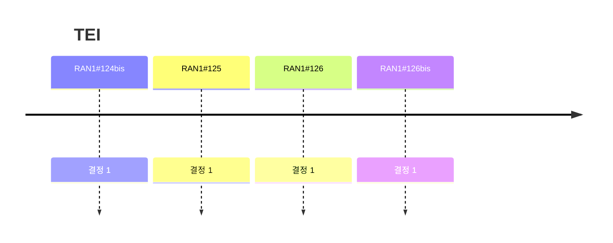

# 11 TEI

> 이 파일은 `scripts/generate_report.py`가 자동으로 생성합니다. 직접 수정하지 마세요.

공식 Agenda 기준으로 이 섹션의 결정을 모았습니다. 번호는 최신 회의 기준이며, 회의 간 연결은 같은 섹션 안의 같은 Agenda 제목으로 합니다.

## 회의별 결정 수

## 직전 회의 대비 (RAN1#126 → RAN1#126bis)

- 신규 결정 1건 (Agreement 1, Working Assumption 0, Conclusion 0)
- Agenda 신설: 없음
- Agenda 제외: 없음

## 11 TEI

회의별 결정 수 (하위 Agenda 포함): #122 0 · #122bis 0 · #123 0 · #124 0 · #124bis 1 · #125 1 · #126 1 · #126bis 1

| 회의 | 번호 | 구분 | 내용 | 출처 |
|---|---|---|---|---|
| RAN1#124bis | 11 | Agreement | For NR sidelink, introduce an RRC parameter that disables the selection of a random cyclic shift for PSCCH DMRS. - If the parameter is configured, the cyclic shift is fixed to  . - TP1 for 38.211 8.4.1.3.2 in R1-2603337 is agreed in principle. | [Chair notes RAN1#124bis_eom5](https://www.3gpp.org/ftp/tsg_ran/WG1_RL1/TSGR1_124b/Inbox/Chair_notes/Chair%20notes%20RAN1%23124bis_eom5.docx) [R1-2603337](https://www.3gpp.org/ftp/tsg_ran/WG1_RL1/TSGR1_124b/Docs/R1-2603337.zip) |
| RAN1#125 | 11 | Agreement | Draft CR in R1-2604713 is agreed. | [Chair notes RAN1#125_eom](https://www.3gpp.org/ftp/tsg_ran/WG1_RL1/TSGR1_125/Inbox/Chair_notes/Chair%20notes%20RAN1%23125_eom.docx) [R1-2604713](https://www.3gpp.org/ftp/tsg_ran/WG1_RL1/TSGR1_125/Docs/R1-2604713.zip) `[125-R20-TEI]` |
| RAN1#126 | 11 | Agreement | Introduce 15 kHz NCP as an optional configuration for MBSFN subframes of a dedicated MBMS carrier in Rel-20 TEI. Note 1: Assuming UE operating in Receive Only Mode (ROM), no MDT support and no UE capability reporting required. Note 2: The related CR work could then be discussed and completed during 2026 Q4 WG meetings. Note 3: it is assumed that 15kHz NCP will be deployed with a single cell. Note 4: it is assumed that if the cell has an MBSFN area with 15 kHz NCP, no other MBSFN area of the same cell has a different numerology on the same frequency carrier. | [Chair notes RAN1#126_eom1](https://www.3gpp.org/ftp/tsg_ran/WG1_RL1/TSGR1_126/Inbox/Chair_notes/Chair%20notes%20RAN1%23126_eom1.docx) [R1-2606848](https://www.3gpp.org/ftp/tsg_ran/WG1_RL1/TSGR1_126/Docs/R1-2606848.zip) `[126-R20-TEI]` |
| RAN1#126bis | 11 | Agreement | Draft CR in R1-2608721 is endorsed. | [Chair notes RAN1#126bis_eom1](https://www.3gpp.org/ftp/tsg_ran/WG1_RL1/TSGR1_126b/Inbox/Chair_notes/Chair%20notes%20RAN1%23126bis_eom1.docx) [R1-2608721](https://www.3gpp.org/ftp/tsg_ran/WG1_RL1/TSGR1_126b/Docs/R1-2608721.zip) `[126bis-R20-TEI]` |
