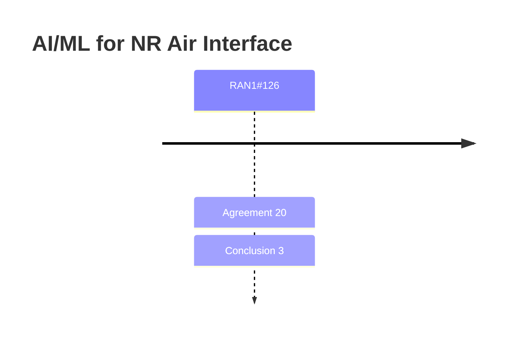

# AI/ML for NR Air Interface (Rel-19/20)

> 이 파일은 `scripts/generate_report.py`가 자동으로 생성합니다. 직접 수정하지 마세요.

## 회의별 진행

## 누적 히스토리

| 회의 | Agenda | 구분 | 내용 | 출처 |
|---|---|---|---|---|
| RAN1#126 | 8.1 | Agreement | The following TP for TS 38.214 Clause 5.2.1.6 is endorsed. The corresponding CR for Rel-19, TS 38.214 in R1-2606870 is endorsed. \| Reason for change \| Incorrectly capture of previous agreement. \| \| Summary of change \| To align with the agreement made in RAN1#122, remove “consecutive” from CPU occupancy duration for SP CSI-PAI report. \| \| Consequences if not approved \| The current specification would contain an inaccurate description of CPU occupancy duration for SP CSI-PAI report. \| \| 5.2.1.6 CSI processing criteria ============================= unchanged parts are omitted ============================ For a CSI report with CSI-ReportConfig with higher layer parameter reportQuantity not set to 'none', or a CSI report with LTM-CSI-ReportConfig, or reportQuantity not set to 'none-bm-r19' or 'none-csi-r19', the CPU(s) (including and/or , for CSI reports with reportQuantity set to 'p-cri-r19', 'p-cri-RSRP-r19', 'p-ssb-index-r19', or 'p-ssb-index-RSRP-r19', and CSI reports configured with the higher layer parameter csi-InferencePrediction-r19, and for CSI report with reportQuantity set to 'rs-pai-r19' or 'csi-pai-r19') are occupied for a number of OFDM symbols as follows: - A periodic or semi-persistent CSI report (excluding an initial semi-persistent CSI report on PUSCH after the PDCCH triggering the report, a semi-persistent CSI report on PUSCH configured with reportQuantity set to 'csi-pai-r19', and a semi-persistent CSI report on PUSCH configured with the higher layer parameter codebookType set to 'typeII-Doppler-r18' or 'typeII-Doppler-PortSelection-r18') occupies CPU(s) from the first symbol of the earliest one of each CSI-RS/CSI-IM/SSB resource, or each CSI-RS/CSI-IM resource associated with all configured sub-configurations for periodic CSI report corresponding to a CSI-ReportConfig that contains a list of sub-configurations provided by csi-ReportSubConfigToAddModList, or each CSI-RS/CSI-IM resource associated with all activated/triggered sub-configurations for semi-persistent CSI report corresponding to a CSI-ReportConfig that contains a list of sub-configurations provided by csi-ReportSubConfigToAddModList, for channel or interference measurement, respective latest CSI-RS/CSI-IM/SSB occasion no later than the corresponding CSI reference resource, until the last symbol of the configured PUSCH/PUCCH carrying the report. - An aperiodic CSI report occupies CPU(s) from the first symbol after the PDCCH triggering the CSI report until the last symbol of the scheduled PUSCH carrying the report. When the PDCCH reception includes two PDCCH candidates from two respective search space sets, as described in clause 10.1 of [6, TS 38.213], for the purpose of determining the CPU occupation duration, the PDCCH candidate that ends later in time is used. - An initial semi-persistent CSI report on PUSCH after the PDCCH trigger occupies CPU(s) from the first symbol after the PDCCH until the last symbol of the scheduled PUSCH carrying the report. When the PDCCH reception includes two PDCCH candidates from two respective search space sets, as described in clause 10.1 of [6, TS 38.213], for the purpose of determining the CPU occupation duration, the PDCCH candidate that ends later in time is used. - A semi-persistent CSI report on PUSCH configured with the higher layer parameter codebookType set to 'typeII-Doppler-r18' or 'typeII-Doppler-PortSelection-r18' occupies CPU(s) from the first symbol of KP-th latest consecutive periodic/semi-persistent CSI-RS occasions no later than CSI reference resource, until the last symbol of the PUSCH carrying the report, where the value of is indicated by UE capability. - A semi-persistent CSI report on PUSCH configured with reportQuantity set to 'csi-pai-r19' occupies CPU(s) from the first symbol of the latest consecutive periodic/semi-persistent CSI-RS occasion of a corresponding linked CSI report (linked by inferenceReportConfigId-r19) no later than CSI reference resource of the linked CSI report, until the last symbol of the PUSCH carrying the CSI-PAI report. ============================= unchanged parts are omitted ============================ \| | [Chair notes RAN1#126_eom1](https://www.3gpp.org/ftp/tsg_ran/WG1_RL1/TSGR1_126/Inbox/Chair_notes/Chair%20notes%20RAN1%23126_eom1.docx) [R1-2606794](https://www.3gpp.org/ftp/tsg_ran/WG1_RL1/TSGR1_126/Docs/R1-2606794.zip) `[126-R19-AI 8.1]` |
| RAN1#126 | 8.1 | Agreement | The following TP for TS 38.214 Clause 5.2.3 is endorsed. The corresponding CR for Rel-19, TS 38.214 in R1-2606870 is endorsed. \| Reason for change \| Clause 5.2.3 of TS38.214 explicitly identifies the reportQuantity values for which CSI feedback consists of a single part. Rel-19 AI/ML introduced new report quantities for AI/ML-based CSI report for inference and performance monitoring. But these new quantity values remain unspecified in terms of whether support single part CSI. As a result, it is currently unclear whether AI/ML-based CSI reports support single CSI part. \| \| Summary of change \| Adding Rel-19 AI/ML reportQuantity values to clarify that CSI reports for AI/ML support single CSI part. \| \| Consequences if not approved \| Ambiguity occurs on whether Rel-19 AI/ML CSI reports support single CSI part or two-part CSI reporting. \| \| 5.2.3 CSI reporting using PUSCH ============================= unchanged parts are omitted ============================ When the higher layer parameter reportQuantity is configured with one of the values 'cri-RSRP', 'ssb-Index-RSRP', 'cri-SINR' or 'ssb-Index-SINR', or 'cri-RSRP-Index', 'ssb-Index-RSRP-Index', 'cri-SINR-Index', 'ssb-Index-SINR-Index', 'tdcp', 'cli-RSSI', 'cli-SRS-RSRP', 'cjtc-Dd', 'cjtc-F', 'cjtc-Dd-F', 'cjtc-P', 'p-CRI-r19', 'p-CRI-RSRP-r19', 'p-SSB-Index-r19', 'p-SSB-Index-RSRP-r19', 'rs-pai-r19', 'csi-pai-r19', the CSI feedback consists of a single part. ============================= unchanged parts are omitted ============================ \| | [Chair notes RAN1#126_eom1](https://www.3gpp.org/ftp/tsg_ran/WG1_RL1/TSGR1_126/Inbox/Chair_notes/Chair%20notes%20RAN1%23126_eom1.docx) [R1-2606794](https://www.3gpp.org/ftp/tsg_ran/WG1_RL1/TSGR1_126/Docs/R1-2606794.zip) `[126-R19-AI 8.1]` |
| RAN1#126 | 8.1 | Agreement | The following TP for TS 38.214 Clause 6.2.1.3 is endorsed. The corresponding CR for Rel-19, TS 38.214 Clause 6.2.1.3 in R1-2606870 is endorsed. \| Reason for change \| 1. When the collision between the SRS for carrier switching and the CSI report happens, UE should follow a priority rule defined. However, the priority rule for the SRS and CSI-PAI report is unclear. 2. To ensure consistent priority rule for two types of PAI reports, i.e., CSI-PAI report and RS-PAI report. \| \| Summary of change \| 1. Reuse the same dropping rule for collision handling between PMI and SRS for the collision handling between CSI-PAI and SRS 2. Revert following agreement made in RAN1#122bis, and apply the same priority rules to collision between RS-PAI and SRS as to collision between CSI-PAI and SRS. \| \| Consequences if not approved \| 1. The collision handling between the SRS for carrier switching and the CSI-PAI report is unclear 2. Inconsistency in collision handling between CSI-PAI/SRS and RS-PAI/SRS. \| \| 6.2.1.3 UE sounding procedure between component carriers ============================= unchanged parts are omitted ============================ The following prioritization rules shall be applied in case of collision between a transmission of SRS over carrier and transmission of a physical signal/channel over a carrier of a serving cell in set - the UE shall not transmit SRS whenever SRS transmission (including any interruption due to uplink or downlink RF retuning time [11, TS 38.133] as defined by higher layer parameters switchingTimeUL and switchingTimeDL of SRS-SwitchingTimeNR) on the carrier of the serving cell and PUSCH/PUCCH transmission carrying HARQ-ACK/positive SR/RI/CRI/SSBRI/UEIRI/P-CRI/P-SSBRI/RS-PAI and/or PRACH on a carrier of a serving cell in set happen to overlap in the same symbol - the UE shall not transmit a periodic/semi-persistent SRS whenever periodic/semi-persistent SRS transmission (including any interruption due to uplink or downlink RF retuning time [11, TS 38.133] as defined by higher layer parameters switchingTimeUL and switchingTimeDL of SRS-SwitchingTimeNR) on the carrier of the serving cell and PUSCH transmission carrying aperiodic CSI on a carrier of a serving cell in set happen to overlap in the same symbol - the UE shall drop PUCCH/PUSCH transmission carrying periodic/semi-persistent CSI comprising only CQI/PMI/L1-RSRP/L1-SINR/P-L1-RSRP/CSI-PAI/RS-PAI and/or Type 1 configured grant PUSCH transmission carrying UE initiated CSI report, and/or SRS transmission on a carrier of a serving cell in set configured for PUSCH/PUCCH transmission whenever the transmission and SRS transmission (including any interruption due to uplink or downlink RF retuning time [11, TS 38.133] as defined by higher layer parameters switchingTimeUL and switchingTimeDL of SRS-SwitchingTimeNR) on the carrier of the serving cell happen to overlap in the same symbol - the UE shall drop PUSCH transmission carrying aperiodic CSI comprising only CQI/PMI/L1-RSRP/L1-SINR/TDCP/cjtc-Dd/cjtc-F/cjtc-Dd-F/cjtc-P/P-L1-RSRP/CSI-PAI/RS-PAI on a carrier of a serving cell in set whenever the transmission and aperiodic SRS transmission (including any interruption due to uplink or downlink RF retuning time [11, TS 38.133]) as defined by higher layer parameters switchingTimeUL and switchingTimeDL of SRS-SwitchingTimeNR) on the carrier of the serving cell happen to overlap in the same symbol. ============================= unchanged parts are omitted ============================ \| | [Chair notes RAN1#126_eom1](https://www.3gpp.org/ftp/tsg_ran/WG1_RL1/TSGR1_126/Inbox/Chair_notes/Chair%20notes%20RAN1%23126_eom1.docx) [R1-2606795](https://www.3gpp.org/ftp/tsg_ran/WG1_RL1/TSGR1_126/Docs/R1-2606795.zip) `[126-R19-AI 8.1]` |
| RAN1#126 | 8.1 | Agreement | The following TP for TS 38.214 Clause 5.1.6.1.2. The corresponding CR for Rel-19, TS 38.214 Clause 5.1.6.1.2 in R1-2606879 is endorsed. Reason for change: A new RRC IE CSI-LoggedMeasurementConfig is defined in 38.331 for network-side data collection, which is used to configure UE to perform the logging of measurements on CSI-RS resources. For CSI-RS measurement configured by the IE CSI-ReportConfig for L1 CSI report, there are some descriptions and constraints in spec 38.214, which are also needed for CSI-RS measurement configured by the IE CSI-LoggedMeasurementConfig for L3 CSI report. Summary of change: Add descriptions and constraints for CSI-RS measurement configured by the IE CSI-LoggedMeasurementConfig (L3 CSI report) in 38.214. Consequences if not approved: The descriptions and constraints for CSI-RS measurement configured by the IE CSI-LoggedMeasurementConfig (L3 CSI report) are missing in 38.214. \| 5.1.6.1.2 CSI-RS for L1-RSRP and L1-SINR computation If a UE is configured with a NZP-CSI-RS-ResourceSet configured with the higher layer parameter repetition set to 'on', the UE may assume that the CSI-RS resources, described in Clause 5.2.2.3.1, within the NZP-CSI-RS-ResourceSet are transmitted with the same downlink spatial domain transmission filter, where the CSI-RS resources in the NZP-CSI-RS-ResourceSet are transmitted in different OFDM symbols. If repetition is set to 'off', the UE shall not assume that the CSI-RS resources within the NZP-CSI-RS-ResourceSet are transmitted with the same downlink spatial domain transmission filter. If the UE is configured with a CSI-ReportConfig with reportQuantity set to 'cri-RSRP', 'cri-SINR', 'cri-RSRP-Index', 'cri-SINR-Index', 'none', 'p-cri-r19', 'p-cri-RSRP-r19', 'p-ssb-index-r19', 'p-ssb-index-RSRP-r19', 'none-bm-r19', or 'rs-pai-r19', and if the CSI-ResourceConfig for channel measurement (higher layer parameters resourcesForChannelMeasurement and resourcesForSetA-r19 when reportQuantity set to 'none-bm-r19') contains a NZP-CSI-RS-ResourceSet that is configured with the higher layer parameter repetition and without the higher layer parameter trs-Info, the UE can only be configured with the same number (1 or 2) of ports with the higher layer parameter nrofPorts for all CSI-RS resources within the set. If the UE is configured with the CSI-RS resource in the same OFDM symbol(s) as an SS/PBCH block, the UE may assume that the CSI-RS and the SS/PBCH block are quasi co-located with 'typeD' if 'typeD' is applicable. Furthermore, the UE shall not expect to be configured with the CSI-RS in PRBs that overlap with those of the SS/PBCH block, and the UE shall expect that the same subcarrier spacing is used for both the CSI-RS and the SS/PBCH block. If the UE is configured with a CSI-LoggedMeasurementConfig, and if the CSI-ResourceConfig for channel measurement (higher layer parameters csi-LoggedResourceConfig) contains a NZP-CSI-RS-ResourceSet that is configured with the higher layer parameter repetition and without the higher layer parameter trs-Info, the UE can only be configured with the same number (1 or 2) of ports with the higher layer parameter nrofPorts for all CSI-RS resources within the set. Each Reporting Setting CSI-LoggedMeasurementConfig is associated with a single downlink BWP (indicated by higher layer parameter BWP-Id) given in the associated CSI-ResourceConfig for channel measurement. <omitted texts> \| MIMO | [Chair notes RAN1#126_eom1](https://www.3gpp.org/ftp/tsg_ran/WG1_RL1/TSGR1_126/Inbox/Chair_notes/Chair%20notes%20RAN1%23126_eom1.docx) [R1-2606835](https://www.3gpp.org/ftp/tsg_ran/WG1_RL1/TSGR1_126/Docs/R1-2606835.zip) `[126-R19-AI 8.1]` |
| RAN1#126 | 8.1 | Agreement | The following changes for Clause 9.2 in TS 38.213 is endorsed. The corresponding CR for Rel-19, TS 38.213 in R1-2606868 is endorsed. - Reason for change: In Rel-19, UEIRI is introduced as a new type of UCI for notifying (ModeA) or requesting a PUSCH resource (ModeB) for UE-initiated/event-driven beam reporting. Whether UE transmits UEIRI on a PUCCH format 0 or format 1 in the PUCCH resource depends on whether the triggering condition of the event(s) for UE-initiated/event-driven beam reporting is met or not. In this case, the information bit of UEIRI is not always included in the PUCCH resource. However, in the current spec, UEIRI is described as a compulsory UCI in the PUCCH resource, which is not correct. - Summary of change: Add the condition “if any” to the information bit for UEIRI where the contents of UCI bit(s) are described in the first paragraph of Section 9.2, TS38.213. - Consequences if not approved: The availability of information bit for UEIRI in PUCCH is not correctly stated. \| 9.2 UCI reporting in physical uplink control channel UCI types reported in a PUCCH include HARQ-ACK information, SR, LRR, UEIRI, and CSI. UCI bits include HARQ-ACK information bits, if any, SR information bits, if any, LRR information bit, if any, UEIRI information bit, if any, and CSI bits, if any. The HARQ-ACK information bits correspond to a HARQ-ACK codebook as described in clause 9.1. For the remaining of this clause, unless stated otherwise in clauses 9.2.4A and 9.2.5.1, any reference to SR is applicable for SR and/or for LRR and/or for UEIRI. <Unchanged parts are omitted> \| | [Chair notes RAN1#126_eom1](https://www.3gpp.org/ftp/tsg_ran/WG1_RL1/TSGR1_126/Inbox/Chair_notes/Chair%20notes%20RAN1%23126_eom1.docx) [R1-2606809](https://www.3gpp.org/ftp/tsg_ran/WG1_RL1/TSGR1_126/Docs/R1-2606809.zip) `[126-R19-AI 8.1]` |
| RAN1#126 | 8.1 | Agreement | The following changes for Clause 9 in TS 38.213 is endorsed. The corresponding CR for Rel-19, TS 38.213 in R1-2606869 is endorsed. - Reason for change:  UE behaviour is unclear for overlapping PUCCH with UEIRI and other channels/signals. - Summary of change: Reuse the same behaviour as SR for overlapping PUCCH with UEIRI and other channels/signals. - Consequences if not approved: Unclear UE behaviour. \| 9 UE procedure for reporting control information <Unchanged parts are omitted> If a UE is configured for NR-DC operation, the UE does not expect to be configured with a PUCCH-SCell. For the remaining of this clause, unless stated otherwise, any reference to SR is applicable for LRR and/or for UEIRI. A PUSCH or a PUCCH transmission other than PUCCH transmissions with SL HARQ-ACK reports, including repetitions if any, can be of priority index 0 or of priority index 1. For a configured grant PUSCH transmission, a UE determines a priority index from phy-PriorityIndex, if provided. For a PUCCH transmission with HARQ-ACK information corresponding to a SPS PDSCH reception or a SPS PDSCH release, a UE determines a priority index from harq-CodebookID, if provided. For a PUCCH transmission with SR, a UE determines the corresponding priority as described in clause 9.2.4. For a PUSCH transmission with semi-persistent CSI report, a UE determines a priority index from a priority indicator field, if provided, in a DCI format that activates the semi-persistent CSI report. If a priority index is not provided to a UE for a PUSCH or a PUCCH transmission other than PUCCH transmissions with SL HARQ-ACK reports, the priority index is 0. <Unchanged parts are omitted> \| | [Chair notes RAN1#126_eom1](https://www.3gpp.org/ftp/tsg_ran/WG1_RL1/TSGR1_126/Inbox/Chair_notes/Chair%20notes%20RAN1%23126_eom1.docx) [R1-2606809](https://www.3gpp.org/ftp/tsg_ran/WG1_RL1/TSGR1_126/Docs/R1-2606809.zip) `[126-R19-AI 8.1]` |
| RAN1#126 | 8.1 | Agreement | The draft CR in R1-2606230 for Rel-19 TS 38.214 is endorsed as alignment CR for TS 38.214. | [Chair notes RAN1#126_eom1](https://www.3gpp.org/ftp/tsg_ran/WG1_RL1/TSGR1_126/Inbox/Chair_notes/Chair%20notes%20RAN1%23126_eom1.docx) [R1-2606809](https://www.3gpp.org/ftp/tsg_ran/WG1_RL1/TSGR1_126/Docs/R1-2606809.zip) `[126-R19-AI 8.1]` |
| RAN1#126 | 8.1 | Agreement | The draft CR in R1-2606128 for Rel-19 TS 38.215 is endorsed as alignment CR for TS 38.215. | [Chair notes RAN1#126_eom1](https://www.3gpp.org/ftp/tsg_ran/WG1_RL1/TSGR1_126/Inbox/Chair_notes/Chair%20notes%20RAN1%23126_eom1.docx) [R1-2606809](https://www.3gpp.org/ftp/tsg_ran/WG1_RL1/TSGR1_126/Docs/R1-2606809.zip) `[126-R19-AI 8.1]` |
| RAN1#126 | 8.1 | Conclusion | There is no consensus in RAN1 to support the following change from R1-2605805 of Clause 5.2.1.5.4.1 in TS 38.214: \| 5.2.1.5.4.1 UE Initiated CSI reporting <Unchanged parts are omitted> The counter of the event instances for such reference signal is reset: - if the reference signal in the indicated TCI state is updated and newBeamResourceSet is a NZP-CSI-RS-ResourceSet configured with repetition, or the SS/PBCH block which is QCLed with the reference signal in the indicated TCI state is updated and newBeamResourceSet is a CSI-SSB-ResourceSet when the UE is configured with a CSI-ReportConfig with the higher layer parameter eventType set to ‘event2’ or ‘event1’, or - if the reference signal with the valueOfQ-th highest L1-RSRP out of the reference signals among the activated TCI states is updated and newBeamResourceSet is a NZP-CSI-RS-ResourceSet configured with repetition, or the SS/PBCH block with the valueOfQ-th highest L1-RSRP out of the SS/PBCH blocks QCLed with the reference signals among the activated TCI states, which determines event instance(s), is updated and newBeamResourceSet is a CSI-SSB-ResourceSet when the UE is configured with a CSI-ReportConfig with the higher layer parameter eventType set to ‘event7’, or - if eventThreshold or valueOfQ or eventInstanceCount or eventDetectionTimeWindow in the CSI-ReportConfig are reconfigured. <Unchanged parts are omitted> \| | [Chair notes RAN1#126_eom1](https://www.3gpp.org/ftp/tsg_ran/WG1_RL1/TSGR1_126/Inbox/Chair_notes/Chair%20notes%20RAN1%23126_eom1.docx) [R1-2606867](https://www.3gpp.org/ftp/tsg_ran/WG1_RL1/TSGR1_126/Docs/R1-2606867.zip) `[126-R19-AI 8.1]` |
| RAN1#126 | 8.1 | Conclusion | There is no consensus in RAN1 to support the TP from R1-2605669 of Clause 6.3.2.1.2 in TS 38.212 and Clause 5.2.1.5.4.1 in TS 38.214. NES | [Chair notes RAN1#126_eom1](https://www.3gpp.org/ftp/tsg_ran/WG1_RL1/TSGR1_126/Inbox/Chair_notes/Chair%20notes%20RAN1%23126_eom1.docx) [R1-2606867](https://www.3gpp.org/ftp/tsg_ran/WG1_RL1/TSGR1_126/Docs/R1-2606867.zip) `[126-R19-AI 8.1]` |
| RAN1#126 | 8.1 | Agreement | The following TP for TS 38.213 Clause 23 is endorsed. The corresponding CR for Rel-19, TS 38.213 in R1-2606872 is endorsed. \| Reason for change: After receiving on-demand SIB1, UE may monitor PDCCH in a CSS set with index 0 or in a CORESET with index 0 (e.g., for SIBx/paing/RAR reception). As clarified in RAN2 reply LS R2-2604211, the controlResourceSetZero and searchSpaceZero fields are always absent in SIB1 irrespective of whether SIB1 is provided in an on-demand manner or provided in a periodic manner, so in this case the search space set index 0 or CORESET with index 0 should refer to searchSpaceZero and controlResourceSetZero in OD-SIB1-Config, when for FR1 or for FR2. Summary of Change: Clarify the UE behavior that when for FR1 or for FR2, for PDCCH monitoring in a search space set with index 0 or in a CORESET with index 0, the UE continues to apply searchSpaceZero and controlResourceSetZero in OD-SIB1 Config. Consequences if not approved: After receiving on-demand SIB1, ambiguity occurs for PDCCH monitoring in a search space set with index 0 or in a CORESET with index 0. 23 UE procedure to request SIB1 reception < Unchanged parts are omitted > pon receiving a PWS notification or paging indicating system information change [12, TS 38.331], and if for FR1 or for FR2, the UE continues to apply searchSpaceZero and controlResourceSetZero in OD-SIB1 Config. < Unchanged parts are omitted > \| | [Chair notes RAN1#126_eom1](https://www.3gpp.org/ftp/tsg_ran/WG1_RL1/TSGR1_126/Inbox/Chair_notes/Chair%20notes%20RAN1%23126_eom1.docx) [R1-2606831](https://www.3gpp.org/ftp/tsg_ran/WG1_RL1/TSGR1_126/Docs/R1-2606831.zip) `[126-R19-AI 8.1]` |
| RAN1#126 | 8.1 | Agreement | The following TP for TS 38.211 Clause 6.3.3.1 is endorsed. The corresponding CR for Rel-19, TS 38.211 in R1-2606849 is endorsed. \| Reason for change: The parameter sib1-RestrictedSetConfig of UL-WUS configuration for SIB1 request in TS 38.331 is not captured in TS 38.211. Summary of change: Add description for parameter sib1-RestrictedSetConfig of TS 38.211 according to the IE sib1-RestrictedSetConfig defined in the TS 38.331. Consequence if not approved: Ambiguity occurs for the sib1-RestrictedSetConfig for on demand SIB1. 6.3.3 Physical random-access channel 6.3.3.1 Sequence generation The set of random-access preambles shall be generated according to from which the frequency-domain representation shall be generated according to where , , , or depending on the PRACH preamble format as given by Tables 6.3.3.1-1 and 6.3.3.1-2. There are 64 preambles defined in each time-frequency PRACH occasion, enumerated in increasing order of first increasing cyclic shift of a logical root sequence, and then in increasing order of the logical root sequence index, starting with the index obtained from the higher-layer parameter - prach-RootSequenceIndex or rootSequenceIndex-BFR or by msgA-PRACH-RootSequenceIndex if configured and a type-2 random-access procedure is initiated as described in clause 8.1 of [5, TS 38.213], or by - prach-RootSequenceIndex in EarlyUL-SyncConfig if the PRACH transmission is for a candidate cell, or by - prach-RootSequenceIndex in RACH-ConfigTwoTA if the PRACH transmission is associated with an additional PCI different from serving cell PCI, or by - prach-RootSequenceIndex in SIB1-RequestConfig if the PRACH transmission is for SIB1 request. Additional preamble sequences, in case 64 preambles cannot be generated from a single root Zadoff-Chu sequence, are obtained from the root sequences with the consecutive logical indexes until all the 64 sequences are found. The logical root sequence order is cyclic; the logical index 0 is consecutive to . The sequence number is obtained from the logical root sequence index according to Tables 6.3.3.1-3 to 6.3.3.1-4B. The cyclic shift is given by where is given by Tables 6.3.3.1-5 to 6.3.3.1-7. The type of restricted sets (unrestricted, restricted type A, restricted type B) is given by - the higher-layer parameter msgA-RestrictedSetConfig, if provided; - or the higher-layer parameter ltm-restrictedSetConfig associated with a candidate cell indicated in Cell indicator field of a PDCCH order, if provided; - or the higher-layer parameter twoTA-restrictedSetConfig associated with an additional PCI indicated in PRACH association indicator field of a PDCCH order, if provided; - otherwise, the higher-layer parameter restrictedSetConfig. < Unchanged Text Omitted > \| | [Chair notes RAN1#126_eom1](https://www.3gpp.org/ftp/tsg_ran/WG1_RL1/TSGR1_126/Inbox/Chair_notes/Chair%20notes%20RAN1%23126_eom1.docx) [R1-2606825](https://www.3gpp.org/ftp/tsg_ran/WG1_RL1/TSGR1_126/Docs/R1-2606825.zip) `[126-R19-AI 8.1]` |
| RAN1#126 | 8.1 | Agreement | The following TP for TS 38.213 Clause 11.1 is endorsed. The corresponding CR for Rel-19, TS 38.213 in R1-2606850 is endorsed. \| Reason for change: The slot configuration for on demand SIB1 is unclear due to missing IE sib1-tdd-UL-DL-ConfigurationCommon. Summary of change: Add missing IE sib1-tdd-UL-DL-ConfigurationCommon for slot configuration for on demand SIB1. The SSB symbols indicated by OD-SIB1-Config cannot be indicated as uplink by sib1-tdd-UL-DL-ConfigurationCommon, and the PRACH symbols indicated by OD-SIB1-Config cannot be indicated as downlink by sib1-tdd-UL-DL-ConfigurationCommon. Consequence if not approved: Ambiguity occurs for the slot configuration for on demand SIB1. 11.1 Slot configuration A slot format includes downlink symbols, uplink symbols, and flexible symbols. The following are applicable for each serving cell. If a UE is provided tdd-UL-DL-ConfigurationCommon, the UE sets the slot format per slot over a number of slots as indicated by tdd-UL-DL-ConfigurationCommon. The tdd-UL-DL-ConfigurationCommon provides - a reference SCS configuration by referenceSubcarrierSpacing - a pattern1. The pattern1 provides - a slot configuration period of msec by dl-UL-TransmissionPeriodicity - a number of slots with only downlink symbols by nrofDownlinkSlots - a number of downlink symbols by nrofDownlinkSymbols - a number of slots with only uplink symbols by nrofUplinkSlots - a number of uplink symbols by nrofUplinkSymbols A value msec is valid only for , . A value msec is valid only for , . A value msec is valid only for,. A value msec is valid only for , or . A slot configuration period of msec includes slots with SCS configuration . From the slots, a first slots include only downlink symbols and a last slots include only uplink symbols. The symbols after the first slots are downlink symbols. The symbols before the last slots are uplink symbols. The remaining are flexible symbols. The first symbol every periods is a first symbol in an even frame. If tdd-UL-DL-ConfigurationCommon provides both pattern1 and pattern2, the UE sets the slot format per slot over a first number of slots as indicated by pattern1 and the UE sets the slot format per slot over a second number of slots as indicated by pattern2. The pattern2 provides - a slot configuration period of msec by dl-UL-TransmissionPeriodicity - a number of slots with only downlink symbols by nrofDownlinkSlots - a number of downlink symbols by nrofDownlinkSymbols - a number of slots with only uplink symbols by nrofUplinkSlots - a number of uplink symbols by nrofUplinkSymbols The applicable values of are same as the applicable values for . A slot configuration period of msec includes first slots and second slots. From the slots, a first slots include only downlink symbols and a last include only uplink symbols. The symbols after the first slots are downlink symbols. The symbols before the last slots are uplink symbols. The remaining are flexible symbols. A UE expects that divides 20 msec. The first symbol every periods is a first symbol in an even frame. A UE expects that the reference SCS configuration is smaller than or equal to a SCS configuration for any configured DL BWP or UL BWP. Each slot provided by pattern1 or pattern2 is applicable to consecutive slots in the active DL BWP or the active UL BWP where the first slot starts at a same time as a first slot for the reference SCS configuration and each downlink or flexible or uplink symbol for the reference SCS configuration corresponds to consecutive downlink or flexible or uplink symbols for the SCS configuration . A downlink or flexible symbol provided by tdd-UL-DL-ConfigurationCommon can include an UL sub-band provided by ul-SubbandlocationAndBandwidth, a first DL sub-band provided by firstDL-SubbandlocationAndBandwidth and may additionally include a second DL sub-band provided by secondDL-SubbandlocationAndBandwidth, for a SCS configuration of any configured UL BWP or DL BWP, respectively, as provided by scs-SpecificCarrierList [4, TS 38.211]. The downlink or flexible symbol is then referred to as an SBFD symbol; otherwise, it is referred to as a non-SBFD symbol. Unless otherwise stated, the UE considers symbols in a slot indicated as downlink and as SBFD by tdd-UL-DL-ConfigurationCommon to be available for transmissions. Uplink symbols by tdd-UL-DL-ConfigurationCommon are non-SBFD symbols. An SBFD symbol or a non-SBFD symbol provided by tdd-UL-DL-ConfigurationCommon cannot change to a non-SBFD symbol or to an SBFD symbol, respectively, by other information. The UE is not provided coresetPoolIndex and is not configured to receive PDSCH according to more than one TCI states mapped to one TCI codepoint [6, TS 38.214] for a serving cell where the UE is provided SBFD symbols. For a PUCCH or a PUSCH transmission in flexible symbols indicated as SBFD by tdd-UL-DL-ConfigurationCommon and associated with PRACH transmission in first PRACH occasions, the UE assumes the flexible symbols as non-SBFD symbols in this RACH attempt. The frequency location of an UL sub-band, or a first DL sub-band, or a second DL sub-band, starts at RB and includes a number of contiguous RBs provided by ul-SubbandlocationAndBandwidth, or firstDL-SubbandlocationAndBandwidth or secondDL-SubbandlocationAndBandwidth, respectively, that indicates an offset and a length as RIV according to [6, TS 38.214], setting , and a value provided by offsetToCarrier for the subcarrierSpacing. SBFD symbols are consecutive, start from a first slot provided by SBFD-StartingSlotIndex and from a first symbol in the first slot provided by SBFD-StartingSymbolIndex, and end in a second slot provided by SBFD-EndingSlotIndex and in a second symbol in the second slot provided by SBFD-EndingSymbolIndex. SBFD symbols can be provided in any of pattern1 and, if provided, pattern2. A configuration period for SBFD symbols is msec when only pattern1 is provided, or when pattern2 is additionally provided. Except for a PRACH transmission in a PRACH occasion determined based on a second RACH configuration provided by sbfd-RACHDualConfig as described in clause 8, the UE transmits or receives a physical channel or signal either only in SBFD symbols or only in non-SBFD symbols. For a PUCCH transmission with SP-CSI reports, or for a PUCCH with SR, LRR, UEIRI, UE doesn’t transmit the PUCCH transmission occasion that is mapped to SBFD symbols and non-SBFD symbols. When the UE is provided sbfd-Config2-Transmission, the UE can - transmit a first PUCCH or PUSCH or a first repetition of a PUCCH or PUSCH in non-SBFD symbols, and - transmit a second PUCCH or PUSCH or a second repetition of the PUCCH or PUSCH, in SBFD symbols When the UE is provided sbfd-Config2-Reception, the UE can - receive a first PDSCH or a first repetition of a PDSCH in non-SBFD symbols, and - receive a second PDSCH or a second repetition of the PDSCH in SBFD symbols When a UE is not provided sbfd-Config2-Transmission - for a PUCCH or PUSCH transmission with repetitions, if the first repetition is either in SBFD symbols or in non-SBFD symbols, the remaining repetitions are also either in SBFD symbols or in non-SBFD symbols, respectively - for a Type 2 CG PUSCH transmission, or for a PUSCH transmission with SP-CSI reports, if the first transmission after a latest activation is either in SBFD symbols or in non-SBFD symbols, the remaining transmissions associated with the latest activation are also either in SBFD symbols or in non-SBFD symbols, respectively - for a Type 1 CG PUSCH, or for a PUCCH transmission with SP-CSI reports, or for a PUCCH with SR, LRR, UEIRI, or P-CSI, or SRS, all respective transmissions are either only in SBFD symbols or only in non-SBFD symbols as indicated by the respective configurations [12, TS 38.331] When a UE is not provided sbfd-Config2-Reception, - for a PDSCH reception with repetitions, if the first repetition is either in SBFD symbols or in non-SBFD symbols, the remaining repetitions are also either in SBFD symbols or in non-SBFD symbols, respectively - for a SPS PDSCH reception, if the first reception after a latest activation is either in SBFD symbols or in non-SBFD symbols, the remaining receptions associated with the latest activation are also either in SBFD symbols or in non-SBFD symbols, respectively In an SBFD symbol, and except for cross-link interference measurements [6, TS 38.214], the UE transmits or receives only in RBs that are both in the active UL BWP and in the UL sub-band, or both in the active DL BWP and the DL sub-band(s), respectively. The UE does not transmit in SBFD symbols indicated for presence of SS/PBCH blocks within the active DL BWP by ssb-PositionsInBurst in SIB1 or in ServingCellConfigCommon. If the UE is additionally provided tdd-UL-DL-ConfigurationDedicated, the parameter tdd-UL-DL-ConfigurationDedicated overrides only flexible symbols per slot over the number of slots as provided by tdd-UL-DL-ConfigurationCommon. The tdd-UL-DL-ConfigurationDedicated provides - a set of slot configurations by slotSpecificConfigurationsToAddModList - for each slot configuration from the set of slot configurations - a slot index for a slot provided by slotIndex - a set of symbols for a slot by symbols where - if symbols = allDownlink, all symbols in the slot are downlink - if symbols = allUplink, all symbols in the slot are uplink - if symbols = explicit, nrofDownlinkSymbols provides a number of downlink first symbols in the slot and nrofUplinkSymbols provides a number of uplink last symbols in the slot. If nrofDownlinkSymbols is not provided, there are no downlink first symbols in the slot and if nrofUplinkSymbols is not provided, there are no uplink last symbols in the slot. The remaining symbols in the slot are flexible For each slot having a corresponding index provided by slotIndex, the UE applies a format provided by a corresponding symbols. The UE does not expect tdd-UL-DL-ConfigurationDedicated to indicate as uplink or as downlink a symbol that tdd-UL-DL-ConfigurationCommon indicates as a downlink or as an uplink symbol, respectively. For a set of symbols of a slot that are indicated as SBFD by tdd-UL-DL-ConfigurationCommon, the UE ignores symbols provided by tdd-UL-DL-ConfigurationDedicated, if any. For each slot configuration provided by tdd-UL-DL-ConfigurationDedicated, a reference SCS configuration is the reference SCS configuration provided by tdd-UL-DL-ConfigurationCommon. A slot configuration period and a number of downlink symbols, uplink symbols, and flexible symbols in each slot of the slot configuration period are determined from tdd-UL-DL-ConfigurationCommon and tdd-UL-DL-ConfigurationDedicated and are common to each configured BWP. A UE considers symbols in a slot indicated as downlink by tdd-UL-DL-ConfigurationCommon, or tdd-UL-DL-ConfigurationDedicated to be available for receptions and considers symbols in a slot indicated as uplink by tdd-UL-DL-ConfigurationCommon, or by tdd-UL-DL-ConfigurationDedicated to be available for transmissions. If a UE is not configured to monitor PDCCH for DCI format 2_0, for a set of symbols of a slot that are indicated as flexible by tdd-UL-DL-ConfigurationCommon and tdd-UL-DL-ConfigurationDedicated if provided, or when tdd-UL-DL-ConfigurationCommon and tdd-UL-DL-ConfigurationDedicated are not provided to the UE - the UE receives PDSCH or CSI-RS in the set of symbols of the slot if the UE receives a corresponding indication by a DCI format - the UE transmits PUSCH, PUCCH, PRACH, or SRS in the set of symbols of the slot if the UE receives a corresponding indication by a DCI format, a RAR UL grant, fallbackRAR UL grant, or successRAR For operation on a single carrier in unpaired spectrum, if a UE is configured by higher layers to receive a PDCCH, or a PDSCH, or a CSI-RS, or a DL PRS in a set of symbols of a slot, the UE receives the PDCCH, the PDSCH, the CSI-RS, or the DL PRS if the UE does not detect a DCI format that indicates to the UE to transmit a PUSCH, a PUCCH, a PRACH, or a SRS in at least one symbol of the set of symbols of the slot; otherwise, the UE does not receive the PDCCH, or the PDSCH, or the CSI-RS, or the DL PRS in the set of symbols of the slot. For a UE operation with shared spectrum channel access in FR1, or in FR2-2 when the UE is provided ChannelAccessMode2 = 'enabled', if the UE is provided csi-RS-ValidationWithDCI, is not provided CO-DurationsPerCell, and is not provided SlotFormatCombinationsPerCell, and if the UE is configured by higher layers to receive a CSI-RS in a set of symbols of a slot, the UE cancels the CSI-RS reception in the set of symbols of the slot if the UE does not detect a DCI format indicating an aperiodic CSI-RS reception or scheduling a PDSCH reception in the set of symbols of the slot. If a UE is provided channelAccessMode ='dynamic' and is provided availableRB-SetsToAddModList and availableRB-SetsToReleaseList, the UE expects to be provided co-DurationsPerCellToAddModList and co-DurationsPerCellToReleaseList and/or slotFormatCombToAddModList and slotFormatCombToReleaseList. For operation on a single carrier in unpaired spectrum, if a UE is configured by higher layers to transmit SRS, or PUCCH, or PUSCH, or PRACH in a set of symbols of a slot and the UE detects a DCI format indicating to the UE to receive CSI-RS or PDSCH in a subset of symbols from the set of symbols, then - If the UE does not indicate the capability of partialCancellationPUCCH-PUSCH-PRACH-TX, the UE does not expect to cancel the transmission of the PUCCH or PUSCH or PRACH in the set of symbols if the first symbol in the set occurs within relative to a last symbol of a PDCCH reception where the UE detects the DCI format; otherwise, the UE cancels the PUCCH, or the PUSCH, or an actual repetition of the PUSCH [6, TS 38.214], determined from clauses 9, 9.2.5 and 9.2.6 or clause 6.1 of [6, TS 38.214], or the PRACH transmission in the set of symbols. - If the UE indicates the capability of partialCancellationPUCCH-PUSCH-PRACH-TX, the UE does not expect to cancel the transmission of the PUCCH or PUSCH or PRACH in symbols from the set of symbols that occur within relative to a last symbol of a PDCCH reception where the UE detects the DCI format. The UE cancels the PUCCH, or the PUSCH, or an actual repetition of the PUSCH [6, TS 38.214], determined from clauses 9, 9.2.5 and 9.2.6 or clause 6.1 of [6, TS 38.214], or the PRACH transmission in remaining symbols from the set of symbols. - The UE does not expect to cancel the transmission of SRS in symbols from the subset of symbols that occur within relative to a last symbol of a PDCCH reception where the UE detects the DCI format. The UE cancels the SRS transmission in remaining symbols from the subset of symbols. is the PUSCH preparation time for the corresponding UE processing capability [6, TS 38.214] assuming and corresponds to the smallest SCS configuration between the SCS configuration of the PDCCH carrying the DCI format and the SCS configuration of the SRS, PUCCH, PUSCH or , where corresponds to the SCS configuration of the PRACH if it is 15kHz or higher; otherwise . For a set of symbols of a slot that are indicated to a UE as uplink by tdd-UL-DL-ConfigurationCommon, or tdd-UL-DL-ConfigurationDedicated, the UE does not receive PDCCH, PDSCH, or CSI-RS when the PDCCH, PDSCH, or CSI-RS overlaps, even partially, with the set of symbols of the slot. For a set of symbols of a slot that are indicated to a UE as uplink by tdd-UL-DL-ConfigurationCommon, or tdd-UL-DL-ConfigurationDedicated, the UE does not receive DL PRS in the set of symbols of the slot, if the UE is not provided with a measurement gap. For a set of symbols of a slot that are indicated to a UE as downlink by tdd-UL-DL-ConfigurationCommon, or tdd-UL-DL-ConfigurationDedicated and, when applicable, are indicated as non-SBFD by tdd-UL-DL-ConfigurationCommon, the UE does not transmit PUSCH, PUCCH, PRACH, or SRS when the PUSCH, PUCCH, PRACH, or SRS overlaps, even partially, with the set of symbols of the slot. For a set of symbols of a slot that are indicated to a UE as flexible by tdd-UL-DL-ConfigurationCommon, and tdd-UL-DL-ConfigurationDedicated if provided, or are indicated as SBFD by tdd-UL-DL-ConfigurationCommon, the UE does not expect to receive both dedicated higher layer parameters configuring transmission from the UE in the set of symbols of the slot and dedicated higher layer parameters configuring reception by the UE in the set of symbols of the slot. For operation on a single carrier in unpaired spectrum, for a set of symbols of a slot indicated to a UE for reception of SS/PBCH blocks by ssb-PositionsInBurst in SIB1 or by ssb-PositionsInBurst in ServingCellConfigCommon or as described in Clause 4.4 or, if the UE is not provided dl-OrJointTCI-StateList, by ssb-PositionsInBurst in SSB-MTCAdditionalPCI associated to physical cell ID with active TCI states for PDCCH or PDSCH, or for a set of symbols of a slot corresponding to SS/PBCH blocks configured for L1 beam measurement/reporting, the UE does not transmit PUSCH, PUCCH, PRACH in the slot if a transmission would overlap with any symbol from the set of symbols and the UE does not transmit SRS in the set of symbols of the slot. The UE does not expect the set of symbols of the slot to be indicated as uplink by tdd-UL-DL-ConfigurationCommon, or tdd-UL-DL-ConfigurationDedicated, when provided to the UE. < Unchanged Text Omitted > \| | [Chair notes RAN1#126_eom1](https://www.3gpp.org/ftp/tsg_ran/WG1_RL1/TSGR1_126/Inbox/Chair_notes/Chair%20notes%20RAN1%23126_eom1.docx) [R1-2606825](https://www.3gpp.org/ftp/tsg_ran/WG1_RL1/TSGR1_126/Docs/R1-2606825.zip) `[126-R19-AI 8.1]` |
| RAN1#126 | 8.1 | Agreement | The following TP for TS 38.213 Clause 11.1 is endorsed. The corresponding CR for Rel-19, TS 38.213 in R1-2606851 is endorsed. \| Reason for change: OD-SIB1 configuration configures search space 0 and CORESET 0 for NES Cell. The set of symbols of CORESET 0 in a slot is used for downlink reception and should not be configured as uplink by sib1-tdd-UL-DL-ConfigurationCommon or tdd-UL-DL-ConfigurationDedicated. The current specification is not clear for this case while it is clear for other cases (e.g., CORESET 0 configured by pdcch-ConfigSIB1 in MIB). Summary of change: Clarify the symbols of CORESET 0 of NES Cell configured by OD-SIB1 configurations cannot be configured as uplink. Consequence if not approved: The symbols of CORESET 0 configured by OD-SIB1 configuration from cell A may be configured as uplink by NES cell which makes the UE behaviour unclear. 11.1 Slot configuration A slot format includes downlink symbols, uplink symbols, and flexible symbols. The following are applicable for each serving cell. < Unchanged Text Omitted > For a set of symbols of a slot indicated to a UE by pdcch-ConfigSIB1 in MIB for a CORESET for Type0-PDCCH CSS set, the UE does not expect the set of symbols to be indicated as uplink by tdd-UL-DL-ConfigurationCommon, or tdd-UL-DL-ConfigurationDedicated. ,For a set of symbols of a slot corresponding to CORESETs provided in MIB, or in SIB1, or in ServingCellConfigCommonSIB and are indicated as SBFD by tdd-UL-DL-ConfigurationCommon, the UE does not expect to receive dedicated higher layer parameters configuring transmission from the UE in the set of symbols of the slot. < Unchanged Text Omitted > \| | [Chair notes RAN1#126_eom1](https://www.3gpp.org/ftp/tsg_ran/WG1_RL1/TSGR1_126/Inbox/Chair_notes/Chair%20notes%20RAN1%23126_eom1.docx) [R1-2606825](https://www.3gpp.org/ftp/tsg_ran/WG1_RL1/TSGR1_126/Docs/R1-2606825.zip) `[126-R19-AI 8.1]` |
| RAN1#126 | 8.1 | Agreement | The following TP for TS 38.213 Clause 4.1 is endorsed. The corresponding CR for Rel-19, TS 38.213 in R1-2606852 is endorsed. \| Reason for change: The periodicity of on-demand SSB can be configured differently than the always-on SSB. However, the current spec says the UE can assume a periodicity of a half frame when the always-on SSB periodicity parameter is absent. When the on-demand SSB periodicity is different than the always-on SSB periodicity this then conflicts with the following statement in the spec which says the UE can assume the periodicity of all SS/PBCH blocks in the serving cell is the same. Summary of Change: Clarify that the assumption of the same periodicity from all SS/PBCH blocks in the serving cell does not hold for on-demand SSB. Consequences if not approved: Incorrect UE assumption on the periodicity of the SSB. 4.1 Cell search < Unchanged Text Omitted > A UE can be provided per serving cell by ssb-periodicityServingCell a periodicity of the half frames for reception of the SS/PBCH blocks for the serving cell. If the UE is not configured a periodicity of the half frames for receptions of the SS/PBCH blocks, the UE assumes a periodicity of a half frame. A UE assumes that the periodicity is same for all SS/PBCH blocks in the serving cell. < Unchanged Text Omitted > \| NR/IoT-NTN | [Chair notes RAN1#126_eom1](https://www.3gpp.org/ftp/tsg_ran/WG1_RL1/TSGR1_126/Inbox/Chair_notes/Chair%20notes%20RAN1%23126_eom1.docx) [R1-2606825](https://www.3gpp.org/ftp/tsg_ran/WG1_RL1/TSGR1_126/Docs/R1-2606825.zip) `[126-R19-AI 8.1]` |
| RAN1#126 | 8.1 | Agreement | The following TP for TS 36.213 Clause 8.6.1 is endorsed. The corresponding CR for Rel-19, TS 36.213 in R1-2606871 is endorsed. \| Spec \| TS 36.213 \| \| Reason for change: \| The value of the initial redundancy version for the support of CB-Msg3-EDT for LTE-MTC NTN is missing. \| \|  \|  \| \| Summary of change: \| Incorporating in clause 8.6.1 of TS 36.213 for LTE-MTC NTN, a statement related to the support of PUSCH for CB-Msg3-EDT as to apply the same solution as for preconfigured uplink resources and the same solution as in NB-IoT NTN for CB-Msg3-EDT. \| \|  \|  \| \| Consequences if not approved: \| The initial redundancy version for the support of CB-Msg3-EDT for LTE-MTC NTN will remain missing, remaining unclear what the value of the initial redundancy version is. \| \| Clauses affected \| 8.6.1 \| \| --------------------------------------------------------------- Text Start ----------------------------------------------------------------- 8.6.1 Modulation order and redundancy version determination -------------------------------------------------------------- Text Omitted --------------------------------------------------------------- For a BL/CE UE configured in CEModeA, is determined by the 'Redundancy version' field in DCI format 6-0A, if present. For a BL/CE UE configured in CEModeA, if the UE is configured with higher layer parameter ce-PUSCH-MultiTB-Config and multiple TB are scheduled in the corresponding DCI, and the 'Redundancy version' field for a scheduled TB is not present in the corresponding DCI, for all TBs scheduled by the DCI. For a BL/CE UE configured with CEModeB, . For a BL/CE UE, for a PUSCH transmission using preconfigured uplink resource. ---------------------------------------------------------------- Text End ------------------------------------------------------------------ \| --------------------------------------------------------------- Text Start ----------------------------------------------------------------- 8.6.1 Modulation order and redundancy version determination -------------------------------------------------------------- Text Omitted --------------------------------------------------------------- For a BL/CE UE configured in CEModeA, is determined by the 'Redundancy version' field in DCI format 6-0A, if present. For a BL/CE UE configured in CEModeA, if the UE is configured with higher layer parameter ce-PUSCH-MultiTB-Config and multiple TB are scheduled in the corresponding DCI, and the 'Redundancy version' field for a scheduled TB is not present in the corresponding DCI, for all TBs scheduled by the DCI. For a BL/CE UE configured with CEModeB, . For a BL/CE UE, for a PUSCH transmission using preconfigured uplink resource. ---------------------------------------------------------------- Text End ------------------------------------------------------------------ \| | [Chair notes RAN1#126_eom1](https://www.3gpp.org/ftp/tsg_ran/WG1_RL1/TSGR1_126/Inbox/Chair_notes/Chair%20notes%20RAN1%23126_eom1.docx) [R1-2606813](https://www.3gpp.org/ftp/tsg_ran/WG1_RL1/TSGR1_126/Docs/R1-2606813.zip) `[126-R19-AI 8.1]` |
| RAN1#126 | 8.1 | Agreement | The following TP for TS 36.213 Clause 16.5 is endorsed. The corresponding CR for Rel-19, TS 36.213 in R1-2606906 is endorsed. \| Spec \| TS 36.213 \| \| Reason for change: \| In NB-IoT NTN TDD operation, it was concluded to do not “specify further enhancements for NPUSCH format 1 scheduling delays”. This was adopted based on the understanding that legacy scheduling values (8, 16, 32, 64) can be used under the assumption that if the scheduled uplink transmission falls into a guard period subframe (muted subframe) then the most immediate available subframe is used. However, this assumption/behavior is currently not described into the 3GPP technical specifications. \| \|  \|  \| \| Summary of change: \| Incorporating in clause 16.5.1 of TS 36.213 for NB-IoT NTN TDD operation, a statement that aligns terminology of legacy procedures (i.e., “a slot is considered an NB-IoT UL slot if is it fully contained within an NB-IoT UL subframe”) to reflect that if because of the scheduling delay value the NPUSCH format 1 transmission happens to coincide with a guard period subframe, then the NPUSCH format 1 transmission shall be performed at the first available subframe of the U consecutive uplink subframes of NB-IoT NTN TDD operation. \| \|  \|  \| \| Consequences if not approved: \| If the behavior is not described, there is no guarantee that all implementations will have to assume that a scheduled uplink transmission that falls into a guard period subframes should be understood to be postponed to the most immediate available uplink subframe. \| \| Clauses affected \| 16.5 \| \| --------------------------------------------------------------- Text Start ----------------------------------------------------------------- 16.5 Narrowband physical uplink shared channel related procedures For a NB-IoT UE that supports twoHARQ-Processes-r14 or the UE is configured with higher layer parameter npusch-MultiTB-Config, there shall be a maximum of 2 uplink HARQ processes. -------------------------------------------------------------- Text Omitted --------------------------------------------------------------- - for IoT NTN TDD, a NB-IoT UE shall assume a subframe as a NB-IoT UL subframe if it is one of the U consecutive uplink subframes according to the frame structure type 1 for IoT NTN TDD and is(s) the value of U defined in [3]. ---------------------------------------------------------------- Text End ------------------------------------------------------------------ \| --------------------------------------------------------------- Text Start ----------------------------------------------------------------- 16.5 Narrowband physical uplink shared channel related procedures For a NB-IoT UE that supports twoHARQ-Processes-r14 or the UE is configured with higher layer parameter npusch-MultiTB-Config, there shall be a maximum of 2 uplink HARQ processes. -------------------------------------------------------------- Text Omitted --------------------------------------------------------------- - for IoT NTN TDD, a NB-IoT UE shall assume a subframe as a NB-IoT UL subframe if it is one of the U consecutive uplink subframes according to the frame structure type 1 for IoT NTN TDD and is(s) the value of U defined in [3]. ---------------------------------------------------------------- Text End ------------------------------------------------------------------ \| | [Chair notes RAN1#126_eom1](https://www.3gpp.org/ftp/tsg_ran/WG1_RL1/TSGR1_126/Inbox/Chair_notes/Chair%20notes%20RAN1%23126_eom1.docx) [R1-2606813](https://www.3gpp.org/ftp/tsg_ran/WG1_RL1/TSGR1_126/Docs/R1-2606813.zip) `[126-R19-AI 8.1]` |
| RAN1#126 | 8.1 | Conclusion | The misalignment issue was discussed in Rel-19 NR NTN WI without consensus. RAN1 is not pursuing enhancement in Rel-19 NR-NTN to address the issue raised by RAN4 in R1-2605188. | [Chair notes RAN1#126_eom1](https://www.3gpp.org/ftp/tsg_ran/WG1_RL1/TSGR1_126/Inbox/Chair_notes/Chair%20notes%20RAN1%23126_eom1.docx) [R1-2606877](https://www.3gpp.org/ftp/tsg_ran/WG1_RL1/TSGR1_126/Docs/R1-2606877.zip) `[126-R19-AI 8.1]` |
| RAN1#126 | 8.1 | Agreement | Capture the following in the Draft LS response to R1-2605188. The misalignment between transmission of PRACH at UE side and monitoring of PRACH at NW side may occur in beam hopping operation when RO periodicity is <160ms. Some companies have the view that the misalignment is due to configuration or NW implementation. The misalignment may also occur in beam hopping operation when RO periodicity is 160ms and cells served by the same hopping beam have overlapping valid PRACH occasions, e.g. due to the aligned SFN and same PRACH time-domain configuration and SSB-to-RO mapping, while the corresponding satellite Rx beam is not active for a footprint at such PRACH occasions. The draft LS in R1-2606882 is endorsed by changing “kindly” to “respectfully” The final LS in R1-2606892 is endorsed. | [Chair notes RAN1#126_eom1](https://www.3gpp.org/ftp/tsg_ran/WG1_RL1/TSGR1_126/Inbox/Chair_notes/Chair%20notes%20RAN1%23126_eom1.docx) [R1-2606834](https://www.3gpp.org/ftp/tsg_ran/WG1_RL1/TSGR1_126/Docs/R1-2606834.zip) `[126-R19-AI 8.1]` |
| RAN1#126 | 9.1.2 | Agreement | For the association between Target CSI and CSI feedback in Option 4-1, support CSI feedback rank as part of each CSI feedback set metadata. | [Chair notes RAN1#126_eom1](https://www.3gpp.org/ftp/tsg_ran/WG1_RL1/TSGR1_126/Inbox/Chair_notes/Chair%20notes%20RAN1%23126_eom1.docx) [R1-2606012](https://www.3gpp.org/ftp/tsg_ran/WG1_RL1/TSGR1_126/Docs/R1-2606012.zip) |
| RAN1#126 | 9.1.2 | Agreement | For Option 4-1, for a CSI feedback set associated with the -th Target CSI set andthe m-th payload size configuration, - the NMSE value associated with the l-th layer of the s-th CSI feedback sample is defined by where  is the generated CSI feedback vector for the l-th layer, the m-th payload size configuration, and the -th Target CSI set corresponding to .  is the floating-point CSI feedback vector for the same l-th layer, the same m-th payload size configuration, and the same -th Target CSI set provided in the exchanged dataset. The average NMSE and X-percentile of NMSE are derived based on the  . | [Chair notes RAN1#126_eom1](https://www.3gpp.org/ftp/tsg_ran/WG1_RL1/TSGR1_126/Inbox/Chair_notes/Chair%20notes%20RAN1%23126_eom1.docx) [R1-2606012](https://www.3gpp.org/ftp/tsg_ran/WG1_RL1/TSGR1_126/Docs/R1-2606012.zip) |
| RAN1#126 | 9.1.2 | Agreement | For Option 4-1 under Direction A in AI/ML based CSI compression, for the format of the NMSE and SGCS performance target, use the 32-bit floating point representation. | [Chair notes RAN1#126_eom1](https://www.3gpp.org/ftp/tsg_ran/WG1_RL1/TSGR1_126/Inbox/Chair_notes/Chair%20notes%20RAN1%23126_eom1.docx) [R1-2606012](https://www.3gpp.org/ftp/tsg_ran/WG1_RL1/TSGR1_126/Docs/R1-2606012.zip) |
| RAN1#126 | 9.1.2 | Agreement | For Direction A, Option 3a-1, combination(s) of the configuration parameters to which the exchanged model parameters apply are provided along with the model parameters. These configuration parameters include: - The port number configuration of N1 and N2, subband size and BWP info (NR ARFCN of the lowest PRB of the BWP and BWP size and the SCS), - CSI payload size configuration per layer - Subband configuration - Rank Note: The port mapping method is separately discussed for both Option 3a-1 and Option 4-1 whether to be applied to either or both or none of them. | [Chair notes RAN1#126_eom1](https://www.3gpp.org/ftp/tsg_ran/WG1_RL1/TSGR1_126/Inbox/Chair_notes/Chair%20notes%20RAN1%23126_eom1.docx) [R1-2606012](https://www.3gpp.org/ftp/tsg_ran/WG1_RL1/TSGR1_126/Docs/R1-2606012.zip) |
