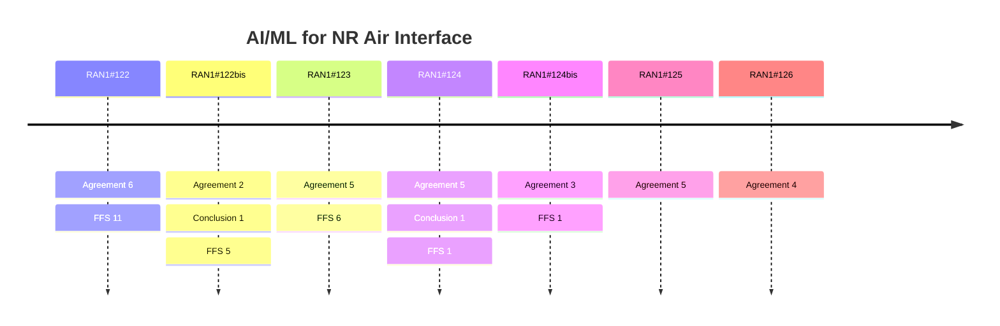

# AI/ML for NR Air Interface (Rel-20)

> 이 파일은 `scripts/generate_report.py`가 자동으로 생성합니다. 직접 수정하지 마세요.

## 회의별 진행

## 회의 간 변화 (Delta)

| 직전 → 최신 | 신규 결정 | WA 확정 | 직전 FFS | FFS 후속 결정 후보 | Agenda 신설 / 제외 |
|---|---|---|---|---|---|
| RAN1#125 → RAN1#126 | 4 | 0 | 0 | 0 | +0 / -0 |
| RAN1#124bis → RAN1#125 | 5 | 0 | 1 | 1 | +0 / -0 |
| RAN1#124 → RAN1#124bis | 3 | 0 | 1 | 0 | +0 / -1 |
| RAN1#123 → RAN1#124 | 6 | 0 | 6 | 0 | +1 / -1 |
| RAN1#122bis → RAN1#123 | 5 | 0 | 5 | 4 | +1 / -0 |
| RAN1#122 → RAN1#122bis | 3 | 0 | 11 | 1 | +0 / -1 |

### 최신 Delta 상세 (RAN1#125 → RAN1#126)

직전 회의 대비 Agenda 변화, WA 확정, FFS 후속 후보가 없습니다.

## 누적 히스토리

| 회의 | Agenda | 구분 | 내용 | 출처 |
|---|---|---|---|---|
| RAN1#122 | 10.1.2 | Agreement | For Option 4-1 under Direction A in AI/ML based CSI compression, support at least target CSI and CSI feedback in the exchanged dataset(s). - FFS: Target CSI type and format - FFS: CSI feedback type and format - FFS: Association between Target CSI and CSI feedback, including mapping for different number of Tx port, number of sub bands, and CSI payload size. | [Chair notes RAN1#122 eom](https://www.3gpp.org/ftp/tsg_ran/WG1_RL1/TSGR1_122/Inbox/Chair_notes/Chair%20notes%20RAN1%23122%20eom.zip) [R1-2506468](https://www.3gpp.org/ftp/tsg_ran/WG1_RL1/TSGR1_122/Docs/R1-2506468.zip) |
| RAN1#122 | 10.1.2 | Agreement | For Option 4-1 under Direction A in AI/ML based CSI compression, consider  the following methods for performance target in the exchanged dataset, - SGCS   - FFS: Average SGCS   - FFS: SGCS values at X-percentiles - NMSE:   - FFS: When the exchanged CSI feedback is the floating-point values at the input of quantization   - FFS: When the exchanged CSI feedback is the binary bit sequence at the output of quantization, the binary sequence will be mapped back to the floating-point values via quantization codebook - FFS: Multiple performance targets for different layer when the target CSI type is precoding matrix, different configurations such as antenna ports, subband configuration and payload size configuration | [Chair notes RAN1#122 eom](https://www.3gpp.org/ftp/tsg_ran/WG1_RL1/TSGR1_122/Inbox/Chair_notes/Chair%20notes%20RAN1%23122%20eom.zip) [R1-2506468](https://www.3gpp.org/ftp/tsg_ran/WG1_RL1/TSGR1_122/Docs/R1-2506468.zip) |
| RAN1#122 | 10.1.2 | Agreement | For Option 4-1 under Direction A in AI/ML based CSI compression, for CSI feedback type and format, down select one of the following options: - Option 1: The exchanged CSI feedback is the latent message before quantization. - Option 2: The exchanged CSI feedback is the binary sequence at the output of quantization. - Note: Quantization codebook is exchanged in addition if not specified in the spec. - Note: Whether or not using the Quantization codebook for model training, is up to UE implementation. | [Chair notes RAN1#122 eom](https://www.3gpp.org/ftp/tsg_ran/WG1_RL1/TSGR1_122/Inbox/Chair_notes/Chair%20notes%20RAN1%23122%20eom.zip) [R1-2506470](https://www.3gpp.org/ftp/tsg_ran/WG1_RL1/TSGR1_122/Docs/R1-2506470.zip) |
| RAN1#122 | 10.1.2 | Agreement | For Option 4-1 under Direction A in AI/ML based CSI compression, support exchange of single pairing ID along with dataset exchange. - One pairing ID is assigned to one dataset.   - The dataset can have different number of Tx port, number of subbands, and CSI payload size configurations (including different quantization codebooks if needed). - From RAN1 perspective, the uniqueness of the pairing ID needs further studied. - FFS: the impact on pairing ID(s) when additional data samples are added to an exchanged dataset, if supported. | [Chair notes RAN1#122 eom](https://www.3gpp.org/ftp/tsg_ran/WG1_RL1/TSGR1_122/Inbox/Chair_notes/Chair%20notes%20RAN1%23122%20eom.zip) [R1-2506470](https://www.3gpp.org/ftp/tsg_ran/WG1_RL1/TSGR1_122/Docs/R1-2506470.zip) |
| RAN1#122 | 10.1.2 | Agreement | For Option 4-1 under Direction A in AI/ML based CSI compression,  if the quantization codebook for CSI feedback is not fixed by the specification, support exchange of quantization codebook along with dataset exchange, - FFS: Quantization codebook exchange method (e.g, look up table, , or how to exchange quantization codebook related information, or other methods) - FFS: Common or different quantization codebook for different CSI payload size - Note: leveraging the discussion in agenda item 10.1.1.1 when applied | [Chair notes RAN1#122 eom](https://www.3gpp.org/ftp/tsg_ran/WG1_RL1/TSGR1_122/Inbox/Chair_notes/Chair%20notes%20RAN1%23122%20eom.zip) [R1-2506470](https://www.3gpp.org/ftp/tsg_ran/WG1_RL1/TSGR1_122/Docs/R1-2506470.zip) |
| RAN1#122 | 11.6 | Agreement | For 6GR AI/ML use cases identification/categorization, for each (sub-)use case proposed, proponent companies are encouraged to study and report the following: - Definition of each (sub-)use case, including at least AI/ML model input/output - The evaluation assumption, methodology, KPIs, benchmark, and preliminary simulation results - Assumption on training types, e.g.,   - offline training, online training/finetuning   - Label construction (if applicable), including whether/how to obtain label data for model training - Assumption on model location for inference, e.g., UE-sided model, NW-sided model, and two-sided model - Collaboration/interaction between UE and NW, e.g.,   - no collaboration/interaction   - UE/Network collaboration targeting at separate or joint ML operation - High level potential specification impact | [Chair notes RAN1#122 eom](https://www.3gpp.org/ftp/tsg_ran/WG1_RL1/TSGR1_122/Inbox/Chair_notes/Chair%20notes%20RAN1%23122%20eom.zip) `[122-R20-6GR-AI/ML]` |
| RAN1#122bis | 10.1.2 | Conclusion | For Option 4-1 under Direction A in AI/ML based CSI compression, there is no consensus to further study the necessity of sharing assisted information to align model design aspects. | [Chair notes RAN1#122b eom4](https://www.3gpp.org/ftp/tsg_ran/WG1_RL1/TSGR1_122b/Inbox/Chair_Notes/Chair%20notes%20RAN1%23122b%20eom4.docx) [R1-2507666](https://www.3gpp.org/ftp/tsg_ran/WG1_RL1/TSGR1_122b/Docs/R1-2507666.zip) |
| RAN1#122bis | 10.1.2 | Agreement | - For Option 4-1 under Direction A in AI/ML based CSI compression, both average SGCS and average NMSE as performance target in the exchanged dataset are supported. Both average SGCS and average NMSE are provided.   - NW side can optionally send NMSE and/or SGCS values at X-percentiles. | [Chair notes RAN1#122b eom4](https://www.3gpp.org/ftp/tsg_ran/WG1_RL1/TSGR1_122b/Inbox/Chair_Notes/Chair%20notes%20RAN1%23122b%20eom4.docx) [R1-2507666](https://www.3gpp.org/ftp/tsg_ran/WG1_RL1/TSGR1_122b/Docs/R1-2507666.zip) |
| RAN1#122bis | 10.1.2 | Agreement | For Option 4-1 under Direction A in AI/ML based CSI compression, for the association between target CSI and CSI feedback in the exchanged dataset. - Support 1:M mapping between one target CSI sample/set of samples to M CSI feedback samples/sets of samples associated with different CSI payload size configurations - FFS: Association between Target CSI and CSI feedback, including scalability related information for different number of Tx port, sub bands related information. - FFS: Whether/how Target CSI samples/set of samples within an exchanged dataset, with different Tx port and sub-band related information are organized. - FFS: Whether the Target CSI is per layer or per rank when Target CSI is precoder matrix. - FFS: Whether and how to support CSI feedback structure with different payload scalability options - FFS: Other details | [Chair notes RAN1#122b eom4](https://www.3gpp.org/ftp/tsg_ran/WG1_RL1/TSGR1_122b/Inbox/Chair_Notes/Chair%20notes%20RAN1%23122b%20eom4.docx) [R1-2507668](https://www.3gpp.org/ftp/tsg_ran/WG1_RL1/TSGR1_122b/Docs/R1-2507668.zip) |
| RAN1#123 | 10.1.2 | Agreement | When the target CSI is precoding matrix with port-subband domain representation, for the association between target CSI and CSI feedback in the exchanged dataset,     - A pairing ID has  target CSI sets,       - Each target CSI set has  target CSI samples, >1.       - Each target CSI sample within the same target CSI set k has a port dimension of N1x N2x2, and the maximum number of subbands, and a rank Vk       - Each target CSI sample within the same target CSI set k has Vk layers, ordered from the strongest to the weakest layer, where Vk is the rank     - Target CSI set k is associated with  CSI feedback sets,       - Each CSI feedback set corresponds to a specific per layer CSI payload size configuration for a rank and subband configuration   - FFS: rank (CSI feedback rank can be different compared to target CSI rank)   - FFS: whether per layer CSI payload size is the same for all the layers of all the samples of the same CSI feedback set.       - Each CSI feedback sample within the set includes CSI feedback per layer, ordered from the strongest to the weakest layer.       - The target CSI set and each of the corresponding CSI feedback set has the same number of samples     - Metadata:       - Per Target CSI set metadata: for each   set, number of samples , the port configuration of N1 and N2, subband size and BWP info (NR ARFCN of the lowest PRB of the BWP and BWP size and the SCS), rank Vk, number of associated CSI feedback set   - FFS: the number of aggregated CSI-RS resources for total number of antenna ports larger than 32, and the portMappingMethod applicable to aggregated resources - For each CSI feedback set metadata: CSI payload size configuration, subband configuration   - FFS: Additional CSI feedback metadata to indicate when specific scalability option is used in model design (e.g. truncation/masking) is used as CSI feedback payload scalability option.   - FFS: rank       - Other metadata are not precluded.       - How the association between the kth target CSI set and Mk CSI feedback sets is indicated is up to SA WG. | [Chair notes RAN1#123 - eom3](https://www.3gpp.org/ftp/tsg_ran/WG1_RL1/TSGR1_123/Inbox/Chair_notes/Chair%20notes%20RAN1%23123%20-%20eom3.docx) [R1-2509097](https://www.3gpp.org/ftp/tsg_ran/WG1_RL1/TSGR1_123/Docs/R1-2509097.zip) |
| RAN1#123 | 10.1.2 | Agreement | For Option 4-1 under Direction A in AI/ML based CSI compression: - Discuss whether to introduce linkage between multiple data sets having their own pairing IDs. - Discuss whether to introduce delivery of additional data set appending new samples on top of previously exchanged data set. | [Chair notes RAN1#123 - eom3](https://www.3gpp.org/ftp/tsg_ran/WG1_RL1/TSGR1_123/Inbox/Chair_notes/Chair%20notes%20RAN1%23123%20-%20eom3.docx) [R1-2509097](https://www.3gpp.org/ftp/tsg_ran/WG1_RL1/TSGR1_123/Docs/R1-2509097.zip) |
| RAN1#123 | 11.6 | Agreement | From RAN 1 perspective, the following use cases can be matched to the identified primary agendas of RAN1 \| Use cases \| Use cases \| Use cases \| Primary agendas \| \| Low overhead CSI-RS or CSI prediction with AI/ML \| Low overhead CSI-RS or CSI prediction with AI/ML \| Low overhead CSI-RS or CSI prediction with AI/ML \| CSI-RS and CSI acquisition \| \| Low overhead DMRS with AI/ML receiver \| Low overhead DMRS with AI/ML receiver \| Low overhead DMRS with AI/ML receiver \| UL & DL DMRS associated with PUSCH/PDSCH Note: Sub-Case C: DMRS-free may be related to modulation \| \| CSI compression and feedback \| CSI compression and feedback \| CSI compression and feedback \| CSI acquisition Note: this may be related to uplink control \| \| AI/ML for beam management and extension \| AI/ML for beam management and extension \| AI/ML for beam management and extension \| Initial access for Sub-case D Beam management for other sub-cases Note: sub-case A/B/D maybe related to mobility \| \| AI/ML for SRS \| AI/ML for SRS \| Low overhead SRS with AI/ML \| SRS \| \| AI/ML for SRS \| AI/ML for SRS \| Low PAPR SRS sequence design \| SRS \| \| AI/ML for SRS \| AI/ML for SRS \| AI/ML based SRS power imbalance compensation \| Not RAN1-led \| \| AI-enabled UL precoder indication \| AI-enabled UL precoder indication \| AI-enabled UL precoder indication \| UL MIMO \| \| AI-based non-linearity handling at transmitter or receiver \| AI-based non-linearity handling at transmitter or receiver \| AI-based non-linearity handling at transmitter or receiver \| Not RAN1-led Note: this may be related to DMRS, SRS, Power control in RAN 1 \| \| AI/ML for (de)modulation \| AI/ML for (de)modulation \| AI/ML for (de)modulation \| modulation Note: Sub-case B may be related to MIMO Note: assuming no change to DMRS \| \| AI/ML based waveform for PAPR reduction \| AI/ML based waveform for PAPR reduction \| AI/ML based waveform for PAPR reduction \| Waveform \| \| AI/ML based HARQ-ACK feedback \| AI/ML based HARQ-ACK feedback \| AI/ML based HARQ-ACK feedback \| Channel coding Note: this may be related to uplink control \| \| PDCCH related \| PDCCH related \| Prior-Information-Aided DCI Decoding \| DL control \| \| PDCCH related \| PDCCH related \| Lossless DCI Compression \| DL control \| \| Power control related \| Power control related \| UL closed-loop power control \| Power control \| \| Power control related \| Power control related \| Pathloss prediction \| Power control \| \| RACH related design \| RACH related design \| Early contention resolution in RACH \| Random access/PRACH \| \| RACH related design \| RACH related design \| Low PAPR PRACH sequence design \| Random access/PRACH \| \| Site Specific Learning for AI/ML using RAN Digital Twin \| Site Specific Learning for AI/ML using RAN Digital Twin \| Site Specific Learning for AI/ML using RAN Digital Twin \| Depending on corresponding use case where site specific learning is applicable, e.g., DMRS \| \| Digital twin construction related use cases \| AI/ML-enabled RAN digital twin with distributed model \| AI/ML-enabled RAN digital twin with distributed model \| ISAC \| \| Digital twin construction related use cases \| Sensing based RAN digital twin construction with NW-side AI/ML model \| Sensing based RAN digital twin construction with NW-side AI/ML model \| ISAC \| \| AI for positioning \| AI for positioning \| AI for positioning \| Positioning related agenda, if any \| \| To accommodate AI/ML service, e.g., token traffic \| if any impact, most likely scheduling/HARQ \| \| To accommodate AI/ML service, e.g., token traffic \| if any impact, most likely scheduling/HARQ \| | [Chair notes RAN1#123 - eom3](https://www.3gpp.org/ftp/tsg_ran/WG1_RL1/TSGR1_123/Inbox/Chair_notes/Chair%20notes%20RAN1%23123%20-%20eom3.docx) `[123-R20-6GR-AI/ML]` |
| RAN1#123 | 11.6 | Agreement | Endorse observation 2.1 ~observation 2.17 in R1-2508811 section 6. Note: this is to replace the corresponding observation in RAN 1 #122bis | [Chair notes RAN1#123 - eom3](https://www.3gpp.org/ftp/tsg_ran/WG1_RL1/TSGR1_123/Inbox/Chair_notes/Chair%20notes%20RAN1%23123%20-%20eom3.docx) `[123-R20-6GR-AI/ML]` |
| RAN1#123 | 11.6 | Agreement | For study/evaluation of the performance and feasibility of AI/ML use cases in 6GR, at least the following may be considered   - Intermediate performance KPIs (e.g., SGCS), link level KPIs (e.g., BLER) and system level KPIs (e.g., throughput vs overhead), etc   - Computation complexity/latency (inference/monitoring)   - Power consumption, if feasible to evaluate   - Model size   - Data collection impact   - Scalability (refer to the examples in TR 38.843)   - Generalization performance     - FFS on whether and how to consider realistic deployment scenarios   - Overhead/complexity associated with data collection, inferencing, performance monitoring, online/site specific fine-tuning, inter-vendor collaboration (if applicable)   - Online training/fine-tuning training latency, if feasible to evaluate   - Inter-vendor collaboration impact, if applicable Note: Details to be discussed per use case. Note: above aspects may be considered for both AI/ML and non-AI counter part | [Chair notes RAN1#123 - eom3](https://www.3gpp.org/ftp/tsg_ran/WG1_RL1/TSGR1_123/Inbox/Chair_notes/Chair%20notes%20RAN1%23123%20-%20eom3.docx) `[123-R20-6GR-AI/ML]` |
| RAN1#124 | 10.9 | Agreement | LS R1-2601598 is endorsed. | [Chair notes RAN1#124 - eom_03](https://www.3gpp.org/ftp/tsg_ran/WG1_RL1/TSGR1_124/Inbox/Chair_notes/Chair%20notes%20RAN1%23124%20-%20eom_03.docx) `[124-R20-AI/ML for RAN#111]` |
| RAN1#124 | 9.1.2 | Agreement | For Option 4-1 under Direction A in AI/ML based CSI compression, for target CSI format, adopt scalar quantization (same format as NW side data collection). - FFS: Larger k1 and k2 values can be considered as opposed to NW data collection. | [Chair notes RAN1#124 - eom_03](https://www.3gpp.org/ftp/tsg_ran/WG1_RL1/TSGR1_124/Inbox/Chair_notes/Chair%20notes%20RAN1%23124%20-%20eom_03.docx) [R1-2601150](https://www.3gpp.org/ftp/tsg_ran/WG1_RL1/TSGR1_124/Docs/R1-2601150.zip) |
| RAN1#124 | 9.1.2 | Agreement | For model pairing procedure at least for inference, a pairing ID corresponding to Direction C is associated with a fully standardized reference model. | [Chair notes RAN1#124 - eom_03](https://www.3gpp.org/ftp/tsg_ran/WG1_RL1/TSGR1_124/Inbox/Chair_notes/Chair%20notes%20RAN1%23124%20-%20eom_03.docx) [R1-2601150](https://www.3gpp.org/ftp/tsg_ran/WG1_RL1/TSGR1_124/Docs/R1-2601150.zip) |
| RAN1#124 | 9.1.2 | Agreement | For Direction A Option 3a-1, support exchange of single pairing ID along with model parameter exchange corresponding to the standardized reference encoder model structure. | [Chair notes RAN1#124 - eom_03](https://www.3gpp.org/ftp/tsg_ran/WG1_RL1/TSGR1_124/Inbox/Chair_notes/Chair%20notes%20RAN1%23124%20-%20eom_03.docx) [R1-2601151](https://www.3gpp.org/ftp/tsg_ran/WG1_RL1/TSGR1_124/Docs/R1-2601151.zip) |
| RAN1#124 | 9.1.2 | Conclusion | For the signaling discussion of direction A option 3a-1, RAN1 assumes the same model parameter description format for parameter exchange as RAN4 will use to describe the reference model in Direction C. Note: RAN1 will not discuss dedicated model parameter description format for option 3a-1. | [Chair notes RAN1#124 - eom_03](https://www.3gpp.org/ftp/tsg_ran/WG1_RL1/TSGR1_124/Inbox/Chair_notes/Chair%20notes%20RAN1%23124%20-%20eom_03.docx) [R1-2601152](https://www.3gpp.org/ftp/tsg_ran/WG1_RL1/TSGR1_124/Docs/R1-2601152.zip) |
| RAN1#124 | 9.1.2 | Agreement | The draft LS R1-2601717 is endorsed with the following changes and re-arrangement of the paragraph before the table. The final LS in R1-2601718 is endorsed. Based on the above RAN4 LS, RAN1 will work on the signaling design and parameter set exchange to support Direction A option 3a-1, RAN1 assumes that the RAN4 specified reference model structure(s) will be scalable across different number of Tx ports, and/or different subbands configurations, and/or different CSI payload size configurations. RAN1 agreed the following CSI payload size configurations of different {d, Q} for SQ, where d denotes the length of latent message and Q denotes the number of quantization bit(s) per element in the latent message. Support of {32,1} is up to UE capability. | [Chair notes RAN1#124 - eom_03](https://www.3gpp.org/ftp/tsg_ran/WG1_RL1/TSGR1_124/Inbox/Chair_notes/Chair%20notes%20RAN1%23124%20-%20eom_03.docx) [R1-2601152](https://www.3gpp.org/ftp/tsg_ran/WG1_RL1/TSGR1_124/Docs/R1-2601152.zip) |
| RAN1#124bis | 9.1.2 | Agreement | For Option 4-1 under Direction A in AI/ML based CSI compression, when the target CSI is precoding matrix with port-subband domain representation and the target CSI set k is associated with  set of CSI feedback set - Support per-layer CSI feedback payload parameter pair   - For layer 1/2/3, support {32, 2}, {64, 2}, {96,2}, {128, 2}, {192, 2}, {32,1}   - For layer 4, support {32, 2}, {64, 2}, {96,2}, {32,1}   - FFS: The number of layers in the CSI feedback set is <= the number of layers in the target CSI set. - Note: NW may only exchange a subset of the CSI feedback payload from the list. | [Chair notes RAN1#124bis_eom5](https://www.3gpp.org/ftp/tsg_ran/WG1_RL1/TSGR1_124b/Inbox/Chair_notes/Chair%20notes%20RAN1%23124bis_eom5.docx) |
| RAN1#124bis | 9.1.2 | Agreement | For Option 4-1 under Direction A in AI/ML based CSI compression, the performance targets are exchanged per layer  per CSI feedback set (), where the CSI feedback set () is the mth out of Mk CSI feedbacks set corresponding to the kth target CSI set. | [Chair notes RAN1#124bis_eom5](https://www.3gpp.org/ftp/tsg_ran/WG1_RL1/TSGR1_124b/Inbox/Chair_notes/Chair%20notes%20RAN1%23124bis_eom5.docx) |
| RAN1#124bis | 9.1.2 | Agreement | For Option 4-1 under Direction A in AI/ML based CSI compression, - One-to-one mapping between pairing ID and exchanged dataset. There is no linkage between different data sets. | [Chair notes RAN1#124bis_eom5](https://www.3gpp.org/ftp/tsg_ran/WG1_RL1/TSGR1_124b/Inbox/Chair_notes/Chair%20notes%20RAN1%23124bis_eom5.docx) [R1-2602692](https://www.3gpp.org/ftp/tsg_ran/WG1_RL1/TSGR1_124b/Docs/R1-2602692.zip) |
| RAN1#125 | 9.1.2 | Agreement | For Option 4-1 under Direction A in AI/ML based CSI compression, for CSI feedback type and format, supports: - The exchanged CSI feedback is the latent message before quantization represented using floating format, e.g., float 32. | [Chair notes RAN1#125_eom](https://www.3gpp.org/ftp/tsg_ran/WG1_RL1/TSGR1_125/Inbox/Chair_notes/Chair%20notes%20RAN1%23125_eom.docx) [R1-2603839](https://www.3gpp.org/ftp/tsg_ran/WG1_RL1/TSGR1_125/Docs/R1-2603839.zip) |
| RAN1#125 | 9.1.2 | Agreement | For Option 4-1 under Direction A in AI/ML based CSI compression, when the target CSI is precoding matrix with port-subband domain representation and the target CSI set k is associated with  set of CSI feedback set, - The number of layers in the CSI feedback set is <= the number of layers in the target CSI set. - Note: This does not mean network side data collection is rank agnostic. Data quality for network side data collection is a separate discussion. | [Chair notes RAN1#125_eom](https://www.3gpp.org/ftp/tsg_ran/WG1_RL1/TSGR1_125/Inbox/Chair_notes/Chair%20notes%20RAN1%23125_eom.docx) [R1-2603839](https://www.3gpp.org/ftp/tsg_ran/WG1_RL1/TSGR1_125/Docs/R1-2603839.zip) |
| RAN1#125 | 9.1.2 | Agreement | For Option 4-1, for a CSI feedback set associated with the -th Target CSI set andthe m-th payload size configuration, and a given subband configuration including N subbands, - the SGCS value associated with the l-th layer of the s-th CSI feedback sample is defined by where  is the reconstructed precoding vector for the l-th layer, the m-th payload size configuration, and the n-th subband, corresponding to  , and  is the precoder represented by the s-th Target CSI sample of the k-th Target CSI set for the same l-th layer and the n-th subband. The average SGCS and X-percentile of SGCS are derived based on the . | [Chair notes RAN1#125_eom](https://www.3gpp.org/ftp/tsg_ran/WG1_RL1/TSGR1_125/Inbox/Chair_notes/Chair%20notes%20RAN1%23125_eom.docx) [R1-2603839](https://www.3gpp.org/ftp/tsg_ran/WG1_RL1/TSGR1_125/Docs/R1-2603839.zip) |
| RAN1#125 | 9.1.2 | Agreement | Draft LS response in R1-2605088, is endorsed with the following changes in red, and updating the fields in heading for “to: SA5”, and “CC: RAN2/RAN3”. \| Regarding “Are there any requirements or assumptions related to scenarios where a gNB generates multiple datasets (e.g. impact on pairing ID association or reuse)”, and “Additionally, once a dataset is generated and transferred to the UE-side training entity, what is the expected behaviour of the pairing ID if the dataset is updated (e.g. unchanged, replaced, or re-assigned)?”, for the above questions, “Based on RAN1 agreements, a different pairing ID shall be assigned to each of the dataset, including the updated dataset. If the dataset is updated, the updated dataset is considered as a separate dataset from RAN1 perspective. “ \| The corresponding final LS in R1-2605089 is endorsed. | [Chair notes RAN1#125_eom](https://www.3gpp.org/ftp/tsg_ran/WG1_RL1/TSGR1_125/Inbox/Chair_notes/Chair%20notes%20RAN1%23125_eom.docx) [R1-2603840](https://www.3gpp.org/ftp/tsg_ran/WG1_RL1/TSGR1_125/Docs/R1-2603840.zip) |
| RAN1#125 | 9.1.2 | Agreement | Draft LS response in R1-2605099, is endorsed with the following changes in red, and updating the fields in heading for “to: RAN2”, CC: -”. \| Regarding “Q3: Besides the pairing ID, what other parameters are necessary in the candidate UE-side data collection configuration?”, RAN1 has the following agreement. On With respect to Q1 and Q2, RAN1 is currently discussing related aspects will reply once RAN1 reach agreement. \| The corresponding final LS in R1-2605100 is endorsed. | [Chair notes RAN1#125_eom](https://www.3gpp.org/ftp/tsg_ran/WG1_RL1/TSGR1_125/Inbox/Chair_notes/Chair%20notes%20RAN1%23125_eom.docx) [R1-2603840](https://www.3gpp.org/ftp/tsg_ran/WG1_RL1/TSGR1_125/Docs/R1-2603840.zip) |
| RAN1#126 | 9.1.2 | Agreement | For the association between Target CSI and CSI feedback in Option 4-1, support CSI feedback rank as part of each CSI feedback set metadata. | [Chair notes RAN1#126_eom1](https://www.3gpp.org/ftp/tsg_ran/WG1_RL1/TSGR1_126/Inbox/Chair_notes/Chair%20notes%20RAN1%23126_eom1.docx) [R1-2606012](https://www.3gpp.org/ftp/tsg_ran/WG1_RL1/TSGR1_126/Docs/R1-2606012.zip) |
| RAN1#126 | 9.1.2 | Agreement | For Option 4-1, for a CSI feedback set associated with the -th Target CSI set andthe m-th payload size configuration, - the NMSE value associated with the l-th layer of the s-th CSI feedback sample is defined by where  is the generated CSI feedback vector for the l-th layer, the m-th payload size configuration, and the -th Target CSI set corresponding to .  is the floating-point CSI feedback vector for the same l-th layer, the same m-th payload size configuration, and the same -th Target CSI set provided in the exchanged dataset. The average NMSE and X-percentile of NMSE are derived based on the  . | [Chair notes RAN1#126_eom1](https://www.3gpp.org/ftp/tsg_ran/WG1_RL1/TSGR1_126/Inbox/Chair_notes/Chair%20notes%20RAN1%23126_eom1.docx) [R1-2606012](https://www.3gpp.org/ftp/tsg_ran/WG1_RL1/TSGR1_126/Docs/R1-2606012.zip) |
| RAN1#126 | 9.1.2 | Agreement | For Option 4-1 under Direction A in AI/ML based CSI compression, for the format of the NMSE and SGCS performance target, use the 32-bit floating point representation. | [Chair notes RAN1#126_eom1](https://www.3gpp.org/ftp/tsg_ran/WG1_RL1/TSGR1_126/Inbox/Chair_notes/Chair%20notes%20RAN1%23126_eom1.docx) [R1-2606012](https://www.3gpp.org/ftp/tsg_ran/WG1_RL1/TSGR1_126/Docs/R1-2606012.zip) |
| RAN1#126 | 9.1.2 | Agreement | For Direction A, Option 3a-1, combination(s) of the configuration parameters to which the exchanged model parameters apply are provided along with the model parameters. These configuration parameters include: - The port number configuration of N1 and N2, subband size and BWP info (NR ARFCN of the lowest PRB of the BWP and BWP size and the SCS), - CSI payload size configuration per layer - Subband configuration - Rank Note: The port mapping method is separately discussed for both Option 3a-1 and Option 4-1 whether to be applied to either or both or none of them. | [Chair notes RAN1#126_eom1](https://www.3gpp.org/ftp/tsg_ran/WG1_RL1/TSGR1_126/Inbox/Chair_notes/Chair%20notes%20RAN1%23126_eom1.docx) [R1-2606012](https://www.3gpp.org/ftp/tsg_ran/WG1_RL1/TSGR1_126/Docs/R1-2606012.zip) |
