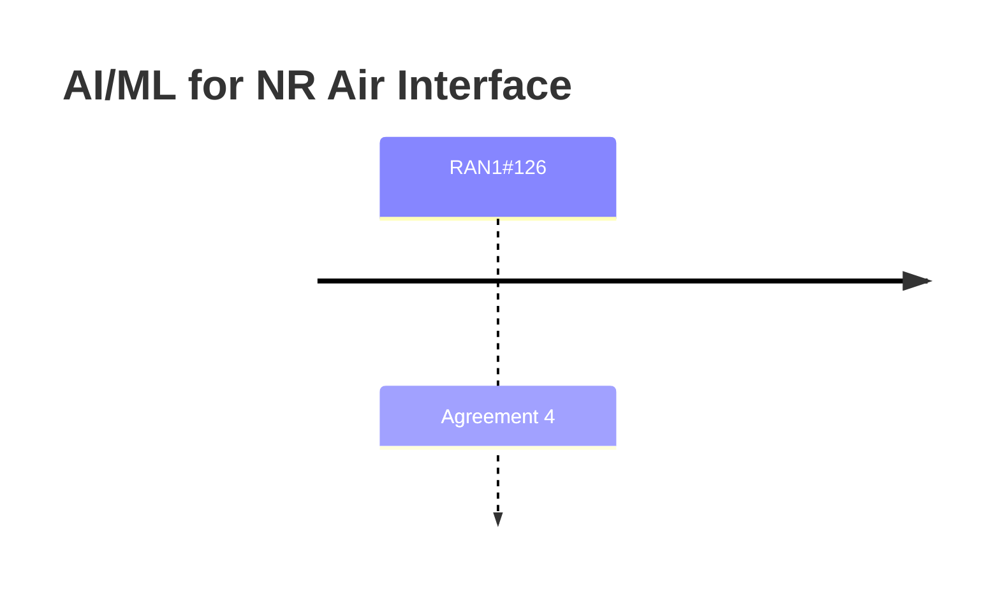

# AI/ML for NR Air Interface (Rel-20)

> 이 파일은 `scripts/generate_report.py`가 자동으로 생성합니다. 직접 수정하지 마세요.

## 회의별 진행

## 누적 히스토리

| 회의 | Agenda | 구분 | 내용 | 출처 |
|---|---|---|---|---|
| RAN1#126 | 9.1.2 | Agreement | For the association between Target CSI and CSI feedback in Option 4-1, support CSI feedback rank as part of each CSI feedback set metadata. | [Chair notes RAN1#126_eom1](https://www.3gpp.org/ftp/tsg_ran/WG1_RL1/TSGR1_126/Inbox/Chair_notes/Chair%20notes%20RAN1%23126_eom1.docx) [R1-2606012](https://www.3gpp.org/ftp/tsg_ran/WG1_RL1/TSGR1_126/Docs/R1-2606012.zip) |
| RAN1#126 | 9.1.2 | Agreement | For Option 4-1, for a CSI feedback set associated with the -th Target CSI set andthe m-th payload size configuration, - the NMSE value associated with the l-th layer of the s-th CSI feedback sample is defined by where  is the generated CSI feedback vector for the l-th layer, the m-th payload size configuration, and the -th Target CSI set corresponding to .  is the floating-point CSI feedback vector for the same l-th layer, the same m-th payload size configuration, and the same -th Target CSI set provided in the exchanged dataset. The average NMSE and X-percentile of NMSE are derived based on the  . | [Chair notes RAN1#126_eom1](https://www.3gpp.org/ftp/tsg_ran/WG1_RL1/TSGR1_126/Inbox/Chair_notes/Chair%20notes%20RAN1%23126_eom1.docx) [R1-2606012](https://www.3gpp.org/ftp/tsg_ran/WG1_RL1/TSGR1_126/Docs/R1-2606012.zip) |
| RAN1#126 | 9.1.2 | Agreement | For Option 4-1 under Direction A in AI/ML based CSI compression, for the format of the NMSE and SGCS performance target, use the 32-bit floating point representation. | [Chair notes RAN1#126_eom1](https://www.3gpp.org/ftp/tsg_ran/WG1_RL1/TSGR1_126/Inbox/Chair_notes/Chair%20notes%20RAN1%23126_eom1.docx) [R1-2606012](https://www.3gpp.org/ftp/tsg_ran/WG1_RL1/TSGR1_126/Docs/R1-2606012.zip) |
| RAN1#126 | 9.1.2 | Agreement | For Direction A, Option 3a-1, combination(s) of the configuration parameters to which the exchanged model parameters apply are provided along with the model parameters. These configuration parameters include: - The port number configuration of N1 and N2, subband size and BWP info (NR ARFCN of the lowest PRB of the BWP and BWP size and the SCS), - CSI payload size configuration per layer - Subband configuration - Rank Note: The port mapping method is separately discussed for both Option 3a-1 and Option 4-1 whether to be applied to either or both or none of them. | [Chair notes RAN1#126_eom1](https://www.3gpp.org/ftp/tsg_ran/WG1_RL1/TSGR1_126/Inbox/Chair_notes/Chair%20notes%20RAN1%23126_eom1.docx) [R1-2606012](https://www.3gpp.org/ftp/tsg_ran/WG1_RL1/TSGR1_126/Docs/R1-2606012.zip) |
