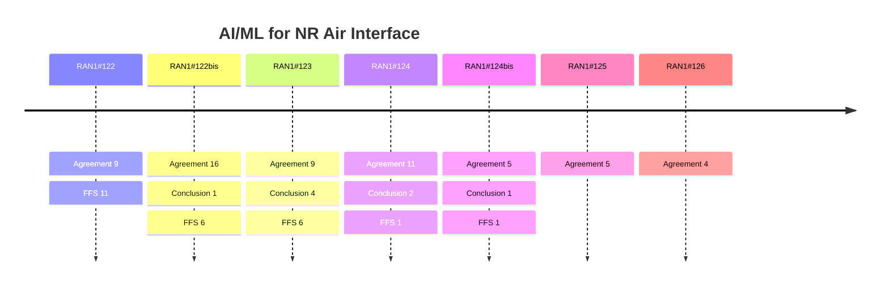

# AI/ML for NR Air Interface (Rel-20)

> 이 파일은 `scripts/generate_report.py`가 자동으로 생성합니다. 직접 수정하지 마세요.

## 회의별 진행

## 누적 히스토리

| 회의 | Agenda | 구분 | 내용 | 출처 |
|---|---|---|---|---|
| RAN1#122 | 10.1.2 | Agreement | For Option 4-1 under Direction A in AI/ML based CSI compression, support at least target CSI and CSI feedback in the exchanged dataset(s). - FFS: Target CSI type and format - FFS: CSI feedback type and format - FFS: Association between Target CSI and CSI feedback, including mapping for different number of Tx port, number of sub bands, and CSI payload size. | [Chair notes RAN1#122 eom](https://www.3gpp.org/ftp/tsg_ran/WG1_RL1/TSGR1_122/Inbox/Chair_notes/Chair%20notes%20RAN1%23122%20eom.zip) [R1-2506468](https://www.3gpp.org/ftp/tsg_ran/WG1_RL1/TSGR1_122/Docs/R1-2506468.zip) |
| RAN1#122 | 10.1.2 | Agreement | For Option 4-1 under Direction A in AI/ML based CSI compression, consider  the following methods for performance target in the exchanged dataset, - SGCS   - FFS: Average SGCS   - FFS: SGCS values at X-percentiles - NMSE:   - FFS: When the exchanged CSI feedback is the floating-point values at the input of quantization   - FFS: When the exchanged CSI feedback is the binary bit sequence at the output of quantization, the binary sequence will be mapped back to the floating-point values via quantization codebook - FFS: Multiple performance targets for different layer when the target CSI type is precoding matrix, different configurations such as antenna ports, subband configuration and payload size configuration | [Chair notes RAN1#122 eom](https://www.3gpp.org/ftp/tsg_ran/WG1_RL1/TSGR1_122/Inbox/Chair_notes/Chair%20notes%20RAN1%23122%20eom.zip) [R1-2506468](https://www.3gpp.org/ftp/tsg_ran/WG1_RL1/TSGR1_122/Docs/R1-2506468.zip) |
| RAN1#122 | 10.1.2 | Agreement | For Option 4-1 under Direction A in AI/ML based CSI compression, for CSI feedback type and format, down select one of the following options: - Option 1: The exchanged CSI feedback is the latent message before quantization. - Option 2: The exchanged CSI feedback is the binary sequence at the output of quantization. - Note: Quantization codebook is exchanged in addition if not specified in the spec. - Note: Whether or not using the Quantization codebook for model training, is up to UE implementation. | [Chair notes RAN1#122 eom](https://www.3gpp.org/ftp/tsg_ran/WG1_RL1/TSGR1_122/Inbox/Chair_notes/Chair%20notes%20RAN1%23122%20eom.zip) [R1-2506470](https://www.3gpp.org/ftp/tsg_ran/WG1_RL1/TSGR1_122/Docs/R1-2506470.zip) |
| RAN1#122 | 10.1.2 | Agreement | For Option 4-1 under Direction A in AI/ML based CSI compression, support exchange of single pairing ID along with dataset exchange. - One pairing ID is assigned to one dataset.   - The dataset can have different number of Tx port, number of subbands, and CSI payload size configurations (including different quantization codebooks if needed). - From RAN1 perspective, the uniqueness of the pairing ID needs further studied. - FFS: the impact on pairing ID(s) when additional data samples are added to an exchanged dataset, if supported. | [Chair notes RAN1#122 eom](https://www.3gpp.org/ftp/tsg_ran/WG1_RL1/TSGR1_122/Inbox/Chair_notes/Chair%20notes%20RAN1%23122%20eom.zip) [R1-2506470](https://www.3gpp.org/ftp/tsg_ran/WG1_RL1/TSGR1_122/Docs/R1-2506470.zip) |
| RAN1#122 | 10.1.2 | Agreement | For Option 4-1 under Direction A in AI/ML based CSI compression,  if the quantization codebook for CSI feedback is not fixed by the specification, support exchange of quantization codebook along with dataset exchange, - FFS: Quantization codebook exchange method (e.g, look up table, , or how to exchange quantization codebook related information, or other methods) - FFS: Common or different quantization codebook for different CSI payload size - Note: leveraging the discussion in agenda item 10.1.1.1 when applied | [Chair notes RAN1#122 eom](https://www.3gpp.org/ftp/tsg_ran/WG1_RL1/TSGR1_122/Inbox/Chair_notes/Chair%20notes%20RAN1%23122%20eom.zip) [R1-2506470](https://www.3gpp.org/ftp/tsg_ran/WG1_RL1/TSGR1_122/Docs/R1-2506470.zip) |
| RAN1#122 | 11.6 | Agreement | For 6GR AI/ML use cases identification/categorization, for each (sub-)use case proposed, proponent companies are encouraged to study and report the following: - Definition of each (sub-)use case, including at least AI/ML model input/output - The evaluation assumption, methodology, KPIs, benchmark, and preliminary simulation results - Assumption on training types, e.g.,   - offline training, online training/finetuning   - Label construction (if applicable), including whether/how to obtain label data for model training - Assumption on model location for inference, e.g., UE-sided model, NW-sided model, and two-sided model - Collaboration/interaction between UE and NW, e.g.,   - no collaboration/interaction   - UE/Network collaboration targeting at separate or joint ML operation - High level potential specification impact | [Chair notes RAN1#122 eom](https://www.3gpp.org/ftp/tsg_ran/WG1_RL1/TSGR1_122/Inbox/Chair_notes/Chair%20notes%20RAN1%23122%20eom.zip) `[122-R20-6GR-AI/ML]` |
| RAN1#122 | 8.1 | Agreement | TP included in R1-250xxxx for TR 38.843 is endorsed in principle. Corresponding CR in R1-2506677 for TR 38.843 is endorsed. | [Chair notes RAN1#122 eom](https://www.3gpp.org/ftp/tsg_ran/WG1_RL1/TSGR1_122/Inbox/Chair_notes/Chair%20notes%20RAN1%23122%20eom.zip) `[122-R19-AI/ML]` |
| RAN1#122 | 8.1 | Agreement | Adopt the following TP in section 5.2.1.6, TS 38.214. | [Chair notes RAN1#122 eom](https://www.3gpp.org/ftp/tsg_ran/WG1_RL1/TSGR1_122/Inbox/Chair_notes/Chair%20notes%20RAN1%23122%20eom.zip) [R1-2506557](https://www.3gpp.org/ftp/tsg_ran/WG1_RL1/TSGR1_122/Docs/R1-2506557.zip) `[122-R19-AI/ML]` |
| RAN1#122 | 8.1 | Agreement | The Draft CR in R1-2506171 for TR 38.843 is endorsed. | [Chair notes RAN1#122 eom](https://www.3gpp.org/ftp/tsg_ran/WG1_RL1/TSGR1_122/Inbox/Chair_notes/Chair%20notes%20RAN1%23122%20eom.zip) [R1-2506171](https://www.3gpp.org/ftp/tsg_ran/WG1_RL1/TSGR1_122/Docs/R1-2506171.zip) `[122-R19-AI/ML]` |
| RAN1#122bis | 10.1.2 | Conclusion | For Option 4-1 under Direction A in AI/ML based CSI compression, there is no consensus to further study the necessity of sharing assisted information to align model design aspects. | [Chair notes RAN1#122b eom4](https://www.3gpp.org/ftp/tsg_ran/WG1_RL1/TSGR1_122b/Inbox/Chair_Notes/Chair%20notes%20RAN1%23122b%20eom4.docx) [R1-2507666](https://www.3gpp.org/ftp/tsg_ran/WG1_RL1/TSGR1_122b/Docs/R1-2507666.zip) |
| RAN1#122bis | 10.1.2 | Agreement | - For Option 4-1 under Direction A in AI/ML based CSI compression, both average SGCS and average NMSE as performance target in the exchanged dataset are supported. Both average SGCS and average NMSE are provided.   - NW side can optionally send NMSE and/or SGCS values at X-percentiles. | [Chair notes RAN1#122b eom4](https://www.3gpp.org/ftp/tsg_ran/WG1_RL1/TSGR1_122b/Inbox/Chair_Notes/Chair%20notes%20RAN1%23122b%20eom4.docx) [R1-2507666](https://www.3gpp.org/ftp/tsg_ran/WG1_RL1/TSGR1_122b/Docs/R1-2507666.zip) |
| RAN1#122bis | 10.1.2 | Agreement | For Option 4-1 under Direction A in AI/ML based CSI compression, for the association between target CSI and CSI feedback in the exchanged dataset. - Support 1:M mapping between one target CSI sample/set of samples to M CSI feedback samples/sets of samples associated with different CSI payload size configurations - FFS: Association between Target CSI and CSI feedback, including scalability related information for different number of Tx port, sub bands related information. - FFS: Whether/how Target CSI samples/set of samples within an exchanged dataset, with different Tx port and sub-band related information are organized. - FFS: Whether the Target CSI is per layer or per rank when Target CSI is precoder matrix. - FFS: Whether and how to support CSI feedback structure with different payload scalability options - FFS: Other details | [Chair notes RAN1#122b eom4](https://www.3gpp.org/ftp/tsg_ran/WG1_RL1/TSGR1_122b/Inbox/Chair_Notes/Chair%20notes%20RAN1%23122b%20eom4.docx) [R1-2507668](https://www.3gpp.org/ftp/tsg_ran/WG1_RL1/TSGR1_122b/Docs/R1-2507668.zip) |
| RAN1#122bis | 8.1 | Agreement | The following TP for TS 38.214 Clause 5.2.1.4.3b is endorsed. Reason for change: The slot of transmission occasion for monitoring is unclear for the linkage of the corresponding CSI report for inference. Summary of change: Clarify the first slot of transmission occasion for monitoring is used for the linkage. Consequences if not approved: gNB and UE may have different understanding on the linkage. \| TS 38.214 Clause 5.2.1.4.3b RS-PAI Reporting <omitted texts> - check a condition : - for the transmission occasion of the second CSI Reporting Setting, there is a linked report of the first CSI Reporting Setting. When nroftimeinstance-r19 is not configured in the first Reporting Setting, the linking is determined if CSI reference resource of a report of the first CSI Reporting Setting has a minimal slot offset, no larger than 64 slots, from the first slot of the transmission occasion of the corresponding Resource Set for channel measurement of the second CSI Reporting Setting. When nroftimeinstance-r19 is configured in the first Reporting Setting, timeinstanceformonitoring-r19 configured in the second CSI Reporting Setting indicates the timeinstanceformonitoring-r19-th time instance among nroftimeinstance-r19 time instance(s), and the linking is determined if the slot corresponding to the time instance indicated by timeinstanceformonitoring-r19 of a report of the first CSI Reporting Setting has a minimal slot offset, no larger than 64 slots, from the first slot of the transmission occasion of the corresponding Resource Set for channel measurement of the second CSI Reporting Setting; <omitted texts> \| | [Chair notes RAN1#122b eom4](https://www.3gpp.org/ftp/tsg_ran/WG1_RL1/TSGR1_122b/Inbox/Chair_Notes/Chair%20notes%20RAN1%23122b%20eom4.docx) [R1-2507998](https://www.3gpp.org/ftp/tsg_ran/WG1_RL1/TSGR1_122b/Docs/R1-2507998.zip) `[122bis-R19-AI/ML]` |
| RAN1#122bis | 8.1 | Agreement | The following TP for 38.214 Clause 6.2.1.3 is endorsed. Reason for change: P-CRI/P-SSBRI/RS-PAI/P-L1-RSRP is missing in the prioritization rules between a transmission of SRS and transmission of a physical signal/channel. Summary of change: Add P-CRI/P-SSBRI/RS-PAI/P-L1-RSRP in the prioritization rules. Consequences if not approved: the prioritization rules between a transmission of SRS and transmission of a physical signal/channel with P-CRI/P-SSBRI/RS-PAI/P-L1-RSRP is unclear. \| 6.2.1.3 UE sounding procedure between component carriers <omitted text> The following prioritization rules shall be applied in case of collision between a transmission of SRS over carrier and transmission of a physical signal/channel over a carrier of a serving cell in set - the UE shall not transmit SRS whenever SRS transmission (including any interruption due to uplink or downlink RF retuning time [11, TS 38.133] as defined by higher layer parameters switchingTimeUL and switchingTimeDL of SRS-SwitchingTimeNR) on the carrier of the serving cell and PUSCH/PUCCH transmission carrying HARQ-ACK/positive SR/RI/CRI/SSBRI/P-CRI/P-SSBRI/RS-PAI and/or PRACH on a carrier of a serving cell in set happen to overlap in the same symbol - the UE shall not transmit a periodic/semi-persistent SRS whenever periodic/semi-persistent SRS transmission (including any interruption due to uplink or downlink RF retuning time [11, TS 38.133] as defined by higher layer parameters switchingTimeUL and switchingTimeDL of SRS-SwitchingTimeNR) on the carrier of the serving cell and PUSCH transmission carrying aperiodic CSI on a carrier of a serving cell in set happen to overlap in the same symbol - the UE shall drop PUCCH/PUSCH transmission carrying periodic/semi-persistent CSI comprising only CQI/PMI/L1-RSRP/L1-SINR/P-L1-RSRP, and/or SRS transmission on a carrier of a serving cell in set configured for PUSCH/PUCCH transmission whenever the transmission and SRS transmission (including any interruption due to uplink or downlink RF retuning time [11, TS 38.133] as defined by higher layer parameters switchingTimeUL and switchingTimeDL of SRS-SwitchingTimeNR) on the carrier of the serving cell happen to overlap in the same symbol - the UE shall drop PUSCH transmission carrying aperiodic CSI comprising only CQI/PMI/L1-RSRP/L1-SINR/TDCP/cjtc-Dd/cjtc-F/cjtc-Dd-F/cjtc-P/P-L1-RSRP on a carrier of a serving cell in set whenever the transmission and aperiodic SRS transmission (including any interruption due to uplink or downlink RF retuning time [11, TS 38.133]) as defined by higher layer parameters switchingTimeUL and switchingTimeDL of SRS-SwitchingTimeNR) on the carrier of the serving cell happen to overlap in the same symbol. <omitted text> \| | [Chair notes RAN1#122b eom4](https://www.3gpp.org/ftp/tsg_ran/WG1_RL1/TSGR1_122b/Inbox/Chair_Notes/Chair%20notes%20RAN1%23122b%20eom4.docx) [R1-2507998](https://www.3gpp.org/ftp/tsg_ran/WG1_RL1/TSGR1_122b/Docs/R1-2507998.zip) `[122bis-R19-AI/ML]` |
| RAN1#122bis | 8.1 | Agreement | The following TP for 38.214 Clause 6.2.1 is endorsed. Reason for change: P-CRI/P-SSBRI/RS-PAI/P-L1-RSRP is missing in the collision handling procedure between a transmission of SRS and transmission of a physical signal/channel. Summary of change: Add P-CRI/P-SSBRI/RS-PAI/P-L1-RSRP in the collision handling procedure. Consequences if not approved: the collision handling procedure between a transmission of SRS and transmission of a physical signal/channel P-CRI/P-SSBRI/RS-PAI/P-L1-RSRP is unclear. \| 6.2.1 UE sounding procedure <omitted text> For PUCCH and SRS on the same carrier, a UE shall not transmit SRS when semi-persistent or periodic SRS is configured in the same symbol(s) with PUCCH carrying only CSI report(s), or only L1-RSRP report(s), or only L1-SINR report(s), or only P-CRI/P-SSBRI/P-L1-RSRP report(s), or only RS-PAI report(s). A UE shall not transmit SRS when semi-persistent or periodic SRS is configured or aperiodic SRS is triggered to be transmitted in the same symbol(s) with PUCCH carrying HARQ-ACK, link recovery request (as defined in clause 9.2.4 of [6, 38.213]) and/or SR. In the case that SRS is not transmitted due to overlap with PUCCH, only the SRS symbol(s) that overlap with PUCCH symbol(s) are dropped. PUCCH shall not be transmitted when aperiodic SRS is triggered to be transmitted to overlap in the same symbol with PUCCH carrying semi-persistent/periodic CSI report(s) or semi-persistent/periodic L1-RSRP report(s) only, or only L1-SINR report(s), or only P-CRI/P-SSBRI/P-L1-RSRP report(s), or only RS-PAI report(s) and the PUCCH starts no earlier than after the last symbol of the PDCCH carrying the triggering command for the aperiodic SRS, where is the PUSCH preparation time for the corresponding UE processing capability assuming and corresponds to the smallest SCS configuration between the SCS configuration of the PDCCH carrying the triggering command and the SCS configuration of the PUCCH. <omitted text> \| | [Chair notes RAN1#122b eom4](https://www.3gpp.org/ftp/tsg_ran/WG1_RL1/TSGR1_122b/Inbox/Chair_Notes/Chair%20notes%20RAN1%23122b%20eom4.docx) [R1-2507998](https://www.3gpp.org/ftp/tsg_ran/WG1_RL1/TSGR1_122b/Docs/R1-2507998.zip) `[122bis-R19-AI/ML]` |
| RAN1#122bis | 8.1 | Agreement | Regarding the RAN2 LS from R1-2506715, for the UE-side candidate data collection configuration for BM-Case2, include the following IEs along with the already agreed IEs in RAN2: - TimeGap-r19, i.e., the expected time gap between two consecutive predicted time instances and between the reference time and the earliest predicted time instance. - nroftimeinstance-r19, i.e., number of expected predicted time instances. | [Chair notes RAN1#122b eom4](https://www.3gpp.org/ftp/tsg_ran/WG1_RL1/TSGR1_122b/Inbox/Chair_Notes/Chair%20notes%20RAN1%23122b%20eom4.docx) [R1-2507998](https://www.3gpp.org/ftp/tsg_ran/WG1_RL1/TSGR1_122b/Docs/R1-2507998.zip) `[122bis-R19-AI/ML]` |
| RAN1#122bis | 8.1 | Agreement | Regarding the RAN2 LS R1-2506720, the answer to the question in the LS is as below: \| From RAN1 perspective, Option 2 is best option and can resolve the issue. No additional RAN 1 impact was identified for Option 2. \| | [Chair notes RAN1#122b eom4](https://www.3gpp.org/ftp/tsg_ran/WG1_RL1/TSGR1_122b/Inbox/Chair_Notes/Chair%20notes%20RAN1%23122b%20eom4.docx) [R1-2507999](https://www.3gpp.org/ftp/tsg_ran/WG1_RL1/TSGR1_122b/Docs/R1-2507999.zip) `[122bis-R19-AI/ML]` |
| RAN1#122bis | 8.1 | Agreement | The following TP for TS 38.214 Clause 5.2.1.4.2 is endorsed. Reason for change: The configuration restriction of AP RS resource set with no more than 16 resources is too restrictive for Set A for inference. Summary of change: For Set A for inference, relax the configuration restriction of AP RS resource set with no more than 16 resources. Consequences if not approved: The configuration of more than 16 resource within Set A for inference is not possible. \| TS 38.214 Clause 5.2.1.4.2 Report quantity configurations <omitted texts> If the UE is configured with a CSI-ReportConfig with the higher layer parameter reportQuantity set to 'cri-RI-LI-PMI-CQI', UE does not expect the CSI-ReportConfig to be configured with higher layer parameter codebookType set to 'typeII-r16' or 'typeII-PortSelection-r16', 'typeII-PortSelection-r17', 'typeII-CJT-r18', 'typeII-CJT-PortSelection-r18', 'typeII-Doppler-r18', 'typeII-Doppler-PortSelection-r18', 'eTypeII-r19', 'TypeII-FePortSelection-r19' or 'typeII-Doppler-r19'. If the UE is configured with a CSI-ReportConfig with higher layer parameter reportQuantity set to 'cri-RSRP', 'cri-SINR', 'none', 'cri-RSRP- Index', 'cri-SINR- Index, 'p-cri-r19', 'p-cri-RSRP-r19', 'p-ssb-index-r19', 'p-ssb-index-RSRP-r19', or ‘rs-pai-r19', and the CSI-ReportConfig is linked to a resource setting not configured by resourcesForSetA-r19 and configured with the higher layer parameter resourceType set to 'aperiodic', then the UE is not expected to be configured with more than 16 CSI-RS resources in a CSI-RS resource set contained within the resource setting. <omitted texts> \| | [Chair notes RAN1#122b eom4](https://www.3gpp.org/ftp/tsg_ran/WG1_RL1/TSGR1_122b/Inbox/Chair_Notes/Chair%20notes%20RAN1%23122b%20eom4.docx) [R1-2507999](https://www.3gpp.org/ftp/tsg_ran/WG1_RL1/TSGR1_122b/Docs/R1-2507999.zip) `[122bis-R19-AI/ML]` |
| RAN1#122bis | 8.1 | Agreement | The draft response LS in R1-2508121 is endorsed. Final LS in R1-2508122 | [Chair notes RAN1#122b eom4](https://www.3gpp.org/ftp/tsg_ran/WG1_RL1/TSGR1_122b/Inbox/Chair_Notes/Chair%20notes%20RAN1%23122b%20eom4.docx) [R1-2507999](https://www.3gpp.org/ftp/tsg_ran/WG1_RL1/TSGR1_122b/Docs/R1-2507999.zip) `[122bis-R19-AI/ML]` |
| RAN1#122bis | 8.1 | Agreement | The following text proposal to TS 38.214 V19.1.0 is endorsed. \| Reason for change \| Capture the agreements related to associated ID for ensuring consistency between training and inference for Rel-19 AI/ML positioning. For training data provided by PRU, TRP-LocationInfo-Implicit may be provided together with NR-PRU-DL-Info for ensuring consistency between training and inference for Rel-19 AI/ML positioning. \| \| Summary of change \| Describe the UE behavior on receiving associated ID from the network. Clarify that the UE may be provided with NR-TRP-LocationInfo-Implicit associated with NR-PRU-DL-Info. \| \| Consequences if not approved \| For Rel-19 AI/ML positioning, the UE may not be able to ensure consistency between training and inference. \| \| Suggested text proposal \| TS 38.214 V19.1.0 5.1.6.5 PRS reception procedure < Unchanged parts are omitted > The UE expects that it will be configured with dl-PRS-ID each of which is defined such that it is associated with multiple DL PRS resource sets. The UE expects that one of these dl-PRS-ID along with a nr-DL-PRS-ResourceSetID and a nr-DL-PRS-ResourceID-r16 can be used to uniquely identify a DL PRS resource. The UE may be configured by the network with nr-PhysCellID, nr-CellGlobalID, and nr-ARFCN [17, TS 37.355] associated with a dl-PRS-ID. - If nr-PhysCellID or nr-CellGlobalID is provided, and if nr-PhysCellID, nr-CellGlobalID and nr-ARFCN associated with the dl-PRS-ID, if provided, are the same as the corresponding information of a serving cell, the UE may assume that the DL PRS is transmitted from the serving cell; - Otherwise, the UE may assume that the DL PRS is not transmitted from a serving cell. If the UE assumes that the DL PRS is transmitted from a serving cell, and if the serving cell is the same as the serving cell defined by the SS/PBCH block, the UE may assume that the DL PRS and the SS/PBCH block are transmitted from the same serving cell. If the UE assumes that the DL PRS is not transmitted from a serving cell, and if nr-PhysCellID is provided, and is the same as physical cell ID of the SS/PBCH block from a non-serving cell of the same band as the DL PRS, the UE may assume that the DL PRS and the SS/PBCH block are transmitted from the same non-serving cell. The UE may be configured by the network with TRP-LocationInfo-Implicit-Element [17, TS 37.355]. - If TRP-LocationInfo-Implicit-Element is provided, and if nr-PhysCellID or nr-CellGlobalID is provided with nr-AIML-AssociatedID, for TRP(s) in the given cell, the UE may assume that the geographical coordinates of the TRP(s) are consistent for a same nr-AIML-AssociatedID. < Unchanged parts are omitted > The UE may be provided with NR-PRU-DL-Info which contains measurement(s) performed by a positioning reference unit (PRU) [20, TS 38.305], the timestamps associated with the measurement(s), and the location information of the PRU. The UE may be provided with NR-TRP-LocationInfo-Implicit [17, TS 37.355] associated with NR-PRU-DL-Info. < Unchanged parts are omitted > \| | [Chair notes RAN1#122b eom4](https://www.3gpp.org/ftp/tsg_ran/WG1_RL1/TSGR1_122b/Inbox/Chair_Notes/Chair%20notes%20RAN1%23122b%20eom4.docx) [R1-2508009](https://www.3gpp.org/ftp/tsg_ran/WG1_RL1/TSGR1_122b/Docs/R1-2508009.zip) `[122bis-R19-AI/ML]` |
| RAN1#122bis | 8.1 | Agreement | Regarding the RAN2 LS R1-2506737, the following response from RAN1 is endorsed. \| Question 1: Does a single Associated ID correspond to the location coordinates of one specific TRP within a cell, or does it represent the location information of a group of TRPs in the same cell, each having distinct location coordinates? Response to Question 1: As stated in RAN1#121 agreement, an associated ID is configured per cell (e.g., NCGI-r15). It is provided for a group of TRP(s) in the same cell, not for one specific TRP within a cell. Note: A group of TRP(s) in the same cell can have only one TRP. Question 2: Is the Associated ID in any way related to the identification of the location of Antenna Reference Points (ARPs) associated with DL-PRS Resource Sets and DL-PRS Resources? Response to Question 2: It is up to network implementation whether the associated ID is related to the identification of the location of ARP(s). Question 3: Are Associated IDs unique across different cells? Can cells belonging to different Positioning Frequency Layers (PFLs) share the same Associated ID? Furthermore, if a single cell is part of multiple PFLs, should it be assigned a distinct Associated ID for each PFL? Response to Question 3: As captured in the RAN1#121 agreement, the associated ID is configured per cell, not per PFL. Specific to RAN2’s Question 3: Associated ID(s) are not required to be unique across different cells. As associated ID(s) are unique only per cell, sharing associated ID(s) for cells belonging to different PFLs is irrelevant. The associated ID is not PFL specific. The associated ID is specific only to geographical coordinates of a group of TRP(s) in a cell. Question 4: RAN2 observes that an Associated ID is configured "per-Cell". However, NR DL-PRS Assistance Data support also PRS-only Transmission Points (TPs), which are not associated to any specific cell (i.e., have no NCGI). Can an Associated ID also implicitly indicate the location coordinates of such PRS-only TPs? Response to Question 4: From RAN1’s perspective, in Rel-19, the associated ID cannot be used to implicitly indicate the consistency of location coordinates of such PRS-only TPs, as the PRS-only TPs are not associated with a cell. \| The final LS response to RAN2 is endorsed in R1-2508026. | [Chair notes RAN1#122b eom4](https://www.3gpp.org/ftp/tsg_ran/WG1_RL1/TSGR1_122b/Inbox/Chair_Notes/Chair%20notes%20RAN1%23122b%20eom4.docx) [R1-2508009](https://www.3gpp.org/ftp/tsg_ran/WG1_RL1/TSGR1_122b/Docs/R1-2508009.zip) `[122bis-R19-AI/ML]` |
| RAN1#122bis | 8.1 | Agreement | The following TP for TS 38.214 is endorsed. \| Reason for change \| During non-active periods of cell DTX, UE is not expected to receive P/SP CSI-RS for CSI report associated with report quantity comprising at least RI which means this can be applied to SP inference report. However, whether it is applied for monitoring report is not clear. \| \| Summary of change \| Report quantity ‘csi-pai-r19’ is added. \| \| Consequences if not approved \| Inconsistent UE behaviour during non-active periods of cell DTX. \| \| TS38.214 5.1.6.1 CSI-RS reception procedure << Unchanged parts are omitted >> During non-active periods of cell DTX if cell DTX is activated for a serving cell, the UE is not expected to receive the periodic CSI-RS and semi-persistent CSI-RS on the serving cell configured in CSI report configuration in CSI-ReportConfig associated with the higher layer parameter reportQuantity comprising at least 'RI' or 'cjtc-P' or ‘csi-pai-r19’. If the cell DTX is activated for a serving cell [10, TS 38.321], the most recent CSI measurement occasion of semi-persistent CSI-RS resource or periodic CSI-RS resource on the serving cell occurs in active periods of cell DTX for CSI report configured by CSI-ReportConfig associated with the higher layer parameter reportQuantity comprising at least 'RI' or 'cjtc-P' or ‘csi-pai-r19’. << Unchanged parts are omitted >> \| TS38.214 5.1.6.1 CSI-RS reception procedure << Unchanged parts are omitted >> During non-active periods of cell DTX if cell DTX is activated for a serving cell, the UE is not expected to receive the periodic CSI-RS and semi-persistent CSI-RS on the serving cell configured in CSI report configuration in CSI-ReportConfig associated with the higher layer parameter reportQuantity comprising at least 'RI' or 'cjtc-P' or ‘csi-pai-r19’. If the cell DTX is activated for a serving cell [10, TS 38.321], the most recent CSI measurement occasion of semi-persistent CSI-RS resource or periodic CSI-RS resource on the serving cell occurs in active periods of cell DTX for CSI report configured by CSI-ReportConfig associated with the higher layer parameter reportQuantity comprising at least 'RI' or 'cjtc-P' or ‘csi-pai-r19’. << Unchanged parts are omitted >> \| | [Chair notes RAN1#122b eom4](https://www.3gpp.org/ftp/tsg_ran/WG1_RL1/TSGR1_122b/Inbox/Chair_Notes/Chair%20notes%20RAN1%23122b%20eom4.docx) [R1-2508061](https://www.3gpp.org/ftp/tsg_ran/WG1_RL1/TSGR1_122b/Docs/R1-2508061.zip) `[122bis-R19-AI/ML]` |
| RAN1#122bis | 8.1 | Agreement | Regarding the RAN2 LS from R1-2506715, for the UE-side candidate data collection configuration for CSI prediction, include the following IEs: - CSI-ResourceConfigId - FFS: whether to include other parameters | [Chair notes RAN1#122b eom4](https://www.3gpp.org/ftp/tsg_ran/WG1_RL1/TSGR1_122b/Inbox/Chair_Notes/Chair%20notes%20RAN1%23122b%20eom4.docx) [R1-2508061](https://www.3gpp.org/ftp/tsg_ran/WG1_RL1/TSGR1_122b/Docs/R1-2508061.zip) `[122bis-R19-AI/ML]` |
| RAN1#122bis | 8.1 | Agreement | Adopt the following TP for TS 38.214. \| Reason for change \| According to the agreement, Rel-16 eType II codebook is used for calculating both the precoder represented by PMI based on the channel measurement corresponding to the monitoring report and the precoder represented by PMI based on the latest CSI-RS resource transmission occasion, no later than CSI reference resource, corresponding to the inference report. However, the codebook for calculating was not clearly captured by the specification. \| \| Summary of change \| Add the corresponding description of the codebook for calculating in TS 38.214. \| \| Consequences if not approved \| How to select the codebook for calculating is not clearly defined in TS 38.214, which is not aligned with the agreement. \| \| TS38.214 5.2.1.4.6 CSI-PAI reporting << Unchanged parts are omitted >> - to report CSI-PAI for the second Reporting Setting, the UE is expected to be configured in the second Report Setting with codebookType set to ‘etypeII-r16’ and it shall: <Unrelated part omitted> for , is the RI reported for the CSI report corresponding to the first Reporting Setting, calculate SGCS value(s) as, , , where is the predicted precoder represented by predicted PMI for -th layer, n-th subband and for -th time instance corresponding to the report of the first Reporting Setting, is the precoder represented by non-predicted PMI for -th layer, n-th subband based on the channel measurement corresponding to the second Reporting Setting, and is the precoder represented by PMI for -th layer and n-th subband, , corresponds to the subbands configured by csi-ReportingBand and numberOfPMI-SubbandsPerCQI-Subband, based on the latest CSI-RS resource transmission occasion, no later than CSI reference resource, corresponding to the report of the first Reporting Setting. Both and are calculated based on the codebookConfig within the second Reporting Setting. The UE is expected to be configured with same csi-ReportingBand and numberOfPMI-SubbandsPerCQI-Subband configurations for the first CSI Reporting Setting and the second CSI Reporting Setting. << Unchanged parts are omitted >> \| TS38.214 5.2.1.4.6 CSI-PAI reporting << Unchanged parts are omitted >> - to report CSI-PAI for the second Reporting Setting, the UE is expected to be configured in the second Report Setting with codebookType set to ‘etypeII-r16’ and it shall: <Unrelated part omitted> for , is the RI reported for the CSI report corresponding to the first Reporting Setting, calculate SGCS value(s) as, , , where is the predicted precoder represented by predicted PMI for -th layer, n-th subband and for -th time instance corresponding to the report of the first Reporting Setting, is the precoder represented by non-predicted PMI for -th layer, n-th subband based on the channel measurement corresponding to the second Reporting Setting, and is the precoder represented by PMI for -th layer and n-th subband, , corresponds to the subbands configured by csi-ReportingBand and numberOfPMI-SubbandsPerCQI-Subband, based on the latest CSI-RS resource transmission occasion, no later than CSI reference resource, corresponding to the report of the first Reporting Setting. Both and are calculated based on the codebookConfig within the second Reporting Setting. The UE is expected to be configured with same csi-ReportingBand and numberOfPMI-SubbandsPerCQI-Subband configurations for the first CSI Reporting Setting and the second CSI Reporting Setting. << Unchanged parts are omitted >> \| | [Chair notes RAN1#122b eom4](https://www.3gpp.org/ftp/tsg_ran/WG1_RL1/TSGR1_122b/Inbox/Chair_Notes/Chair%20notes%20RAN1%23122b%20eom4.docx) [R1-2508062](https://www.3gpp.org/ftp/tsg_ran/WG1_RL1/TSGR1_122b/Docs/R1-2508062.zip) `[122bis-R19-AI/ML]` |
| RAN1#122bis | 8.1 | Agreement | Following TP is endorsed as editorial corrections for TS 38.214 for Clauses 5.2.1.4.2, 5.2.1.4.6, 5.2.1.6 and 5.4. \| TS38.214 5.2.1.4.2 Report quantity configurations << Unchanged parts are omitted >> If the UE is configured with a CSI-ReportConfig with reportQuantity-r19 set to ‘csi-pai-r19’, - the UE shall be configured with inferenceReportConfigId-r19 to link another CSI-ReportConfig configured with the higher layer parameter [RRC_name-r19] csi-InferencePrediction-r19, - when semi-persistent Reporting Setting is configured for the CSI-ReportConfig configured with the higher layer parameter [RRC_name-r19] csi-InferencePrediction-r19, the UE is not expected to be configured with a periodic Reporting Setting for the CSI-ReportConfig with reportQuantity-r19 set to ‘csi-pai-r19’. - when aperiodic Reporting Setting is configured for the CSI-ReportConfig configured with the higher layer parameter [RRC_name-r19] csi-InferencePrediction-r19, the UE is not expected to be configured with a periodic or semi-persistent Reporting Setting for the CSI-ReportConfig with reportQuantity-r19 set to ‘csi-pai-r19’. << Unchanged parts are omitted >> 5.2.1.4.6 CSI-PAI reporting When the UE is configured with a first CSI Reporting Setting for reporting CSI prediction, based on a CSI-ReportConfig configured with the higher layer parameter [RRC_name-r19] csi-InferencePrediction-r19 and a second CSI Reporting Setting for reporting CSI-PAI, based on a CSI-ReportConfig with reportQuantity-r19 set to ‘csi-pai-r19’, and the second Reporting Setting is linked to the first Reporting Setting by inferenceReportConfigId-r19, the reporting of CSI-PAI corresponding to the second CSI Reporting Setting shall consider the following: << Unchanged parts are omitted >> 5.2.1.6 CSI processing criteria The UE indicates the number of supported simultaneous CSI calculations with parameter simultaneousCSI-ReportsPerCC or simultaneousCSI-SubReportsPerCC-r18 in a component carrier, and simultaneousCSI-ReportsAllCC or simultaneousCSI-SubReportsAllCC-r18 across all component carriers. If UE is configured with at least one CSI report setting with sub-configuration in a component carrier, UE shall use parameter simultaneousCSI-SubReportsPerCC-r18 in the component carrier; otherwise, UE shall use simultaneousCSI-ReportsPerCC in the component carrier. If UE is configured with at least one CSI reporting setting with sub-configuration in any component carrier, UE shall use simultaneousCSI-SubReportsAllCC-r18; otherwise, UE shall use simultaneousCSI-ReportsAllCC. If a UE supports simultaneous CSI calculations it is said to have CSI processing units for processing CSI reports. If L CPUs are occupied for calculation of CSI reports in a given OFDM symbol, the UE has unoccupied CPUs. If N CSI reports start occupying their respective CPUs on the same OFDM symbol on which CPUs are unoccupied, where each CSI report corresponds to , the UE is not required to update the requested CSI reports with lowest priority (according to Clause 5.2.5), where is the largest value such that holds. For CSI reports with reportQuantity set to ‘p-cri-r19’, ‘p-cri-RSRP-r19’, ‘p-ssb-index-r19’, or ‘p-ssb-index-RSRP-r19’, or CSI reports configured with the higher layer parameter [RRC_name-r19] csi-InferencePrediction-r19, is considered. For CSI reports with reportQuantity set to ‘p-cri-r19’, ‘p-cri-RSRP-r19’, ‘p-ssb-index-r19’, or ‘p-ssb-index-RSRP-r19’, and CSI reports configured with the higher layer parameter [RRC_name-r19] csi-InferencePrediction-r19, the UE may indicate a second value for the number of supported simultaneous CSI calculations with parameter SecondValuesSimultaneousCSI-ReportsPerCC in a component carrier, and SecondValuesSimultaneousCSI-ReportsAllCC across all component carriers, and if applicable, a third value for the number of supported simultaneous CSI calculations with parameter ThirdValuesSimultaneousCSI-ReportsPerCC in a component carrier, and ThirdValuesSimultaneousCSI-ReportsAllCC across all component carriers, in addition to . If a UE supports simultaneous CSI calculations it is said to have CSI processing units for processing CSI reports. If Lx CPUs are occupied for calculation of CSI reports in a given OFDM symbol, the UE has unoccupied CPUs. If CSI reports start occupying their respective CPUs on the same OFDM symbol on which CPUs are unoccupied, where each CSI report corresponds to , the UE is not required to update the requested CSI reports with lowest priority (according to Clause 5.2.5), where is the largest value such that holds. If only the second value is indicated, x = 2. If both of the second value and the third value are indicated, x = 2, 3 where the CSI reports with reportQuantity set to ‘p-cri-r19’, ‘p-cri-RSRP-r19’, ‘p-ssb-index-r19’, or ‘p-ssb-index-RSRP-r19’ corresponds to either x = 2 or x = 3 subject to UE capability and the CSI reports configured with the higher layer parameter [RRC_name-r19] csi-InferencePrediction-r19 corresponds to either x = 2 or x = 3 subject to UE capability. For CSI reports with reportQuantity set to ‘p-cri-r19’, ‘p-cri-RSRP-r19’, ‘p-ssb-index-r19’, or ‘p-ssb-index-RSRP-r19’, and CSI reports configured with the higher layer parameter [RRC_name-r19] csi-InferencePrediction-r19 if a CSI report is not considered within any of and , the values for and are considered to be 0, for the procedure previously described in this clause and the UE is not required to update the CSI report. A UE is not expected to be configured with an aperiodic CSI trigger state containing more than Reporting Settings. Processing of a CSI report occupies a number of CPUs for a number of symbols as follows: << Unchanged parts are omitted >> - and , for a CSI report configured with the higher layer parameter [RRC_name-r19] csi-InferencePrediction-r19, where the values of and are reported by UE capability. For a CSI report with CSI-ReportConfig with higher layer parameter reportQuantity not set to ‘none’, or a CSI report with LTM-CSI-ReportConfig, or reportQuantity not set to ‘none-bm-r19’ or ‘none-csi-r19’, the CPU(s) (including and/or , for CSI reports with reportQuantity set to ‘p-cri-r19’, ‘p-cri-RSRP-r19’, ‘p-ssb-index-r19’, or ‘p-ssb-index-RSRP-r19’, or ‘csi-pai-r19’, or ‘rs-pai-r19’, and CSI reports configured with the higher layer parameter [RRC_name-r19] csi-InferencePrediction-r19 are occupied for a number of OFDM symbols as follows: << Unchanged parts are omitted >> In any slot, the UE is not expected to have more active CSI-RS ports or active CSI-RS resources in active BWPs than reported as capability. NZP CSI-RS resource is active in a duration of time defined as follows. For aperiodic CSI-RS, (excluding the case in which the corresponding aperiodic CSI Reporting Setting is configured with the higher layer parameter [RRC_name-r19] csi-InferencePrediction-r19 and is linked to another aperiodic CSI Reporting Setting with reportQuantity-r19 set to ‘csi-pai-r19’), starting from the end of the PDCCH containing the request and ending at the end of the scheduled PUSCH containing the report associated with this aperiodic CSI-RS. When the PDCCH candidates are associated with a search space set configured with searchSpaceLinkingId, for the purpose of determining the NZP CSI-RS resource active duration, the PDCCH candidate that ends later in time among the two linked PDCCH candidates is used. For semi-persistent CSI-RS, starting from the end of when the activation command is applied, and ending at the end of when the deactivation command is applied. For periodic CSI-RS, starting when the periodic CSI-RS is configured by higher layer signalling, and ending when the periodic CSI-RS configuration is released. << Unchanged parts are omitted >> For aperiodic CSI-RS, when the corresponding aperiodic CSI Reporting Setting is configured with the higher layer parameter [RRC_name-r19] csi-InferencePrediction-r19 and is linked to another aperiodic CSI Reporting Setting with reportQuantity-r19 set to ‘csi-pai-r19’, NZP CSI-RS resource is active in a duration starting from the end of the PDCCH containing the request for the report of the corresponding CSI Reporting Setting and ending at the end of the scheduled PUSCH containing the report associated with the report of the linked CSI Reporting Setting. 5.4 UE CSI computation time << Unchanged parts are omitted >> , with of table 5.4-2, if the CSI report is configured with , codebookType is set to ‘typeII-Doppler-r18’ or ‘typeII-Doppler-PortSelection-r18’ and the corresponding NZP-CSI-RS-ResourceSet for channel measurement is aperiodic with CSI-RS resources, and is according to UE reported capability as defined in [13, TS 38.306] when the higher layer parameter [RRC_name-r19] csi-InferencePrediction-r19 is configured in CSI-ReportConfig, otherwise , or - , with of table 5.4-2, where or symbols, according to the reported UE capability, where the value of ∈{1,2,4} is indicated by UE capability, if the CSI report is configured with , codebookType is set to ‘typeII-Doppler-r18’ or ‘typeII-Doppler-PortSelection-r18’ and the corresponding NZP-CSI-RS-ResourceSet for channel measurement is periodic or semi-persistent with a single CSI-RS resource, and is according to UE reported capability as defined in [13, TS 38.306] when the higher layer parameter [RRC_name-r19] csi-InferencePrediction-r19 is configured in CSI-ReportConfig, otherwise , or - or , according to UE reported capability, with of table 5.4-2, if the CSI report is configured with , codebookType is set to ‘typeII-Doppler-r18’ and the corresponding NZP-CSI-RS-ResourceSet for channel measurement is aperiodic with CSI-RS resources, and is according to UE reported capability as defined in [13, TS 38.306] when the higher layer parameter [RRC_name-r19] csi-InferencePrediction-r19 is configured in CSI-ReportConfig, otherwise , or - or , according to UE reported capability, with of table 5.4-2, if the CSI report is configured with , codebookType is set to ‘typeII-Doppler-r18’ and the corresponding NZP-CSI-RS-ResourceSet for channel measurement is periodic or semi-persistent with a single CSI-RS resource, and is according to UE reported capability as defined in [13, TS 38.306] when the higher layer parameter [RRC_name-r19] csi-InferencePrediction-r19 is configured in CSI-ReportConfig, otherwise , or << Unchanged parts are omitted >> \| | [Chair notes RAN1#122b eom4](https://www.3gpp.org/ftp/tsg_ran/WG1_RL1/TSGR1_122b/Inbox/Chair_Notes/Chair%20notes%20RAN1%23122b%20eom4.docx) [R1-2508062](https://www.3gpp.org/ftp/tsg_ran/WG1_RL1/TSGR1_122b/Docs/R1-2508062.zip) `[122bis-R19-AI/ML]` |
| RAN1#122bis | 8.1 | Agreement | Support the configuration of following parameter in a CSI-ReportConfig with the higher layer parameter reportQuantity set to 'none-CSI-r19' - CodebookConfig-r18 set to ‘typeII-Doppler-r18’ | [Chair notes RAN1#122b eom4](https://www.3gpp.org/ftp/tsg_ran/WG1_RL1/TSGR1_122b/Inbox/Chair_Notes/Chair%20notes%20RAN1%23122b%20eom4.docx) [R1-2508142](https://www.3gpp.org/ftp/tsg_ran/WG1_RL1/TSGR1_122b/Docs/R1-2508142.zip) `[122bis-R19-AI/ML]` |
| RAN1#123 | 10.1.2 | Agreement | When the target CSI is precoding matrix with port-subband domain representation, for the association between target CSI and CSI feedback in the exchanged dataset,     - A pairing ID has  target CSI sets,       - Each target CSI set has  target CSI samples, >1.       - Each target CSI sample within the same target CSI set k has a port dimension of N1x N2x2, and the maximum number of subbands, and a rank Vk       - Each target CSI sample within the same target CSI set k has Vk layers, ordered from the strongest to the weakest layer, where Vk is the rank     - Target CSI set k is associated with  CSI feedback sets,       - Each CSI feedback set corresponds to a specific per layer CSI payload size configuration for a rank and subband configuration   - FFS: rank (CSI feedback rank can be different compared to target CSI rank)   - FFS: whether per layer CSI payload size is the same for all the layers of all the samples of the same CSI feedback set.       - Each CSI feedback sample within the set includes CSI feedback per layer, ordered from the strongest to the weakest layer.       - The target CSI set and each of the corresponding CSI feedback set has the same number of samples     - Metadata:       - Per Target CSI set metadata: for each   set, number of samples , the port configuration of N1 and N2, subband size and BWP info (NR ARFCN of the lowest PRB of the BWP and BWP size and the SCS), rank Vk, number of associated CSI feedback set   - FFS: the number of aggregated CSI-RS resources for total number of antenna ports larger than 32, and the portMappingMethod applicable to aggregated resources - For each CSI feedback set metadata: CSI payload size configuration, subband configuration   - FFS: Additional CSI feedback metadata to indicate when specific scalability option is used in model design (e.g. truncation/masking) is used as CSI feedback payload scalability option.   - FFS: rank       - Other metadata are not precluded.       - How the association between the kth target CSI set and Mk CSI feedback sets is indicated is up to SA WG. | [Chair notes RAN1#123 - eom3](https://www.3gpp.org/ftp/tsg_ran/WG1_RL1/TSGR1_123/Inbox/Chair_notes/Chair%20notes%20RAN1%23123%20-%20eom3.docx) [R1-2509097](https://www.3gpp.org/ftp/tsg_ran/WG1_RL1/TSGR1_123/Docs/R1-2509097.zip) |
| RAN1#123 | 10.1.2 | Agreement | For Option 4-1 under Direction A in AI/ML based CSI compression: - Discuss whether to introduce linkage between multiple data sets having their own pairing IDs. - Discuss whether to introduce delivery of additional data set appending new samples on top of previously exchanged data set. | [Chair notes RAN1#123 - eom3](https://www.3gpp.org/ftp/tsg_ran/WG1_RL1/TSGR1_123/Inbox/Chair_notes/Chair%20notes%20RAN1%23123%20-%20eom3.docx) [R1-2509097](https://www.3gpp.org/ftp/tsg_ran/WG1_RL1/TSGR1_123/Docs/R1-2509097.zip) |
| RAN1#123 | 11.6 | Agreement | From RAN 1 perspective, the following use cases can be matched to the identified primary agendas of RAN1 \| Use cases \| Use cases \| Use cases \| Primary agendas \| \| Low overhead CSI-RS or CSI prediction with AI/ML \| Low overhead CSI-RS or CSI prediction with AI/ML \| Low overhead CSI-RS or CSI prediction with AI/ML \| CSI-RS and CSI acquisition \| \| Low overhead DMRS with AI/ML receiver \| Low overhead DMRS with AI/ML receiver \| Low overhead DMRS with AI/ML receiver \| UL & DL DMRS associated with PUSCH/PDSCH Note: Sub-Case C: DMRS-free may be related to modulation \| \| CSI compression and feedback \| CSI compression and feedback \| CSI compression and feedback \| CSI acquisition Note: this may be related to uplink control \| \| AI/ML for beam management and extension \| AI/ML for beam management and extension \| AI/ML for beam management and extension \| Initial access for Sub-case D Beam management for other sub-cases Note: sub-case A/B/D maybe related to mobility \| \| AI/ML for SRS \| AI/ML for SRS \| Low overhead SRS with AI/ML \| SRS \| \| AI/ML for SRS \| AI/ML for SRS \| Low PAPR SRS sequence design \| SRS \| \| AI/ML for SRS \| AI/ML for SRS \| AI/ML based SRS power imbalance compensation \| Not RAN1-led \| \| AI-enabled UL precoder indication \| AI-enabled UL precoder indication \| AI-enabled UL precoder indication \| UL MIMO \| \| AI-based non-linearity handling at transmitter or receiver \| AI-based non-linearity handling at transmitter or receiver \| AI-based non-linearity handling at transmitter or receiver \| Not RAN1-led Note: this may be related to DMRS, SRS, Power control in RAN 1 \| \| AI/ML for (de)modulation \| AI/ML for (de)modulation \| AI/ML for (de)modulation \| modulation Note: Sub-case B may be related to MIMO Note: assuming no change to DMRS \| \| AI/ML based waveform for PAPR reduction \| AI/ML based waveform for PAPR reduction \| AI/ML based waveform for PAPR reduction \| Waveform \| \| AI/ML based HARQ-ACK feedback \| AI/ML based HARQ-ACK feedback \| AI/ML based HARQ-ACK feedback \| Channel coding Note: this may be related to uplink control \| \| PDCCH related \| PDCCH related \| Prior-Information-Aided DCI Decoding \| DL control \| \| PDCCH related \| PDCCH related \| Lossless DCI Compression \| DL control \| \| Power control related \| Power control related \| UL closed-loop power control \| Power control \| \| Power control related \| Power control related \| Pathloss prediction \| Power control \| \| RACH related design \| RACH related design \| Early contention resolution in RACH \| Random access/PRACH \| \| RACH related design \| RACH related design \| Low PAPR PRACH sequence design \| Random access/PRACH \| \| Site Specific Learning for AI/ML using RAN Digital Twin \| Site Specific Learning for AI/ML using RAN Digital Twin \| Site Specific Learning for AI/ML using RAN Digital Twin \| Depending on corresponding use case where site specific learning is applicable, e.g., DMRS \| \| Digital twin construction related use cases \| AI/ML-enabled RAN digital twin with distributed model \| AI/ML-enabled RAN digital twin with distributed model \| ISAC \| \| Digital twin construction related use cases \| Sensing based RAN digital twin construction with NW-side AI/ML model \| Sensing based RAN digital twin construction with NW-side AI/ML model \| ISAC \| \| AI for positioning \| AI for positioning \| AI for positioning \| Positioning related agenda, if any \| \| To accommodate AI/ML service, e.g., token traffic \| if any impact, most likely scheduling/HARQ \| \| To accommodate AI/ML service, e.g., token traffic \| if any impact, most likely scheduling/HARQ \| | [Chair notes RAN1#123 - eom3](https://www.3gpp.org/ftp/tsg_ran/WG1_RL1/TSGR1_123/Inbox/Chair_notes/Chair%20notes%20RAN1%23123%20-%20eom3.docx) `[123-R20-6GR-AI/ML]` |
| RAN1#123 | 11.6 | Agreement | Endorse observation 2.1 ~observation 2.17 in R1-2508811 section 6. Note: this is to replace the corresponding observation in RAN 1 #122bis | [Chair notes RAN1#123 - eom3](https://www.3gpp.org/ftp/tsg_ran/WG1_RL1/TSGR1_123/Inbox/Chair_notes/Chair%20notes%20RAN1%23123%20-%20eom3.docx) `[123-R20-6GR-AI/ML]` |
| RAN1#123 | 11.6 | Agreement | For study/evaluation of the performance and feasibility of AI/ML use cases in 6GR, at least the following may be considered   - Intermediate performance KPIs (e.g., SGCS), link level KPIs (e.g., BLER) and system level KPIs (e.g., throughput vs overhead), etc   - Computation complexity/latency (inference/monitoring)   - Power consumption, if feasible to evaluate   - Model size   - Data collection impact   - Scalability (refer to the examples in TR 38.843)   - Generalization performance     - FFS on whether and how to consider realistic deployment scenarios   - Overhead/complexity associated with data collection, inferencing, performance monitoring, online/site specific fine-tuning, inter-vendor collaboration (if applicable)   - Online training/fine-tuning training latency, if feasible to evaluate   - Inter-vendor collaboration impact, if applicable Note: Details to be discussed per use case. Note: above aspects may be considered for both AI/ML and non-AI counter part | [Chair notes RAN1#123 - eom3](https://www.3gpp.org/ftp/tsg_ran/WG1_RL1/TSGR1_123/Inbox/Chair_notes/Chair%20notes%20RAN1%23123%20-%20eom3.docx) `[123-R20-6GR-AI/ML]` |
| RAN1#123 | 8.1 | Agreement | Adopt the following TPs for TS 38.214 Clause 5.2.1.6. Reason for change: The release of CPU1 and CPUx for a CSI report not considered within any of  and  is unclear. Summary of change: Clarify that the CPU1 and CPUx for a CSI report not considered within any of  and  are not occupied. Consequences if not approved: gNB and UE may have different understanding on the release of CPU1 and CPUx for a CSI report not considered within any of  and . \| TP for TS 38.214 Clause 5.2.1.6 CSI processing criteria <omitted texts> For CSI reports with reportQuantity set to 'p-cri-r19', 'p-cri-RSRP-r19', 'p-ssb-index-r19', or 'p-ssb-index-RSRP-r19', and CSI reports configured with the higher layer parameter csi-InferencePrediction-r19, the UE may indicate a second value for the number of supported simultaneous CSI calculations with parameter SecondValuesSimultaneousCSI-ReportsPerCC in a component carrier, and SecondValuesSimultaneousCSI-ReportsAllCC across all component carriers, and if applicable, a third value for the number of supported simultaneous CSI calculations with parameter ThirdValuesSimultaneousCSI-ReportsPerCC in a component carrier, and ThirdValuesSimultaneousCSI-ReportsAllCC across all component carriers, in addition to . If a UE supports simultaneous CSI calculations it is said to have CSI processing units for processing CSI reports. If CPUs are occupied for calculation of CSI reports in a given OFDM symbol, the UE has unoccupied CPUs. If CSI reports start occupying their respective CPUs on the same OFDM symbol on which CPUs are unoccupied, where each CSI report corresponds to , the UE is not required to update the requested CSI reports with lowest priority (according to Clause 5.2.5), where is the largest value such that holds. If only the second value is indicated, x = 2. If both of the second value and the third value are indicated, x = 2, 3 where the CSI reports with reportQuantity set to 'p-cri-r19', 'p-cri-RSRP-r19', 'p-ssb-index-r19', or 'p-ssb-index-RSRP-r19' corresponds to either x = 2 or x = 3 subject to UE capability and the CSI reports configured with the higher layer parameter the higher layer parameter csi-InferencePrediction-r19 corresponds to either x = 2 or x = 3 subject to UE capability. For CSI reports with reportQuantity set to 'p-cri-r19', 'p-cri-RSRP-r19', 'p-ssb-index-r19', or 'p-ssb-index-RSRP-r19', and CSI reports configured with the higher layer parameter csi-InferencePrediction-r19, and are considered for determining and , and if a CSI report is not considered within any of and , the values for the CPUs corresponding to and of the CSI report are not occupied considered to be 0, for the procedure previously described in this clause, and the UE is not required to update the CSI report. <omitted texts> \| | [Chair notes RAN1#123 - eom3](https://www.3gpp.org/ftp/tsg_ran/WG1_RL1/TSGR1_123/Inbox/Chair_notes/Chair%20notes%20RAN1%23123%20-%20eom3.docx) [R1-2508772](https://www.3gpp.org/ftp/tsg_ran/WG1_RL1/TSGR1_123/Docs/R1-2508772.zip) `[123-R19-AI/ML]` |
| RAN1#123 | 8.1 | Conclusion | - No further discussion in RAN1 on APU framework for Rel-19 AI/ML positioning. | [Chair notes RAN1#123 - eom3](https://www.3gpp.org/ftp/tsg_ran/WG1_RL1/TSGR1_123/Inbox/Chair_notes/Chair%20notes%20RAN1%23123%20-%20eom3.docx) [R1-2509515](https://www.3gpp.org/ftp/tsg_ran/WG1_RL1/TSGR1_123/Docs/R1-2509515.zip) `[123-R19-AI/ML]` |
| RAN1#123 | 8.1 | Conclusion | - For Rel-19 AI/ML positioning, there is no consensus in RAN1 to further discuss to enhance the TP endorsed in RAN1#122bis on associated ID. | [Chair notes RAN1#123 - eom3](https://www.3gpp.org/ftp/tsg_ran/WG1_RL1/TSGR1_123/Inbox/Chair_notes/Chair%20notes%20RAN1%23123%20-%20eom3.docx) [R1-2509515](https://www.3gpp.org/ftp/tsg_ran/WG1_RL1/TSGR1_123/Docs/R1-2509515.zip) `[123-R19-AI/ML]` |
| RAN1#123 | 8.1 | Agreement | The following TP is endorsed for TS 38.214. \| Reason for change \| CPU duration for CSI prediction related data collection is not captured correctly. \| \| Summary of change \| Reflect the RAN1 agreements accurately in Section 5.2.1.6 of TS 38.214. \| \| Consequences if not approved \| Incorrect UE behaviour for CPU duration for data collection for training. \| \| 5.2.1.6 CSI processing criteria < Unchanged parts are omitted > For a CSI report with CSI-ReportConfig with higher layer parameter reportQuantity set to 'none' and CSI-RS-ResourceSet with higher layer parameter trs-Info not configured, or reportQuantity set to 'none-bm-r19' or 'none-csi-r19', the CPU(s) are occupied for a number of OFDM symbols as follows: - A semi-persistent CSI report (excluding an initial semi-persistent CSI report on PUSCH after the PDCCH triggering the report) occupies CPU(s) from the first symbol of the earliest one of each transmission occasion of periodic or semi-persistent CSI-RS/SSB resource for channel measurement for L1-RSRP computation, until symbols after the last symbol of the latest one of the CSI-RS/SSB resource for channel measurement for L1-RSRP computation in each transmission occasion. - An aperiodic CSI report occupies CPU(s) from the first symbol after the PDCCH triggering the CSI report until the last symbol between symbols after the first symbol after the PDCCH triggering the CSI report and symbols after the last symbol of the latest one of each CSI-RS/SSB resource for channel measurement for L1-RSRP computation. For a CSI report with CSI-ReportConfig with higher layer parameter reportQuantity set to 'none-csi-r19', the CPU(s) are occupied for a number of OFDM symbols as follows: - CSI report occupies CPU(s) from the first symbol of each transmission occasion of periodic or semi-persistent CSI-RS resource for channel measurement, until symbols after the transmission occasion of periodic or semi-persistent CSI-RS resource for channel measurement. < Unchanged parts are omitted > \| 5.2.1.6 CSI processing criteria < Unchanged parts are omitted > For a CSI report with CSI-ReportConfig with higher layer parameter reportQuantity set to 'none' and CSI-RS-ResourceSet with higher layer parameter trs-Info not configured, or reportQuantity set to 'none-bm-r19' or 'none-csi-r19', the CPU(s) are occupied for a number of OFDM symbols as follows: - A semi-persistent CSI report (excluding an initial semi-persistent CSI report on PUSCH after the PDCCH triggering the report) occupies CPU(s) from the first symbol of the earliest one of each transmission occasion of periodic or semi-persistent CSI-RS/SSB resource for channel measurement for L1-RSRP computation, until symbols after the last symbol of the latest one of the CSI-RS/SSB resource for channel measurement for L1-RSRP computation in each transmission occasion. - An aperiodic CSI report occupies CPU(s) from the first symbol after the PDCCH triggering the CSI report until the last symbol between symbols after the first symbol after the PDCCH triggering the CSI report and symbols after the last symbol of the latest one of each CSI-RS/SSB resource for channel measurement for L1-RSRP computation. For a CSI report with CSI-ReportConfig with higher layer parameter reportQuantity set to 'none-csi-r19', the CPU(s) are occupied for a number of OFDM symbols as follows: - CSI report occupies CPU(s) from the first symbol of each transmission occasion of periodic or semi-persistent CSI-RS resource for channel measurement, until symbols after the transmission occasion of periodic or semi-persistent CSI-RS resource for channel measurement. < Unchanged parts are omitted > \| | [Chair notes RAN1#123 - eom3](https://www.3gpp.org/ftp/tsg_ran/WG1_RL1/TSGR1_123/Inbox/Chair_notes/Chair%20notes%20RAN1%23123%20-%20eom3.docx) [R1-2509188](https://www.3gpp.org/ftp/tsg_ran/WG1_RL1/TSGR1_123/Docs/R1-2509188.zip) `[123-R19-AI/ML]` |
| RAN1#123 | 8.1 | Agreement | The following TP is endorsed for TS 38.214. \| Reason for change \| In current TS 38.214, if the UE is configured with a CSI-ReportConfig that contains a list of sub-configurations, provided by csi-ReportSubConfigToAddModList, the report quantities that UE does not expect to be configured introduced are specified. In Rel-19 AI/ML, some new report quantities are introduced. Specifically, the following new report quantities are introduced in Rel-19 AI/ML: 'p-cri-r19', 'p-cri-RSRP-r19', 'p-ssb-index-r19', 'p-ssb-index-RSRP-r19', 'rs-pai-r19', 'csi-pai-r19', 'none-csi-r19', 'none-bm-r19'. Then the current description should cover the new report quantities. \| \| Summary of change \| Include the report quantities in Rel-19 that UE does not expect to be configured with when UE is configured with sub-configurations. \| \| Consequences if not approved \| Incorrect UE behaviour when UE is configured with sub-configurations. \| \| 5.2.1.4.2 Report quantity configurations <Unrelated parts are omitted> If the UE is configured with a CSI-ReportConfig that contains a list of sub-configurations, provided by csi-ReportSubConfigToAddModList: <Unrelated parts are omitted> - The UE does not expect the higher layer parameter reportQuantity to be set to 'cri-RSRP', 'cri-SINR', 'cri-SINR- Index', 'cri-RSRP-Index', 'none', 'ssb-Index-RSRP', 'ssb-Index-SINR', 'ssb-Index-RSRP- Index', 'ssb-Index-SINR- Index', or 'tdcp'., 'p-cri-r19', 'p-cri-RSRP-r19', 'p-ssb-index-r19', 'p-ssb-index-RSRP-r19', 'rs-pai-r19', 'csi-pai-r19', 'none-csi-r19', or 'none-bm-r19'. <Unrelated parts are omitted> \| 5.2.1.4.2 Report quantity configurations <Unrelated parts are omitted> If the UE is configured with a CSI-ReportConfig that contains a list of sub-configurations, provided by csi-ReportSubConfigToAddModList: <Unrelated parts are omitted> - The UE does not expect the higher layer parameter reportQuantity to be set to 'cri-RSRP', 'cri-SINR', 'cri-SINR- Index', 'cri-RSRP-Index', 'none', 'ssb-Index-RSRP', 'ssb-Index-SINR', 'ssb-Index-RSRP- Index', 'ssb-Index-SINR- Index', or 'tdcp'., 'p-cri-r19', 'p-cri-RSRP-r19', 'p-ssb-index-r19', 'p-ssb-index-RSRP-r19', 'rs-pai-r19', 'csi-pai-r19', 'none-csi-r19', or 'none-bm-r19'. <Unrelated parts are omitted> \| | [Chair notes RAN1#123 - eom3](https://www.3gpp.org/ftp/tsg_ran/WG1_RL1/TSGR1_123/Inbox/Chair_notes/Chair%20notes%20RAN1%23123%20-%20eom3.docx) [R1-2509188](https://www.3gpp.org/ftp/tsg_ran/WG1_RL1/TSGR1_123/Docs/R1-2509188.zip) `[123-R19-AI/ML]` |
| RAN1#123 | 8.1 | Agreement | The following TP for TS 38.214 is endorsed. \| Reason for change \| In current specification, it is ambiguous which prediction instance the UE should monitor for CSI-PAI. \| \| Summary of change \| Specify that the monitoring report is linked to the S-th time instance contains the same slot of the transmission occasion of the CSI-RS resources for CSI-PAI report. \| \| Consequences if not approved \| Incomplete UE behaviour for CSI-PAI reporting. \| \| 5.2.1.4.6 CSI-PAI reporting << Unchanged parts are omitted >> to report CSI-PAI for the second Reporting Setting, the UE shall: - determine predicted PMI (see Clause 5.2.2.2.10 or Clause 5.2.2.2.11) for each of the subband(s) configured by csi-ReportingBand and numberOfPMI-SubbandsPerCQI-Subband for the -th time instance configured by timeinstanceforCSImonitoring-r19 in the second Reporting Setting ( , with >1 provided in the first Reporting Setting), based on the CSI prediction performed by the UE using the channel measurement corresponding to the first Reporting Setting, - determine non-predicted PMI for each of the subband(s) configured by csi-ReportingBand and numberOfPMI-SubbandsPerCQI-Subband, which is corresponding to the -th time instance of the report of the first Reporting Setting, based on the CSI-RS resource(s) whose transmission occasion is contained within the same slot of the S-th time instance of the report of the first Reporting Setting in the resource set for channel measurement for the report corresponding to the second Reporting Setting. - determine non-predicted PMI for each of the subband(s) configured by csi-ReportingBand and numberOfPMI-SubbandsPerCQI-Subband, based on the latest CSI-RS resource transmission occasion, no later than the CSI reference resource of the CSI report, corresponding to the first Reporting Setting - for , is the RI reported for the CSI report corresponding to the first Reporting Setting, calculate SGCS value(s) as, << Unchanged parts are omitted >> \| 5.2.1.4.6 CSI-PAI reporting << Unchanged parts are omitted >> to report CSI-PAI for the second Reporting Setting, the UE shall: - determine predicted PMI (see Clause 5.2.2.2.10 or Clause 5.2.2.2.11) for each of the subband(s) configured by csi-ReportingBand and numberOfPMI-SubbandsPerCQI-Subband for the -th time instance configured by timeinstanceforCSImonitoring-r19 in the second Reporting Setting ( , with >1 provided in the first Reporting Setting), based on the CSI prediction performed by the UE using the channel measurement corresponding to the first Reporting Setting, - determine non-predicted PMI for each of the subband(s) configured by csi-ReportingBand and numberOfPMI-SubbandsPerCQI-Subband, which is corresponding to the -th time instance of the report of the first Reporting Setting, based on the CSI-RS resource(s) whose transmission occasion is contained within the same slot of the S-th time instance of the report of the first Reporting Setting in the resource set for channel measurement for the report corresponding to the second Reporting Setting. - determine non-predicted PMI for each of the subband(s) configured by csi-ReportingBand and numberOfPMI-SubbandsPerCQI-Subband, based on the latest CSI-RS resource transmission occasion, no later than the CSI reference resource of the CSI report, corresponding to the first Reporting Setting - for , is the RI reported for the CSI report corresponding to the first Reporting Setting, calculate SGCS value(s) as, << Unchanged parts are omitted >> \| | [Chair notes RAN1#123 - eom3](https://www.3gpp.org/ftp/tsg_ran/WG1_RL1/TSGR1_123/Inbox/Chair_notes/Chair%20notes%20RAN1%23123%20-%20eom3.docx) [R1-2509188](https://www.3gpp.org/ftp/tsg_ran/WG1_RL1/TSGR1_123/Docs/R1-2509188.zip) `[123-R19-AI/ML]` |
| RAN1#123 | 8.1 | Conclusion | There is no consensus in RAN1 to further discuss active resource/port counting value for inference report if associated performance monitoring is configured. | [Chair notes RAN1#123 - eom3](https://www.3gpp.org/ftp/tsg_ran/WG1_RL1/TSGR1_123/Inbox/Chair_notes/Chair%20notes%20RAN1%23123%20-%20eom3.docx) [R1-2509188](https://www.3gpp.org/ftp/tsg_ran/WG1_RL1/TSGR1_123/Docs/R1-2509188.zip) `[123-R19-AI/ML]` |
| RAN1#123 | 8.1 | Conclusion | There is no consensus in RAN1 to further discuss on enhancement of timeline for AP CSI-PAI report (Z, Z’) and SP CSI-PAI report. | [Chair notes RAN1#123 - eom3](https://www.3gpp.org/ftp/tsg_ran/WG1_RL1/TSGR1_123/Inbox/Chair_notes/Chair%20notes%20RAN1%23123%20-%20eom3.docx) [R1-2509188](https://www.3gpp.org/ftp/tsg_ran/WG1_RL1/TSGR1_123/Docs/R1-2509188.zip) `[123-R19-AI/ML]` |
| RAN1#124 | 10.9 | Agreement | LS R1-2601598 is endorsed. | [Chair notes RAN1#124 - eom_03](https://www.3gpp.org/ftp/tsg_ran/WG1_RL1/TSGR1_124/Inbox/Chair_notes/Chair%20notes%20RAN1%23124%20-%20eom_03.docx) `[124-R20-AI/ML for RAN#111]` |
| RAN1#124 | 8.1 | Agreement | The following TP for TS 38.214 Clause 5.2.1.4.2 for Rel-19 is endorsed. The corresponding final CR for Rel-19, TS 38.214 in R1-2601645 is endorsed. Reason for change: There is a bracket related to Set A description. Report quantity name and RRC parameters name are not aligned with the latest TS38.331. Summary of change: Remove the bracket related to Set A description and align the report quantity name and RRC parameters name. Consequences if not approved: The description related to Set A is unclear. \| 5.2.1.4.2 Report quantity configurations <omitted texts> If the UE is configured with a CSI-ReportConfig with reportQuantity-r19 set to 'p-cri-r19p-CRI-r19', 'p-cri-RSRP-r19p-CRI-RSRP-r19', 'p-ssb-index-r19p-SSB-Index-r19' or 'p-ssb-index-RSRP-r19p-SSB-Index-RSRP-r19', and with nrofreportedpredictedrs-r19nrofReportedPredictedRS-r19 and/or nroftimeinstance-r19nrofTimeInstance-r19, the following applies: the UE is not required to update measurements for more than 64 CSI-RS or SSB resources given by resourcesForChannelMeasurement,[ and is not expected to predict for more than 64 CSI-RS or SSB resources given by resourcesForSetA-r19]resourcesForChannelPrediction-r19, the UE shall report one of the following in a single report: - nrofreportedpredictedrs-r19nrofReportedPredictedRS-r19 different P-CRIs or P-SSBRIs of the second Resource Setting, if nroftimeinstance-r19nrofTimeInstance-r19 is not configured and reportQuantity-r19 is set to ' p-cri-r19p-CRI-r19' or ' p-ssb-index-r19p-SSB-Index-r19', - nrofreportedpredictedrs-r19nrofReportedPredictedRS-r19 different P-CRIs or P-SSBRIs of the second Resource Setting, with corresponding predicted L1-RSRP(s), if nroftimeinstance-r19nrofTimeInstance-r19 is not configured and reportQuantity-r19 set to ' p-cri-RSRP-r19p-CRI-RSRP-r19' or ' p-ssb-index-RSRP-r19p-SSB-Index-RSRP-r19', - nrofreportedpredictedrs-r19nrofReportedPredictedRS-r19 different P-CRIs or P-SSBRIs of the second Resource Setting for each of nroftimeinstance-r19nrofTimeInstance-r19 time instance(s), if nroftimeinstance-r19nrofTimeInstance-r19 is configured and reportQuantity-r19 set to 'p-cri-r19' or ' p-ssb-index-RSRP-r19p-SSB-Index-RSRP-r19', - nrofreportedpredictedrs-r19nrofReportedPredictedRS-r19 different P-CRIs or P-SSBRIs of the second Resource Setting for each of nroftimeinstance-r19nrofTimeInstance-r19 time instance(s), with corresponding predicted L1-RSRP(s), if nroftimeinstance-r19nrofTimeInstance-r19 is configured and reportQuantity-r19 set to ' p-cri-RSRP-r19p-CRI-RSRP-r19' or ' p-ssb-index-RSRP-r19p-SSB-Index-RSRP-r19'. <omitted texts> \| | [Chair notes RAN1#124 - eom_03](https://www.3gpp.org/ftp/tsg_ran/WG1_RL1/TSGR1_124/Inbox/Chair_notes/Chair%20notes%20RAN1%23124%20-%20eom_03.docx) [R1-2600736](https://www.3gpp.org/ftp/tsg_ran/WG1_RL1/TSGR1_124/Docs/R1-2600736.zip) `[124-R19-AI/ML]` |
| RAN1#124 | 8.1 | Agreement | Adopt the following TP for TS 38.214 Clause 5.2.1.6. The corresponding final CR for Rel-19, TS 38.214 in R1-2601645 is endorsed. Reason for change: The notation of “and/or ” is mistakenly used to describe occupied CPU for CPU occupation time for CSI report for monitoring. Summary of change: Adding correct notation of occupied CPU for CPU occupation time for CSI report for monitoring. Consequences if not approved: The notation of occupied CPU for CPU occupation time for CSI report for monitoring is incorrect. \| 5.2.1.6 CSI processing criteria <omitted texts> For a CSI report with CSI-ReportConfig with higher layer parameter reportQuantity not set to 'none', or a CSI report with LTM-CSI-ReportConfig, or reportQuantity not set to 'none-bm-r19' or 'none-csi-r19', the CPU(s) (including and/or , for CSI reports with reportQuantity set to 'p-cri-r19', 'p-cri-RSRP-r19', 'p-ssb-index-r19', or 'p-ssb-index-RSRP-r19', or ‘csi-pai-r19’, or ‘rs-pai-r19’, and CSI reports configured with the higher layer parameter csi-InferencePrediction-r19, and for CSI report with reportQuantity set to ‘rs-pai-r19’ or ‘csi-pai-r19’) are occupied for a number of OFDM symbols as follows: - A periodic or semi-persistent CSI report (excluding an initial semi-persistent CSI report on PUSCH after the PDCCH triggering the report, a semi-persistent CSI report on PUSCH configured with reportQuantity set to 'csi-pai-r19', and a semi-persistent CSI report on PUSCH configured with the higher layer parameter codebookType set to 'typeII-Doppler-r18' or 'typeII-Doppler-PortSelection-r18') occupies CPU(s) from the first symbol of the earliest one of each CSI-RS/CSI-IM/SSB resource, or each CSI-RS/CSI-IM resource associated with all configured sub-configurations for periodic CSI report corresponding to a CSI-ReportConfig that contains a list of sub-configurations provided by csi-ReportSubConfigToAddModList, or each CSI-RS/CSI-IM resource associated with all activated/triggered sub-configurations for semi-persistent CSI report corresponding to a CSI-ReportConfig that contains a list of sub-configurations provided by csi-ReportSubConfigToAddModList, for channel or interference measurement, respective latest CSI-RS/CSI-IM/SSB occasion no later than the corresponding CSI reference resource, until the last symbol of the configured PUSCH/PUCCH carrying the report. <omitted texts> \| | [Chair notes RAN1#124 - eom_03](https://www.3gpp.org/ftp/tsg_ran/WG1_RL1/TSGR1_124/Inbox/Chair_notes/Chair%20notes%20RAN1%23124%20-%20eom_03.docx) [R1-2600736](https://www.3gpp.org/ftp/tsg_ran/WG1_RL1/TSGR1_124/Docs/R1-2600736.zip) `[124-R19-AI/ML]` |
| RAN1#124 | 8.1 | Agreement | Adopt the following TP for TS 38.214 Clause 5.2.1.4.6. The corresponding final CR for Rel-19, TS 38.214 in R1-2601635 is endorsed. \| Reason for change \| In current TS 38.214, for CSI-PAI reporting, the non-predicted PMI (ground-truth) is corresponding to the S-th time instance of the report of the first Reporting Setting, based on the CSI-RS resource(s) whose transmission occasion is contained within the same slot of the S-th time instance of the report of the first Reporting Setting (inference report). However, for CSI prediction, the reported predicted PMI refers to the precoder matrix for slot interval(s) rather than for individual slot(s). \| \| Summary of change \| Correct the definition of the CSI-RS resource(s) corresponding to the non-predicted PMI. \| \| Consequences if not approved \| There is misalignment between the descriptions in CSI-PAI reporting and predicted PMI reporting. \| \| 5.2.1.4.6 CSI-PAI reporting <Unchanged part omitted> - to report CSI-PAI for the second Reporting Setting, the UE is expected to be configured in the second Report Setting with codebookType set to 'typeII-r16' and it shall: determine predicted PMI (see Clause 5.2.2.2.10 or Clause 5.2.2.2.11) for each of the subband(s) configured by csi-ReportingBand and numberOfPMI-SubbandsPerCQI-Subband for the -th time instance configured by timeinstanceforCSImonitoring-r19 in the second Reporting Setting ( , with >1 provided in the first Reporting Setting), based on the CSI prediction performed by the UE using the channel measurement corresponding to the first Reporting Setting, determine non-predicted PMI for each of the subband(s) configured by csi-ReportingBand and numberOfPMI-SubbandsPerCQI-Subband, which is corresponding to the -th time instance of the report of the first Reporting Setting, based on the CSI-RS resource(s) whose transmission occasion is contained within the same slot interval of the S-th time instance of the report of the first Reporting Setting in the resource set for channel measurement for the report corresponding to the second Reporting Setting. <Unchanged part omitted> \| 5.2.1.4.6 CSI-PAI reporting <Unchanged part omitted> - to report CSI-PAI for the second Reporting Setting, the UE is expected to be configured in the second Report Setting with codebookType set to 'typeII-r16' and it shall: determine predicted PMI (see Clause 5.2.2.2.10 or Clause 5.2.2.2.11) for each of the subband(s) configured by csi-ReportingBand and numberOfPMI-SubbandsPerCQI-Subband for the -th time instance configured by timeinstanceforCSImonitoring-r19 in the second Reporting Setting ( , with >1 provided in the first Reporting Setting), based on the CSI prediction performed by the UE using the channel measurement corresponding to the first Reporting Setting, determine non-predicted PMI for each of the subband(s) configured by csi-ReportingBand and numberOfPMI-SubbandsPerCQI-Subband, which is corresponding to the -th time instance of the report of the first Reporting Setting, based on the CSI-RS resource(s) whose transmission occasion is contained within the same slot interval of the S-th time instance of the report of the first Reporting Setting in the resource set for channel measurement for the report corresponding to the second Reporting Setting. <Unchanged part omitted> \| | [Chair notes RAN1#124 - eom_03](https://www.3gpp.org/ftp/tsg_ran/WG1_RL1/TSGR1_124/Inbox/Chair_notes/Chair%20notes%20RAN1%23124%20-%20eom_03.docx) [R1-2601565](https://www.3gpp.org/ftp/tsg_ran/WG1_RL1/TSGR1_124/Docs/R1-2601565.zip) `[124-R19-AI/ML]` |
| RAN1#124 | 8.1 | Agreement | Adopt the following TP for TS 38.214 Clause 5.2.1.4.6. The corresponding final CR for Rel-19, TS 38.214 in R1-2601635 is endorsed. \| Reason for change \| 1. when N4=1, CSI-PAI report is not possible, performance monitoring is not supported; 2. Misalignment between timeinstanceforCSImonitoring-r19 used in TS 38.214 and timeInstanceForCSI-PAI-r19 used in TS 38.331 \| \| Summary of change \| 1. Add CSI-PAI report when N4=1; 2. Change timeinstanceforCSImonitoring to timeInstanceForCSI-PAI-r19 \| \| Consequences if not approved \| 1. Performance monitoring is not supported for CSI prediction when N4=1; 2. Misaligned parameters for indicating the time instance between TS 38.214 and TS38.331 \| \| 5.2.1.4.6 CSI-PAI reporting <Unchanged part omitted> - to report CSI-PAI for the second Reporting Setting, the UE is expected to be configured in the second Report Setting with codebookType set to 'typeII-r16' and it shall: determine predicted PMI (see Clause 5.2.2.2.10) for each of the subband(s) configured by csi-ReportingBand and numberOfPMI-SubbandsPerCQI-Subband if 1, or determine predicted PMI (see Clause 5.2.2.2.10 or Clause 5.2.2.2.11) for each of the subband(s) configured by csi-ReportingBand and numberOfPMI-SubbandsPerCQI-Subband for the -th time instance configured by timeInstanceForCSI-PAI-r19timeinstanceforCSImonitoring-r19 in the second Reporting Setting ( , with >1 provided in the first Reporting Setting), based on the CSI prediction performed by the UE using the channel measurement corresponding to the first Reporting Setting, determine non-predicted PMI for each of the subband(s) configured by csi-ReportingBand and numberOfPMI-SubbandsPerCQI-Subband, which is corresponding to the time instance of the report of the first Reporting Setting if 1 or the -th time instance of the report of the first Reporting Setting if >1, based on the CSI-RS resource(s) whose transmission occasion is contained within the same slot of the time instance of the report of the first Reporting Setting if 1 or the S-th time instance of the report of the first Reporting Setting if >1 in the resource set for channel measurement for the report corresponding to the second Reporting Setting. <Unchanged part omitted> \| 5.2.1.4.6 CSI-PAI reporting <Unchanged part omitted> - to report CSI-PAI for the second Reporting Setting, the UE is expected to be configured in the second Report Setting with codebookType set to 'typeII-r16' and it shall: determine predicted PMI (see Clause 5.2.2.2.10) for each of the subband(s) configured by csi-ReportingBand and numberOfPMI-SubbandsPerCQI-Subband if 1, or determine predicted PMI (see Clause 5.2.2.2.10 or Clause 5.2.2.2.11) for each of the subband(s) configured by csi-ReportingBand and numberOfPMI-SubbandsPerCQI-Subband for the -th time instance configured by timeInstanceForCSI-PAI-r19timeinstanceforCSImonitoring-r19 in the second Reporting Setting ( , with >1 provided in the first Reporting Setting), based on the CSI prediction performed by the UE using the channel measurement corresponding to the first Reporting Setting, determine non-predicted PMI for each of the subband(s) configured by csi-ReportingBand and numberOfPMI-SubbandsPerCQI-Subband, which is corresponding to the time instance of the report of the first Reporting Setting if 1 or the -th time instance of the report of the first Reporting Setting if >1, based on the CSI-RS resource(s) whose transmission occasion is contained within the same slot of the time instance of the report of the first Reporting Setting if 1 or the S-th time instance of the report of the first Reporting Setting if >1 in the resource set for channel measurement for the report corresponding to the second Reporting Setting. <Unchanged part omitted> \| | [Chair notes RAN1#124 - eom_03](https://www.3gpp.org/ftp/tsg_ran/WG1_RL1/TSGR1_124/Inbox/Chair_notes/Chair%20notes%20RAN1%23124%20-%20eom_03.docx) [R1-2601565](https://www.3gpp.org/ftp/tsg_ran/WG1_RL1/TSGR1_124/Docs/R1-2601565.zip) `[124-R19-AI/ML]` |
| RAN1#124 | 8.1 | Agreement | Adopt the following TP for TS 38.214 Clause 5.2.1.6. The corresponding final CR for Rel-19, TS 38.214 in R1-2601635 is endorsed. Reason for change: CPU duration for UE-sided data collection for CSI prediction is not captured correctly. Summary of change: Reflect the RAN1 agreements accurately in Section 5.2.1.6 of TS 38.214. | [Chair notes RAN1#124 - eom_03](https://www.3gpp.org/ftp/tsg_ran/WG1_RL1/TSGR1_124/Inbox/Chair_notes/Chair%20notes%20RAN1%23124%20-%20eom_03.docx) [R1-2601565](https://www.3gpp.org/ftp/tsg_ran/WG1_RL1/TSGR1_124/Docs/R1-2601565.zip) `[124-R19-AI/ML]` |
| RAN1#124 | 8.1 | Agreement | For CSI prediction using UE-side model, for data collection for training, - OCPU=1 the CPU occupancy starts from the first symbol of each P/SP-CSI-RS occasion till Z3’ symbols after the P/SP-CSI-RS occasion. Consequence if not approved: Incorrect behaviour for CPU duration. \| 5.2.1.6 CSI processing criteria < Unchanged parts are omitted > For a CSI report with CSI-ReportConfig with higher layer parameter reportQuantity set to 'none' and CSI-RS-ResourceSet with higher layer parameter trs-Info not configured, or reportQuantity set to 'none-bm-r19', the CPU(s) are occupied for a number of OFDM symbols as follows: - A semi-persistent CSI report (excluding an initial semi-persistent CSI report on PUSCH after the PDCCH triggering the report) occupies CPU(s) from the first symbol of the earliest one of each transmission occasion of periodic or semi-persistent CSI-RS/SSB resource for channel measurement for L1-RSRP computation, until symbols after the last symbol of the latest one of the CSI-RS/SSB resource for channel measurement for L1-RSRP computation in each transmission occasion. - An aperiodic CSI report occupies CPU(s) from the first symbol after the PDCCH triggering the CSI report until the last symbol between symbols after the first symbol after the PDCCH triggering the CSI report and symbols after the last symbol of the latest one of each CSI-RS/SSB resource for channel measurement for L1-RSRP computation. For a CSI report with CSI-ReportConfig with higher layer parameter reportQuantity set to 'none-csi-r19', the CPU(s) are occupied for a number of OFDM symbols as follows: - CSI report occupies CPU(s) from the first symbol of each transmission occasion of periodic or semi-persistent CSI-RS resource for channel measurement, until symbols after the transmission occasion of periodic or semi-persistent CSI-RS resource for channel measurement in each transmission occasion. where are defined in the table 5.4-2. < Unchanged parts are omitted > \| | [Chair notes RAN1#124 - eom_03](https://www.3gpp.org/ftp/tsg_ran/WG1_RL1/TSGR1_124/Inbox/Chair_notes/Chair%20notes%20RAN1%23124%20-%20eom_03.docx) [R1-2601565](https://www.3gpp.org/ftp/tsg_ran/WG1_RL1/TSGR1_124/Docs/R1-2601565.zip) `[124-R19-AI/ML]` |
| RAN1#124 | 8.1 | Conclusion | There is no consensus in RAN1 to further discuss on CMR configuration alignment between CSI-pai report and inference report for CSI prediction. | [Chair notes RAN1#124 - eom_03](https://www.3gpp.org/ftp/tsg_ran/WG1_RL1/TSGR1_124/Inbox/Chair_notes/Chair%20notes%20RAN1%23124%20-%20eom_03.docx) [R1-2601565](https://www.3gpp.org/ftp/tsg_ran/WG1_RL1/TSGR1_124/Docs/R1-2601565.zip) `[124-R19-AI/ML]` |
| RAN1#124 | 9.1.2 | Agreement | For Option 4-1 under Direction A in AI/ML based CSI compression, for target CSI format, adopt scalar quantization (same format as NW side data collection). - FFS: Larger k1 and k2 values can be considered as opposed to NW data collection. | [Chair notes RAN1#124 - eom_03](https://www.3gpp.org/ftp/tsg_ran/WG1_RL1/TSGR1_124/Inbox/Chair_notes/Chair%20notes%20RAN1%23124%20-%20eom_03.docx) [R1-2601150](https://www.3gpp.org/ftp/tsg_ran/WG1_RL1/TSGR1_124/Docs/R1-2601150.zip) |
| RAN1#124 | 9.1.2 | Agreement | For model pairing procedure at least for inference, a pairing ID corresponding to Direction C is associated with a fully standardized reference model. | [Chair notes RAN1#124 - eom_03](https://www.3gpp.org/ftp/tsg_ran/WG1_RL1/TSGR1_124/Inbox/Chair_notes/Chair%20notes%20RAN1%23124%20-%20eom_03.docx) [R1-2601150](https://www.3gpp.org/ftp/tsg_ran/WG1_RL1/TSGR1_124/Docs/R1-2601150.zip) |
| RAN1#124 | 9.1.2 | Agreement | For Direction A Option 3a-1, support exchange of single pairing ID along with model parameter exchange corresponding to the standardized reference encoder model structure. | [Chair notes RAN1#124 - eom_03](https://www.3gpp.org/ftp/tsg_ran/WG1_RL1/TSGR1_124/Inbox/Chair_notes/Chair%20notes%20RAN1%23124%20-%20eom_03.docx) [R1-2601151](https://www.3gpp.org/ftp/tsg_ran/WG1_RL1/TSGR1_124/Docs/R1-2601151.zip) |
| RAN1#124 | 9.1.2 | Conclusion | For the signaling discussion of direction A option 3a-1, RAN1 assumes the same model parameter description format for parameter exchange as RAN4 will use to describe the reference model in Direction C. Note: RAN1 will not discuss dedicated model parameter description format for option 3a-1. | [Chair notes RAN1#124 - eom_03](https://www.3gpp.org/ftp/tsg_ran/WG1_RL1/TSGR1_124/Inbox/Chair_notes/Chair%20notes%20RAN1%23124%20-%20eom_03.docx) [R1-2601152](https://www.3gpp.org/ftp/tsg_ran/WG1_RL1/TSGR1_124/Docs/R1-2601152.zip) |
| RAN1#124 | 9.1.2 | Agreement | The draft LS R1-2601717 is endorsed with the following changes and re-arrangement of the paragraph before the table. The final LS in R1-2601718 is endorsed. Based on the above RAN4 LS, RAN1 will work on the signaling design and parameter set exchange to support Direction A option 3a-1, RAN1 assumes that the RAN4 specified reference model structure(s) will be scalable across different number of Tx ports, and/or different subbands configurations, and/or different CSI payload size configurations. RAN1 agreed the following CSI payload size configurations of different {d, Q} for SQ, where d denotes the length of latent message and Q denotes the number of quantization bit(s) per element in the latent message. Support of {32,1} is up to UE capability. | [Chair notes RAN1#124 - eom_03](https://www.3gpp.org/ftp/tsg_ran/WG1_RL1/TSGR1_124/Inbox/Chair_notes/Chair%20notes%20RAN1%23124%20-%20eom_03.docx) [R1-2601152](https://www.3gpp.org/ftp/tsg_ran/WG1_RL1/TSGR1_124/Docs/R1-2601152.zip) |
| RAN1#124bis | 8.1 | Agreement | The following TP for TS 38.212 Clause 6.3.1.1.2 is endorsed. The corresponding final CR for Rel-19 TS 38.212 in R1-2603378 is endorsed Reason for change: For P/SP CSI reporting on PUCCH for performance monitoring, it is possible that the number of information bits of RS-PAI becomes less than 3 bits. However, NR specifications do not support PUCCH carrying 1 or 2 information bits other than HARQ-ACK/SR. Summary of change: For P/SP CSI reporting on PUCCH for performance monitoring, the number of information bits of related CSI is zero padded to 3 bits. Consequences if not approved: For P/SP CSI reporting on PUCCH for performance monitoring, 1-bit or 2-bit payload size of RS-PAI is not supported. \| 6.3.1.1.2 CSI only <omitted texts> If none of the CSI reports for transmission on a PUCCH is of two parts, the CSI fields of all CSI reports, in the order from upper part to lower part in Table 6.3.1.1.2-12, are mapped to the UCI bit sequence starting with . The most significant bit of each field is mapped to the lowest order information bit for that field, e.g. the most significant bit of the first field is mapped to. If the length of UCI bit sequence is less than 3 bits, zeros shall be appended to the UCI bit sequence until its length equals 3. Table 6.3.1.1.2-12: Mapping order of CSI reports to UCI bit sequence , without two-part CSI report(s) <omitted texts> \| | [Chair notes RAN1#124bis_eom5](https://www.3gpp.org/ftp/tsg_ran/WG1_RL1/TSGR1_124b/Inbox/Chair_notes/Chair%20notes%20RAN1%23124bis_eom5.docx) [R1-2603260](https://www.3gpp.org/ftp/tsg_ran/WG1_RL1/TSGR1_124b/Docs/R1-2603260.zip) `[124b-R19-AI/ML]` |
| RAN1#124bis | 8.1 | Agreement | The following TP for TS 38.214 Clause 5.2.1.6 is endorsed. The corresponding final CR for Rel-19 TS 38.214 in R1-2603379 is endorsed Reason for change: CPU duration for beam management related UE-side data collection is not captured correctly. In current specification, periodic CSI report for UE-side data collection for beam management is not supported. \| Agreement For UE-sided model, regarding the resource type for data collection purpose, only always-on SSB and P/SP CSI-RS are supported. Agreement For UE-sided model, regarding a CSI-ReportConfig for data collection, Reuse the existing CPU occupation time for a CSI report with CSI-ReportConfig with reportQuantity set to 'none' and TRS-info not configured \| Summary of change: Reflect the RAN1 agreements accurately in Section 5.2.1.6 of TS 38.214. Include periodic CSI report for UE-side data collection for beam management. Consequence if not approved: Incorrect UE behaviour for CPU duration for UE-side data collection for training. \| 5.2.1.6 CSI processing criteria < Unchanged parts are omitted > For a CSI report with CSI-ReportConfig with higher layer parameter reportQuantity set to 'none' and CSI-RS-ResourceSet with higher layer parameter trs-Info not configured, or reportQuantity set to 'none-bm-r19', the CPU(s) are occupied for a number of OFDM symbols as follows: - A semi-persistent CSI report (excluding an initial semi-persistent CSI report on PUSCH after the PDCCH triggering the report) occupies CPU(s) from the first symbol of the earliest one of each transmission occasion of periodic or semi-persistent CSI-RS/SSB resource for channel measurement for L1-RSRP computation, until symbols after the last symbol of the latest one of the CSI-RS/SSB resource for channel measurement for L1-RSRP computation in each transmission occasion. - An aperiodic CSI report occupies CPU(s) from the first symbol after the PDCCH triggering the CSI report until the last symbol between symbols after the first symbol after the PDCCH triggering the CSI report and symbols after the last symbol of the latest one of each CSI-RS/SSB resource for channel measurement for L1-RSRP computation. For a CSI report with CSI-ReportConfig with higher layer parameter reportQuantity set to 'none-csi-r19', the CPU(s) are occupied for a number of OFDM symbols as follows: - CSI report occupies CPU(s) from the first symbol of each transmission occasion of periodic or semi-persistent CSI-RS resource for channel measurement, until symbols after the transmission occasion of periodic or semi-persistent CSI-RS resource for channel measurement. where are defined in the table 5.4-2. For a CSI report with CSI-ReportConfig with higher layer parameter reportQuantity set to 'none-bm-r19', the CPU(s) are occupied for a number of OFDM symbols as follows: - CSI report occupies CPU(s) from the first symbol of the earliest one of each transmission occasion of periodic or semi-persistent CSI-RS/SSB resource for channel measurement for L1-RSRP computation, until symbols after the last symbol of the latest one of the CSI-RS/SSB resource for channel measurement for L1-RSRP computation in each transmission occasion. where are defined in the table 5.4-2. < Unchanged parts are omitted > \| | [Chair notes RAN1#124bis_eom5](https://www.3gpp.org/ftp/tsg_ran/WG1_RL1/TSGR1_124b/Inbox/Chair_notes/Chair%20notes%20RAN1%23124bis_eom5.docx) [R1-2603260](https://www.3gpp.org/ftp/tsg_ran/WG1_RL1/TSGR1_124b/Docs/R1-2603260.zip) `[124b-R19-AI/ML]` |
| RAN1#124bis | 8.1 | Conclusion | There is no RAN1 consensus on the following: - For virtual resource blocks mapping of PDSCH in TS38.211, rate matching of the resource elements in the corresponding physical resource blocks are not performed around the NZP CSI-RS only configured in Set A for CSI report for inference. | [Chair notes RAN1#124bis_eom5](https://www.3gpp.org/ftp/tsg_ran/WG1_RL1/TSGR1_124b/Inbox/Chair_notes/Chair%20notes%20RAN1%23124bis_eom5.docx) [R1-2603260](https://www.3gpp.org/ftp/tsg_ran/WG1_RL1/TSGR1_124b/Docs/R1-2603260.zip) `[124b-R19-AI/ML]` |
| RAN1#124bis | 9.1.2 | Agreement | For Option 4-1 under Direction A in AI/ML based CSI compression, when the target CSI is precoding matrix with port-subband domain representation and the target CSI set k is associated with  set of CSI feedback set - Support per-layer CSI feedback payload parameter pair   - For layer 1/2/3, support {32, 2}, {64, 2}, {96,2}, {128, 2}, {192, 2}, {32,1}   - For layer 4, support {32, 2}, {64, 2}, {96,2}, {32,1}   - FFS: The number of layers in the CSI feedback set is <= the number of layers in the target CSI set. - Note: NW may only exchange a subset of the CSI feedback payload from the list. | [Chair notes RAN1#124bis_eom5](https://www.3gpp.org/ftp/tsg_ran/WG1_RL1/TSGR1_124b/Inbox/Chair_notes/Chair%20notes%20RAN1%23124bis_eom5.docx) |
| RAN1#124bis | 9.1.2 | Agreement | For Option 4-1 under Direction A in AI/ML based CSI compression, the performance targets are exchanged per layer  per CSI feedback set (), where the CSI feedback set () is the mth out of Mk CSI feedbacks set corresponding to the kth target CSI set. | [Chair notes RAN1#124bis_eom5](https://www.3gpp.org/ftp/tsg_ran/WG1_RL1/TSGR1_124b/Inbox/Chair_notes/Chair%20notes%20RAN1%23124bis_eom5.docx) |
| RAN1#124bis | 9.1.2 | Agreement | For Option 4-1 under Direction A in AI/ML based CSI compression, - One-to-one mapping between pairing ID and exchanged dataset. There is no linkage between different data sets. | [Chair notes RAN1#124bis_eom5](https://www.3gpp.org/ftp/tsg_ran/WG1_RL1/TSGR1_124b/Inbox/Chair_notes/Chair%20notes%20RAN1%23124bis_eom5.docx) [R1-2602692](https://www.3gpp.org/ftp/tsg_ran/WG1_RL1/TSGR1_124b/Docs/R1-2602692.zip) |
| RAN1#125 | 9.1.2 | Agreement | For Option 4-1 under Direction A in AI/ML based CSI compression, for CSI feedback type and format, supports: - The exchanged CSI feedback is the latent message before quantization represented using floating format, e.g., float 32. | [Chair notes RAN1#125_eom](https://www.3gpp.org/ftp/tsg_ran/WG1_RL1/TSGR1_125/Inbox/Chair_notes/Chair%20notes%20RAN1%23125_eom.docx) [R1-2603839](https://www.3gpp.org/ftp/tsg_ran/WG1_RL1/TSGR1_125/Docs/R1-2603839.zip) |
| RAN1#125 | 9.1.2 | Agreement | For Option 4-1 under Direction A in AI/ML based CSI compression, when the target CSI is precoding matrix with port-subband domain representation and the target CSI set k is associated with  set of CSI feedback set, - The number of layers in the CSI feedback set is <= the number of layers in the target CSI set. - Note: This does not mean network side data collection is rank agnostic. Data quality for network side data collection is a separate discussion. | [Chair notes RAN1#125_eom](https://www.3gpp.org/ftp/tsg_ran/WG1_RL1/TSGR1_125/Inbox/Chair_notes/Chair%20notes%20RAN1%23125_eom.docx) [R1-2603839](https://www.3gpp.org/ftp/tsg_ran/WG1_RL1/TSGR1_125/Docs/R1-2603839.zip) |
| RAN1#125 | 9.1.2 | Agreement | For Option 4-1, for a CSI feedback set associated with the -th Target CSI set andthe m-th payload size configuration, and a given subband configuration including N subbands, - the SGCS value associated with the l-th layer of the s-th CSI feedback sample is defined by where  is the reconstructed precoding vector for the l-th layer, the m-th payload size configuration, and the n-th subband, corresponding to  , and  is the precoder represented by the s-th Target CSI sample of the k-th Target CSI set for the same l-th layer and the n-th subband. The average SGCS and X-percentile of SGCS are derived based on the . | [Chair notes RAN1#125_eom](https://www.3gpp.org/ftp/tsg_ran/WG1_RL1/TSGR1_125/Inbox/Chair_notes/Chair%20notes%20RAN1%23125_eom.docx) [R1-2603839](https://www.3gpp.org/ftp/tsg_ran/WG1_RL1/TSGR1_125/Docs/R1-2603839.zip) |
| RAN1#125 | 9.1.2 | Agreement | Draft LS response in R1-2605088, is endorsed with the following changes in red, and updating the fields in heading for “to: SA5”, and “CC: RAN2/RAN3”. \| Regarding “Are there any requirements or assumptions related to scenarios where a gNB generates multiple datasets (e.g. impact on pairing ID association or reuse)”, and “Additionally, once a dataset is generated and transferred to the UE-side training entity, what is the expected behaviour of the pairing ID if the dataset is updated (e.g. unchanged, replaced, or re-assigned)?”, for the above questions, “Based on RAN1 agreements, a different pairing ID shall be assigned to each of the dataset, including the updated dataset. If the dataset is updated, the updated dataset is considered as a separate dataset from RAN1 perspective. “ \| The corresponding final LS in R1-2605089 is endorsed. | [Chair notes RAN1#125_eom](https://www.3gpp.org/ftp/tsg_ran/WG1_RL1/TSGR1_125/Inbox/Chair_notes/Chair%20notes%20RAN1%23125_eom.docx) [R1-2603840](https://www.3gpp.org/ftp/tsg_ran/WG1_RL1/TSGR1_125/Docs/R1-2603840.zip) |
| RAN1#125 | 9.1.2 | Agreement | Draft LS response in R1-2605099, is endorsed with the following changes in red, and updating the fields in heading for “to: RAN2”, CC: -”. \| Regarding “Q3: Besides the pairing ID, what other parameters are necessary in the candidate UE-side data collection configuration?”, RAN1 has the following agreement. On With respect to Q1 and Q2, RAN1 is currently discussing related aspects will reply once RAN1 reach agreement. \| The corresponding final LS in R1-2605100 is endorsed. | [Chair notes RAN1#125_eom](https://www.3gpp.org/ftp/tsg_ran/WG1_RL1/TSGR1_125/Inbox/Chair_notes/Chair%20notes%20RAN1%23125_eom.docx) [R1-2603840](https://www.3gpp.org/ftp/tsg_ran/WG1_RL1/TSGR1_125/Docs/R1-2603840.zip) |
| RAN1#126 | 9.1.2 | Agreement | For the association between Target CSI and CSI feedback in Option 4-1, support CSI feedback rank as part of each CSI feedback set metadata. | [Chair notes RAN1#126_eom1](https://www.3gpp.org/ftp/tsg_ran/WG1_RL1/TSGR1_126/Inbox/Chair_notes/Chair%20notes%20RAN1%23126_eom1.docx) [R1-2606012](https://www.3gpp.org/ftp/tsg_ran/WG1_RL1/TSGR1_126/Docs/R1-2606012.zip) |
| RAN1#126 | 9.1.2 | Agreement | For Option 4-1, for a CSI feedback set associated with the -th Target CSI set andthe m-th payload size configuration, - the NMSE value associated with the l-th layer of the s-th CSI feedback sample is defined by where  is the generated CSI feedback vector for the l-th layer, the m-th payload size configuration, and the -th Target CSI set corresponding to .  is the floating-point CSI feedback vector for the same l-th layer, the same m-th payload size configuration, and the same -th Target CSI set provided in the exchanged dataset. The average NMSE and X-percentile of NMSE are derived based on the  . | [Chair notes RAN1#126_eom1](https://www.3gpp.org/ftp/tsg_ran/WG1_RL1/TSGR1_126/Inbox/Chair_notes/Chair%20notes%20RAN1%23126_eom1.docx) [R1-2606012](https://www.3gpp.org/ftp/tsg_ran/WG1_RL1/TSGR1_126/Docs/R1-2606012.zip) |
| RAN1#126 | 9.1.2 | Agreement | For Option 4-1 under Direction A in AI/ML based CSI compression, for the format of the NMSE and SGCS performance target, use the 32-bit floating point representation. | [Chair notes RAN1#126_eom1](https://www.3gpp.org/ftp/tsg_ran/WG1_RL1/TSGR1_126/Inbox/Chair_notes/Chair%20notes%20RAN1%23126_eom1.docx) [R1-2606012](https://www.3gpp.org/ftp/tsg_ran/WG1_RL1/TSGR1_126/Docs/R1-2606012.zip) |
| RAN1#126 | 9.1.2 | Agreement | For Direction A, Option 3a-1, combination(s) of the configuration parameters to which the exchanged model parameters apply are provided along with the model parameters. These configuration parameters include: - The port number configuration of N1 and N2, subband size and BWP info (NR ARFCN of the lowest PRB of the BWP and BWP size and the SCS), - CSI payload size configuration per layer - Subband configuration - Rank Note: The port mapping method is separately discussed for both Option 3a-1 and Option 4-1 whether to be applied to either or both or none of them. | [Chair notes RAN1#126_eom1](https://www.3gpp.org/ftp/tsg_ran/WG1_RL1/TSGR1_126/Inbox/Chair_notes/Chair%20notes%20RAN1%23126_eom1.docx) [R1-2606012](https://www.3gpp.org/ftp/tsg_ran/WG1_RL1/TSGR1_126/Docs/R1-2606012.zip) |
