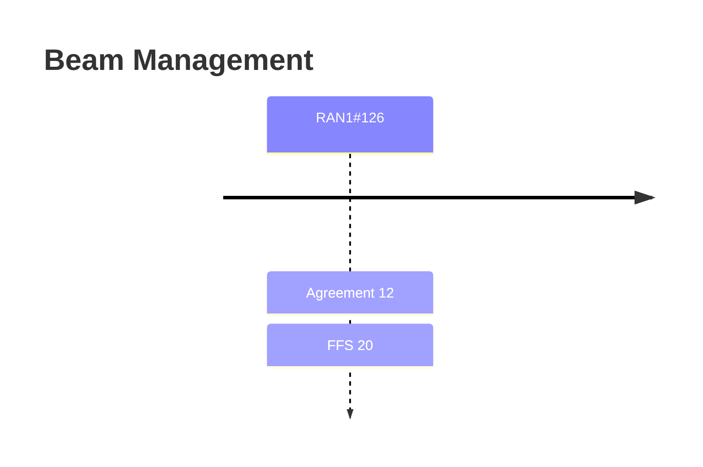

# Beam Management (Rel-20)

> 이 파일은 `scripts/generate_report.py`가 자동으로 생성합니다. 직접 수정하지 마세요.

## 회의별 진행

## 누적 히스토리

| 회의 | Agenda | 구분 | 내용 | 출처 |
|---|---|---|---|---|
| RAN1#126 | 10.5.3.4 | Agreement | For the study on requirement/functionality of DL RS for beam measurement, for inter-symbol NW/UE-side beam sweeping, the following is considered: - Study the following time-domain behavior of DL RS for beam measurement: aperiodic, semi-persistent and periodic. - At least support the functionality for UE to assume whether DL RSs are transmitted with same DL Tx spatial filter(s) or not. - Note: Sync-signal design is not considered herein - At least following aspects to be considered for DL RS for beam measurement:   - UE complexity,   - Energy efficiency,   - RS overhead,   - Measurement performance, and corresponding coverage.   - Beam measurement/sweeping latency   - Multiplexing with other data and RS | [Chair notes RAN1#126_eom1](https://www.3gpp.org/ftp/tsg_ran/WG1_RL1/TSGR1_126/Inbox/Chair_notes/Chair%20notes%20RAN1%23126_eom1.docx) `[126-R20-6GR-Beam management]` |
| RAN1#126 | 10.5.3.4 | Agreement | Regarding QCL framework, - At least support the following QCL properties for DL:   - Doppler shift, Doppler spread, average delay, delay spread, and spatial Rx parameter   - FFS: Whether/how to introduce average gain as a QCL property.   - FFS: Other QCL properties - FFS: Where/how/when to use above QCL properties. - FFS: Source QCL-RS | [Chair notes RAN1#126_eom1](https://www.3gpp.org/ftp/tsg_ran/WG1_RL1/TSGR1_126/Inbox/Chair_notes/Chair%20notes%20RAN1%23126_eom1.docx) `[126-R20-6GR-Beam management]` |
| RAN1#126 | 10.5.3.4 | Agreement | Regarding UE initiated beam management, at least the following procedure can be considered - Event detection for triggering UL transmission - UL transmission procedure - NW response, if any, to UL transmission procedure   - UE behavior, if any, after receiving NW response. | [Chair notes RAN1#126_eom1](https://www.3gpp.org/ftp/tsg_ran/WG1_RL1/TSGR1_126/Inbox/Chair_notes/Chair%20notes%20RAN1%23126_eom1.docx) `[126-R20-6GR-Beam management]` |
| RAN1#126 | 10.5.3.4 | Agreement | Regarding UE initiated beam management, at least for a single-TRP operation, on event detection for triggering UL transmission, the following can be studied for Event-1 and Event-2. - Event evaluation metric/threshold, - Current/serving DL RS determination, - Candidate DL RS identification, if applicable. | [Chair notes RAN1#126_eom1](https://www.3gpp.org/ftp/tsg_ran/WG1_RL1/TSGR1_126/Inbox/Chair_notes/Chair%20notes%20RAN1%23126_eom1.docx) `[126-R20-6GR-Beam management]` |
| RAN1#126 | 10.5.3.4 | Agreement | For the study on beam measurement and report regarding DL beam measurement and report procedure on DL RS(s) for multi-TRP scenario(s), the following can be considered on Case-1: - Regarding L1-RSRP calculation, NR L1-RSRP definition can be used as the starting point.   - FFS: Whether any other extension of L1-RSRP definition is needed, e.g., TRP-specific or port-specific L1-RSRP. - Regarding RS measurement requirements,   - Study the need of a functionality of enabling UE to a) differentiate DL RSs from different TRPs within a cell, or b) differentiate DL RSs across cells for DL beam measurement and report. - Regarding report content/format,   - Information of identifying DL RS can be included in the report as a starting point, besides for L1-RSRP   - FFS: the following report content can be studied:     - N DL RSs per selected TRP or per measured TRP     - M DL RSs across different TRPs   - FFS: Whether/How to include the information of selected TRP in the report.   - FFS: other metrics, e.g., L1-SINR. - Note (Case-1): To identify/report the preferred N>1 DL beams per NW TRP/panel or across NW TRP(s)/panel(s) for supporting multi-TRP/panel transmission scheme(s). - Note: Above TRPs may belong to a same cell or different cells. - Note (for the study purpose): The above study at least considers the following transmission schemes: TDMed and DPS transmission scheme, if supported. | [Chair notes RAN1#126_eom1](https://www.3gpp.org/ftp/tsg_ran/WG1_RL1/TSGR1_126/Inbox/Chair_notes/Chair%20notes%20RAN1%23126_eom1.docx) `[126-R20-6GR-Beam management]` |
| RAN1#126 | 10.5.3.4 | Agreement | For the study on spatial/temporal/frequency domain beam measurement/prediction (relevant to AI/ML or non-AI/advanced schemes), the following is considered: - Regarding spatial/temporal domain DL Tx beam prediction and management on multi-TRP/cell(intra/inter-cell), at least support the case that the cells/TRPs corresponding to the predicted beam(s) (Set-A) are within the set of cells/TRPs corresponding to the measured beam(s) (Set-B).   - FFS: Other cases that the case that at least one of the cells/TRPs corresponding to the predicted beam(s) (Set-A) are outside the set of cells/TRPs corresponding to the measured beam(s) (Set-B). - Regarding frequency domain beam measurement/prediction (cross-frequency), at least support the collocated scenarios of source and target frequencies (using same height of NW antenna(s)).   - FFS: Non-collocated scenarios of source and target frequencies. - FFS: How to ensure the training and inference consistency for UE-side model, e.g., association ID. - FFS: Whether/how to indicate the combination coefficient(s), W, between measured beams (set B) for computation of the target beams (set A), e.g., matrix-based approach (from NW to UE).   - Predicted results of Set-A is derived based on W and measured results of Set-B - FFS: Report content   - Whether/how to report confidence level associated with reported beam, e.g., inaccurate, invalid prediction | [Chair notes RAN1#126_eom1](https://www.3gpp.org/ftp/tsg_ran/WG1_RL1/TSGR1_126/Inbox/Chair_notes/Chair%20notes%20RAN1%23126_eom1.docx) `[126-R20-6GR-Beam management]` |
| RAN1#126 | 10.5.3.4 | Agreement | - Study target usage/necessity and procedure of UE UL beam sweeping - From RAN1 perspective, as a baseline, Tx beam of UL channel/RS may be determined according to DL-RS.   - Note: UE beam correspondence is assumed RAN1 - Send an LS to RAN4 | [Chair notes RAN1#126_eom1](https://www.3gpp.org/ftp/tsg_ran/WG1_RL1/TSGR1_126/Inbox/Chair_notes/Chair%20notes%20RAN1%23126_eom1.docx) `[126-R20-6GR-Beam management]` |
| RAN1#126 | 10.5.3.4 | Agreement | Draft LS R1-2606909 is endorsed in principle. Final LS R1-2606910 is endorsed. | [Chair notes RAN1#126_eom1](https://www.3gpp.org/ftp/tsg_ran/WG1_RL1/TSGR1_126/Inbox/Chair_notes/Chair%20notes%20RAN1%23126_eom1.docx) `[126-R20-6GR-Beam management]` |
| RAN1#126 | 10.5.3.4 | Agreement | Regarding UE initiated beam management, on a single-TRP operation, on UL transmission procedure, the following can be studied for Event-1 and Event-2. - Candidate-1a: First UL channel + Second UL channel   - First channel (e.g., PUCCH, PRACH) is to at least notify event occurrence;   - Second channel (e.g., PUSCH) is to carry a beam report - Candidate-1b: First UL channel + SRS   - First channel (e.g., PUCCH) is to at least notify event occurrence;   - SRS can be used for NW DL-Tx/UL-Rx beam determination. - Candidate-2a: First UL channel at least notifying event occurrence   - First UL channel can be PUCCH, PUSCH, or PRACH. - Candidate-2b: SRS used for NW DL-Tx/UL-Rx beam determination | [Chair notes RAN1#126_eom1](https://www.3gpp.org/ftp/tsg_ran/WG1_RL1/TSGR1_126/Inbox/Chair_notes/Chair%20notes%20RAN1%23126_eom1.docx) `[126-R20-6GR-Beam management]` |
| RAN1#126 | 10.5.3.4 | Agreement | For network-initiated beam reporting in 6GR, - Study the following time-domain behavior of beam reporting: aperiodic, semi-persistent, periodic. - Support DL RS identifier as another report quantity in a beam report, when applicable.   - Note: DL RS may be measured or predicted by the UE. | [Chair notes RAN1#126_eom1](https://www.3gpp.org/ftp/tsg_ran/WG1_RL1/TSGR1_126/Inbox/Chair_notes/Chair%20notes%20RAN1%23126_eom1.docx) `[126-R20-6GR-Beam management]` |
| RAN1#126 | 10.5.3.4 | Agreement | Regarding DL beam measurement and report procedure, for the study on NW determination of refined analog beam(s), including the feasibility and necessity, the following is considered: - Potential use cases:   - To improve beam-forming gain/throughput via generating NW refined analog beam(s) based on UE report which may be different from measured beams - Studying the details of:   - Benchmark: Companies report the benchmark in evaluation.     - Benchmark #1 Beam selection from a set of measured beams     - Benchmark #2 Beam selection from a set of measured beams plus candidate analog beams (for subsequent transmission)   - RS measurement requirements   - Potential report content (based on the measured beams):   - Applicable frequency range   - Others are not precluded. - Note: NW implementation information is not disclosed. | [Chair notes RAN1#126_eom1](https://www.3gpp.org/ftp/tsg_ran/WG1_RL1/TSGR1_126/Inbox/Chair_notes/Chair%20notes%20RAN1%23126_eom1.docx) `[126-R20-6GR-Beam management]` |
| RAN1#126 | 10.5.3.4 | Agreement | Regarding NW initiated beam indication, study transmission configuration indicator (TCI) framework involving both joint and separate DL/UL TCI state(s) for both single-TRP/cell/carrier and multi-TRP/cell/carrier operations - Regarding joint-DL/UL TCI state(s), study joint-DL/UL TCI state(s) at least apply to PDSCH, and PUSCH;   - FFS: what other target channel(s)/RS(s) which shall/can follow the TCI state, including CSI-RS, SRS, PDCCH, PUCCH and PRACH - Regarding separate DL/UL TCI state, study the following - DL-TCI state(s) at least apply to PDSCH;   - FFS: The target channel(s)/RS(s) which shall/can follow the DL-TCI state, including CSI-RS, and/or PDCCH - UL-TCI state(s) at least apply to PUSCH;   - FFS: The target channel(s)/RS(s) which shall/can follow the UL-TCI state, including SRS, and PRACH, and/or PUCCH - FFS: At least for joint-DL/UL TCI state/DL-TCI state, one state comprises at least one source QCL-RS, and each source QCL-RS is associated with at least one QCL property.   - The joint-DL/UL TCI state can also used for determining UL TX beam   - FFS: Other transmission parameter(s) for DL and UL associated with the TCI state (e.g., power control parameters, TAG, etc), besides for QCL properties. - FFS: At least for UL-TCI state, one state comprises at least one reference signal, if applicable, for determining UL TX beam.   - FFS: Other transmission parameter(s) for UL associated with the TCI state (e.g., power control parameters, TAG, etc), besides for UL TX beam. Note: TCI state is for the purpose of discussion | [Chair notes RAN1#126_eom1](https://www.3gpp.org/ftp/tsg_ran/WG1_RL1/TSGR1_126/Inbox/Chair_notes/Chair%20notes%20RAN1%23126_eom1.docx) `[126-R20-6GR-Beam management]` |
