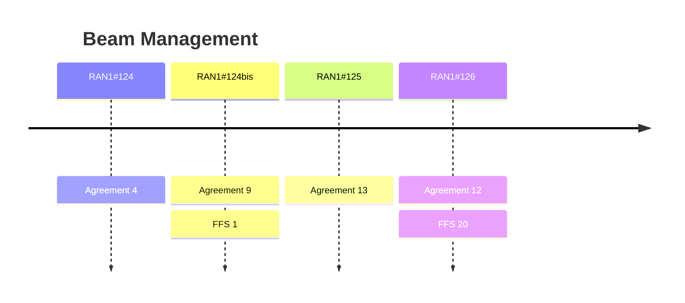

# Beam Management (Rel-20)

> 이 파일은 `scripts/generate_report.py`가 자동으로 생성합니다. 직접 수정하지 마세요.

## 회의별 진행

## 회의 간 변화 (Delta)

| 직전 → 최신 | 신규 결정 | WA 확정 | 직전 FFS | FFS 후속 결정 후보 | Agenda 신설 / 제외 |
|---|---|---|---|---|---|
| RAN1#125 → RAN1#126 | 12 | 0 | 0 | 0 | +0 / -0 |
| RAN1#124bis → RAN1#125 | 13 | 0 | 1 | 0 | +0 / -0 |
| RAN1#124 → RAN1#124bis | 9 | 0 | 0 | 0 | +0 / -0 |
| RAN1#123 → RAN1#124 | 4 | 0 | 0 | 0 | +1 / -0 |
| RAN1#122bis → RAN1#123 | 0 | 0 | 0 | 0 | +0 / -0 |
| RAN1#122 → RAN1#122bis | 0 | 0 | 0 | 0 | +0 / -0 |

### 최신 Delta 상세 (RAN1#125 → RAN1#126)

직전 회의 대비 Agenda 변화, WA 확정, FFS 후속 후보가 없습니다.

## 누적 히스토리

| 회의 | Agenda | 구분 | 내용 | 출처 |
|---|---|---|---|---|
| RAN1#124 | 10.5.2.4 | Agreement | Study TCI/QCL-related aspects, e.g., definition of QCL/TCI-state, QCL property/chain On beam management for DL and UL of 6GR, at least the following aspects should be studied: - Beam measurement(prediction)/report/indication within a same TRP, i.e., single-TRP, in a cell/carrier; - Beam measurement(prediction)/report/indication among different TRPs, i.e., multi-TRP, in a cell/carrier; - Beam measurement(prediction)/report/indication among different cells/carrier, i.e., inter-cell/carrier - Note: Both AI/ML and non-AI/ML related mechanism(s) for the above can be further studied. Note-1: Which multi-TRP transmission scheme for study will be discussed under other agenda. | [Chair notes RAN1#124 - eom_03](https://www.3gpp.org/ftp/tsg_ran/WG1_RL1/TSGR1_124/Inbox/Chair_notes/Chair%20notes%20RAN1%23124%20-%20eom_03.docx) `[124-R20-6GR-Beam management]` |
| RAN1#124 | 10.5.2.4 | Agreement | Study of UE-initiated/event-driven beam management (UEIBM) mechanisms for 6GR, covering at least the following aspects: - Event definition and the corresponding target use case. - UL transmission, UE’s behavior, and procedure for a triggered event, including the necessity and design of the associated network’s response. - Note 1: Both AI/ML and non-AI/ML related mechanism(s) for the above can be further studied. - Note 2: UE-initiated/event-driven CSI reporting is not discussed in this agenda. | [Chair notes RAN1#124 - eom_03](https://www.3gpp.org/ftp/tsg_ran/WG1_RL1/TSGR1_124/Inbox/Chair_notes/Chair%20notes%20RAN1%23124%20-%20eom_03.docx) `[124-R20-6GR-Beam management]` |
| RAN1#124 | 10.5.2.4 | Agreement | Regarding link-level evaluation of 6GR beam management, in RAN1#124b, to use the following template as starting point for collecting related parameters. \| Parameter \| Value \| \| Carrier Frequency \|  \| \| Duplex / Waveform \|  \| \| Subcarrier Spacing \|  \| \| Simulation Bandwidth \|  \| \| Channel Model \|  \| \| Delay Spread \|  \| \| NW Antenna Config \|  \| \| Multi-TRP operation \|  \| \| TXRU mapping to antenna elements \|  \| \| Beam-forming scheme \|  \| \| Procedure of beam sweeping \|  \| \| Criteria for beam selection \|  \| \| UE Antenna Config \|  \| \| BS array orientation \|  \| \| UE array orientation \|  \| \| UE antenna element radiation pattern \|  \| \| UE Velocity \|  \| \| MIMO Scheme \|  \| \| CW-to-layer mapping \|  \| \| Channel coding \|  \| \| SSB, CSI-RS configuration for BM \|  \| \| SRS configuration for BM \|  \| \| Receiver Type \|  \| \| Channel Estimation \|  \| \| MCS \|  \| \| Performance Metric(s) \|  \| | [Chair notes RAN1#124 - eom_03](https://www.3gpp.org/ftp/tsg_ran/WG1_RL1/TSGR1_124/Inbox/Chair_notes/Chair%20notes%20RAN1%23124%20-%20eom_03.docx) `[124-R20-6GR-Beam management]` |
| RAN1#124 | 10.5.2.4 | Agreement | Regarding system-level evaluation of 6GR beam management, in RAN1#124b, , to use the following template as starting point for collecting related parameters. \| Parameter \| Value \| \| Scenario (Carrier frequency) \|  \| \| Mode \|  \| \| System BW \|  \| \| Subcarrier spacing for data \|  \| \| Channel model \|  \| \| BS Antenna Configuration \|  \| \| BS array orientation \|  \| \| TXRU mapping to antenna elements \|  \| \| Beam-forming scheme \|  \| \| Procedure of beam sweeping \|  \| \| Multi-TRP operation \|  \| \| Criteria for selection for serving TRP(s) \|  \| \| Criteria for beam selection for serving TRP(s) \|  \| \| UE Antenna Configuration \|  \| \| UE array orientation \|  \| \| Beam correspondence \|  \| \| Link adaptation \|  \| \| UE receiver type \|  \| \| BS Tx Power \|  \| \| Maximum UE Tx Power \|  \| \| Inter site distance \|  \| \| UE antenna element radiation pattern \|  \| \| UE Speed and UE distribution \|  \| \| UE rotation \|  \| \| BS Antenna height \|  \| \| UE Antenna height \|  \| \| Car penetration Loss \|  \| \| Building penetration loss (O2I) \|  \| \| UE mobility feature (optional) \|  \| \| Scheduling algorithm \|  \| \| MCS \|  \| \| Traffic Model \|  \| \| CSI Feedback \|  \| \| Resource Utilization \|  \| \| Prediction parameter \|  \| \| UE number/cell \|  \| \| Layout/deployment \|  \| \| Inter-cell interference model \|  \| \| Metric \|  \| | [Chair notes RAN1#124 - eom_03](https://www.3gpp.org/ftp/tsg_ran/WG1_RL1/TSGR1_124/Inbox/Chair_notes/Chair%20notes%20RAN1%23124%20-%20eom_03.docx) `[124-R20-6GR-Beam management]` |
| RAN1#124bis | 10.5.2.4 | Agreement | Support the following table as the assumption of SLS for evaluation of 6GR beam management: \| Parameter \| Value \| \| #1 Scenario (Carrier frequency) \| Indoor hotspot, Urban macro, Dense urban (one-layer, and two-layer), High Speed Train, SMa, Urban grid, 4 GHz, TDD 7 GHz, TDD 30 GHz, TDD Other scenarios are not precluded (companies to report) \| \| #2 Mode \| DL/UL SU-MIMO/MU-MIMO \| \| #3 System BW \| 4GHz: 20MHz 7GHz: 100 MHz 30GHz: 100 MHz \| \| #4 Subcarrier spacing for data \| 4GHz/7GHz: 30KHz; 30GHz: 120 KHz \| \| #5 Channel model \| TR 38.901 with the following features, if needed: Spatial consistency, including Autocorrelation of shadow fading (Section 7.4.4 in TR 38.901) Correlation modeling for multi‑frequency simulations. Near-field characters Spatial non-stationarity \| \| #6 BS Antenna Configuration \| Reuse the agreed configuration(s) from 6GR air interface evaluation assumptions For 7GHz, the following can be further considered: 128 TXRUs, 2048AEs, (M, N, P, Mg, Ng; Mp, Np) = (64, 16, 2, 1, 1, 8, 8), (dH, dV) = (0.5, 0.5); For 30GHz, the following can be further considered: (M, N, P, Mg, Ng; Mp, Np) = (8, 16, 2, 1, 1; 1, 1), or (16, 32, 2, 1, 1; 1, 1)), (dH, dV) = (0.5, 0.5); \| \| #7 BS array orientation \| Mechanical tilt: 180° in GCS for indoor hotspot; 90° in GCS for Urban Macro, Dense Urban and High Speed Train Electrical tilt: Company to report Other mechanical tilts are not precluded (companies to report) \| \| #8 TXRU mapping to antenna elements \| A single TXRU is mapped per panel per subarray per polarization. Others are not precluded (companies to report). \| \| #9 Beam-forming scheme \| Companies explain the details, e.g., DFT-based or Eigen-based \| \| #10 Procedure of beam sweeping \| Companies explain the details \| \| #11 Multi-TRP operation \| Reuse the assumptions for multi-TRP scenarios of DL-based CSI (A.I. 10.5.3.1) with the following interpretation: The maximum number of coordinated TRP(s) = {1, 2, 3, 4}, and other larger value(s) are not precluded Backhaul: ideal (baseline) or non-ideal; sync: ideal (baseline) or non-ideal; FFS: Other update for high-speed train \| \| #12 Criteria for selection for serving TRP(s) \| Serving TRP selection with objective of maximizing RSRP is considered as baseline, and other criteria is not precluded and up to companies to report. For TRP switching, it is up to companies to report the TRP selection margin, if any. \| \| #13 Criteria for beam selection for serving TRP(s) \| Beam selection with objective of maximizing RSRP is considered as baseline, and other criteria is not precluded and up to companies to report. \| \| #14 UE Antenna Configuration \| 4GHz & 7GHz: Reuse the agreed configuration(s) from 6GR air interface evaluation assumptions; 30GHz: Reuse the agreed configuration(s) from 6GR air interface evaluation assumptions: [Config 0 (one panel) or Config 1 (two panels)]: (M, N, P, Mg, Ng; Mp, Np) = (4, 1, 2, 1, 1; 1, 1) is considered as a baseline \| \| #15 UE array orientation \| Ω‌UT,a uniformly distributed on [0, 360] deg, Ω‌UT,b = 0 deg, Ω‌UT,g = 0 deg is considered as a baseline. Others are not precluded (companies to report) \| \| #16 Beam correspondence \| Ideal (baseline) or non-ideal. Others are not precluded. \| \| #17 Link adaptation \| Based on CSI-RS (Adaptive Modulation and Coding, AMC) \| \| #18 UE receiver type \| MMSE-IRC as baseline; other advanced receivers are not precluded \| \| #19 BS Tx Power \| Reuse the configuration(s) from 6GR air interface evaluation assumptions \| \| #20 Maximum UE Tx Power \| Reuse the configuration(s) from 6GR air interface evaluation assumptions \| \| #21 Inter site distance \| Reuse the configuration(s) from 6GR air interface evaluation assumptions, besides for the following: High Speed Train: 1732 m ISD \| \| #22 UE antenna element radiation pattern \| Reuse the configuration(s) from 6GR air interface evaluation assumptions \| \| #23 UE Speed and UE distribution \| Reuse the configuration(s) from 6GR air interface evaluation assumptions, besides for the following: High Speed Train: 100% outdoor in train (up to 500km/h) \| \| #24 UE rotation \| No UE rotation (baseline). UE rotation is not precluded and the corresponding rotation speed is up to companies to report. \| \| #25 BS Antenna height \| Dense urban macro and Urban Macro: 25 m; Dense urban micro: 10 m; Indoor: 3m \| \| #26 UE Antenna height \| Section 7.2 in TR 38.901. Others are not precluded (companies to report). \| \| #27 Car penetration Loss \| TR 38.901, sec 7.4.3.2: μ = 9 dB, σp = 5 dB \| \| #28 Building penetration loss (O2I) \| Table 7.4.3-2 in TR 38.901 \| \| #29 UE mobility feature (optional) \| Baseline: Random direction straight-line trajectories (from 38.843, Option-3) - Initial UE location, moving direction and speed: UE is randomly dropped in a cell, and an initial moving direction is randomly selected, with a fixed speed. - The initial UE location should be randomly drop within the following blue area: where d1 is the minimum distance that UE should be away from the BS. Each sector is a cell and that the cell association is geometry based. Company to report whether inter-cell handover or switching is disabled during the simulation. Company to report whether the trajectory should be terminated (e.g., for co-located case) or be retained (e.g., non co-located case), if the UE trajectory hits the site boundary (the hexagonal grid) Other UE mobility model(s), e.g., EVM for NR ICBM, are not precluded (companies to report). \| \| #30 Scheduling algorithm \| PF scheduler \| \| #31 MCS \| Use NR MCS \| \| #32 Traffic Model \| FTP model 1/3 with packet size 0.5 Mbytes (other value is not precluded) Other traffic models are not precluded (companies to report). Full buffer (Optional) \| \| #33 CSI Feedback \| CSI periodicity: 10ms, 20ms (baseline), 40ms, 80ms, 160ms FFS: Other update for high-speed train \| \| #34 Resource Utilization \| 30%, 50%, 70% (optional) \| \| #35 Prediction parameter \| Company can report assumption for set-A and set-B, prediction/observation window and any extension for multi-TRP measurement Set A: {16, 32, 64, 128, 256, 512, 1024}. Other values are not precluded. Set B: {4, 8, 16, 32, 48, 64}. Other values are not precluded: Set A/Set B combinations: Alt1: Set B is different from Set A Alt2: Set B is a subset of Set A Alt3: Set B is the same as Set A Regarding temporal domain prediction, the following can be considered: Time gap between predicted time instances (including first future time instance): {40ms, 80ms, 120ms, 160ms, 200ms}. Other values not precluded Prediction/observation window: {1, 2, 4, 8} predicted/measured time instances. Other values not precluded. Note: Regarding cross-frequency prediction, as a baseline, NW antenna(s) for source and target frequencies reuse the same placement and orientation. Others are not precluded (companies to report). \| \| #36 UE number/cell \| Reuse the configuration(s) from 6GR air interface evaluation assumptions \| \| #37 Layout/deployment \| Reuse the assumptions of uplink/downlink transmission schemes (10.5.2.2/3) 7 x 3, single layer, hex grid (baseline) 7 x 3 two layers, macro layer: hex grid; micro layer: locations of micro sites are reported by company (optional) 19 x 3, single layer, hex grid (optional) FFS: Other update for high-speed train \| \| #38 Inter-cell interference model \| Reuse the assumptions of DL-based CSI (10.5.3.1) Explicitly and realistically modelled \| \| #39 Metric \| Top-K/1 beam prediction accuracy (with or without L1-RSRP margin), average UPT, and 5%-ile UPT Companies can report other performance metrics observations, e.g., SINR/RSRP prediction accuracy, RS overhead reduction, beam management latency, model and computational complexity, etc. Companies report the assumption of transmission scheme (e.g., Type-I/II PMI or SVD), if UPT is reported. \| | [Chair notes RAN1#124bis_eom5](https://www.3gpp.org/ftp/tsg_ran/WG1_RL1/TSGR1_124b/Inbox/Chair_notes/Chair%20notes%20RAN1%23124bis_eom5.docx) `[124b-R20-6GR-Beam management]` |
| RAN1#124bis | 10.5.2.4 | Agreement | Support the following table as the basic assumption of LLS for evaluation of 6GR beam management: \| Parameter \| Value \| \| #1 Carrier Frequency \| 4GHz, 7GHz, 30GHz \| \| #2 Duplex / Waveform \| TDD/CP-OFDM \| \| #3 Subcarrier Spacing \| For 4GHz/7GHz: 30KHz; For 30GHz:120KHz \| \| #4 Simulation Bandwidth \| Reuse the assumptions of PDSCH EVM (10.5.2.2) 20 MHz, 100 MHz Other bandwidths are not precluded (companies to report) \| \| #5 Channel Model \| Reuse the assumptions of PDSCH EVM/CSI-others (10.5.2.2/10.5.3.3) CDL-A/B/C/D model in TR 38.901 The CDL table is translated so that the strongest cluster’s AoD and AoA occur at a random angle for both the antenna panels of TRP and UE in the local coordinate. The value of the random angle is selected to be uniformly distributed from +30 to -30 degree. The random value is chosen independently for both AoD and AoA. \| \| #6 Delay Spread \| Reuse the assumptions of PDSCH EVM (10.5.2.2) 30 ns, 100 ns, 300 ns, 1000 ns (optional) \| \| #7 NW Antenna Config \| Reuse the agreed configuration(s) from 6GR air interface evaluation assumptions For 7GHz, the following can be further considered: 128 TXRUs, 2048AEs, (M, N, P, Mg, Ng; Mp, Np) = (64, 16, 2, 1, 1, 8, 8), (dH, dV) = (0.5, 0.5); For 30GHz, the following can be further considered: (M, N, P, Mg, Ng; Mp, Np) = (8, 16, 2, 1, 1; 1, 1), or (16, 32, 2, 1, 1; 1, 1)), (dH, dV) = (0.5, 0.5); \| \| #8 Multi-TRP operation \| The maximum number of coordinated TRP(s) = {1 (baseline), 2, 3, 4}, and other larger value(s) are not precluded CDL channel model is generated per TRP independently; Backhaul: ideal (baseline) or non-ideal; Sync: ideal (baseline) or non-ideal; Companies explain the details, if any. \| \| #9 TXRU mapping to antenna elements \| A single TXRU is mapped per panel per subarray per polarization. Others are not precluded (companies to report). \| \| #10 Beam-forming scheme \| Companies explain the details, e.g., DFT-based or Eigen-based \| \| #11 Procedure of beam sweeping \| Companies explain the details \| \| #12 Criteria for beam selection \| To maximize RSRP (with/without a margin (baseline for margin: 3dB, companies to report)) as a baseline. Other criteria is not precluded and up to companies to report. \| \| #13 UE Antenna Config \| 4GHz & 7GHz: Reuse the agreed configuration(s) from 6GR air interface evaluation assumptions; 30GHz: Reuse the agreed configuration(s) from 6GR air interface evaluation assumptions: [Config 0 (one panel) or Config 1 (two panels)]: (M, N, P, Mg, Ng; Mp, Np) = (4, 1, 2, 1, 1; 1, 1) is considered as a baseline \| \| #14 BS array orientation \| Azimuth 0°, mechanic downtilt: 90° in GCS. \| \| #15 UE array orientation \| ΩUT,a uniformly distributed on [0, 360] degree, ΩUT,b = 0°, ΩUT,g = 0° \| \| #16 UE antenna element radiation pattern \| For 4 GHz/7GHz: Option-1: Omni-directional with 0dBi gain; Option-2: According to Table 7.3-2 in TR 38.901 (radiation power pattern for handheld UT) For 30 GHz: See Table A.2.1-8 in TR 38.802 \| \| #17 UE Velocity \| 3km/h, 30km/h, 120km/h (Optional), 350km/h(Optional), 500km/h (Optional) \| \| #18 MIMO Scheme \| SU-MIMO/MU-MIMO \| \| #19 CW-to-layer mapping \| Reuse the assumptions of CSI EVM (10.5.3.1) \| \| #20 Channel coding \| LDPC for DL/UL data channel, Polar for CSI \| \| #21 SSB, CSI-RS configuration for BM \| NR SSB, CSI-RS for BM as benchmark, and it is up to company to report other configuration, e.g., periodicity. \| \| #22 SRS configuration for BM \| NR SRS with usage set to BM as baseline, and it is up to company to report other configuration, e.g., periodicity \| \| #23 Receiver Type \| MMSE-IRC as baseline; R-ML (companies to report) \| \| #24 Channel Estimation \| Ideal or realistic \| \| #25 MCS \| NR MCS (fixed, or AMC) \| \| #26 Performance Metric(s) \| BLER and Spectrum Efficiency (SE) Companies can report other performance metrics. \| | [Chair notes RAN1#124bis_eom5](https://www.3gpp.org/ftp/tsg_ran/WG1_RL1/TSGR1_124b/Inbox/Chair_notes/Chair%20notes%20RAN1%23124bis_eom5.docx) `[124b-R20-6GR-Beam management]` |
| RAN1#124bis | 10.5.2.4 | Agreement | Support the following table as the assumption of SLS for evaluation of 6GR beam management: \| #29 UE mobility feature (optional) \| Baseline: Random direction straight-line trajectories (from 38.843, Option-3) - Initial UE location, moving direction and speed: UE is randomly dropped in a cell, and an initial moving direction is randomly selected, with a fixed speed. - The initial UE location should be randomly drop within the following blue area: where d1 is the minimum distance that UE should be away from the BS. Each sector is a cell and that the cell association is geometry based. Company to report whether inter-cell handover or switching is disabled during the simulation. Company to report whether the trajectory should be terminated (e.g., single-TRP) or be retained (e.g., multi-TRP), if the UE trajectory hits the site boundary (the hexagonal grid) Other UE mobility model(s), e.g., EVM for NR ICBM, linear trajectory model with random and smooth direction change (i.e., TR38.843, Option-2), are not precluded (companies to report). \| \| #35 Prediction parameter \| Company can report assumption for set-A and set-B, prediction window and any extension for intra-/inter-cell/multi-TRP measurement Set A: M*N M: {8, 16, 32, 64, 256,1024}. N: {1, 2, 3, 4}. Ratio of the size of Set-B to Set-A: {1, 1/2, 1/4, 1/8, 1/16, 1/32} For multi-TRP, Set-A and Set-B can contain beams across TRP(s). Other values for M, N and ratio are not precluded. Set A/Set B combinations: Alt1: Set B is different from Set A Alt2: Set B is a subset of Set A Alt3: Set B is the same as Set A Regarding temporal domain prediction, the following can be considered: Time gap between neighboring predicted time instances: {20ms, 40ms, 80ms, 120ms, 160ms, 200ms}. Predicted time instances: {1, 2, 4, 8}. Measured time instances: companies to report. Other values for the above are not precluded Other prediction mechanism is not precluded and up to companies’ report. \| \| #39 Metric \| Top-K/1 beam prediction accuracy (with or without L1-RSRP margin), average/5%-ile UPT/throughput, SINR/RSRP, L1-RSRP/SINR difference between Top-1 predicted beam and genie-aided beam, RS overhead reduction, beam management latency, and/or number of model-parameter(s)/model computational complexity. Companies can report other performance metrics Companies report the assumption of transmission scheme, if UPT/throughput is reported. \| | [Chair notes RAN1#124bis_eom5](https://www.3gpp.org/ftp/tsg_ran/WG1_RL1/TSGR1_124b/Inbox/Chair_notes/Chair%20notes%20RAN1%23124bis_eom5.docx) `[124b-R20-6GR-Beam management]` |
| RAN1#124bis | 10.5.2.4 | Agreement | Support the following table as the assumption of LLS for evaluation of 6GR beam management: \| #26 Performance Metric(s) \| BLER and Spectrum Efficiency (SE) Companies can report other performance metrics \| | [Chair notes RAN1#124bis_eom5](https://www.3gpp.org/ftp/tsg_ran/WG1_RL1/TSGR1_124b/Inbox/Chair_notes/Chair%20notes%20RAN1%23124bis_eom5.docx) `[124b-R20-6GR-Beam management]` |
| RAN1#124bis | 10.5.2.4 | Agreement | For 6GR UE-initiated beam management (UEIBM), Study the following events for single-TRP as a starting point: - Event-1: The measured/predicted quality of the current/serving beam is worse than a threshold, including “beam failure”. - Event-2: The measured/predicted quality of at least one candidate beam becomes a threshold value better than the current/serving beam.   - The candidate beam is associated with a same (i.e., intra-cell) or a different physical cell ID (i.e., inter-cell case) as the current/serving beam. - How to extend to m-TRP use case, including the feasibility. | [Chair notes RAN1#124bis_eom5](https://www.3gpp.org/ftp/tsg_ran/WG1_RL1/TSGR1_124b/Inbox/Chair_notes/Chair%20notes%20RAN1%23124bis_eom5.docx) `[124b-R20-6GR-Beam management]` |
| RAN1#124bis | 10.5.2.4 | Agreement | - Study requirement/functionality of DL RS for beam measurement, e.g., number of RS ports, time/frequency-domain RS pattern, time-domain behavior, etc.   - Note: Sync-signal design is not considered herein | [Chair notes RAN1#124bis_eom5](https://www.3gpp.org/ftp/tsg_ran/WG1_RL1/TSGR1_124b/Inbox/Chair_notes/Chair%20notes%20RAN1%23124bis_eom5.docx) `[124b-R20-6GR-Beam management]` |
| RAN1#124bis | 10.5.2.4 | Agreement | For the study on spatial/temporal/frequency domain beam measurement/prediction (relevant to AI/ML or non-AI/advanced schemes), the following is considered: - Implementation complexity/overhead:   - Model/computation complexity: FLOPs   - Model size, if AI/ML is involved: Number of parameters   - Note: The above complexity/overhead with the increase of TRP number should be clarified. - Benchmark:   - Benchmark-1: based on the measurement of Set-A;   - Benchmark-2: only based on the measurement of Set-B (non-prediction).   - Other benchmarks are not precluded and up to companies report - Evaluation assumptions with the following clarifications   - Spatial/Temporal domain DL Tx beam prediction and management, scenarios of both single-TRP and multi-TRP (intra/inter-cell) can be considered.     - For multi-TRP (intra/inter-cell), companies report whether the predicted beam(s) (Set-A) are from the same set of cells/TRPs corresponding to the measured beam(s) (Set-B) or not.     - Note (Sample and Hold): Regarding temporal domain prediction, reuse the result of the latest measurement.   - Regarding frequency domain beam measurement/prediction (cross-frequency), the scenario of co-located and non-colocated, intra-frequency-range (inter-/intra-band) and inter-frequency-range can be considered.     - Note: Regarding Cross frequency DL Tx beam prediction, Set-A includes beams in the predicted/target frequency, and Set-B is based on the measurement in the source frequency     - Further clarification/extension on channel modeling (e.g., inter-frequency-range, non-colocated) can be studied.     - Note: For colocated case, impact on performance using same/different placement and orientation on NW antenna(s) for source and target frequencies should be considered. - Note: the above assumptions can also apply for non-AI schemes, i.e., without training/inference/data collection, when applicable. | [Chair notes RAN1#124bis_eom5](https://www.3gpp.org/ftp/tsg_ran/WG1_RL1/TSGR1_124b/Inbox/Chair_notes/Chair%20notes%20RAN1%23124bis_eom5.docx) `[124b-R20-6GR-Beam management]` |
| RAN1#124bis | 10.5.2.4 | Agreement | For network-initiated beam reporting in 6GR, support at least L1-RSRP as a measurement/report quantity for beam reporting, when applicable. - Note: L1-RSRP maybe measured or predicted by UE. - FFS: L1-SINR and others. | [Chair notes RAN1#124bis_eom5](https://www.3gpp.org/ftp/tsg_ran/WG1_RL1/TSGR1_124b/Inbox/Chair_notes/Chair%20notes%20RAN1%23124bis_eom5.docx) `[124b-R20-6GR-Beam management]` |
| RAN1#124bis | 10.5.2.4 | Agreement | Regarding NW-initiated beam management, study DL beam measurement and report procedure on DL RS(s) for both single-TRP/cell/carrier and multi-TRP/cell/carrier scenario(s). - At least the following aspects can be studied:   - Procedure of beam sweeping/tracking, e.g., intra-/inter-symbol, time-domain/frequency-domain sweeping   - Measurement/prediction metrics   - Time-domain behavior for report, e.g., aperiodic, semi-persistent, periodic   - Report content   - Note: Report container for study will be discussed under other agenda.   - Note: RAN1 strives to support a unified framework for beam measurement and reporting for MIMO and mobility. | [Chair notes RAN1#124bis_eom5](https://www.3gpp.org/ftp/tsg_ran/WG1_RL1/TSGR1_124b/Inbox/Chair_notes/Chair%20notes%20RAN1%23124bis_eom5.docx) `[124b-R20-6GR-Beam management]` |
| RAN1#125 | 10.5.2.4 | Agreement | Support the following table as the assumption of SLS for evaluation of 6GR beam management: \| Parameter \| Value \| \| #6 BS Antenna Configuration \| Reuse the agreed configuration(s) from 6GR air interface evaluation assumptions For 30GHz, the following can be further considered: (M, N, P, Mg, Ng; Mp, Np) = (8, 16, 2, 1, 1; 1, 1), or (16, 32, 2, 1, 1; 1, 1)), (dH, dV) = (0.5, 0.5); \| \| #14 UE Antenna Configuration \| 4GHz & 7GHz: Reuse the agreed configuration(s) from 6GR air interface evaluation assumptions; 30GHz: Reuse the agreed configuration(s) from 6GR air interface evaluation assumptions: For one-panel, (M, N, P, Mg, Ng; Mp, Np) = (4, 1, 2, 1, 1; 1, 1) is considered as a baseline For multi-panel, (M, N, P; Mp, Np) = (2, 2, 2; 1, 1) is considered as a baseline. \| | [Chair notes RAN1#125_eom](https://www.3gpp.org/ftp/tsg_ran/WG1_RL1/TSGR1_125/Inbox/Chair_notes/Chair%20notes%20RAN1%23125_eom.docx) `[125-R20-6GR-Beam management]` |
| RAN1#125 | 10.5.2.4 | Agreement | Regarding the scenario of high-speed train, support the following revision in red on the agreement for SLS evaluation assumption of 6GR beam management: \| Parameter \| Value \| \| #11 Multi-TRP operation \| Reuse the assumptions for multi-TRP scenarios of DL-based CSI (A.I. 10.5.3.1) with the following interpretation except for high-speed train scenario: The maximum number of coordinated TRP(s) = {1, 2, 3, 4}, and other larger value(s) are not precluded Backhaul: ideal (baseline) or non-ideal; sync: ideal (baseline) or non-ideal; FFS: Other update for high-speed train Regarding high-speed train scenario, reuse the assumptions of downlink/uplink transmission schemes (10.5.2.2/3) Maximum number of coordinated TRPs is 2, 4, 8 or 16 Other number of coordinated TRPs are not precluded \| \| #33 CSI Feedback \| CSI periodicity: 10ms, 20ms (baseline), 40ms, 80ms, 160ms FFS: Other update for high-speed train \| \| #37 Layout/deployment \| Reuse the assumptions of uplink/downlink transmission schemes (10.5.2.2/3) 7 x 3, single layer, hex grid (baseline) 7 x 3 two layers, macro layer: hex grid; micro layer: locations of micro sites are reported by company (optional) 19 x 3, single layer, hex grid (optional) FFS: Other update for high-speed train Regarding high-speed train, reuse the assumptions of downlink/uplink transmission schemes (10.5.2.2/3) Regarding around 4 and 7 GHz, rural macro, 500 m or 1732 m ISD between RRH sites, two TRxPs per RRH site, one or more RRH sites connected to a BBU, with RRH site to railway track distance: 100 m Inter-track distance: 6 m Train length: 400 m Train width: 3.38 m Regarding around 30 GHz, rural macro, 500 m or 1732 m between BBU sites, one or more RRH sites connected to 1 BBU, one TRxP per RRH site, with RRH site to railway track distance: 5 m Inter-RRH site distance: [580 m, 580 m, 572 m] Inter-track distance: 6 m Train length: 400 m Train width: 3.38 m \| | [Chair notes RAN1#125_eom](https://www.3gpp.org/ftp/tsg_ran/WG1_RL1/TSGR1_125/Inbox/Chair_notes/Chair%20notes%20RAN1%23125_eom.docx) `[125-R20-6GR-Beam management]` |
| RAN1#125 | 10.5.2.4 | Agreement | Support the following table as the basic assumption of LLS for evaluation of 6GR beam management: \| Parameter \| Value \| \| #7 NW Antenna Config \| Reuse the agreed configuration(s) from 6GR air interface evaluation assumptions For 30GHz, the following can be further considered: (M, N, P, Mg, Ng; Mp, Np) = (8, 16, 2, 1, 1; 1, 1), or (16, 32, 2, 1, 1; 1, 1)), (dH, dV) = (0.5, 0.5); \| \| #14 UE Antenna Configuration \| 4GHz & 7GHz: Reuse the agreed configuration(s) from 6GR air interface evaluation assumptions; 30GHz: Reuse the agreed configuration(s) from 6GR air interface evaluation assumptions: For one-panel, (M, N, P, Mg, Ng; Mp, Np) = (4, 1, 2, 1, 1; 1, 1) is considered as a baseline For multi-panel, (M, N, P; Mp, Np) = (2, 2, 2; 1, 1) is considered as a baseline. \| | [Chair notes RAN1#125_eom](https://www.3gpp.org/ftp/tsg_ran/WG1_RL1/TSGR1_125/Inbox/Chair_notes/Chair%20notes%20RAN1%23125_eom.docx) `[125-R20-6GR-Beam management]` |
| RAN1#125 | 10.5.2.4 | Agreement | Study QCL framework, including QCL property, QCL relationship/chain between source QCL-RS(s) and target channel(s)/RS(s). - Study the following QCL properties at least for DL as a starting point:   - Doppler shift, Doppler spread, average delay, delay spread, average gain, spatial Rx parameter   - Note: The above does not necessarily mean that the above is a part of QCL properties by default. - Study source QCL-RS(s) w.r.t. QCL properties of each target channel/RS   - Each target channel/RS can be associated with at least one source QCL-RS as a baseline     - Study whether/how to introduce more than one source QCL-RS w.r.t. a same QCL property for a target channel/RS     - Study whether/how to introduce more than one source QCL-RS w.r.t different QCL properties for a target channel/RS - Study QCL relationship for multi-carrier/TRP/cell scenarios | [Chair notes RAN1#125_eom](https://www.3gpp.org/ftp/tsg_ran/WG1_RL1/TSGR1_125/Inbox/Chair_notes/Chair%20notes%20RAN1%23125_eom.docx) `[125-R20-6GR-Beam management]` |
| RAN1#125 | 10.5.2.4 | Agreement | For UE-initiated beam management in 6GR, study the following as an event evaluation metric as starting point. -        measured or predicated L1-RSRP -        L1-SINR -        Hypothetical BLER. For UE-initiated beam management in 6GR, study the following as report metric for beam reporting if applicable as starting point. -        measured or predicated L1-RSRP -        L1-SINR | [Chair notes RAN1#125_eom](https://www.3gpp.org/ftp/tsg_ran/WG1_RL1/TSGR1_125/Inbox/Chair_notes/Chair%20notes%20RAN1%23125_eom.docx) `[125-R20-6GR-Beam management]` |
| RAN1#125 | 10.5.2.4 | Agreement | On NW-initiated beam management, regarding DL beam measurement and report procedure on DL RS(s) for both single-TRP/cell/carrier and multi-TRP/cell/carrier scenario(s), the following aspects on DL beam measurement can be studied - Study the procedure of beam sweeping considering the following alternatives:   - At least support inter-symbol NW/UE-side beam sweeping including multiple DL RS(s) for DL Tx beam sweeping/repetition.   - Whether/how to support the following on intra-symbol beam sweeping     - Frequency-domain/FDMed at least for NW Tx beam sweeping: multiple DL RS(s) for beam measurement are multiplexed in/associated with different frequency resource(s)     - Sequence-domain/CDMed at least for NW Tx beam sweeping: multiple DL RS(s) for beam measurement are multiplexed with different sequence (e.g., sequence root, or CDMed);     - Sub-symbol/TDMed at least for UE Rx beam sweeping: each sub-symbol (e.g., time-domain multiplexing within a symbol) is measured by a respective Rx beam;       - Note: ‘Sub-symbol’ is just for discussion purpose, which does not imply whether to introduce any new terminologies.   - Note: UE-side beam sweeping is applied to the case of Rx multi-beam in FR2. - Note: Granularity of DL RS can be further discussed. - Study functionality requirement on DL RS measurement   - Per DL measurement or across DL measurement(s), the following can be considered:     - The maximum number of TRPs (within a cell or across cell)/cells/carriers     - The maximum number of DL Tx beams per TRP/cell/carrier     - The maximum number of DL Tx beams across measured TRPs/cells/carriers - At least following aspects to be considered for designing the procedure of beam sweeping/tracking:   - Increase of the number of coordinated TRPs/beams-per-TRP compared with 5G-NR   - Hybrid/analog beam-forming architecture in NW   - Latency/RS overhead for beam sweeping/tracking | [Chair notes RAN1#125_eom](https://www.3gpp.org/ftp/tsg_ran/WG1_RL1/TSGR1_125/Inbox/Chair_notes/Chair%20notes%20RAN1%23125_eom.docx) `[125-R20-6GR-Beam management]` |
| RAN1#125 | 10.5.2.4 | Agreement | Support the following table as the assumption of SLS for evaluation of 6GR beam management - Revise the RAN1#124-bis agreement as follows: \| Parameter \| Value \| \| #1 Scenario (Carrier frequency) \| Indoor hotspot, Urban macro, Dense urban (one-layer, and two-layer), High Speed Train, SMa, Urban grid, 4 GHz, TDD 7 GHz, TDD 30 GHz, TDD Other scenarios are not precluded (companies to report) \| \| #2 Mode \| DL/UL SU-MIMO/MU-MIMO \| \| #3 System BW \| 4GHz: 20MHz 7GHz: 100 MHz 30GHz: 100 MHz \| \| #4 Subcarrier spacing for data \| 4GHz/7GHz: 30KHz; 30GHz: 120 KHz \| \| #5 Channel model \| TR 38.901 with the following features, if needed: Spatial consistency, including Autocorrelation of shadow fading (Section 7.4.4 in TR 38.901) Correlation modeling for multi‑frequency simulations. Near-field characters Spatial non-stationarity \| \| #6 BS Antenna Configuration \| Reuse the agreed configuration(s) from 6GR air interface evaluation assumptions For 30GHz, the following can be further considered: (M, N, P, Mg, Ng; Mp, Np) = (8, 16, 2, 1, 1; 1, 1), or (16, 32, 2, 1, 1; 1, 1)), (dH, dV) = (0.5, 0.5); \| \| #7 BS array orientation \| Mechanical tilt: 180° in GCS for indoor hotspot; 90° in GCS for Urban Macro, Dense Urban and High Speed Train Electrical tilt: Company to report Other mechanical tilts are not precluded (companies to report) \| \| #8 TXRU mapping to antenna elements \| A single TXRU is mapped per panel per subarray per polarization. Others are not precluded (companies to report). \| \| #9 Beam-forming scheme \| Companies explain the details, e.g., DFT-based or Eigen-based \| \| #10 Procedure of beam sweeping \| Companies explain the details \| \| #11 Multi-TRP operation \| Reuse the assumptions for multi-TRP scenarios of DL-based CSI (A.I. 10.5.3.1) with the following interpretation except for high-speed train scenario: The maximum number of coordinated TRP(s) = {1, 2, 3, 4}, and other larger value(s) are not precluded Backhaul: ideal (baseline) or non-ideal; sync: ideal (baseline) or non-ideal; FFS: Other update for high-speed train Regarding high-speed train scenario, reuse the assumptions of downlink/uplink transmission schemes (10.5.2.2/3) Maximum number of coordinated TRPs is 2, 4, 8 or 16 Other number of coordinated TRPs are not precluded \| \| #12 Criteria for selection for serving TRP(s) \| Serving TRP selection with objective of maximizing RSRP is considered as baseline, and other criteria is not precluded and up to companies to report. For TRP switching, it is up to companies to report the TRP selection margin, if any. \| \| #13 Criteria for beam selection for serving TRP(s) \| Beam selection with objective of maximizing RSRP is considered as baseline, and other criteria is not precluded and up to companies to report. \| \| #14 UE Antenna Configuration \| 4GHz & 7GHz: Reuse the agreed configuration(s) from 6GR air interface evaluation assumptions; 30GHz: Reuse the agreed configuration(s) from 6GR air interface evaluation assumptions: For one-panel, (M, N, P, Mg, Ng; Mp, Np) = (4, 1, 2, 1, 1; 1, 1) is considered as a baseline For multi-panel, (M, N, P; Mp, Np) = (2, 2, 2; 1, 1) is considered as a baseline. \| \| #15 UE array orientation \| Ω‌UT,a uniformly distributed on [0, 360] deg, Ω‌UT,b = 0 deg, Ω‌UT,g = 0 deg is considered as a baseline. Others are not precluded (companies to report) \| \| #16 Beam correspondence \| Ideal (baseline) or non-ideal. Others are not precluded. \| \| #17 Link adaptation \| Based on CSI-RS (Adaptive Modulation and Coding, AMC) \| \| #18 UE receiver type \| MMSE-IRC as baseline; other advanced receivers are not precluded \| \| #19 BS Tx Power \| Reuse the configuration(s) from 6GR air interface evaluation assumptions \| \| #20 Maximum UE Tx Power \| Reuse the configuration(s) from 6GR air interface evaluation assumptions \| \| #21 Inter site distance \| Reuse the configuration(s) from 6GR air interface evaluation assumptions, besides for the following: High Speed Train: 1732 m ISD \| \| #22 UE antenna element radiation pattern \| Reuse the configuration(s) from 6GR air interface evaluation assumptions \| \| #23 UE Speed and UE distribution \| Reuse the configuration(s) from 6GR air interface evaluation assumptions, besides for the following: High Speed Train: 100% outdoor in train (up to 500km/h) \| \| #24 UE rotation \| No UE rotation (baseline). UE rotation is not precluded and the corresponding rotation speed is up to companies to report. \| \| #25 BS Antenna height \| Dense urban macro and Urban Macro: 25 m; Dense urban micro: 10 m; Indoor: 3m \| \| #26 UE Antenna height \| Section 7.2 in TR 38.901. Others are not precluded (companies to report). \| \| #27 Car penetration Loss \| TR 38.901, sec 7.4.3.2: μ = 9 dB, σp = 5 dB \| \| #28 Building penetration loss (O2I) \| Table 7.4.3-2 in TR 38.901 \| \| #29 UE mobility feature (optional) \| Baseline: Random direction straight-line trajectories (from 38.843, Option-3) - Initial UE location, moving direction and speed: UE is randomly dropped in a cell, and an initial moving direction is randomly selected, with a fixed speed. - The initial UE location should be randomly drop within the following blue area: where d1 is the minimum distance that UE should be away from the BS. Each sector is a cell and that the cell association is geometry based. Company to report whether inter-cell handover or switching is disabled during the simulation. Company to report whether the trajectory should be terminated (e.g., single-TRP) or be retained (e.g., multi-TRP), if the UE trajectory hits the site boundary (the hexagonal grid) Other UE mobility model(s), e.g., EVM for NR ICBM, linear trajectory model with random and smooth direction change (i.e., TR38.843, Option-2), are not precluded (companies to report). \| \| #30 Scheduling algorithm \| PF scheduler \| \| #31 MCS \| Use NR MCS \| \| #32 Traffic Model \| FTP model 1/3 with packet size 0.5 Mbytes (other value is not precluded) Other traffic models are not precluded (companies to report). Full buffer (Optional) \| \| #33 CSI Feedback \| CSI periodicity: 10ms, 20ms (baseline), 40ms, 80ms, 160ms FFS: Other update for high-speed train \| \| #34 Resource Utilization \| 30%, 50%, 70% (optional) \| \| #35 Prediction parameter \| Company can report assumption for set-A and set-B, prediction window and any extension for intra-/inter-cell/multi-TRP measurement Set A: M*N M: {8, 16, 32, 64, 256,1024}. N: {1, 2, 3, 4}. Ratio of the size of Set-B to Set-A: {1, 1/2, 1/4, 1/8, 1/16, 1/32} For multi-TRP, Set-A and Set-B can contain beams across TRP(s). Other values for M, N and ratio are not precluded. Set A/Set B combinations: Alt1: Set B is different from Set A Alt2: Set B is a subset of Set A Alt3: Set B is the same as Set A Regarding temporal domain prediction, the following can be considered: Time gap between neighboring predicted time instances: {20ms, 40ms, 80ms, 120ms, 160ms, 200ms}. Predicted time instances: {1, 2, 4, 8}. Measured time instances: companies to report. Other values for the above are not precluded Other prediction mechanism is not precluded and up to companies’ report. \| \| #36 UE number/cell \| Reuse the configuration(s) from 6GR air interface evaluation assumptions \| \| #37 Layout/deployment \| Reuse the assumptions of uplink/downlink transmission schemes (10.5.2.2/3) 7 x 3, single layer, hex grid (baseline) 7 x 3 two layers, macro layer: hex grid; micro layer: locations of micro sites are reported by company (optional) 19 x 3, single layer, hex grid (optional) FFS: Other update for high-speed train Regarding high-speed train, reuse the assumptions of downlink/uplink transmission schemes (10.5.2.2/3) Regarding around 4 and 7 GHz, rural macro, 500 m or 1732 m ISD between RRH sites, two TRxPs per RRH site, one or more RRH sites connected to a BBU, with RRH site to railway track distance: 100 m Inter-track distance: 6 m Train length: 400 m Train width: 3.38 m Regarding around 30 GHz, rural macro, 500 m or 1732 m between BBU sites, one or more RRH sites connected to 1 BBU, one TRxP per RRH site, with RRH site to railway track distance: 5 m Inter-RRH site distance: [580 m, 580 m, 572 m] Inter-track distance: 6 m Train length: 400 m Train width: 3.38 m \| \| #38 Inter-cell interference model \| Reuse the assumptions of DL-based CSI (10.5.3.1) Explicitly and realistically modelled \| \| #39 Metric \| Top-K/1 beam prediction accuracy (with or without L1-RSRP margin), average/5%-ile UPT/throughput, SINR/RSRP, L1-RSRP/SINR difference between Top-1 predicted beam and genie-aided beam, RS overhead reduction, beam management latency, and/or number of model-parameter(s)/model computational complexity. Companies can report other performance metrics Companies report the assumption of transmission scheme, if UPT/throughput is reported. \| | [Chair notes RAN1#125_eom](https://www.3gpp.org/ftp/tsg_ran/WG1_RL1/TSGR1_125/Inbox/Chair_notes/Chair%20notes%20RAN1%23125_eom.docx) `[125-R20-6GR-Beam management]` |
| RAN1#125 | 10.5.2.4 | Agreement | Support the following table as the assumption of LLS for evaluation of 6GR beam management - Revise the RAN1#124-bis agreement as follows: \| Parameter \| Value \| \| #1 Carrier Frequency \| 4GHz, 7GHz, 30GHz \| \| #2 Duplex / Waveform \| TDD/CP-OFDM \| \| #3 Subcarrier Spacing \| For 4GHz/7GHz: 30KHz; For 30GHz:120KHz \| \| #4 Simulation Bandwidth \| Reuse the assumptions of PDSCH EVM (10.5.2.2) 20 MHz, 100 MHz Other bandwidths are not precluded (companies to report) \| \| #5 Channel Model \| Reuse the assumptions of PDSCH EVM/CSI-others (10.5.2.2/10.5.3.3) CDL-A/B/C/D model in TR 38.901 The CDL table is translated so that the strongest cluster’s AoD and AoA occur at a random angle for both the antenna panels of TRP and UE in the local coordinate. The value of the random angle is selected to be uniformly distributed from +30 to -30 degree. The random value is chosen independently for both AoD and AoA. \| \| #6 Delay Spread \| Reuse the assumptions of PDSCH EVM (10.5.2.2) 30 ns, 100 ns, 300 ns, 1000 ns (optional) \| \| #7 NW Antenna Config \| Reuse the agreed configuration(s) from 6GR air interface evaluation assumptions For 30GHz, the following can be further considered: (M, N, P, Mg, Ng; Mp, Np) = (8, 16, 2, 1, 1; 1, 1), or (16, 32, 2, 1, 1; 1, 1)), (dH, dV) = (0.5, 0.5); \| \| #8 Multi-TRP operation \| The maximum number of coordinated TRP(s) = {1 (baseline), 2, 3, 4}, and other larger value(s) are not precluded CDL channel model is generated per TRP independently; Backhaul: ideal (baseline) or non-ideal; Sync: ideal (baseline) or non-ideal; Companies explain the details, if any. \| \| #9 TXRU mapping to antenna elements \| A single TXRU is mapped per panel per subarray per polarization. Others are not precluded (companies to report). \| \| #10 Beam-forming scheme \| Companies explain the details, e.g., DFT-based or Eigen-based \| \| #11 Procedure of beam sweeping \| Companies explain the details \| \| #12 Criteria for beam selection \| To maximize RSRP (with/without a margin (baseline for margin: 3dB, companies to report)) as a baseline. Other criteria is not precluded and up to companies to report. \| \| #13 UE Antenna Config \| 4GHz & 7GHz: Reuse the agreed configuration(s) from 6GR air interface evaluation assumptions; 30GHz: Reuse the agreed configuration(s) from 6GR air interface evaluation assumptions: For one-panel, (M, N, P, Mg, Ng; Mp, Np) = (4, 1, 2, 1, 1; 1, 1) is considered as a baseline For multi-panel, (M, N, P; Mp, Np) = (2, 2, 2; 1, 1) is considered as a baseline. \| \| #14 BS array orientation \| Azimuth 0°, mechanic downtilt: 90° in GCS. \| \| #15 UE array orientation \| ΩUT,a uniformly distributed on [0, 360] degree, ΩUT,b = 0°, ΩUT,g = 0° \| \| #16 UE antenna element radiation pattern \| For 4 GHz/7GHz: Option-1: Omni-directional with 0dBi gain; Option-2: According to Table 7.3-2 in TR 38.901 (radiation power pattern for handheld UT) For 30 GHz: See Table A.2.1-8 in TR 38.802 \| \| #17 UE Velocity \| 3km/h, 30km/h, 120km/h (Optional), 350km/h(Optional), 500km/h (Optional) \| \| #18 MIMO Scheme \| SU-MIMO/MU-MIMO \| \| #19 CW-to-layer mapping \| Reuse the assumptions of CSI EVM (10.5.3.1) \| \| #20 Channel coding \| LDPC for DL/UL data channel, Polar for CSI \| \| #21 SSB, CSI-RS configuration for BM \| NR SSB, CSI-RS for BM as benchmark, and it is up to company to report other configuration, e.g., periodicity. \| \| #22 SRS configuration for BM \| NR SRS with usage set to BM as baseline, and it is up to company to report other configuration, e.g., periodicity \| \| #23 Receiver Type \| MMSE-IRC as baseline; R-ML (companies to report) \| \| #24 Channel Estimation \| Ideal or realistic \| \| #25 MCS \| NR MCS (fixed, or AMC) \| \| #26 Performance Metric(s) \| BLER and Spectrum Efficiency (SE) Companies can report other performance metrics \| | [Chair notes RAN1#125_eom](https://www.3gpp.org/ftp/tsg_ran/WG1_RL1/TSGR1_125/Inbox/Chair_notes/Chair%20notes%20RAN1%23125_eom.docx) `[125-R20-6GR-Beam management]` |
| RAN1#125 | 10.5.2.4 | Agreement | Study the following uplink signal and channels transmission in response to a triggered Event-1: - PRACH - PUCCH - PUSCH - SRS | [Chair notes RAN1#125_eom](https://www.3gpp.org/ftp/tsg_ran/WG1_RL1/TSGR1_125/Inbox/Chair_notes/Chair%20notes%20RAN1%23125_eom.docx) `[125-R20-6GR-Beam management]` |
| RAN1#125 | 10.5.2.4 | Agreement | For the study on DL beam measurement and report (AI/ML-based or non-AI/ML-based) on the deployment scenarios of NW multi-TRP/panel and/or UE single/multi-panel/irregular-handheld/CPE UE, the following can be considered: - Potential use cases (multi-TRP transmission scheme may use the following beam measurement and report procedure):   - Case-1: To identify/report the preferred N>1 DL beams per NW TRP/panel or across NW TRP(s)/panel(s) for supporting multi-TRP/panel transmission scheme(s).   - Case-2: To identify/report the preferred M >1 DL beams of different NW TRPs/panels that can be received simultaneously to facilitate multi-TRP/panel joint transmission.   - Other use cases are not precluded. - For each potential use case, studying details of:   - Benchmark:     - Beam measurement and report (non-group based L1-RSRP report) on single-TRP/single-panel-UE, multi-TRP/single-panel-UE, of 5G NR     - 5G NR L1-RSRP   - L1-RSRP calculation   - RS measurement requirements   - Report content/format   - Others are not precluded. - Note-1: Strive for unified beam measurement and report procedure for all NW single-/multi-TRP/panel and single-panel-/multi-panel/irregular-handheld-UE. - Note-2: Which multi-TRP transmission scheme to be supported will be discussed under other agenda. - Companies report the assumption of transmission scheme, if UPT/throughput is reported. | [Chair notes RAN1#125_eom](https://www.3gpp.org/ftp/tsg_ran/WG1_RL1/TSGR1_125/Inbox/Chair_notes/Chair%20notes%20RAN1%23125_eom.docx) `[125-R20-6GR-Beam management]` |
| RAN1#125 | 10.5.2.4 | Agreement | Regarding DL beam measurement and report procedure (at least for non-AI/ML-based), for the study on L1-SINR based DL beam measurement and report, the following is considered: - Studying details of   - Benchmark: L1-RSRP based DL beam measurement and report   - L1-SINR calculation   - Resource requirements for channel and interference measurement   - Report content   - Others are not precluded. - Potential design target/benefits/Use case(s):   - Case-1: To reduce intra-TRP/cell interference   - Case-2: To reduce cross-TRP/cell interference   - Other cases | [Chair notes RAN1#125_eom](https://www.3gpp.org/ftp/tsg_ran/WG1_RL1/TSGR1_125/Inbox/Chair_notes/Chair%20notes%20RAN1%23125_eom.docx) `[125-R20-6GR-Beam management]` |
| RAN1#125 | 10.5.2.4 | Agreement | Support the following as clarification on urban grid as in the assumption of SLS for evaluation of 6GR beam management - Inter site distance: 500 m ISD, 250 m ISD - Layout/deployment:   - 5 x 3 single layer, hex grid (baseline)   - 18x 3 single layer, hex grid (baseline) | [Chair notes RAN1#125_eom](https://www.3gpp.org/ftp/tsg_ran/WG1_RL1/TSGR1_125/Inbox/Chair_notes/Chair%20notes%20RAN1%23125_eom.docx) `[125-R20-6GR-Beam management]` |
| RAN1#125 | 10.5.2.4 | Agreement | For the study on spatial/temporal/frequency domain beam measurement/prediction (relevant to AI/ML or non-AI/advanced schemes), the following is considered: - Regarding frequency domain beam measurement/prediction (cross-frequency),   - The following pair of measured/predicted frequencies can be considered for further evaluation.     - Case-1:       - Measured frequency: [4 GHz]       - Predicted frequency: [7 GHz]     - Case-2:       - Measured frequency: [4 GHz]       - Predicted frequency: [30 GHz]     - Other cases are not precluded.   - For the study of cross-frequency DL Tx beam prediction for collocated source and target frequencies (using same placement of NW antenna(s) for source and target frequencies), the following procedure for channel model generation can be considered as a starting point:     - Step 1: To generate channel layout/properties for all TRPs (including both source and target) operating at the source frequency (e.g., 4GHz).     - Step 2: To extend channels of target-frequency TRPs to target frequency (e.g., 7GHz) based on correlation modeling for multi‑frequency simulations (in TR 38.901)     - Step 3: To remove the source-frequency (e.g., 4GHz) channels from these target prediction TRPs.   - Note: RAN1 identify the requirement of channel modelling for evaluating     - non-collocated source and target frequencies     - collocated source and target frequencies (using [same] different height of NW antenna(s) and/or different orientation) - Study AI/ML model generalization by evaluating inference performance of spatial/temporal/frequency domain beam measurement/prediction under different generalization cases.   - Note: Identified generalization cases in 38.843 can be considered as a starting point | [Chair notes RAN1#125_eom](https://www.3gpp.org/ftp/tsg_ran/WG1_RL1/TSGR1_125/Inbox/Chair_notes/Chair%20notes%20RAN1%23125_eom.docx) `[125-R20-6GR-Beam management]` |
| RAN1#126 | 10.5.3.4 | Agreement | For the study on requirement/functionality of DL RS for beam measurement, for inter-symbol NW/UE-side beam sweeping, the following is considered: - Study the following time-domain behavior of DL RS for beam measurement: aperiodic, semi-persistent and periodic. - At least support the functionality for UE to assume whether DL RSs are transmitted with same DL Tx spatial filter(s) or not. - Note: Sync-signal design is not considered herein - At least following aspects to be considered for DL RS for beam measurement:   - UE complexity,   - Energy efficiency,   - RS overhead,   - Measurement performance, and corresponding coverage.   - Beam measurement/sweeping latency   - Multiplexing with other data and RS | [Chair notes RAN1#126_eom1](https://www.3gpp.org/ftp/tsg_ran/WG1_RL1/TSGR1_126/Inbox/Chair_notes/Chair%20notes%20RAN1%23126_eom1.docx) `[126-R20-6GR-Beam management]` |
| RAN1#126 | 10.5.3.4 | Agreement | Regarding QCL framework, - At least support the following QCL properties for DL:   - Doppler shift, Doppler spread, average delay, delay spread, and spatial Rx parameter   - FFS: Whether/how to introduce average gain as a QCL property.   - FFS: Other QCL properties - FFS: Where/how/when to use above QCL properties. - FFS: Source QCL-RS | [Chair notes RAN1#126_eom1](https://www.3gpp.org/ftp/tsg_ran/WG1_RL1/TSGR1_126/Inbox/Chair_notes/Chair%20notes%20RAN1%23126_eom1.docx) `[126-R20-6GR-Beam management]` |
| RAN1#126 | 10.5.3.4 | Agreement | Regarding UE initiated beam management, at least the following procedure can be considered - Event detection for triggering UL transmission - UL transmission procedure - NW response, if any, to UL transmission procedure   - UE behavior, if any, after receiving NW response. | [Chair notes RAN1#126_eom1](https://www.3gpp.org/ftp/tsg_ran/WG1_RL1/TSGR1_126/Inbox/Chair_notes/Chair%20notes%20RAN1%23126_eom1.docx) `[126-R20-6GR-Beam management]` |
| RAN1#126 | 10.5.3.4 | Agreement | Regarding UE initiated beam management, at least for a single-TRP operation, on event detection for triggering UL transmission, the following can be studied for Event-1 and Event-2. - Event evaluation metric/threshold, - Current/serving DL RS determination, - Candidate DL RS identification, if applicable. | [Chair notes RAN1#126_eom1](https://www.3gpp.org/ftp/tsg_ran/WG1_RL1/TSGR1_126/Inbox/Chair_notes/Chair%20notes%20RAN1%23126_eom1.docx) `[126-R20-6GR-Beam management]` |
| RAN1#126 | 10.5.3.4 | Agreement | For the study on beam measurement and report regarding DL beam measurement and report procedure on DL RS(s) for multi-TRP scenario(s), the following can be considered on Case-1: - Regarding L1-RSRP calculation, NR L1-RSRP definition can be used as the starting point.   - FFS: Whether any other extension of L1-RSRP definition is needed, e.g., TRP-specific or port-specific L1-RSRP. - Regarding RS measurement requirements,   - Study the need of a functionality of enabling UE to a) differentiate DL RSs from different TRPs within a cell, or b) differentiate DL RSs across cells for DL beam measurement and report. - Regarding report content/format,   - Information of identifying DL RS can be included in the report as a starting point, besides for L1-RSRP   - FFS: the following report content can be studied:     - N DL RSs per selected TRP or per measured TRP     - M DL RSs across different TRPs   - FFS: Whether/How to include the information of selected TRP in the report.   - FFS: other metrics, e.g., L1-SINR. - Note (Case-1): To identify/report the preferred N>1 DL beams per NW TRP/panel or across NW TRP(s)/panel(s) for supporting multi-TRP/panel transmission scheme(s). - Note: Above TRPs may belong to a same cell or different cells. - Note (for the study purpose): The above study at least considers the following transmission schemes: TDMed and DPS transmission scheme, if supported. | [Chair notes RAN1#126_eom1](https://www.3gpp.org/ftp/tsg_ran/WG1_RL1/TSGR1_126/Inbox/Chair_notes/Chair%20notes%20RAN1%23126_eom1.docx) `[126-R20-6GR-Beam management]` |
| RAN1#126 | 10.5.3.4 | Agreement | For the study on spatial/temporal/frequency domain beam measurement/prediction (relevant to AI/ML or non-AI/advanced schemes), the following is considered: - Regarding spatial/temporal domain DL Tx beam prediction and management on multi-TRP/cell(intra/inter-cell), at least support the case that the cells/TRPs corresponding to the predicted beam(s) (Set-A) are within the set of cells/TRPs corresponding to the measured beam(s) (Set-B).   - FFS: Other cases that the case that at least one of the cells/TRPs corresponding to the predicted beam(s) (Set-A) are outside the set of cells/TRPs corresponding to the measured beam(s) (Set-B). - Regarding frequency domain beam measurement/prediction (cross-frequency), at least support the collocated scenarios of source and target frequencies (using same height of NW antenna(s)).   - FFS: Non-collocated scenarios of source and target frequencies. - FFS: How to ensure the training and inference consistency for UE-side model, e.g., association ID. - FFS: Whether/how to indicate the combination coefficient(s), W, between measured beams (set B) for computation of the target beams (set A), e.g., matrix-based approach (from NW to UE).   - Predicted results of Set-A is derived based on W and measured results of Set-B - FFS: Report content   - Whether/how to report confidence level associated with reported beam, e.g., inaccurate, invalid prediction | [Chair notes RAN1#126_eom1](https://www.3gpp.org/ftp/tsg_ran/WG1_RL1/TSGR1_126/Inbox/Chair_notes/Chair%20notes%20RAN1%23126_eom1.docx) `[126-R20-6GR-Beam management]` |
| RAN1#126 | 10.5.3.4 | Agreement | - Study target usage/necessity and procedure of UE UL beam sweeping - From RAN1 perspective, as a baseline, Tx beam of UL channel/RS may be determined according to DL-RS.   - Note: UE beam correspondence is assumed RAN1 - Send an LS to RAN4 | [Chair notes RAN1#126_eom1](https://www.3gpp.org/ftp/tsg_ran/WG1_RL1/TSGR1_126/Inbox/Chair_notes/Chair%20notes%20RAN1%23126_eom1.docx) `[126-R20-6GR-Beam management]` |
| RAN1#126 | 10.5.3.4 | Agreement | Draft LS R1-2606909 is endorsed in principle. Final LS R1-2606910 is endorsed. | [Chair notes RAN1#126_eom1](https://www.3gpp.org/ftp/tsg_ran/WG1_RL1/TSGR1_126/Inbox/Chair_notes/Chair%20notes%20RAN1%23126_eom1.docx) `[126-R20-6GR-Beam management]` |
| RAN1#126 | 10.5.3.4 | Agreement | Regarding UE initiated beam management, on a single-TRP operation, on UL transmission procedure, the following can be studied for Event-1 and Event-2. - Candidate-1a: First UL channel + Second UL channel   - First channel (e.g., PUCCH, PRACH) is to at least notify event occurrence;   - Second channel (e.g., PUSCH) is to carry a beam report - Candidate-1b: First UL channel + SRS   - First channel (e.g., PUCCH) is to at least notify event occurrence;   - SRS can be used for NW DL-Tx/UL-Rx beam determination. - Candidate-2a: First UL channel at least notifying event occurrence   - First UL channel can be PUCCH, PUSCH, or PRACH. - Candidate-2b: SRS used for NW DL-Tx/UL-Rx beam determination | [Chair notes RAN1#126_eom1](https://www.3gpp.org/ftp/tsg_ran/WG1_RL1/TSGR1_126/Inbox/Chair_notes/Chair%20notes%20RAN1%23126_eom1.docx) `[126-R20-6GR-Beam management]` |
| RAN1#126 | 10.5.3.4 | Agreement | For network-initiated beam reporting in 6GR, - Study the following time-domain behavior of beam reporting: aperiodic, semi-persistent, periodic. - Support DL RS identifier as another report quantity in a beam report, when applicable.   - Note: DL RS may be measured or predicted by the UE. | [Chair notes RAN1#126_eom1](https://www.3gpp.org/ftp/tsg_ran/WG1_RL1/TSGR1_126/Inbox/Chair_notes/Chair%20notes%20RAN1%23126_eom1.docx) `[126-R20-6GR-Beam management]` |
| RAN1#126 | 10.5.3.4 | Agreement | Regarding DL beam measurement and report procedure, for the study on NW determination of refined analog beam(s), including the feasibility and necessity, the following is considered: - Potential use cases:   - To improve beam-forming gain/throughput via generating NW refined analog beam(s) based on UE report which may be different from measured beams - Studying the details of:   - Benchmark: Companies report the benchmark in evaluation.     - Benchmark #1 Beam selection from a set of measured beams     - Benchmark #2 Beam selection from a set of measured beams plus candidate analog beams (for subsequent transmission)   - RS measurement requirements   - Potential report content (based on the measured beams):   - Applicable frequency range   - Others are not precluded. - Note: NW implementation information is not disclosed. | [Chair notes RAN1#126_eom1](https://www.3gpp.org/ftp/tsg_ran/WG1_RL1/TSGR1_126/Inbox/Chair_notes/Chair%20notes%20RAN1%23126_eom1.docx) `[126-R20-6GR-Beam management]` |
| RAN1#126 | 10.5.3.4 | Agreement | Regarding NW initiated beam indication, study transmission configuration indicator (TCI) framework involving both joint and separate DL/UL TCI state(s) for both single-TRP/cell/carrier and multi-TRP/cell/carrier operations - Regarding joint-DL/UL TCI state(s), study joint-DL/UL TCI state(s) at least apply to PDSCH, and PUSCH;   - FFS: what other target channel(s)/RS(s) which shall/can follow the TCI state, including CSI-RS, SRS, PDCCH, PUCCH and PRACH - Regarding separate DL/UL TCI state, study the following - DL-TCI state(s) at least apply to PDSCH;   - FFS: The target channel(s)/RS(s) which shall/can follow the DL-TCI state, including CSI-RS, and/or PDCCH - UL-TCI state(s) at least apply to PUSCH;   - FFS: The target channel(s)/RS(s) which shall/can follow the UL-TCI state, including SRS, and PRACH, and/or PUCCH - FFS: At least for joint-DL/UL TCI state/DL-TCI state, one state comprises at least one source QCL-RS, and each source QCL-RS is associated with at least one QCL property.   - The joint-DL/UL TCI state can also used for determining UL TX beam   - FFS: Other transmission parameter(s) for DL and UL associated with the TCI state (e.g., power control parameters, TAG, etc), besides for QCL properties. - FFS: At least for UL-TCI state, one state comprises at least one reference signal, if applicable, for determining UL TX beam.   - FFS: Other transmission parameter(s) for UL associated with the TCI state (e.g., power control parameters, TAG, etc), besides for UL TX beam. Note: TCI state is for the purpose of discussion | [Chair notes RAN1#126_eom1](https://www.3gpp.org/ftp/tsg_ran/WG1_RL1/TSGR1_126/Inbox/Chair_notes/Chair%20notes%20RAN1%23126_eom1.docx) `[126-R20-6GR-Beam management]` |
