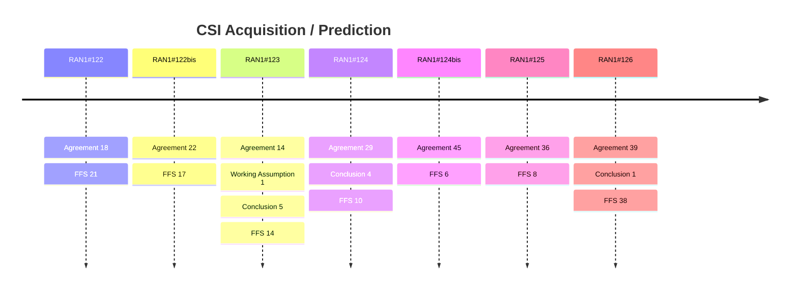

# CSI Acquisition / Prediction (Rel-20)

> 이 파일은 `scripts/generate_report.py`가 자동으로 생성합니다. 직접 수정하지 마세요.

## 회의별 진행

## 누적 히스토리

| 회의 | Agenda | 구분 | 내용 | 출처 |
|---|---|---|---|---|
| RAN1#122 | 10.1.1 | Agreement | For CSI feedback via two-sided model, support at least precoding matrix as target CSI type. - FFS whether consider raw channel matrix as further improvement, starting with evaluations, e.g. potential fusion with SRS measurement (SRS period/hopping, DL/UL reciprocity), frequency granularity of channel matrix, number of Rx antennas, etc. | [Chair notes RAN1#122 eom](https://www.3gpp.org/ftp/tsg_ran/WG1_RL1/TSGR1_122/Inbox/Chair_notes/Chair%20notes%20RAN1%23122%20eom.zip) [R1-2506496](https://www.3gpp.org/ftp/tsg_ran/WG1_RL1/TSGR1_122/Docs/R1-2506496.zip) |
| RAN1#122 | 10.1.1 | Agreement | Specify the precoding matrix feedback via two-sided model as follows: For a certain layer  and rank , - A precoding matrix is mapped with a latent message , with l = 1, ..., v where l is the layer index.   - The mapping is subject to [at least] a pairing ID configured by high-layer signalling.   - FFS  is common or specific for different layers or ranks   - Note: the terminology “latent message” is used for discussion purposes, the detailed name can be discussed further - is quantized and mapped to bit sequence before reporting. | [Chair notes RAN1#122 eom](https://www.3gpp.org/ftp/tsg_ran/WG1_RL1/TSGR1_122/Inbox/Chair_notes/Chair%20notes%20RAN1%23122%20eom.zip) [R1-2506496](https://www.3gpp.org/ftp/tsg_ran/WG1_RL1/TSGR1_122/Docs/R1-2506496.zip) |
| RAN1#122 | 10.1.1 | Agreement | For precoding matrix feedback, for a certain layer  of rank , the latent message  contains  real values - If scalar quantization (SQ) supported, it refers to the quantization of each real value independently,   - The payload size for layer  and rank  is determined by , where  is the number of bits per scalar. - If vector quantization (VQ) is supported, it refers to the quantization of a segment of L (L>1) consecutive real values jointly, and the segment(s) are separately quantized.   - The payload size for layer  and rank  is determined by , where  is the length of the vector segment,   is the number of bits per segment   - Note: Combining two real-values as a complex value and performing amplitude-phase quantization is precluded. | [Chair notes RAN1#122 eom](https://www.3gpp.org/ftp/tsg_ran/WG1_RL1/TSGR1_122/Inbox/Chair_notes/Chair%20notes%20RAN1%23122%20eom.zip) [R1-2506497](https://www.3gpp.org/ftp/tsg_ran/WG1_RL1/TSGR1_122/Docs/R1-2506497.zip) |
| RAN1#122 | 10.1.1 | Agreement | For precoding matrix feedback, consider the following aspects for payload determination - Support only SQ, or only VQ or both - and / or  and / or  are fixed values or determined from multiple values based on NW configuration or UE reporting. - and / or  is layer-common or layer-specific, rank-common or rank-specific. - If configured, and / or  and / or  above are configured separately from pairing ID, or configured by Pairing ID.   - The configuration may be via other parameters which are used to derive , L and . Note: Consider limiting the total number of possible payload sizes considering the inter-vendor training challenges. Note: ,  and  are independent on subband and port configurations, - FFS each combination of ,  and is applicable to a certain set of subband and port configurations | [Chair notes RAN1#122 eom](https://www.3gpp.org/ftp/tsg_ran/WG1_RL1/TSGR1_122/Inbox/Chair_notes/Chair%20notes%20RAN1%23122%20eom.zip) [R1-2506497](https://www.3gpp.org/ftp/tsg_ran/WG1_RL1/TSGR1_122/Docs/R1-2506497.zip) |
| RAN1#122 | 10.1.1 | Agreement | For inference report configuration, support separate configuration of subband, Tx port and payload size from pairing ID. | [Chair notes RAN1#122 eom](https://www.3gpp.org/ftp/tsg_ran/WG1_RL1/TSGR1_122/Inbox/Chair_notes/Chair%20notes%20RAN1%23122%20eom.zip) [R1-2506498](https://www.3gpp.org/ftp/tsg_ran/WG1_RL1/TSGR1_122/Docs/R1-2506498.zip) |
| RAN1#122 | 10.1.1 | Agreement | For quantization codebook used for quantizing the feedback, - For inter-vendor collaboration Direction A, select one of the following:   - Alt1: Exchange quantization codebook from NW-side to UE-side along with each exchanged dataset or model parameters   - Alt2: Use a standardized quantization codebook decided by RAN1. Including NW and UE data collection for training, performance monitoring, as well as model pairing related issues. | [Chair notes RAN1#122 eom](https://www.3gpp.org/ftp/tsg_ran/WG1_RL1/TSGR1_122/Inbox/Chair_notes/Chair%20notes%20RAN1%23122%20eom.zip) [R1-2506498](https://www.3gpp.org/ftp/tsg_ran/WG1_RL1/TSGR1_122/Docs/R1-2506498.zip) |
| RAN1#122 | 10.1.1 | Agreement | For model pairing procedure for inference, consider the applicability report procedure of Rel-19 AI/ML beam management for UE side model as a starting point. - Pairing ID(s) (i.e., ID for pairing related discussion) is indicated (e.g., in CSI-reportConfig) in Step 3.   - FFS whether/how to link the Pairing ID with the inter-vendor collaboration   - FFS whether/how Paring ID(s) are reported in Step 4 - FFS whether to support both Option A (CSI-ReportConfig for inference configuration) and Option B (sets of inference related parameters for applicability report only).   - FFS CSI compression specific inference configuration or inference related parameters. | [Chair notes RAN1#122 eom](https://www.3gpp.org/ftp/tsg_ran/WG1_RL1/TSGR1_122/Inbox/Chair_notes/Chair%20notes%20RAN1%23122%20eom.zip) [R1-2506482](https://www.3gpp.org/ftp/tsg_ran/WG1_RL1/TSGR1_122/Docs/R1-2506482.zip) |
| RAN1#122 | 10.1.1 | Agreement | For NW side data collection of CSI compression, discuss the content and format of the collected data by assuming higher layer based signalling. - Details on signaling is up to RAN2. | [Chair notes RAN1#122 eom](https://www.3gpp.org/ftp/tsg_ran/WG1_RL1/TSGR1_122/Inbox/Chair_notes/Chair%20notes%20RAN1%23122%20eom.zip) [R1-2506482](https://www.3gpp.org/ftp/tsg_ran/WG1_RL1/TSGR1_122/Docs/R1-2506482.zip) |
| RAN1#122 | 10.1.1 | Agreement | To enable UE side data collection, CSI-ReportConfig can be used for configuring the resources for data collection purpose without CSI report - P-CSI-RS and /SP CSI-RS are supported | [Chair notes RAN1#122 eom](https://www.3gpp.org/ftp/tsg_ran/WG1_RL1/TSGR1_122/Inbox/Chair_notes/Chair%20notes%20RAN1%23122%20eom.zip) [R1-2506482](https://www.3gpp.org/ftp/tsg_ran/WG1_RL1/TSGR1_122/Docs/R1-2506482.zip) |
| RAN1#122 | 10.1.1 | Agreement | For NW side data collection, study the solution for quantizing Target CSI, from the aspects of overhead, quantization loss/performance, and complexity. E.g.,: - Option 0: Reusing legacy e-Type II codebook - Option 1: Scalar quantization to the Target CSI. FFS number of bits for real/imaginary, whether coefficients for quantization are obtained from transformation of Target CSI. - Option 2: Enhanced methods to reduce the SVD/EVD decomposition complexity, reduce frequency/spatial/beam domain basis searching, with potentially relaxed overhead, e.g., Type II like codebook with scalar quantized W2 similar to Option 1 scalar quantization. - Option 3: Enhanced method for improved overhead saving, e.g., reporting the dominant eigenvalues/eigenvectors of per layer precoding matrix. - Option 4: eType II like codebook with new parameter values (e.g. larger L, pv, beta, amplitude, phase) - Note: the quantizaton format should consider the maximum payload size per reporting (e.g., 9KBytes) of the current higher layer signaling. - Note: At least take precoding matrix as Target CSI type. FFS channel matrix. - FFS: EVM, metric, benchmark (e.g., FP32, eT2 with PC6/8), by reusing R18 study EVM as baseline. | [Chair notes RAN1#122 eom](https://www.3gpp.org/ftp/tsg_ran/WG1_RL1/TSGR1_122/Inbox/Chair_notes/Chair%20notes%20RAN1%23122%20eom.zip) [R1-2506485](https://www.3gpp.org/ftp/tsg_ran/WG1_RL1/TSGR1_122/Docs/R1-2506485.zip) |
| RAN1#122 | 10.2.2 | Agreement | For UE transition from IDLE/INACTIVE to CONNECTED mode, support at least aperiodic SRS-AS transmission triggered via MSG4 of 4-Step RACH. | [Chair notes RAN1#122 eom](https://www.3gpp.org/ftp/tsg_ran/WG1_RL1/TSGR1_122/Inbox/Chair_notes/Chair%20notes%20RAN1%23122%20eom.zip) [R1-2506539](https://www.3gpp.org/ftp/tsg_ran/WG1_RL1/TSGR1_122/Docs/R1-2506539.zip) |
| RAN1#122 | 10.2.2 | Agreement | For UE transition from IDLE/INACTIVE to CONNECTED mode, support aperiodic CSI reporting  triggered via MSG4 of 4-Step RACH based on the followings: - The aperiodic CSI reporting is transmitted on PUSCH. - Support at least aperiodic CSI-RS for CSI associated with the aperiodic CSI reporting - Support PMI-based reporting with wideband PMI based on Rel-15 Type-I SP codebook and wideband CQI   - FFS: Which report quantity(s) can be configured - Support PMI-free reporting with wideband CQI   - FFS: Which report quantity can be configured | [Chair notes RAN1#122 eom](https://www.3gpp.org/ftp/tsg_ran/WG1_RL1/TSGR1_122/Inbox/Chair_notes/Chair%20notes%20RAN1%23122%20eom.zip) [R1-2506539](https://www.3gpp.org/ftp/tsg_ran/WG1_RL1/TSGR1_122/Docs/R1-2506539.zip) |
| RAN1#122 | 10.2.2 | Agreement | For a UE transition from IDLE to CONNECTED mode, support the following procedure at least for early aperiodic SRS-AS/CSI-RS/CSI triggering (i.e., early triggering of aperiodic SRS-AS transmission, aperiodic CSI-RS reception, aperiodic CSI reporting): - Step-1: The UE receives the resource/reporting configuration(s) for early SRS-AS/CSI-RS/CSI triggering provided in the system information before MSG3.   - FFS: Which SIB is used to carry the resource/reporting configuration(s) for early SRS-AS/CSI/CSI-RS triggering - Step-2: The UE reports its capability on early SRS/CSI-RS/CSI triggering through MSG3 - Step-3: The UE receives MSG4 that triggers early SRS-AS/CSI-RS/CSI based on  the capability reported by the UE. - Step-4: The UE performs aperiodic SRS-AS transmission, aperiodic CSI-RS reception, and/or aperiodic CSI reporting.   - FFS: Timeline of the aperiodic SRS-AS transmission, aperiodic CSI-RS reception, aperiodic CSI reporting Note: The term “capability” above does not mean legacy RRC based UE capability. FFS: For a UE transition from INACTIVE to CONNECTED mode, whether above procedure can be reused at least for early aperiodic SRS-AS/CSI-RS/CSI triggering Note: Whether the aperiodic SRS-AS transmission, aperiodic CSI-RS reception, and/or aperiodic CSI reporting can be configured/triggered simultaneously will be discussed separately | [Chair notes RAN1#122 eom](https://www.3gpp.org/ftp/tsg_ran/WG1_RL1/TSGR1_122/Inbox/Chair_notes/Chair%20notes%20RAN1%23122%20eom.zip) [R1-2506539](https://www.3gpp.org/ftp/tsg_ran/WG1_RL1/TSGR1_122/Docs/R1-2506539.zip) |
| RAN1#122 | 10.2.2 | Agreement | CSI-RS frequency-domain density ρ = 1/4 can be configured to the K NZP CSI-RS resources at least for the following cases:   - K=2 24-port NZP CSI-RS resources in a CSI-RS resource set aggregating 48 CSI-RS ports   - K=4 16-port NZP CSI-RS resources in a CSI-RS resource set aggregating 64 CSI-RS ports   - K=2 32-port NZP CSI-RS resources in a CSI-RS resource set aggregating 64 CSI-RS ports   - K=4 32-port NZP CSI-RS resources in a CSI-RS resource set aggregating 128 CSI-RS ports FFS: K=3 16-port NZP CSI-RS resources in a CSI-RS resource set aggregating 48 CSI-RS ports Note: It’s not precluded that the frequency-domain density configured to the K NZP CSI-RS resources in the same CSI-RS resource set for 48/64/128 CSI-RS ports aggregation can be different | [Chair notes RAN1#122 eom](https://www.3gpp.org/ftp/tsg_ran/WG1_RL1/TSGR1_122/Inbox/Chair_notes/Chair%20notes%20RAN1%23122%20eom.zip) [R1-2506539](https://www.3gpp.org/ftp/tsg_ran/WG1_RL1/TSGR1_122/Docs/R1-2506539.zip) |
| RAN1#122 | 10.2.2 | Agreement | CSI-RS frequency-domain density ρ = 1/3 and 1/6 can be configured to the K NZP CSI-RS resources at least for the following cases:   - K=3 16-port NZP CSI-RS resources in a CSI-RS resource set aggregating 48 CSI-RS ports FFS: K=2 24-port NZP CSI-RS resources in a CSI-RS resource set aggregating 48 CSI-RS ports Note: It’s not precluded that the frequency-domain density configured to the K NZP CSI-RS resources in the same CSI-RS resource set for 48 CSI-RS ports aggregation can be different | [Chair notes RAN1#122 eom](https://www.3gpp.org/ftp/tsg_ran/WG1_RL1/TSGR1_122/Inbox/Chair_notes/Chair%20notes%20RAN1%23122%20eom.zip) [R1-2506576](https://www.3gpp.org/ftp/tsg_ran/WG1_RL1/TSGR1_122/Docs/R1-2506576.zip) |
| RAN1#122 | 10.2.2 | Agreement | For early triggering of SRS-AS when SCell transition from deactivation to activation, support at least aperiodic SRS-AS transmission on a SCell, triggered based on legacy SCell activation command activating the SCell. - FFS: Timeline of the aperiodic SRS-AS transmission (requirement is up to RAN4) - FFS: How to trigger the aperiodic SRS-AS transmission based on legacy SCell activation command - FFS: Whether/what new information is provided in SCell activation command? | [Chair notes RAN1#122 eom](https://www.3gpp.org/ftp/tsg_ran/WG1_RL1/TSGR1_122/Inbox/Chair_notes/Chair%20notes%20RAN1%23122%20eom.zip) [R1-2506583](https://www.3gpp.org/ftp/tsg_ran/WG1_RL1/TSGR1_122/Docs/R1-2506583.zip) |
| RAN1#122 | 10.2.2 | Agreement | For early triggering of CSI/CSI-RS when SCell transition from deactivation to activation, support aperiodic CSI reporting for a SCell triggered based on legacy SCell activation command activating the SCell. - The aperiodic CSI reporting is assosicated with at least aperiodic CSI-RS for CSI on the SCell - FFS: Timeline of the aperiodic CSI reporting and corresponding aperiodic CSI-RS for CSI (requirement is up to RAN4) - FFS: How to trigger the aperiodic CSI reporting and corresponding aperiodic CSI-RS for CSI based on legacy SCell activation command? - FFS: Whether/what new information is provided in SCell activation command? | [Chair notes RAN1#122 eom](https://www.3gpp.org/ftp/tsg_ran/WG1_RL1/TSGR1_122/Inbox/Chair_notes/Chair%20notes%20RAN1%23122%20eom.zip) [R1-2506583](https://www.3gpp.org/ftp/tsg_ran/WG1_RL1/TSGR1_122/Docs/R1-2506583.zip) |
| RAN1#122 | 10.2.2 | Agreement | For early triggering of SRS-AS/CSI-RS/CSI when UE transition from IDLE to CONNECTED mode, study the following at least three options for Step-1 and Step-2: - Option-1: NW can provide the resource/report configuration in SIBx based on only one UE capability assumption, and UE can report through MSG3 whether the resource/report configuration received in SIBx is supported. - Option-2: NW can provide the resource/report configuration(s) in SIBx based on one or multiple UE capability assumptions, and UE can report through MSG3 which resource/report configuration(s) received in SIBx is/are supported. - Option-3: NW can provide the resource/report configuration(s) in SIBx based on one or multiple UE capability assumptions, and UE can report through MSG3 the supported capability(s) of early SRS/CSI/CSI-RS triggering (e.g., whether to support this feature, max number of CSI-RS ports, xTyR for SRS-AS, max bandwidth of the CSI-RS/SRS-AS etc.). Note: The term “capability” or “UE capability” above does not mean legacy RRC based UE capability. | [Chair notes RAN1#122 eom](https://www.3gpp.org/ftp/tsg_ran/WG1_RL1/TSGR1_122/Inbox/Chair_notes/Chair%20notes%20RAN1%23122%20eom.zip) [R1-2506583](https://www.3gpp.org/ftp/tsg_ran/WG1_RL1/TSGR1_122/Docs/R1-2506583.zip) |
| RAN1#122bis | 10.1.1.1 | Agreement | Support precoding matrix with port-subband domain representation as target CSI type. - For a certain layer , a precoding matrix on N_sb subband and P CSI-RS ports is  with  being a  vector. - Note: Only sub-band PMI reporting is supported. | [Chair notes RAN1#122b eom4](https://www.3gpp.org/ftp/tsg_ran/WG1_RL1/TSGR1_122b/Inbox/Chair_Notes/Chair%20notes%20RAN1%23122b%20eom4.docx) [R1-2508021](https://www.3gpp.org/ftp/tsg_ran/WG1_RL1/TSGR1_122b/Docs/R1-2508021.zip) |
| RAN1#122bis | 10.1.1.1 | Agreement | For determining the payload parameters combinations  or   across all layers and ranks, consider following general principles for precoding matrix-based target CSI - Rank-common and layer-common model with payload-scalable design is considered as the baseline implementation for discussion purpose.   - Note: layer-specific / rank-specific (if supported) payload parameters are supported by this rank-common and layer-common model with payload-scalable design. - Limiting the total number of (per-layer) payload parameters combinations  or   across all layers and all ranks. - At least for medium to high per-layer payload regime, the total payload size of rank 2, rank 3 and 4 are comparable to each other. - Spectral efficiency or system throughput and trade-off with feedback overhead are considered as the performance metric. | [Chair notes RAN1#122b eom4](https://www.3gpp.org/ftp/tsg_ran/WG1_RL1/TSGR1_122b/Inbox/Chair_Notes/Chair%20notes%20RAN1%23122b%20eom4.docx) [R1-2508021](https://www.3gpp.org/ftp/tsg_ran/WG1_RL1/TSGR1_122b/Docs/R1-2508021.zip) |
| RAN1#122bis | 10.1.1.1 | Agreement | When the Target CSI is precoder matrix, in order to down-select to N per-layer payload parameter combinations (PC) of  or  based on performance, overhead and complexity trade-off results, consider the following candidate values: - Candiate values for : 32, 64, 96, 128, 192 - Candidate values for : 1, 2, 3, 4, (8, 10 only for VQ)   - 2 is considered as the baseline assumption for SQ. - Candidate values for L: L=2, 4, - Candidate values for N: 4, 5, 6 - Note: These N payload PCs of  or  are considered as the pool for the payload PC for each layer and each rank. - Note: The above is for discussion purpose, how to configure the PCs (across layers and ranks) is a separate discussion. - Note: Rank-common and layer-common model with payload scalable design is considered. - Note: The above does not mean support of both SQ and VQ. - Note: The number of parameters combinations configurations (Y) does not exceed 8. | [Chair notes RAN1#122b eom4](https://www.3gpp.org/ftp/tsg_ran/WG1_RL1/TSGR1_122b/Inbox/Chair_Notes/Chair%20notes%20RAN1%23122b%20eom4.docx) [R1-2508022](https://www.3gpp.org/ftp/tsg_ran/WG1_RL1/TSGR1_122b/Docs/R1-2508022.zip) |
| RAN1#122bis | 10.1.1.1 | Agreement | For payload parameter combinations (PC), consider followings - Support Y configurable PCs (across layers and ranks) as below, where X_n, Xn_31, Xn_32, Xn_33, Xn_41, Xn_42, Xn_43, Xn_44 represent a pair of  or a triplet of   chosen from the per-layer PC pool. \|  \| Rank1 \| Rank2 \| Rank3 \| Rank4 \| \| PC1 \| X1 \| X1, X1 \| X1_31, X1_32, X1_33 \| X1_41, X1_42, X1_43, X1_44 \| \| PC2 \| X2 \| X2, X2 \| X2_31, X2_32, X2_33 \| X2_41, X2_42, X2_43, X2_44 \| \| … \|  \|  \|  \|  \| - For rank 1 and rank 2, layer-common and rank-common payload is supported. - For rank 3, consider alternatives of {Xn_31, Xn_32, Xn_33} = {a, a, a}, {a, a, b}, {a, b, b} for potential down selection. - For rank 4, consider alternatives of {Xn_41, Xn_42, Xn_43, Xn_44} = {a, a, a, a}, {a, a, b, b}, {a, b, b, c}, {a, a, b, c} or {a, b, c, c} for potential down selection. - Note: The table is for discussion purpose, how to configure the PCs (across layers and ranks) is a separate discussion. - Note: a, b values in rank3 can be different from that in rank 4. | [Chair notes RAN1#122b eom4](https://www.3gpp.org/ftp/tsg_ran/WG1_RL1/TSGR1_122b/Inbox/Chair_Notes/Chair%20notes%20RAN1%23122b%20eom4.docx) [R1-2508022](https://www.3gpp.org/ftp/tsg_ran/WG1_RL1/TSGR1_122b/Docs/R1-2508022.zip) |
| RAN1#122bis | 10.1.1.1 | Agreement | Consider following for evaluation: - For down-selection of per-layer pairs of  or a triplets of  , average SGCS across per layer can be considered as performance metric. - For down-selection of the rank-specific and layer-specific patterns (e.g., {Xn_31, Xn_32, Xn_33} and {Xn_41, Xn_42, Xn_43, Xn_44}), spectral efficiency or throughput should be considered. | [Chair notes RAN1#122b eom4](https://www.3gpp.org/ftp/tsg_ran/WG1_RL1/TSGR1_122b/Inbox/Chair_Notes/Chair%20notes%20RAN1%23122b%20eom4.docx) [R1-2508023](https://www.3gpp.org/ftp/tsg_ran/WG1_RL1/TSGR1_122b/Docs/R1-2508023.zip) |
| RAN1#122bis | 10.1.1.1 | Agreement | For CSI feedback via two-sided AIML models, reuse legacy CSI reporting framework - Support CSI report based on periodic, semi-persistent and aperiodic CSI-RS resources with legacy measurement resource configurations. - Support aperiodic report and semi-persistent CSI report on PUSCH and reuse legacy triggering mechanism. | [Chair notes RAN1#122b eom4](https://www.3gpp.org/ftp/tsg_ran/WG1_RL1/TSGR1_122b/Inbox/Chair_Notes/Chair%20notes%20RAN1%23122b%20eom4.docx) [R1-2508023](https://www.3gpp.org/ftp/tsg_ran/WG1_RL1/TSGR1_122b/Docs/R1-2508023.zip) |
| RAN1#122bis | 10.1.1.2 | Agreement | For NW side data collection with higher layer reporting, for further study of Option 1 (scalar quantization), consider the following definition for evaluation: - Content: for a number of S=1 (as baseline) Target CSI samples each with the dimensions of 2N1N2 ports, N3 subbands, v layers for precoding matrix, and real+imaginary (or amplitude+phase) parts, which has overall 2N1N2*N3*v complex elements, and any complex element has a real (or amplitude) part of x1 and an imaginary (or phase) part of x2.   - Note: Companies to report whether  real value and imaginary value are quantized, or amplitude value and phase value are quantized. - Format: x1 is quantized to k1 bits within range of [T1min, T1max], and x2 is quantized to k2 bits within range of [T2min, T2max]. E.g., for Scalar8, k1=8 bits for quantizing the real part, and k2=8 bits for quantizing the imaginary part. Uniform quantization is assumed.   - Note: Companies to report whether/how the normalization is performed, and whether it is normalized within or across 2N1N2 ports/ N3 subbands/ v layers/ real and imaginary (or amplitude and phase) parts. - Fixed parameter values of k1/k2/T1min/T1max/T2min/T2max across complex elements, as a baseline for evaluations. Companies to report the values. - Note: It is up to company to use number of samples S>1 in their evaluations. In this case, companies need to provide information how S samples are quantized in their evaluation. | [Chair notes RAN1#122b eom4](https://www.3gpp.org/ftp/tsg_ran/WG1_RL1/TSGR1_122b/Inbox/Chair_Notes/Chair%20notes%20RAN1%23122b%20eom4.docx) [R1-2508028](https://www.3gpp.org/ftp/tsg_ran/WG1_RL1/TSGR1_122b/Docs/R1-2508028.zip) |
| RAN1#122bis | 10.1.1.2 | Agreement | For NW side data collection with higher layer reporting, regarding Option 4 (eType II like codebook with new parameter), further study the following candidate enhanced parameter values with potential down selection. - L= 4/6/12/16/(N1*N2), pv=0.6/0.75/1, Beta = 0.5/0.8/1. Reference amplitude = 4bits/6bits, differential amplitude = 3bits/4bits, and phase = 4bits/6bits   - Company to report the quantization step for reference amplitude for 6bits. - No restriction to the total number of non-zero coefficients for a specific rank. - Other combinations can be considered and reported by companies. | [Chair notes RAN1#122b eom4](https://www.3gpp.org/ftp/tsg_ran/WG1_RL1/TSGR1_122b/Inbox/Chair_Notes/Chair%20notes%20RAN1%23122b%20eom4.docx) [R1-2508030](https://www.3gpp.org/ftp/tsg_ran/WG1_RL1/TSGR1_122b/Docs/R1-2508030.zip) |
| RAN1#122bis | 10.1.1.2 | Agreement | For the study of NW side data collection with higher layer reporting, following evaluation assumptions are considered: - Benchmark#1: FP32 (k1=k2=32 bits) - Benchmark#2: legacy eType II with PC6 (for layer 1/2/3/4), PC8(for layer 1/2) - CSI payload size: at least consider large CSI payload Z ≥ 230 bits per layer, optionally consider low/medium CSI payload size X/Y per layer. - Tx port: 32, 64, or 128 up to companies. - Subband number: 13, or 19 up to companies. - Performance metric:   - Metric#1: SGCS for specific layer(s) between Target CSI of FP32 and recovery CSI, for a model trained with quantized Target CSI with a specific quantization option.   - Metric#2: SGCS for specific layer(s) between the Target CSI of FP32 with its quantized version subject to a specific quantization solution   - Overhead per sample and per layer SGCS results are reported per layer - Note: Complexity should be analysed. - For Option 1, consider k1+k2=4, 6 ,7, 8, 16, 32 - Other assumptions follow R18 study EVM | [Chair notes RAN1#122b eom4](https://www.3gpp.org/ftp/tsg_ran/WG1_RL1/TSGR1_122b/Inbox/Chair_Notes/Chair%20notes%20RAN1%23122b%20eom4.docx) [R1-2508030](https://www.3gpp.org/ftp/tsg_ran/WG1_RL1/TSGR1_122b/Docs/R1-2508030.zip) |
| RAN1#122bis | 10.1.1.2 | Agreement | For CPU counting of UE side data collection, - OCPU=1 - FFS: The CPU occupancy duration | [Chair notes RAN1#122b eom4](https://www.3gpp.org/ftp/tsg_ran/WG1_RL1/TSGR1_122b/Inbox/Chair_Notes/Chair%20notes%20RAN1%23122b%20eom4.docx) [R1-2508031](https://www.3gpp.org/ftp/tsg_ran/WG1_RL1/TSGR1_122b/Docs/R1-2508031.zip) |
| RAN1#122bis | 10.2.2 | Agreement | For early triggering of SRS-AS when SCell transition from a dormant BWP to a non-dormant BWP, support aperiodic SRS-AS transmission on the non-dormant BWP, triggered via a DCI indicating switching out of SCell dormancy. - Legacy DCI format(s) for switching out of SCell dormancy is reused without introducing new DCI field or resizing the existing DCI field - FFS: Which DCI format(s) from DCI format 0_1/0_3/1_1/1_3/2_6 is supported - FFS: Triggering mechanism(s) - FFS: Timeline of the aperiodic SRS-AS transmission (requirement is up to RAN4) | [Chair notes RAN1#122b eom4](https://www.3gpp.org/ftp/tsg_ran/WG1_RL1/TSGR1_122b/Inbox/Chair_Notes/Chair%20notes%20RAN1%23122b%20eom4.docx) [R1-2506838](https://www.3gpp.org/ftp/tsg_ran/WG1_RL1/TSGR1_122b/Docs/R1-2506838.zip) |
| RAN1#122bis | 10.2.2 | Agreement | For early triggering of CSI/CSI-RS when SCell transition from a dormant BWP to a non-dormant BWP, support aperiodic CSI reporting for the non-dormant BWP, triggered via a DCI indicating switching out of SCell dormancy. - The aperiodic CSI reporting is associated with aperiodic CSI-RS for CSI on the non-dormant BWP - Legacy DCI format(s) for switching out of SCell dormancy is reused without introducing new DCI field or resizing the existing DCI field - FFS: Which DCI format(s) from DCI format 0_1/0_3/1_1/1_3/2_6 is supported - FFS: Triggering mechanism(s) - FFS: Timeline of the aperiodic CSI reporting and corresponding aperiodic CSI-RS for CSI (requirement is up to RAN4) | [Chair notes RAN1#122b eom4](https://www.3gpp.org/ftp/tsg_ran/WG1_RL1/TSGR1_122b/Inbox/Chair_Notes/Chair%20notes%20RAN1%23122b%20eom4.docx) [R1-2506838](https://www.3gpp.org/ftp/tsg_ran/WG1_RL1/TSGR1_122b/Docs/R1-2506838.zip) |
| RAN1#122bis | 10.2.2 | Agreement | For UE transition from IDLE/INACTIVE to CONNECTED mode, support the followings for aperiodic CSI reporting triggered by MSG4: - For PMI-based reporting, support the report quantity ‘CRI-RI-PMI-CQI’   - FFS: ‘CRI-RI-LI-PMI-CQI’ - For PMI-free reporting, support the report quantity ‘CRI-RI-CQI’ | [Chair notes RAN1#122b eom4](https://www.3gpp.org/ftp/tsg_ran/WG1_RL1/TSGR1_122b/Inbox/Chair_Notes/Chair%20notes%20RAN1%23122b%20eom4.docx) [R1-2506838](https://www.3gpp.org/ftp/tsg_ran/WG1_RL1/TSGR1_122b/Docs/R1-2506838.zip) |
| RAN1#122bis | 10.2.2 | Agreement | For early TRS reception when UE transition from IDLE/INACTIVE to CONNECTED mode, down-select one from the followings in RAN1#123 meeting: - Alt-1: Support aperiodic TRS triggered by MSG4 only - Alt-2: Support periodic TRS triggered by MSG4 and aperiodic TRS triggered by MSG4 - Alt-3: Support periodic TRS triggered by MSG4 only | [Chair notes RAN1#122b eom4](https://www.3gpp.org/ftp/tsg_ran/WG1_RL1/TSGR1_122b/Inbox/Chair_Notes/Chair%20notes%20RAN1%23122b%20eom4.docx) [R1-2506838](https://www.3gpp.org/ftp/tsg_ran/WG1_RL1/TSGR1_122b/Docs/R1-2506838.zip) |
| RAN1#122bis | 10.2.2 | Agreement | For UE transition from IDLE/INACTIVE to CONNECTED mode, using MAC-CE in the PDSCH for MSG4 to trigger early aperiodic SRS-AS/CSI-RS/CSI - Note: How to determine the PUSCH for aperiodic CSI reporting is separately discussed. | [Chair notes RAN1#122b eom4](https://www.3gpp.org/ftp/tsg_ran/WG1_RL1/TSGR1_122b/Inbox/Chair_Notes/Chair%20notes%20RAN1%23122b%20eom4.docx) [R1-2506839](https://www.3gpp.org/ftp/tsg_ran/WG1_RL1/TSGR1_122b/Docs/R1-2506839.zip) |
| RAN1#122bis | 10.2.2 | Agreement | For SCell transition from deactivation to activation, support the followings for aperiodic CSI reporting triggered based on legacy SCell activation command: - For PMI-based reporting, support the report quantity ‘CRI-RI-PMI-CQI’   - FFS: ‘CRI-RI-LI-PMI-CQI’ - For PMI-free reporting, support the report quantity ‘CRI-RI-CQI’ | [Chair notes RAN1#122b eom4](https://www.3gpp.org/ftp/tsg_ran/WG1_RL1/TSGR1_122b/Inbox/Chair_Notes/Chair%20notes%20RAN1%23122b%20eom4.docx) [R1-2506839](https://www.3gpp.org/ftp/tsg_ran/WG1_RL1/TSGR1_122b/Docs/R1-2506839.zip) |
| RAN1#122bis | 10.2.2 | Agreement | For SCell transition from dormant-BWP to non-dormant BWP, support the followings for aperiodic CSI reporting triggered via a DCI indicating switching out of SCell dormancy: - For PMI-based reporting, support the report quantity ‘CRI-RI-PMI-CQI’   - FFS: ‘CRI-RI-LI-PMI-CQI’ - For PMI-free reporting, support the report quantity ‘CRI-RI-CQI’ | [Chair notes RAN1#122b eom4](https://www.3gpp.org/ftp/tsg_ran/WG1_RL1/TSGR1_122b/Inbox/Chair_Notes/Chair%20notes%20RAN1%23122b%20eom4.docx) [R1-2506839](https://www.3gpp.org/ftp/tsg_ran/WG1_RL1/TSGR1_122b/Docs/R1-2506839.zip) |
| RAN1#122bis | 10.2.2 | Agreement | For early aperiodic SRS-AS/CSI-RS/CSI triggering (i.e., early triggering of aperiodic SRS-AS transmission, aperiodic CSI-RS reception, aperiodic CSI reporting) when UE transition from INACTIVE to CONNECTED mode, reuse the procedure for UE transition from IDLE to CONNECTED mode. | [Chair notes RAN1#122b eom4](https://www.3gpp.org/ftp/tsg_ran/WG1_RL1/TSGR1_122b/Inbox/Chair_Notes/Chair%20notes%20RAN1%23122b%20eom4.docx) [R1-2506839](https://www.3gpp.org/ftp/tsg_ran/WG1_RL1/TSGR1_122b/Docs/R1-2506839.zip) |
| RAN1#122bis | 10.2.2 | Agreement | For early triggering of SRS-AS when UE transition from IDLE/INACTIVE to CONNECTED mode, support Option-2 as follows: - In Step-1, SIBx provides one or multiple SRS configurations based on one or multiple ‘xTyR’ UE capability assumptions.   - At least one SRS configuration(s) resource sets for SRS-AS in an SRS configuration is provided for a same ‘xTyR’   - FFS: Information to be provided in SRS configuration(s)   - FFS: Whether Configuration information could be SRS configuration or the CSI report configuration for PMI-free report.   - FFS: Whether SRS configuration can be associated with CSI report configuration for PMI-free report. - In Step-2, UE reports through MSG3 which/whether the SRS configuration(s) provided in SIBx is/are supported.   - FFS: How to report which/whether the SRS configuration(s) provided in SIBx is/are supported. | [Chair notes RAN1#122b eom4](https://www.3gpp.org/ftp/tsg_ran/WG1_RL1/TSGR1_122b/Inbox/Chair_Notes/Chair%20notes%20RAN1%23122b%20eom4.docx) [R1-2506839](https://www.3gpp.org/ftp/tsg_ran/WG1_RL1/TSGR1_122b/Docs/R1-2506839.zip) |
| RAN1#122bis | 10.2.2 | Agreement | For early triggering of aperiodic CSI reporting and the associated CSI-RS for CSI when UE transition from IDLE/INACTIVE to CONNECTED mode, support Option-2 as follows: - In Step-1, SIBx provides one or multiple CSI report configurations based on one or multiple UE capability assumptions   - Each CSI reporting configuration is associated with a CSI resource configuration for channel measurement.     - The CSI-RS resource set(s) in the CSI resource configuration for channel measurement is provided with a same number of CSI-RS ports   - Each CSI reporting configuration is associated with a CSI resource configuration for CSI-IM based interference measurement.   - FFS: Support of NZP CSI-RS based interference measurement   - FFS: Information to be provided in a CSI report/resource configuration - In Step-2, UE reports through MSG3 which/whether the CSI report configuration(s) provided in SIBx is/are supported.   - FFS: How to report which/whether the CSI report configuration(s) provided in SIBx is/are supported. | [Chair notes RAN1#122b eom4](https://www.3gpp.org/ftp/tsg_ran/WG1_RL1/TSGR1_122b/Inbox/Chair_Notes/Chair%20notes%20RAN1%23122b%20eom4.docx) [R1-2506840](https://www.3gpp.org/ftp/tsg_ran/WG1_RL1/TSGR1_122b/Docs/R1-2506840.zip) |
| RAN1#122bis | 10.2.2 | Agreement | On PUSCH allocation for MSG4-triggered aperiodic CSI reporting associated with aperiodic CSI-RS for CSI, when UE transition from IDLE/INACTIVE to CONNECTED mode, down select one from the following alternatives to determine PUSCH for carrying the aperiodic CSI report by RAN1#123: - Alt-1: The PUSCH is scheduled by MAC CE in MSG4 along with the aperiodic CSI report triggering. - Alt-2: The PUSCH is scheduled by a legacy DCI after MSG4 - Alt-3: The PUSCH is configured by SIBx providing resource/reporting configuration for early triggering of aperiodic CSI reporting. Note: The timeline of PUSCH for aperiodic CSI reporting is separately discussed. | [Chair notes RAN1#122b eom4](https://www.3gpp.org/ftp/tsg_ran/WG1_RL1/TSGR1_122b/Inbox/Chair_Notes/Chair%20notes%20RAN1%23122b%20eom4.docx) [R1-2508115](https://www.3gpp.org/ftp/tsg_ran/WG1_RL1/TSGR1_122b/Docs/R1-2508115.zip) |
| RAN1#122bis | 10.2.2 | Agreement | On triggering mechanism for early aperiodic SRS-AS transmission on a SCell and early aperiodic CSI reporting for a SCell, based on the legacy SCell activation activating the SCell, down-select one from the followings in RAN1#123 meeting: - Alt-1 (Implicit mechanism):   - For early aperiodic SRS-AS transmission, the SRS resource set(s) triggered for the SCell is determined according to RRC configuration.   - For early aperiodic CSI reporting, the CSI report configuration(s) triggered for the SCell is determined according to RRC configuration - Alt-2 (Explicit mechanism):   - For early aperiodic SRS-AS transmission, the SRS resource set(s) triggered for the SCell is determined according to an indication in SCell activation command.   - For early aperiodic CSI reporting, the CSI report configuration(s) triggered for the SCell is determined according to an indication in SCell activation command. | [Chair notes RAN1#122b eom4](https://www.3gpp.org/ftp/tsg_ran/WG1_RL1/TSGR1_122b/Inbox/Chair_Notes/Chair%20notes%20RAN1%23122b%20eom4.docx) [R1-2508115](https://www.3gpp.org/ftp/tsg_ran/WG1_RL1/TSGR1_122b/Docs/R1-2508115.zip) |
| RAN1#123 | 10.1.1.1 | Agreement | Support NW side optionally exchanges codebook to the UE side. - If NW side exchanges a codebook, the exchanged codebook is associated to the pairing ID.   - FFS SQ / VQ / both is supported   - FFS the details, e.g., whether exchange the NW-defined codebook or the  ID of a standardized SQ codebook in case of multiple standardized codebooks. - If NW side does not exchange a codebook or an ID of a standardized SQ codebook in case of multiple standardized codebooks, a standardized SQ codebook is associated to the pairing ID. - Note: For the same quantization resolution, a common codebook is used for all the scalars/segment(s), all the layers of pre-coding matrix and all parameter pairs/triplets for the associated pairing ID. | [Chair notes RAN1#123 - eom3](https://www.3gpp.org/ftp/tsg_ran/WG1_RL1/TSGR1_123/Inbox/Chair_notes/Chair%20notes%20RAN1%23123%20-%20eom3.docx) [R1-2509215](https://www.3gpp.org/ftp/tsg_ran/WG1_RL1/TSGR1_123/Docs/R1-2509215.zip) |
| RAN1#123 | 10.1.1.1 | Agreement | If target CSI type is pre-coder matrix, at least support per-layer payload parameter pairs {32, 2}, {64, 2}, {128, 2}, {192, 2} - FFS: Whether support per-layer payload parameter pairs {32, 1}, {48, 2}, {96, 1}, {96, 2}, {192, 1}, {128,10/128} - Note: The above pair refers to the pair of latent dimension and quantization resolution, i.e., {d, Q} for SQ or {d, Q/L} for VQ. | [Chair notes RAN1#123 - eom3](https://www.3gpp.org/ftp/tsg_ran/WG1_RL1/TSGR1_123/Inbox/Chair_notes/Chair%20notes%20RAN1%23123%20-%20eom3.docx) [R1-2509215](https://www.3gpp.org/ftp/tsg_ran/WG1_RL1/TSGR1_123/Docs/R1-2509215.zip) |
| RAN1#123 | 10.1.1.1 | Agreement | If target CSI type is pre-coder matrix, at least for SQ, for the PC with rank-1 payload of 128 bits, support the following payload combinations across layers and ranks. The layers are reported in the order of decreasing strength. \| Rank1 \| Rank2 \| Rank3 \| Rank4 \| \| {64, 2} \| {64, 2}, {64, 2} \| {32, 2}, {32, 2}, {64, 2} \| {32, 2}, {32, 2}, {32, 2}, {32, 2} \| | [Chair notes RAN1#123 - eom3](https://www.3gpp.org/ftp/tsg_ran/WG1_RL1/TSGR1_123/Inbox/Chair_notes/Chair%20notes%20RAN1%23123%20-%20eom3.docx) [R1-2509215](https://www.3gpp.org/ftp/tsg_ran/WG1_RL1/TSGR1_123/Docs/R1-2509215.zip) |
| RAN1#123 | 10.1.1.1 | Agreement | If target CSI type is pre-coder matrix, at least for SQ, for the PC with rank-1 payload of 256 bits, support the following payload combinations across layers and ranks. The layers are reported in the order of decreasing strength. \| Rank1 \| Rank2 \| Rank3 \| Rank4 \| \| {128, 2} \| {128, 2}, {128, 2} \| {64, 2}, {64, 2}, {128, 2} \| {64, 2}, {64, 2}, {64, 2}, {64, 2} \| | [Chair notes RAN1#123 - eom3](https://www.3gpp.org/ftp/tsg_ran/WG1_RL1/TSGR1_123/Inbox/Chair_notes/Chair%20notes%20RAN1%23123%20-%20eom3.docx) [R1-2509215](https://www.3gpp.org/ftp/tsg_ran/WG1_RL1/TSGR1_123/Docs/R1-2509215.zip) |
| RAN1#123 | 10.1.1.1 | Agreement | If target CSI type is pre-coder matrix, at least for SQ, for the PC with rank-1 payload of 64 bits, select one alternative from following alternatives in RAN1 #124. - The layers are reported in the order of decreasing strength. - Note: For the purpose of comparison, consider the following:   - For comparing Alt.1 and Alt. 2, consider payload scalability. \|  \| Rank1 \| Rank2 \| Rank3 \| Rank4 \| \| Alt1 \| {32, 2} \| {32, 2}, {32, 2} \| NA \| NA \| \| Alt2 \| {32, 2} \| {32, 2}, {32, 2} \| {32, 1}, {32, 1}, {32, 2} \| {32, 1}, {32, 1}, {32, 1}, {32, 1} \| | [Chair notes RAN1#123 - eom3](https://www.3gpp.org/ftp/tsg_ran/WG1_RL1/TSGR1_123/Inbox/Chair_notes/Chair%20notes%20RAN1%23123%20-%20eom3.docx) [R1-2509215](https://www.3gpp.org/ftp/tsg_ran/WG1_RL1/TSGR1_123/Docs/R1-2509215.zip) |
| RAN1#123 | 10.1.1.1 | Agreement | If target CSI type is pre-coder matrix, at least for SQ, for the PC with rank-1 payload of 384 bits, select one alternative from following alternatives in RAN1 #124. - The layers are reported in the order of decreasing strength. \|  \| Rank1 \| Rank2 \| Rank3 \| Rank4 \| \| Alt1.1 \| {192, 2} \| {192, 2}, {192, 2} \| {96, 2}, {96, 2}, {192, 2} \| {96, 2}, {96, 2}, {96, 2}, {96, 2} \| \| Alt1.2 \| {192, 2} \| {192, 2}, {192, 2} \| {192, 1}, {192, 1}, {192, 2} \| {192, 1}, {192, 1}, {192, 1}, {192, 1} \| \| Alt2 \| {192, 2} \| {192, 2}, {192, 2} \| {128, 2}, {128, 2}, {128, 2} \| {64, 2}, {64, 2}, {128, 2}, {128, 2} \| \| Alt3.1 \| {192, 2} \| {192, 2}, {192, 2} \| {128, 2}, {128, 2}, {128, 2} \| {96, 2}, {96, 2}, {96, 2}, {96, 2} \| \| Alt3.2 \| {192, 2} \| {192, 2}, {192, 2} \| {128, 2}, {128, 2}, {128, 2} \| {192, 1}, {192, 1}, {192, 1}, {192, 1} \| | [Chair notes RAN1#123 - eom3](https://www.3gpp.org/ftp/tsg_ran/WG1_RL1/TSGR1_123/Inbox/Chair_notes/Chair%20notes%20RAN1%23123%20-%20eom3.docx) [R1-2509215](https://www.3gpp.org/ftp/tsg_ran/WG1_RL1/TSGR1_123/Docs/R1-2509215.zip) |
| RAN1#123 | 10.1.1.2 | Agreement | For NW side data collection with higher layer reporting, regarding Target CSI quantization, Option 1 (Scalar quantization) is supported. Note: Supporting target CSI payload size greater than single RRC message may need RAN2 justification. | [Chair notes RAN1#123 - eom3](https://www.3gpp.org/ftp/tsg_ran/WG1_RL1/TSGR1_123/Inbox/Chair_notes/Chair%20notes%20RAN1%23123%20-%20eom3.docx) [R1-2509507](https://www.3gpp.org/ftp/tsg_ran/WG1_RL1/TSGR1_123/Docs/R1-2509507.zip) |
| RAN1#123 | 10.1.1.2 | Agreement | For Option 1 (scalar quantization) of NW side data collection with higher layer reporting, down select between Option 1a and Option 1b: - Option 1a: Each complex element of the Target CSI sample is quantized to real value and imaginary value   - Further study at least k1=k2=3, 4, 5, 6, and 8 to ensure the performance (e.g., the minimum value that achieves the close performance to upperbound).   - Further study the quantized value of each codepoint. - Option 1b: Each complex element of the Target CSI sample is quantized to amplitude value and phase value   - Further study at least k1+k2=6, 7, 8, 12, and 16 with k1>k2, k1<k2 or k1=k2 to ensure the performance (e.g., the minimum value that achieves the close performance to upperbound).   - Further study the quantized value of each codepoint. - Further study the potential UE complexity between Option 1a and Option 1b, e.g., considering the potential conversion to amplitude/phase domain of Option 1b. - Consider Metric#1 (SGCS for a trained model) for the evaluation. - The study at least considers 32 ports, 64 ports, and 128 ports; 19 subbands; rank 4. - It is up to companies to study mixed Target CSIs subject to multiple {k1, k2} values each corresponding to a specific port/subband/layer configuration, for training scalable model. - Study the necessity of RRC signaling enhancement, e.g., for a large k1, k2 pair if needed. - Further study whether/how to perform normalization for Option 1a and Option 1b, e.g., the ranges of both [T1min, T1max] and [T2min, T2max] are fixed and specified as [-1, 1] for real/imag quantization, or [0, 1]/[0, 2π) for amplitude/phase quantization. Select one among the alternatives:   - Alt.1: It is UE implementation to perform scale up/down to fit the fixed range.   - Alt.2: Additional specification on the quantization, e.g.,     - Alt.2-1: At least one element among all real and imag elements in the Target CSI matrix (FFS per layer and/or per subband) correspond to any of Tmin (where Tmin=T1min=T2min) and Tmax (where Tmax=T1max=T2max) in the quantization table or at least one element among all amplitude elements in the Target CSI matrix (FFS per layer and/or per subband) correspond to T1max     - Alt.2-2: Reporting scaling factor and offset factor used for denormalization.     - Alt.2-3: Fixed scaling factor used for normalization. | [Chair notes RAN1#123 - eom3](https://www.3gpp.org/ftp/tsg_ran/WG1_RL1/TSGR1_123/Inbox/Chair_notes/Chair%20notes%20RAN1%23123%20-%20eom3.docx) [R1-2509507](https://www.3gpp.org/ftp/tsg_ran/WG1_RL1/TSGR1_123/Docs/R1-2509507.zip) |
| RAN1#123 | 10.1.1.2 | Agreement | Support providing Pairing ID(s) in CSI-ReportConfig for UE side data collection - FFS mandatory or optional - FFS whether to configure Pairing ID for NW side data collection - FFS whether multiple Pairing IDs provided in one CSI-ReportConfig for UE side data collection | [Chair notes RAN1#123 - eom3](https://www.3gpp.org/ftp/tsg_ran/WG1_RL1/TSGR1_123/Inbox/Chair_notes/Chair%20notes%20RAN1%23123%20-%20eom3.docx) [R1-2509507](https://www.3gpp.org/ftp/tsg_ran/WG1_RL1/TSGR1_123/Docs/R1-2509507.zip) |
| RAN1#123 | 10.2.2 | Conclusion | For UE transition from IDLE/INACTIVE to CONNECTED mode, there is no RAN1 consensus to support the following cases triggered by MSG4 of 4-Step RACH: - Periodic and semi-persistent SRS-AS - Periodic and semi-persistent CSI-RS for CSI associated with aperiodic CSI reporting | [Chair notes RAN1#123 - eom3](https://www.3gpp.org/ftp/tsg_ran/WG1_RL1/TSGR1_123/Inbox/Chair_notes/Chair%20notes%20RAN1%23123%20-%20eom3.docx) [R1-2508520](https://www.3gpp.org/ftp/tsg_ran/WG1_RL1/TSGR1_123/Docs/R1-2508520.zip) |
| RAN1#123 | 10.2.2 | Conclusion | For SCell transition from deactivation to activation, there is no RAN1 consensus to support the following cases triggered based on legacy SCell activation command: - Periodic and semi-persistent SRS - Periodic and semi-persistent CSI-RS for CSI associated with aperiodic CSI reporting | [Chair notes RAN1#123 - eom3](https://www.3gpp.org/ftp/tsg_ran/WG1_RL1/TSGR1_123/Inbox/Chair_notes/Chair%20notes%20RAN1%23123%20-%20eom3.docx) [R1-2508520](https://www.3gpp.org/ftp/tsg_ran/WG1_RL1/TSGR1_123/Docs/R1-2508520.zip) |
| RAN1#123 | 10.2.2 | Agreement | For early TRS reception when UE transition from IDLE/INACTIVE to CONNECTED mode, at least support aperiodic TRS with up to  TRS burst(s) triggered by a MAC-CE in MSG4 of 4-Step RACH. - FFS: The value of - FFS: Whether to further support periodic TRS triggered by MSG4 | [Chair notes RAN1#123 - eom3](https://www.3gpp.org/ftp/tsg_ran/WG1_RL1/TSGR1_123/Inbox/Chair_notes/Chair%20notes%20RAN1%23123%20-%20eom3.docx) [R1-2508520](https://www.3gpp.org/ftp/tsg_ran/WG1_RL1/TSGR1_123/Docs/R1-2508520.zip) |
| RAN1#123 | 10.2.2 | Agreement | For early triggering of aperiodic TRS when UE transition from IDLE/INACTIVE to CONNECTED mode, support Option-1, i.e., - In Step-1, SIBx provides one CSI resource configuration for aperiodic TRS   - FFS: Whether to support more than one TRS resource sets provided in one CSI resource configuration (e.g., TRS resource sets can be provided with different triggering offsets, numbers of TRS bursts and/or gap between TRS bursts, etc) - In Step-2, UE reports through MSG3 whether the CSI resource configuration for aperiodic TRS provided in SIBx is supported.   - FFS: Whether/How UE additionally reports via MSG3 the number of TRS bursts that the UE needs | [Chair notes RAN1#123 - eom3](https://www.3gpp.org/ftp/tsg_ran/WG1_RL1/TSGR1_123/Inbox/Chair_notes/Chair%20notes%20RAN1%23123%20-%20eom3.docx) [R1-2508520](https://www.3gpp.org/ftp/tsg_ran/WG1_RL1/TSGR1_123/Docs/R1-2508520.zip) |
| RAN1#123 | 10.2.2 | Agreement | On triggering mechanism for early aperiodic SRS-AS transmission on a SCell and early aperiodic CSI reporting and associated aperiodic CSI-RS for CSI for a SCell, based on the legacy SCell activation activating the SCell, support Alt-2, i.e., - For early aperiodic SRS-AS transmission, the SRS resource set(s) triggered for the SCell is determined according to an indication in SCell activation command. - For early aperiodic CSI reporting and associated aperiodic CSI-RS for CSI, the CSI report configuration(s) triggered for the SCell is determined according to an indication in SCell activation command. | [Chair notes RAN1#123 - eom3](https://www.3gpp.org/ftp/tsg_ran/WG1_RL1/TSGR1_123/Inbox/Chair_notes/Chair%20notes%20RAN1%23123%20-%20eom3.docx) [R1-2508520](https://www.3gpp.org/ftp/tsg_ran/WG1_RL1/TSGR1_123/Docs/R1-2508520.zip) |
| RAN1#123 | 10.2.2 | Agreement | On PUSCH allocation for MSG4-triggered aperiodic CSI reporting associated with aperiodic CSI-RS for CSI, when UE transition from IDLE/INACTIVE to CONNECTED mode, support Alt-1 from Agreement in RAN1#122bis, i.e., the PUSCH is scheduled by MAC CE in MSG4 along with the aperiodic CSI report triggering. - Strive to reuse legacy UL grant design in RAR - FFS: Whether/How to handle the re-transmission of MSG4 PDSCH with the aperiodic CSI report triggering - FFS: Whether HARQ-ACK for PDSCH Msg4 is transmitted or not. | [Chair notes RAN1#123 - eom3](https://www.3gpp.org/ftp/tsg_ran/WG1_RL1/TSGR1_123/Inbox/Chair_notes/Chair%20notes%20RAN1%23123%20-%20eom3.docx) [R1-2508520](https://www.3gpp.org/ftp/tsg_ran/WG1_RL1/TSGR1_123/Docs/R1-2508520.zip) |
| RAN1#123 | 10.2.2 | Conclusion | No enhancement to the following legacy specification restriction on frequency density of CSI-RS port in a CSI subband for the frequency-domain densities ρ = 1/4 and 1/8, i.e., the following from Clause 5.2.1.4 in TS 38.214 shall be applied: - A UE is not expected to be configured with csi-ReportingBand which contains a subband where a CSI-RS resource linked to the CSI Report setting has the frequency density of each CSI-RS port per PRB in the subband less than the configured density of the CSI-RS resource. FFS: Whether to apply the legacy specification restriction to the frequency-domain densities ρ = 1/3 and 1/6 | [Chair notes RAN1#123 - eom3](https://www.3gpp.org/ftp/tsg_ran/WG1_RL1/TSGR1_123/Inbox/Chair_notes/Chair%20notes%20RAN1%23123%20-%20eom3.docx) [R1-2508520](https://www.3gpp.org/ftp/tsg_ran/WG1_RL1/TSGR1_123/Docs/R1-2508520.zip) |
| RAN1#123 | 10.2.2 | Agreement | Support frequency-domain density ρ = 1/8 for K NZP CSI-RS resources in the same CSI-RS resource set for 48/64/128 CSI-RS ports aggregation with the following configurations, for wideband CSI reporting based on Rel-19 Type-1 codebooks: - K=4 16-port NZP CSI-RS resources in a resource set aggregating 64 CSI-RS ports - K=4 32-port NZP CSI-RS resources in a resource set aggregating 128 CSI-RS ports | [Chair notes RAN1#123 - eom3](https://www.3gpp.org/ftp/tsg_ran/WG1_RL1/TSGR1_123/Inbox/Chair_notes/Chair%20notes%20RAN1%23123%20-%20eom3.docx) [R1-2508520](https://www.3gpp.org/ftp/tsg_ran/WG1_RL1/TSGR1_123/Docs/R1-2508520.zip) |
| RAN1#123 | 10.2.2 | Working Assumption | - K=2 24-port NZP CSI-RS resources in a resource set aggregating 48 CSI-RS ports - FFS: For subband CSI reporting and Type-2 codebook Support of frequency-domain density ρ = 1/8 is a separate UE capability. Note: Different frequency-domain densities configured to the K NZP CSI-RS resources in the same CSI-RS resource set for 48/64/128 CSI-RS ports aggregation are not precluded | [Chair notes RAN1#123 - eom3](https://www.3gpp.org/ftp/tsg_ran/WG1_RL1/TSGR1_123/Inbox/Chair_notes/Chair%20notes%20RAN1%23123%20-%20eom3.docx) [R1-2508520](https://www.3gpp.org/ftp/tsg_ran/WG1_RL1/TSGR1_123/Docs/R1-2508520.zip) |
| RAN1#123 | 10.2.2 | Conclusion | There is no RAN1 consensus to support different frequency-domain densities configured to the K NZP CSI-RS resources in the same CSI-RS resource set for 48/64/128 CSI-RS ports aggregation. | [Chair notes RAN1#123 - eom3](https://www.3gpp.org/ftp/tsg_ran/WG1_RL1/TSGR1_123/Inbox/Chair_notes/Chair%20notes%20RAN1%23123%20-%20eom3.docx) [R1-2508520](https://www.3gpp.org/ftp/tsg_ran/WG1_RL1/TSGR1_123/Docs/R1-2508520.zip) |
| RAN1#123 | 10.2.2 | Conclusion | There is no RAN1 consensus to support cyclic RB position in different transmission occasions for K NZP CSI-RS resources in the same CSI-RS resource set for 48/64/128 CSI-RS ports aggregation. | [Chair notes RAN1#123 - eom3](https://www.3gpp.org/ftp/tsg_ran/WG1_RL1/TSGR1_123/Inbox/Chair_notes/Chair%20notes%20RAN1%23123%20-%20eom3.docx) [R1-2508520](https://www.3gpp.org/ftp/tsg_ran/WG1_RL1/TSGR1_123/Docs/R1-2508520.zip) |
| RAN1#124 | 10.5.3.1 | Agreement | Adopt the following table as the basic assumption of SLS for evaluation of DL-based CSI acquisition. Table General Assumption \| Parameters \| Proposals \| \| #1 Carrier frequency \| Around 700MHz (FDD) Around 2 GHz (FDD) Around 4 GHz (TDD) Around 7 GHz (TDD) Other carrier frequency is not precluded \| \| #2 Simulation bandwidth \| 20MHz 100MHz (not applicable for 700MHz) Other BW is not precluded System/channel bandwidth assumption is reported by companies. \| \| #3 Number of subbands and subbands size \| Number of SBs 1 for WB 13 SB for 20MHz TBD SB for 100MHz Subband size: 4 or 8 PRBs for 20MHz TBD PRBs for 100MHz Note: Temporary, before subband size for 6GR is decided Other number can be reported. \| \| #4 Scenario \| Note: Reuse SLS assumption for PDSCH \| \| #5 UE number/cell \| 10, 30 for FTP3 Other numbers is not precluded. \| \| #6 Layout/deployment \| 1-ring (7*3), 2-ring (19*3) Other layout/deployment are not precluded. \| \| #7 Channel model \| Rel-19 TR 38.901 Note: spatial consistency could be considered, if applicable \| \| #8 Numerology \| OFDM, 15 kHz for FDD, 30 kHz for TDD \| \| #9 Transmit power (per 20MHz) \| Dense urban: 44dBm Urban macro: 46dBm Suburban Marco:49dBm Other values can be reported by companies. Note: For evaluation purpose, BS Tx power scales up with bandwidth proportionally under the limitation of the maximum BS Tx power is 56dBm for outdoor and 33dBmfor indoor for the above carrier frequencies. \| \| #10 BS antenna configuration \| Reuse the assumption under AI 10.5.2.2 when applicable, otherwise refer to AI 10.1 \| \| #11 UE power class \| 23dBm, 26dBm[,29dBm] \| \| #12 UE antenna configuration \| Details follow corresponding agreements in Agenda 10.1 \| \| #13 UE Receiver \| MMSE-IRC (baseline) R-ML (Reported by companies) \| \| #14 Traffic model \| FTP Model 1/3 (0.5 Mbyte packet sizes) Low RU about 30% Medium RU about 50% High RU about 70% Other model is not precluded. \| \| #15 Scheduling \| PF \| \| #16 Inter-cell interference model \| Explicitly and realistically modelled \| \| #17 Channel estimation assumption \| Realistic as the baseline Companies to report the detailed CSI-RS channel estimation \| \| #18 CSI feedback \| CSI periodicity: 10ms, 20ms Scheduling delay: Minimum [4ms] from CSI measurement to CSI application Companies to report if other assumptions are used \| \| #19 MIMO scheme \| SU-MIMO MU-MIMO with rank adaptation NR CW-to-layer mapping is used and other mapping is not precluded. \| \| #20 Feedback assumption \| Companies report UCI reception assumption. FFS: how to modeling \| \| #21 Evaluation Metric \| Throughput and CSI feedback overhead as baseline metrics, the CSI feedback overhead is the actual feedback overhead statistics per system level evaluation Other KPI is not precluded. \| \| #22 Baseline for performance evaluation \| Rel-19 Type I Scheme A/B Rel-19 eType II Codebook Ideal SVD for calibration [NR AI-CSI compression, when applicable] \| \| #23 Phase errors for radios with uncalibrated antennas (for 4 TXRUs) \| Wideband phase error between Tx antenna port 0 and Tx antenna port () can be modeled: Independent random phase offset uniformly distributed between 0 and 2π between any two Tx antenna ports. \| \| #24 Calibration error modeling for other antennas \| FFS \| - Note: EVM assumption for HST scenarios will be treated separately | [Chair notes RAN1#124 - eom_03](https://www.3gpp.org/ftp/tsg_ran/WG1_RL1/TSGR1_124/Inbox/Chair_notes/Chair%20notes%20RAN1%23124%20-%20eom_03.docx) `[124-R20-6GR-Aspects of DL based CSI acquisition]` |
| RAN1#124 | 10.5.3.1 | Agreement | Adopt the following table as the assumptions for LLS for DL based CSI acquisition. \| Parameters \| Value \| \| #1 Carrier frequency \| Around 700MHz (FDD) Around 2 GHz (FDD) Around 4 GHz (TDD) Around 7 GHz (TDD) \| \| #2 RB allocation for PDSCH \| 24RB, 48RB, others are not precluded \| \| #2a Channel BW \| Depend on carrier frequency. Companies to report the assumed channel BW. \| \| #3 Waveform and numerology for DL \| CP-OFDM, 15 kHz for FDD, 30 kHz for others \| \| #4 Channel model \| CDL-A/B/C/D/E in TR 38.901 Possible DS values = {10, 30, 100, 300, 1000} ns. ASA, ASD, ZSA, ZSD follow the values in sec 7.7.1 in TR 38.901 Companies to report how randomization is performed if considered For time domain CSI prediction, companies to report whether CDL or TDL is used. Note: it does not mean it is mandatory for companies to evaluate time domain CSI prediction in LLS If UL transmission is simulated, companies to report the assumption for UL channel model. \| \| #5 UE speed \| 3 km/h, 30 km/h, 120km/h, 350km/h, 500km/h \| \| #6 PRG \| 2 RBs, 4 RBs as start point for evaluation Other values are not precluded \| \| #7 BS antenna configuration \| Reuse the assumption under AI 10.5.2.2 when applicable, otherwise refer to AI 10.1 \| \| #8 UE antenna configuration \| Follow agreements in agenda 10.1 \| \| #9 MIMO scheme \| SU-MIMO, MU-MIMO. \| \| #10 Receiver type \| MMSE-IRC or rML for DL. MMSE-IRC for UL \| \| #11 CW to layer mapping \| NR CW to layer mapping (baseline) Other codeword-to-layer mapping options are not precluded \| \| #12 Channel coding \| LDPC for PDSCH, Polar for CSI (for evaluation benchmark), when applicable \| \| #13 MCS \| For PDSCH: QPSK (1/5, 1/3), 16QAM (2/5, 1/2, 3/4), 64QAM (1/2, 2/3, 5/6), 256QAM (2/3, 5/6) \| \| #14 Channel estimation \| Realistic as baseline Companies to report the detailed CSI-RS channel estimation. \| \| #15 Link adaptation \| AMC/fixed MCS \| \| #16 KPIs \| Intermediate KPIs: SGCS/NMSE BLER, SE/throughput \| \| #17 Other CSI-RS parameters \| Specified by proponent, e.g., CDM-group sizes, CDM group layout, PDSCH/CSI-RS multiplexing, etc. \| \| #18 Maximum CSI-RS power boosting \| 6dB (cf. R1-103331.FFS other values pending RAN4 feedback) \| \| #19 CSI-RS periodicity \| 10, 20 ms \| \| #20 Scheduling delay \| Minimum [4ms] from CSI measurement to CSI application Companies to report if other assumptions are used \| \| #21 CSI reception \| At least for the CSI feedback without channel coding, e.g. JSCM, JSCC related study: Simulate CSI receiver performance with realistic channel/interference+noise estimation under realistic assumptions. Companies to report the detailed assumptions for UL channel/interference \| \| #22 Phase errors for radios with uncalibrated antennas (for 4 TXRUs) \| Wideband phase error between Tx antenna port 0 and Tx antenna port () can be modeled: Independent random phase offset uniformly distributed between 0 and 2π between any two Tx antenna ports. \| Note: additional necessary evaluation assumptions for CSI feedback without channel coding, e.g. JSCM, JSCC, are to be discussed separately. | [Chair notes RAN1#124 - eom_03](https://www.3gpp.org/ftp/tsg_ran/WG1_RL1/TSGR1_124/Inbox/Chair_notes/Chair%20notes%20RAN1%23124%20-%20eom_03.docx) `[124-R20-6GR-Aspects of DL based CSI acquisition]` |
| RAN1#124 | 10.5.3.1 | Agreement | To evaluate the performance of non-AI/AI based CSI prediction at UE side or NW side, consider - Intermediate metric: Subband/RB-level per layer eigenvector/precoder SGCS, NMSE calculated between predicted channel and ground-truth channel   - To compare NW side prediction with UE side prediction, the impact of CSI reporting shall be considered   - FFS: other intermediate KPI - System-level metric: UPT (mean, 5%tile), CSI reporting overhead   - CSI-RS overhead is considered in UPT calculation   - Companies to report how to calculate CSI report overhead and CSI report mechanism - Link-level metric: BLER/SE/throughput - Complexity metrics: FLOPs/M - For AI based prediction: number of parameters/M - Baseline:   - Baseline#1: CSI measurement/report based on full CSI-RS ports/density   - Baseline#2:     - Sample & Hold for frequency domain, companies to report how Sample & Hold is performed     - FFS for spatial domain - Other baselines are not precluded - Companies to report sampling ratio and sampling pattern   - Definition of sampling ratio and sampling pattern subjects to detailed domain for reduction - FFS calibration error for BS antenna arrays other than 4TXRUs - Companies to report the assumptions for spatial consistency modelling, if applicable - The above is at least applicable to frequency/spatial domain prediction. Companies to report other sub-use case specific parameters, if applicable | [Chair notes RAN1#124 - eom_03](https://www.3gpp.org/ftp/tsg_ran/WG1_RL1/TSGR1_124/Inbox/Chair_notes/Chair%20notes%20RAN1%23124%20-%20eom_03.docx) `[124-R20-6GR-Aspects of DL based CSI acquisition]` |
| RAN1#124 | 10.5.3.1 | Agreement | For evaluation of multi-TRP under single layer deployment, - Same antenna configuration and Tx power is assumed across TRPs. - Note: other multi-TRP scenarios are not precluded - Note: TRP assumption for HST scenarios will be treated separately Table Multi-TRP scenarios \| Multi-TRP Scenario 1: Intra-cell scenario, with 4 TRPs/RRHs per multi-TRP set \| Multi-TRP Scenario 2: intra-site, inter-cell, with 3 TRPs per cooperative set (as baseline) \| Multi-TRP Scenario 3: Inter/intra-site, inter-cell with TRPs per cooperative set \| \|  \|  \| Companies report the setting when N>1 \| | [Chair notes RAN1#124 - eom_03](https://www.3gpp.org/ftp/tsg_ran/WG1_RL1/TSGR1_124/Inbox/Chair_notes/Chair%20notes%20RAN1%23124%20-%20eom_03.docx) `[124-R20-6GR-Aspects of DL based CSI acquisition]` |
| RAN1#124 | 10.5.3.1 | Agreement | For the study on AI-based CSI compression, the following is considered: - KPI: SGCS (Intermediate), PAPR (when applicable), throughput vs CSI feedback overhead, DL throughput/BLER vs SNR   - CSI feedback overhead: the number of UL resource elements     - Companies to report values   - Note: the overhead of DMRS (if applicable) is reported by company - Model/computation complexity at UE side (when applicable): FLOPs/M - Model/computation complexity at NW side: FLOPs/M - Model size: Number of parameters/M - Overhead of downloadable basis/codebook/matrix for compression (when applicable): size of parameters (Mbytes) and updated frequency - Overhead/complexity/impact of inter-vendor collaboration (when applicable) - Benchmark:   - Rel-20 NR SSCC approach with 2-sided model (companies report the inter-vender collaboration assumption) and/or NR eType II feedback and/or NR Type I feedback   - Link adaptation is considered - Evaluation assumptions follow general EVM.   - For uplink transmission (e.g., UL channel model, UL SNR range, UL channel estimation, UL noise + interference estimation) are reported by companies   - Companies to report the considered non-ideal factors, if assumed, e.g., Tx PA nonlinearity & RF impairment, UL/DL channel estimation errors, uplink interference pattern   - Companies to report the bitwidth/shape of the modulation constellation - Note: the above assumptions can also apply for non-AI schemes, i.e., without training/inference/data collection/projection, when applicable. - Note: RAN4 related impacts, e.g., EVM, ACLR, SEM, are to be considered | [Chair notes RAN1#124 - eom_03](https://www.3gpp.org/ftp/tsg_ran/WG1_RL1/TSGR1_124/Inbox/Chair_notes/Chair%20notes%20RAN1%23124%20-%20eom_03.docx) `[124-R20-6GR-Aspects of DL based CSI acquisition]` |
| RAN1#124 | 10.5.3.2 | Agreement | Study at least the following aspects of SRS for uplink and downlink CSI acquisition: - Efficient support of larger channel bandwidth - Capacity enhancements - Coverage enhancements - Efficient resource utilization - Dynamic/flexible adaptation of SRS parameters - mTRP transmission/reception, FWA, HST and other high mobility scenarios - Interference mitigation - Energy efficiency | [Chair notes RAN1#124 - eom_03](https://www.3gpp.org/ftp/tsg_ran/WG1_RL1/TSGR1_124/Inbox/Chair_notes/Chair%20notes%20RAN1%23124%20-%20eom_03.docx) `[124-R20-6GR-Aspects of UL based CSI acquisition]` |
| RAN1#124 | 10.5.3.2 | Agreement | For UL-based CSI acquisition, study at least the following SRS usages: - CSI acquisition for UL transmission - CSI acquisition for DL transmission - Beam management - Other usages are not precluded | [Chair notes RAN1#124 - eom_03](https://www.3gpp.org/ftp/tsg_ran/WG1_RL1/TSGR1_124/Inbox/Chair_notes/Chair%20notes%20RAN1%23124%20-%20eom_03.docx) `[124-R20-6GR-Aspects of UL based CSI acquisition]` |
| RAN1#124 | 10.5.3.2 | Agreement | Adopt the assumptions in the following table as the basic assumption of SLS for evaluation of UL-based CSI acquisition. Table: SLS assumption for DL CSI and UL CSI \| Parameters \| Assumptions for DL CSI \| Assumptions for UL CSI \| \| #1 Carrier frequency \| Reuse SLS assumptions of DL-based CSI(10.5.3.1) Around 700MHz (FDD) Around 2 GHz (FDD) Around 4 GHz (TDD) Around 7 GHz (TDD) Other carrier frequency is not precluded \| Reuse SLS assumptions of uplink transmission schemes(10.5.2.3) Around 0.7 GHz, FDD Around 2 GHz, FDD Around 4 GHz, TDD Around 7 GHz, TDD Around 30 GHz, TDD \| \| #2 Simulation bandwidth \| Reuse SLS assumptions of DL-based CSI(10.5.3.1) 20MHz 100MHz (not applicable for 700MHz) Other BW is not precluded System/channel bandwidth assumption is reported by companies. \| Reuse SLS assumptions of uplink transmission schemes(10.5.2.3) 20 MHz (baseline) 100 MHz (for 4—7 GHz) (optional) Other bandwidths are not precluded (companies to report) \| \| #3 Precoding granularity \| Company report the precoder granularity \| Reuse SLS assumptions of uplink transmission schemes(10.5.2.3) Company can report \| \| #4 Scenario \| Reuse SLS assumptions of DL-based CSI(10.5.3.1) Note: Reuse SLS assumption for PDSCH \| Reuse SLS assumptions of uplink transmission schemes(10.5.2.3) Suburban macro, 1732 m ISD (for around 0.7—4 GHz) Urban macro, 500 m ISD (for around 0.7—30 GHz) Dense urban, 200 m ISD (for around 4—30 GHz) Urban Macro (500m), one-layer deployment, two-layer deployment (Optional) Dense urban (200m), one-layer deployment, two-layer deployment (Optional) Urban Grid (Optional) Other scenarios are not precluded (companies to report) \| \| #5 UE number/cell \| Reuse SLS assumptions of DL-based CSI(10.5.3.1) Other numbers is not precluded. \| Company to report \| \| #6 Layout/deployment \| Reuse SLS assumptions of DL-based CSI(10.5.3.1) 1-ring (7*3), 2-ring (19*3) Other layout/deployment are not precluded. \| Reuse SLS assumptions of uplink transmission schemes(10.5.2.3) 7 x 3, single layer, hex grid (baseline) 7 x 3 two layers, macro layer: hex grid; micro layer: locations of micro sites are reported by company (optional) 19 x 3, single layer, hex grid (optional) \| \| #7 Channel model \| Reuse SLS assumptions of DL-based CSI(10.5.3.1) Rel-19 TR 38.901 Note: spatial consistency could be considered, if applicable \| Reuse SLS assumptions of uplink transmission schemes(10.5.2.3) \| \| #8 Numerology \| Reuse SLS assumptions of DL-based CSI(10.5.3.1) OFDM, 15 kHz for FDD, 30 kHz for TDD \| Reuse SLS assumptions of uplink transmission schemes(10.5.2.3) 15 kHz for FDD 30 kHz for TDD and around 2—7 GHz 120 kHz for TDD and around 30 GHz \| \| #9 Transmit power (per 20MHz) \| Reuse SLS assumptions of DL-based CSI(10.5.3.1) Dense urban: 44dBm Urban macro: 46dBm Suburban Marco:49dBm Other values can be reported by companies. Note: For evaluation purpose, BS Tx power scales up with bandwidth proportionally under the limitation of the maximum BS Tx power is 56dBm for outdoor and 33dBmfor indoor for the above carrier frequencies. \| NA \| \| #10 BS antenna configuration \| Reuse the assumption under AI 10.5.3.1 when applicable, otherwise refer to AI 10.1 \| Reuse the assumption under AI 10.5.2.3 when applicable, otherwise refer to AI 10.1 \| \| #11 UE power class \| Reuse SLS assumptions of DL-based CSI(10.5.3.1) 23dBm, 26dBm[,29dBm] \| Reuse SLS assumptions of uplink transmission schemes(10.5.2.3) 23dBm, 26dBm[,29dBm] \| \| #12 UE antenna configuration \| Reuse SLS assumptions of DL-based CSI(10.5.3.1) Details follow corresponding agreements in Agenda 10.1 \| Reuse SLS assumptions of uplink transmission schemes(10.5.2.3) Details follow corresponding agreements in Agenda 10.1. Other antenna location/configuration are not precluded and can be considered. \| \| #13 UE Receiver \| Reuse SLS assumptions of DL-based CSI(10.5.3.1) MMSE-IRC (baseline) R-ML (Reported by companies) \| NA \| \| gNB receiver \| NA \| Reuse SLS assumptions of uplink transmission schemes(10.5.2.3) Baseline: MMSE-IRC Other can be reported \| \| #14 Traffic model \| Reuse SLS assumptions of DL-based CSI(10.5.3.1) FTP Model 1/3 (0.5 Mbyte packet sizes) Low RU about 30% Medium RU about 50% High RU about 70% Other model is not precluded. \| Reuse SLS assumptions of uplink transmission schemes(10.5.2.3) \| \| #15 Scheduling \| Reuse SLS assumptions of DL-based CSI(10.5.3.1) PF \| Reuse SLS assumptions of uplink transmission schemes(10.5.2.3) Proportional fair \| \| #16 Inter-cell interference model \| Reuse SLS assumptions of DL-based CSI(10.5.3.1) Explicitly and realistically modelled \| Explicitly and realistically modelled \| \| #17 Channel estimation assumption \| Realistic as the baseline Companies to report the detailed SRS channel estimation error model \| Realistic as the baseline Companies to report the detailed SRS channel estimation error model \| \| #18 SRS periodicity \| 5ms, 10ms, 20ms, 40ms, 80ms, 160ms Companies to state the simulated SRS periodicity if other values are used. Note: SRS triggering may be aperiodic Scheduling delay: Minimum [4ms] from CSI measurement to CSI application. \| 5ms, 10ms, 20ms, 40ms, 80ms, 160ms Companies to state the simulated SRS periodicity if other values are used. Note: SRS triggering may be aperiodic Scheduling delay: Minimum [4ms] from CSI measurement to CSI application. \| \| #19 MIMO scheme \| Reuse SLS assumptions of DL-based CSI(10.5.3.1) SU-MIMO MU-MIMO with rank adaptation NR CW-to-layer mapping is used and other mapping is not precluded. \| Reuse SLS assumptions of uplink transmission schemes(10.5.2.3) Depending on PUSCH scheme Reported by company (e.g., SU/MU-MIMO, max rank) \| \| #21 Evaluation Metric \| DL throughput as baseline metrics Other KPI is not precluded. \| Reuse SLS assumptions of uplink transmission schemes(10.5.2.3) Throughput Additional assumption of average UPT, 5%-tile UPT, 50%-tile UPT, 95%-tile UPT \| \| #24 Calibration error modeling for other antennas \| Reuse SLS assumptions of DL-based CSI(10.5.3.1) FFS \|  \| \| #25gNB noise figure \| Reuse SLS assumptions of uplink transmission schemes(10.5.2.3) Around 7 GHz and below: 5dB Around 15 GHz and above: 7dB \| Reuse SLS assumptions of uplink transmission schemes(10.5.2.3) Around 7 GHz and below: 5dB Around 15 GHz and above: 7dB \| \| #26UE noise figure \| Reuse general assumption \|  \| \| #27 Impairments \| Reuse SLS assumptions of uplink transmission schemes(10.5.2.3) Company can report (according to use case / scenario / scheme) e.g., UE coherence modeling, Tx power imbalance, relative phase error, DL&UL reciprocity \| Reuse SLS assumptions of uplink transmission schemes(10.5.2.3) Company can report (according to use case / scenario / scheme) e.g., UE coherence modeling, Tx power imbalance, relative phase error, DL&UL reciprocity \| \| #28 power control \| Reuse SLS assumptions of uplink transmission schemes(10.5.2.3) Company can report \| Reuse SLS assumptions of uplink transmission schemes(10.5.2.3) Company can report \| \| #29 UE speed \| Reuse SLS assumptions of downlink transmission schemes(10.5.2.2) \| Reuse SLS assumptions of uplink transmission schemes(10.5.2.3) Urban macro and dense urban: indoor (3 km/h), outdoor (30km/h) Suburban macro: indoor (3 km/h), outdoor (40km/h) additional assumption of 0.3 km/h for FWA \| - Note: EVM assumption for HST scenarios will be treated separately | [Chair notes RAN1#124 - eom_03](https://www.3gpp.org/ftp/tsg_ran/WG1_RL1/TSGR1_124/Inbox/Chair_notes/Chair%20notes%20RAN1%23124%20-%20eom_03.docx) `[124-R20-6GR-Aspects of UL based CSI acquisition]` |
| RAN1#124 | 10.5.3.2 | Agreement | Adopt the assumptions in the following table as the basic assumption of LLS for evaluation of UL-based DL CSI acquisition. \| Parameters \| Assumptions for DL CSI \| \| #1 Carrier frequency \| Reuse assumptions of DL-based CSI(10.5.3.1) Around 700MHz (FDD) Around 2 GHz (FDD) Around 4 GHz (TDD) Around 7 GHz (TDD) \| \| #2 RB allocation for PDSCH \| Reuse assumptions of DL-based CSI(10.5.3.1) 24RB, 48RB, others are not precluded \| \| #2a Channel BW \| Reuse assumptions of DL-based CSI(10.5.3.1) Depend on carrier frequency. Companies to report the assumed channel BW. \| \| #3 Waveform and numerology for DL \| Reuse assumptions of DL-based CSI(10.5.3.1) CP-OFDM, 15 kHz for FDD, 30 kHz for others \| \| #4 Channel model \| Reuse assumptions of DL-based CSI(10.5.3.1) CDL-A/B/C/D/E in TR 38.901 Possible DS values = {10, 30, 100, 300, 1000} ns. ASA, ASD, ZSA, ZSD follow the values in sec 7.7.1 in TR 38.901 Companies to report how randomization is performed if considered \| \| #5 UE speed \| Reuse assumptions of DL-based CSI(10.5.3.1) 3 km/h, 30 km/h, 120km/h, 350km/h, 500km/h \| \| #6 PRG \| Reuse assumptions of DL-based CSI(10.5.3.1) 2 RBs, 4 RBs as start point for evaluation Other values are not precluded \| \| #7 BS antenna configuration \| Reuse assumptions of DL-based CSI(10.5.3.1) \| \| #8 UE antenna configuration \| Reuse assumptions of DL-based CSI(10.5.3.1) Follow agreements in agenda 10.1 \| \| #9 MIMO scheme \| Reuse assumptions of DL-based CSI(10.5.3.1) SU-MIMO, MU-MIMO. \| \| #10 Receiver type \| Reuse assumptions of DL-based CSI(10.5.3.1) MMSE-IRC or RML for DL \| \| #11 CW to layer mapping \| Reuse assumptions of DL-based CSI(10.5.3.1) NR CW to layer mapping (baseline) Other codeword-to-layer mapping options are not precluded \| \| #12 Channel coding \| Reuse assumptions of DL-based CSI(10.5.3.1) LDPC for PDSCH, Polar for CSI (for evaluation benchmark), when applicable \| \| #13 MCS \| Reuse assumptions of DL-based CSI(10.5.3.1) For PDSCH: QPSK (1/5, 1/3), 16QAM (2/5, 1/2, 3/4), 64QAM (1/2, 2/3, 5/6), 256QAM (2/3, 5/6) \| \| #14 Channel estimation \| Reuse assumptions of DL-based CSI(10.5.3.1) Realistic as baseline Companies to report the detailed SRS channel estimation. \| \| #15 Link adaptation \| Reuse assumptions of DL-based CSI(10.5.3.1) AMC/fixed MCS \| \| #16 KPIs \| Reuse assumptions of DL-based CSI(10.5.3.1) Intermediate KPIs: SGCS/NMSE BLER, SE/throughput \| \| #19 SRS periodicity \| 5ms, 10ms, 20 ms, 40ms, 80ms, 160ms Company to report if other assumptions are used \| \| #20 Scheduling delay \| Reuse assumptions of DL-based CSI(10.5.3.1) Minimum [4ms] from CSI measurement to CSI application Companies to report if other assumptions are used \| \| #23 SNR difference between DL and UL \| Company to report the value of SNRDL-SNRUL \| \| #24 SRS transmission parameters \| Company to report the SRS parameters such as comb, sequence, etc \| \| #25 Impairments \| Reuse SLS assumptions of uplink transmission schemes(10.5.2.3) Company can report (according to use case / scenario / scheme) e.g., UE coherence modeling, Tx power imbalance, relative phase error, DL&UL reciprocity \| | [Chair notes RAN1#124 - eom_03](https://www.3gpp.org/ftp/tsg_ran/WG1_RL1/TSGR1_124/Inbox/Chair_notes/Chair%20notes%20RAN1%23124%20-%20eom_03.docx) `[124-R20-6GR-Aspects of UL based CSI acquisition]` |
| RAN1#124 | 10.5.3.2 | Agreement | For LLS for UL-based UL CSI acquisition, reuse the LLS assumption for uplink transmission schemes under AI 10.5.2.3. | [Chair notes RAN1#124 - eom_03](https://www.3gpp.org/ftp/tsg_ran/WG1_RL1/TSGR1_124/Inbox/Chair_notes/Chair%20notes%20RAN1%23124%20-%20eom_03.docx) `[124-R20-6GR-Aspects of UL based CSI acquisition]` |
| RAN1#124 | 10.5.3.3 | Agreement | Adopt the following simulation assumptions for tracking RS evaluation Table 1: LLS assumptions for T/F tracking \| Parameter \| Value \| \| Duplex, Waveform \| FDD and TDD, CP-OFDM \| \| Carrier Frequency/SCS \| 700MHz/15kHz, 4GHz/30kHz, 7GHz/30kHz, 30GHz/120kHz \| \| Number of TRPs \| NTRP=1, 2, 4 Companies should report the transmission assumptions for the RS transmission for tracking in case of more than 1 TRP. \| \| Bandwidth for PDSCH \| 5MHz, 20MHz, 100MHz, bandwidth for tracking RS can be reported by companies \| \| MIMO scheme \| SU-MIMO, Rank 1,2,3,4 \| \| Modulation \| QPSK, 16QAM, 64QAM, 256QAM and 1024QAM \| \| Precoding granularity \| PRG = wideband, other value(TBD) \| \| Channel Model \| CDL channel in TR38.901 For CDL-C for 4, 7 and 30 GHz - with combination of ASA and ASD scaling values in sec. 7.7.5.1 in TR 38.901, for above 6 GHz cases - ZSA = 5°, ZSD = 1° The CDL table is translated so that the strongest cluster’s AoD and AoA occur at a random angle for both the antenna panels of TRP and UE in the local coordinate. The value of the random angle is selected to be uniformly distributed from +30 to -30 degree. The random value is chosen independently for both AoD and AoA. In mTRP cases, the channel is generated per TRP. \| \| Delay spread \| 30ns, 100ns, 300ns, 1000ns \| \| UE speed \| 3km/h, 10km/h, 120km/h, 350km/h 500km/h \| \| Initial time offset (TO) \| 1/X CP, X= 8 Other values can be reported by companies. \| \| CFO \| Initial acquisition TRP: uniform distribution +/- 0.05 ppm UE: uniform distribution +/- 5, 10, 20ppm (each company to choose one) Non-initial acquisition Per TRP: uniform distribution +/- 0.05 ppm UE: uniform distribution [+/- 0.1] ppm Note 1: Those parameters are used for simulation assumptions for synchronization signals/channels in NR (TR38.802). Note 2: Other values can be reported by companies. \| \| Drift rate \| 0.2 ppm/sec Other values can be reported by companies. \| \| BS antenna configuration \| Around 700MHz carrier frequency 4TXRUs/32AEs: (M,N,P,Mg,Ng; Mp, Np)= (8, 2, 2, 1, 1, 1, 2), (dH,dV) = (0.5, 0.5)λ Around 4GHz carrier frequency 32TXRUs/128AEs: (M, N, P, Mg, Ng; Mp, Np) = (8,8,2,1,1,2,8). (dH, dV) = (0.5, 0.5)λ Around 7GHz carrier frequency 128 TXRUs/728AEs: (M, N, P, Mg, Ng, Mp, Np) = (24,16,2, 1, 1, 4,16). (dH,dV) = (0.5,0.8)λ Around 30GHz carrier frequency 8TXRUs / 512AEs: (M, N, P, Mg, Ng, Mp, Np) = (8, 8, 2, 2, 2; 1, 1), (dH,dV) = (0.5, 0.5)λ \| \| UE antenna configuration \| Follow the agreement in 10.1. \| \| Channel estimation \| Realistic channel estimation. Companies can report the CE methods. \| \| Performance metric \| Estimation error (e.g., CFO/Dopler rmse), BLER, Throughput \| | [Chair notes RAN1#124 - eom_03](https://www.3gpp.org/ftp/tsg_ran/WG1_RL1/TSGR1_124/Inbox/Chair_notes/Chair%20notes%20RAN1%23124%20-%20eom_03.docx) `[124-R20-6GR-Other Aspects related to CSI]` |
| RAN1#124 | 10.5.3.3 | Agreement | For joint DL and UL based DL CSI acquisition, reuse the evaluation methodology for LLS and SLS agreed in DL CSI / UL CSI agendas. - Note: Specific necessary aspects on joint operation will be discussed. | [Chair notes RAN1#124 - eom_03](https://www.3gpp.org/ftp/tsg_ran/WG1_RL1/TSGR1_124/Inbox/Chair_notes/Chair%20notes%20RAN1%23124%20-%20eom_03.docx) `[124-R20-6GR-Other Aspects related to CSI]` |
| RAN1#124 | 10.5.3.3 | Agreement | Study joint DL and UL based CSI acquisition in TDD system. | [Chair notes RAN1#124 - eom_03](https://www.3gpp.org/ftp/tsg_ran/WG1_RL1/TSGR1_124/Inbox/Chair_notes/Chair%20notes%20RAN1%23124%20-%20eom_03.docx) `[124-R20-6GR-Other Aspects related to CSI]` |
| RAN1#124 | 10.5.3.3 | Agreement | Study and evaluate at least the following aspects on RS for finer time/frequency tracking for both connected and idle modes - Frequency domain factors   - Bandwidth   - Frequency domain density - Time domain factors   - Time domain behavior: e.g., periodic, semi-persistent, aperiodic, on-demand   - Time domain density: e.g., periodicity, number of slots, number of symbols and interval between symbols in a slot, etc. - Spatial domain factors   - FFS: Details | [Chair notes RAN1#124 - eom_03](https://www.3gpp.org/ftp/tsg_ran/WG1_RL1/TSGR1_124/Inbox/Chair_notes/Chair%20notes%20RAN1%23124%20-%20eom_03.docx) `[124-R20-6GR-Other Aspects related to CSI]` |
| RAN1#124 | 10.5.3.3 | Agreement | Considering at least the following aspects for the tracking RS design for finer time/frequency tracking Set 1 (KPI): - Tracking performance - Overhead - Energy efficiency for NW&UE - UE-side complexity - Accuracy of QCL parameter(s) estimation | [Chair notes RAN1#124 - eom_03](https://www.3gpp.org/ftp/tsg_ran/WG1_RL1/TSGR1_124/Inbox/Chair_notes/Chair%20notes%20RAN1%23124%20-%20eom_03.docx) `[124-R20-6GR-Other Aspects related to CSI]` |
| RAN1#124 | 9.1.1 | Agreement | For precoding matrix feedback via two-sided model, support following payload combination for the payload of 384 bits of rank 1. The layers are reported in the order of decreasing strength. \| Rank1 \| Rank2 \| Rank3 \| Rank4 \| \| {192, 2} \| {192, 2}, {192, 2} \| {96, 2}, {96, 2}, {192, 2} \| {96, 2}, {96, 2}, {96, 2}, {96, 2} \| | [Chair notes RAN1#124 - eom_03](https://www.3gpp.org/ftp/tsg_ran/WG1_RL1/TSGR1_124/Inbox/Chair_notes/Chair%20notes%20RAN1%23124%20-%20eom_03.docx) |
| RAN1#124 | 9.1.1 | Agreement | For precoding matrix feedback via two-sided model, support following payload combination for the payload of 32/64 bits of rank 1. The layers are reported in the order of decreasing strength. \| Rank1 \| Rank2 \| Rank3 \| Rank4 \| \| {32, 1} \| {32, 1}, {32, 1} \| N/A \| N/A \| \| {32, 2} \| {32, 2}, {32, 2} \| {32, 1}, {32, 1}, {32, 2} \| {32, 1}, {32, 1}, {32, 1}, {32, 1} \| Note: UE should report whether or not the UE supports parameter combination or per-layer payload pair {32,1} or Q=1.  Details of the reporting method is to be discussed in corresponding UE feature discussion. | [Chair notes RAN1#124 - eom_03](https://www.3gpp.org/ftp/tsg_ran/WG1_RL1/TSGR1_124/Inbox/Chair_notes/Chair%20notes%20RAN1%23124%20-%20eom_03.docx) |
| RAN1#124 | 9.1.1 | Agreement | Down-select up to two options from the following options for target CSI format for NW side data collection at RAN1#124bis. - Option 1a-33: real / imaginary part quantization via 3-bit, i.e., k1=k2=3 - Option 1a-55: real / imaginary part quantization via 5-bit, i.e., k1=k2=5 - Option 1b-34: amplitude quantization via 3-bit, phase quantization via 4-bit, k1=3, k2=4 - Option 1b-46: amplitude quantization via 4-bit, phase quantization via 6-bit, k1=4, k2=6 Note1: SGCS metric 1 is used as the metric, i.e., SGCS between target CSI FL32 and reconstructed CSI inferred by model trained using target CSI of the respective format. Note2: Companies should try to optimize the normalization methods to minimize the quantization error, e.g., for each target CSI sample on a subband and a layer, normalized according to the amplitude of the strongest coefficients or real/imaginary part (Alt2-1). Note3: If two options are selected  they should belong to the same category (i.e. 1a or 1b). | [Chair notes RAN1#124 - eom_03](https://www.3gpp.org/ftp/tsg_ran/WG1_RL1/TSGR1_124/Inbox/Chair_notes/Chair%20notes%20RAN1%23124%20-%20eom_03.docx) [R1-2601253](https://www.3gpp.org/ftp/tsg_ran/WG1_RL1/TSGR1_124/Docs/R1-2601253.zip) |
| RAN1#124 | 9.1.1 | Agreement | Support layer-based UCI mapping and omission. - FFS the details of layer-grouping to facilitate CSI mapping and omission. - Note: Partial omission of layers is not supported. | [Chair notes RAN1#124 - eom_03](https://www.3gpp.org/ftp/tsg_ran/WG1_RL1/TSGR1_124/Inbox/Chair_notes/Chair%20notes%20RAN1%23124%20-%20eom_03.docx) [R1-2601253](https://www.3gpp.org/ftp/tsg_ran/WG1_RL1/TSGR1_124/Docs/R1-2601253.zip) |
| RAN1#124 | 9.1.1 | Agreement | For the evaluation of the target CSI format options for NW side data collection, consider following quantization values: - For real / image part quantization of option 1a, consider - CB1:  for , j=1, 2   - Companies are encouraged to apply different scaling factor for CB1. - For amplitude / phase quantization of option 1b, consider - Amplitude: Reuse e-Type II quantization tables. Replace the value of reserved codepoints to (1/2)15/4. - Phase: uniform distribution, , for | [Chair notes RAN1#124 - eom_03](https://www.3gpp.org/ftp/tsg_ran/WG1_RL1/TSGR1_124/Inbox/Chair_notes/Chair%20notes%20RAN1%23124%20-%20eom_03.docx) [R1-2601254](https://www.3gpp.org/ftp/tsg_ran/WG1_RL1/TSGR1_124/Docs/R1-2601254.zip) |
| RAN1#124 | 9.1.1 | Conclusion | There is no consensus on determining the actual payload size of the inference report based on UE indications other than RI. | [Chair notes RAN1#124 - eom_03](https://www.3gpp.org/ftp/tsg_ran/WG1_RL1/TSGR1_124/Inbox/Chair_notes/Chair%20notes%20RAN1%23124%20-%20eom_03.docx) [R1-2601254](https://www.3gpp.org/ftp/tsg_ran/WG1_RL1/TSGR1_124/Docs/R1-2601254.zip) |
| RAN1#124 | 9.1.1 | Conclusion | Configuration of pairing ID in the CSI report for inference is sufficient to distinguish the CSI feedback with two-sided model with other legacy CSI reports. | [Chair notes RAN1#124 - eom_03](https://www.3gpp.org/ftp/tsg_ran/WG1_RL1/TSGR1_124/Inbox/Chair_notes/Chair%20notes%20RAN1%23124%20-%20eom_03.docx) [R1-2601254](https://www.3gpp.org/ftp/tsg_ran/WG1_RL1/TSGR1_124/Docs/R1-2601254.zip) |
| RAN1#124 | 9.2.2 | Conclusion | There is no RAN1 consensus to support periodic TRS triggered by a MAC-CE in MSG4 when UE transition from IDLE/INACTIVE to CONNECTED mode. | [Chair notes RAN1#124 - eom_03](https://www.3gpp.org/ftp/tsg_ran/WG1_RL1/TSGR1_124/Inbox/Chair_notes/Chair%20notes%20RAN1%23124%20-%20eom_03.docx) [R1-2600647](https://www.3gpp.org/ftp/tsg_ran/WG1_RL1/TSGR1_124/Docs/R1-2600647.zip) |
| RAN1#124 | 9.2.2 | Agreement | Support a MAC-CE in MSG4 PDSCH for triggering aperiodic SRS-AS/CSI-RS indicates at least - The slot offset used to determine the transmission slot of aperiodic SRS-AS if triggered, - The slot offset used to determine the transmission slot of aperiodic CSI-RS associated with AP CSI reporting if triggered, and - The slot offset used to determine the transmission slot of aperiodic CSI-RS of the first TRS burst, if triggered. - The slot offset used to determine the transmission slot of the PUSCH for aperiodic CSI reporting, if triggered, via the UL grant provided in the MAC-CE   - FFS: How to indicate the slot offset by the UL grant provided in the MAC-CE Note: Whether to indicate the other settings (i.e., comb offset, repetition factor, cyclic shift and the number of TRS bursts, the parameters (e.g., slot offset, time gap) to determine the Tx slot(s) of the TRS burst(s), if triggered, other than the first TRS burst) via MAC-CE in MSG4 are separately discussed. | [Chair notes RAN1#124 - eom_03](https://www.3gpp.org/ftp/tsg_ran/WG1_RL1/TSGR1_124/Inbox/Chair_notes/Chair%20notes%20RAN1%23124%20-%20eom_03.docx) [R1-2600647](https://www.3gpp.org/ftp/tsg_ran/WG1_RL1/TSGR1_124/Docs/R1-2600647.zip) |
| RAN1#124 | 9.2.2 | Agreement | For aperiodic CSI reporting for a SCell(s), triggered based on a legacy SCell activation command activating the SCell(s), the SCell activation command indicates a UL grant for a PUSCH to carry the aperiodic CSI report(s) for the CSI report configuration(s) triggered for the SCell(s) - Strive to reuse legacy UL grant design in RAR - The aperiodic CSI report(s) is reported in the same PUSCH. - FFS: The serving cell where the PUSCH is scheduled in | [Chair notes RAN1#124 - eom_03](https://www.3gpp.org/ftp/tsg_ran/WG1_RL1/TSGR1_124/Inbox/Chair_notes/Chair%20notes%20RAN1%23124%20-%20eom_03.docx) [R1-2600647](https://www.3gpp.org/ftp/tsg_ran/WG1_RL1/TSGR1_124/Docs/R1-2600647.zip) |
| RAN1#124 | 9.2.2 | Agreement | To determine the transmission/reception slot of the DL/UL signalling triggered/scheduled based on a legacy SCell activation command (i.e., aperiodic SRS-AS, aperiodic CSI-RS and the PUSCH scheduled for aperiodic CSI reporting), for applying a slot offset between a reference slot and a transmission/reception slot of the DL/UL signalling triggered/scheduled based on the legacy SCell activation command, the reference slot is the first slot that is 3ms after UE transmits HARQ-ACK for the PDSCH carrying the SCell activation command | [Chair notes RAN1#124 - eom_03](https://www.3gpp.org/ftp/tsg_ran/WG1_RL1/TSGR1_124/Inbox/Chair_notes/Chair%20notes%20RAN1%23124%20-%20eom_03.docx) [R1-2600647](https://www.3gpp.org/ftp/tsg_ran/WG1_RL1/TSGR1_124/Docs/R1-2600647.zip) |
| RAN1#124 | 9.2.2 | Agreement | To determine the transmission/reception slot of a MSG4-triggered DL/UL signalling (i.e., aperiodic SRS-AS, aperiodic TRS, aperiodic CSI-RS and the PUSCH scheduled for aperiodic CSI reporting), for applying a slot offset between a reference slot and a transmission/reception slot of the MSG4-triggered DL/UL signalling, the reference slot is the first slot that is 3ms after UE transmits HARQ-ACK for the MSG4 PDSCH carrying the MAC-CE. | [Chair notes RAN1#124 - eom_03](https://www.3gpp.org/ftp/tsg_ran/WG1_RL1/TSGR1_124/Inbox/Chair_notes/Chair%20notes%20RAN1%23124%20-%20eom_03.docx) [R1-2600647](https://www.3gpp.org/ftp/tsg_ran/WG1_RL1/TSGR1_124/Docs/R1-2600647.zip) |
| RAN1#124 | 9.2.2 | Agreement | For SCell transition from deactivation to activation, at least support triggering early aperiodic SRS and/or early aperiodic CSI reporting based on Rel-17 fast SCell activation MAC-CE. - FFS: Support of triggering early aperiodic SRS and/or early aperiodic CSI reporting based on Rel-15 SCell activation MAC-CE | [Chair notes RAN1#124 - eom_03](https://www.3gpp.org/ftp/tsg_ran/WG1_RL1/TSGR1_124/Inbox/Chair_notes/Chair%20notes%20RAN1%23124%20-%20eom_03.docx) [R1-2600648](https://www.3gpp.org/ftp/tsg_ran/WG1_RL1/TSGR1_124/Docs/R1-2600648.zip) |
| RAN1#124 | 9.2.2 | Agreement | For CSI-RS frequency-domain densities ρ = 1/3 and 1/6, support new CSI subband sizes as follows: \| Bandwidth part size (PRBs) \| CSI subband size (PRBs) \| \| 24-72 \| 6 (FFS: 12) \| \| 73-144 \| 12 (FFS: 6) \| \| 145-275 \| 24 (FFS: 30) \| Note: Legacy PRG sizes are reused without enhancement. | [Chair notes RAN1#124 - eom_03](https://www.3gpp.org/ftp/tsg_ran/WG1_RL1/TSGR1_124/Inbox/Chair_notes/Chair%20notes%20RAN1%23124%20-%20eom_03.docx) [R1-2600648](https://www.3gpp.org/ftp/tsg_ran/WG1_RL1/TSGR1_124/Docs/R1-2600648.zip) |
| RAN1#124 | 9.2.2 | Conclusion | No enhancement to the following legacy specification restriction on frequency density of CSI-RS port in a CSI subband for the frequency-domain densities ρ = 1/3 and 1/6, i.e., the following from Clause 5.2.1.4 in TS 38.214 shall be applied: - A UE is not expected to be configured with csi-ReportingBand which contains a subband where a CSI-RS resource linked to the CSI Report setting has the frequency density of each CSI-RS port per PRB in the subband less than the configured density of the CSI-RS resource. | [Chair notes RAN1#124 - eom_03](https://www.3gpp.org/ftp/tsg_ran/WG1_RL1/TSGR1_124/Inbox/Chair_notes/Chair%20notes%20RAN1%23124%20-%20eom_03.docx) [R1-2600648](https://www.3gpp.org/ftp/tsg_ran/WG1_RL1/TSGR1_124/Docs/R1-2600648.zip) |
| RAN1#124 | 9.2.2 | Agreement | MSG4-triggered aperiodic TRS is QCLed with the SSB the UE identified during the initial access procedure, on QCL-Type C. - FSS:  Whether to consider QCL Type-D when applicable. | [Chair notes RAN1#124 - eom_03](https://www.3gpp.org/ftp/tsg_ran/WG1_RL1/TSGR1_124/Inbox/Chair_notes/Chair%20notes%20RAN1%23124%20-%20eom_03.docx) [R1-2600648](https://www.3gpp.org/ftp/tsg_ran/WG1_RL1/TSGR1_124/Docs/R1-2600648.zip) |
| RAN1#124 | 9.2.2 | Agreement | On triggering mechanism for early SRS/CSI-RS/CSI, via a DCI indicating switching out of dormancy for an SCell(s) based on legacy UE-specific DCI formats (e.g., DCI format 0_1/0_3/1_1/1_3), - For triggering aperiodic SRS-AS, the SRS resource set(s) triggered for the SCell(s) is determined according to ‘SRS request’ field in the legacy DCI format 0_1/0_3/1_1/1_3 indicating switching out of dormancy for the SCell(s)   - FFS: How to determine the serving cell(s) triggered with aperiodic SRS   - FFS: How to coexist with legacy triggering mechanism for aperiodic SRS - For triggering aperiodic CSI reporting and associated CSI-RS for CSI, the CSI report configuration(s) triggered for the SCell(s) is determined according to ‘CSI request’ field in the DCI formats 0_1/0_3 indicating switching out of dormancy for the SCell(s)   - Note: UE determines the serving cell(s) which the associated CSI-RS is triggered for, via carrier configured in the CSI report configuration(s), where the CSI report configuration(s) is determined according to the ‘CSI request’ field.   - Note: No additional RAN1 spec enhancement is needed to support aperiodic CSI reporting Note: Legacy DCI format(s) for switching out of SCell dormancy is reused without introducing new DCI field or resizing the existing DCI field. | [Chair notes RAN1#124 - eom_03](https://www.3gpp.org/ftp/tsg_ran/WG1_RL1/TSGR1_124/Inbox/Chair_notes/Chair%20notes%20RAN1%23124%20-%20eom_03.docx) [R1-2600649](https://www.3gpp.org/ftp/tsg_ran/WG1_RL1/TSGR1_124/Docs/R1-2600649.zip) |
| RAN1#124 | 9.2.2 | Agreement | On how to determine the serving cell(s) triggered with aperiodic SRS via ‘SRS request’ field in a DCI indicating switching out of dormancy based on legacy DCI formats 0_1/0_3/1_1/1_3, study the following alternatives: - Alt-1: The SRS trigger state indicated in ‘SRS request’ field applies to,   - The cell(s) scheduled by legacy mechanism and configured with aperiodic SRS resource set(s) associated with the SRS trigger state; and   - The SCell(s) which is indicated with switching out of dormancy and configured with aperiodic SRS resource set(s) for SRS-AS associated with the SRS trigger state. - Alt-2: For DCI format 0_1/1_1, support “Carrier Indicator” field in the DCI to indicate the serving cell(s) triggered with aperiodic SRS, if the “Carrier Indicator” field indicates non-zero value. Note: The other alternative(s) is not precluded. | [Chair notes RAN1#124 - eom_03](https://www.3gpp.org/ftp/tsg_ran/WG1_RL1/TSGR1_124/Inbox/Chair_notes/Chair%20notes%20RAN1%23124%20-%20eom_03.docx) [R1-2600649](https://www.3gpp.org/ftp/tsg_ran/WG1_RL1/TSGR1_124/Docs/R1-2600649.zip) |
| RAN1#124bis | 10.5.3.1 | Agreement | For 6GR codebook design for CSI report, study considering the following to ensure better performance than 5G   - SU-MIMO and MU-MIMO   - Single TRP and multi-TRP including CJT   - Other use scenarios, at least including High Doppler / High Speed Train (HST), Near-Field Propagation, spatial non-stationary (SNS) Note: Companies to provide complexity analysis | [Chair notes RAN1#124bis_eom5](https://www.3gpp.org/ftp/tsg_ran/WG1_RL1/TSGR1_124b/Inbox/Chair_notes/Chair%20notes%20RAN1%23124bis_eom5.docx) `[124b-R20-6GR-Aspects of DL based CSI acquisition]` |
| RAN1#124bis | 10.5.3.1 | Agreement | Starting from NR L1-based CSI reporting design, study whether/how the following aspects to be addressed in 6GR CSI reporting design taking into account of the comparison, at least including: - B1. Scheduling constraint relaxation - B2. Streamlined multiplexing complexity/collision handling rules, if applicable - B3. Streamlined CSI timeline including timeline relaxation - B4. Handling of varying CSI payload size For comparison on CSI report in L1 and L2, considering at least the following aspects taking into account of B1~B4: - A1. Efficiency /overhead - A2. Latency - A3. Reliability - A4. Implementation processing complexity at UE considering cross layer complexity (if any) - A5. Implementation processing complexity at NW considering cross layer complexity (if any) - A6. Congestion - A7. Min/Max CSI payload | [Chair notes RAN1#124bis_eom5](https://www.3gpp.org/ftp/tsg_ran/WG1_RL1/TSGR1_124b/Inbox/Chair_notes/Chair%20notes%20RAN1%23124bis_eom5.docx) `[124b-R20-6GR-Aspects of DL based CSI acquisition]` |
| RAN1#124bis | 10.5.3.1 | Agreement | For spatial domain CSI prediction, Baseline #2 is Linear interpolation, where the channel of an unmeasured port uses the channel of the nearest measured ports based on CSI-RS port indexing (for evaluation purpose, 5G NR port indexing is assumed) in the same polarization, without using assistance information derived from full-dimensional measurement. - Companies to report remaining details if any, including other baselines | [Chair notes RAN1#124bis_eom5](https://www.3gpp.org/ftp/tsg_ran/WG1_RL1/TSGR1_124b/Inbox/Chair_notes/Chair%20notes%20RAN1%23124bis_eom5.docx) `[124b-R20-6GR-Aspects of DL based CSI acquisition]` |
| RAN1#124bis | 10.5.3.1 | Agreement | For CSI-RS for CSI acquisition in 6GR, study the maximum number of ports considering the following alternatives   - Alt 1: The maximum number of CSI-RS ports is 128   - Alt 2: The maximum number of CSI-RS ports is 256   - Alt 3: The maximum number of CSI-RS ports is 512   - The study includes evaluation of the performance and CSI-RS overhead     - Note: relevant complexity can also be considered   - FFS whether all the NR port numbers are supported | [Chair notes RAN1#124bis_eom5](https://www.3gpp.org/ftp/tsg_ran/WG1_RL1/TSGR1_124b/Inbox/Chair_notes/Chair%20notes%20RAN1%23124bis_eom5.docx) `[124b-R20-6GR-Aspects of DL based CSI acquisition]` |
| RAN1#124bis | 10.5.3.1 | Agreement | 6GR supports NZP CSI-RS as the channel measurement RS for DL based CSI acquisition - FFS other reference signals, e.g., DMRS - FFS Aspects related with non-precoded CSI-RS or precoded CSI-RS | [Chair notes RAN1#124bis_eom5](https://www.3gpp.org/ftp/tsg_ran/WG1_RL1/TSGR1_124b/Inbox/Chair_notes/Chair%20notes%20RAN1%23124bis_eom5.docx) `[124b-R20-6GR-Aspects of DL based CSI acquisition]` |
| RAN1#124bis | 10.5.3.1 | Agreement | Consider CSI-IM as the baseline for interference measurement resource for DL CSI acquisition in 6GR - FFS other RS types, e.g., NZP CSI-RS, DMRS, etc | [Chair notes RAN1#124bis_eom5](https://www.3gpp.org/ftp/tsg_ran/WG1_RL1/TSGR1_124b/Inbox/Chair_notes/Chair%20notes%20RAN1%23124bis_eom5.docx) `[124b-R20-6GR-Aspects of DL based CSI acquisition]` |
| RAN1#124bis | 10.5.3.1 | Agreement | On time-domain type of 6G CSI-RS for downlink based CSI acquisition, at least support periodic and aperiodic CSI-RS, and further study - Whether semi-persistent CSI-RS is additionally supported - Whether new time-domain behavior is beneficial | [Chair notes RAN1#124bis_eom5](https://www.3gpp.org/ftp/tsg_ran/WG1_RL1/TSGR1_124b/Inbox/Chair_notes/Chair%20notes%20RAN1%23124bis_eom5.docx) `[124b-R20-6GR-Aspects of DL based CSI acquisition]` |
| RAN1#124bis | 10.5.3.1 | Agreement | 6GR CSI-RS pattern is defined as aggregation of CDM groups, for which study the following aspects - Whether CSI-RS pattern is defined on single or multiple slots/RBs in time/frequency domain - For CDM design, consider the following options   - RE locations of CDM groups     - Option 1-1: Localized CDM group similar to 5G NR, where one CDM group contains adjacent REs     - Option 1-2: Comb-based CDM group, where subcarriers in one CDM group are distributed following comb pattern   - CDM group size and type     - Option 2-1: Reuse/Simplify NR, i.e., CDM 1, 2, 4, 8 with potential reduction of candidates,     - Option 2-2: Larger CDM size, e.g., CDM 16     - Option 2-3: New CDM type for NR CDM size (e.g., fd-CDM4 or cdm8-FD4-TD2) - At least following aspects to be considered for designing CSI-RS pattern   - CSI-RS Overhead   - CSI-RS coverage   - CSI-RS sharing use cases   - Channel estimation performance   - NES   - Coexistence with other signals/channels   - Digital precoding/Hybrid precoding structures   - MRSS | [Chair notes RAN1#124bis_eom5](https://www.3gpp.org/ftp/tsg_ran/WG1_RL1/TSGR1_124b/Inbox/Chair_notes/Chair%20notes%20RAN1%23124bis_eom5.docx) `[124b-R20-6GR-Aspects of DL based CSI acquisition]` |
| RAN1#124bis | 10.5.3.1 | Agreement | For the study of non-AI/AI based time domain CSI prediction at UE or NW side, consider - Intermediate metric: Subband-level per layer per predicted time instance eigenvector/precoder SGCS, NMSE calculated between predicted channel and ground-truth channel   - To compare NW side prediction with UE side prediction, the impact of CSI reporting shall be considered   - FFS WB SGCS/NMSE - System-level metric: UPT (mean, 5%tile), CSI reporting overhead   - CSI-RS overhead is considered in UPT calculation   - To evaluate CSI report overhead, companies to report how the PMI/channel of the predicted time instance(s) is reported - Link-level metric: BLER/SE/throughput - Complexity metrics: FLOPs/M   - For AI based prediction: number of parameters/M - Baseline: Sample & Hold - Additional EVM assumption   - Channel modelling: Spatial consistency with mobility procedure A   - UE distribution: 100% outdoors with speed 10, 20, 30, 60, 120km/h     - Other speeds are not precluded   - UE Rx antenna phase discontinuity modelling: Companies to report the used model   - Observation window (number/distance between adjacent CSI-RS occasions): e.g., 5/10ms, 5/20ms for periodic CSI-RS; and 12/2ms, 8/2ms, 4/2ms for aperiodic CSI-RS;     - other values can be additionally submitted   - Prediction window (number/length of each predicted instances/gap from the last observation instance to the 1st predicted instance):  e.g., 1/10ms/5ms, 4/10ms/5ms;     - other values can be additionally submitted. | [Chair notes RAN1#124bis_eom5](https://www.3gpp.org/ftp/tsg_ran/WG1_RL1/TSGR1_124b/Inbox/Chair_notes/Chair%20notes%20RAN1%23124bis_eom5.docx) `[124b-R20-6GR-Aspects of DL based CSI acquisition]` |
| RAN1#124bis | 10.5.3.1 | Agreement | For the study on JSCM-based CSI compression, at least considering the following aspects on top of previous agreement for AI-based CSI compression: - Performance of Projection-matrix-based compression (compress target CSI by multiplying with a projection matrix at UE) or encoder-based (e.g., transformer-based), and reconstruct the CSI at NW with a NW-sided model   - Companies to report method for obtaining projection matrix/encoder   - Companies to report non-AI/ML operations (if any) before/after multiplying with a projection matrix. - Study the potential RF related impact (e.g., PAPR) and potential solutionsat least including   - Map the output to certain discrete constellation with, at least considering     - NR modulation constellations, e.g., 16QAM, 64QAM, 256QAM, 1024QAM     - Other modulation constellations, e.g., 64APSK, other customized (fixed) constellations   - Map/restrict the output, e.g., with restricted amplitude(s)   - PAPR restriction during training as part of loss function   - Note: the above operation is fixed/known by NW - Both precoding matrix and explicit H can be considered as the target CSI for inference - For performance evaluation related to error detection,   - For benchmark of SSCC and eType II/Type I, when CSI error is detected, previous CSI is adopted to derive the precoder for downlink transmission   - For JSCM, details of error detection, if any, companies report the assumption in the evaluation - Study on generalization and scalability performance - Study on LCM for JSCM-based CSI compression - Note: Companies to report how to multiplex JSCM-compressed precoding matrix/explicit H with other UCI, e.g., RI or CQI, and/or UL-SCH - Note: The related testability issue is up to RAN 4. - Note: LS to RAN 4 is to be considered for RAN 4 potential related impacts, e.g., EVM, ACLR, SEM, PAPR, testability, arbitrary constellation, when mature. - Note: Companies to report I/Q imbalance assumption, if any | [Chair notes RAN1#124bis_eom5](https://www.3gpp.org/ftp/tsg_ran/WG1_RL1/TSGR1_124b/Inbox/Chair_notes/Chair%20notes%20RAN1%23124bis_eom5.docx) `[124b-R20-6GR-Aspects of DL based CSI acquisition]` |
| RAN1#124bis | 10.5.3.1 | Agreement | For 6GR CSI-RS for DL based CSI acquisition, study CSI-RS RE sharing considering the following use cases. - Use case 1: Sharing a common set or subset of REs among CSI-RS with different number of ports - Use case 2: Sharing a common set or subset of REs among CSI-RS with different frequency densities - Use case 3: Sharing a common set or subset of REs among CSI-RS with different periodicities/time domain types - Use case 4: Sharing a common set or subset of REs among 5G CSI-RS and 6G CSI-RS - Note: the combination of the above use cases can be considered. - Note: the above use cases are design principles at this stage. Whether there is specification impact subjects to further discussion. - Note: the scenarios for sharing of CSI-RS may need to consider CSI-RS channel estimation performance at cell-edge, precoded/non-precoded CSI-RS, AI/non-AI, NES enabled/disabled, UEs with different measurement capabilities, single-TRP/Panel or multi-TRP/Panel etc | [Chair notes RAN1#124bis_eom5](https://www.3gpp.org/ftp/tsg_ran/WG1_RL1/TSGR1_124b/Inbox/Chair_notes/Chair%20notes%20RAN1%23124bis_eom5.docx) `[124b-R20-6GR-Aspects of DL based CSI acquisition]` |
| RAN1#124bis | 10.5.3.1 | Agreement | For 6GR, on the study of non-AI or AI based frequency/spatial domain prediction in NW side or UE side, study necessary assistance information used to predict the full-dimension channel from the reduced-dimension measurement - Companies to provide details on the assistance information, including the content, how to derive it, how often it needs to be updated, etc. | [Chair notes RAN1#124bis_eom5](https://www.3gpp.org/ftp/tsg_ran/WG1_RL1/TSGR1_124b/Inbox/Chair_notes/Chair%20notes%20RAN1%23124bis_eom5.docx) `[124b-R20-6GR-Aspects of DL based CSI acquisition]` |
| RAN1#124bis | 10.5.3.1 | Agreement | For AI based CSI prediction, evaluate generalization/scalability performances of prediction models at least across one or more of the following scenarios/configurations - Various deployment scenarios, e.g., UMa, InH - Various carrier frequencies - Various indoor/outdoor distributions - Various BS antenna configurations, e.g., antenna spacing, antenna virtualization/TxRU mapping, antenna port layouts, antenna port numbers - Various sampling ratios and/or sampling patterns - Various UE side parameters, e.g., UE speeds, SNR/SINR, UE channel estimation errors, UE antenna configurations - Various report resolution - Companies are encouraged to evaluate generalization/scalability performance across multiple scenario/configuration combinations. - The above is at least applicable to frequency/spatial/time domain prediction. FFS other sub-use case specific generalization aspects, if any | [Chair notes RAN1#124bis_eom5](https://www.3gpp.org/ftp/tsg_ran/WG1_RL1/TSGR1_124b/Inbox/Chair_notes/Chair%20notes%20RAN1%23124bis_eom5.docx) `[124b-R20-6GR-Aspects of DL based CSI acquisition]` |
| RAN1#124bis | 10.5.3.1 | Agreement | For the codebook design, study at least the following codebook structures - For low-resolution/ high-resolution CSI, considering ,  for evaluation - Note: Other codebook structure and enhancements of NR codebook structure(s), or other codebook are not precluded - Note: NR codebooks are used as benchmark for performance and complexity assessment For evaluation on codebook design, companies report - the max rank assumption, and whether a single codebook structure across all ranks for low-/high-resolution CSI, if appliable - the assumption of SD/FD basis selection, if appliable - the codebook parameter assumptions - basis format assumption - assumption of target CSI and corresponding codebook structure, e.g., implicit/explicit CSI - complexity analysis | [Chair notes RAN1#124bis_eom5](https://www.3gpp.org/ftp/tsg_ran/WG1_RL1/TSGR1_124b/Inbox/Chair_notes/Chair%20notes%20RAN1%23124bis_eom5.docx) `[124b-R20-6GR-Aspects of DL based CSI acquisition]` |
| RAN1#124bis | 10.5.3.1 | Agreement | For the evaluation of scalability/generalization for AI-based CSI compression, the evaluation methodology in NR (as in TR 38.843) can be considered as the starting point. The set of configurations are considered focusing on one or more of the following aspects at a starting point: - Various DL channels for compression, for example, deployment scenarios (e.g., UMa, UMi, InH), outdoor/indoor UE distributions (e.g., 10:0, 8:2, 5:5, 2:8, 0:10), antenna virtualization (TxRU mapping) - Various uplink channel/interference for uplink transmission (e.g., AWGN, CDL, TDL, Uma channel, different uplink SNR range, different UL noise/interference patterns) - Various UL resource size, e.g., #of REs for CSI feedback - Various NW (Rx chain, channel estimation, equalization) and UE (Tx chain, and RF impairments) implementations - Various number of Tx/Rx ports/layers, if applicable - Various number of subbands - Companies report the training and testing assumptions | [Chair notes RAN1#124bis_eom5](https://www.3gpp.org/ftp/tsg_ran/WG1_RL1/TSGR1_124b/Inbox/Chair_notes/Chair%20notes%20RAN1%23124bis_eom5.docx) `[124b-R20-6GR-Aspects of DL based CSI acquisition]` |
| RAN1#124bis | 10.5.3.1 | Agreement | For the study on channel property information (CPI), at least the following is considered. - Potential use cases, e.g., assisting RS configuration; assisting CSI report configuration; assisting scheduling coordination at spatial domain; how to be used for event/condition definition for event-triggered CSI computation and reporting; determining CSI report; assisting CSI prediction   - Note: examples are for the purpose of discussion. Other use cases are not excluded.   - Note: assisting SRS based CSI acquisition is to be discussed in 10.5.3.3 - For each potential use case, studying details of   - Benchmark   - KPI   - Report quantities/updating occasion, and associated time domain computation assumptions, if applicable   - measurement RS   - UE computation complexity for CPI, and corresponding CSI feedback complexity, if applicable. - Note: Strive for common report quantities for use cases, if applicable. - Note: The related testability issue is up to RAN 4. - Note: LS to RAN 4 is to be considered for RAN 4 testability issues, when mature. | [Chair notes RAN1#124bis_eom5](https://www.3gpp.org/ftp/tsg_ran/WG1_RL1/TSGR1_124b/Inbox/Chair_notes/Chair%20notes%20RAN1%23124bis_eom5.docx) `[124b-R20-6GR-Aspects of DL based CSI acquisition]` |
| RAN1#124bis | 10.5.3.1 | Agreement | Study on whether/how to support CSI report for CJT calibration. | [Chair notes RAN1#124bis_eom5](https://www.3gpp.org/ftp/tsg_ran/WG1_RL1/TSGR1_124b/Inbox/Chair_notes/Chair%20notes%20RAN1%23124bis_eom5.docx) `[124b-R20-6GR-Aspects of DL based CSI acquisition]` |
| RAN1#124bis | 10.5.3.2 | Agreement | Study at least hierarchical structure of SRS resource set and SRS resource for 6GR. | [Chair notes RAN1#124bis_eom5](https://www.3gpp.org/ftp/tsg_ran/WG1_RL1/TSGR1_124b/Inbox/Chair_notes/Chair%20notes%20RAN1%23124bis_eom5.docx) `[124b-R20-6GR-Aspects of UL based CSI acquisition]` |
| RAN1#124bis | 10.5.3.2 | Agreement | Study how to support multiple usages using a same SRS transmission. | [Chair notes RAN1#124bis_eom5](https://www.3gpp.org/ftp/tsg_ran/WG1_RL1/TSGR1_124b/Inbox/Chair_notes/Chair%20notes%20RAN1%23124bis_eom5.docx) `[124b-R20-6GR-Aspects of UL based CSI acquisition]` |
| RAN1#124bis | 10.5.3.2 | Agreement | Study SRS sequence design considering at least the following aspects: - Coverage, capacity and measurement performance, e.g., PAPR, size of sequence pool, cross-correlation/auto-correlation - Length candidates of SRS sequence - SRS resource element mapping - Flexible adaptation of SRS frequency domain parameters (if supported) | [Chair notes RAN1#124bis_eom5](https://www.3gpp.org/ftp/tsg_ran/WG1_RL1/TSGR1_124b/Inbox/Chair_notes/Chair%20notes%20RAN1%23124bis_eom5.docx) `[124b-R20-6GR-Aspects of UL based CSI acquisition]` |
| RAN1#124bis | 10.5.3.2 | Agreement | ZC and CGS sequences in NR are the starting point for studying 6GR SRS design. | [Chair notes RAN1#124bis_eom5](https://www.3gpp.org/ftp/tsg_ran/WG1_RL1/TSGR1_124b/Inbox/Chair_notes/Chair%20notes%20RAN1%23124bis_eom5.docx) `[124b-R20-6GR-Aspects of UL based CSI acquisition]` |
| RAN1#124bis | 10.5.3.2 | Agreement | {1, 2, 3, 4, 8} are supported as the numbers of SRS antenna ports   - FFS: Other number of UE antenna ports - Note: Separate discussion on the number of antenna ports of UE device(s) | [Chair notes RAN1#124bis_eom5](https://www.3gpp.org/ftp/tsg_ran/WG1_RL1/TSGR1_124b/Inbox/Chair_notes/Chair%20notes%20RAN1%23124bis_eom5.docx) `[124b-R20-6GR-Aspects of UL based CSI acquisition]` |
| RAN1#124bis | 10.5.3.2 | Agreement | Support P/AP-SRS as the baseline for 6GR. Further study - Whether it is necessary to support SP-SRS. - Note: UE initiated SRS can be discussed separately. | [Chair notes RAN1#124bis_eom5](https://www.3gpp.org/ftp/tsg_ran/WG1_RL1/TSGR1_124b/Inbox/Chair_notes/Chair%20notes%20RAN1%23124bis_eom5.docx) `[124b-R20-6GR-Aspects of UL based CSI acquisition]` |
| RAN1#124bis | 10.5.3.2 | Agreement | For 6GR SRS frequency hopping mechanism, study the following   - SRS frequency hopping pattern   - Partial frequency sounding with/without intra-repetition hopping | [Chair notes RAN1#124bis_eom5](https://www.3gpp.org/ftp/tsg_ran/WG1_RL1/TSGR1_124b/Inbox/Chair_notes/Chair%20notes%20RAN1%23124bis_eom5.docx) `[124b-R20-6GR-Aspects of UL based CSI acquisition]` |
| RAN1#124bis | 10.5.3.2 | Agreement | 5G SRS pattern design per resource (in frequency domain) with regular comb values (comb values supported by NR), i.e., combs 2, 4 and 8 is taken as starting point for the 6GR SRS study, further study at least the following aspects. - Multiplexing of multiple SRS ports. - Sparse SRS patterns, such as larger comb values, non-uniform-based patterns. - Note 1: impact of SRS pattern design on at least complexity, coverage, capacity and performance is to be considered. | [Chair notes RAN1#124bis_eom5](https://www.3gpp.org/ftp/tsg_ran/WG1_RL1/TSGR1_124b/Inbox/Chair_notes/Chair%20notes%20RAN1%23124bis_eom5.docx) `[124b-R20-6GR-Aspects of UL based CSI acquisition]` |
| RAN1#124bis | 10.5.3.2 | Agreement | For UL-based CSI acquisition, study the following aspects of SRS repetition   - Number of repetitions   - Cross-slot SRS transmission   - Others | [Chair notes RAN1#124bis_eom5](https://www.3gpp.org/ftp/tsg_ran/WG1_RL1/TSGR1_124b/Inbox/Chair_notes/Chair%20notes%20RAN1%23124bis_eom5.docx) `[124b-R20-6GR-Aspects of UL based CSI acquisition]` |
| RAN1#124bis | 10.5.3.2 | Agreement | For UL-based CSI acquisition, study at least the following mechanisms of SRS interference mitigation   - Interference randomization based on hopping of group/base sequence, start RB index, comb offset, and cyclic shift for SRS | [Chair notes RAN1#124bis_eom5](https://www.3gpp.org/ftp/tsg_ran/WG1_RL1/TSGR1_124b/Inbox/Chair_notes/Chair%20notes%20RAN1%23124bis_eom5.docx) `[124b-R20-6GR-Aspects of UL based CSI acquisition]` |
| RAN1#124bis | 10.5.3.2 | Agreement | - To support maximum SRS bandwidth beyond 272 PRBs within a carrier efficiently, study at least the following aspects: - Frequency hopping - Sparse SRS in frequency domain - Redefining or extending the existing SRS bandwidth configuration - SRS sequence design - Combinations of above schemes - Other approaches are not excluded Note1: Sounding for larger DL CBW is a separate issue to be studied. | [Chair notes RAN1#124bis_eom5](https://www.3gpp.org/ftp/tsg_ran/WG1_RL1/TSGR1_124b/Inbox/Chair_notes/Chair%20notes%20RAN1%23124bis_eom5.docx) `[124b-R20-6GR-Aspects of UL based CSI acquisition]` |
| RAN1#124bis | 10.5.3.2 | Agreement | At least from the perspectives of benefit, complexity, and overhead, study the feasibility and necessity of introducing more dynamic/flexible adaptation of the following SRS parameters than that supported by NR. - Frequency domain parameters, such as SRS bandwidth, starting position in frequency domain, hopping related parameters, resource element mapping - Time domain parameters, such as slot offset, starting position in time domain, number of consecutive OFDM symbols, periodicity - Code domain parameters, such as cyclic shift - Number of SRS ports - Combinations of above schemes, such as adaptive combination of comb offset and cyclic shift - Spatial domain parameters, such as SRS precoding - Other schemes are not excluded Note 1: feasibility may be different for each of the parameters. | [Chair notes RAN1#124bis_eom5](https://www.3gpp.org/ftp/tsg_ran/WG1_RL1/TSGR1_124b/Inbox/Chair_notes/Chair%20notes%20RAN1%23124bis_eom5.docx) `[124b-R20-6GR-Aspects of UL based CSI acquisition]` |
| RAN1#124bis | 10.5.3.2 | Agreement | For the inter-UE multiplexing of SRS and other uplink channels/signals (e.g., SRS/PUCCH/PUSCH), study at least the following aspects   - Whether/how to introduce unified hopping between SRS and other UL channels (i.e., PUCCH, PUSCH)   - PUSCH/PUCCH Rate matching for SRS. | [Chair notes RAN1#124bis_eom5](https://www.3gpp.org/ftp/tsg_ran/WG1_RL1/TSGR1_124b/Inbox/Chair_notes/Chair%20notes%20RAN1%23124bis_eom5.docx) `[124b-R20-6GR-Aspects of UL based CSI acquisition]` |
| RAN1#124bis | 10.5.3.2 | Agreement | For UL-based CSI acquisition, study at least the following aspects of precoded SRS transmission.   - How the precoder is determined   - Whether it requires UE side reciprocity or not   - Coherency assumption on antenna ports   - Impact on PAPR | [Chair notes RAN1#124bis_eom5](https://www.3gpp.org/ftp/tsg_ran/WG1_RL1/TSGR1_124b/Inbox/Chair_notes/Chair%20notes%20RAN1%23124bis_eom5.docx) `[124b-R20-6GR-Aspects of UL based CSI acquisition]` |
| RAN1#124bis | 10.5.3.3 | Agreement | Study and evaluate the following parameters and candidate values to determine the frequency domain structure of RS for finer time/frequency tracking for both connected and idle modes - Minimum Bandwidth: candidate values {partial BW (please clarify) of the BWP, full BW of the BWP}. - Density: candidate values {x} REs/RB. | [Chair notes RAN1#124bis_eom5](https://www.3gpp.org/ftp/tsg_ran/WG1_RL1/TSGR1_124b/Inbox/Chair_notes/Chair%20notes%20RAN1%23124bis_eom5.docx) `[124b-R20-6GR-Other Aspects related to CSI]` |
| RAN1#124bis | 10.5.3.3 | Agreement | Study single-port and multi-port RS for finer time/frequency tracking. | [Chair notes RAN1#124bis_eom5](https://www.3gpp.org/ftp/tsg_ran/WG1_RL1/TSGR1_124b/Inbox/Chair_notes/Chair%20notes%20RAN1%23124bis_eom5.docx) `[124b-R20-6GR-Other Aspects related to CSI]` |
| RAN1#124bis | 10.5.3.3 | Agreement | - Study and evaluate the mismatch and impact on performance, if any, between QCL parameters of the RS for finer time/frequency tracking and the target RSs/Channels. | [Chair notes RAN1#124bis_eom5](https://www.3gpp.org/ftp/tsg_ran/WG1_RL1/TSGR1_124b/Inbox/Chair_notes/Chair%20notes%20RAN1%23124bis_eom5.docx) `[124b-R20-6GR-Other Aspects related to CSI]` |
| RAN1#124bis | 10.5.3.3 | Agreement | Study and evaluate the following parameters and candidate values to determine the time domain factors of the RS for finer time/frequency tracking for both connected and idle modes - Time domain behaviour:   - Candidate values: periodic, aperiodic, semi-persistent   - Combination of them can be used for tracking - Periodicity for semi-persistent and periodic tracking RS, if supported   - Candidate values: {Y} ms, - Number of symbols in a slot   - Candidate values: {N} - Time interval between tracking RS symbols for finer time/frequency tracking   - Candidate values: {Ssymb} symbols - Number of consecutive slots   - Candidate values: { Sslot } | [Chair notes RAN1#124bis_eom5](https://www.3gpp.org/ftp/tsg_ran/WG1_RL1/TSGR1_124b/Inbox/Chair_notes/Chair%20notes%20RAN1%23124bis_eom5.docx) `[124b-R20-6GR-Other Aspects related to CSI]` |
| RAN1#124bis | 10.5.3.3 | Agreement | Regarding the frequency domain density for RS for finer time/frequency tracking for both connected and idle modes, at least the following candidate values are considered for study and evaluation - x∈{2,3,4,6,12}. - x is defined as number of REs/RBs/symbol/port Other values are not precluded. | [Chair notes RAN1#124bis_eom5](https://www.3gpp.org/ftp/tsg_ran/WG1_RL1/TSGR1_124b/Inbox/Chair_notes/Chair%20notes%20RAN1%23124bis_eom5.docx) `[124b-R20-6GR-Other Aspects related to CSI]` |
| RAN1#124bis | 10.5.3.3 | Agreement | At least study the following use case for joint DL/UL CSI acquisition - Use case 1: SRS based CSI acquisition assisted by DL based measurement and reporting   - DL based measurement and reporting is reported by companies   - Note: Both AI and non-AI solutions can be considered - Use case 2: MCS and rank selection for DL transmission with SRS based CSI acquisition assisted by other assistant information reporting | [Chair notes RAN1#124bis_eom5](https://www.3gpp.org/ftp/tsg_ran/WG1_RL1/TSGR1_124b/Inbox/Chair_notes/Chair%20notes%20RAN1%23124bis_eom5.docx) `[124b-R20-6GR-Other Aspects related to CSI]` |
| RAN1#124bis | 10.5.3.3 | Agreement | For the purpose of performance evaluation of joint DL/UL based CSI acquisition, consider the following SRS error model: - SRS error model   - is the estimated channel, is the channel response in frequency domain.  is the white complex Gaussian matrix with zero mean, and variance  is the scaling factor .   - The details of calculation on should be provided by each company and additional factors (e.g., SRS interference, non-perfect open loop power control, UE TX antenna gain imbalance modelling) may be considered.   - Examples on calculation of   - SINR refers to the underlying SINR of the SRS as received at the aNB     - for inter-cell SRS interference: UEs are randomly grouped to 4 groups in baseline cases, UEs in the same group (in different cells) would interfere with each other’s SRS     - Use pathloss for interference calculation   - Actual SRS transmission and estimation can be used instead of such modeling.   - Other models can be used by companies. | [Chair notes RAN1#124bis_eom5](https://www.3gpp.org/ftp/tsg_ran/WG1_RL1/TSGR1_124b/Inbox/Chair_notes/Chair%20notes%20RAN1%23124bis_eom5.docx) `[124b-R20-6GR-Other Aspects related to CSI]` |
| RAN1#124bis | 10.5.3.3 | Agreement | For the purpose of performance evaluation of joint DL/UL based CSI acquisition, consider the following antenna calibration error: - Antenna calibration error can be modeled as   - represents the downlink channel obtained using channel reciprocity at aNB side and has a dimension .   - is the uplink channel derived by SRS and has a dimension .   - is the number of antenna ports of UE,  is the number antenna ports of aNB.   - is the amplitude mismatch coefficient and could be modeled as subject to uniform or Gaussian distribution, e.g., Gaussian distribution with zero mean and variance X1=0.35 dB.   - is the phase mismatch coefficient and could be modeled as subject to uniform or Gaussian distribution, e.g., Gaussian distribution with zero mean and variance Y1=5 degrees.   - Other values on X1 and Y1 can be considered and reported by companies.   - is the amplitude mismatch coefficient and could be modeled as subject to uniform or Gaussian distribution, e.g., Gaussian distribution with zero mean and variance X2 dB.   - is the phase mismatch coefficient and could be modeled as subject to uniform or Gaussian distribution, e.g., Gaussian distribution with zero mean and variance Y2 degrees.   - Values on X2 and Y2 are reported by companies.   - The distribution of  and  can also be reported by companies.   - Both or either of aNB or UE-side antenna calibration error can be used in the simulation and is reported by companies.   - Note: For any scheme requiring UE DL/UL reciprocity, the feasibility of UE DL/UL reciprocity should be considered. | [Chair notes RAN1#124bis_eom5](https://www.3gpp.org/ftp/tsg_ran/WG1_RL1/TSGR1_124b/Inbox/Chair_notes/Chair%20notes%20RAN1%23124bis_eom5.docx) `[124b-R20-6GR-Other Aspects related to CSI]` |
| RAN1#124bis | 10.5.3.3 | Agreement | For the purpose of performance evaluation of joint DL/UL based CSI acquisition, study whether and how to model the uplink and downlink insertion loss difference. Example on uplink and downlink insertion loss difference model: - The uplink and downlink insertion loss difference by using the model , where  is a diagonal matrix with diagonal coefficient  representing the power ratio of the -th antenna with respect to the antenna that has highest power in dB scale. is the uplink channel derived by SRS and has a dimension .  The generation of  is reported by companies. | [Chair notes RAN1#124bis_eom5](https://www.3gpp.org/ftp/tsg_ran/WG1_RL1/TSGR1_124b/Inbox/Chair_notes/Chair%20notes%20RAN1%23124bis_eom5.docx) `[124b-R20-6GR-Other Aspects related to CSI]` |
| RAN1#124bis | 9.1.1 | Agreement | For the standardized SQ codebook when NW does not exchange a codebook, support [1/8, 3/8, 5/8, 7/8] for Q=2 and [1/4, 3/4] for Q=1. | [Chair notes RAN1#124bis_eom5](https://www.3gpp.org/ftp/tsg_ran/WG1_RL1/TSGR1_124b/Inbox/Chair_notes/Chair%20notes%20RAN1%23124bis_eom5.docx) |
| RAN1#124bis | 9.1.1 | Agreement | For precoding matrix feedback via two-sided model, support upto 128 ports, upto rank 4 and upto 19 subbands. | [Chair notes RAN1#124bis_eom5](https://www.3gpp.org/ftp/tsg_ran/WG1_RL1/TSGR1_124b/Inbox/Chair_notes/Chair%20notes%20RAN1%23124bis_eom5.docx) |
| RAN1#124bis | 9.1.1 | Agreement | Support two-part UCI for CSI feedback via two-sided model, where - UCI part 1 contains CQI, RI and CRI - UCI part 2 contains the PMI (i.e., CSI feedback of all layers). - Layer 1 to  are mapped to Group 1, Layer  to layer  are mapped to Group 2 - Note: The bits sequence is mapped based on their indices inside each layer, followed by the bit sequence of the next layer. The layers are ordered from the strongest to the weakest. | [Chair notes RAN1#124bis_eom5](https://www.3gpp.org/ftp/tsg_ran/WG1_RL1/TSGR1_124b/Inbox/Chair_notes/Chair%20notes%20RAN1%23124bis_eom5.docx) |
| RAN1#124bis | 9.1.1 | Agreement | For NW side data collection, support target CSI quantization - Down-selection between 1a (real-imaginary) and 1b (amplitude-phase), i.e., {1a-33, 1b-34}. | [Chair notes RAN1#124bis_eom5](https://www.3gpp.org/ftp/tsg_ran/WG1_RL1/TSGR1_124b/Inbox/Chair_notes/Chair%20notes%20RAN1%23124bis_eom5.docx) |
| RAN1#124bis | 9.1.1 | Agreement | For performance monitoring: - Support using paired CSI feedback and target CSI samples for performance monitoring, and further investigate the feasibility of following options and downselect one,   - Option 1: Support using L3 signaling framework to collect target CSI samples.     - Companies to report details about how to associate target CSI sample with CSI feedback sample.   - Option 2: Support using L1 signalling, considering   - UE assisted monitoring   - CSI reporting via L1 signaling with legacy PMI codebook   - CSI reporting using L1 signaling with high resolution quantization of partial target CSI | [Chair notes RAN1#124bis_eom5](https://www.3gpp.org/ftp/tsg_ran/WG1_RL1/TSGR1_124b/Inbox/Chair_notes/Chair%20notes%20RAN1%23124bis_eom5.docx) |
| RAN1#125 | 10.5.3.1 | Agreement | For the study of non-AI/AI based CSI prediction in frequency/spatial domain at UE side, consider the following aspects - Prediction input (UE side Input): reduced CSI-RS measurement - Additional information to be used by UE side for CSI prediction, if applicable   - Option 1: Long-term channel information derived from full-dimensional CSI-RS measurement   - Option 2: Reconstruction information (indicated by BS) applied on the measured channel based on non-precoded CSI-RS,   - Option 3: Reconstruction information based on precoded CSI-RS (indicated by BS), e.g., precoder applied on CSI-RS   - Option 4: DMRS based CSI measurement   - Other options or combination of above options are not precluded   - Companies are encouraged to study whether there is performance impact caused by aging/temporary unavailability of the additional information - Prediction output (UE side Output): Predicted CSI to be used for CSI report   - Note: UE side Output does not necessarily equal the CSI report quantity   - Companies to report the details of the predicted CSI for CSI report | [Chair notes RAN1#125_eom](https://www.3gpp.org/ftp/tsg_ran/WG1_RL1/TSGR1_125/Inbox/Chair_notes/Chair%20notes%20RAN1%23125_eom.docx) `[125-R20-6GR-Aspects of DL based CSI acquisition]` |
| RAN1#125 | 10.5.3.1 | Agreement | For the study on configurable/downloadable codebook/basis/bases, consider at least the following: - The information for NW to determine the configurable/downloadable codebook/basis/bases, e.g., reported CPI, SRS, previous reported CSI   - Companies report the detail assumptions for obtaining such information in the evaluation, at least including     - Additional signaling overhead for information collection, if applicable     - The assumptions of the information, e.g., the SRS related assumption, CPI reporting related assumption, time domain relationship with the target CSI report     - Additional measurement overhead, if applicable - Companies report   - BS antenna configuration, subband configuration   - signalling overhead, representing format of configurable/downloadable basis/codebook, updated frequency of the configurable/downloadable basis or configurable/downloadable codebook, how to determinate when to update   - whether the configurable/downloadable codebook or basis is UE- specific or UE-common (Cell-specific), rank/layer- common or specific   - codebook structure assumption for configurable/downloadable codebook/basis, e.g., eType-II-like, Type-I-like   - complexity at UE side for CSI feedback with configurable/ downloadable basis/codebook for CSI feedback: e.g., number of complex operations for CSI computation and memory requirement for basis storage   - whether NW-sided model is assumed     - If NW-sided model is assumed, companies report the input/output, labeling. - UE speed assumption follows the general EVM section 10.1 and other EVM follows the assumption agreed in RAN1#124. | [Chair notes RAN1#125_eom](https://www.3gpp.org/ftp/tsg_ran/WG1_RL1/TSGR1_125/Inbox/Chair_notes/Chair%20notes%20RAN1%23125_eom.docx) `[125-R20-6GR-Aspects of DL based CSI acquisition]` |
| RAN1#125 | 10.5.3.1 | Agreement | For study of DMRS-based CSI, considering at least the following aspects: - Potential use cases, including e.g., increased CSI accuracy including inter-layer imbalance information, CSI-RS overhead reduction, CSI acquisition for TDD. - Benchmark:   - CSI-RS based     - P CSI-RS and/or AP CSI-RS based (precoded or non-precoded)   - SRS based - Company to report CSI-RS/SRS assumption for benchmark - Company to report the assumptions for DMRS resources and how DMRS is used for CSI measurement, e.g., only for channel measurement or both channel and interference measurement. - Companies to report the OLLA assumption details, if applicable - KPI:   - Throughput (average and edge UPT) vs total CSI feedback overhead (averaged over UEs, over simulation time (per time unit)), where the total CSI feedback overhead includes both DMRS based feedback, and other necessary CSI feedback (if applicable)   - Note: DL RS overhead is included in throughput calculation. - DMRS based report quantity:   - at least CQI, companies report CQI calculation assumption   - companies can report other quantities, e.g., PMI (e.g., refinement), RI, RSRP/SINR, DMRS port selection indication if assumed, including the detailed assumption - UE speed assumption follows the general EVM section 10.1 and other EVM follows the assumption agreed in RAN1#124. | [Chair notes RAN1#125_eom](https://www.3gpp.org/ftp/tsg_ran/WG1_RL1/TSGR1_125/Inbox/Chair_notes/Chair%20notes%20RAN1%23125_eom.docx) `[125-R20-6GR-Aspects of DL based CSI acquisition]` |
| RAN1#125 | 10.5.3.1 | Agreement | Support at least codebook based implicit CSI feedback in 6GR. Study whether/how to support explicit CSI feedback, including at least the following aspects: - Reporting quantities/format, including compression/quantization methods   - e.g., full channel matrix, channel covariance matrix, eigenvector(s) with eigenvalue(s) - Companies to provide reporting overhead, instance assumption for channel covariance matrix, performance and complexity analysis, and assumption for link adaptation and other reference signal (if applicable) - Note: both sTRP and mTRP can be considered - Note: Both AI and non-AI based solution for CSI feedback can be considered. - Note: The related testability issue is up to RAN 4. - Note: LS to RAN 4 is to be considered for RAN 4 testability issues, when mature. | [Chair notes RAN1#125_eom](https://www.3gpp.org/ftp/tsg_ran/WG1_RL1/TSGR1_125/Inbox/Chair_notes/Chair%20notes%20RAN1%23125_eom.docx) `[125-R20-6GR-Aspects of DL based CSI acquisition]` |
| RAN1#125 | 10.5.3.1 | Agreement | At least support NW triggered and/or configured CSI reporting. Study whether/how to support UE-initiated or event-triggered CSI reporting, at least the following aspects: - Performance and complexity evaluation, including signalling overhead   - Taking NW triggered and/or configured CSI as benchmark - Reporting format/quantities - Event definition including use cases/scenarios and triggering and reporting mechanism   - e.g., CSI report/component is transmitted only if associated event has occurred, CSI reporting configuration selection/adaptation by the UE if associated event has occurred - Note: UE-initiated (event-triggered) reporting for beam management is to be discussed separately in the Beam Management agenda | [Chair notes RAN1#125_eom](https://www.3gpp.org/ftp/tsg_ran/WG1_RL1/TSGR1_125/Inbox/Chair_notes/Chair%20notes%20RAN1%23125_eom.docx) `[125-R20-6GR-Aspects of DL based CSI acquisition]` |
| RAN1#125 | 10.5.3.1 | Agreement | For the 6GR codebook design for CSI report, the following is considered: - NR fixed DFT basis is used as a baseline for evaluation for W1 and Wf  at least for non-precoded CSI-RS   - For cell-specific precoded CSI-RS, port-selection basis and/or NR DFT basis can be used as a baseline for evaluation   - FFS on other basis, e.g., for near field, basis combined from DFT beams/port selection, and non-orthogonal DFT basis - Low- resolution scheme:   - Max RI=8 as a baseline for evaluation   - Candidate structures include Type-I Scheme-A like (W1 W2), Type-I Scheme-B like (W1 W2), eType-II like L=1 (W1 W2 Wf) structures     - For eType-II like L=1, layer-specific/layer-group-specific SD basis selection     - Other candidate schemes are not precluded   - FFS: details on whether/how to accommodate passive array with smaller number of ports - High- resolution scheme:   - Max RI=4 as a baseline for evaluation   - eType-II L>1 (W1 W2 Wf) structure as a baseline for evaluation (including implicit and explicit feedback)   - Note: Whether/how to use this for explicit channel feedback is not precluded. - For both low- and high-res, CJT codebook with NTRP>1 TRPs/panels   - TRP/panel specific SD basis selection, TRP/panel common FD basis selection (if applicable) as a baseline for evaluation   - Study whether/how to support dynamic TRP/panel selection mechanism   - Company reports the multi-TRP/panel assumption, e.g., co-located, non-co-located   - Note: The term “TRP” and “panel” are used for discussion purposes Note: Additional details are still to be studied, including enhancements for UPT-overhead trade-off and UE complexity | [Chair notes RAN1#125_eom](https://www.3gpp.org/ftp/tsg_ran/WG1_RL1/TSGR1_125/Inbox/Chair_notes/Chair%20notes%20RAN1%23125_eom.docx) `[125-R20-6GR-Aspects of DL based CSI acquisition]` |
| RAN1#125 | 10.5.3.1 | Agreement | For the study of non-AI/AI based CSI prediction in frequency/spatial domain at NW side, consider the following aspects - Prediction input:   - Option 1-1: UE reported channel matrix derived from reduced dimension CSI-RS measurement   - Option 1-2: UE reported coefficient matrix, which is based on the multiplication of a downloaded matrix and the channel matrix derived from reduced dimension CSI-RS measurement   - Option 1-3: UE reported precoding matrix derived from reduced dimension CSI-RS measurement   - Option 1-4: UE reported coefficient matrix, which is based on the multiplication of a downloaded matrix and the precoding matrix derived from reduced dimension CSI-RS measurement   - Other options are not precluded   - Note: Performance impact caused by quantization of the UE reported CSI is part of the study - Additional information to be used by NW side for CSI prediction, if applicable   - Option 2-1: Long-term channel information corresponding to full dimension CSI reported by UE   - Option 2-2: Channel information corresponding to full dimension CSI derived from UL measurement   - Option 2-3: Channel measurement based on DL DMRS reported by UE   - For spatial domain, “dimension” is defined in terms of ports   - For frequency domain, companies to report the assumed granularity to define “full dimension” - Prediction output: Full-dimension CSI to be used by BS   - Note: companies are encouraged to report the details of the full-dimension CSI - Note: companies to report the assumption of rank and MCS determination in the simulation | [Chair notes RAN1#125_eom](https://www.3gpp.org/ftp/tsg_ran/WG1_RL1/TSGR1_125/Inbox/Chair_notes/Chair%20notes%20RAN1%23125_eom.docx) `[125-R20-6GR-Aspects of DL based CSI acquisition]` |
| RAN1#125 | 10.5.3.1 | Agreement | For RE locations of CDM groups in 6GR CSI-RS pattern design, support Option 1-1: Localized CDM group similar to 5G NR, where one CDM group contains adjacent REs. | [Chair notes RAN1#125_eom](https://www.3gpp.org/ftp/tsg_ran/WG1_RL1/TSGR1_125/Inbox/Chair_notes/Chair%20notes%20RAN1%23125_eom.docx) `[125-R20-6GR-Aspects of DL based CSI acquisition]` |
| RAN1#125 | 10.5.3.1 | Agreement | For OCC sequence used in a 6GR CSI-RS CDM group, study the following options - Option 1: Walsh sequence - Option 2: DFT sequence | [Chair notes RAN1#125_eom](https://www.3gpp.org/ftp/tsg_ran/WG1_RL1/TSGR1_125/Inbox/Chair_notes/Chair%20notes%20RAN1%23125_eom.docx) `[125-R20-6GR-Aspects of DL based CSI acquisition]` |
| RAN1#125 | 10.5.3.1 | Agreement | For the study of non-AI/AI based CSI prediction in time domain at UE side, consider the following aspects - Prediction input: RS measurement from one or multiple occasions in the observation window   - The RS includes at least CSI-RSs   - Study the impact of RS with longer periodicity (e.g., 10ms, 20ms, for evaluation), and potential solutions, if needed - Study whether additional information is beneficial for UE side time domain CSI prediction, e.g., DMRS based measurement, IMR - Prediction output: CSI in the prediction window to be reported by UE   - The CSI includes at least channel prediction, study whether/how to enable interference prediction   - Study whether to support both N4=1 and N4>1 in the prediction window, and associated UE reporting mechanism     - The definition of N4 is same as NR - NR Rel-18/Rel-19 UE side CSI prediction as a start point   - Study the extension to >32 ports - Note: At least for CSI prediction without interference prediction, UE side time domain CSI prediction is to be compared with NW side time domain CSI prediction | [Chair notes RAN1#125_eom](https://www.3gpp.org/ftp/tsg_ran/WG1_RL1/TSGR1_125/Inbox/Chair_notes/Chair%20notes%20RAN1%23125_eom.docx) `[125-R20-6GR-Aspects of DL based CSI acquisition]` |
| RAN1#125 | 10.5.3.1 | Agreement | For the study of 6GR CSI-RS pattern in single or multiple slots/RBs in time/frequency domain - The number of slots for defining CSI-RS pattern is M1, and the number of RBs for defining CSI-RS pattern is M2. Study the following further aspects in this case   - For RE location in the M1 slots and M2 RBs,     - Option 1-1: Restrict that CSI-RS pattern occupies a same set of REs in each of the M1 slots and M2 RBs     - Option 1-2: CSI-RS pattern can occupy same or different set of REs in each of the M1 slots and M2 RBs       - The number of REs occupied by CSI-RS in the M1 slots and M2 RBs can be same or different     - FFS whether the set of REs occupied by CSI-RS changes across occasions   - For mapping order of CDM groups in the M1 slots and M2 RBs     - Option 2-1: Mapping order of CDM groups in the M1 slots and M2 RBs is fixed across multiple occasions/symbols     - Option 2-2: Mapping order of CDM groups in the M1 slots and M2 RBs is switched across multiple occasions/symbols   - Whether both or which one from M1 and M2 can be larger than 1 is to be further studied   - Study details for M1 and M2, including both the upper bound and detailed values - Note: for RAN1 study purpose, whether the CSI-RS pattern mentioned above is from NW or UE perspective is a separate discussion | [Chair notes RAN1#125_eom](https://www.3gpp.org/ftp/tsg_ran/WG1_RL1/TSGR1_125/Inbox/Chair_notes/Chair%20notes%20RAN1%23125_eom.docx) `[125-R20-6GR-Aspects of DL based CSI acquisition]` |
| RAN1#125 | 10.5.3.1 | Agreement | For CSI-RS sharing use case 1 (sharing a common set or subset of REs among CSI-RS with different number of ports) in 6GR, study the following aspects - Level 1: Sharing granularity is CDM group level - Level 2: Sharing granularity can be smaller than a CDM group | [Chair notes RAN1#125_eom](https://www.3gpp.org/ftp/tsg_ran/WG1_RL1/TSGR1_125/Inbox/Chair_notes/Chair%20notes%20RAN1%23125_eom.docx) `[125-R20-6GR-Aspects of DL based CSI acquisition]` |
| RAN1#125 | 10.5.3.1 | Agreement | For CSI-RS sharing use case 2 (Sharing a common set or subset of REs among CSI-RS with different frequency densities), study whether/how to achieve frequency density common sequence mapping. | [Chair notes RAN1#125_eom](https://www.3gpp.org/ftp/tsg_ran/WG1_RL1/TSGR1_125/Inbox/Chair_notes/Chair%20notes%20RAN1%23125_eom.docx) `[125-R20-6GR-Aspects of DL based CSI acquisition]` |
| RAN1#125 | 10.5.3.1 | Agreement | For 6GR CSI container design, CSI report in L1 is supported with - separate CSI measurement/computation triggering/configuration and CSI reporting triggering/configuration - minimizing collision handling cases and simplification on the collision handling rules between more than 1 UL channels where at least 1 of the UL channels carrying CSI reports,   - E.g., No collision handling rules between multiple carriers, if applicable   - Designs are to be discussed and decided in 10.5.4.4 - streamlined CSI timeline including timeline relaxation | [Chair notes RAN1#125_eom](https://www.3gpp.org/ftp/tsg_ran/WG1_RL1/TSGR1_125/Inbox/Chair_notes/Chair%20notes%20RAN1%23125_eom.docx) `[125-R20-6GR-Aspects of DL based CSI acquisition]` |
| RAN1#125 | 10.5.3.1 | Agreement | For CJT calibration report, - Study the following three types of reporting quantities: - Inter-TRP (xTRP) delay offset, analogous to Rel-19 cjtc-Dd - Inter-TRP (xTRP) frequency offset, analogous to Rel-19 cjtc-F - Inter-TRP (xTRP) DL/UL phase offset, analogous to Rel-19 cjtc-P - Note: Additional details are still to be studied, including dynamic range and resolution, and their additional use cases (if any) - Stand-alone reporting as a baseline for evaluation - Study whether/how to support reporting CJTC delay offset report and codebook-based CSI (with NTRP>1) - Note: when CSI-RS and DMRS have different delay pre-compensation assumption, the potential impact on DMRS based channel estimation can be discussed in 10.5.2.2 | [Chair notes RAN1#125_eom](https://www.3gpp.org/ftp/tsg_ran/WG1_RL1/TSGR1_125/Inbox/Chair_notes/Chair%20notes%20RAN1%23125_eom.docx) `[125-R20-6GR-Aspects of DL based CSI acquisition]` |
| RAN1#125 | 10.5.3.1 | Agreement | For the study on channel property information (CPI), the evaluation at least considering the following: Category of use cases: - CSI configuration/report adaptation for overhead/complexity reduction, CSI feedback with more accuracy, and/or CSI prediction - Reference signal configuration adaptation (e.g., CSI-RS for CSI, DMRS, SRS) - DL/UL transmission scheduling and configuration (e.g., coordinated beamforming/scheduling for inter-TRP/cell/user interference suppression) - Note: the above categories can be applicable to sTRP/mTRP. Basic categories of channel properties - Spatial-domain (SD) - Frequency-domain (FD) - Time-domain (TD) - Any combination of the above domains Measurement definition and/or reporting formats, for example: - Correlation information (e.g., time-/frequency/spatial-domain correlation) - Spectrum (e.g., channel statistics in a transform domain, basis indices and power) - Channel covariance matrix - Explicit channel matrix - Explicit system parameters (e.g. codebook parameters, RS parameters) - Other formats are not precluded. Note: Strive for common report quantities for use cases, if applicable. Note: The related testability issue is up to RAN 4. Note: LS to RAN 4 is to be considered for RAN 4 testability issues, when mature. | [Chair notes RAN1#125_eom](https://www.3gpp.org/ftp/tsg_ran/WG1_RL1/TSGR1_125/Inbox/Chair_notes/Chair%20notes%20RAN1%23125_eom.docx) `[125-R20-6GR-Aspects of DL based CSI acquisition]` |
| RAN1#125 | 10.5.3.1 | Agreement | For SLS/LLS evaluation for JSCM-based CSI compression, - For both JSCM and SSCCM, the following Tx/Rx chain is considered. Companies report the assumption and/or abstraction for each block. | [Chair notes RAN1#125_eom](https://www.3gpp.org/ftp/tsg_ran/WG1_RL1/TSGR1_125/Inbox/Chair_notes/Chair%20notes%20RAN1%23125_eom.docx) `[125-R20-6GR-Aspects of DL based CSI acquisition]` |
| RAN1#125 | 10.5.3.1 | Agreement | For SLS evaluation for JSCM-based CSI compression, - Considering the following options of the SSCCM below could be used for the SLS evaluation as a starting point:   - Option 1: variable RE overhead {Throughput vs CSI feedback overhead (# of REs)}     - Step 1: for SSCCM, fixed payload determination (per PC or per payload)       - Different parameter combination or payload is simulated.     - Step 2: CSI feedback overhead (# of REs) is averaged of scheduled UEs in SLS, and the UL resource of each UE is determined based on the UL SINR considering link adaption     - Step 3(if applicable): check whether UL transmission is successfully decoded or not       - Based on the PHY abstraction (flip coin) according to UL SINR for each UE         - Y: Calculate UPT based on the current CSI         - N: Calculate UPT based on the historical CSI     - Step 4: gNB uses the received CSI feedback for DL transmission for UPT calculation across UEs.   - Option 2: Fixed CSI feedback overhead (#RE) with per UE level PC/payload selection for SSCCM and per scheduling UE level uplink link adaptation for SSCCM     - Step 1: Fixed CSI feedback overhead (# of REs) is used across all UEs.       - Payload determination (parameter combination/payload) for each UE         - Companies report how to determine the parameter commination/payload       - for each UE, the payload size can be selected according to UL SINR         - Companies report how to generate UL SINR, e.g., based on geometry only, or based on geometry and fast fading.         - Companies report the target BLER and UL SINR definition (e.g., port domain or UL SINR after Rx combination)     - Step 2 (if applicable): check whether UL transmission is successfully decoded or not       - Based on the PHY abstraction (flip coin) according to UL SINR for each UE         - Y: Calculate UPT based on the current CSI and update the historical CSI         - N: Calculate UPT based on the historical CSI   - Option 3: variable RE overhead with per scheduled UE level PC/payload selection and per scheduling UE level uplink link adaptation for SSCCM     - Step 1:       - Payload determination (parameter combination/payload) and link adaptation to determine the variable RE for each UE         - Companies report how to determine the parameter combination/payload and link adaption     - Step 2 (if applicable): check whether UL transmission is successfully decoded or not       - Based on the PHY abstraction (flip coin) according to UL SINR for each UE         - Y: Calculate UPT based on the current CSI and update the historical CSI         - N: Calculate UPT based on the historical CSI         - Note: Error free can be reported.     - Step 3: gNB uses the received CSI feedback for DL transmission for UPT calculation across UEs   - Other refinement to the above options are not precluded.   - Other options can be reported. - SSCCM baseline assumption for SLS is up to companies’ report - For JSCM, CSI feedback overhead is selected for each scheduled UEs in SLS.   - Companies report how to select the CSI overhead for each UE for other method. - Companies report how to generate UL SINR, e.g., based on geometry only, or based on geometry and fast fading.   - Companies report the uplink channel estimation error assumption. - Companies report the target BLER (e.g., error free, or 1% or 10%) and UL SINR definition (e.g., port domain or UL SINR after Rx combination) for SSCCM in Step 2. - Fixed max Tx power for uplink, companies report MPR assumption in the simulation. Companies report the UL power control assumption, e.g., P0 and alpha values.   - PRB is used as power control adjustment granularity - Companies report constellation assumption and corresponding PAPR (considering potential multiplexing with other UCI/UL-SCH). - 1Tx or multiple Tx can be considered for UL. If more than 1 Tx is assumed, companies report the UL Tx/precoder assumptions. - Companies report the PHY abstraction for uplink based on polar coding, if applicable. - Companies report the handling of scalability of number of REs for JSCM-based CSI compression, if applicable, and whether to adopt UCI only on PUSCH or UCI with UL-SCH for benchmark and JSCM-based compression. - Companies report the assumptions of JSCM, e.g., the projection-matrix-based compression (compress target CSI by multiplying with a projection matrix at UE) or encoder-based (e.g., transformer-based) - Companies report the assumption on obtaining projection matrix/encoder for JSCM-based CSI compression - Companies report the assumption on DL CSI-RS channel estimation error:   - Error modelling in TR36.897 Table A.1-2 as a baseline if channel estimation error is modelled. | [Chair notes RAN1#125_eom](https://www.3gpp.org/ftp/tsg_ran/WG1_RL1/TSGR1_125/Inbox/Chair_notes/Chair%20notes%20RAN1%23125_eom.docx) `[125-R20-6GR-Aspects of DL based CSI acquisition]` |
| RAN1#125 | 10.5.3.2 | Agreement | Study the following cases for AI/ML UL-based CSI, and strive to support the unified SRS patterns/designs/framework that work for both AI/ML and non-AI/ML schemes. - AI/ML for low-overhead SRS (Sub-Case A): low-overhead SRS with AI/ML at the network side for CSI reconstruction   - Note: low-overhead SRS may include overhead reduction schemes in the time and/or frequency domains. | [Chair notes RAN1#125_eom](https://www.3gpp.org/ftp/tsg_ran/WG1_RL1/TSGR1_125/Inbox/Chair_notes/Chair%20notes%20RAN1%23125_eom.docx) `[125-R20-6GR-Aspects of UL based CSI acquisition]` |
| RAN1#125 | 10.5.3.2 | Agreement | For the evaluation of AI/ML-based UL-based CSI acquisition,   - Support to reuse the assumption for evaluation of UL-based CSI   - FLOPs and number of parameters of AI/ML model are reported by company | [Chair notes RAN1#125_eom](https://www.3gpp.org/ftp/tsg_ran/WG1_RL1/TSGR1_125/Inbox/Chair_notes/Chair%20notes%20RAN1%23125_eom.docx) `[125-R20-6GR-Aspects of UL based CSI acquisition]` |
| RAN1#125 | 10.5.3.2 | Agreement | For the evaluation of scalability/generalization of AI/ML-based UL-based CSI acquisition, the evaluation methodology in NR (as in TR 38.843) can be considered as the starting point. The set of configurations are considered focusing on one or more of the following aspects: - Various antenna configurations, e.g., UE Tx port number, UE Tx port layout - Various channel and link conditions, e.g., SNR/SINR ranges - Various time/frequency domain factors, e.g., various frequency allocations/RPFS/hopping patterns, time domain allocations, UE speeds - Other aspects, e.g., power of SRS transmission, deployment scenarios, channel models Note: Companies are encouraged to evaluate generalization/scalability performance across multiple scenario/configuration combinations. | [Chair notes RAN1#125_eom](https://www.3gpp.org/ftp/tsg_ran/WG1_RL1/TSGR1_125/Inbox/Chair_notes/Chair%20notes%20RAN1%23125_eom.docx) `[125-R20-6GR-Aspects of UL based CSI acquisition]` |
| RAN1#125 | 10.5.3.2 | Agreement | Consider SRS repetition and cross-slot SRS transmission mechanisms specified in NR as a starting point for 6GR. | [Chair notes RAN1#125_eom](https://www.3gpp.org/ftp/tsg_ran/WG1_RL1/TSGR1_125/Inbox/Chair_notes/Chair%20notes%20RAN1%23125_eom.docx) `[125-R20-6GR-Aspects of UL based CSI acquisition]` |
| RAN1#125 | 10.5.3.2 | Agreement | For multiplexing of multiple SRS ports, study at least the following options:   - TDM   - CDM in frequency domains (at least include CS)   - TD-OCC   - FDM (at least include comb and comb offset)   - Combinations of above options   - Note: other schemes are not precluded - Strive for a unified design framework for different numbers of ports. - FFS whether/how to support dynamic/flexible adaptation of multiplexing parameters(e.g., comb and CS).   - Whether/how dynamic/flexible adaptation of multiplexing parameters can be achieved beyond resource/resource-set level indication can be discussed separately | [Chair notes RAN1#125_eom](https://www.3gpp.org/ftp/tsg_ran/WG1_RL1/TSGR1_125/Inbox/Chair_notes/Chair%20notes%20RAN1%23125_eom.docx) `[125-R20-6GR-Aspects of UL based CSI acquisition]` |
| RAN1#125 | 10.5.3.2 | Agreement | Study at least the following aspects of SRS antenna switching for DL CSI acquisition - Guard Period (GP) between consecutive SRS resources for antenna switching - Whether and how to define the GP between consecutive SRS resources for antenna switching, considering the practical RF chain switching times of UEs - GP between SRS and other proceeding/following UL signal/channel transmission, if different antennas are used for SRS and other proceeding/following UL signal/channel transmission, - Whether/how to define GP between SRS and other proceeding/following UL signal/channel transmission - Allowed combinations of x (number of Tx antennas at UE) and y (number of Rx antennas at UE) - Impact of realistic UE antenna layouts (both symmetric and asymmetric number of antenna ports across RF chains) - Whether/how to handle power imbalance among SRS antenna ports due to insertion loss Note: regarding the practical RF chain switching times of UEs, and power imbalance, studies/conclusions from RAN4 should be considered by RAN1 | [Chair notes RAN1#125_eom](https://www.3gpp.org/ftp/tsg_ran/WG1_RL1/TSGR1_125/Inbox/Chair_notes/Chair%20notes%20RAN1%23125_eom.docx) `[125-R20-6GR-Aspects of UL based CSI acquisition]` |
| RAN1#125 | 10.5.3.2 | Agreement | For UL-based CSI in 6GR, study carrier switching and consider at least the following aspects - Take SRS carrier switching mechanisms in NR as the starting point for 6GR carrier switching study. - Strive to simplify the SRS carrier switching framework compared to NR, e.g.,   - By converging the redundant triggering alternatives to reduce UE complexity and standardization overhead   - By simplifying the collision handling rules when SRS for carrier switching collides with other UL signals/channels   - By reducing/eliminating unnecessary switching-back | [Chair notes RAN1#125_eom](https://www.3gpp.org/ftp/tsg_ran/WG1_RL1/TSGR1_125/Inbox/Chair_notes/Chair%20notes%20RAN1%23125_eom.docx) `[125-R20-6GR-Aspects of UL based CSI acquisition]` |
| RAN1#125 | 10.5.3.2 | Agreement | For 6GR SRS sequence design,   - candidate options including:   - ZC and CGS sequences in NR   - Enhanced ZC   - Enhanced CGS   - other directions are not precluded | [Chair notes RAN1#125_eom](https://www.3gpp.org/ftp/tsg_ran/WG1_RL1/TSGR1_125/Inbox/Chair_notes/Chair%20notes%20RAN1%23125_eom.docx) `[125-R20-6GR-Aspects of UL based CSI acquisition]` |
| RAN1#125 | 10.5.3.2 | Agreement | - For SRS transmission procedure to facilitate sounding in the UL of all parts of the DL bandwidth where the DL CBW is larger than supported UL CBW, study at least the following aspects/solutions - UL sounding for all parts of the target bandwidth over multiple transmissions of SRS, at least consider the following for solutions   - with a single SRS resource   - with multiple SRS resources - Consider the impacts on other signals/channels (including at least interruption of data transmission, collision handling), required number of switching, switching gap, SRS overhead to sound all parts of the DL bandwidth, time to complete the sounding - Accommodating any location of UL BW, if supported - Other aspects/solutions are not excluded Note: studies/conclusions from RAN4 might be needed. | [Chair notes RAN1#125_eom](https://www.3gpp.org/ftp/tsg_ran/WG1_RL1/TSGR1_125/Inbox/Chair_notes/Chair%20notes%20RAN1%23125_eom.docx) `[125-R20-6GR-Aspects of UL based CSI acquisition]` |
| RAN1#125 | 10.5.3.3 | Agreement | Study and evaluate the following options on the candidate RS(s) for finer time and frequency tracking for connected and/or idle mode, if applicable - Option 1: Dedicated RS for finer time and frequency tracking   - Periodic/semi-persistent RS, standalone aperiodic RS or combination of them can be considered for finer timing and frequency tracking - Option 2: DMRS   - PDSCH DMRS, PDCCH DMRS can be considered - Option 3: Synchronization signals   - SSB and other types of signals/channel structure or reference signal, if applicable - Combination of different options can also be considered, e.g., SS + dedicated RS for finer time and frequency tracking, dedicated RS for finer time and frequency tracking + DMRS, SS+DMRS etc. - Note 1: Periodic TRS in 5G NR is taken as the baseline for evaluation. - Note 2: For comprehensive comparison, companies are encouraged to provide simulation results at least considering the following assumptions for all the options in addition to the agreed simulation assumptions, if applicable   - DRX configuration, including DRX periodicity, on duration, etc.   - PDSCH is not scheduled in every slot     - Provide details on the interval and arrive rate of PDSCH       - E.g., PDSCH scheduled in burst of X slots, where X can be as low as 1.   - Assumptions for PDSCH DMRS including     - Precoding granularity: subband precoding, PRG size is reported by companies     - DMRS       - When DMRS is used for tracking, at least one additional DMRS symbol should be configured       - The frequency domain location of DMRS may be changed across slots       - The DMRS has a same bandwidth with PDSCH   - SNR range: Low, media, high   - Other aspects can be reported by companies | [Chair notes RAN1#125_eom](https://www.3gpp.org/ftp/tsg_ran/WG1_RL1/TSGR1_125/Inbox/Chair_notes/Chair%20notes%20RAN1%23125_eom.docx) `[125-R20-6GR-Other Aspects related to CSI]` |
| RAN1#125 | 10.5.3.3 | Agreement | For the study and evaluation on the time domain factors for RS for finer time and frequency tracking - Regarding the periodicity for periodic and semi-persistent RS, consider the following candidate values: - Regarding the time interval  between RS symbols in a slot, consider the following candidate values: - Regarding the number of symbols in a slot , consider the following candidate values: - Regarding the number of consecutive slots , consider the following candidate values: - The applicable FR should be considered. | [Chair notes RAN1#125_eom](https://www.3gpp.org/ftp/tsg_ran/WG1_RL1/TSGR1_125/Inbox/Chair_notes/Chair%20notes%20RAN1%23125_eom.docx) `[125-R20-6GR-Other Aspects related to CSI]` |
| RAN1#125 | 10.5.3.3 | Agreement | Regarding the minimal bandwidth () of RS spanning continuous RBs for finer time and frequency tracking, study and evaluate the following candidate values - Full BWP bandwidth - 52RBs - 24RBs - PDSCH bandwidth if DMRS is used for finer time and frequency tracking, - SSB or other types of 6GR sync signals/channel structure or reference signal bandwidth (if applicable) when it is used for finer time and frequency tracking - Other values are not precluded | [Chair notes RAN1#125_eom](https://www.3gpp.org/ftp/tsg_ran/WG1_RL1/TSGR1_125/Inbox/Chair_notes/Chair%20notes%20RAN1%23125_eom.docx) `[125-R20-6GR-Other Aspects related to CSI]` |
| RAN1#125 | 10.5.3.3 | Agreement | Study and evaluate the following assistance information for joint DL/UL based CSI acquisition use case 2 - SINR - Non-PMI CSI feedback, e.g., CRI-RI-CQI - RSRP + interference-plus-noise - Note: The information can be wideband or subband, if applicable - Note: How to calculate, use and report the information shall be reported by companies. | [Chair notes RAN1#125_eom](https://www.3gpp.org/ftp/tsg_ran/WG1_RL1/TSGR1_125/Inbox/Chair_notes/Chair%20notes%20RAN1%23125_eom.docx) `[125-R20-6GR-Other Aspects related to CSI]` |
| RAN1#125 | 10.5.3.3 | Agreement | Study and evaluate the following assistance information for joint DL/UL based CSI acquisition use case 1 - Channel covariance matrix related information   - E.g., spatial/beam, frequency, or joint spatial frequency domain channel covariance matrix - Multipath components (MPC) related information   - E.g., Power Angular Spectrum (PAS), Power Delay Profile (PDP), Doppler shift/spread, Power Delay Angular and Doppler profile - Channel matrix related information   - E.g., Precoding matrix, channel eigenvector and eigenvalue, explicit channel matrix, etc.   - Full or partial channel matrix related information may be used - Received power difference between UE Rx ports - L1-RSRPs with finer granularity in frequency (e.g., subband level) and/or spatial (e.g., Rx ports group) Note 1: When the information is needed, how to report the information will be discussed in 10.5.3.1. Note 2: How to calculate, use and report the information shall be reported by companies. Note 3: The feasibility to obtain and report the information should be considered. | [Chair notes RAN1#125_eom](https://www.3gpp.org/ftp/tsg_ran/WG1_RL1/TSGR1_125/Inbox/Chair_notes/Chair%20notes%20RAN1%23125_eom.docx) `[125-R20-6GR-Other Aspects related to CSI]` |
| RAN1#125 | 9.1.1 | Agreement | For quantization of target CSI for NW side data collection, support amplitude and phase quantization with 3-bit for amplitude and 4-bit for phase for each complex number of the target CSI. - Reuse eType II amplitude quantization table. - Reuse eType II phase quantization table - Support normalization Alt2-1: - At least one element among the elements in the per-layer and per-subband target precoding matrix correspond to the strongest value in the amplitude quantization levels. | [Chair notes RAN1#125_eom](https://www.3gpp.org/ftp/tsg_ran/WG1_RL1/TSGR1_125/Inbox/Chair_notes/Chair%20notes%20RAN1%23125_eom.docx) [R1-2604677](https://www.3gpp.org/ftp/tsg_ran/WG1_RL1/TSGR1_125/Docs/R1-2604677.zip) |
| RAN1#125 | 9.1.1 | Agreement | Decide the necessity of target CSI restriction in RAN1 #126 considering the following cases: - Case A: No restriction on target CSI , NW further filter out the unwanted beams on the reconstructed CSI  such that , where  and - Case B: Target CSI restriction is applied on  unwanted beams such that , NW further filter out the unwanted beams on the reconstructed CSI  such that , where  and Metric: Investigate the resultant spectral efficiency or throughput of the two cases. Note1: Models in both cases are trained without considering target CSI restriction as baseline. Companies to report if target CSI restriction is assumed in training for Case B. Note2: Consider  as baseline (other values are not precluded) and different unwanted beams can be assumed for different samples (upto companies to report how to determine the unwanted beams for each sample) Note3: non-oversampling beams are considered. Note4: Companies to report UE side complexity analysis for both cases. | [Chair notes RAN1#125_eom](https://www.3gpp.org/ftp/tsg_ran/WG1_RL1/TSGR1_125/Inbox/Chair_notes/Chair%20notes%20RAN1%23125_eom.docx) [R1-2604677](https://www.3gpp.org/ftp/tsg_ran/WG1_RL1/TSGR1_125/Docs/R1-2604677.zip) |
| RAN1#125 | 9.1.1 | Agreement | In NW data collection, UE reports target CSI according to the configured rank by the NW. - FFS whether when the rank observed by UE is different from the configured rank, UE can report its suggested rank per reported target CSI sample - FFS whether define data logging event - FFS whether UE report data quality indicator and its type - Note: Companies are encouraged to justify the usefulness of the above suggested rank, data logging event or data quality indicator via evaluations. | [Chair notes RAN1#125_eom](https://www.3gpp.org/ftp/tsg_ran/WG1_RL1/TSGR1_125/Inbox/Chair_notes/Chair%20notes%20RAN1%23125_eom.docx) [R1-2604678](https://www.3gpp.org/ftp/tsg_ran/WG1_RL1/TSGR1_125/Docs/R1-2604678.zip) |
| RAN1#125 | 9.1.1 | Agreement | Support following configuration for candidate UE data collection - Pairing ID   - FFS:  whether it is optional or mandatory - Resources for channel and interference measurement   - Optional parameter - Port configuration including n1-n2 and port mapping method (for > 32 ports)   - If <=32 ports, configure N1-N2 from table 5.2.2.2.1-2 of TS38.214   - If > 32 ports, configure N1-N2 from table 5.2.2.2.5a-1 of TS38.214, and configure port mapping method   - Optional parameter - Subband configuration (i.e., csi-ReportingBand)   - Optional parameter | [Chair notes RAN1#125_eom](https://www.3gpp.org/ftp/tsg_ran/WG1_RL1/TSGR1_125/Inbox/Chair_notes/Chair%20notes%20RAN1%23125_eom.docx) [R1-2604679](https://www.3gpp.org/ftp/tsg_ran/WG1_RL1/TSGR1_125/Docs/R1-2604679.zip) |
| RAN1#126 | 10.5.3.1 | Agreement | For the 6GR codebook design for CSI report, study a W1W2 only structure for the low-resolution scheme with the following considerations at least for RI=1-4: - W1-structure   - SD basis     - NR oversampled 2D-DFT basis is a baseline       - FFS on other basis, e.g., basis constructed from combined 2D DFT beams       - FFS on alphabet set for combination coefficients for the basis constructed from combined 2D DFT beams   - SD basis selection     - eType-I Scheme-B like unrestricted orthogonal DFT beam selection in 2D direction is a baseline       - FFS on orthogonal basis selection in at least 1D direction, or non-orthogonal basis selection     - Layer-specific/layer-group-specific SD basis selection       - FFS on basis-to-layer (layer-group) mapping, e.g., ordering or no ordering       - FFS on the maximum number of SD basis vector selection - W2-structure   - Layer-specific/layer-group-specific inter-polarization co-phase selection     - FFS: inter-polarization amplitude   - Alphabet set for inter-polarization co-phase: BPSK, QPSK     - FFS: details for each rank     - FFS: for WB, whether to consider or not 8-PSK in addition to BPSK and QPSK - FFS on RI>4 - Strive for having a unified codebook scheme for all supported ranks by 6G - FFS: details on whether/how to accommodate passive array with smaller number of ports - Note: UE implementation complexity is to be considered in the design of SD-basis and co-phasing selection, including the number of candidate combinations and the associated search complexity. - Note: CBSR discussion will be discussed separately - Note: For discussion of low resolution scheme, eType-1 Scheme-A and eType-II with L=1 are precluded | [Chair notes RAN1#126_eom1](https://www.3gpp.org/ftp/tsg_ran/WG1_RL1/TSGR1_126/Inbox/Chair_notes/Chair%20notes%20RAN1%23126_eom1.docx) `[126-R20-6GR-Aspects of DL based CSI acquisition]` |
| RAN1#126 | 10.5.3.1 | Conclusion | For the 6GR codebook design for CSI report, for discussion purposes, based on the previous agreements, the following separate category is used: - Category for resolution: low- and high-resolution, comprising at least the following criteria:   - Target scenario (e.g., SU-MIMO, MU-MIMO)   - Feedback overhead   - UE complexity in CSI calculation | [Chair notes RAN1#126_eom1](https://www.3gpp.org/ftp/tsg_ran/WG1_RL1/TSGR1_126/Inbox/Chair_notes/Chair%20notes%20RAN1%23126_eom1.docx) `[126-R20-6GR-Aspects of DL based CSI acquisition]` |
| RAN1#126 | 10.5.3.1 | Agreement | - On defining the CSI-RS pattern in M1 slots and M2 RBs, support both M1 and M2 can be larger than or equal to 1   - For M1,     - For the number of CSI-RS ports smaller than or equal to X, only M1=1 is supported.     - For the number of CSI-RS ports larger than X, support M1 can be larger than 1     - FFS value of X   - FFS for M2 | [Chair notes RAN1#126_eom1](https://www.3gpp.org/ftp/tsg_ran/WG1_RL1/TSGR1_126/Inbox/Chair_notes/Chair%20notes%20RAN1%23126_eom1.docx) `[126-R20-6GR-Aspects of DL based CSI acquisition]` |
| RAN1#126 | 10.5.3.1 | Agreement | For CSI-RS for CSI acquisition in 6GR, design on CSI-RS and CSI assumes the maximum number of CSI-RS ports is 256. - Final decision on the maximum number of CSI-RS ports (128, 256 or 512) is to be made in RAN1#127 | [Chair notes RAN1#126_eom1](https://www.3gpp.org/ftp/tsg_ran/WG1_RL1/TSGR1_126/Inbox/Chair_notes/Chair%20notes%20RAN1%23126_eom1.docx) `[126-R20-6GR-Aspects of DL based CSI acquisition]` |
| RAN1#126 | 10.5.3.1 | Agreement | On the design of CDM group size and type for 6G CSI-RS, study and evaluate the following detailed candidates in addition to the ones supported in NR - For Option 2-2: Larger CDM size   - Candidate 2-2-1: cdm16-FD4-TD4   - Candidate 2-2-2: cdm16-FD2-TD8   - Candidate 2-2-3: cdm16-FD8-TD2   - Candidate 2-2-4: cdm16-FD16   - Candidate 2-2-5: cdm32-FD4-TD8   - Candidate 2-2-6: cdm32-FD8-TD4   - Candidate 2-2-7: cdm64-FD8-TD8   - Candidate 2-2-8: cdm12y-FD12-TDy, where y = {1, 2, 4} - For Option 2-3: New CDM type for NR CDM size   - Candidate 2-3-1: cdm4-FD4   - Candidate 2-3-2: cdm8-FD4-TD2   - Candidate 2-3-3: cdm8-FD8 - Companies to report the applicable number of CSI-RS ports for each candidate in the simulation | [Chair notes RAN1#126_eom1](https://www.3gpp.org/ftp/tsg_ran/WG1_RL1/TSGR1_126/Inbox/Chair_notes/Chair%20notes%20RAN1%23126_eom1.docx) `[126-R20-6GR-Aspects of DL based CSI acquisition]` |
| RAN1#126 | 10.5.3.1 | Agreement | For CSI-RS sequence in 6G, take the NR PN sequence and mapping as the baseline for evaluation, further study the following aspects - How to achieve low-PAPR for pre-coded CSI-RS by sequence and/or mapping, compared to NR PN sequence and its mapping - Handle the case with high inter-cell interference /how to handle the case with high inter-cell interference - CSI-RS sharing for different frequency density - On sequence initialization, take NR UE specific configuration for initialization as the baseline, study whether other options are needed | [Chair notes RAN1#126_eom1](https://www.3gpp.org/ftp/tsg_ran/WG1_RL1/TSGR1_126/Inbox/Chair_notes/Chair%20notes%20RAN1%23126_eom1.docx) `[126-R20-6GR-Aspects of DL based CSI acquisition]` |
| RAN1#126 | 10.5.3.1 | Agreement | For 6G CSI-RS, study the following options to address the potential PAPR issue caused by precoded CSI-RS - Option 1: BS implementation-based approach, e.g., use UE-transparent CDM-specific small cyclic shifts, or use small CDM group size - Option 2: Map the PN sequence to the global subcarrier indices in the whole bandwidth sequentially - Option 3: Multiply the PN sequence with an additional CDM group-specific scrambling sequence - Option 4: Multiply the PN sequence with an additional port-specific scrambling sequence - Option 5: Apply segmented phase rotation on the PN sequence | [Chair notes RAN1#126_eom1](https://www.3gpp.org/ftp/tsg_ran/WG1_RL1/TSGR1_126/Inbox/Chair_notes/Chair%20notes%20RAN1%23126_eom1.docx) `[126-R20-6GR-Aspects of DL based CSI acquisition]` |
| RAN1#126 | 10.5.3.1 | Agreement | For 6GR codebook design for CSI report, study whether/how to address near-field (NF) propagation as follows: - Evaluation scenario:   - 7GHz band scenarios   - Same SLS methodology is assumed as agreed EVM for CSI evaluation, with NF channel modeling   - Centralized TXRU array (single TRP) architecture - Assess the following:   - Regular UPT stats   - Percentage of UEs impacted by NF and its impact on UPT     - Companies to report how to define NF UEs, e.g., UEs within Rayleigh distance or scaling of Rayleigh distance for calibration purpose   - Whether/how the NF transmission issue (if identified) needs be addressed:     - SRS-based CSI acquisition     - via fixed codebook design       - with NR fixed DFT basis or port-selection basis (e.g., large-array into multiple sub-arrays analogous to CJT extension/multiple-panel)       - with new fixed basis (e.g., SD basis utilizing distance domain or other)       - with basis combined from DFT beams/port selection     - via DLable codebook/basis     - via AI-based CSI compression | [Chair notes RAN1#126_eom1](https://www.3gpp.org/ftp/tsg_ran/WG1_RL1/TSGR1_126/Inbox/Chair_notes/Chair%20notes%20RAN1%23126_eom1.docx) `[126-R20-6GR-Aspects of DL based CSI acquisition]` |
| RAN1#126 | 10.5.3.1 | Agreement | For the study of non-AI/AI based CSI prediction in frequency/spatial/time domain at UE or NW side, adopt the templates in the following documents for collecting companies’ results. - LLS: [10.5.3.1] CSI prediction simulation result collection template _LLS_v1_Mod.xlsx in R1-2605468 - SLS: [10.5.3.1] CSI prediction simulation result collection template _SLS_v1_Mod.xlsx in R1-2605468 Email discussion for collecting companies’ results. Setp. 23, Oct. 8 | [Chair notes RAN1#126_eom1](https://www.3gpp.org/ftp/tsg_ran/WG1_RL1/TSGR1_126/Inbox/Chair_notes/Chair%20notes%20RAN1%23126_eom1.docx) `[126-R20-6GR-Aspects of DL based CSI acquisition]` |
| RAN1#126 | 10.5.3.1 | Agreement | For CSI-RS sharing Use case 2: Sharing a common set or subset of REs among CSI-RS with different frequency densities, study the following alternatives for discussing frequency density common sequence mapping - Alt 1: Generate sequence for higher frequency density first, from which extract lower frequency density sequence - Alt 2: Generate sequences for lower frequency density first, which are concatenated to form higher frequency density sequence | [Chair notes RAN1#126_eom1](https://www.3gpp.org/ftp/tsg_ran/WG1_RL1/TSGR1_126/Inbox/Chair_notes/Chair%20notes%20RAN1%23126_eom1.docx) `[126-R20-6GR-Aspects of DL based CSI acquisition]` |
| RAN1#126 | 10.5.3.1 | Agreement | - For CSI-RS sharing Use case 1: Sharing a common set or subset of REs among CSI-RS with different number of ports, taking Level 1 (Sharing granularity is CDM group level) as baseline, - Study Level 2 (Sharing granularity can be smaller than a CDM group), with the following sub-levels - Level 2-1: CDM group is decoded without assuming the knowledge of - Level 2-2: CDM group is decoded assuming the knowledge of | [Chair notes RAN1#126_eom1](https://www.3gpp.org/ftp/tsg_ran/WG1_RL1/TSGR1_126/Inbox/Chair_notes/Chair%20notes%20RAN1%23126_eom1.docx) `[126-R20-6GR-Aspects of DL based CSI acquisition]` |
| RAN1#126 | 10.5.3.1 | Agreement | For the evaluation on downloadable/configurable codebook/basis for CSI report, the following is considered additionally on top of the agreement in RAN 1 #125: - Type-I-like scheme:   - Option-1A:     - , where  is a 2N1N2-dimensional precoding vector for layer , and  is the number of layers     - is determined by UE from a downloadable/configurable codebook, and company reports the size of the downloadable/configurable codebook   - Option-1B:,     - ,  is a N1N2-dimension SD basis for layer     - (wideband) is determined by UE from a downloadable/configurable SD basis set, and company reports the size of the downloadable/configurable SD basis set     - W2 is either SB or WB - Type-II-like scheme:   - Option-2A: ,     - (wideband) is determined by UE from a downloadable/configurable SD basis set for layer , and/or  is determined by UE from a downloadable/configurable FD basis set, and L is the number of selected SD basis     - Note: if FD basis set is not based on downloadable/configurable FD basis set, DFT FD basis set is assumed in the simulation.   - Option-2B: ,     - (wideband) is determined by UE from a downloadable/configurable SD-FD basis pair set for layer l, and L is the number of selected SD/FD basis vector pairs - Companies report the basis/precoding vector quantization assumption, if applicable - Companies report how the NW determines downloadable/configurable basis/codebook - Companies report the orthogonality of the downloadable/configurable basis/ precoding vector and the assumption for basis/ precoding vector selection (whether the selection is layer-common or layer-specific) - Strive to have common codebook structure with fixed codebook, if applicable - Companies are encouraged to compare with fixed codebook as well as AI-based CSI compression | [Chair notes RAN1#126_eom1](https://www.3gpp.org/ftp/tsg_ran/WG1_RL1/TSGR1_126/Inbox/Chair_notes/Chair%20notes%20RAN1%23126_eom1.docx) `[126-R20-6GR-Aspects of DL based CSI acquisition]` |
| RAN1#126 | 10.5.3.1 | Agreement | For the 6GR codebook design for CSI report, study a W1W2Wf structure as a starting point for the high-resolution scheme with the following considerations for RI=1-4: - W1-structure   - SD basis     - NR oversampled 2D-DFT basis is a baseline       - FFS on other basis       - FFS on alphabet set for combination coefficients for the basis constructed from combined 2D DFT beams   - SD basis selection     - Down-select from the following options:       - Opt1. L=1 only, Layer-specific/group-specific SD basis selection       - Opt2. L≥1 Layer-specific/group-specific SD basis selection       - Opt3. L>1 Layer-common SD basis selection     - eType-II orthogonal DFT beam selection in 2D direction is a baseline       - FFS orthogonal basis selection in at least 1D direction       - FFS non-orthogonal L basis selection, e.g., basis vector- specific (q1, q2) selection       - FFS orthogonal L basis selection, non-orthogonal basis selection across different layers, e.g., orthogonal DFT beam selection in 2D direction for each layer with layer-specific (q1, q2) selection       - FFS whether/how to further optimize SD basis selection, e.g., using layer-common in combination with layer-specific/layer group-specific - FFS whether to consider RI>4 - Wf-structure   - eType-II layer-specific FD basis selection as a baseline     - FFS on whether/how to further optimize FD compression, e.g., delay-domain pre-alignment per-basis prior to FD compression - W2-structure   - Linear combining (LC) coefficient scheme (ref/diff amps, phase, SCI) analogous to Rel-16 NR eType-II as a starting point     - FFS: details on alphabet sets on LC coefficients   - Whether to support bitmap for indicating the location of NZCs as well as a parameter for the maximum number of NZCs - FFS parameter combination (PC) design - Note: UE implementation complexity is to be considered in the design of SD-basis selection, including the additional complexity of inter-layer interference mitigation for layer-specific schemes. | [Chair notes RAN1#126_eom1](https://www.3gpp.org/ftp/tsg_ran/WG1_RL1/TSGR1_126/Inbox/Chair_notes/Chair%20notes%20RAN1%23126_eom1.docx) `[126-R20-6GR-Aspects of DL based CSI acquisition]` |
| RAN1#126 | 10.5.3.1 | Agreement | For 6GR CSI-RS, study CSI-RS design to achieve low CSI-RS overhead considering the following possible directions - Direction 1: Sparse CSI-RS in frequency/spatial domain   - Consider AI and/or non-AI prediction to reconstruct the channel at UE and/or NW side   - Study sparse pattern - Direction 2: Use non-orthogonal CSI-RS ports   - Study the use of cyclic shifts or scrambling sequences across CSI-RS RBs, or non-orthogonal cover code   - Inter CSI-RS port interference leakage is to be considered in the evaluations - Note: Combinations of the directions can be considered. - Note: At least total CSI-RS overhead, performance and UE/NW complexity are to be studied - Note: Companies to report the assumed CSI-RS time-domain behavior including CSI-RS periodicity in the evaluations - Note: companies to report how CSI-RS overhead can be reduced from system perspective | [Chair notes RAN1#126_eom1](https://www.3gpp.org/ftp/tsg_ran/WG1_RL1/TSGR1_126/Inbox/Chair_notes/Chair%20notes%20RAN1%23126_eom1.docx) `[126-R20-6GR-Aspects of DL based CSI acquisition]` |
| RAN1#126 | 10.5.3.1 | Agreement | For evaluation on CPI reporting in SD/FD/TD, study the following options of form of CPI: - Option 1: Channel covariance matrix/spectrum, e.g., ,  in form of basis matrix and associated coefficients and/or power, wherein  is in port/frequency domain   - FFS: Whether orthogonal or non-orthogonal bases are used for compression   - FFS: Whether off-diagonal coefficients in additional to diagonal coefficients of full or subset of   - FFS: Whether CPI in SD/FD/TD domains are reported separately or jointly - Option 2: Channel covariance matrix in form of quantization of decomposed channel covariance matrices, e.g., EVD, QR - Option 3: Normalized correlation   - FFS: whether CPIs in different domains are reported separately or jointly - Option 4: Channel matrix (utilizing the explicit CSI report) - Option 5: Explicit system parameter, e.g., codebook parameter, RS parameter. Companies to provide details of applicable use cases for the above options. Companies report calculation assumption of the channel covariance matrix/spectrum, e.g., average over time domain, average over frequency domain, average over spatial domain. Note: Strive for common report quantities for use cases for a certain domain, if applicable. | [Chair notes RAN1#126_eom1](https://www.3gpp.org/ftp/tsg_ran/WG1_RL1/TSGR1_126/Inbox/Chair_notes/Chair%20notes%20RAN1%23126_eom1.docx) `[126-R20-6GR-Aspects of DL based CSI acquisition]` |
| RAN1#126 | 10.5.3.1 | Agreement | For the evaluation of stand-alone reporting for CJT calibration report, consider the following aspects: - Reporting quantities of Rel-19 CJTC-Dd/F/P can be candidates - xTRP delay offset report   - Study dynamic range ADO and resolution MFO     - Rel-19 CJTC-Dd dynamic range and resolution can be considered as a starting point     - FFS: other candidate values of ADO and MDO - xTRP frequency offset report   - Study dynamic range AFO and resolution MFO     - Rel-19 CJTC-F dynamic range and resolution can be considered as a starting point     - FFS: other candidate values of AFO and MFO - xTRP phase offset report   - Study resolution MP and frequency granularity (WB, SB)     - Rel-19 CJTC-P resolution can be considered as a starting point     - FFS: other candidate values of MP - Companies to report how to acquire mTRP CSI for evaluation, e.g., SRS-based CSI acquisition or CJT CSI report - Companies to report the modeling of CJT calibration report, including reporting periodicity, residual offset and fluctuation, all under realistic assumption - Companies to report assumption of measurement accuracy error levels - FFS on measurement RS requirement, e.g., frequency density and bandwidth, # of RS symbols, the gap between RS symbols - Assumption on algorithms to determine delay/frequency/phase offset report | [Chair notes RAN1#126_eom1](https://www.3gpp.org/ftp/tsg_ran/WG1_RL1/TSGR1_126/Inbox/Chair_notes/Chair%20notes%20RAN1%23126_eom1.docx) `[126-R20-6GR-Aspects of DL based CSI acquisition]` |
| RAN1#126 | 10.5.3.1 | Agreement | For the study of explicit CSI feedback, the evaluation considers the following aspects: - Form of explicit CSI   - Opt-A: information facilitating NW reconstruction of the channel matrix H (e.g., NRX x NTX) per frequency granularity unit     - Note:  NRX does not necessarily mean the number of UE Rx physical antenna(s)   - Opt-B: information facilitating NW reconstruction of H’H per frequency granularity unit   - Companies to report compression/quantization scheme used for the evaluation - Handling of link adaptation via at least one of the following options   - Opt-1: CQI/RI information in another report (e.g., based on CSI-RS or DMRS)   - Opt-2: Assistance information (e.g., L1-SINR, L1-RSRP, Interference-plus-noise (IpN) information) in the same explicit CSI report or another report   - Opt-3: the explicit feedback considering pre-whitening channel or channel covariance   - Note: other options are not precluded. | [Chair notes RAN1#126_eom1](https://www.3gpp.org/ftp/tsg_ran/WG1_RL1/TSGR1_126/Inbox/Chair_notes/Chair%20notes%20RAN1%23126_eom1.docx) `[126-R20-6GR-Aspects of DL based CSI acquisition]` |
| RAN1#126 | 10.5.3.1 | Agreement | Draft LS R1-2606904 is endorsed in principle. Final LS R1-2606905 is endorsed. | [Chair notes RAN1#126_eom1](https://www.3gpp.org/ftp/tsg_ran/WG1_RL1/TSGR1_126/Inbox/Chair_notes/Chair%20notes%20RAN1%23126_eom1.docx) `[126-R20-6GR-Aspects of DL based CSI acquisition]` |
| RAN1#126 | 10.5.3.1 | Agreement | For evaluation on precoded CSI-RS without considering CSI-RS overhead reduction: - Assume cell-specific wideband precoded CSI-RS, e.g., the number of precoded CSI-RS ports is same as the number of TXRUs at aNB - Company reports the precoder of CSI-RS, and information/how to determinate the precoder. - The following CSI feedback scheme can be considered for the evaluation: - Option 1: Type I-like (W1W2) and/or eType II-like (W1W2Wf) CSI reporting with port-selection (PS) basis - Option 2: Type I-like (W1W2) and/or eType II-like (W1W2Wf) CSI reporting with NR DFT basis with reconstruction information - Option 3: Type I-like (W1W2) and/or eType II-like(W1W2Wf) CSI reporting with NR DFT basis (CSI-RS port precoder is transparent to UE) - Company report how NW utilized the reported CSI for PDSCH precoder determination. - FFS on other basis, e.g., the basis constructed from combined 2D DFT beams/ port-selection (PS) basis - Benchmark:   - Type I and eType II codebook with non-precoded CSI-RS Companies report the QCL related assumptions Note: Precoded CSI-RS with less density in spatial domain is to be discussed separately. Note: downloadable basis/precoder (e.g. FD basis/precoder associated with each precoded CSI-RS port) can be considered additionally with precoded CSI-RS and the assumption/consideration for downloadable basis is taken into account Note: the PAPR issue of precoded CSI-RS is to be studied. | [Chair notes RAN1#126_eom1](https://www.3gpp.org/ftp/tsg_ran/WG1_RL1/TSGR1_126/Inbox/Chair_notes/Chair%20notes%20RAN1%23126_eom1.docx) `[126-R20-6GR-Aspects of DL based CSI acquisition]` |
| RAN1#126 | 10.5.3.1 | Agreement | For the evaluation on the benefit of early CSI triggering/reporting, considering the following aspects: - Potential scenarios/use cases:   - UE transition from IDLE/INACTIVE to CONNECTED mode,   - During activation of serving cells /carriers   - Mobility   - Note: Early beam report is to be discussed separately   - Other use cases are not precluded. - For each potential use case, studying details of   - Report quantities for each use case   - RS for measurement   - Benchmark   - KPI - Note: Strive to minimize Msg 1 impact. - Note: Both measured and predicted CSI can be considered, if appliable. | [Chair notes RAN1#126_eom1](https://www.3gpp.org/ftp/tsg_ran/WG1_RL1/TSGR1_126/Inbox/Chair_notes/Chair%20notes%20RAN1%23126_eom1.docx) `[126-R20-6GR-Aspects of DL based CSI acquisition]` |
| RAN1#126 | 10.5.3.1 | Agreement | For the evaluation on PDSCH DMRS-based CSI for PDSCH link adaptation, the following is consideration: - For channel measurement, the DMRS port(s) associated with data is considered as the baseline   - FFS on whether to consider DMRS port(s) allocated with PDSCH but not associated with the data - For interference measurement (when needed), company to report how to acquire interference information. - Company to report the UE assumptions for DMRS-based CSI calculation. - Email discussion for the templates and collect results for the use cases, e.g., fixed codebook, AI-CSI, CPI, downloadable/configurable codebook/basis, DMRS-based CSI, precoded CSI-RS. | [Chair notes RAN1#126_eom1](https://www.3gpp.org/ftp/tsg_ran/WG1_RL1/TSGR1_126/Inbox/Chair_notes/Chair%20notes%20RAN1%23126_eom1.docx) `[126-R20-6GR-Aspects of DL based CSI acquisition]` |
| RAN1#126 | 10.5.3.2 | Agreement | For SRS, at least cyclic-shift and/or comb-offset are supported. | [Chair notes RAN1#126_eom1](https://www.3gpp.org/ftp/tsg_ran/WG1_RL1/TSGR1_126/Inbox/Chair_notes/Chair%20notes%20RAN1%23126_eom1.docx) `[126-R20-6GR-Aspects of UL based CSI acquisition]` |
| RAN1#126 | 10.5.3.2 | Agreement | Study whether/how TD-OCC can be supported together with SRS repetition to enable multiplexing of SRS ports, and at least take the following aspects into consideration: - OCC lengths: e.g., TD-OCC2, TD-OCC4, other lengths - Whether it is applicable to intra- and inter-UE multiplexing of SRS ports - TD-OCC related interference randomization scheme - The non-orthogonality incurred by partial dropping - Channel variation in time domain | [Chair notes RAN1#126_eom1](https://www.3gpp.org/ftp/tsg_ran/WG1_RL1/TSGR1_126/Inbox/Chair_notes/Chair%20notes%20RAN1%23126_eom1.docx) `[126-R20-6GR-Aspects of UL based CSI acquisition]` |
| RAN1#126 | 10.5.3.2 | Agreement | For at least increasing SRS capacity/reducing overhead/improve coverage purposes sparse SRS patterns with comb values larger than 8, study at least comb 12 and 16 with consideration of at least the following aspects.   - SRS sequences   - MPR and PAPR/CM impact   - Max number of cyclic shifts for the corresponding comb value   - Minimum available bandwidth and its corresponding sequence   - Channel estimation performance   - Applicable RB sizes (e.g., RB size >= 8)   - Any other performance impacts - FFS other comb values. - Note: RAN4 input on maximum power boosting is needed | [Chair notes RAN1#126_eom1](https://www.3gpp.org/ftp/tsg_ran/WG1_RL1/TSGR1_126/Inbox/Chair_notes/Chair%20notes%20RAN1%23126_eom1.docx) `[126-R20-6GR-Aspects of UL based CSI acquisition]` |
| RAN1#126 | 10.5.3.2 | Agreement | Support cross-slot SRS transmission at least for consecutive S+U slots - FFS: whether to support cross-slot SRS transmission spanning any two consecutive slots, e.g., U+U slots. | [Chair notes RAN1#126_eom1](https://www.3gpp.org/ftp/tsg_ran/WG1_RL1/TSGR1_126/Inbox/Chair_notes/Chair%20notes%20RAN1%23126_eom1.docx) `[126-R20-6GR-Aspects of UL based CSI acquisition]` |
| RAN1#126 | 10.5.3.2 | Agreement | Study at least the following aspects of precoded SRS - Intended usage (e.g., for UL CSI and/or DL CSI) - Feasibility under specific UE architectures (e.g., xTyR configurations for DL CSI) - Gain compared to non-precoded SRS, accounting for practical impairments (e.g., PAPR/CM loss, realistic UE reciprocity, and UE coherency assumptions) - Methods for precoder derivation of precoded SRS: - Method-1: Determined by NW (e.g., derived from the measurements of SRS and indications from NW) - Method-2: Determined (with/without reported) by UE via DL measurement - FFS: UE UL/DL reciprocity calibration | [Chair notes RAN1#126_eom1](https://www.3gpp.org/ftp/tsg_ran/WG1_RL1/TSGR1_126/Inbox/Chair_notes/Chair%20notes%20RAN1%23126_eom1.docx) `[126-R20-6GR-Aspects of UL based CSI acquisition]` |
| RAN1#126 | 10.5.3.2 | Agreement | For SRS of 6GR, study the following frequency hopping aspects - A single-level frequency hopping   - hopping over bandwidth with one or multiple frequency hops - Two-level frequency hopping   - First level: hopping over BW with one or multiple frequency hops   - Second level: hopping within each frequency hop of the first-level hopping - For single or two levels, consider at least the following options   - Nested tree-like frequency hopping pattern   - Sequential hopping pattern   - Pattern following RB offset provided by NW   - With/without Intra-repetition hopping in the second level Note: the case with larger DL BW than UL BW will be discussed separately | [Chair notes RAN1#126_eom1](https://www.3gpp.org/ftp/tsg_ran/WG1_RL1/TSGR1_126/Inbox/Chair_notes/Chair%20notes%20RAN1%23126_eom1.docx) `[126-R20-6GR-Aspects of UL based CSI acquisition]` |
| RAN1#126 | 10.5.3.2 | Agreement | To support maximum SRS bandwidth beyond 272 PRBs in a carrier, consider the following options: - Option 1: Table based approach (similar to NR)   - Option 1-1:     - Refer to the bandwidth entries for up to 272 PRBs in the table from NR     - Introduce new SRS bandwidth entries from 272 to [544] PRBs   - Option 1-2:     - Scale up the SRS bandwidth entries in the table from NR by integer factor, e.g. value of 2 or 4   - Option 1-3:     - The overall SRS bandwidth is divided into more than one part, in which each part can reuse SRS bandwidth entries in the table from NR. - Option 2: Flexible SRS bandwidth determination and frequency hopping   - Replace the existing table-based SRS bandwidth determination with parameter-based frequency hopping pattern determination provided by NW | [Chair notes RAN1#126_eom1](https://www.3gpp.org/ftp/tsg_ran/WG1_RL1/TSGR1_126/Inbox/Chair_notes/Chair%20notes%20RAN1%23126_eom1.docx) `[126-R20-6GR-Aspects of UL based CSI acquisition]` |
| RAN1#126 | 10.5.3.3 | Agreement | Support single-port RS in addition to SSB for finer time and frequency tracking as a baseline for connected mode for 6GR. Note: It does not preclude further study on multi-port RS for finer time and frequency tracking. | [Chair notes RAN1#126_eom1](https://www.3gpp.org/ftp/tsg_ran/WG1_RL1/TSGR1_126/Inbox/Chair_notes/Chair%20notes%20RAN1%23126_eom1.docx) `[126-R20-6GR-Other Aspects related to CSI]` |
| RAN1#126 | 10.5.3.3 | Agreement | For the evaluation of joint DL/UL based CSI acquisition, at least take the following baseline for use case 1 - Baseline#1: DL CSI acquisition based on SRS only - Baseline#2: DL CSI acquisition based on CSI-RS only - Additionally consider the Rel-19 UE antenna model defined in TR 38.901. | [Chair notes RAN1#126_eom1](https://www.3gpp.org/ftp/tsg_ran/WG1_RL1/TSGR1_126/Inbox/Chair_notes/Chair%20notes%20RAN1%23126_eom1.docx) `[126-R20-6GR-Other Aspects related to CSI]` |
| RAN1#126 | 10.5.3.3 | Agreement | For the evaluation of joint DL/UL based CSI acquisition, additionally consider the following KPIs - UPT - Intermediate KPI (e.g., SGCS, NMSE) - RS overhead - Feedback overhead - Computation complexity and model complexity, if any - Storage complexity, if any | [Chair notes RAN1#126_eom1](https://www.3gpp.org/ftp/tsg_ran/WG1_RL1/TSGR1_126/Inbox/Chair_notes/Chair%20notes%20RAN1%23126_eom1.docx) `[126-R20-6GR-Other Aspects related to CSI]` |
| RAN1#126 | 10.5.3.3 | Agreement | Use the following template to collect the simulation results for use case 1: \| Simulation assumptions on scenario, MIMO scheme, e.g., carrier frequency, channel model, antenna port layouts at aNB and antenna port layouts at UE, etc. \|  \| \| Assistance information \|  \| \| How to obtain and report, e.g., format and quantization, the assistance information \|  \| \| How to use the assistance information \|  \| \| CSI-RS and CSI report configuration, if any \|  \| \| SRS configuration \|  \| \| Performance gain compared with baseline schemes \|  \| \| Observations in terms of the agreed KPIs \|  \| | [Chair notes RAN1#126_eom1](https://www.3gpp.org/ftp/tsg_ran/WG1_RL1/TSGR1_126/Inbox/Chair_notes/Chair%20notes%20RAN1%23126_eom1.docx) `[126-R20-6GR-Other Aspects related to CSI]` |
| RAN1#126 | 10.5.3.3 | Agreement | Use the following template to collect the simulation results for use case 2: \| Simulation assumptions on scenario, MIMO scheme, e.g., carrier frequency, channel model, antenna port layouts at aNB and UE etc. \|  \| \| Assistance information \|  \| \| How to obtain and report the assistance information \|  \| \| How to use the assistance information for MCS and RI selection. \|  \| \| CSI-RS and CSI report configuration, if any \|  \| \| SRS configuration \|  \| \| Performance gain compared with baseline schemes \|  \| \| Observations in terms of the agreed KPIs \|  \| | [Chair notes RAN1#126_eom1](https://www.3gpp.org/ftp/tsg_ran/WG1_RL1/TSGR1_126/Inbox/Chair_notes/Chair%20notes%20RAN1%23126_eom1.docx) `[126-R20-6GR-Other Aspects related to CSI]` |
| RAN1#126 | 10.5.3.3 | Agreement | For the evaluation of joint DL/UL based CSI acquisition, at least take the following baseline for use case 2 - Baseline #1: DL CSI acquisition based on precoded CSI-RS and SRS, where PDSCH precoder is determined based on SRS, and rank and MCS follows the non-PMI report based on precoded CSI-RS.   - Companies to report details about how the network determines the CSI-RS precoder - Baseline#2: DL CSI acquisition based on both SRS and CSI-RS, where UE reports CRI/PMI/RI/CQI based on CSI-RS, and network determines rank and MCS based on the SRS channel estimation and the reported CRI/PMI/RI/CQI   - Companies to report details about how network determines rank and MCS based on the SRS channel estimation and the reported CRI/PMI/RI/CQI - It does not mean that CRI-RI-CQI report is supported. | [Chair notes RAN1#126_eom1](https://www.3gpp.org/ftp/tsg_ran/WG1_RL1/TSGR1_126/Inbox/Chair_notes/Chair%20notes%20RAN1%23126_eom1.docx) `[126-R20-6GR-Other Aspects related to CSI]` |
| RAN1#126 | 10.5.3.3 | Agreement | Further study the following proposal and strive to make agreement for RAN1#126bis meeting - Support of both periodic RS in addition to SSB and aperiodic RS for fine time and frequency tracking at least for connected mode in 6GR as baseline   - UE in connected mode uses periodic RS and uses aperiodic RS, for finer time and frequency tracking   - Periodic RS     - RS with periodicity including at least 20ms, 40ms, 80ms and, if different, then maximum periodicity of SSB     - FFS: Whether periodic RS for finer time and frequency tracking can be used in idle mode     - Note: Periodicities of SSB will not be discussed in this agenda   - Aperiodic RS     - Conditions under which aperiodic RS is used, e.g. long periodicities for periodic RS     - FFS: Whether aperiodic RS is associated with another periodic or aperiodic RS     - Following options are considered       - Option 1: RS other than PDSCH DMRS or PDCCH DMRS       - Option 2: PDSCH DMRS or PDCCH DMRS       - Note: DMRS pattern/design will not be discussed in this agenda   - Aperiodic RS may have the same or different structure/pattern from that of periodic RS - Note 1: Whether and how to use SSB for finer time and frequency tracking is up to UE implementation - Note 2: The agreed KPI in RAN1#124 along with RS overhead should be considered for the study of the time/frequency/spatial domain factors for the periodic and aperiodic RS for finer time and frequency tracking targeting the following use cases:     - Single/Multi-TRP     - Single/Multi-carrier     - Larger DL channel BW, e.g., up to 400MHz. - For both periodic and aperiodic RS, details on time/frequency/spatial domain factor are separately studied based on the agreed candidates in RAN1#124bis and RAN1#125 | [Chair notes RAN1#126_eom1](https://www.3gpp.org/ftp/tsg_ran/WG1_RL1/TSGR1_126/Inbox/Chair_notes/Chair%20notes%20RAN1%23126_eom1.docx) `[126-R20-6GR-Other Aspects related to CSI]` |
| RAN1#126 | 10.5.3.3 | Agreement | On top of agreement in RAN1#125, further study and evaluate the following sub use cases for joint DL/UL CSI acquisition use case 1 - Use case 1A: Assisting SRS channel estimation, e.g., interference mitigation and channel interpolation Use case 1B: Assisting aNB side compensation for SRS reception with SRS power imbalance Use case 1C: CSI feedback and SRS fusion for full dimension channel matrix acquisition Use case 1D: Assisting SRS configuration | [Chair notes RAN1#126_eom1](https://www.3gpp.org/ftp/tsg_ran/WG1_RL1/TSGR1_126/Inbox/Chair_notes/Chair%20notes%20RAN1%23126_eom1.docx) `[126-R20-6GR-Other Aspects related to CSI]` |
| RAN1#126 | 9.1.1 | Agreement | Send LS to RAN2 to study, and if deemed feasible, specify L3 signaling for performance monitoring, including the following aspects - Reporting of pair-wise of target CSI sample and the corresponding CSI feedback sample of the corresponding inference report - Full and partial target CSI reporting is allowed, where partial target CSI = subset of subbands / layers of the CSI feedback of the inference report) - Same set of layers are considered for target CSI sample and CSI feedback sample. - Mechanism to collect multiple samples - Sample is a pair of target CSI and CSI feedback sample - Linking to corresponding inference configuration (detailed solution upto RAN2) | [Chair notes RAN1#126_eom1](https://www.3gpp.org/ftp/tsg_ran/WG1_RL1/TSGR1_126/Inbox/Chair_notes/Chair%20notes%20RAN1%23126_eom1.docx) [R1-2606361](https://www.3gpp.org/ftp/tsg_ran/WG1_RL1/TSGR1_126/Docs/R1-2606361.zip) |
| RAN1#126 | 9.1.1 | Agreement | Support L1 signaling for performance monitoring, down-selection from the following alternatives: - Alt1: NW side monitoring via legacy eType II format with potential spec impact - Alt2: NW side monitoring via partial / full target CSI reporting via same format as NW data collection - Alt3: UE assisted monitoring via SGCS / monitoring output reporting - Alt 4: NW side monitoring via legacy eType II without spec impact - Note: From RAN1 point of view, monitoring based on L3 signalling and L1 signalling are independently considered. | [Chair notes RAN1#126_eom1](https://www.3gpp.org/ftp/tsg_ran/WG1_RL1/TSGR1_126/Inbox/Chair_notes/Chair%20notes%20RAN1%23126_eom1.docx) [R1-2606361](https://www.3gpp.org/ftp/tsg_ran/WG1_RL1/TSGR1_126/Docs/R1-2606361.zip) |
| RAN1#126 | 9.1.1 | Agreement | The following text for Draft LS in R1-2606881 is endorsed. Regarding performance monitoring, RAN1 has the following agreement on using L3 signaling to collect pair-wise of target CSI sample and CSI feedback sample. \| Agreement: Send LS to RAN2 to study, and if deemed feasible, specify L3 signaling for performance monitoring, including the following aspects Reporting of pair-wise of target CSI sample and the corresponding CSI feedback sample of the corresponding inference report Full and partial target CSI reporting is allowed, where partial target CSI = subset of subbands / layers of the CSI feedback of the inference report) Same set of layers are considered for target CSI sample and CSI feedback sample. Mechanism to collect multiple samples Sample is a pair of target CSI and CSI feedback sample Linking to corresponding inference configuration (detailed solution upto RAN2) \| RAN1 asks RAN2 if they would be so kind as to consider the agreement above in their future work. The corresponding final LS in R1-2606893 is endorsed. | [Chair notes RAN1#126_eom1](https://www.3gpp.org/ftp/tsg_ran/WG1_RL1/TSGR1_126/Inbox/Chair_notes/Chair%20notes%20RAN1%23126_eom1.docx) [R1-2606362](https://www.3gpp.org/ftp/tsg_ran/WG1_RL1/TSGR1_126/Docs/R1-2606362.zip) |
| RAN1#126 | 9.1.1 | Agreement | Support following configuration for inference configuration - Pairing ID - Subband configuration (reuse csi-ReportingBand) - Resources for channel and interference measurement (reuse legacy configuration) - portMappingMethod (reuse legacy configuraiton) - codebookConfig-r20 - Payload parameter combination configuration - N1, N2 configuration - Rank restriction (reuse legacy) - FFS: reportQuantity | [Chair notes RAN1#126_eom1](https://www.3gpp.org/ftp/tsg_ran/WG1_RL1/TSGR1_126/Inbox/Chair_notes/Chair%20notes%20RAN1%23126_eom1.docx) [R1-2606362](https://www.3gpp.org/ftp/tsg_ran/WG1_RL1/TSGR1_126/Docs/R1-2606362.zip) |
