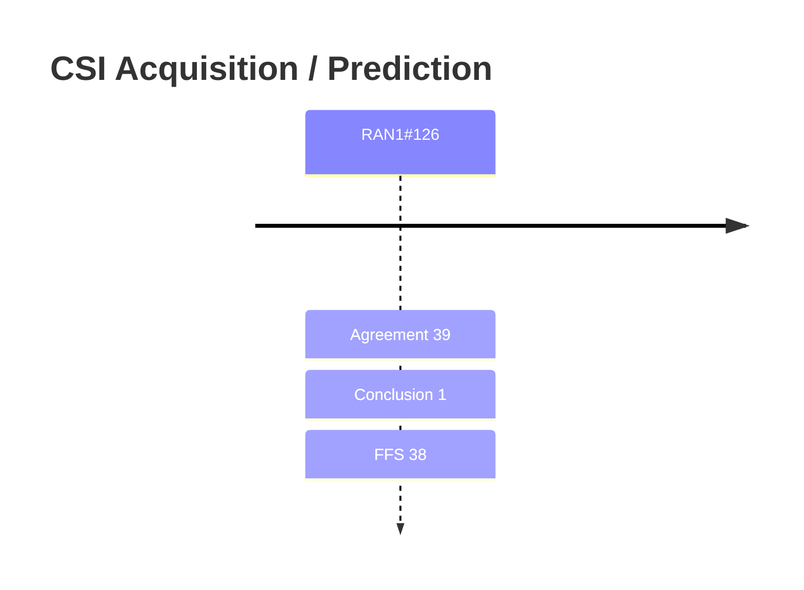

# CSI Acquisition / Prediction (Rel-20)

> 이 파일은 `scripts/generate_report.py`가 자동으로 생성합니다. 직접 수정하지 마세요.

## 회의별 진행

## 누적 히스토리

| 회의 | Agenda | 구분 | 내용 | 출처 |
|---|---|---|---|---|
| RAN1#126 | 10.5.3.1 | Agreement | For the 6GR codebook design for CSI report, study a W1W2 only structure for the low-resolution scheme with the following considerations at least for RI=1-4: - W1-structure   - SD basis     - NR oversampled 2D-DFT basis is a baseline       - FFS on other basis, e.g., basis constructed from combined 2D DFT beams       - FFS on alphabet set for combination coefficients for the basis constructed from combined 2D DFT beams   - SD basis selection     - eType-I Scheme-B like unrestricted orthogonal DFT beam selection in 2D direction is a baseline       - FFS on orthogonal basis selection in at least 1D direction, or non-orthogonal basis selection     - Layer-specific/layer-group-specific SD basis selection       - FFS on basis-to-layer (layer-group) mapping, e.g., ordering or no ordering       - FFS on the maximum number of SD basis vector selection - W2-structure   - Layer-specific/layer-group-specific inter-polarization co-phase selection     - FFS: inter-polarization amplitude   - Alphabet set for inter-polarization co-phase: BPSK, QPSK     - FFS: details for each rank     - FFS: for WB, whether to consider or not 8-PSK in addition to BPSK and QPSK - FFS on RI>4 - Strive for having a unified codebook scheme for all supported ranks by 6G - FFS: details on whether/how to accommodate passive array with smaller number of ports - Note: UE implementation complexity is to be considered in the design of SD-basis and co-phasing selection, including the number of candidate combinations and the associated search complexity. - Note: CBSR discussion will be discussed separately - Note: For discussion of low resolution scheme, eType-1 Scheme-A and eType-II with L=1 are precluded | [Chair notes RAN1#126_eom1](https://www.3gpp.org/ftp/tsg_ran/WG1_RL1/TSGR1_126/Inbox/Chair_notes/Chair%20notes%20RAN1%23126_eom1.docx) `[126-R20-6GR-Aspects of DL based CSI acquisition]` |
| RAN1#126 | 10.5.3.1 | Conclusion | For the 6GR codebook design for CSI report, for discussion purposes, based on the previous agreements, the following separate category is used: - Category for resolution: low- and high-resolution, comprising at least the following criteria:   - Target scenario (e.g., SU-MIMO, MU-MIMO)   - Feedback overhead   - UE complexity in CSI calculation | [Chair notes RAN1#126_eom1](https://www.3gpp.org/ftp/tsg_ran/WG1_RL1/TSGR1_126/Inbox/Chair_notes/Chair%20notes%20RAN1%23126_eom1.docx) `[126-R20-6GR-Aspects of DL based CSI acquisition]` |
| RAN1#126 | 10.5.3.1 | Agreement | - On defining the CSI-RS pattern in M1 slots and M2 RBs, support both M1 and M2 can be larger than or equal to 1   - For M1,     - For the number of CSI-RS ports smaller than or equal to X, only M1=1 is supported.     - For the number of CSI-RS ports larger than X, support M1 can be larger than 1     - FFS value of X   - FFS for M2 | [Chair notes RAN1#126_eom1](https://www.3gpp.org/ftp/tsg_ran/WG1_RL1/TSGR1_126/Inbox/Chair_notes/Chair%20notes%20RAN1%23126_eom1.docx) `[126-R20-6GR-Aspects of DL based CSI acquisition]` |
| RAN1#126 | 10.5.3.1 | Agreement | For CSI-RS for CSI acquisition in 6GR, design on CSI-RS and CSI assumes the maximum number of CSI-RS ports is 256. - Final decision on the maximum number of CSI-RS ports (128, 256 or 512) is to be made in RAN1#127 | [Chair notes RAN1#126_eom1](https://www.3gpp.org/ftp/tsg_ran/WG1_RL1/TSGR1_126/Inbox/Chair_notes/Chair%20notes%20RAN1%23126_eom1.docx) `[126-R20-6GR-Aspects of DL based CSI acquisition]` |
| RAN1#126 | 10.5.3.1 | Agreement | On the design of CDM group size and type for 6G CSI-RS, study and evaluate the following detailed candidates in addition to the ones supported in NR - For Option 2-2: Larger CDM size   - Candidate 2-2-1: cdm16-FD4-TD4   - Candidate 2-2-2: cdm16-FD2-TD8   - Candidate 2-2-3: cdm16-FD8-TD2   - Candidate 2-2-4: cdm16-FD16   - Candidate 2-2-5: cdm32-FD4-TD8   - Candidate 2-2-6: cdm32-FD8-TD4   - Candidate 2-2-7: cdm64-FD8-TD8   - Candidate 2-2-8: cdm12y-FD12-TDy, where y = {1, 2, 4} - For Option 2-3: New CDM type for NR CDM size   - Candidate 2-3-1: cdm4-FD4   - Candidate 2-3-2: cdm8-FD4-TD2   - Candidate 2-3-3: cdm8-FD8 - Companies to report the applicable number of CSI-RS ports for each candidate in the simulation | [Chair notes RAN1#126_eom1](https://www.3gpp.org/ftp/tsg_ran/WG1_RL1/TSGR1_126/Inbox/Chair_notes/Chair%20notes%20RAN1%23126_eom1.docx) `[126-R20-6GR-Aspects of DL based CSI acquisition]` |
| RAN1#126 | 10.5.3.1 | Agreement | For CSI-RS sequence in 6G, take the NR PN sequence and mapping as the baseline for evaluation, further study the following aspects - How to achieve low-PAPR for pre-coded CSI-RS by sequence and/or mapping, compared to NR PN sequence and its mapping - Handle the case with high inter-cell interference /how to handle the case with high inter-cell interference - CSI-RS sharing for different frequency density - On sequence initialization, take NR UE specific configuration for initialization as the baseline, study whether other options are needed | [Chair notes RAN1#126_eom1](https://www.3gpp.org/ftp/tsg_ran/WG1_RL1/TSGR1_126/Inbox/Chair_notes/Chair%20notes%20RAN1%23126_eom1.docx) `[126-R20-6GR-Aspects of DL based CSI acquisition]` |
| RAN1#126 | 10.5.3.1 | Agreement | For 6G CSI-RS, study the following options to address the potential PAPR issue caused by precoded CSI-RS - Option 1: BS implementation-based approach, e.g., use UE-transparent CDM-specific small cyclic shifts, or use small CDM group size - Option 2: Map the PN sequence to the global subcarrier indices in the whole bandwidth sequentially - Option 3: Multiply the PN sequence with an additional CDM group-specific scrambling sequence - Option 4: Multiply the PN sequence with an additional port-specific scrambling sequence - Option 5: Apply segmented phase rotation on the PN sequence | [Chair notes RAN1#126_eom1](https://www.3gpp.org/ftp/tsg_ran/WG1_RL1/TSGR1_126/Inbox/Chair_notes/Chair%20notes%20RAN1%23126_eom1.docx) `[126-R20-6GR-Aspects of DL based CSI acquisition]` |
| RAN1#126 | 10.5.3.1 | Agreement | For 6GR codebook design for CSI report, study whether/how to address near-field (NF) propagation as follows: - Evaluation scenario:   - 7GHz band scenarios   - Same SLS methodology is assumed as agreed EVM for CSI evaluation, with NF channel modeling   - Centralized TXRU array (single TRP) architecture - Assess the following:   - Regular UPT stats   - Percentage of UEs impacted by NF and its impact on UPT     - Companies to report how to define NF UEs, e.g., UEs within Rayleigh distance or scaling of Rayleigh distance for calibration purpose   - Whether/how the NF transmission issue (if identified) needs be addressed:     - SRS-based CSI acquisition     - via fixed codebook design       - with NR fixed DFT basis or port-selection basis (e.g., large-array into multiple sub-arrays analogous to CJT extension/multiple-panel)       - with new fixed basis (e.g., SD basis utilizing distance domain or other)       - with basis combined from DFT beams/port selection     - via DLable codebook/basis     - via AI-based CSI compression | [Chair notes RAN1#126_eom1](https://www.3gpp.org/ftp/tsg_ran/WG1_RL1/TSGR1_126/Inbox/Chair_notes/Chair%20notes%20RAN1%23126_eom1.docx) `[126-R20-6GR-Aspects of DL based CSI acquisition]` |
| RAN1#126 | 10.5.3.1 | Agreement | For the study of non-AI/AI based CSI prediction in frequency/spatial/time domain at UE or NW side, adopt the templates in the following documents for collecting companies’ results. - LLS: [10.5.3.1] CSI prediction simulation result collection template _LLS_v1_Mod.xlsx in R1-2605468 - SLS: [10.5.3.1] CSI prediction simulation result collection template _SLS_v1_Mod.xlsx in R1-2605468 Email discussion for collecting companies’ results. Setp. 23, Oct. 8 | [Chair notes RAN1#126_eom1](https://www.3gpp.org/ftp/tsg_ran/WG1_RL1/TSGR1_126/Inbox/Chair_notes/Chair%20notes%20RAN1%23126_eom1.docx) `[126-R20-6GR-Aspects of DL based CSI acquisition]` |
| RAN1#126 | 10.5.3.1 | Agreement | For CSI-RS sharing Use case 2: Sharing a common set or subset of REs among CSI-RS with different frequency densities, study the following alternatives for discussing frequency density common sequence mapping - Alt 1: Generate sequence for higher frequency density first, from which extract lower frequency density sequence - Alt 2: Generate sequences for lower frequency density first, which are concatenated to form higher frequency density sequence | [Chair notes RAN1#126_eom1](https://www.3gpp.org/ftp/tsg_ran/WG1_RL1/TSGR1_126/Inbox/Chair_notes/Chair%20notes%20RAN1%23126_eom1.docx) `[126-R20-6GR-Aspects of DL based CSI acquisition]` |
| RAN1#126 | 10.5.3.1 | Agreement | - For CSI-RS sharing Use case 1: Sharing a common set or subset of REs among CSI-RS with different number of ports, taking Level 1 (Sharing granularity is CDM group level) as baseline, - Study Level 2 (Sharing granularity can be smaller than a CDM group), with the following sub-levels - Level 2-1: CDM group is decoded without assuming the knowledge of - Level 2-2: CDM group is decoded assuming the knowledge of | [Chair notes RAN1#126_eom1](https://www.3gpp.org/ftp/tsg_ran/WG1_RL1/TSGR1_126/Inbox/Chair_notes/Chair%20notes%20RAN1%23126_eom1.docx) `[126-R20-6GR-Aspects of DL based CSI acquisition]` |
| RAN1#126 | 10.5.3.1 | Agreement | For the evaluation on downloadable/configurable codebook/basis for CSI report, the following is considered additionally on top of the agreement in RAN 1 #125: - Type-I-like scheme:   - Option-1A:     - , where  is a 2N1N2-dimensional precoding vector for layer , and  is the number of layers     - is determined by UE from a downloadable/configurable codebook, and company reports the size of the downloadable/configurable codebook   - Option-1B:,     - ,  is a N1N2-dimension SD basis for layer     - (wideband) is determined by UE from a downloadable/configurable SD basis set, and company reports the size of the downloadable/configurable SD basis set     - W2 is either SB or WB - Type-II-like scheme:   - Option-2A: ,     - (wideband) is determined by UE from a downloadable/configurable SD basis set for layer , and/or  is determined by UE from a downloadable/configurable FD basis set, and L is the number of selected SD basis     - Note: if FD basis set is not based on downloadable/configurable FD basis set, DFT FD basis set is assumed in the simulation.   - Option-2B: ,     - (wideband) is determined by UE from a downloadable/configurable SD-FD basis pair set for layer l, and L is the number of selected SD/FD basis vector pairs - Companies report the basis/precoding vector quantization assumption, if applicable - Companies report how the NW determines downloadable/configurable basis/codebook - Companies report the orthogonality of the downloadable/configurable basis/ precoding vector and the assumption for basis/ precoding vector selection (whether the selection is layer-common or layer-specific) - Strive to have common codebook structure with fixed codebook, if applicable - Companies are encouraged to compare with fixed codebook as well as AI-based CSI compression | [Chair notes RAN1#126_eom1](https://www.3gpp.org/ftp/tsg_ran/WG1_RL1/TSGR1_126/Inbox/Chair_notes/Chair%20notes%20RAN1%23126_eom1.docx) `[126-R20-6GR-Aspects of DL based CSI acquisition]` |
| RAN1#126 | 10.5.3.1 | Agreement | For the 6GR codebook design for CSI report, study a W1W2Wf structure as a starting point for the high-resolution scheme with the following considerations for RI=1-4: - W1-structure   - SD basis     - NR oversampled 2D-DFT basis is a baseline       - FFS on other basis       - FFS on alphabet set for combination coefficients for the basis constructed from combined 2D DFT beams   - SD basis selection     - Down-select from the following options:       - Opt1. L=1 only, Layer-specific/group-specific SD basis selection       - Opt2. L≥1 Layer-specific/group-specific SD basis selection       - Opt3. L>1 Layer-common SD basis selection     - eType-II orthogonal DFT beam selection in 2D direction is a baseline       - FFS orthogonal basis selection in at least 1D direction       - FFS non-orthogonal L basis selection, e.g., basis vector- specific (q1, q2) selection       - FFS orthogonal L basis selection, non-orthogonal basis selection across different layers, e.g., orthogonal DFT beam selection in 2D direction for each layer with layer-specific (q1, q2) selection       - FFS whether/how to further optimize SD basis selection, e.g., using layer-common in combination with layer-specific/layer group-specific - FFS whether to consider RI>4 - Wf-structure   - eType-II layer-specific FD basis selection as a baseline     - FFS on whether/how to further optimize FD compression, e.g., delay-domain pre-alignment per-basis prior to FD compression - W2-structure   - Linear combining (LC) coefficient scheme (ref/diff amps, phase, SCI) analogous to Rel-16 NR eType-II as a starting point     - FFS: details on alphabet sets on LC coefficients   - Whether to support bitmap for indicating the location of NZCs as well as a parameter for the maximum number of NZCs - FFS parameter combination (PC) design - Note: UE implementation complexity is to be considered in the design of SD-basis selection, including the additional complexity of inter-layer interference mitigation for layer-specific schemes. | [Chair notes RAN1#126_eom1](https://www.3gpp.org/ftp/tsg_ran/WG1_RL1/TSGR1_126/Inbox/Chair_notes/Chair%20notes%20RAN1%23126_eom1.docx) `[126-R20-6GR-Aspects of DL based CSI acquisition]` |
| RAN1#126 | 10.5.3.1 | Agreement | For 6GR CSI-RS, study CSI-RS design to achieve low CSI-RS overhead considering the following possible directions - Direction 1: Sparse CSI-RS in frequency/spatial domain   - Consider AI and/or non-AI prediction to reconstruct the channel at UE and/or NW side   - Study sparse pattern - Direction 2: Use non-orthogonal CSI-RS ports   - Study the use of cyclic shifts or scrambling sequences across CSI-RS RBs, or non-orthogonal cover code   - Inter CSI-RS port interference leakage is to be considered in the evaluations - Note: Combinations of the directions can be considered. - Note: At least total CSI-RS overhead, performance and UE/NW complexity are to be studied - Note: Companies to report the assumed CSI-RS time-domain behavior including CSI-RS periodicity in the evaluations - Note: companies to report how CSI-RS overhead can be reduced from system perspective | [Chair notes RAN1#126_eom1](https://www.3gpp.org/ftp/tsg_ran/WG1_RL1/TSGR1_126/Inbox/Chair_notes/Chair%20notes%20RAN1%23126_eom1.docx) `[126-R20-6GR-Aspects of DL based CSI acquisition]` |
| RAN1#126 | 10.5.3.1 | Agreement | For evaluation on CPI reporting in SD/FD/TD, study the following options of form of CPI: - Option 1: Channel covariance matrix/spectrum, e.g., ,  in form of basis matrix and associated coefficients and/or power, wherein  is in port/frequency domain   - FFS: Whether orthogonal or non-orthogonal bases are used for compression   - FFS: Whether off-diagonal coefficients in additional to diagonal coefficients of full or subset of   - FFS: Whether CPI in SD/FD/TD domains are reported separately or jointly - Option 2: Channel covariance matrix in form of quantization of decomposed channel covariance matrices, e.g., EVD, QR - Option 3: Normalized correlation   - FFS: whether CPIs in different domains are reported separately or jointly - Option 4: Channel matrix (utilizing the explicit CSI report) - Option 5: Explicit system parameter, e.g., codebook parameter, RS parameter. Companies to provide details of applicable use cases for the above options. Companies report calculation assumption of the channel covariance matrix/spectrum, e.g., average over time domain, average over frequency domain, average over spatial domain. Note: Strive for common report quantities for use cases for a certain domain, if applicable. | [Chair notes RAN1#126_eom1](https://www.3gpp.org/ftp/tsg_ran/WG1_RL1/TSGR1_126/Inbox/Chair_notes/Chair%20notes%20RAN1%23126_eom1.docx) `[126-R20-6GR-Aspects of DL based CSI acquisition]` |
| RAN1#126 | 10.5.3.1 | Agreement | For the evaluation of stand-alone reporting for CJT calibration report, consider the following aspects: - Reporting quantities of Rel-19 CJTC-Dd/F/P can be candidates - xTRP delay offset report   - Study dynamic range ADO and resolution MFO     - Rel-19 CJTC-Dd dynamic range and resolution can be considered as a starting point     - FFS: other candidate values of ADO and MDO - xTRP frequency offset report   - Study dynamic range AFO and resolution MFO     - Rel-19 CJTC-F dynamic range and resolution can be considered as a starting point     - FFS: other candidate values of AFO and MFO - xTRP phase offset report   - Study resolution MP and frequency granularity (WB, SB)     - Rel-19 CJTC-P resolution can be considered as a starting point     - FFS: other candidate values of MP - Companies to report how to acquire mTRP CSI for evaluation, e.g., SRS-based CSI acquisition or CJT CSI report - Companies to report the modeling of CJT calibration report, including reporting periodicity, residual offset and fluctuation, all under realistic assumption - Companies to report assumption of measurement accuracy error levels - FFS on measurement RS requirement, e.g., frequency density and bandwidth, # of RS symbols, the gap between RS symbols - Assumption on algorithms to determine delay/frequency/phase offset report | [Chair notes RAN1#126_eom1](https://www.3gpp.org/ftp/tsg_ran/WG1_RL1/TSGR1_126/Inbox/Chair_notes/Chair%20notes%20RAN1%23126_eom1.docx) `[126-R20-6GR-Aspects of DL based CSI acquisition]` |
| RAN1#126 | 10.5.3.1 | Agreement | For the study of explicit CSI feedback, the evaluation considers the following aspects: - Form of explicit CSI   - Opt-A: information facilitating NW reconstruction of the channel matrix H (e.g., NRX x NTX) per frequency granularity unit     - Note:  NRX does not necessarily mean the number of UE Rx physical antenna(s)   - Opt-B: information facilitating NW reconstruction of H’H per frequency granularity unit   - Companies to report compression/quantization scheme used for the evaluation - Handling of link adaptation via at least one of the following options   - Opt-1: CQI/RI information in another report (e.g., based on CSI-RS or DMRS)   - Opt-2: Assistance information (e.g., L1-SINR, L1-RSRP, Interference-plus-noise (IpN) information) in the same explicit CSI report or another report   - Opt-3: the explicit feedback considering pre-whitening channel or channel covariance   - Note: other options are not precluded. | [Chair notes RAN1#126_eom1](https://www.3gpp.org/ftp/tsg_ran/WG1_RL1/TSGR1_126/Inbox/Chair_notes/Chair%20notes%20RAN1%23126_eom1.docx) `[126-R20-6GR-Aspects of DL based CSI acquisition]` |
| RAN1#126 | 10.5.3.1 | Agreement | Draft LS R1-2606904 is endorsed in principle. Final LS R1-2606905 is endorsed. | [Chair notes RAN1#126_eom1](https://www.3gpp.org/ftp/tsg_ran/WG1_RL1/TSGR1_126/Inbox/Chair_notes/Chair%20notes%20RAN1%23126_eom1.docx) `[126-R20-6GR-Aspects of DL based CSI acquisition]` |
| RAN1#126 | 10.5.3.1 | Agreement | For evaluation on precoded CSI-RS without considering CSI-RS overhead reduction: - Assume cell-specific wideband precoded CSI-RS, e.g., the number of precoded CSI-RS ports is same as the number of TXRUs at aNB - Company reports the precoder of CSI-RS, and information/how to determinate the precoder. - The following CSI feedback scheme can be considered for the evaluation: - Option 1: Type I-like (W1W2) and/or eType II-like (W1W2Wf) CSI reporting with port-selection (PS) basis - Option 2: Type I-like (W1W2) and/or eType II-like (W1W2Wf) CSI reporting with NR DFT basis with reconstruction information - Option 3: Type I-like (W1W2) and/or eType II-like(W1W2Wf) CSI reporting with NR DFT basis (CSI-RS port precoder is transparent to UE) - Company report how NW utilized the reported CSI for PDSCH precoder determination. - FFS on other basis, e.g., the basis constructed from combined 2D DFT beams/ port-selection (PS) basis - Benchmark:   - Type I and eType II codebook with non-precoded CSI-RS Companies report the QCL related assumptions Note: Precoded CSI-RS with less density in spatial domain is to be discussed separately. Note: downloadable basis/precoder (e.g. FD basis/precoder associated with each precoded CSI-RS port) can be considered additionally with precoded CSI-RS and the assumption/consideration for downloadable basis is taken into account Note: the PAPR issue of precoded CSI-RS is to be studied. | [Chair notes RAN1#126_eom1](https://www.3gpp.org/ftp/tsg_ran/WG1_RL1/TSGR1_126/Inbox/Chair_notes/Chair%20notes%20RAN1%23126_eom1.docx) `[126-R20-6GR-Aspects of DL based CSI acquisition]` |
| RAN1#126 | 10.5.3.1 | Agreement | For the evaluation on the benefit of early CSI triggering/reporting, considering the following aspects: - Potential scenarios/use cases:   - UE transition from IDLE/INACTIVE to CONNECTED mode,   - During activation of serving cells /carriers   - Mobility   - Note: Early beam report is to be discussed separately   - Other use cases are not precluded. - For each potential use case, studying details of   - Report quantities for each use case   - RS for measurement   - Benchmark   - KPI - Note: Strive to minimize Msg 1 impact. - Note: Both measured and predicted CSI can be considered, if appliable. | [Chair notes RAN1#126_eom1](https://www.3gpp.org/ftp/tsg_ran/WG1_RL1/TSGR1_126/Inbox/Chair_notes/Chair%20notes%20RAN1%23126_eom1.docx) `[126-R20-6GR-Aspects of DL based CSI acquisition]` |
| RAN1#126 | 10.5.3.1 | Agreement | For the evaluation on PDSCH DMRS-based CSI for PDSCH link adaptation, the following is consideration: - For channel measurement, the DMRS port(s) associated with data is considered as the baseline   - FFS on whether to consider DMRS port(s) allocated with PDSCH but not associated with the data - For interference measurement (when needed), company to report how to acquire interference information. - Company to report the UE assumptions for DMRS-based CSI calculation. - Email discussion for the templates and collect results for the use cases, e.g., fixed codebook, AI-CSI, CPI, downloadable/configurable codebook/basis, DMRS-based CSI, precoded CSI-RS. | [Chair notes RAN1#126_eom1](https://www.3gpp.org/ftp/tsg_ran/WG1_RL1/TSGR1_126/Inbox/Chair_notes/Chair%20notes%20RAN1%23126_eom1.docx) `[126-R20-6GR-Aspects of DL based CSI acquisition]` |
| RAN1#126 | 10.5.3.2 | Agreement | For SRS, at least cyclic-shift and/or comb-offset are supported. | [Chair notes RAN1#126_eom1](https://www.3gpp.org/ftp/tsg_ran/WG1_RL1/TSGR1_126/Inbox/Chair_notes/Chair%20notes%20RAN1%23126_eom1.docx) `[126-R20-6GR-Aspects of UL based CSI acquisition]` |
| RAN1#126 | 10.5.3.2 | Agreement | Study whether/how TD-OCC can be supported together with SRS repetition to enable multiplexing of SRS ports, and at least take the following aspects into consideration: - OCC lengths: e.g., TD-OCC2, TD-OCC4, other lengths - Whether it is applicable to intra- and inter-UE multiplexing of SRS ports - TD-OCC related interference randomization scheme - The non-orthogonality incurred by partial dropping - Channel variation in time domain | [Chair notes RAN1#126_eom1](https://www.3gpp.org/ftp/tsg_ran/WG1_RL1/TSGR1_126/Inbox/Chair_notes/Chair%20notes%20RAN1%23126_eom1.docx) `[126-R20-6GR-Aspects of UL based CSI acquisition]` |
| RAN1#126 | 10.5.3.2 | Agreement | For at least increasing SRS capacity/reducing overhead/improve coverage purposes sparse SRS patterns with comb values larger than 8, study at least comb 12 and 16 with consideration of at least the following aspects.   - SRS sequences   - MPR and PAPR/CM impact   - Max number of cyclic shifts for the corresponding comb value   - Minimum available bandwidth and its corresponding sequence   - Channel estimation performance   - Applicable RB sizes (e.g., RB size >= 8)   - Any other performance impacts - FFS other comb values. - Note: RAN4 input on maximum power boosting is needed | [Chair notes RAN1#126_eom1](https://www.3gpp.org/ftp/tsg_ran/WG1_RL1/TSGR1_126/Inbox/Chair_notes/Chair%20notes%20RAN1%23126_eom1.docx) `[126-R20-6GR-Aspects of UL based CSI acquisition]` |
| RAN1#126 | 10.5.3.2 | Agreement | Support cross-slot SRS transmission at least for consecutive S+U slots - FFS: whether to support cross-slot SRS transmission spanning any two consecutive slots, e.g., U+U slots. | [Chair notes RAN1#126_eom1](https://www.3gpp.org/ftp/tsg_ran/WG1_RL1/TSGR1_126/Inbox/Chair_notes/Chair%20notes%20RAN1%23126_eom1.docx) `[126-R20-6GR-Aspects of UL based CSI acquisition]` |
| RAN1#126 | 10.5.3.2 | Agreement | Study at least the following aspects of precoded SRS - Intended usage (e.g., for UL CSI and/or DL CSI) - Feasibility under specific UE architectures (e.g., xTyR configurations for DL CSI) - Gain compared to non-precoded SRS, accounting for practical impairments (e.g., PAPR/CM loss, realistic UE reciprocity, and UE coherency assumptions) - Methods for precoder derivation of precoded SRS: - Method-1: Determined by NW (e.g., derived from the measurements of SRS and indications from NW) - Method-2: Determined (with/without reported) by UE via DL measurement - FFS: UE UL/DL reciprocity calibration | [Chair notes RAN1#126_eom1](https://www.3gpp.org/ftp/tsg_ran/WG1_RL1/TSGR1_126/Inbox/Chair_notes/Chair%20notes%20RAN1%23126_eom1.docx) `[126-R20-6GR-Aspects of UL based CSI acquisition]` |
| RAN1#126 | 10.5.3.2 | Agreement | For SRS of 6GR, study the following frequency hopping aspects - A single-level frequency hopping   - hopping over bandwidth with one or multiple frequency hops - Two-level frequency hopping   - First level: hopping over BW with one or multiple frequency hops   - Second level: hopping within each frequency hop of the first-level hopping - For single or two levels, consider at least the following options   - Nested tree-like frequency hopping pattern   - Sequential hopping pattern   - Pattern following RB offset provided by NW   - With/without Intra-repetition hopping in the second level Note: the case with larger DL BW than UL BW will be discussed separately | [Chair notes RAN1#126_eom1](https://www.3gpp.org/ftp/tsg_ran/WG1_RL1/TSGR1_126/Inbox/Chair_notes/Chair%20notes%20RAN1%23126_eom1.docx) `[126-R20-6GR-Aspects of UL based CSI acquisition]` |
| RAN1#126 | 10.5.3.2 | Agreement | To support maximum SRS bandwidth beyond 272 PRBs in a carrier, consider the following options: - Option 1: Table based approach (similar to NR)   - Option 1-1:     - Refer to the bandwidth entries for up to 272 PRBs in the table from NR     - Introduce new SRS bandwidth entries from 272 to [544] PRBs   - Option 1-2:     - Scale up the SRS bandwidth entries in the table from NR by integer factor, e.g. value of 2 or 4   - Option 1-3:     - The overall SRS bandwidth is divided into more than one part, in which each part can reuse SRS bandwidth entries in the table from NR. - Option 2: Flexible SRS bandwidth determination and frequency hopping   - Replace the existing table-based SRS bandwidth determination with parameter-based frequency hopping pattern determination provided by NW | [Chair notes RAN1#126_eom1](https://www.3gpp.org/ftp/tsg_ran/WG1_RL1/TSGR1_126/Inbox/Chair_notes/Chair%20notes%20RAN1%23126_eom1.docx) `[126-R20-6GR-Aspects of UL based CSI acquisition]` |
| RAN1#126 | 10.5.3.3 | Agreement | Support single-port RS in addition to SSB for finer time and frequency tracking as a baseline for connected mode for 6GR. Note: It does not preclude further study on multi-port RS for finer time and frequency tracking. | [Chair notes RAN1#126_eom1](https://www.3gpp.org/ftp/tsg_ran/WG1_RL1/TSGR1_126/Inbox/Chair_notes/Chair%20notes%20RAN1%23126_eom1.docx) `[126-R20-6GR-Other Aspects related to CSI]` |
| RAN1#126 | 10.5.3.3 | Agreement | For the evaluation of joint DL/UL based CSI acquisition, at least take the following baseline for use case 1 - Baseline#1: DL CSI acquisition based on SRS only - Baseline#2: DL CSI acquisition based on CSI-RS only - Additionally consider the Rel-19 UE antenna model defined in TR 38.901. | [Chair notes RAN1#126_eom1](https://www.3gpp.org/ftp/tsg_ran/WG1_RL1/TSGR1_126/Inbox/Chair_notes/Chair%20notes%20RAN1%23126_eom1.docx) `[126-R20-6GR-Other Aspects related to CSI]` |
| RAN1#126 | 10.5.3.3 | Agreement | For the evaluation of joint DL/UL based CSI acquisition, additionally consider the following KPIs - UPT - Intermediate KPI (e.g., SGCS, NMSE) - RS overhead - Feedback overhead - Computation complexity and model complexity, if any - Storage complexity, if any | [Chair notes RAN1#126_eom1](https://www.3gpp.org/ftp/tsg_ran/WG1_RL1/TSGR1_126/Inbox/Chair_notes/Chair%20notes%20RAN1%23126_eom1.docx) `[126-R20-6GR-Other Aspects related to CSI]` |
| RAN1#126 | 10.5.3.3 | Agreement | Use the following template to collect the simulation results for use case 1: \| Simulation assumptions on scenario, MIMO scheme, e.g., carrier frequency, channel model, antenna port layouts at aNB and antenna port layouts at UE, etc. \|  \| \| Assistance information \|  \| \| How to obtain and report, e.g., format and quantization, the assistance information \|  \| \| How to use the assistance information \|  \| \| CSI-RS and CSI report configuration, if any \|  \| \| SRS configuration \|  \| \| Performance gain compared with baseline schemes \|  \| \| Observations in terms of the agreed KPIs \|  \| | [Chair notes RAN1#126_eom1](https://www.3gpp.org/ftp/tsg_ran/WG1_RL1/TSGR1_126/Inbox/Chair_notes/Chair%20notes%20RAN1%23126_eom1.docx) `[126-R20-6GR-Other Aspects related to CSI]` |
| RAN1#126 | 10.5.3.3 | Agreement | Use the following template to collect the simulation results for use case 2: \| Simulation assumptions on scenario, MIMO scheme, e.g., carrier frequency, channel model, antenna port layouts at aNB and UE etc. \|  \| \| Assistance information \|  \| \| How to obtain and report the assistance information \|  \| \| How to use the assistance information for MCS and RI selection. \|  \| \| CSI-RS and CSI report configuration, if any \|  \| \| SRS configuration \|  \| \| Performance gain compared with baseline schemes \|  \| \| Observations in terms of the agreed KPIs \|  \| | [Chair notes RAN1#126_eom1](https://www.3gpp.org/ftp/tsg_ran/WG1_RL1/TSGR1_126/Inbox/Chair_notes/Chair%20notes%20RAN1%23126_eom1.docx) `[126-R20-6GR-Other Aspects related to CSI]` |
| RAN1#126 | 10.5.3.3 | Agreement | For the evaluation of joint DL/UL based CSI acquisition, at least take the following baseline for use case 2 - Baseline #1: DL CSI acquisition based on precoded CSI-RS and SRS, where PDSCH precoder is determined based on SRS, and rank and MCS follows the non-PMI report based on precoded CSI-RS.   - Companies to report details about how the network determines the CSI-RS precoder - Baseline#2: DL CSI acquisition based on both SRS and CSI-RS, where UE reports CRI/PMI/RI/CQI based on CSI-RS, and network determines rank and MCS based on the SRS channel estimation and the reported CRI/PMI/RI/CQI   - Companies to report details about how network determines rank and MCS based on the SRS channel estimation and the reported CRI/PMI/RI/CQI - It does not mean that CRI-RI-CQI report is supported. | [Chair notes RAN1#126_eom1](https://www.3gpp.org/ftp/tsg_ran/WG1_RL1/TSGR1_126/Inbox/Chair_notes/Chair%20notes%20RAN1%23126_eom1.docx) `[126-R20-6GR-Other Aspects related to CSI]` |
| RAN1#126 | 10.5.3.3 | Agreement | Further study the following proposal and strive to make agreement for RAN1#126bis meeting - Support of both periodic RS in addition to SSB and aperiodic RS for fine time and frequency tracking at least for connected mode in 6GR as baseline   - UE in connected mode uses periodic RS and uses aperiodic RS, for finer time and frequency tracking   - Periodic RS     - RS with periodicity including at least 20ms, 40ms, 80ms and, if different, then maximum periodicity of SSB     - FFS: Whether periodic RS for finer time and frequency tracking can be used in idle mode     - Note: Periodicities of SSB will not be discussed in this agenda   - Aperiodic RS     - Conditions under which aperiodic RS is used, e.g. long periodicities for periodic RS     - FFS: Whether aperiodic RS is associated with another periodic or aperiodic RS     - Following options are considered       - Option 1: RS other than PDSCH DMRS or PDCCH DMRS       - Option 2: PDSCH DMRS or PDCCH DMRS       - Note: DMRS pattern/design will not be discussed in this agenda   - Aperiodic RS may have the same or different structure/pattern from that of periodic RS - Note 1: Whether and how to use SSB for finer time and frequency tracking is up to UE implementation - Note 2: The agreed KPI in RAN1#124 along with RS overhead should be considered for the study of the time/frequency/spatial domain factors for the periodic and aperiodic RS for finer time and frequency tracking targeting the following use cases:     - Single/Multi-TRP     - Single/Multi-carrier     - Larger DL channel BW, e.g., up to 400MHz. - For both periodic and aperiodic RS, details on time/frequency/spatial domain factor are separately studied based on the agreed candidates in RAN1#124bis and RAN1#125 | [Chair notes RAN1#126_eom1](https://www.3gpp.org/ftp/tsg_ran/WG1_RL1/TSGR1_126/Inbox/Chair_notes/Chair%20notes%20RAN1%23126_eom1.docx) `[126-R20-6GR-Other Aspects related to CSI]` |
| RAN1#126 | 10.5.3.3 | Agreement | On top of agreement in RAN1#125, further study and evaluate the following sub use cases for joint DL/UL CSI acquisition use case 1 - Use case 1A: Assisting SRS channel estimation, e.g., interference mitigation and channel interpolation Use case 1B: Assisting aNB side compensation for SRS reception with SRS power imbalance Use case 1C: CSI feedback and SRS fusion for full dimension channel matrix acquisition Use case 1D: Assisting SRS configuration | [Chair notes RAN1#126_eom1](https://www.3gpp.org/ftp/tsg_ran/WG1_RL1/TSGR1_126/Inbox/Chair_notes/Chair%20notes%20RAN1%23126_eom1.docx) `[126-R20-6GR-Other Aspects related to CSI]` |
| RAN1#126 | 9.1.1 | Agreement | Send LS to RAN2 to study, and if deemed feasible, specify L3 signaling for performance monitoring, including the following aspects - Reporting of pair-wise of target CSI sample and the corresponding CSI feedback sample of the corresponding inference report - Full and partial target CSI reporting is allowed, where partial target CSI = subset of subbands / layers of the CSI feedback of the inference report) - Same set of layers are considered for target CSI sample and CSI feedback sample. - Mechanism to collect multiple samples - Sample is a pair of target CSI and CSI feedback sample - Linking to corresponding inference configuration (detailed solution upto RAN2) | [Chair notes RAN1#126_eom1](https://www.3gpp.org/ftp/tsg_ran/WG1_RL1/TSGR1_126/Inbox/Chair_notes/Chair%20notes%20RAN1%23126_eom1.docx) [R1-2606361](https://www.3gpp.org/ftp/tsg_ran/WG1_RL1/TSGR1_126/Docs/R1-2606361.zip) |
| RAN1#126 | 9.1.1 | Agreement | Support L1 signaling for performance monitoring, down-selection from the following alternatives: - Alt1: NW side monitoring via legacy eType II format with potential spec impact - Alt2: NW side monitoring via partial / full target CSI reporting via same format as NW data collection - Alt3: UE assisted monitoring via SGCS / monitoring output reporting - Alt 4: NW side monitoring via legacy eType II without spec impact - Note: From RAN1 point of view, monitoring based on L3 signalling and L1 signalling are independently considered. | [Chair notes RAN1#126_eom1](https://www.3gpp.org/ftp/tsg_ran/WG1_RL1/TSGR1_126/Inbox/Chair_notes/Chair%20notes%20RAN1%23126_eom1.docx) [R1-2606361](https://www.3gpp.org/ftp/tsg_ran/WG1_RL1/TSGR1_126/Docs/R1-2606361.zip) |
| RAN1#126 | 9.1.1 | Agreement | The following text for Draft LS in R1-2606881 is endorsed. Regarding performance monitoring, RAN1 has the following agreement on using L3 signaling to collect pair-wise of target CSI sample and CSI feedback sample. \| Agreement: Send LS to RAN2 to study, and if deemed feasible, specify L3 signaling for performance monitoring, including the following aspects Reporting of pair-wise of target CSI sample and the corresponding CSI feedback sample of the corresponding inference report Full and partial target CSI reporting is allowed, where partial target CSI = subset of subbands / layers of the CSI feedback of the inference report) Same set of layers are considered for target CSI sample and CSI feedback sample. Mechanism to collect multiple samples Sample is a pair of target CSI and CSI feedback sample Linking to corresponding inference configuration (detailed solution upto RAN2) \| RAN1 asks RAN2 if they would be so kind as to consider the agreement above in their future work. The corresponding final LS in R1-2606893 is endorsed. | [Chair notes RAN1#126_eom1](https://www.3gpp.org/ftp/tsg_ran/WG1_RL1/TSGR1_126/Inbox/Chair_notes/Chair%20notes%20RAN1%23126_eom1.docx) [R1-2606362](https://www.3gpp.org/ftp/tsg_ran/WG1_RL1/TSGR1_126/Docs/R1-2606362.zip) |
| RAN1#126 | 9.1.1 | Agreement | Support following configuration for inference configuration - Pairing ID - Subband configuration (reuse csi-ReportingBand) - Resources for channel and interference measurement (reuse legacy configuration) - portMappingMethod (reuse legacy configuraiton) - codebookConfig-r20 - Payload parameter combination configuration - N1, N2 configuration - Rank restriction (reuse legacy) - FFS: reportQuantity | [Chair notes RAN1#126_eom1](https://www.3gpp.org/ftp/tsg_ran/WG1_RL1/TSGR1_126/Inbox/Chair_notes/Chair%20notes%20RAN1%23126_eom1.docx) [R1-2606362](https://www.3gpp.org/ftp/tsg_ran/WG1_RL1/TSGR1_126/Docs/R1-2606362.zip) |
