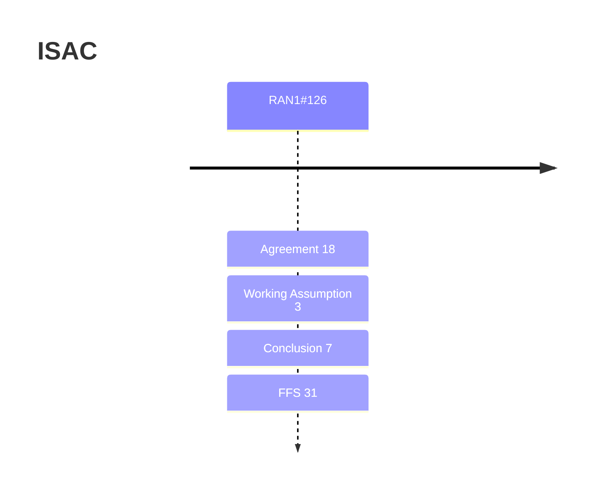

# ISAC (Rel-20)

> 이 파일은 `scripts/generate_report.py`가 자동으로 생성합니다. 직접 수정하지 마세요.

## 회의별 진행

## 누적 히스토리

| 회의 | Agenda | 구분 | 내용 | 출처 |
|---|---|---|---|---|
| RAN1#126 | 10.8.1 | Agreement | For Rel-20 6G ISAC performance evaluation, adopt the following minimum UE-UE (2D) distance evaluation assumption for baseline cases/configurations. \|  \| Scenario \| Minimum UE-UE (2D) distance \| \| Sensing UAV \| UMa-AV \| 1 m \| \| Sensing UAV \| SMa \| 1 m \| \| Sensing Human \| UMa \| 1 m \| \| Sensing Human \| Indoor Hotspot (Indoor-office) \| 1 m \| \| Sensing Vehicle \| Urban Grid \| Determined by the agreed UE distribution \| \| Sensing Vehicle \| Highway \| Determined by the agreed UE distribution \| \| Sensing AGV \| Indoor Factory (SH) \| 1 m \| | [Chair notes RAN1#126_eom1](https://www.3gpp.org/ftp/tsg_ran/WG1_RL1/TSGR1_126/Inbox/Chair_notes/Chair%20notes%20RAN1%23126_eom1.docx) [R1-2605742](https://www.3gpp.org/ftp/tsg_ran/WG1_RL1/TSGR1_126/Docs/R1-2605742.zip) `[126-R20-6GR-ISAC-Evaluations]` |
| RAN1#126 | 10.8.1 | Conclusion | No consensus to introduce UAV-UE as sensing capable UE in the baseline case/combination of sensing UAV in Rel-20. | [Chair notes RAN1#126_eom1](https://www.3gpp.org/ftp/tsg_ran/WG1_RL1/TSGR1_126/Inbox/Chair_notes/Chair%20notes%20RAN1%23126_eom1.docx) [R1-2605742](https://www.3gpp.org/ftp/tsg_ran/WG1_RL1/TSGR1_126/Docs/R1-2605742.zip) `[126-R20-6GR-ISAC-Evaluations]` |
| RAN1#126 | 10.8.1 | Conclusion | No consensus to remove CPE UE in Indoor-office (Indoor Hotspot) for the baseline case/combination of sensing Human in Rel-20. | [Chair notes RAN1#126_eom1](https://www.3gpp.org/ftp/tsg_ran/WG1_RL1/TSGR1_126/Inbox/Chair_notes/Chair%20notes%20RAN1%23126_eom1.docx) [R1-2605742](https://www.3gpp.org/ftp/tsg_ran/WG1_RL1/TSGR1_126/Docs/R1-2605742.zip) `[126-R20-6GR-ISAC-Evaluations]` |
| RAN1#126 | 10.8.1 | Conclusion | For Rel-20 6G ISAC performance evaluation, for baseline cases/combinations, it is clarified that ‘convex hull’ refers to ‘convex hull of the TRP deployment’ in Indoor Hotspot (Indoor office) and Indoor Factory evaluation assumptions. | [Chair notes RAN1#126_eom1](https://www.3gpp.org/ftp/tsg_ran/WG1_RL1/TSGR1_126/Inbox/Chair_notes/Chair%20notes%20RAN1%23126_eom1.docx) [R1-2605742](https://www.3gpp.org/ftp/tsg_ran/WG1_RL1/TSGR1_126/Docs/R1-2605742.zip) `[126-R20-6GR-ISAC-Evaluations]` |
| RAN1#126 | 10.8.1 | Conclusion | For Rel-20 6G ISAC performance evaluation of object detection and/or tracking, for baseline cases/combinations, it is clarified that the scenario Indoor Hotspot (Indoor-office) for sensing Human is ‘open office’, but not ‘mixed office’, as defined in TR 38.901. | [Chair notes RAN1#126_eom1](https://www.3gpp.org/ftp/tsg_ran/WG1_RL1/TSGR1_126/Inbox/Chair_notes/Chair%20notes%20RAN1%23126_eom1.docx) [R1-2605742](https://www.3gpp.org/ftp/tsg_ran/WG1_RL1/TSGR1_126/Docs/R1-2605742.zip) `[126-R20-6GR-ISAC-Evaluations]` |
| RAN1#126 | 10.8.1 | Conclusion | No consensus to remove CPE UE in Indoor Factory for the baseline case/combination of sensing AGV in Rel-20. | [Chair notes RAN1#126_eom1](https://www.3gpp.org/ftp/tsg_ran/WG1_RL1/TSGR1_126/Inbox/Chair_notes/Chair%20notes%20RAN1%23126_eom1.docx) [R1-2605742](https://www.3gpp.org/ftp/tsg_ran/WG1_RL1/TSGR1_126/Docs/R1-2605742.zip) `[126-R20-6GR-ISAC-Evaluations]` |
| RAN1#126 | 10.8.1 | Conclusion | No consensus to introduce AGV-UE as sensing capable UE in the baseline case/combination of sensing AGV in Rel-20. | [Chair notes RAN1#126_eom1](https://www.3gpp.org/ftp/tsg_ran/WG1_RL1/TSGR1_126/Inbox/Chair_notes/Chair%20notes%20RAN1%23126_eom1.docx) [R1-2605742](https://www.3gpp.org/ftp/tsg_ran/WG1_RL1/TSGR1_126/Docs/R1-2605742.zip) `[126-R20-6GR-ISAC-Evaluations]` |
| RAN1#126 | 10.8.1 | Agreement | For Rel-20 6G ISAC performance evaluation, for baseline cases/combinations of sensing AGV in Indoor Factory (SH), the following parameters are assumed for clutters. \| Clutter density: \| 20% \| \| Clutter height: \| 2 m \| \| Clutter size: \| 10 m \| | [Chair notes RAN1#126_eom1](https://www.3gpp.org/ftp/tsg_ran/WG1_RL1/TSGR1_126/Inbox/Chair_notes/Chair%20notes%20RAN1%23126_eom1.docx) [R1-2605742](https://www.3gpp.org/ftp/tsg_ran/WG1_RL1/TSGR1_126/Docs/R1-2605742.zip) `[126-R20-6GR-ISAC-Evaluations]` |
| RAN1#126 | 10.8.1 | Agreement | For Rel-20 6G ISAC performance evaluation, for object detection and/or tracking, the MDP (missed detection probability) and the FAP type 2 (false alarm probability type 2) are calculated as follows: - Missed detection probability where, -	 is the number of missed targets in the drop n, i.e., the true target not associated with any detected object. -	 is the number of true targets in the drop n. -	 is total number of drops with at least one target per drop. FFS: same MDP definition as 5GA ISAC study should also be evaluated - False alarm probability Type-2 where, -	 is the number of detected objects but not associated with any true targets in the drop n. -	 is the total number of detected objects in the drop n. -	 is number of drops with at least one detected object. FFS: same FAP type-2 definition as 5GA ISAC study should also be evaluated | [Chair notes RAN1#126_eom1](https://www.3gpp.org/ftp/tsg_ran/WG1_RL1/TSGR1_126/Inbox/Chair_notes/Chair%20notes%20RAN1%23126_eom1.docx) [R1-2605742](https://www.3gpp.org/ftp/tsg_ran/WG1_RL1/TSGR1_126/Docs/R1-2605742.zip) `[126-R20-6GR-ISAC-Evaluations]` |
| RAN1#126 | 10.8.1 | Agreement | For Rel-20 6G ISAC performance evaluation, for object detection and/or tracking, when data fusion from multiple sensing nodes/pairs is applied: - Instead of using detected objects per sensing node/pair, the jointly determined object(s) fused from detected objects of multiple sensing nodes/pairs will be used for association between detected object(s) and true target(s), calculating MDP, FAP Type 2 and positioning/velocity accuracy. - Companies to report the method/algorithm to obtain the jointly fused object(s) from detected objects of multiple sensing nodes/pairs. | [Chair notes RAN1#126_eom1](https://www.3gpp.org/ftp/tsg_ran/WG1_RL1/TSGR1_126/Inbox/Chair_notes/Chair%20notes%20RAN1%23126_eom1.docx) [R1-2605742](https://www.3gpp.org/ftp/tsg_ran/WG1_RL1/TSGR1_126/Docs/R1-2605742.zip) `[126-R20-6GR-ISAC-Evaluations]` |
| RAN1#126 | 10.8.1 | Agreement | For Rel-20 6G ISAC evaluation on SAC (sensing assisted communication), companies are encouraged to evaluate and report at least one of the following: - Scope 1: Evaluate performance of sensing measurement/result, which will be used to assist communication; - Scope 2: Evaluate performance of communication, with and without assistance of sensing measurement/result. The sensing measurement/result to assist communication can be:   - Ideal sensing measurement/result   - Non-ideal sensing measurement/result, and company to report how to model error/offset of non-ideal factors for non-ideal sensing measurement/result   - Real sensing measurement/result, which is obtained from simulation   - Note: companies to report which is used in their simulation. For Rel-20 6G ISAC evaluation on SAC, for Scope 2: - The communication use case(s) in AI 10.8.2 are encouraged - Companies to report whether the location and/or velocity information of communication UE and/or TRP is needed or not in their SAC algorithm/mechanism   - Note: this does not imply specifying exchange of location and/or velocity information between UE and TRP - Companies to report the time-frequency resource cost due to sensing for SAC and necessary details on the definition of the time-frequency resource cost based on TR38.765 as starting point   - Comparison with benchmark and benchmark details should also be reported as well as other necessary details if any - Companies are encouraged to use communication-related performance metrics as agreed in communication agendas - Companies are encouraged to use baseline/benchmark mechanism as agreed in communication agendas for comparison; Use of state-of-the-art mechanism without assistance of sensing measurement/result for comparison is not precluded - Companies are encouraged to use additional communication-related evaluation assumptions (if necessary but not discussed/agreed in AI 10.8.1) as agreed in communication agendas Note: How to draw conclusion/observation is a separate discussion. | [Chair notes RAN1#126_eom1](https://www.3gpp.org/ftp/tsg_ran/WG1_RL1/TSGR1_126/Inbox/Chair_notes/Chair%20notes%20RAN1%23126_eom1.docx) [R1-2605743](https://www.3gpp.org/ftp/tsg_ran/WG1_RL1/TSGR1_126/Docs/R1-2605743.zip) `[126-R20-6GR-ISAC-Evaluations]` |
| RAN1#126 | 10.8.1 | Agreement | For Rel-20 6G ISAC evaluation on SAC, for Scope 1, the following sensing measurement/results and corresponding performance metrics are considered: - Delay/Doppler/angle/power/phase related information of the ISAC channel   - Performance metric:     - RMSE of delay of the path(s) used to assist communication     - RMSE of Doppler the path(s) used to assist communication     - RMSE of angles (one or more of AOD, ZOD, AOA, ZOA) of the path(s) used to assist communication     - RMSE of power of the path(s) used to assist communication       - FFS: details on the power of the path(s)     - FFS: RMSE of phase of the path(s) used to assist communication     - Companies to report how to select the path(s), how to derive RMSE from multiple paths and how such sensing measurement/result of the paths(s) is able to assist communication     - Note: when evaluated, companies are not required to report every metric - Enrivonment (large surface, wall) that reconstructed by sensing   - Performance metric:     - Mean value of absolute perpendicular distance from the sensed specular reflection point to the ground-truth plane     - Mean value of absolute perpendicular distance from the ground truth specular reflection point to the reconstructed plane     - Note: when evaluated, companies are not required to report every metric   - EO type-2 should be modeled in the simulation in this case Companies are not required to evaluate and report every sensing measurement/result. Note: In Scope 1, the performance metrics for detecting object for the purpose of SAC are the same as those for object detection and/or tracking, and thus already included in Rel-20 6G ISAC object detection and/or tracking study. Note 2: How to draw conclusion/observation is a separate discussion. | [Chair notes RAN1#126_eom1](https://www.3gpp.org/ftp/tsg_ran/WG1_RL1/TSGR1_126/Inbox/Chair_notes/Chair%20notes%20RAN1%23126_eom1.docx) [R1-2605743](https://www.3gpp.org/ftp/tsg_ran/WG1_RL1/TSGR1_126/Docs/R1-2605743.zip) `[126-R20-6GR-ISAC-Evaluations]` |
| RAN1#126 | 10.8.1 | Agreement | For Rel-20 6G ISAC evaluation on SAC, for evaluation assumptions, the evaluation assumptions of baseline cases/combinations of object detection and/or tracking are reused as starting point. In addition, one or more of the following adjustment may be considered: - Dropping of sensing target is optional - In case reconstruction of enrivonment (large surface, wall that modeled by EO type-2) is evaluated, additional sensing capable UEs can be dropped for reconstructing environment - Other adjustment is not precluded Companies should report the adjustments (if any) with necessary details when reporting simulation results. | [Chair notes RAN1#126_eom1](https://www.3gpp.org/ftp/tsg_ran/WG1_RL1/TSGR1_126/Inbox/Chair_notes/Chair%20notes%20RAN1%23126_eom1.docx) [R1-2605743](https://www.3gpp.org/ftp/tsg_ran/WG1_RL1/TSGR1_126/Docs/R1-2605743.zip) `[126-R20-6GR-ISAC-Evaluations]` |
| RAN1#126 | 10.8.1 | Agreement | Templates (excel files) in R1-2606863 are adopted to collect evaluation results of object detection and/or tracking in AI 10.8.1. Additional tdoc file(s) will also be used to collect companies input in details, which may include but not limited to: - Details on sensing RS/resource - Details on method/algorithm for detection - Details on method/algorithm for tracking - Details on inter-site/intra-site interference modelling, if modelled - Details on method/algorithm to select sensing STx-SRx pair(s) - Details on method/algorithm to obtain the jointly fused object(s) from detected objects of multiple sensing nodes/pairs, if data fusion is applied - Details on the sensing capable UE dropping Note: Further revision is not precluded, depending on future discussion | [Chair notes RAN1#126_eom1](https://www.3gpp.org/ftp/tsg_ran/WG1_RL1/TSGR1_126/Inbox/Chair_notes/Chair%20notes%20RAN1%23126_eom1.docx) [R1-2605743](https://www.3gpp.org/ftp/tsg_ran/WG1_RL1/TSGR1_126/Docs/R1-2605743.zip) `[126-R20-6GR-ISAC-Evaluations]` |
| RAN1#126 | 10.8.2 | Working Assumption | - The following representative use cases for sensing assisted communication is/are selected for study in Rel-20 ISAC   - Sensing assisted beam management   - [Sensing assisted CSI acquisition and reporting]   - Note: companies can also study other use cases for sensing assisted communication - Note: In AI10.8, physical layer design discussions are limited to sensing related aspects | [Chair notes RAN1#126_eom1](https://www.3gpp.org/ftp/tsg_ran/WG1_RL1/TSGR1_126/Inbox/Chair_notes/Chair%20notes%20RAN1%23126_eom1.docx) [R1-2605585](https://www.3gpp.org/ftp/tsg_ran/WG1_RL1/TSGR1_126/Docs/R1-2605585.zip) `[126-R20-6GR-ISAC-Integration]` |
| RAN1#126 | 10.8.2 | Agreement | In addition to theoretical characteristics analysis, companies are encouraged to do at least one of followings to evaluate RE pattern of sensing RS in 10.8.2 - Full SLS with or without cooperative sensing as 10.8.1 (Option 1 from RAN1#125) for sensing performance evaluation - SLS with non-cooperative sensing (i.e., no fusion) (Option 2 from RAN1#125) at least for sensing measurement performance evaluation       - LOS condition is always assumed for each STX-target-SRX link - Simplified SLS with single STX and single SRX (Option 3 from RAN1#125) at least for sensing measurement performance evaluation       - LOS condition is always assumed for each STX-target-SRX link - Note: detailed modelling is up to company report | [Chair notes RAN1#126_eom1](https://www.3gpp.org/ftp/tsg_ran/WG1_RL1/TSGR1_126/Inbox/Chair_notes/Chair%20notes%20RAN1%23126_eom1.docx) [R1-2605586](https://www.3gpp.org/ftp/tsg_ran/WG1_RL1/TSGR1_126/Docs/R1-2605586.zip) `[126-R20-6GR-ISAC-Integration]` |
| RAN1#126 | 10.8.2 | Agreement | Study on a sensing RS resource consisting of one or multiple component RS. - Study the following options for component RS   - Component RS can be RS for communication is reused for sensing   - Component RS can be enhanced RS for sensing, taking reuse of RS for communication as starting point   - Component RS can be dedicated RS for sensing - Note: The multiple component RS of a sensing RS resource can be of single or multiple RS types. - Companies to provide necessity, theoretical analysis, performance evaluation and specification impacts on the above options and the sensing RS resource in next RAN1 meetings. - Note: RE pattern of the sensing RS resource is union set of all REs of all component RS - FFS: details of component RS | [Chair notes RAN1#126_eom1](https://www.3gpp.org/ftp/tsg_ran/WG1_RL1/TSGR1_126/Inbox/Chair_notes/Chair%20notes%20RAN1%23126_eom1.docx) [R1-2605586](https://www.3gpp.org/ftp/tsg_ran/WG1_RL1/TSGR1_126/Docs/R1-2605586.zip) `[126-R20-6GR-ISAC-Integration]` |
| RAN1#126 | 10.8.2 | Agreement | Study the following two options to generate a sensing RS resource - Option 1: A sensing RS resource has single antenna port, which can be precoded or non-precoded - Option 2: A sensing RS resource can have multiple antenna ports, which can be precoded or non-precoded - Companies to provide necessity, theoretical analysis, performance evaluation and specification impacts on the above options in next RAN1 meetings. - FFS impact on measurement reporting and assistance information | [Chair notes RAN1#126_eom1](https://www.3gpp.org/ftp/tsg_ran/WG1_RL1/TSGR1_126/Inbox/Chair_notes/Chair%20notes%20RAN1%23126_eom1.docx) [R1-2605586](https://www.3gpp.org/ftp/tsg_ran/WG1_RL1/TSGR1_126/Docs/R1-2605586.zip) `[126-R20-6GR-ISAC-Integration]` |
| RAN1#126 | 10.8.2 | Conclusion | - On UE-side measurement report, measurement Level A from NR ISAC is not considered for 6G ISAC study in Rel-20. | [Chair notes RAN1#126_eom1](https://www.3gpp.org/ftp/tsg_ran/WG1_RL1/TSGR1_126/Inbox/Chair_notes/Chair%20notes%20RAN1%23126_eom1.docx) [R1-2605587](https://www.3gpp.org/ftp/tsg_ran/WG1_RL1/TSGR1_126/Docs/R1-2605587.zip) `[126-R20-6GR-ISAC-Integration]` |
| RAN1#126 | 10.8.2 | Agreement | - The following metrics for a path are to be studied in 6G ISAC   - Delay information defined per path     - Option 1: Receive time difference between a path and a reference path, e.g., RSTD like     - Option 2: Receive time difference between a path and a reference time, e.g., RTOA like       - FFS reference time     - Option 3: Receive time of a path minus a transmission time, e.g., Rx-Tx time difference like       - FFS transmission time   - Doppler information defined per path     - FFS absolute or relative/differential Doppler information   - Angle information defined per path     - FFS absolute or relative/differential angle information, implicit/indirect angle information     - FFS how to derive angle   - RSRP/SINR/amplitude/phase defined per path     - FFS how to derive phase   - Quality/uncertainty/confidence defined per path   - FFS ambiguity handling of delay/Doppler/angle of a path   - Further discuss the additional metrics for a path     - Micro-Doppler     - RCS     - Association among paths     - Other metrics are not precluded   - FFS reference path   - FFS definition of path - Note: the necessity, applicable sensing modes, achievable sensing performance, reporting aspects (e.g., overhead) of above metrics can be discussed separately | [Chair notes RAN1#126_eom1](https://www.3gpp.org/ftp/tsg_ran/WG1_RL1/TSGR1_126/Inbox/Chair_notes/Chair%20notes%20RAN1%23126_eom1.docx) [R1-2605587](https://www.3gpp.org/ftp/tsg_ran/WG1_RL1/TSGR1_126/Docs/R1-2605587.zip) `[126-R20-6GR-ISAC-Integration]` |
| RAN1#126 | 10.8.2 | Agreement | - The following metrics of a scattering point or an object are to be studied in 6G ISAC from RAN1 perspective   - 3D or 2D location     - Option1: Absolute location     - Option2: Relative location referred to a reference location     - FFS reference location   - 3D or 2D velocity     - Option1: Measured true 3D/2D velocity     - Option2: Scalar of radial velocity   - Uncertainty/confidence   - association of measurements of a scattering point/object   - FFS ambiguity handling of delay/Doppler/angle of a scattering point   - Further discuss the additional metrics for a scattering point/object     - Power related information if applicable, e.g., RCS     - Micro-Doppler     - Other metrics are not precluded   - FFS definition of scattering point/object - Note: the necessity, applicable sensing modes, and achievable sensing performance, reporting aspects (e.g., overhead) of above metrics can be discussed separately | [Chair notes RAN1#126_eom1](https://www.3gpp.org/ftp/tsg_ran/WG1_RL1/TSGR1_126/Inbox/Chair_notes/Chair%20notes%20RAN1%23126_eom1.docx) [R1-2605587](https://www.3gpp.org/ftp/tsg_ran/WG1_RL1/TSGR1_126/Docs/R1-2605587.zip) `[126-R20-6GR-ISAC-Integration]` |
| RAN1#126 | 10.8.2 | Agreement | - The metrics of consecutive samples in delay/Doppler/angle profiles are to be studied in 6G ISAC   - FFS: whether/how to apply window(s) of consecutive samples in delay/Doppler/angle profile - Note: the necessity, applicable sensing modes, and achievable sensing performance, reporting aspects (e.g., overhead) of above metrics can be discussed separately | [Chair notes RAN1#126_eom1](https://www.3gpp.org/ftp/tsg_ran/WG1_RL1/TSGR1_126/Inbox/Chair_notes/Chair%20notes%20RAN1%23126_eom1.docx) [R1-2605588](https://www.3gpp.org/ftp/tsg_ran/WG1_RL1/TSGR1_126/Docs/R1-2605588.zip) `[126-R20-6GR-ISAC-Integration]` |
| RAN1#126 | 10.8.3 | Agreement | The following options are further studied for RS sequence enhancement for sensing based on ZC sequence based on CP-OFDM. - Opt. 1 ZC sequence optimization - Opt. 2 Frequency domain quadratic-phase RS sequence .   - FFS: details of B, C, D   - FFS: A as constant or whether/how to define A as function of m     - Note: intention of A(m) here is different from FDSS - [Opt. 3 Time domain RS sequence generation based on transform precoding] - Opt. 4 Time domain spanning ZC sequence across OFDM symbols RS sequence enhancement should identify: - the benefits/drawbacks based on comprehensive comparison with NR Gold sequence for TRP transmission and NR ZC sequence for UE transmission as benchmark for evaluation - applicability/necessity to TRP-transmission based sensing - applicability/necessity to UE-transmission based sensing Discussion on the other solutions will continue. | [Chair notes RAN1#126_eom1](https://www.3gpp.org/ftp/tsg_ran/WG1_RL1/TSGR1_126/Inbox/Chair_notes/Chair%20notes%20RAN1%23126_eom1.docx) [R1-2606564](https://www.3gpp.org/ftp/tsg_ran/WG1_RL1/TSGR1_126/Docs/R1-2606564.zip) `[126-R20-6GR-ISAC-Waveform and FS]` |
| RAN1#126 | 10.8.3 | Agreement | - The following options are further studied for RS enhancement for sensing based on Gold sequence based on CP-OFDM.   - Gold sequence optimization (e.g., initialization)   - Gold sequence modulated by pi/2 BPSK with transform precoding for UE transmission   - Gold sequence modulated by pi/2 BPSK for CP-OFDM   - Time domain spanning Gold sequence across OFDM symbols RS sequence enhancement should identify: - the benefits/drawbacks based on comprehensive comparison with NR Gold sequence for TRP transmission and NR ZC sequence for UE transmission as benchmark for evaluation - applicability/necessity to TRP-transmission and/or UE-transmission based sensing Other solutions are not precluded. | [Chair notes RAN1#126_eom1](https://www.3gpp.org/ftp/tsg_ran/WG1_RL1/TSGR1_126/Inbox/Chair_notes/Chair%20notes%20RAN1%23126_eom1.docx) [R1-2606564](https://www.3gpp.org/ftp/tsg_ran/WG1_RL1/TSGR1_126/Docs/R1-2606564.zip) `[126-R20-6GR-ISAC-Waveform and FS]` |
| RAN1#126 | 10.8.3 | Agreement | For effective CP length extension for sensing, further study the necessity (including whether implementation based solution can solve the issue or not) and the following candidate solutions. - Transmission of successive N OFDM symbols that carries sensing RS   - FFS: details of generation method   - FFS: value N - Freq. domain comb pattern for sensing RS   - FFS: details of generation method including comb size   - FFS: combination of successive N OFDM symbols and freq. comb pattern - Time gap after/before/within OFDM symbol carrying sensing RS, without changing OFDM symbol duration/structure of 6GR communication design   - FFS: location of the time gap   - FFS: duration of the time gap FFS: benefits/drawbacks/spec impact FFS: applicable sensing mode and scenario FFS: supported excess delay FFS: other solutions are not precluded | [Chair notes RAN1#126_eom1](https://www.3gpp.org/ftp/tsg_ran/WG1_RL1/TSGR1_126/Inbox/Chair_notes/Chair%20notes%20RAN1%23126_eom1.docx) [R1-2606564](https://www.3gpp.org/ftp/tsg_ran/WG1_RL1/TSGR1_126/Docs/R1-2606564.zip) `[126-R20-6GR-ISAC-Waveform and FS]` |
| RAN1#126 | 10.8.3 | Working Assumption | Linear Ambiguity Function (AF) is defined as: - Opt 1.  in delay-Doppler domain where  is the delay shift,  is the Doppler frequency,  is the sampling interval - Opt 2.  in delay-Doppler domain, where  is the delay shift,  is the Doppler frequency,  is the sampling interval, ,  is the number of samples in CP, N is the number of samples in OFDM symbol without CP, M is the number of OFDM symbols. Circular Ambiguity Function (AF) is defined as: - Opt 1.  in delay-Doppler domain, where  is the delay shift,  is the Doppler frequency,  is the sampling interval, N is the number of samples in OFDM symbol without CP - Opt 2a. where p is Doppler index,  is delay index, ,  is the number of samples in CP, N is the number of samples in OFDM symbol without CP, M is the number of OFDM symbols, X is the spectrum of x. - Opt 2b.  in delay-Doppler domain, where  is the delay shift,  is the Doppler frequency,  is the sampling interval, ,  is the number of samples in CP, N is the number of samples in OFDM symbol without CP, M is the number of OFDM symbols. - Opt 3.  in delay domain of single symbol where  is the delay shift,  is the Doppler frequency,  is the sampling interval, N is the number of samples in OFDM symbol without CP, x’ is the received signal Note: down-selection on Linear/Circular AF and options for evaluation will be discussed separately. Note: companies should report assumption about receiver processing and observation window. | [Chair notes RAN1#126_eom1](https://www.3gpp.org/ftp/tsg_ran/WG1_RL1/TSGR1_126/Inbox/Chair_notes/Chair%20notes%20RAN1%23126_eom1.docx) [R1-2606565](https://www.3gpp.org/ftp/tsg_ran/WG1_RL1/TSGR1_126/Docs/R1-2606565.zip) `[126-R20-6GR-ISAC-Waveform and FS]` |
| RAN1#126 | 10.8.3 | Working Assumption | Linear Cross Ambiguity Function(CAF) is defined as: - Opt 1.  in delay-Doppler domain, where  is the delay shift,  is the Doppler frequency,  is the sampling interval - Opt 2.  in delay-Doppler domain, where  is the delay shift,  is the Doppler frequency,  is the sampling interval, ,  is the number of samples in CP, N is the number of samples in OFDM symbol without CP, M is the number of OFDM symbols. Circular Cross Ambiguity Function(CAF) is defined as: - Opt 1.  in delay-Doppler domain, where  is the integer delay shift,  is the Doppler frequency,  is the sampling interval, N is the number of samples in OFDM symbol without CP - Opt 2a.   in delay-Doppler domain, where p is Doppler index,  is delay index, ,  is the number of samples in CP, N is the number of samples in OFDM symbol without CP, M is the number of OFDM symbols, X and Y are the spectrums of x and y respectively. - Opt 2b.  in delay-Doppler domain, where  is the delay shift,  is the Doppler frequency,  is the sampling interval, ,  is the number of samples in CP, N is the number of samples in OFDM symbol without CP, M is the number of OFDM symbols. - Opt 3.  in delay domain of single symbol where  is the delay shift,  is the Doppler frequency,  is the sampling interval, N is the number of samples in OFDM symbol without CP, y’ is the received signal Note: down-selection on Linear/Circular CAF and options for evaluation will be discussed separately. Note: companies should report assumption about receiver processing and observation window. | [Chair notes RAN1#126_eom1](https://www.3gpp.org/ftp/tsg_ran/WG1_RL1/TSGR1_126/Inbox/Chair_notes/Chair%20notes%20RAN1%23126_eom1.docx) [R1-2606565](https://www.3gpp.org/ftp/tsg_ran/WG1_RL1/TSGR1_126/Docs/R1-2606565.zip) `[126-R20-6GR-ISAC-Waveform and FS]` |
| RAN1#126 | 10.8.3 | Agreement | Peak-to-Sidelobe Ratio (PSLR), Integrated Sidelobe Ratio (ISLR), and Main lobe width are defined based on AF as follows. - Definition of power   - Opt 1. Power is defined in delay-Doppler domain   - Opt 2. Power is defined in delay domain with zero or non-zero Doppler cut - Main lobe width is defined as the width of AF measured at the points where the power drops to half (-3 dB) of the peak main lobe power (3dB width). - Main lobe region (M) is the region corresponding to the first ‘null-to-null’ region from the main lobe. - Side lobe region (S) is defined as the entire region except the first ‘null-to-null’ region from the main lobe - , where PML=maximum power within the main lobe region, PSL=maximum power within the sided lobe region   - Opt 1.  ,   - Opt 2.  , - , where IML=power integrated within the main lobe region, ISL=power integrated within the sided lobe region   - Opt 1. ,   - Opt 2. , | [Chair notes RAN1#126_eom1](https://www.3gpp.org/ftp/tsg_ran/WG1_RL1/TSGR1_126/Inbox/Chair_notes/Chair%20notes%20RAN1%23126_eom1.docx) [R1-2606565](https://www.3gpp.org/ftp/tsg_ran/WG1_RL1/TSGR1_126/Docs/R1-2606565.zip) `[126-R20-6GR-ISAC-Waveform and FS]` |
