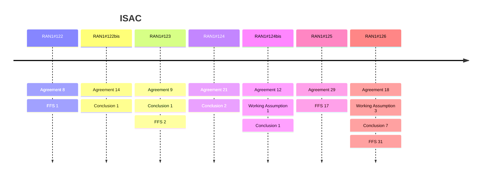

# ISAC (Rel-20)

> 이 파일은 `scripts/generate_report.py`가 자동으로 생성합니다. 직접 수정하지 마세요.

## 회의별 진행

## 회의 간 변화 (Delta)

| 직전 → 최신 | 신규 결정 | WA 확정 | 직전 FFS | FFS 후속 결정 후보 | Agenda 신설 / 제외 |
|---|---|---|---|---|---|
| RAN1#125 → RAN1#126 | 28 | 0 | 17 | 7 | +0 / -0 |
| RAN1#124bis → RAN1#125 | 29 | 0 | 0 | 0 | +0 / -0 |
| RAN1#124 → RAN1#124bis | 14 | 0 | 0 | 0 | +3 / -2 |
| RAN1#123 → RAN1#124 | 23 | 0 | 2 | 1 | +1 / -0 |
| RAN1#122bis → RAN1#123 | 10 | 0 | 0 | 0 | +0 / -1 |
| RAN1#122 → RAN1#122bis | 15 | 0 | 1 | 0 | +1 / -0 |

### 최신 Delta 상세 (RAN1#125 → RAN1#126)

**FFS 후속 결정 후보** — RAN1#125 FFS와 키워드가 60% 이상 겹치는 같은 Agenda의 RAN1#126 결정입니다. 자동 매칭 후보이므로 FFS 해소 여부는 원문으로 확인하세요.

| Agenda | RAN1#125 FFS | RAN1#126 후보 결정 | 일치율 | 출처 |
|---|---|---|---|---|
| Evaluations | FFS: UAV-UE as sensing capable UE | No consensus to introduce UAV-UE as sensing capable UE in the baseline case/combination of sensing UAV in Rel-20. | 100% | FFS: [Chair notes RAN1#125_eom](https://www.3gpp.org/ftp/tsg_ran/WG1_RL1/TSGR1_125/Inbox/Chair_notes/Chair%20notes%20RAN1%23125_eom.docx) [R1-2603928](https://www.3gpp.org/ftp/tsg_ran/WG1_RL1/TSGR1_125/Docs/R1-2603928.zip) `[125-R20-6GR-ISAC-Evaluations]` 후보: [Chair notes RAN1#126_eom1](https://www.3gpp.org/ftp/tsg_ran/WG1_RL1/TSGR1_126/Inbox/Chair_notes/Chair%20notes%20RAN1%23126_eom1.docx) [R1-2605742](https://www.3gpp.org/ftp/tsg_ran/WG1_RL1/TSGR1_126/Docs/R1-2605742.zip) `[126-R20-6GR-ISAC-Evaluations]` |
| Evaluations | FFS: AGV UE as sensing capable UE | No consensus to introduce AGV-UE as sensing capable UE in the baseline case/combination of sensing AGV in Rel-20. | 100% | FFS: [Chair notes RAN1#125_eom](https://www.3gpp.org/ftp/tsg_ran/WG1_RL1/TSGR1_125/Inbox/Chair_notes/Chair%20notes%20RAN1%23125_eom.docx) [R1-2603928](https://www.3gpp.org/ftp/tsg_ran/WG1_RL1/TSGR1_125/Docs/R1-2603928.zip) `[125-R20-6GR-ISAC-Evaluations]` 후보: [Chair notes RAN1#126_eom1](https://www.3gpp.org/ftp/tsg_ran/WG1_RL1/TSGR1_126/Inbox/Chair_notes/Chair%20notes%20RAN1%23126_eom1.docx) [R1-2605742](https://www.3gpp.org/ftp/tsg_ran/WG1_RL1/TSGR1_126/Docs/R1-2605742.zip) `[126-R20-6GR-ISAC-Evaluations]` |
| Aspects of integration with communication | FFS: physical layer design aspects are limited to the scope of AI10.8 | - The following representative use cases for sensing assisted communication is/are selected for study in Rel-20 ISAC   - Sensing assisted beam management   - [Sensing assisted CSI acquisition and reporting]   - Note: companies can also study other use cases for sensing assisted communication - Note: In AI10.8, physical layer design discussions are limited to sensing related aspects | 86% | FFS: [Chair notes RAN1#125_eom](https://www.3gpp.org/ftp/tsg_ran/WG1_RL1/TSGR1_125/Inbox/Chair_notes/Chair%20notes%20RAN1%23125_eom.docx) [R1-2603995](https://www.3gpp.org/ftp/tsg_ran/WG1_RL1/TSGR1_125/Docs/R1-2603995.zip) `[125-R20-6GR-ISAC-Integration]` 후보: [Chair notes RAN1#126_eom1](https://www.3gpp.org/ftp/tsg_ran/WG1_RL1/TSGR1_126/Inbox/Chair_notes/Chair%20notes%20RAN1%23126_eom1.docx) [R1-2605585](https://www.3gpp.org/ftp/tsg_ran/WG1_RL1/TSGR1_126/Docs/R1-2605585.zip) `[126-R20-6GR-ISAC-Integration]` |
| Waveform and frame structure | FFS: The applicable sensing modes. | For effective CP length extension for sensing, further study the necessity (including whether implementation based solution can solve the issue or not) and the following candidate solutions. - Transmission of successive N OFDM symbols that carries sensing RS   - FFS: details of generation method   - FFS: value N - Freq. domain comb pattern for sensing RS   - FFS: details of generation method including comb size   - FFS: combination of successive N OFDM symbols and freq. comb pattern - Time gap after/before/within OFDM symbol carrying sensing RS, without changing OFDM symbol duration/structure of 6GR communication design   - FFS: location of the time gap   - FFS: duration of the time gap FFS: benefits/drawbacks/spec impact FFS: applicable sensing mode and scenario FFS: supported excess delay FFS: other solutions are not precluded | 67% | FFS: [Chair notes RAN1#125_eom](https://www.3gpp.org/ftp/tsg_ran/WG1_RL1/TSGR1_125/Inbox/Chair_notes/Chair%20notes%20RAN1%23125_eom.docx) [R1-2604764](https://www.3gpp.org/ftp/tsg_ran/WG1_RL1/TSGR1_125/Docs/R1-2604764.zip) `[125-R20-6GR-ISAC-Waveform and FS]` 후보: [Chair notes RAN1#126_eom1](https://www.3gpp.org/ftp/tsg_ran/WG1_RL1/TSGR1_126/Inbox/Chair_notes/Chair%20notes%20RAN1%23126_eom1.docx) [R1-2606564](https://www.3gpp.org/ftp/tsg_ran/WG1_RL1/TSGR1_126/Docs/R1-2606564.zip) `[126-R20-6GR-ISAC-Waveform and FS]` |
| Waveform and frame structure | FFS: applicable sensing modes | For effective CP length extension for sensing, further study the necessity (including whether implementation based solution can solve the issue or not) and the following candidate solutions. - Transmission of successive N OFDM symbols that carries sensing RS   - FFS: details of generation method   - FFS: value N - Freq. domain comb pattern for sensing RS   - FFS: details of generation method including comb size   - FFS: combination of successive N OFDM symbols and freq. comb pattern - Time gap after/before/within OFDM symbol carrying sensing RS, without changing OFDM symbol duration/structure of 6GR communication design   - FFS: location of the time gap   - FFS: duration of the time gap FFS: benefits/drawbacks/spec impact FFS: applicable sensing mode and scenario FFS: supported excess delay FFS: other solutions are not precluded | 67% | FFS: [Chair notes RAN1#125_eom](https://www.3gpp.org/ftp/tsg_ran/WG1_RL1/TSGR1_125/Inbox/Chair_notes/Chair%20notes%20RAN1%23125_eom.docx) [R1-2604764](https://www.3gpp.org/ftp/tsg_ran/WG1_RL1/TSGR1_125/Docs/R1-2604764.zip) `[125-R20-6GR-ISAC-Waveform and FS]` 후보: [Chair notes RAN1#126_eom1](https://www.3gpp.org/ftp/tsg_ran/WG1_RL1/TSGR1_126/Inbox/Chair_notes/Chair%20notes%20RAN1%23126_eom1.docx) [R1-2606564](https://www.3gpp.org/ftp/tsg_ran/WG1_RL1/TSGR1_126/Docs/R1-2606564.zip) `[126-R20-6GR-ISAC-Waveform and FS]` |
| Waveform and frame structure | FFS: whether applicable to dedicated sensing RS or RS shared with communication | For effective CP length extension for sensing, further study the necessity (including whether implementation based solution can solve the issue or not) and the following candidate solutions. - Transmission of successive N OFDM symbols that carries sensing RS   - FFS: details of generation method   - FFS: value N - Freq. domain comb pattern for sensing RS   - FFS: details of generation method including comb size   - FFS: combination of successive N OFDM symbols and freq. comb pattern - Time gap after/before/within OFDM symbol carrying sensing RS, without changing OFDM symbol duration/structure of 6GR communication design   - FFS: location of the time gap   - FFS: duration of the time gap FFS: benefits/drawbacks/spec impact FFS: applicable sensing mode and scenario FFS: supported excess delay FFS: other solutions are not precluded | 60% | FFS: [Chair notes RAN1#125_eom](https://www.3gpp.org/ftp/tsg_ran/WG1_RL1/TSGR1_125/Inbox/Chair_notes/Chair%20notes%20RAN1%23125_eom.docx) [R1-2604764](https://www.3gpp.org/ftp/tsg_ran/WG1_RL1/TSGR1_125/Docs/R1-2604764.zip) `[125-R20-6GR-ISAC-Waveform and FS]` 후보: [Chair notes RAN1#126_eom1](https://www.3gpp.org/ftp/tsg_ran/WG1_RL1/TSGR1_126/Inbox/Chair_notes/Chair%20notes%20RAN1%23126_eom1.docx) [R1-2606564](https://www.3gpp.org/ftp/tsg_ran/WG1_RL1/TSGR1_126/Docs/R1-2606564.zip) `[126-R20-6GR-ISAC-Waveform and FS]` |
| Waveform and frame structure | FFS: impact on integration with communication | For effective CP length extension for sensing, further study the necessity (including whether implementation based solution can solve the issue or not) and the following candidate solutions. - Transmission of successive N OFDM symbols that carries sensing RS   - FFS: details of generation method   - FFS: value N - Freq. domain comb pattern for sensing RS   - FFS: details of generation method including comb size   - FFS: combination of successive N OFDM symbols and freq. comb pattern - Time gap after/before/within OFDM symbol carrying sensing RS, without changing OFDM symbol duration/structure of 6GR communication design   - FFS: location of the time gap   - FFS: duration of the time gap FFS: benefits/drawbacks/spec impact FFS: applicable sensing mode and scenario FFS: supported excess delay FFS: other solutions are not precluded | 67% | FFS: [Chair notes RAN1#125_eom](https://www.3gpp.org/ftp/tsg_ran/WG1_RL1/TSGR1_125/Inbox/Chair_notes/Chair%20notes%20RAN1%23125_eom.docx) [R1-2604764](https://www.3gpp.org/ftp/tsg_ran/WG1_RL1/TSGR1_125/Docs/R1-2604764.zip) `[125-R20-6GR-ISAC-Waveform and FS]` 후보: [Chair notes RAN1#126_eom1](https://www.3gpp.org/ftp/tsg_ran/WG1_RL1/TSGR1_126/Inbox/Chair_notes/Chair%20notes%20RAN1%23126_eom1.docx) [R1-2606564](https://www.3gpp.org/ftp/tsg_ran/WG1_RL1/TSGR1_126/Docs/R1-2606564.zip) `[126-R20-6GR-ISAC-Waveform and FS]` |

## 누적 히스토리

| 회의 | Agenda | 구분 | 내용 | 출처 |
|---|---|---|---|---|
| RAN1#122 | 10.5.1 | Agreement | Horizontal/vertical positioning accuracy are agreed as performance metrics for NR ISAC.   - It is defined as the absolute value of the difference between the estimated horizontal/vertical position and the corresponding true position of a sensing target.     - Note: in RAN1 evaluations, there should be only one estimated horizontal/vertical position corresponding to the true position of a sensing target | [Chair notes RAN1#122 eom](https://www.3gpp.org/ftp/tsg_ran/WG1_RL1/TSGR1_122/Inbox/Chair_notes/Chair%20notes%20RAN1%23122%20eom.zip) [R1-2506477](https://www.3gpp.org/ftp/tsg_ran/WG1_RL1/TSGR1_122/Docs/R1-2506477.zip) |
| RAN1#122 | 10.5.1 | Agreement | The following evaluation parameters are agreed for the evaluation on NR ISAC. \| Parameters \| Assumptions \| \| Scenario \| UMa-AV, Optional RMa-AV \| \| Carrier frequency \| Mandatory: one value either 4 GHz or 4.9GHz. optional for FR1: 6 GHz [optional for FR2: 28 GHz] \| \| System bandwidth \| 100 MHz \| \| Numerology \| SCS = 30kHz \| \| BS Layout \| Hexagonal grid, 7 macro sites, 3 sectors per site. See Note1 3 sectors with 30, 150, 270 degrees \| \| Inter-BS (2D) distance \| Uma-AV: 500m, optional 1000m, RMa-AV: 1732m \| \| BS antenna height \| 25m for UMa-AV, 35m for RMa-AV \| \| Wrap-round \| No wrap-round \| Note1: target(s) are dropped only in the center site, and inter-BS interference is not modelled. | [Chair notes RAN1#122 eom](https://www.3gpp.org/ftp/tsg_ran/WG1_RL1/TSGR1_122/Inbox/Chair_notes/Chair%20notes%20RAN1%23122%20eom.zip) [R1-2506478](https://www.3gpp.org/ftp/tsg_ran/WG1_RL1/TSGR1_122/Docs/R1-2506478.zip) |
| RAN1#122 | 10.5.1 | Agreement | The following evaluation parameters are agreed for the evaluation on NR ISAC. \| Parameters \| Assumptions \| \| Target type \| UAV with small size (0.3m x 0.4m x 0.2m) \| \| Target distribution when target(s) are dropped \| N = 5 targets per sector in the center site. Optional: N is uniformly distributed from 1 to 10. Horizontal plane: uniformly distributed in a sector Vertical plane: Uniformly distributed between 25m and 300m, optionally distributed between 1.5m and 300m \| \| Mobility \| horizontal speed: uniformly distributed between 0 and 180km/h vertical speed: 0km/h \| Note: N=0 will be discussed in a later proposal in relation to false alarm. | [Chair notes RAN1#122 eom](https://www.3gpp.org/ftp/tsg_ran/WG1_RL1/TSGR1_122/Inbox/Chair_notes/Chair%20notes%20RAN1%23122%20eom.zip) [R1-2506478](https://www.3gpp.org/ftp/tsg_ran/WG1_RL1/TSGR1_122/Docs/R1-2506478.zip) |
| RAN1#122 | 10.5.1 | Agreement | The following evaluation parameters are agreed for the evaluation on NR ISAC. \| Parameters \| Assumptions \| \| Minimum BS-target 3D distance \| 10 m \| \| Minimum target-target (3D) distance \| 10 m \| \| Target outdoor/indoor proportion \| 100% outdoor \| \| LOS/NLOS \| LOS and NLOS \| \| Orientation \| Random in horizontal domain \| \| RCS model \| RCS model 1 for UAV with small size \| | [Chair notes RAN1#122 eom](https://www.3gpp.org/ftp/tsg_ran/WG1_RL1/TSGR1_122/Inbox/Chair_notes/Chair%20notes%20RAN1%23122%20eom.zip) [R1-2506478](https://www.3gpp.org/ftp/tsg_ran/WG1_RL1/TSGR1_122/Docs/R1-2506478.zip) |
| RAN1#122 | 10.5.1 | Agreement | For the purpose of performance metric calculation, association of the detected object(s) and the true target(s) should fulfil at least the following conditions:   - One true target is associated with at most one detected object   - One detected object is associated with at most one true target   - The same association applies to miss detection, false alarm probability Type 2 (if defined) and positioning/velocity accuracy   - Companies to report the method used for association of the detected object(s) and the true target(s) | [Chair notes RAN1#122 eom](https://www.3gpp.org/ftp/tsg_ran/WG1_RL1/TSGR1_122/Inbox/Chair_notes/Chair%20notes%20RAN1%23122%20eom.zip) [R1-2506479](https://www.3gpp.org/ftp/tsg_ran/WG1_RL1/TSGR1_122/Docs/R1-2506479.zip) |
| RAN1#122 | 10.5.1 | Agreement | - Missed detection probability is agreed as performance metric for NR ISAC.   - It is defined as the conditional probability of not detecting the presence of a target when the target is actually present in the simulation area. Where,       - is the number of missed targets in the drop n, i.e., the true target not associated with any detected object       - is the number of true targets in the drop n.       - is total number of drops with at least one target per drop | [Chair notes RAN1#122 eom](https://www.3gpp.org/ftp/tsg_ran/WG1_RL1/TSGR1_122/Inbox/Chair_notes/Chair%20notes%20RAN1%23122%20eom.zip) [R1-2506479](https://www.3gpp.org/ftp/tsg_ran/WG1_RL1/TSGR1_122/Docs/R1-2506479.zip) |
| RAN1#122 | 10.5.1 | Agreement | - False alarm probability is agreed as performance metric for NR ISAC.   - For cases without true target dropped in simulation area, False alarm probability Type 1 is computed and reported   - For cases with true targets dropped in simulation area, False alarm probability Type 2 is computed and reported   - Note: both False alarm probability Types are mandatory   - KPI values for False alarm probability Type 1 and 2 can be discussed separately. Definitions:   - False alarm probability Type 1 (no target dropped in simulation area): An object is detected when there is no target present in simulation area is considered a false alarm. Where,     - equal to 1 if at least one object is detected when there is no target dropped in the simulation area in the drop n, otherwise  equal to 0.     - is the total number of drops without targets in the simulation area.   - False alarm probability Type 2 (targets dropped in simulation area): An object is detected but not associated with any true targets in the simulation area is considered as a false alarm. Where,       - is the number of detected objects but not associated with any true targets in the drop n.       - is the total number of detected objects in the drop n.       - FFS:         - Option 1:  is number of drops (N)         - Option 2:  is number of drops with at least one detected object Note: the number of targets should be reported by companies when providing False alarm probability Type 2 | [Chair notes RAN1#122 eom](https://www.3gpp.org/ftp/tsg_ran/WG1_RL1/TSGR1_122/Inbox/Chair_notes/Chair%20notes%20RAN1%23122%20eom.zip) [R1-2506479](https://www.3gpp.org/ftp/tsg_ran/WG1_RL1/TSGR1_122/Docs/R1-2506479.zip) |
| RAN1#122 | 10.5.1 | Agreement | - Velocity accuracy is agreed as performance metric for NR ISAC.   - Velocity accuracy is defined as the absolute value of the difference between the estimated velocity and the corresponding true velocity of a sensing target.   - For single TRP monostatic sensing,     - The radial velocity accuracy can be estimated       - The true radial velocity is the projection of true velocity on the direction from TRP to target for TRP monostatic.     - The true velocity accuracy can be estimated. | [Chair notes RAN1#122 eom](https://www.3gpp.org/ftp/tsg_ran/WG1_RL1/TSGR1_122/Inbox/Chair_notes/Chair%20notes%20RAN1%23122%20eom.zip) [R1-2506479](https://www.3gpp.org/ftp/tsg_ran/WG1_RL1/TSGR1_122/Docs/R1-2506479.zip) |
| RAN1#122bis | 10.5.1 | Agreement | On False alarm probability Type 2 (targets dropped in simulation area), the parameter  is the number of drops with at least one detected object. | [Chair notes RAN1#122b eom4](https://www.3gpp.org/ftp/tsg_ran/WG1_RL1/TSGR1_122b/Inbox/Chair_Notes/Chair%20notes%20RAN1%23122b%20eom4.docx) [R1-2507423](https://www.3gpp.org/ftp/tsg_ran/WG1_RL1/TSGR1_122b/Docs/R1-2507423.zip) |
| RAN1#122bis | 10.5.1 | Conclusion | Sensing resolution is not considered as a performance metric for evaluation of NR ISAC. | [Chair notes RAN1#122b eom4](https://www.3gpp.org/ftp/tsg_ran/WG1_RL1/TSGR1_122b/Inbox/Chair_Notes/Chair%20notes%20RAN1%23122b%20eom4.docx) [R1-2507423](https://www.3gpp.org/ftp/tsg_ran/WG1_RL1/TSGR1_122b/Docs/R1-2507423.zip) |
| RAN1#122bis | 10.5.1 | Agreement | The following evaluation parameters are agreed for the evaluation on NR ISAC. \| Parameters \| Assumptions \| Assumptions \| \| BS antenna configuration \| For 4GHz, 4.9GHz: Option 1 as optional Tx: (12,16, 2,1,1;2,16) Rx: (12,16,2,1,1;2,16) Option 2 Tx: (8,8,2,1,1;4,8) Rx: (8,8,2,1,1;4,8) \| For 6GHz: Option 1 as optional Tx: (16,16, 2,1,1;4,16) Rx: (16,16,2,1,1;4,16) Option 2: Tx: (8,8,2,1,1;4,8) Rx: (8,8,2,1,1;4,8) \| \| BS antenna configuration \| Mandatory: = (0.5, 0.8)λ, +45°/-45° polarization Optional: = (0.5, 0.5)λ, +45°/-45° polarization \| Mandatory: = (0.5, 0.8)λ, +45°/-45° polarization Optional: = (0.5, 0.5)λ, +45°/-45° polarization \| - Note: Tx antenna elements and Rx antenna elements are operating simultaneously | [Chair notes RAN1#122b eom4](https://www.3gpp.org/ftp/tsg_ran/WG1_RL1/TSGR1_122b/Inbox/Chair_Notes/Chair%20notes%20RAN1%23122b%20eom4.docx) [R1-2507423](https://www.3gpp.org/ftp/tsg_ran/WG1_RL1/TSGR1_122b/Docs/R1-2507423.zip) |
| RAN1#122bis | 10.5.1 | Agreement | The following evaluation parameters are agreed for the evaluation on NR ISAC. \| Parameters \| Assumptions \| \| BS antenna radiation pattern \| Table 9 in Report ITU-R M.2412 \| \| BS antenna mechanic tilt (downtilt angle without electrical tilt) \| 90° in GCS (pointing to horizontal direction) \| \| BS antenna electrical tilt (downtilt angle after mechanic and electrical tilt) \| Option 1: no electrical tilt Option 2: 102° in GCS \| \| Polarized antenna model \| Model-2 in clause 7.3.2 in TR 38.901 \| | [Chair notes RAN1#122b eom4](https://www.3gpp.org/ftp/tsg_ran/WG1_RL1/TSGR1_122b/Inbox/Chair_Notes/Chair%20notes%20RAN1%23122b%20eom4.docx) [R1-2507423](https://www.3gpp.org/ftp/tsg_ran/WG1_RL1/TSGR1_122b/Docs/R1-2507423.zip) |
| RAN1#122bis | 10.5.1 | Agreement | The following evaluation parameters are agreed for the evaluation on NR ISAC. \| Parameters \| Assumptions \| \| gNB-target link \| gNB-aerial UE of UMa/RMa parameters in 36.777 with Alternative 3 \| \| Concatenation of TX-target and target-RX links \| Up to company choice between two options for concatenation defined in Step 9 in section 7.9.4.1, TR 38.901 \| \| The power threshold for path dropping after concatenation for target channel \| -25dB and -40dB are respectively used for the two options for concatenation \| | [Chair notes RAN1#122b eom4](https://www.3gpp.org/ftp/tsg_ran/WG1_RL1/TSGR1_122b/Inbox/Chair_Notes/Chair%20notes%20RAN1%23122b%20eom4.docx) [R1-2507424](https://www.3gpp.org/ftp/tsg_ran/WG1_RL1/TSGR1_122b/Docs/R1-2507424.zip) |
| RAN1#122bis | 10.5.1 | Agreement | The following evaluation parameters are agreed for the evaluation on NR ISAC. \| Parameters \| Assumptions \| \| Co-site inter-sector interference \| Not modelled \| \| Adjacent channel interference \| Not modelled \| \| BS receiver noise figure \| 5dB \| | [Chair notes RAN1#122b eom4](https://www.3gpp.org/ftp/tsg_ran/WG1_RL1/TSGR1_122b/Inbox/Chair_Notes/Chair%20notes%20RAN1%23122b%20eom4.docx) [R1-2507424](https://www.3gpp.org/ftp/tsg_ran/WG1_RL1/TSGR1_122b/Docs/R1-2507424.zip) |
| RAN1#122bis | 10.5.1 | Agreement | When Tx/Rx operates simultaneously (baseline case), the following parameters are used for the evaluation on NR ISAC: \| Antenna isolation \| Option 1: 65dB Option 2: 80dB \| \| Maximum BS Tx power \| Option 1: 37dBm Option 2: 52dBm The above options are calculated with BS_maxpower = BS Rx saturation power + antenna isolation by assuming the BS Rx saturation power = -28dBm and the antenna isolation = 65dB and 80dB, respectively \| - Optionally: companies should report the maximum BS Tx power when it is assumed that Tx and Rx don’t operate simultaneously. Companies should report how the maximum BS Tx power is derived. | [Chair notes RAN1#122b eom4](https://www.3gpp.org/ftp/tsg_ran/WG1_RL1/TSGR1_122b/Inbox/Chair_Notes/Chair%20notes%20RAN1%23122b%20eom4.docx) [R1-2507424](https://www.3gpp.org/ftp/tsg_ran/WG1_RL1/TSGR1_122b/Docs/R1-2507424.zip) |
| RAN1#122bis | 10.5.1 | Agreement | The following evaluation parameters are agreed for the evaluation on NR ISAC. \| Parameters \| Assumptions \| \| CPI (coherent processing interval) \| Companies to report the CPI value assumed \| \| Waveform \| CP-OFDM as baseline, other waveform is up to companies report \| | [Chair notes RAN1#122b eom4](https://www.3gpp.org/ftp/tsg_ran/WG1_RL1/TSGR1_122b/Inbox/Chair_Notes/Chair%20notes%20RAN1%23122b%20eom4.docx) [R1-2507424](https://www.3gpp.org/ftp/tsg_ran/WG1_RL1/TSGR1_122b/Docs/R1-2507424.zip) |
| RAN1#122bis | 10.5.1 | Agreement | When Tx/Rx operates simultaneously, the following evaluation parameters are agreed for the evaluation on NR ISAC. \| Self-interference \| The residual leakage interference/noise is modelled e.g. by additional additive white Gaussian noise, -94+X dBm in 100 MHz, X is up to company report. Companies to provide details on their modelling. Note: X = -Infinity corresponds to not modelling self-interference \| | [Chair notes RAN1#122b eom4](https://www.3gpp.org/ftp/tsg_ran/WG1_RL1/TSGR1_122b/Inbox/Chair_Notes/Chair%20notes%20RAN1%23122b%20eom4.docx) [R1-2507425](https://www.3gpp.org/ftp/tsg_ran/WG1_RL1/TSGR1_122b/Docs/R1-2507425.zip) |
| RAN1#122bis | 10.5.1 | Agreement | For the evaluation on NR ISAC, - 3 kinds of resources are defined - Type 1: resources that are used for sensing signal transmission - Type 2: part of Type 1 resources that are used for communication purpose   - Note: it is possible the resource type 2 doesn’t exist - Type 3: resources that are not used for sensing signal transmission, and cannot be used for communication purpose due to sensing operation - Both options should be reported for sensing resource ratio - Option 1: (Type_1 + Type_3) resources over all radio DL and UL resources - Option 2: (Type_1 - Type_2 + Type_3) resources over all radio DL and UL resources - Note: if Type 2 resource doesn’t exist, two options are the same For the evaluation on NR ISAC, - Company should report T/F RE mapping of sensing RS, assumed TDD UL/DL configuration if applicable. - Company should report which sensing RS resources are considered as Type 2 resource and related reason. | [Chair notes RAN1#122b eom4](https://www.3gpp.org/ftp/tsg_ran/WG1_RL1/TSGR1_122b/Inbox/Chair_Notes/Chair%20notes%20RAN1%23122b%20eom4.docx) [R1-2507426](https://www.3gpp.org/ftp/tsg_ran/WG1_RL1/TSGR1_122b/Docs/R1-2507426.zip) |
| RAN1#122bis | 10.5.1 | Agreement | Companies are encouraged to report the high-level sensing signal/data processing method used in the evaluation, e.g., 2D FFT, MUSIC, and any other methods. | [Chair notes RAN1#122b eom4](https://www.3gpp.org/ftp/tsg_ran/WG1_RL1/TSGR1_122b/Inbox/Chair_Notes/Chair%20notes%20RAN1%23122b%20eom4.docx) [R1-2507426](https://www.3gpp.org/ftp/tsg_ran/WG1_RL1/TSGR1_122b/Docs/R1-2507426.zip) |
| RAN1#122bis | 10.5.1 | Agreement | Up to company to model low power cluster in the evaluation of NR ISAC | [Chair notes RAN1#122b eom4](https://www.3gpp.org/ftp/tsg_ran/WG1_RL1/TSGR1_122b/Inbox/Chair_Notes/Chair%20notes%20RAN1%23122b%20eom4.docx) [R1-2507426](https://www.3gpp.org/ftp/tsg_ran/WG1_RL1/TSGR1_122b/Docs/R1-2507426.zip) |
| RAN1#122bis | 10.5.1 | Agreement | Companies should report details of the Tx beam information (number of Tx beams, wide/narrow Tx beam) being used at TRP. - The details of the Tx beam information (number of Tx beams, wide/narrow Tx beam) being used at TRP will be captured along with the corresponding evaluation results in the Rel-20 TR | [Chair notes RAN1#122b eom4](https://www.3gpp.org/ftp/tsg_ran/WG1_RL1/TSGR1_122b/Inbox/Chair_Notes/Chair%20notes%20RAN1%23122b%20eom4.docx) [R1-2507426](https://www.3gpp.org/ftp/tsg_ran/WG1_RL1/TSGR1_122b/Docs/R1-2507426.zip) |
| RAN1#122bis | 10.5.1 | Agreement | The following performance objectives are adopted for evaluation purpose of NR ISAC. \| Metric \| Value \| \| Missed detection Probability \| [5]% \| \| False Alarm Probability Type 1 \| [5]% \| \| False Alarm Probability Type 2 \| [5]% \| \| Horizontal Positioning Accuracy \| [10] m with confidence level 90% \| \| Vertical Positioning Accuracy \| [10] m with confidence level 90% \| \| Velocity Accuracy \| [5] m/s with confidence level 90% \| | [Chair notes RAN1#122b eom4](https://www.3gpp.org/ftp/tsg_ran/WG1_RL1/TSGR1_122b/Inbox/Chair_Notes/Chair%20notes%20RAN1%23122b%20eom4.docx) [R1-2507426](https://www.3gpp.org/ftp/tsg_ran/WG1_RL1/TSGR1_122b/Docs/R1-2507426.zip) |
| RAN1#122bis | 10.5 | Agreement | The TR skeleton in R1-2507422 is endorsed. | [Chair notes RAN1#122b eom4](https://www.3gpp.org/ftp/tsg_ran/WG1_RL1/TSGR1_122b/Inbox/Chair_Notes/Chair%20notes%20RAN1%23122b%20eom4.docx) [R1-2508159](https://www.3gpp.org/ftp/tsg_ran/WG1_RL1/TSGR1_122b/Docs/R1-2508159.zip) `[122bis-R20-ISAC]` |
| RAN1#123 | 10.5.1 | Agreement | - In section 6.2 Performance evaluation results in TR 38.765, - Multiple configurations of the following parameters are defined to respectively analyze the evaluation results   - At least Two baseline configurations 1 & 2 are defined for evaluation purpose \|  \| Parameters \| Configuration 1 Baseline \| Configuration 2 Baseline \| \| 1 \| Scenario \| (UMa-AV, 500m) \| (UMa-AV, 500m) \| \| 2 \| Sensing Tx/Rx operating simultaneously or not \| Sensing Tx/Rx operating simultaneously \| Sensing Tx/Rx operating simultaneously \| \| 3 \| Carrier frequency \| 4 or 4.9GHz \| 4 or 4.9GHz \| \| 4 \| Max BS Tx power \| 52 dBm \| 37 dBm \| \| 5 \| BS antenna configuration \| (M, N, P, Mg, Ng, Mp, Np) Tx: (8,8,2,1,1;4,8) Rx: (8,8,2,1,1;4,8) = (0.5, 0.8)λ, +45°/-45° polarization \| (M, N, P, Mg, Ng, Mp, Np) Tx: (8,8,2,1,1;4,8) Rx: (8,8,2,1,1;4,8) = (0.5, 0.8)λ, +45°/-45° polarization \| \| 6 \| Number of targets per sector in center site \| N=5 \| N=5 \| \| 7 \| Target vertical distribution \| 25-300m \| 25-300m \|   - Additional configurations can be defined for other assumptions of the parameters, based on reported evaluation results in RAN1 #124. | [Chair notes RAN1#123 - eom3](https://www.3gpp.org/ftp/tsg_ran/WG1_RL1/TSGR1_123/Inbox/Chair_notes/Chair%20notes%20RAN1%23123%20-%20eom3.docx) [R1-2509238](https://www.3gpp.org/ftp/tsg_ran/WG1_RL1/TSGR1_123/Docs/R1-2509238.zip) |
| RAN1#123 | 10.5.1 | Agreement | - Companies should report whether a same target is modeled in the ISAC channel of single, multiple or all STXs/SRXs   - Company should report how to determine the single or multiple STXs/SRXs for a target   - The details of STX/SRX determination will be captured along with the corresponding evaluation results in the TR for NR ISAC   - If the evaluation results are derived by measurement reports from multiple/all STXs/SRXs, companies should report how measurement reports from multiple/all STXs/SRXs are used | [Chair notes RAN1#123 - eom3](https://www.3gpp.org/ftp/tsg_ran/WG1_RL1/TSGR1_123/Inbox/Chair_notes/Chair%20notes%20RAN1%23123%20-%20eom3.docx) [R1-2509238](https://www.3gpp.org/ftp/tsg_ran/WG1_RL1/TSGR1_123/Docs/R1-2509238.zip) |
| RAN1#123 | 10.5.1 | Agreement | From RAN1 perspective, the following measurements that may be reported from RAN are identified in the study of NR ISAC. Note: Down selection of Level(s)/Option(s) for recommendation can be discussed separately. - Level A: Raw data per Tx antenna port per OFDM symbol per RX antenna port per TRP for a given time stamp   - Option A1: Amplitude and phase samples in time/delay domain of the estimated channel, i.e., Amplitude and phase values of channel impulse response   - Option A2: Amplitude and phase per subcarrier in frequency domain of the estimated channel - Level B: Amplitude and phase profile of delay, and/or Doppler, and/or angle per TRP for a given time stamp by using window(s) of the [consecutive] samples in delay, Doppler and/or angle domain   - Option B1: Delay-Doppler profile per Tx antenna port per Rx antenna port, which includes the amplitude and phase samples distributed across different delays and Doppler shifts.   - Option B2: Delay-Angle profile per Tx antenna port per OFDM symbol, which includes the amplitude and phase samples distributed across different delays and spatial angles (e.g., Angle of Arrival).   - Option B3: Delay-Doppler-Angle profile per Tx antenna port, which includes the amplitude and phase samples distributed across delay, Doppler, and angle domains.   - Option B4: Delay profile per Tx antenna port per OFDM symbol per Rx antenna port, which includes the amplitude and phase samples distributed across different delays.   - Note: Level B is applicable for either LCS or GCS - Level C: per detected path/point measurements per Tx antenna port per TRP which may be reflected/scattered from scattering point(s).   - Option C1: Delay/range, Doppler/velocity, one or multiple 3D angles, and [power/confidence metric] per detected path for a given time stamp.     - A path is associated with one couple {delay/range, Doppler/velocity, [power/confidence metric]}, and one or multiple 3D angles.   - Option C2: Doppler/velocity, position, and [power/confidence metric] per detected path for a given time stamp.     - A path is associated with one doppler/velocity, [power/confidence metric], one or multiple positions   - Option C3: Delay/range, Doppler/velocity, 3D angle, and [power/confidence metric] per detected path for a given time stamp.     - A path is associated with one delay, and one or multiple triple {Doppler/velocity, 3D angle, [power/confidence metric]}   - Option C4: Delay/range, Doppler/velocity, 3D angle, and [power/confidence metric] per detected point for a given time stamp     - A point is associated with one range/delay, one Doppler/velocity, one 3D angle   - Option C5: Position, velocity, and [power/confidence metric] per detected point for a given time stamp     - A point is associated with one position, one velocity   - FFS: Velocity can be     - Opt 1: radial velocity     - Opt 2: 3D velocity   - Note:     - Position can be defined in either LCS or GCS     - Angle can be defined in either LCS or GCS     - Ambiguity issue will be further discussed     - 3D angle refers to a pair of horizontal and vertical angles - Level D: Object/target level measurement [per TRP or per gNB]   - One or more value pair(s) {position, velocity} in GCS for a given time stamp is reported for a detected object/target,     - Option D1: Only one value pair {position, velocity} in GCS for a given time stamp is reported for a detected object/target. The association of multiple measurements across different time stamps for the same detected object/target is not reported.     - Option D2: Only one value pair {position, velocity} in GCS for a given time stamp is reported for a detected object/target. The association of multiple measurements across different time stamps for the same detected object/target is reported.     - Option D3: One or more value pairs {position, velocity} in GCS for a given time stamp are reported for a detected object/target. The association of multiple measurements across different time stamps for the same detected object/target is reported.     - Option D4: One or more value pairs {position, velocity} in GCS for a given time stamp are reported for a detected object/target. The association of multiple measurements across different time stamps for the same detected object/target is not reported.   - Note: Ambiguity issue can be further discussed if any   - Note: velocity is 3D velocity for Option D2/D3   - FFS: velocity can be radial velocity or 3D velocity for Option D1/D4 - Note: the possible information from RAN to SF for further processing can be further discussed for all levels - Note: the possible information from SF to RAN can be further discussed for all levels - Note: confidence metric can be further discussed for options of Level C/D - Note: definition of time stamp for each of all options of all Levels can be further discussed - For Level A/B/C, Tx antenna port means reference signal antenna port for sensing purpose | [Chair notes RAN1#123 - eom3](https://www.3gpp.org/ftp/tsg_ran/WG1_RL1/TSGR1_123/Inbox/Chair_notes/Chair%20notes%20RAN1%23123%20-%20eom3.docx) [R1-2509241](https://www.3gpp.org/ftp/tsg_ran/WG1_RL1/TSGR1_123/Docs/R1-2509241.zip) |
| RAN1#123 | 10.5.1 | Agreement | RAN1 confirms the performance objectives in the early agreement from RAN1 #122bis by removing the brackets \| Agreement The following performance objectives are adopted for evaluation purpose of NR ISAC. \| | [Chair notes RAN1#123 - eom3](https://www.3gpp.org/ftp/tsg_ran/WG1_RL1/TSGR1_123/Inbox/Chair_notes/Chair%20notes%20RAN1%23123%20-%20eom3.docx) [R1-2509242](https://www.3gpp.org/ftp/tsg_ran/WG1_RL1/TSGR1_123/Docs/R1-2509242.zip) |
| RAN1#123 | 10.5.1 | Agreement | Confidence level of the X% represents X percentile point of the cumulative distribution function (CDF) of the estimation errors | [Chair notes RAN1#123 - eom3](https://www.3gpp.org/ftp/tsg_ran/WG1_RL1/TSGR1_123/Inbox/Chair_notes/Chair%20notes%20RAN1%23123%20-%20eom3.docx) [R1-2509242](https://www.3gpp.org/ftp/tsg_ran/WG1_RL1/TSGR1_123/Docs/R1-2509242.zip) |
| RAN1#123 | 10.5.1 | Conclusion | Sensing service latency and refreshing rate are not considered as performance metrics for evaluation of NR ISAC. | [Chair notes RAN1#123 - eom3](https://www.3gpp.org/ftp/tsg_ran/WG1_RL1/TSGR1_123/Inbox/Chair_notes/Chair%20notes%20RAN1%23123%20-%20eom3.docx) [R1-2509242](https://www.3gpp.org/ftp/tsg_ran/WG1_RL1/TSGR1_123/Docs/R1-2509242.zip) |
| RAN1#123 | 10.5.1 | Agreement | - Up to company to report evaluation results for UAV tracking in NR ISAC study.   - Proponent company should clarify the details on how target trajectory is modeled | [Chair notes RAN1#123 - eom3](https://www.3gpp.org/ftp/tsg_ran/WG1_RL1/TSGR1_123/Inbox/Chair_notes/Chair%20notes%20RAN1%23123%20-%20eom3.docx) [R1-2509242](https://www.3gpp.org/ftp/tsg_ran/WG1_RL1/TSGR1_123/Docs/R1-2509242.zip) |
| RAN1#123 | 10.5.1 | Agreement | - The following general procedure for performance evaluation of NR ISAC is to be captured in TR 38.765. - Simulation parameter configuration - Sensing scenario generation, including the deployment of sensing Tx/Rx (STXs/SRXs) - Dropping N target(s), where N is equal to 0 or larger than 0 - Channel generation and STX/SRX determination for the targets - Sensing signal generation and passing the sensing signal to the generated channel - Sensing signal processing at each SRX, optionally, sensing signal processing based on fusion from multiple STXs/SRXs   - E.g., optionally, sensing signal processing based on tracking - Sensing performance metric calculation. Note: company should report the details on sensing signal processing and ISAC channel generation | [Chair notes RAN1#123 - eom3](https://www.3gpp.org/ftp/tsg_ran/WG1_RL1/TSGR1_123/Inbox/Chair_notes/Chair%20notes%20RAN1%23123%20-%20eom3.docx) [R1-2509242](https://www.3gpp.org/ftp/tsg_ran/WG1_RL1/TSGR1_123/Docs/R1-2509242.zip) |
| RAN1#123 | 10.5.1 | Agreement | - The following evaluation assumptions for optional FR2-1 carrier frequency are considered for evaluation of NR ISAC \| Parameters \| Values \| \| Scenario \| UMi-AV \| \| Carrier Frequency \| 30 GHz \| \| System bandwidth \| 400 MHz \| \| SCS \| 120 kHz \| \| Inter-BS (2D) distance \| 200 m \| \| BS antenna configurations \| (M,N,P,Mg,Ng;Mp,Np) = (16,16,2,2,1;1,1), (dH,dV) = (0.5, 0.5 or 0.8)λ, +45°/-45° polarization for whole panel; (16,16,2,1,1;1,1) for Tx and (16,16,2,1,1;1,1) for Rx \| \| Beam set at TRxP \| Up to company report \| \| Antenna isolation \| 80 ~ 100 dB \| \| Max BS Tx power \| 30 dBm \| \| BS noise figure \| 7 dB \| - Up to company to report evaluation results and additional configuration information for FR2-1. | [Chair notes RAN1#123 - eom3](https://www.3gpp.org/ftp/tsg_ran/WG1_RL1/TSGR1_123/Inbox/Chair_notes/Chair%20notes%20RAN1%23123%20-%20eom3.docx) [R1-2509242](https://www.3gpp.org/ftp/tsg_ran/WG1_RL1/TSGR1_123/Docs/R1-2509242.zip) |
| RAN1#123 | 10.5.1 | Agreement | - The attached template in R1-2509242 (Proposal 5.3-1-rev2) is used as starting point for evaluation results collection | [Chair notes RAN1#123 - eom3](https://www.3gpp.org/ftp/tsg_ran/WG1_RL1/TSGR1_123/Inbox/Chair_notes/Chair%20notes%20RAN1%23123%20-%20eom3.docx) [R1-2509242](https://www.3gpp.org/ftp/tsg_ran/WG1_RL1/TSGR1_123/Docs/R1-2509242.zip) |
| RAN1#124 | 9.5.1 | Agreement | - The definition on time stamp from existing specifications, e.g., TS 38.455, TS 38.355, TS 37.355 are reused as baseline - No more discussion on time stamp is expected from RAN1 study perspective | [Chair notes RAN1#124 - eom_03](https://www.3gpp.org/ftp/tsg_ran/WG1_RL1/TSGR1_124/Inbox/Chair_notes/Chair%20notes%20RAN1%23124%20-%20eom_03.docx) [R1-2601380](https://www.3gpp.org/ftp/tsg_ran/WG1_RL1/TSGR1_124/Docs/R1-2601380.zip) |
| RAN1#124 | 9.5.1 | Agreement | - From RAN1 perspective, the measurement of Level D reported from RAN is per gNB   - Note: RAN1’s understanding is that gNB can associate with one or multiple TRPs | [Chair notes RAN1#124 - eom_03](https://www.3gpp.org/ftp/tsg_ran/WG1_RL1/TSGR1_124/Inbox/Chair_notes/Chair%20notes%20RAN1%23124%20-%20eom_03.docx) [R1-2601380](https://www.3gpp.org/ftp/tsg_ran/WG1_RL1/TSGR1_124/Docs/R1-2601380.zip) |
| RAN1#124 | 9.5.1 | Agreement | The Text Proposal to TR 38.765 in R1-2601594 is endorsed. | [Chair notes RAN1#124 - eom_03](https://www.3gpp.org/ftp/tsg_ran/WG1_RL1/TSGR1_124/Inbox/Chair_notes/Chair%20notes%20RAN1%23124%20-%20eom_03.docx) [R1-2601381](https://www.3gpp.org/ftp/tsg_ran/WG1_RL1/TSGR1_124/Docs/R1-2601381.zip) |
| RAN1#124 | 9.5.1 | Agreement | The Text Proposal to TR 38.765 in R1-2601595 is endorsed. | [Chair notes RAN1#124 - eom_03](https://www.3gpp.org/ftp/tsg_ran/WG1_RL1/TSGR1_124/Inbox/Chair_notes/Chair%20notes%20RAN1%23124%20-%20eom_03.docx) [R1-2601381](https://www.3gpp.org/ftp/tsg_ran/WG1_RL1/TSGR1_124/Docs/R1-2601381.zip) |
| RAN1#124 | 9.5.1 | Agreement | The Text Proposal to TR 38.765 in R1-2601596 is endorsed | [Chair notes RAN1#124 - eom_03](https://www.3gpp.org/ftp/tsg_ran/WG1_RL1/TSGR1_124/Inbox/Chair_notes/Chair%20notes%20RAN1%23124%20-%20eom_03.docx) [R1-2601381](https://www.3gpp.org/ftp/tsg_ran/WG1_RL1/TSGR1_124/Docs/R1-2601381.zip) |
| RAN1#124 | 9.5.1 | Agreement | - From RAN1 perspective, on measurement quantization of Level C/D for position/velocity measurement, quantization methods in existing specifications, e.g., TS 23.032, TS 38.455, TS 38.355, TS 37.355 can be considered. - From RAN1 perspective, on measurement quantization of Level C for delay/angle measurement, quantization methods in existing specifications, e.g., TS 38.133 can be considered.   - For Doppler measurement, same number of quantized bits as radial velocity can be considered. - Note: above does not take into account the potential impact from measurement quantization on the sensing performance. | [Chair notes RAN1#124 - eom_03](https://www.3gpp.org/ftp/tsg_ran/WG1_RL1/TSGR1_124/Inbox/Chair_notes/Chair%20notes%20RAN1%23124%20-%20eom_03.docx) [R1-2601381](https://www.3gpp.org/ftp/tsg_ran/WG1_RL1/TSGR1_124/Docs/R1-2601381.zip) |
| RAN1#124 | 9.5.1 | Agreement | - The velocity measurement of Option C1/C3/C4 is radial velocity. | [Chair notes RAN1#124 - eom_03](https://www.3gpp.org/ftp/tsg_ran/WG1_RL1/TSGR1_124/Inbox/Chair_notes/Chair%20notes%20RAN1%23124%20-%20eom_03.docx) [R1-2601381](https://www.3gpp.org/ftp/tsg_ran/WG1_RL1/TSGR1_124/Docs/R1-2601381.zip) |
| RAN1#124 | 9.5.1 | Agreement | The following Text Proposal to Conclusion section in TR 38.765 is endorsed. \| The performance for UAV sensing use case with gNB monostatic sensing is evaluated based on the evaluation assumptions in Annex A (including UMa-AV, Sensing Tx/Rx operating simultaneously, FR1), with detailed assumptions and modelling reported by the companies as captured in Annex B. Among all the reported evaluation results as captured in Annex B, Baseline 1 (high BS TX power 52dBm with 80dB antenna isolation) By utilizing measurements from multiple or all TRPs, results from 9/10 sources achieve the performance objectives. By utilizing measurements from single TRP, results from 3/11 sources achieve the performance objectives. Baseline 2 (low BS TX power 37dBm with 65dB antenna isolation) By utilizing measurements from multiple or all TRPs, results from 7/9 sources achieve the performance objectives. By utilizing measurements from single TRP, results from 2/9 sources achieve the performance objectives \| | [Chair notes RAN1#124 - eom_03](https://www.3gpp.org/ftp/tsg_ran/WG1_RL1/TSGR1_124/Inbox/Chair_notes/Chair%20notes%20RAN1%23124%20-%20eom_03.docx) [R1-2601382](https://www.3gpp.org/ftp/tsg_ran/WG1_RL1/TSGR1_124/Docs/R1-2601382.zip) |
| RAN1#124 | 9.5.1 | Conclusion | - From RAN1 perspective, the issue on ambiguity handling in delay/range, Doppler/radial velocity, angle, position and 3D velocity measurements is identified, but not further discussed in Rel-20 NR ISAC.   - Note: it does not prevent further discussion in future.   - Note: this issue may or may not be addressed by NW implementation. | [Chair notes RAN1#124 - eom_03](https://www.3gpp.org/ftp/tsg_ran/WG1_RL1/TSGR1_124/Inbox/Chair_notes/Chair%20notes%20RAN1%23124%20-%20eom_03.docx) [R1-2601382](https://www.3gpp.org/ftp/tsg_ran/WG1_RL1/TSGR1_124/Docs/R1-2601382.zip) |
| RAN1#124 | 9.5.1 | Agreement | - The velocity measurement of Option D1/D4 is 3D velocity, optional radial velocity.   - Note: in the deployment where 3D velocity cannot be reported, Level D should not be reported. | [Chair notes RAN1#124 - eom_03](https://www.3gpp.org/ftp/tsg_ran/WG1_RL1/TSGR1_124/Inbox/Chair_notes/Chair%20notes%20RAN1%23124%20-%20eom_03.docx) [R1-2601382](https://www.3gpp.org/ftp/tsg_ran/WG1_RL1/TSGR1_124/Docs/R1-2601382.zip) |
| RAN1#124 | 9.5.1 | Agreement | - The velocity measurement of Option C2/C5 is radial velocity. | [Chair notes RAN1#124 - eom_03](https://www.3gpp.org/ftp/tsg_ran/WG1_RL1/TSGR1_124/Inbox/Chair_notes/Chair%20notes%20RAN1%23124%20-%20eom_03.docx) [R1-2601382](https://www.3gpp.org/ftp/tsg_ran/WG1_RL1/TSGR1_124/Docs/R1-2601382.zip) |
| RAN1#124 | 9.5.1 | Conclusion | - No further discussion on the assistance information from SF to RAN is expected in Rel-20 NR ISAC from RAN1 study perspective. | [Chair notes RAN1#124 - eom_03](https://www.3gpp.org/ftp/tsg_ran/WG1_RL1/TSGR1_124/Inbox/Chair_notes/Chair%20notes%20RAN1%23124%20-%20eom_03.docx) [R1-2601382](https://www.3gpp.org/ftp/tsg_ran/WG1_RL1/TSGR1_124/Docs/R1-2601382.zip) |
| RAN1#124 | 9.5.1 | Agreement | - Confirm the definition of measurement Level B by removing the square brackets - Level B: Amplitude and phase profile of delay, and/or Doppler, and/or angle per TRP for a given time stamp by using window(s) of the [consecutive] samples in at least one profile of delay, and/or Doppler and/or angle domain | [Chair notes RAN1#124 - eom_03](https://www.3gpp.org/ftp/tsg_ran/WG1_RL1/TSGR1_124/Inbox/Chair_notes/Chair%20notes%20RAN1%23124%20-%20eom_03.docx) [R1-2601382](https://www.3gpp.org/ftp/tsg_ran/WG1_RL1/TSGR1_124/Docs/R1-2601382.zip) |
| RAN1#124 | 9.5.1 | Agreement | - From RAN1 perspective, the following methods can be considered to define the quantization for the measurements of Level A/B,   - e.g., floating point, uniform scalar, non-uniform scalar   - other quantization method is not precluded. - Note: above doesn’t take into account the potential impact from the measurement quantization on sensing performance - Note: No more discussion on measurement quantization on Level A/B is expected in the study item from RAN1 perspective | [Chair notes RAN1#124 - eom_03](https://www.3gpp.org/ftp/tsg_ran/WG1_RL1/TSGR1_124/Inbox/Chair_notes/Chair%20notes%20RAN1%23124%20-%20eom_03.docx) [R1-2601383](https://www.3gpp.org/ftp/tsg_ran/WG1_RL1/TSGR1_124/Docs/R1-2601383.zip) |
| RAN1#124 | 9.5.1 | Agreement | - From RAN1 perspective, the metric related to power can be considered for Level C measurement report. - From RAN1 perspective, the metric related to power (if applicable) can be considered for Level D measurement report. - Note: metric related to power may be different from those defined for communication and between Level C and Level D - From RAN1 perspective, confidence metrics for the measurements can be considered for Level C/D measurement report - No more discussion on the metric related to power and confidence metrics is expected in the study item from RAN1 study perspective | [Chair notes RAN1#124 - eom_03](https://www.3gpp.org/ftp/tsg_ran/WG1_RL1/TSGR1_124/Inbox/Chair_notes/Chair%20notes%20RAN1%23124%20-%20eom_03.docx) [R1-2601383](https://www.3gpp.org/ftp/tsg_ran/WG1_RL1/TSGR1_124/Docs/R1-2601383.zip) |
| RAN1#124 | 9.5.1 | Agreement | - For Level C, at least the following examples of assistance information are identified as needed to assist the further processing at Sensing Function. The assistance information may or may not be provided by RAN.   - Location of TRP if at least delay/range, Doppler/radial velocity or angle is reported   - If a measurement is reported in LCS, LCS to GCS transformation information - For level D, if radial velocity is not reported, no assistance information is identified from RAN1 perspective. - No more discussion on the assistance information on Level C/D from RAN to SF is expected in the study item from RAN1 perspective | [Chair notes RAN1#124 - eom_03](https://www.3gpp.org/ftp/tsg_ran/WG1_RL1/TSGR1_124/Inbox/Chair_notes/Chair%20notes%20RAN1%23124%20-%20eom_03.docx) [R1-2601383](https://www.3gpp.org/ftp/tsg_ran/WG1_RL1/TSGR1_124/Docs/R1-2601383.zip) |
| RAN1#124 | 9.5.1 | Agreement | - From RAN1 perspective, on measurement quantization of Level C/D for confidence metric, the existing specifications, e.g., TS 23.032, TS 38.455, TS 38.355, TS 37.355 can be considered. - Note: above does not take into account the potential impact from measurement quantization on the sensing performance. - Note: No more discussion on measurement quantization on Level C/D for the metric related to power and confidence metric is expected in the study item from RAN1 perspective | [Chair notes RAN1#124 - eom_03](https://www.3gpp.org/ftp/tsg_ran/WG1_RL1/TSGR1_124/Inbox/Chair_notes/Chair%20notes%20RAN1%23124%20-%20eom_03.docx) [R1-2601384](https://www.3gpp.org/ftp/tsg_ran/WG1_RL1/TSGR1_124/Docs/R1-2601384.zip) |
| RAN1#124 | 9.5.1 | Agreement | - For Level A/B, at least the following examples of assistance information are identified as needed to assist the further processing at Sensing Function. The assistance information may or may not be provided by RAN.   - Level A     - Location of TRP     - Step size in delay domain if samples in delay domain is reported     - Time information related to OFDM symbols used for measurement     - Antenna configuration and/or beam information   - Level B     - Location of TRP     - LCS to GCS transformation information     - Information related to sampling of delay, doppler and/or angle profile - Additional assistance information is not precluded - No more discussion on the assistance information on Level A/B from RAN to SF is expected in the study item from RAN1 perspective | [Chair notes RAN1#124 - eom_03](https://www.3gpp.org/ftp/tsg_ran/WG1_RL1/TSGR1_124/Inbox/Chair_notes/Chair%20notes%20RAN1%23124%20-%20eom_03.docx) [R1-2601384](https://www.3gpp.org/ftp/tsg_ran/WG1_RL1/TSGR1_124/Docs/R1-2601384.zip) |
| RAN1#124 | 9.5.1 | Agreement | The payload size estimation of each measurement level/option for NR ISAC can be done by the following formulas - Level A: Msubcarrier* Ncpi *Mtxport*Nrxport*Ntrp*(Nquan1+ Nquan2) Where,   - Msubcarrier: number of subcarriers in a OFDM symbols   - Ncpi: number of OFDM symbols within CPI   - Mtxport: number of reference signal antenna port for sensing purpose   - Nrxport: number of Rx antenna ports   - Ntrp: number of TRPs for payload size calculation   - Nquan1: number of quantized bits for amplitude   - Nquan2: number of quantized bits for angle - Level B:   - Delay-Doppler Profile: Mdelay *Ndoppler *Mtxport* Nrxport *Ntrp *(Nquan1+ Nquan2)   - Delay-angle Profile: Mdelay * Ncpi *Mtxport*Nangle *Ntrp *(Nquan1+ Nquan2)   - Delay-Doppler-angle Profile: Mdelay *Ndoppler *Mtxport*Nangle *Ntrp *(Nquan1+ Nquan2)   - Delay Profile: Mdelay *Ncpi*Mtxport*Nrxport *Ntrp *(Nquan1+ Nquan2) Where,   - Mdelay: number of delay samples in the window   - Ndoppler: number of Doppler samples in the window   - Nangle: number of angle samples in the window - Level C:   - C1/C2/C3: Np1*Ntrp *   - C4/C5: Np2*Ntrp * Where,   - Np1 is total number of paths   - Np2 is total number of points   - Nparam is 5 including e.g.,     - C1/C3/C4: delay, Doppler, horizontal angle, vertical angle, power measurement     - C2/C5: position (x, y, z), radial velocity, power measurement   - Nquan,i: number of quantized bits   - Ntrp: number of TRPs for payload size calculation - Level D:   - Nobject*Ngnb * for options D1/2   - Mpoints* Ngnb * for options D3/4 Where,   - Nobject is total number of targets   - Mpoints is total number of scattering points of all targets   - Ngnb is fixed to 1 | [Chair notes RAN1#124 - eom_03](https://www.3gpp.org/ftp/tsg_ran/WG1_RL1/TSGR1_124/Inbox/Chair_notes/Chair%20notes%20RAN1%23124%20-%20eom_03.docx) [R1-2601384](https://www.3gpp.org/ftp/tsg_ran/WG1_RL1/TSGR1_124/Docs/R1-2601384.zip) |
| RAN1#124 | 9.5.1 | Agreement | - The following assumptions on the parameters can be used to estimate payload size of different Levels/Options of measurements for NR ISAC for calculation purpose \| Parameters \| Assumptions \| Relation to maximum payload calculation \| \| Nsubcarriers \| 3276 for 100MHz, 30kHz SCS \|  \| \| Ncpi \| Min 64, medium 160, max 320 symbols per CPI \|  \| \| Mtxport \| 1, medium 4, max 9 \| Note: value obtained based on evaluation assumptions \| \| Nrxport \| 64 \|  \| \| Ntrp \| 3 \|  \| \| Ngnb \| 1 \|  \| \| Nquan1, i.e., amplitude \| Min 16, medium 16, max 32 \|  \| \| Nquan2, i.e., phase \| Min 16, medium 16, max 32 \|  \| \|  \| Min 16, medium 16, max 32 \|  \| \| Mdelay \| Min 288 (CP length, UMa) Medium/max: 467 for 2*570m (UMa) Max: 1436 for 2*1732m (RMa) \|  \| \| Ndoppler \| same as Ncpi \|  \| \| Nangle \| B2/B3: 32, 360 \| Note: value obtained based on evaluation assumptions Note: 32 assumes non-uniform sampling Note: 360 assumes uniform oversampling \| \| Np \| 30, 60, 120 \| to calculate min/medium/max for Level-C Note: value obtained based on evaluation assumptions \| \| Nobject for D1/D2 \| 15 \| Note: value obtained based on evaluation assumptions \| \| Mpoints for D3/D4 \| 20 \| Note: value obtained based on evaluation assumptions \|   - For Level C     - Nparam=5 parameters for measurements   - For Level D     - Nparam=7 parameters for measurements     - for D2/D3/D4, one more parameter of target ID is assumed Note: for B2/B3, minimum value and maximum value can be different between non-uniform sampling case and uniform oversampling case Note: RAN1 does not require all the parameters to take the minimum values at the same time or the maximum values at the same time Note: above does not take into account the potential impact from measurement quantization on the sensing performance. Note: above does not take into account the potential impact of different Levels/Options on the sensing performance. | [Chair notes RAN1#124 - eom_03](https://www.3gpp.org/ftp/tsg_ran/WG1_RL1/TSGR1_124/Inbox/Chair_notes/Chair%20notes%20RAN1%23124%20-%20eom_03.docx) [R1-2601384](https://www.3gpp.org/ftp/tsg_ran/WG1_RL1/TSGR1_124/Docs/R1-2601384.zip) |
| RAN1#124 | 9.5.1 | Agreement | The following Text Proposal to Conclusion section in TR 38.765 is endorsed. \| The study in physical layer has identified a number of Levels/Options for measurement report as described in Clause 5. Different Levels/Options for measurement report are associated with different payload overhead, assistance information and other higher layer aspects. \| | [Chair notes RAN1#124 - eom_03](https://www.3gpp.org/ftp/tsg_ran/WG1_RL1/TSGR1_124/Inbox/Chair_notes/Chair%20notes%20RAN1%23124%20-%20eom_03.docx) [R1-2601384](https://www.3gpp.org/ftp/tsg_ran/WG1_RL1/TSGR1_124/Docs/R1-2601384.zip) |
| RAN1#124 | 9.5 | Agreement | Draft TR R1-2601711 is endorsed in principle. | [Chair notes RAN1#124 - eom_03](https://www.3gpp.org/ftp/tsg_ran/WG1_RL1/TSGR1_124/Inbox/Chair_notes/Chair%20notes%20RAN1%23124%20-%20eom_03.docx) `[124-R20-ISAC]` |
| RAN1#124 | 9.5 | Agreement | TR R1-2601712 is endorsed. | [Chair notes RAN1#124 - eom_03](https://www.3gpp.org/ftp/tsg_ran/WG1_RL1/TSGR1_124/Inbox/Chair_notes/Chair%20notes%20RAN1%23124%20-%20eom_03.docx) `[124-R20-ISAC]` |
| RAN1#124bis | 10.8.1 | Working Assumption | For Rel-20 6G ISAC performance evaluation, - evaluate object detection and/or tracking for the following sensing targets/objects: UAV, human, vehicle, AGV - discuss further on evaluation on communication assistance | [Chair notes RAN1#124bis_eom5](https://www.3gpp.org/ftp/tsg_ran/WG1_RL1/TSGR1_124b/Inbox/Chair_notes/Chair%20notes%20RAN1%23124bis_eom5.docx) `[124b-R20-6GR-ISAC-Evaluations]` |
| RAN1#124bis | 10.8.1 | Conclusion | For Rel-20 6G ISAC evaluation, the attributes (e.g. antenna pattern, mobility, etc.) of different UEs are for the purpose of evaluation discussion. No intention to study or specify diverse device type. | [Chair notes RAN1#124bis_eom5](https://www.3gpp.org/ftp/tsg_ran/WG1_RL1/TSGR1_124b/Inbox/Chair_notes/Chair%20notes%20RAN1%23124bis_eom5.docx) `[124b-R20-6GR-ISAC-Evaluations]` |
| RAN1#124bis | 10.8.1 | Agreement | For Rel-20 6G sensing performance evaluation of object detection and/or tracking, the following cases/combinations are considered as baseline cases/combinations. \| Sensing target \| Indoor or outdoor \| Scenario \| Carrier frequency \| \| UAV \| Outdoor \| UMa-AV, SMa \| 4 GHz, ~7 GHz, 30 GHz (for UMa-AV only) \| \| Human \| Outdoor \| UMa \| 4 GHz, ~7 GHz, 30 GHz \| \| Human \| Indoor \| Indoor Hotspot \| 4 GHz, ~7 GHz, 30 GHz \| \| Vehicle \| Outdoor \| Urban Grid, Highway \| 4 GHz, ~7 GHz, 30 GHz (for Urban Grid only) \| \| AGV \| Indoor \| Indoor factory (SH) \| 4 GHz, ~7 GHz, 30 GHz \| - Note: sensing mode(s) for each row will be discussed - Other cases/combinations can also be evaluated, reported and collected from companies. Note: In this agreement, no intention to de-prioritize other scenarios or carrier frequencies. | [Chair notes RAN1#124bis_eom5](https://www.3gpp.org/ftp/tsg_ran/WG1_RL1/TSGR1_124b/Inbox/Chair_notes/Chair%20notes%20RAN1%23124bis_eom5.docx) [R1-2602521](https://www.3gpp.org/ftp/tsg_ran/WG1_RL1/TSGR1_124b/Docs/R1-2602521.zip) `[124b-R20-6GR-ISAC-Evaluations]` |
| RAN1#124bis | 10.8.1 | Agreement | Companies are encouraged to bring input to the evaluation on communication assistance in next meeting, including but not limited to: - Necessity of evaluation on communication assistance - For proponents, provide: what to sense and, if necessary, what/how to assist communication   - What metric of sensing is to be defined   - Whether/what metric related to communication is to be defined   - Whether performance target/KPI is to be defined, for either sensing metric or communication metric   - Necessary channel model extension   - Necessary update of evaluation methodology on top of 5G NR sensing evaluation methodology | [Chair notes RAN1#124bis_eom5](https://www.3gpp.org/ftp/tsg_ran/WG1_RL1/TSGR1_124b/Inbox/Chair_notes/Chair%20notes%20RAN1%23124bis_eom5.docx) [R1-2602521](https://www.3gpp.org/ftp/tsg_ran/WG1_RL1/TSGR1_124b/Docs/R1-2602521.zip) `[124b-R20-6GR-ISAC-Evaluations]` |
| RAN1#124bis | 10.8.1 | Agreement | Companies are encouraged to bring input to the sensing mode related evaluation assumptions in next meeting, using the following table as starting point. The values in current table are example values based on the input and discussion in RAN1#125. Note: This is not intended to specify all sensing modes. Note2: This does not mean any sensing mode is applicable to any scenario/use case. Note3: Other parameters/values for each sensing mode can also be discussed. \| Sensing mode \| Parameter \| Value \| \| TRP mono-static \| Sensing Tx/Rx operating simultaneously or not \| Simultaneously, or not simultaneously (FFS: with/without switching time and value if any) \| \| TRP mono-static \| BS antenna isolation \| For Around 7 GHz and below 7 GHz: Option 1: 80 dB Option 2: 65 dB For 30 GHz: Option 1: 100 dB Option 2: 72 dB Option 3: 85 dB \| \| TRP mono-static \| BS transmit power \| Simultaneously: min { BS transmit power in Table of ISAC system configuration, BS Rx saturation power + BS antenna isolation}, assuming the BS Rx saturation power = -28 dBm Not simultaneously: Follow BS transmit power in the table of general evaluation assumption \| \| TRP mono-static \| BS self-interference impact \| The residual leakage interference/noise is modelled e.g., by additional additive white Gaussian noise, -174 + 10log10(BW) + X dBm in BW Hz, BW is simulated bandwidth, X = {-Infinity, 0, 5} is up to company report. Note: X = -Infinity corresponds to not modelling self-interference. \| \| UE mono-static \| UE type for sensing \| Companies to report \| \| UE mono-static \| Sensing Tx/Rx operating simultaneously or not \| FFS \| \| UE mono-static \| UE transmit power \| FFS \| \| UE mono-static \| UE Antenna isolation \| FFS \| \| UE mono-static \| UE Self-interference impact \| FFS \| \| UE mono-static \| Availability of UE location, velocity and orientation \| Option 1: Known, ideally (baseline) Option 2: Known, with error. FFS distribution of error in each aspect (e.g. location, speed, orientation). Option 3: Unknown, rely on actual measurement Note: UE location, velocity and orientation are individually determined \| \| TRP-TRP bi-static \| Timing/frequency error \| Option 1: Ideal (baseline) Option 2: With error, FFS value range and model of the distribution Note: timing error and frequency error are individually determined \| \| TRP-TRP bi-static \| Coherency and phase continuity among symbols within a CPI \| Option 1: Always coherent Option 2: Coherency is assumed under some conditions; FFS: Conditions \| \| UE-UE bi-static \| UE type for sensing \| Companies to report \| \| UE-UE bi-static \| Timing/frequency error \| Option 1: Ideal (baseline) Option 2: With error, FFS value range and model of the distribution Note: timing error and frequency error are individually determined \| \| UE-UE bi-static \| Availability of UE location, velocity and orientation \| Option 1: Known, ideally (baseline) Option 2: Known, with error. FFS distribution of error in each aspect (e.g. location, speed, orientation). Option 3: Unknown, rely on actual measurement Note: UE location, velocity and orientation are individually determined \| \| UE-UE bi-static \| Coherency and phase continuity among symbols within a CPI \| Option 1: Always coherent Option 2: Coherency is assumed under some conditions; FFS: Conditions \| \| TRP-UE bi-static \| UE type for sensing \| Companies to report \| \| TRP-UE bi-static \| Timing/frequency error \| Option 1: Ideal (baseline) Option 2: With error, FFS value range and model of the distribution Note: timing error and frequency error are individually determined \| \| TRP-UE bi-static \| Availability of UE location, velocity and orientation \| Option 1: Known, ideally (baseline) Option 2: Known, with error. FFS distribution of error in each aspect (e.g. location, speed, orientation). Option 3: Unknown, rely on actual measurement Note: UE location, velocity and orientation are individually determined \| \| TRP-UE bi-static \| Coherency and phase continuity among symbols within a CPI \| Option 1: Always coherent Option 2: Coherency is assumed under some conditions; FFS: Conditions \| \| UE-TRP bi-static \| UE type for sensing \| Companies to report \| \| UE-TRP bi-static \| Timing/frequency error \| Option 1: Ideal (baseline) Option 2: With error, FFS value range and model of the distribution Note: timing error and frequency error are individually determined \| \| UE-TRP bi-static \| Availability of UE location, velocity and orientation \| Option 1: Known, ideally (baseline) Option 2: Known, with error. FFS distribution of error in each aspect (e.g. location, speed, orientation). Option 3: Unknown, rely on actual measurement Note: UE location, velocity and orientation are individually determined \| \| UE-TRP bi-static \| Coherency and phase continuity among symbols within a CPI \| Option 1: Always coherent Option 2: Coherency is assumed under some conditions; FFS: Conditions \| | [Chair notes RAN1#124bis_eom5](https://www.3gpp.org/ftp/tsg_ran/WG1_RL1/TSGR1_124b/Inbox/Chair_notes/Chair%20notes%20RAN1%23124bis_eom5.docx) [R1-2602521](https://www.3gpp.org/ftp/tsg_ran/WG1_RL1/TSGR1_124b/Docs/R1-2602521.zip) `[124b-R20-6GR-ISAC-Evaluations]` |
| RAN1#124bis | 10.8.2 | Agreement | - On RS for ISAC, study at least the following aspects, considering sensing performance, resource overhead and impact to communication   - RS for communication is reused for sensing   - Enhanced RS for sensing, taking reuse of RS for communication as starting point     - Note: Part of or all of the RS may be used for communication purpose, and it does not mean the final decision on whether the enhanced RS is used for communication purpose is to be made in this agenda.   - Dedicated RS for sensing | [Chair notes RAN1#124bis_eom5](https://www.3gpp.org/ftp/tsg_ran/WG1_RL1/TSGR1_124b/Inbox/Chair_notes/Chair%20notes%20RAN1%23124bis_eom5.docx) [R1-2602590](https://www.3gpp.org/ftp/tsg_ran/WG1_RL1/TSGR1_124b/Docs/R1-2602590.zip) `[124b-R20-6GR-ISAC-Integration]` |
| RAN1#124bis | 10.8.2 | Agreement | - Study RE patterns of RS for sensing, considering sensing performance, resource overhead and impact to communication - Note: enhancements on RS sequence if any will be discussed in agenda 10.8.3 | [Chair notes RAN1#124bis_eom5](https://www.3gpp.org/ftp/tsg_ran/WG1_RL1/TSGR1_124b/Inbox/Chair_notes/Chair%20notes%20RAN1%23124bis_eom5.docx) [R1-2602590](https://www.3gpp.org/ftp/tsg_ran/WG1_RL1/TSGR1_124b/Docs/R1-2602590.zip) `[124b-R20-6GR-ISAC-Integration]` |
| RAN1#124bis | 10.8.2 | Agreement | - On measurement for ISAC, study at least the following aspects.   - Measurement definitions/levels for TRP-side measurement, taking the measurement Levels studied in NR ISAC as starting point   - Measurement definitions/levels for UE-side measurement   - Impacts of non-ideal factors on measurement   - Other aspects are not precluded   - Note: this discussion may or may not mean there is specification impact | [Chair notes RAN1#124bis_eom5](https://www.3gpp.org/ftp/tsg_ran/WG1_RL1/TSGR1_124b/Inbox/Chair_notes/Chair%20notes%20RAN1%23124bis_eom5.docx) [R1-2602591](https://www.3gpp.org/ftp/tsg_ran/WG1_RL1/TSGR1_124b/Docs/R1-2602591.zip) `[124b-R20-6GR-ISAC-Integration]` |
| RAN1#124bis | 10.8.2 | Agreement | - On measurement report for ISAC, study at least the following aspects and applicable scenarios (e.g., sensing modes, targets, etc.) from RAN1 perspective.   - Measurement reporting mechanism from UE     - Option 1A: The UE measurements and/or assistance information if needed from UE can be directly sent to aNB     - Option 1B: The UE measurements and/or assistance information if needed from UE can be sent to SF   - Measurement reporting mechanism from aNB     - Option 2A: The aNB measurements and/or assistance information if needed from aNB can be directly sent to UE     - Option 2B: The aNB measurements and/or assistance information if needed from aNB can be sent to SF   - The study may require cross-WG coordination.   - Note: combination of multiple options is not precluded.   - Note: measurements in each option may be different | [Chair notes RAN1#124bis_eom5](https://www.3gpp.org/ftp/tsg_ran/WG1_RL1/TSGR1_124b/Inbox/Chair_notes/Chair%20notes%20RAN1%23124bis_eom5.docx) [R1-2602591](https://www.3gpp.org/ftp/tsg_ran/WG1_RL1/TSGR1_124b/Docs/R1-2602591.zip) `[124b-R20-6GR-ISAC-Integration]` |
| RAN1#124bis | 10.8.2 | Agreement | - On measurement report for ISAC, study impacts from at least the following aspects from RAN1 perspective   - Measurement reporting mechanism     - E.g., Periodic, semi-persistent, aperiodic, event-triggered report as starting point     - Reporting signaling e.g., L1, L2, higher layer, etc.   - Other aspects are not precluded   - The study may require cross-WG coordination. | [Chair notes RAN1#124bis_eom5](https://www.3gpp.org/ftp/tsg_ran/WG1_RL1/TSGR1_124b/Inbox/Chair_notes/Chair%20notes%20RAN1%23124bis_eom5.docx) [R1-2602591](https://www.3gpp.org/ftp/tsg_ran/WG1_RL1/TSGR1_124b/Docs/R1-2602591.zip) `[124b-R20-6GR-ISAC-Integration]` |
| RAN1#124bis | 10.8.3 | Agreement | CP-OFDM waveform as defined for 6GR is the starting point for 6G ISAC waveform study. Study on enhancements on CP-OFDM or other waveforms is not precluded. | [Chair notes RAN1#124bis_eom5](https://www.3gpp.org/ftp/tsg_ran/WG1_RL1/TSGR1_124b/Inbox/Chair_notes/Chair%20notes%20RAN1%23124bis_eom5.docx) [R1-2602983](https://www.3gpp.org/ftp/tsg_ran/WG1_RL1/TSGR1_124b/Docs/R1-2602983.zip) `[124b-R20-6GR-ISAC-Waveform and FS]` |
| RAN1#124bis | 10.8.3 | Agreement | 6GR communication frame structure is the starting point for 6G ISAC frame structure study, in at least the following aspects. - Frame/sub-frame/slot/symbol structure - CP length - SCS Enhancements on frame structure/above aspects are not precluded. | [Chair notes RAN1#124bis_eom5](https://www.3gpp.org/ftp/tsg_ran/WG1_RL1/TSGR1_124b/Inbox/Chair_notes/Chair%20notes%20RAN1%23124bis_eom5.docx) [R1-2602983](https://www.3gpp.org/ftp/tsg_ran/WG1_RL1/TSGR1_124b/Docs/R1-2602983.zip) `[124b-R20-6GR-ISAC-Waveform and FS]` |
| RAN1#124bis | 10.8.3 | Agreement | Companies are encouraged to provide views on necessity/pros/cons/metrics of LLS and/or SLS and pros/cons/metrics of theoretical waveform characteristics analysis, for evaluation of ISAC waveform and/or integration with communication, to RAN1#125 meeting. | [Chair notes RAN1#124bis_eom5](https://www.3gpp.org/ftp/tsg_ran/WG1_RL1/TSGR1_124b/Inbox/Chair_notes/Chair%20notes%20RAN1%23124bis_eom5.docx) [R1-2602983](https://www.3gpp.org/ftp/tsg_ran/WG1_RL1/TSGR1_124b/Docs/R1-2602983.zip) `[124b-R20-6GR-ISAC-Waveform and FS]` |
| RAN1#124bis | 10.8.3 | Agreement | CP-OFDM is used as the benchmark for evaluating the benefits of sensing waveforms. | [Chair notes RAN1#124bis_eom5](https://www.3gpp.org/ftp/tsg_ran/WG1_RL1/TSGR1_124b/Inbox/Chair_notes/Chair%20notes%20RAN1%23124bis_eom5.docx) [R1-2602983](https://www.3gpp.org/ftp/tsg_ran/WG1_RL1/TSGR1_124b/Docs/R1-2602983.zip) `[124b-R20-6GR-ISAC-Waveform and FS]` |
| RAN1#125 | 10.8.1 | Agreement | For Rel-20 6G ISAC performance evaluation of object detection and/or tracking, for the baseline cases/combinations, encourage companies to explore different sensing modes. Note: Evaluating any sensing mode in this agenda does not necessarily mean any RAN1 specification impact. | [Chair notes RAN1#125_eom](https://www.3gpp.org/ftp/tsg_ran/WG1_RL1/TSGR1_125/Inbox/Chair_notes/Chair%20notes%20RAN1%23125_eom.docx) [R1-2603925](https://www.3gpp.org/ftp/tsg_ran/WG1_RL1/TSGR1_125/Docs/R1-2603925.zip) `[125-R20-6GR-ISAC-Evaluations]` |
| RAN1#125 | 10.8.1 | Agreement | Revise the content of ‘sensing Tx/Rx operating simultaneously or not’ of TRP mono-static sensing mode as follows. \| Sensing mode \| Parameter \| Value \| \| TRP mono-static \| Sensing Tx/Rx operating simultaneously or not \| Simultaneously Part of the antenna elements and TxRUs are used for transmission and the other part is used for reception when operating simultaneously No switching time is needed Not simultaneously Full or half antenna elements and TxRUs are used for transmission and reception when operating non-simultaneously Switching time Alt 1: 0.5 us Alt 2: 2 us Alt 3: other value Companies should report the switching time assumed in the evaluation \| Note: The above values are only for RAN1 sensing evaluation purpose, and the feasibility has not been verified in RAN4. | [Chair notes RAN1#125_eom](https://www.3gpp.org/ftp/tsg_ran/WG1_RL1/TSGR1_125/Inbox/Chair_notes/Chair%20notes%20RAN1%23125_eom.docx) [R1-2603926](https://www.3gpp.org/ftp/tsg_ran/WG1_RL1/TSGR1_125/Docs/R1-2603926.zip) `[125-R20-6GR-ISAC-Evaluations]` |
| RAN1#125 | 10.8.1 | Agreement | Revise content of time/frequency error of each related sensing modes as follows. --- \| TRP-TRP bi-static \| Timing/frequency error \| Option 1: Ideal (baseline) Option 2: With error Time: Truncated Gaussian distribution within [-2σ, 2σ] with σ = 5 ns Frequency: Uniform distribution within [-0.05 ppm, 0.05 ppm] Option 3: With different error value Companies should report the error value Note: timing error and frequency error are individually determined and can be evaluated separately. \| \| UE-UE bi-static \| Timing/frequency error \| Option 1: Ideal (baseline) Option 2: With error Time: Truncated Gaussian distribution within [-2σ, 2σ] with σ = 10 ns Frequency: Uniform distribution within [-0.1 ppm, 0.1 ppm] Option 3: With different error value Companies should report the error value Note: timing error and frequency error are individually determined and can be evaluated separately \| \| TRP-UE bi-static \| Timing/frequency error \| Option 1: Ideal (baseline) Option 2: With error Time: Truncated Gaussian distribution within [-2σ, 2σ] with σ = 5 ns Frequency: Uniform distribution within [-0.05 ppm, 0.05 ppm] Option 3: With different error value Companies should report the error value Note: timing error and frequency error are individually determined and can be evaluated separately \| \| UE-TRP bi-static \| Timing/frequency error \| Option 1: Ideal (baseline) Option 2: With error Time: Truncated Gaussian distribution within [-2σ, 2σ] with σ = 5 ns Frequency: Uniform distribution within [-0.05 ppm, 0.05 ppm] Option 3: With different error value Companies should report the error value Note: timing error and frequency error are individually determined and can be evaluated separately \| Note: The error value in Option 2 is residual error. Note2: The above values are only for RAN1 sensing evaluation purpose, and the feasibility has not been verified in RAN4. --- | [Chair notes RAN1#125_eom](https://www.3gpp.org/ftp/tsg_ran/WG1_RL1/TSGR1_125/Inbox/Chair_notes/Chair%20notes%20RAN1%23125_eom.docx) [R1-2603926](https://www.3gpp.org/ftp/tsg_ran/WG1_RL1/TSGR1_125/Docs/R1-2603926.zip) `[125-R20-6GR-ISAC-Evaluations]` |
| RAN1#125 | 10.8.1 | Agreement | Revise content of coherency for each related sensing modes as follows. --- \| TRP-TRP bi-static \| Coherency and phase continuity among symbols within a CPI \| Option 1: Always coherent (baseline) Option 2: Coherency is not maintained under some conditions Random phase is added when there is a DL/UL switching. Note: This does not mean DL/UL switching is the only event that breaking the coherency. Option 3: Coherency is not maintained due to N event(s) that randomly distributed in a CPI length Random phase is added when there is a breaking event. Alt 1: N = 1 Alt 2: N > 1, value of N is up to company report \| \| UE-UE bi-static \| Coherency and phase continuity among symbols within a CPI \| Option 1: Always coherent (baseline) Option 2: Coherency is not maintained under some conditions Random phase is added when there is a DL/UL switching. Note: This does not mean DL/UL switching is the only event that breaking the coherency. Option 3: Coherency is not maintained due to N event(s) that randomly distributed in a CPI length Random phase is added when there is a breaking event. Alt 1: N = 1 Alt 2: N > 1, value of N is up to company report \| \| TRP-UE bi-static \| Coherency and phase continuity among symbols within a CPI \| Option 1: Always coherent (baseline) Option 2: Coherency is not maintained under some conditions Random phase is added when there is a DL/UL switching. Note: This does not mean DL/UL switching is the only event that breaking the coherency. Option 3: Coherency is not maintained due to N event(s) that randomly distributed in a CPI length Random phase is added when there is a breaking event. Alt 1: N = 1 Alt 2: N > 1, value of N is up to company report \| \| UE-TRP bi-static \| Coherency and phase continuity among symbols within a CPI \| Option 1: Always coherent (baseline) Option 2: Coherency is not maintained under some conditions Random phase is added when there is a DL/UL switching. Note: This does not mean DL/UL switching is the only event that breaking the coherency. Option 3: Coherency is not maintained due to N event(s) that randomly distributed in a CPI length Random phase is added when there is a breaking event. Alt 1: N = 1 Alt 2: N > 1, value of N is up to company report \| Note: Added random phase is up to companies’ report, e.g. uniform (-pi, pi], or residual offset (-a, a] where a < pi. --- | [Chair notes RAN1#125_eom](https://www.3gpp.org/ftp/tsg_ran/WG1_RL1/TSGR1_125/Inbox/Chair_notes/Chair%20notes%20RAN1%23125_eom.docx) [R1-2603926](https://www.3gpp.org/ftp/tsg_ran/WG1_RL1/TSGR1_125/Docs/R1-2603926.zip) `[125-R20-6GR-ISAC-Evaluations]` |
| RAN1#125 | 10.8.1 | Agreement | Revise content of availability of UE location, velocity and orientation as follows. \| Availability of UE location, velocity and orientation \| Option 1: Known, ideally (baseline) Option 2: Known, with error. location error: Truncated Gaussian distribution within [-2σ, 2σ] with σ = 0.5 m per axis velocity error: Truncated Gaussian distribution within [-2σ, 2σ] with σ = 0.5 m/s per axis orientation error: Truncated Gaussian distribution within [-2σ, 2σ] with σ = 2° per axis Note: Option 2 is not applicable to CPE UE or Fixed UE at Roadside Option 3: Unknown, rely on actual measurement Note: UE location, velocity and orientation are individually determined and can be evaluated separately \| Note: The above values are only for RAN1 sensing evaluation purpose, and the feasibility has not been verified in RAN4. | [Chair notes RAN1#125_eom](https://www.3gpp.org/ftp/tsg_ran/WG1_RL1/TSGR1_125/Inbox/Chair_notes/Chair%20notes%20RAN1%23125_eom.docx) [R1-2603926](https://www.3gpp.org/ftp/tsg_ran/WG1_RL1/TSGR1_125/Docs/R1-2603926.zip) `[125-R20-6GR-ISAC-Evaluations]` |
| RAN1#125 | 10.8.1 | Agreement | Revise content for UE mono-static as follows. \| UE mono-static \| UE type for sensing \| Companies to report \| \| UE mono-static \| Sensing Tx/Rx operating simultaneously or not \| Simultaneously Part of the antenna elements (and TxRUs if applicable) are used for transmission and the other part is used for reception when operating simultaneously No switching time is needed Not simultaneously Full or half antenna elements and TxRUs are used when operating non-simultaneously Switching time Alt 1: 2 us Alt 2: other value \| \| UE mono-static \| UE transmit power \| Simultaneously: min {UE transmit power in Table of ISAC system configuration, UE Rx saturation power + UE antenna isolation}, assuming the UE Rx saturation power = -20 dBm Not simultaneously: Follow UE transmit power in the table of general evaluation assumption \| \| UE mono-static \| UE Antenna isolation \| Option 1: 15 dB Option 2: 20 dB Option 3: 40 dB (not applicable for FR1 handheld UE) Option 4: 10 dB \| \| UE mono-static \| UE Self-interference impact \| The residual leakage interference/noise is modelled e.g., by additional additive white Gaussian noise, -174 + 10log10(BW) + X dBm in BW Hz, BW is simulated bandwidth, X = {-Infinity, 0, 5} is up to company report. Note: X = -Infinity corresponds to not modelling self-interference. \| Note: ‘Availability of UE location, velocity and orientation’ is separately discussed. Note2: The above values are only for RAN1 sensing evaluation purpose, and the feasibility has not been verified in RAN4. | [Chair notes RAN1#125_eom](https://www.3gpp.org/ftp/tsg_ran/WG1_RL1/TSGR1_125/Inbox/Chair_notes/Chair%20notes%20RAN1%23125_eom.docx) [R1-2603926](https://www.3gpp.org/ftp/tsg_ran/WG1_RL1/TSGR1_125/Docs/R1-2603926.zip) `[125-R20-6GR-ISAC-Evaluations]` |
| RAN1#125 | 10.8.1 | Agreement | For object detection and/or tracking, define velocity accuracy for 6G ISAC evaluation: Velocity accuracy is defined as the absolute value of the difference between the estimated velocity and the corresponding true velocity of a sensing target. For single node monostatic sensing or single pair of bistatic sensing, both the radial velocity accuracy and the 3D velocity accuracy can be estimated. The true radial velocity is the sum of the following two components: - Component 1: The projection of the velocity difference vector on the unit-norm vector from target to STX, where the velocity difference vector is between the true 3D velocity of the target and the true 3D velocity of the STX; - Component 2: The projection of the velocity difference vector on the unit-norm vector from target to SRX, where the velocity difference vector is between the true 3D velocity of the target and the true 3D velocity of the SRX. Note: If STx and SRx are static, true radial velocity is , where  is the true 3D velocity of the target,  is the bistatic angle between incident direction and scattering direction, and  is the angle between the true 3D velocity vector and the bisector vector within the bistatic angle . For mono-static sensing, . | [Chair notes RAN1#125_eom](https://www.3gpp.org/ftp/tsg_ran/WG1_RL1/TSGR1_125/Inbox/Chair_notes/Chair%20notes%20RAN1%23125_eom.docx) [R1-2603926](https://www.3gpp.org/ftp/tsg_ran/WG1_RL1/TSGR1_125/Docs/R1-2603926.zip) `[125-R20-6GR-ISAC-Evaluations]` |
| RAN1#125 | 10.8.1 | Agreement | For Rel-20 6G ISAC performance evaluation, for object detection and/or tracking, regarding the performance target in UMa and Indoor Factory scenarios given by RAN Plenary: - The vertical localization accuracy requirement is applicable to the case of sensing UAV. | [Chair notes RAN1#125_eom](https://www.3gpp.org/ftp/tsg_ran/WG1_RL1/TSGR1_125/Inbox/Chair_notes/Chair%20notes%20RAN1%23125_eom.docx) [R1-2603926](https://www.3gpp.org/ftp/tsg_ran/WG1_RL1/TSGR1_125/Docs/R1-2603926.zip) `[125-R20-6GR-ISAC-Evaluations]` |
| RAN1#125 | 10.8.1 | Agreement | For Rel-20 6G ISAC evaluation, adopt the following channel model for sensing UAV in SMa scenario: --- For Target channel Applicable to link STx - target (UAV) and link target (UAV) – SRx: - For the case where STx/SRx is TRP:   - LOS Probability: \| Scenario \| LOS probability (distance is in meters) \| Applicability range in terms of aerial UE height \| \| SMa-AV \| According to Table 7.4.2-1 of TR 38.901, using the formula of SMa \|  \| \| SMa-AV \|  \|  \| \| SMa-AV \| 1 \|  \| \| is given in units of meters. \| is given in units of meters. \| is given in units of meters. \|   - Path Loss: \| Scenario and LOS/NLOS condition \| Pathloss [dB] (fc is in GHz and distance is in meters) \| Applicability range \| \| SMa-AV LOS \| According to Table 7.4.1-1 of TR 38.901, using the formula \|  \| \| SMa-AV LOS \|  \|  \| \| SMa-AV NLOS \| According to Table 7.4.1-1 of TR 38.901, using the formula \|  \| \| SMa-AV NLOS \|  \|  \|   - Shadow Fading: \| Scenario and LOS/NLOS condition \| Shadow fading std [dB] \| Applicability range \| \| SMa-AV LOS \| According to Table 7.4.1-1 of TR 38.901, using the Shadow fading std \|  \| \| SMa-AV LOS \|  \|  \| \| SMa-AV NLOS \| According to Table 7.4.1-1 of TR 38.901, using the Shadow fading std \|  \| \| SMa-AV NLOS \|  \|  \|   - Fast Fading Model: - According to Section 7.5 of TR 38.901, for - According to Section B.1.3 of TR 36.777 of RMa-AV, for - For the case where STx/SRx is terrestrial UE: \| For sensing scenario SMa-AV, - TRP-aerial UE link of UMi-AV in Annex A and B of TR 36.777 by setting hBS =1.5m for FR1 - Reuse the channel model of FR1 for FR2 - The corresponding parameter values in FR2 are used \| For Background channel For mono-static sensing, reuse the background channel for monostatic of RMa-AV. ---- | [Chair notes RAN1#125_eom](https://www.3gpp.org/ftp/tsg_ran/WG1_RL1/TSGR1_125/Inbox/Chair_notes/Chair%20notes%20RAN1%23125_eom.docx) [R1-2603926](https://www.3gpp.org/ftp/tsg_ran/WG1_RL1/TSGR1_125/Docs/R1-2603926.zip) `[125-R20-6GR-ISAC-Evaluations]` |
| RAN1#125 | 10.8.1 | Agreement | For Rel-20 6G ISAC evaluation, if tracking sensing targets/objects is evaluated, up to companies to report the trajectory (straight-line constant velocity trajectory, or non-straight-line/ non-constant velocity trajectory) | [Chair notes RAN1#125_eom](https://www.3gpp.org/ftp/tsg_ran/WG1_RL1/TSGR1_125/Inbox/Chair_notes/Chair%20notes%20RAN1%23125_eom.docx) [R1-2603928](https://www.3gpp.org/ftp/tsg_ran/WG1_RL1/TSGR1_125/Docs/R1-2603928.zip) `[125-R20-6GR-ISAC-Evaluations]` |
| RAN1#125 | 10.8.1 | Agreement | For Rel-20 6G ISAC performance evaluation, adopt the following evaluation assumption table for baseline case/combination of sensing UAV. \|  \| Parameter \| Sensing UAV \| Sensing UAV \| \| System configuration \| Scenario \| UMa-AV \| SMa \| \| System configuration \| Carrier frequency and spectrum \| 4 GHz, TDD ~ 7 GHz, TDD 30 GHz, TDD \| 4 GHz, TDD ~ 7 GHz, TDD \| \| System configuration \| Waveform \| CP-OFDM can be used as starting point/benchmark Other waveforms are up to companies report \| CP-OFDM can be used as starting point/benchmark Other waveforms are up to companies report \| \| System configuration \| Subcarrier spacing (when OFDM-based waveform is applied) \| 30 kHz for 4 GHz and ~ 7 GHz 120 kHz for 30 GHz \| 30 kHz for 4 GHz and ~ 7 GHz \| \| System configuration \| CP length (when OFDM-based waveform is applied) \| Normal CP as in communication can be used as starting point. Other values are up to companies report \| Normal CP as in communication can be used as starting point. Other values are up to companies report \| \| System configuration \| Reference signal \| 6GR communication RS or existing 5G NR communication RS can be used as starting point. Other RS are up to company report \| 6GR communication RS or existing 5G NR communication RS can be used as starting point. Other RS are up to company report \| \| System configuration \| Information on sensing RS, assumed TDD UL/DL configuration if applicable \| Companies to report the necessary information of sensing RS, e.g. pattern in time and frequency domain, assumption in spatial domain, sequence, TDD configuration (if applicable), etc. \| Companies to report the necessary information of sensing RS, e.g. pattern in time and frequency domain, assumption in spatial domain, sequence, TDD configuration (if applicable), etc. \| \| System configuration \| Bandwidth \| 100 MHz for 4 GHz 200 or 400 MHz for ~ 7 GHz Maximum 200 MHz for UE transmission 400 MHz for 30 GHz \| 100 MHz for 4 GHz 200 or 400 MHz for ~ 7 GHz Maximum 200 MHz for UE transmission \| \| System configuration \| Layout \| ISD = 500 m 7 x 3, single layer, hex grid (baseline) 19 x 3, single layer, hex grid (optional) \| ISD = 1299 m, or 1732 m 7 x 3, single layer, hex grid (baseline) 19 x 3, single layer, hex grid (optional) \| \| System configuration \| Wrap-round \| Baseline: No wrap-round Up to companies to report if warp-around is adopted. \| Baseline: No wrap-round Up to companies to report if warp-around is adopted. \| \| BS configuration \| BS antenna height \| 25 m \| 35 m \| \| BS configuration \| BS transmit power (per 20 MHz) \| For 4 GHz and ~7 GHz 46 dBm Note: BS Tx power scales up with bandwidth proportionally under the limitation of the maximum BS Tx power is 56 dBm for outdoor for the above carrier frequencies. For 30 GHz 33 dBm for all scenarios Note: For around 30GHz, BS Tx power scales up with bandwidth proportionally under the limitation of EIRP 75dBm. Other BS transmit powers are not precluded (companies to report) Note: Tx power may be further limited due to mono-static sensing. \| For 4 GHz and ~7 GHz 49 dBm Note: BS Tx power scales up with bandwidth proportionally under the limitation of the maximum BS Tx power is 56 dBm for outdoor for the above carrier frequencies. Other BS transmit powers are not precluded (companies to report) Note: Tx power may be further limited due to mono-static sensing. \| \| BS configuration \| BS antenna configuration \| 4 GHz: 4 TXRUs, 32 AEs, (M, N, P, Mg, Ng; Mp, Np) = (8, 2, 2, 1, 1; 1, 2), (dH, dV) = (0.5, 0.8), (“Outdoor Combination 0 (optional)”) 64 TXRUs, 192AEs, (M, N, P, Mg, Ng; Mp, Np) = (12, 8, 2, 1, 1, 4, 8). (dH, dV) = (0.5, 0.8), (“Outdoor Combination 1”) 64 TXRUs, 256AEs, (M, N, P, Mg, Ng; Mp, Np) = (16, 8, 2, 1, 1, 4, 8). (dH, dV) = (0.5, 0.8), (“Outdoor Combination 2”) Around 7 GHz: 128 TXRUs, 768 AEs, (M, N, P, Mg, Ng; Mp, Np) = (24, 16, 2, 1, 1; 4, 16), (dH, dV) = (0.5, 0.8), (“Outdoor Combination 1”) 256 TXRUs, 1024 AEs, (M, N, P, Mg, Ng; Mp, Np) = (32, 16, 2, 1, 1; 8, 16), (dH, dV) = (0.5, 0.8), (“Outdoor Combination 2”) 512 TXRUs, 2048AEs, (M, N, P, Mg, Ng; Mp, Np) = (64, 16, 2, 1, 1, 16, 16), (dH, dV) = (0.5, 0.5), (“Outdoor Combination 5”) 30 GHz 4 TXRUs, 1024 AEs, (M, N, P, Mg, Ng; Mp, Np) = (16, 16, 2, 2, 1; 1, 1), (dH, dV) = (0.5, 0.5) , (“Outdoor Combination 3”) 16 TXRUs, 2048 AEs, (M, N, P, Mg, Ng; Mp, Np) = (16, 8, 2, 4, 2; 1, 1), (dH, dV) = (0.5, 0.5) , (“Outdoor Combination 1”) Other antenna configurations are not precluded (companies to report) \| 4 GHz: 4 TXRUs, 32 AEs, (M, N, P, Mg, Ng; Mp, Np) = (8, 2, 2, 1, 1; 1, 2), (dH, dV) = (0.5, 0.8), (“Outdoor Combination 0 (optional)”) 64 TXRUs, 192AEs, (M, N, P, Mg, Ng; Mp, Np) = (12, 8, 2, 1, 1, 4, 8). (dH, dV) = (0.5, 0.8), (“Outdoor Combination 1”) 64 TXRUs, 256AEs, (M, N, P, Mg, Ng; Mp, Np) = (16, 8, 2, 1, 1, 4, 8). (dH, dV) = (0.5, 0.8), (“Outdoor Combination 2”) Around 7 GHz: 128 TXRUs, 768 AEs, (M, N, P, Mg, Ng; Mp, Np) = (24, 16, 2, 1, 1; 4, 16), (dH, dV) = (0.5, 0.8), (“Outdoor Combination 1”) 256 TXRUs, 1024 AEs, (M, N, P, Mg, Ng; Mp, Np) = (32, 16, 2, 1, 1; 8, 16), (dH, dV) = (0.5, 0.8), (“Outdoor Combination 2”) 512 TXRUs, 2048AEs, (M, N, P, Mg, Ng; Mp, Np) = (64, 16, 2, 1, 1, 16, 16), (dH, dV) = (0.5, 0.5), (“Outdoor Combination 5”) Other antenna configurations are not precluded (companies to report) \| \| BS configuration \| BS noise figure \| Around 7GHz and below: 5 dB 30 GHz: 7 dB \| Around 7GHz and below: 5 dB \| \| BS configuration \| BS mechanical/electrical tilt \| Mechanical tilt: 90° in GCS Electrical tilt: Company to report, e.g. 102° in GCS Other mechanical tilts are not precluded (companies to report) \| Mechanical tilt: 95° in GCS for ISD = 1299m; 92° in GCS (pointing to horizontal direction) for ISD = 1732m; Electrical tilt: Company to report, e.g. 102° in GCS Other mechanical tilts are not precluded (companies to report) \| \| Sensing -capable UE configuration \| UE antenna height \| Handheld: 1.5 m CPE: 1m above building height in TR 38.901 \| Handheld: 1.5 m CPE: 1m above building height in TR 38.901 \| \| Sensing -capable UE configuration \| UE Transmit power (maximum) \| Handheld: 23 dBm as baseline For 30 GHz, EIRP should not exceed 43 dBm. CPE: 35 dBm as baseline For 30 GHz, EIRP should not exceed 55 dBm. Other values (e.g. 26 dBm, 29 dBm) are not precluded, but should follow those in communication evaluation assumption agenda. Note: Tx power may be further limited due to mono-static sensing. \| Handheld: 23 dBm as baseline CPE: 35 dBm as baseline Other values (e.g. 26 dBm, 29 dBm) are not precluded, but should follow those in communication evaluation assumption agenda. Note: Tx power may be further limited due to mono-static sensing. \| \| Sensing -capable UE configuration \| UE antenna configuration \| Handheld: 4 GHz and ~ 7GHz: Combination2(4R) Alt 1: (M, N, P, Mg, Ng; Mp, Np) = (2, 2, 1, 1, 1; 2, 2) for single polarization, (dH,dV)= (0.5, 0.5)λ Alt 2: [(2, 4, 6, 8), or (1, 3, 5, 7)] as described in section 7.3 in TR 38.901 Combination3(8R) 30 GHz: Config 0: 1 panel，(M, N, P, Mg, Ng; Mp, Np) = (4, 1, 2, 1, 1; 1, 1) Config 1: 2 panels on front and back, 8 elements per panel (M, N, P) = (2, 2, 2), 2T2R TxRU per panel Other configurations are not precluded. Companies to report other details if necessary, e.g. device antenna model CPE: 4 GHz: Combination3(8R) Alt 1: (M, N, P, Mg, Ng; Mp, Np) = (2, 2, 2, 1, 1; 2, 2) for dual polarization or (2, 4, 1, 1, 1; 2, 4) for single polarization , (dH, dV)= (0.5, 0.5)λ Alt 2: (1, 2, 3, 4, 5, 6, 7, 8) as described in section 7.3 in TR 38.901 ~ 7 GHz: Combination4(16R) Alt 1: (M, N, P, Mg, Ng; Mp, Np)= (2, 4, 2, 1, 1; 2,4) , (dH, dV)= (0.5, 0.5)λ; Alt 2: up to company to report the antenna placement, directional pattern orientation of the CPE panel. 30 GHz: Config 0: (M, N, P, Mg, Ng; Mp, Np) = (4, 4, 2, 1, 1; 1, 1); Config 1: 2 panels on front and back, 8 elements per panel (M, N, P) = (2, 2, 2), 2T2R TxRU per panel Other configurations are not precluded. CPE can be equipped with multiple (up to 4) antenna panels. Companies to report other details if necessary, e.g. device antenna model \| Handheld: 4 GHz and ~ 7GHz: Combination2(4R) Alt 1: (M, N, P, Mg, Ng; Mp, Np) = (2, 2, 1, 1, 1; 2, 2) for single polarization, (dH,dV)= (0.5, 0.5)λ Alt 2: [(2, 4, 6, 8), or (1, 3, 5, 7)] as described in section 7.3 in TR 38.901 Combination3(8R) Other configurations are not precluded. Companies to report other details if necessary, e.g. device antenna model CPE: 4 GHz: Combination3(8R) Alt 1: (M, N, P, Mg, Ng; Mp, Np) = (2, 2, 2, 1, 1; 2, 2) for dual polarization or (2, 4, 1, 1, 1; 2, 4) for single polarization , (dH, dV)= (0.5, 0.5)λ Alt 2: (1, 2, 3, 4, 5, 6, 7, 8) as described in section 7.3 in TR 38.901 ~ 7 GHz: Combination4(16R) Alt 1: (M, N, P, Mg, Ng; Mp, Np)= (2, 4, 2, 1, 1; 2,4) , (dH, dV)= (0.5, 0.5)λ; Alt 2: up to company to report the antenna placement, directional pattern orientation of the CPE panel. Other configurations are not precluded. CPE can be equipped with multiple (up to 4) antenna panels. Companies to report other details if necessary, e.g. device antenna model \| \| Sensing -capable UE configuration \| UE array orientation \| Handheld: Follow the models in communication evaluation assumption agenda CPE: Follow the models in communication evaluation assumption agenda Note: The orientation of the CPE panel can be optimized. \| Handheld: Follow the models in communication evaluation assumption agenda CPE: Follow the models in communication evaluation assumption agenda Note: The orientation of the CPE panel can be optimized. \| \| Sensing -capable UE configuration \| UE mobility \| Handheld: Baseline: 0 km/h Optional: {3, 10} km/h CPE: 0 km/h \| Handheld: Baseline: 0 km/h Optional: {3, 10} km/h CPE: 0 km/h \| \| Sensing -capable UE configuration \| UE distribution \| Handheld: A number of N = {1, 10, 20, 30 (baseline), 60, 120} UEs uniformly distributed within each sector of centre site, 100% Outdoor. CPE: Rooftop mounted (TR 36.873, building height uniformly 4-8 floors, 3 m per floor); 100% Outdoor, N = {1, 10, 20, 30(baseline), 60, 120} uniformly distributed per sector of centre site Other values are not precluded. \| Handheld: A number of N = {1, 10, 20, 30 (baseline), 60, 120} UEs uniformly distributed within each sector of centre site, 100% Outdoor. CPE: Rooftop mounted (TR 36.873, building height uniformly 4-8 floors, 3 m per floor); 100% Outdoor, N = {1, 10, 20, 30(baseline), 60, 120} uniformly distributed per sector of centre site Other values are not precluded. \| \| Sensing -capable UE configuration \| UE noise figure \| Around 7GHz and below: 7 dB 30 GHz: 10 dB \| Around 7GHz and below: 7 dB \| \| Sensing target/object configuration (UAV) \| Outdoor/indoor \| 100% Outdoor \| 100% Outdoor \| \| Sensing target/object configuration (UAV) \| Physical information and RCS \| Size (Length x Width x Height): Option 1: 1.6 m x 1.5 m x 0.7 m Option 2: 0.3 m x 0.4 m x 0.2 m RCS based on Clause 7.9.2.1 in TR 38.901 Option 1: RCS model 2 for UAV with large size Option 2: RCS model 1 for UAV with small size \| Size (Length x Width x Height): Option 1: 1.6 m x 1.5 m x 0.7 m Option 2: 0.3 m x 0.4 m x 0.2 m RCS based on Clause 7.9.2.1 in TR 38.901 Option 1: RCS model 2 for UAV with large size Option 2: RCS model 1 for UAV with small size \| \| Sensing target/object configuration (UAV) \| 3D distribution \| N targets per sector in the center site only - Baseline: N = 5 - Optional: N = 10 - Optional: N is uniformly distributed from 1 to 10 Horizontal plane: Uniformly distributed in a sector Vertical plane: Uniformly distributed between 25 m and 300 m Optional: between 1.5 m and 300 m. NOTE: N = 0 may be considered for the evaluation of false alarm \| N targets per sector in the center site only - Baseline: N = 5 - Optional: N = 10 - Optional: N is uniformly distributed from 1 to 10 Horizontal plane: Uniformly distributed in a sector Vertical plane: Uniformly distributed between 25 m and 300 m Optional: between 1.5 m and 300 m. NOTE: N = 0 may be considered for the evaluation of false alarm \| \| Sensing target/object configuration (UAV) \| Mobility \| Horizontal: uniformly distributed between 0 and 180 km/h Optional: up to 320 km/h Vertical: 0 km/h \| Horizontal: uniformly distributed between 0 and 180 km/h Optional: up to 320 km/h Vertical: 0 km/h \| \| Sensing target/object configuration (UAV) \| Orientation \| Random in horizontal domain \| Random in horizontal domain \| \| Sensing target/object configuration (UAV) \| Trajectory \| Up to company report \| Up to company report \| \| Sensing target/object configuration (UAV) \| Minimum 3D distance between STx/SRx and sensing target \| 10 m \| 10 m \| \| Sensing target/object configuration (UAV) \| Minimum target-target 3D distance \| 10 m \| 10 m \| \| Sensing target/object configuration (UAV) \| LOS/NLOS \| LOS and NLOS \| LOS and NLOS \| \| Simulation assumption \| Inter-site interference \| Option 1: Not modelled Option 2: Explicitly modelled Including interference from communication signal, if applicable. \| Option 1: Not modelled Option 2: Explicitly modelled Including interference from communication signal, if applicable. \| \| Simulation assumption \| Co-site inter-sector interference \| Option 1: Not modelled Option 2: Explicitly modelled Including interference from communication signal, if applicable. \| Option 1: Not modelled Option 2: Explicitly modelled Including interference from communication signal, if applicable. \| \| Simulation assumption \| Concatenation of TX-target and target-RX links \| The NLOS rays in the STX-SPST link are 1-by-1 randomly coupled with the NLOS rays in the ST-SRX link. \| The NLOS rays in the STX-SPST link are 1-by-1 randomly coupled with the NLOS rays in the ST-SRX link. \| \| Simulation assumption \| The power threshold for path dropping after concatenation for target channel \| -40 dB for concatenation \| -40 dB for concatenation \| \| Simulation assumption \| CPI length \| Companies to report Note: separate discussion for waveform/RS \| Companies to report Note: separate discussion for waveform/RS \| \| Simulation assumption \| Periodicity of CPI for the same STx/SRx pair \| Companies to report \| Companies to report \| \| Simulation assumption \| Number of CPI within one period for the same STx/SRx pair \| Companies to report \| Companies to report \| \| Simulation assumption \| Overhead of sensing resource \| Both Overhead 1 and Overhead 2 ((defined in TR 38.765) shall be reported Overhead 1 (Type_1 + Type_3) over all radio DL and UL resources Overhead 2 (Type_1 – Type_2 + Type_3) over all radio DL and UL resources Overhead 2 less than 10% is encouraged \| Both Overhead 1 and Overhead 2 ((defined in TR 38.765) shall be reported Overhead 1 (Type_1 + Type_3) over all radio DL and UL resources Overhead 2 (Type_1 – Type_2 + Type_3) over all radio DL and UL resources Overhead 2 less than 10% is encouraged \| \| Simulation assumption \| Selection of sensing Tx-Rx pair \| Companies report the option and selection method for STx-SRx pair: Option 1: a same target is modelled in the channel of single Sensing Tx/Rx Option 2: a same target is modelled in the channel of multiple Sensing Txs/Rxs Option 3: a same target is modelled in the channel of all Sensing Txs/Rxs Note: Selection of STx-SRx pair shall be based on achievable measurement information (e.g. RSRP, pathloss, RSRPP, etc.), but not genie-aided information of the target (e.g. location of the target, range between target and STx/SRx, etc.). \| Companies report the option and selection method for STx-SRx pair: Option 1: a same target is modelled in the channel of single Sensing Tx/Rx Option 2: a same target is modelled in the channel of multiple Sensing Txs/Rxs Option 3: a same target is modelled in the channel of all Sensing Txs/Rxs Note: Selection of STx-SRx pair shall be based on achievable measurement information (e.g. RSRP, pathloss, RSRPP, etc.), but not genie-aided information of the target (e.g. location of the target, range between target and STx/SRx, etc.). \| \| Simulation assumption \| Tx/Rx beam information, (mt x nt) / (mr x nr) \| Companies report the Tx and Rx beam information, of BS and/or UE, when applicable. \| Companies report the Tx and Rx beam information, of BS and/or UE, when applicable. \| \| Simulation assumption \| Algorithm for detection \| Companies report the algorithm for detection, including whether/how fusion of sensing data from multiple SRx is used \| Companies report the algorithm for detection, including whether/how fusion of sensing data from multiple SRx is used \| \| Simulation assumption \| Algorithm for tracking \| Companies report the algorithm for tracking, if applicable, including whether/how fusion of sensing data from multiple SRx is used \| Companies report the algorithm for tracking, if applicable, including whether/how fusion of sensing data from multiple SRx is used \| \| Simulation assumption \| Other additional features \| Optional Up to companies report (e.g. low power clutter, clutter mobility). \| Optional Up to companies report (e.g. low power clutter, clutter mobility). \| FFS: UAV-UE as sensing capable UE | [Chair notes RAN1#125_eom](https://www.3gpp.org/ftp/tsg_ran/WG1_RL1/TSGR1_125/Inbox/Chair_notes/Chair%20notes%20RAN1%23125_eom.docx) [R1-2603928](https://www.3gpp.org/ftp/tsg_ran/WG1_RL1/TSGR1_125/Docs/R1-2603928.zip) `[125-R20-6GR-ISAC-Evaluations]` |
| RAN1#125 | 10.8.1 | Agreement | For Rel-20 6G ISAC performance evaluation, adopt the following evaluation assumption table for baseline case/combination of sensing human. \|  \| Parameter \| Sensing Human \| Sensing Human \| \| System configuration \| Scenario \| UMa \| Indoor Hotspot (Indoor-office) \| \| System configuration \| Carrier frequency and spectrum \| 4 GHz, TDD ~ 7 GHz, TDD 30 GHz, TDD \| 4 GHz, TDD ~ 7 GHz, TDD 30 GHz, TDD \| \| System configuration \| Waveform \| CP-OFDM can be used as starting point/benchmark Other waveforms are up to companies report \| CP-OFDM can be used as starting point/benchmark Other waveforms are up to companies report \| \| System configuration \| Subcarrier spacing (when OFDM-based waveform is applied) \| 30 kHz for 4 GHz and ~ 7 GHz 120 kHz for 30 GHz \| 30 kHz for 4 GHz and ~ 7 GHz 120 kHz for 30 GHz \| \| System configuration \| CP length (when OFDM-based waveform is applied) \| Normal CP as in communication can be used as starting point. Other values are up to companies report \| Normal CP as in communication can be used as starting point. Other values are up to companies report \| \| System configuration \| Reference signal \| 6GR communication RS or existing 5G NR communication RS can be used as starting point. Other RS are up to company report \| 6GR communication RS or existing 5G NR communication RS can be used as starting point. Other RS are up to company report \| \| System configuration \| Information on sensing RS, assumed TDD UL/DL configuration if applicable \| Companies to report the necessary information of sensing RS, e.g. pattern in time and frequency domain, assumption in spatial domain, sequence, TDD configuration (if applicable), etc. \| Companies to report the necessary information of sensing RS, e.g. pattern in time and frequency domain, assumption in spatial domain, sequence, TDD configuration (if applicable), etc. \| \| System configuration \| Bandwidth \| 100 MHz for 4 GHz 200 or 400 MHz for ~ 7 GHz Maximum 200 MHz for UE transmission 400 MHz for 30 GHz \| 100 MHz for 4 GHz 200 or 400 MHz for ~ 7 GHz Maximum 200 MHz for UE transmission 400 MHz for 30 GHz \| \| System configuration \| Layout \| ISD = 500 m 7 x 3, single layer, hex grid (baseline) 19 x 3, single layer, hex grid (optional) \| ISD = 20 m Follow the layout in TR 38.901/TR 38.914 \| \| System configuration \| Wrap-round \| Baseline: No wrap-round Up to companies to report if warp-around is adopted. \| No wrap-round \| \| BS configuration \| BS antenna height \| 25 m \| 3 m (ceiling) \| \| BS configuration \| BS transmit power (per 20 MHz) \| For 4 GHz and ~7 GHz 46 dBm Note: BS Tx power scales up with bandwidth proportionally under the limitation of the maximum BS Tx power is 56 dBm for outdoor for the above carrier frequencies. For 30 GHz 33 dBm Note: For around 30GHz, BS Tx power scales up with bandwidth proportionally under the limitation of EIRP 75dBm. Other BS transmit powers are not precluded (companies to report) Note: Tx power may be further limited due to mono-static sensing. \| For 4 GHz and ~7 GHz 24 dBm Note: BS Tx power scales up with bandwidth proportionally under the limitation of the maximum BS Tx power is 33 dBm for indoor for the above carrier frequencies. For 30 GHz 23 dBm Note: For around 30GHz, BS Tx power scales up with bandwidth proportionally under the limitation of EIRP 75dBm. Other BS transmit powers are not precluded (companies to report) Note: Tx power may be further limited due to mono-static sensing. \| \| BS configuration \| BS antenna configuration \| 4 GHz: 4 TXRUs, 32 AEs, (M, N, P, Mg, Ng; Mp, Np) = (8, 2, 2, 1, 1; 1, 2), (dH, dV) = (0.5, 0.8), (“Outdoor Combination 0 (optional)”) 64 TXRUs, 192AEs, (M, N, P, Mg, Ng; Mp, Np) = (12, 8, 2, 1, 1, 4, 8). (dH, dV) = (0.5, 0.8), (“Outdoor Combination 1”) 64 TXRUs, 256AEs, (M, N, P, Mg, Ng; Mp, Np) = (16, 8, 2, 1, 1, 4, 8). (dH, dV) = (0.5, 0.8), (“Outdoor Combination 2”) Around 7 GHz: 128 TXRUs, 768 AEs, (M, N, P, Mg, Ng; Mp, Np) = (24, 16, 2, 1, 1; 4, 16), (dH, dV) = (0.5, 0.8), (“Outdoor Combination 1”) 256 TXRUs, 1024 AEs, (M, N, P, Mg, Ng; Mp, Np) = (32, 16, 2, 1, 1; 8, 16), (dH, dV) = (0.5, 0.8), (“Outdoor Combination 2”) 512 TXRUs, 2048AEs, (M, N, P, Mg, Ng; Mp, Np) = (64, 16, 2, 1, 1, 16, 16), (dH, dV) = (0.5, 0.5), (“Outdoor Combination 5”) 30 GHz 4 TXRUs, 1024 AEs, (M, N, P, Mg, Ng; Mp, Np) = (16, 16, 2, 2, 1; 1, 1), (dH, dV) = (0.5, 0.5) , (“Outdoor Combination 3”) 16 TXRUs, 2048 AEs, (M, N, P, Mg, Ng; Mp, Np) = (16, 8, 2, 4, 2; 1, 1), (dH, dV) = (0.5, 0.5) , (“Outdoor Combination 1”) Other antenna configurations are not precluded (companies to report) \| 4 GHz: 32 TXRUs, 32 AEs, (M, N, P, Mg, Ng; Mp, Np) = (4, 4, 2, 1 ,1; 4, 4), (dH, dV) = (0.5, 0.5) , (“Indoor Combination 1”) 32 TXRUs, 128 AEs, (M, N, P, Mg, Ng; Mp, Np) = (8, 8, 2, 1 ,1; 2, 8), (dH, dV) = (0.5, 0.5) , (“Indoor Combination 2”) Around 7 GHz: 32 TxRU, 64 AEs, (M, N, P, Mg, Ng; Mp, Np) = (4, 8, 2, 1, 1; 2, 8), (dH, dV) = (0.5, 0.5) , (“Indoor Combination 1”) 128 TxRU, 512 AEs, (M, N, P, Mg, Ng; Mp, Np) = (16, 16, 2, 1, 1; 8, 8), (dH, dV) = (0.5, 0.5) , (“Indoor Combination 3”) 30 GHz 8 TxRU, 128 AEs, (M, N, P, Mg, Ng; Mp, Np) = (4, 4, 2, 2, 2; 1, 1), (dH, dV) = (0.5, 0.5) , (“Indoor Combination 1”) 2 TxRU, 768 AEs, (M, N, P, Mg, Ng; Mp, Np) = (24, 16, 2, 1, 1; 1, 1), (dH, dV) = (0.5, 0.5) , (“Indoor Combination 4”) Other antenna configurations are not precluded (companies to report) \| \| BS configuration \| BS noise figure \| Around 7GHz and below: 5 dB 30 GHz: 7 dB \| Around 7GHz and below: 5 dB 30 GHz: 7 dB \| \| BS configuration \| BS mechanical/electrical tilt \| Mechanical tilt: 90° in GCS Electrical tilt: Company to report, e.g. 102° in GCS Other mechanical tilts are not precluded (companies to report) \| Mechanical tilt: 180° in GCS Electrical tilt: Company to report, if other values than the mechanical tilt is used. \| \| Sensing-capable UE configuration \| UE antenna height \| Handheld: 1.5 m CPE: 1m above building height in TR 38.901 \| Handheld: 1 m CPE: 1 m \| \| Sensing-capable UE configuration \| UE Transmit power (maximum) \| Handheld: 23 dBm as baseline For 30 GHz, EIRP should not exceed 43 dBm. CPE: 35 dBm as baseline For 30 GHz, EIRP should not exceed 55 dBm. Other values (e.g. 26 dBm, 29 dBm) are not precluded, but should follow those in communication evaluation assumption agenda. Note: Tx power may be further limited due to mono-static sensing. \| Handheld: 23 dBm as baseline For 30 GHz, EIRP should not exceed 43 dBm. CPE: 35 dBm as baseline For 30 GHz, EIRP should not exceed 55 dBm. Other values (e.g. 26 dBm, 29 dBm) are not precluded, but should follow those in communication evaluation assumption agenda. Note: Tx power may be further limited due to mono-static sensing. \| \| Sensing-capable UE configuration \| UE antenna configuration \| Handheld: 4 GHz and ~ 7GHz: Combination2(4R) Alt 1: (M, N, P, Mg, Ng; Mp, Np) = (2, 2, 1, 1, 1; 2, 2) for single polarization, (dH,dV)= (0.5, 0.5)λ Alt 2: [(2, 4, 6, 8), or (1, 3, 5, 7)] as described in section 7.3 in TR 38.901 Combination3(8R) 30 GHz: Config 0: 1 panel，(M, N, P, Mg, Ng; Mp, Np) = (4, 1, 2, 1, 1; 1, 1) Config 1: 2 panels on front and back, 8 elements per panel (M, N, P) = (2, 2, 2), 2T2R TxRU per panel Other configurations are not precluded. Companies to report other details if necessary, e.g. device antenna model CPE: 4 GHz: Combination3(8R) Alt 1: (M, N, P, Mg, Ng; Mp, Np) = (2, 2, 2, 1, 1; 2, 2) for dual polarization or (2, 4, 1, 1, 1; 2, 4) for single polarization , (dH, dV)= (0.5, 0.5)λ Alt 2: (1, 2, 3, 4, 5, 6, 7, 8) as described in section 7.3 in TR 38.901 ~ 7 GHz: Combination4(16R) Alt 1: (M, N, P, Mg, Ng; Mp, Np)= (2, 4, 2, 1, 1; 2,4) , (dH, dV)= (0.5, 0.5)λ; Alt 2: up to company to report the antenna placement, directional pattern orientation of the CPE panel. 30 GHz: Config 0: (M, N, P, Mg, Ng; Mp, Np) = (4, 4, 2, 1, 1; 1, 1); Config 1: 2 panels on front and back, 8 elements per panel (M, N, P) = (2, 2, 2), 2T2R TxRU per panel Other configurations are not precluded. CPE can be equipped with multiple (up to 4) antenna panels. Companies to report other details if necessary, e.g. device antenna model \| Handheld: 4 GHz and ~ 7GHz: Combination2(4R) Alt 1: (M, N, P, Mg, Ng; Mp, Np) = (2, 2, 1, 1, 1; 2, 2) for single polarization, (dH,dV)= (0.5, 0.5)λ Alt 2: [(2, 4, 6, 8), or (1, 3, 5, 7)] as described in section 7.3 in TR 38.901 Combination3(8R) 30 GHz: Config 0: 1 panel，(M, N, P, Mg, Ng; Mp, Np) = (4, 1, 2, 1, 1; 1, 1) Config 1: 2 panels on front and back, 8 elements per panel (M, N, P) = (2, 2, 2), 2T2R TxRU per panel Other configurations are not precluded. Companies to report other details if necessary, e.g. device antenna model CPE: 4 GHz: Combination3(8R) Alt 1: (M, N, P, Mg, Ng; Mp, Np) = (2, 2, 2, 1, 1; 2, 2) for dual polarization or (2, 4, 1, 1, 1; 2, 4) for single polarization , (dH, dV)= (0.5, 0.5)λ Alt 2: (1, 2, 3, 4, 5, 6, 7, 8) as described in section 7.3 in TR 38.901 ~ 7 GHz: Combination4(16R) Alt 1: (M, N, P, Mg, Ng; Mp, Np)= (2, 4, 2, 1, 1; 2,4) , (dH, dV)= (0.5, 0.5)λ; Alt 2: up to company to report the antenna placement, directional pattern orientation of the CPE panel. 30 GHz: Config 0: (M, N, P, Mg, Ng; Mp, Np) = (4, 4, 2, 1, 1; 1, 1); Config 1: 2 panels on front and back, 8 elements per panel (M, N, P) = (2, 2, 2), 2T2R TxRU per panel Other configurations are not precluded. CPE can be equipped with multiple (up to 4) antenna panels. Companies to report other details if necessary, e.g. device antenna model \| \| Sensing-capable UE configuration \| UE array orientation \| Handheld: Follow the models in communication evaluation assumption agenda CPE: Follow the models in communication evaluation assumption agenda Note: The orientation of the CPE panel can be optimized. \| Handheld: Follow the models in communication evaluation assumption agenda CPE: Follow the models in communication evaluation assumption agenda Note: The orientation of the CPE panel can be optimized. \| \| Sensing-capable UE configuration \| UE mobility \| Handheld: Baseline: 0 km/h Optional: {3, 10} km/h CPE: 0 km/h \| Handheld: Baseline: 0 km/h Optional: 3 km/h CPE: 0 km/h \| \| Sensing-capable UE configuration \| UE distribution \| Handheld: A number of N = {1, 10, 20, 30 (baseline), 60, 120} UEs uniformly distributed within each sector of centre site, 100% Outdoor. CPE: Rooftop mounted (TR 36.873, building height uniformly 4-8 floors, 3 m per floor); 100% Outdoor, N = {1, 10, 20, 30(baseline), 60, 120} uniformly distributed per sector of centre site Other values are not precluded. \| Handheld: A number of N = {1, 10, 20 30(baseline), 60(baseline), 120} UEs uniformly distributed in the horizontal area of the convex hull. CPE: A number of N = {1, 10, 20, 30(baseline), 60} UEs uniformly distributed in the horizontal area of the convex hull. Other values are not precluded. \| \| Sensing-capable UE configuration \| UE noise figure \| Around 7GHz and below: 7 dB 30 GHz: 10 dB \| Around 7GHz and below: 7 dB 30 GHz: 10 dB \| \| Sensing target/object configuration (Human) \| Outdoor/indoor \| 100% Outdoor \| 100% Indoor \| \| Sensing target/object configuration (Human) \| Physical information and RCS \| Size (Length x Width x Height): Adult: 0.5 m x 0.5 m x 1.75 m RCS based on Clause 7.9.2.1 in TR 38.901 Option 1: model 1 (angular independent) Option 2: model 2 (angular dependent) \| Size (Length x Width x Height): Adult: 0.5 m x 0.5 m x 1.75 m RCS based on Clause 7.9.2.1 in TR 38.901 Option 1: model 1 (angular independent) Option 2: model 2 (angular dependent) \| \| Sensing target/object configuration (Human) \| 3D distribution \| N targets uniformly per sector in the center site only Baseline: N = 5 Optional: N = 1, 2, 10, Height is 1.5 m NOTE: N = 0 may be considered for the evaluation of false alarm \| N targets uniformly distributed over the horizontal area of the convex hull Baseline: N = 5 Optional: N = 1, 2, 10, 15 Height is 1.5 m NOTE: N = 0 may be considered for the evaluation of false alarm \| \| Sensing target/object configuration (Human) \| Mobility \| Horizontal only Option 1: 3 km/h (baseline) Option 2: 10 km/h Option 3: Uniform distribution between 0 km/h and 10 km/h \| Horizontal only Option 1: 3 km/h (baseline) Option 2: Uniform distribution between 0 km/h and 3 km/h \| \| Sensing target/object configuration (Human) \| Orientation \| Random over the horizontal area \| Random over the horizontal area \| \| Sensing target/object configuration (Human) \| Trajectory \| Up to company report \| Up to company report \| \| Sensing target/object configuration (Human) \| Minimum 3D distance between STx/SRx and sensing target \| For TRP as STx/SRx, the minimum 2D distances between STx/SRx and the sensing target 35 m for UMa scenarios For UE as STx/SRx, the minimum 2D distance between STX/SRX and the sensing target is 1 m (as in TR 38.858) \| For TRP as STx/SRx, the minimum 2D distance between STx/SRx and the sensing target is 0 m For UE as STx/SRx, the minimum 2D distance between STx/SRx and the sensing target is 1 m (as in TR 38.858) \| \| Sensing target/object configuration (Human) \| Minimum target-target 3D distance \| Option 1: At least larger than the physical size of a sensing target Option 2: Fixed value, 1 m \| Option 1: At least larger than the physical size of a sensing target Option 2: Fixed value, 1 m \| \| Sensing target/object configuration (Human) \| LOS/NLOS \| LOS and NLOS \| LOS and NLOS \| \| Simulation assumption \| Inter-site interference \| Option 1: Not modelled Option 2: Explicitly modelled Including interference from communication signal, if applicable. \| Option 1: Not modelled Option 2: Explicitly modelled Including interference from communication signal, if applicable. \| \| Simulation assumption \| Co-site inter-sector interference \| Option 1: Not modelled Option 2: Explicitly modelled Including interference from communication signal, if applicable. \| Not applicable \| \| Simulation assumption \| Concatenation of TX-target and target-RX links \| The NLOS rays in the STX-SPST link are 1-by-1 randomly coupled with the NLOS rays in the ST-SRX link. \| The NLOS rays in the STX-SPST link are 1-by-1 randomly coupled with the NLOS rays in the ST-SRX link. \| \| Simulation assumption \| The power threshold for path dropping after concatenation for target channel \| -40 dB for concatenation \| -40 dB for concatenation \| \| Simulation assumption \| CPI length \| Companies to report Note: separate discussion for waveform/RS \| Companies to report Note: separate discussion for waveform/RS \| \| Simulation assumption \| Periodicity of CPI for the same STx/SRx pair \| Companies to report \| Companies to report \| \| Simulation assumption \| Number of CPI within one period for the same STx/SRx pair \| Companies to report \| Companies to report \| \| Simulation assumption \| Overhead of sensing resource \| Both Overhead 1 and Overhead 2 ((defined in TR 38.765) shall be reported Overhead 1 (Type_1 + Type_3) over all radio DL and UL resources Overhead 2 (Type_1 – Type_2 + Type_3) over all radio DL and UL resources Overhead 2 less than 10% is encouraged \| Both Overhead 1 and Overhead 2 ((defined in TR 38.765) shall be reported Overhead 1 (Type_1 + Type_3) over all radio DL and UL resources Overhead 2 (Type_1 – Type_2 + Type_3) over all radio DL and UL resources Overhead 2 less than 10% is encouraged \| \| Simulation assumption \| Selection of sensing Tx-Rx pair \| Companies report the option and selection method for STx-SRx pair: Option 1: a same target is modelled in the channel of single Sensing Tx/Rx Option 2: a same target is modelled in the channel of multiple Sensing Txs/Rxs Option 3: a same target is modelled in the channel of all Sensing Txs/Rxs Note: Selection of STx-SRx pair shall be based on achievable measurement information (e.g. RSRP, pathloss, RSRPP, etc.), but not genie-aided information of the target (e.g. location of the target, range between target and STx/SRx, etc.). \| Companies report the option and selection method for STx-SRx pair: Option 1: a same target is modelled in the channel of single Sensing Tx/Rx Option 2: a same target is modelled in the channel of multiple Sensing Txs/Rxs Option 3: a same target is modelled in the channel of all Sensing Txs/Rxs Note: Selection of STx-SRx pair shall be based on achievable measurement information (e.g. RSRP, pathloss, RSRPP, etc.), but not genie-aided information of the target (e.g. location of the target, range between target and STx/SRx, etc.). \| \| Simulation assumption \| Tx/Rx beam information, (mt x nt) / (mr x nr) \| Companies report the Tx and Rx beam information, of BS and/or UE, when applicable. \| Companies report the Tx and Rx beam information, of BS and/or UE, when applicable. \| \| Simulation assumption \| Algorithm for detection \| Companies report the algorithm for detection, including whether/how fusion of sensing data from multiple SRx is used \| Companies report the algorithm for detection, including whether/how fusion of sensing data from multiple SRx is used \| \| Simulation assumption \| Algorithm for tracking \| Companies report the algorithm for tracking, if applicable, including whether/how fusion of sensing data from multiple SRx is used \| Companies report the algorithm for tracking, if applicable, including whether/how fusion of sensing data from multiple SRx is used \| \| Simulation assumption \| Other additional features \| Optional Up to companies report (e.g. low power clutter, clutter mobility). \| Optional Up to companies report (e.g. low power clutter, clutter mobility). \| | [Chair notes RAN1#125_eom](https://www.3gpp.org/ftp/tsg_ran/WG1_RL1/TSGR1_125/Inbox/Chair_notes/Chair%20notes%20RAN1%23125_eom.docx) [R1-2603928](https://www.3gpp.org/ftp/tsg_ran/WG1_RL1/TSGR1_125/Docs/R1-2603928.zip) `[125-R20-6GR-ISAC-Evaluations]` |
| RAN1#125 | 10.8.1 | Agreement | For Rel-20 6G ISAC performance evaluation, adopt the following evaluation assumption table for baseline case/combination of sensing vehicle. \|  \| Parameter \| Sensing Vehicle \| Sensing Vehicle \| Sensing Vehicle \| \| System configuration \| Scenario \| Urban Grid \| Urban Grid \| Highway \| \| System configuration \| Carrier frequency and spectrum \| 4 GHz, TDD ~ 7 GHz, TDD 30 GHz, TDD \| 4 GHz, TDD ~ 7 GHz, TDD 30 GHz, TDD \| 4 GHz, TDD ~ 7 GHz, TDD \| \| System configuration \| Waveform \| CP-OFDM can be used as starting point/benchmark Other waveforms are up to companies report \| CP-OFDM can be used as starting point/benchmark Other waveforms are up to companies report \| CP-OFDM can be used as starting point/benchmark Other waveforms are up to companies report \| \| System configuration \| Subcarrier spacing (when OFDM-based waveform is applied) \| 30 kHz for 4 GHz and ~ 7 GHz 120 kHz for 30 GHz \| 30 kHz for 4 GHz and ~ 7 GHz 120 kHz for 30 GHz \| 30 kHz for 4 GHz and ~ 7 GHz \| \| System configuration \| CP length (when OFDM-based waveform is applied) \| Normal CP as in communication can be used as starting point Other values are up to companies report \| Normal CP as in communication can be used as starting point Other values are up to companies report \| Normal CP as in communication can be used as starting point Other values are up to companies report \| \| System configuration \| Reference signal \| 6GR communication RS or existing 5G NR communication RS can be used as starting point. Other RS are up to company report \| 6GR communication RS or existing 5G NR communication RS can be used as starting point. Other RS are up to company report \| 6GR communication RS or existing 5G NR communication RS can be used as starting point. Other RS are up to company report \| \| System configuration \| Information on sensing RS, assumed TDD UL/DL configuration if applicable \| Companies to report the necessary information of sensing RS, e.g. pattern in time and frequency domain, assumption in spatial domain, sequence, TDD configuration (if applicable), etc. \| Companies to report the necessary information of sensing RS, e.g. pattern in time and frequency domain, assumption in spatial domain, sequence, TDD configuration (if applicable), etc. \| Companies to report the necessary information of sensing RS, e.g. pattern in time and frequency domain, assumption in spatial domain, sequence, TDD configuration (if applicable), etc. \| \| System configuration \| Bandwidth \| 100 MHz for 4 GHz 200 or 400 MHz for ~ 7 GHz Maximum 200 MHz for UE transmission 400 MHz for 30 GHz \| 100 MHz for 4 GHz 200 or 400 MHz for ~ 7 GHz Maximum 200 MHz for UE transmission 400 MHz for 30 GHz \| 100 MHz for 4 GHz 200 or 400 MHz for ~ 7 GHz Maximum 200 MHz for UE transmission \| \| System configuration \| Layout \| FR1: Option 1: ISD = 500 m Follow the layout in TR 38.901 Option 2: ISD = 250 m Follow the layout in TR 38.901, Table 7.9.6.1-3 FR2: ISD = 250 m Follow the layout in TR 38.901, Table 7.9.6.1-3 \| FR1: Option 1: ISD = 500 m Follow the layout in TR 38.901 Option 2: ISD = 250 m Follow the layout in TR 38.901, Table 7.9.6.1-3 FR2: ISD = 250 m Follow the layout in TR 38.901, Table 7.9.6.1-3 \| FR1: Option 1: ISD = 1732 m (baseline) Follow the layout in TR 37.885. Option 2: ISD = 500m Follow the layout in TR 36.885 Figure A.1.3-3. \| \| System configuration \| Wrap-round \| Baseline: No wrap-round Up to companies to report if warp-around is adopted. \| Baseline: No wrap-round Up to companies to report if warp-around is adopted. \| Baseline: No wrap-round Up to companies to report if warp-around is adopted. \| \| BS configuration \| BS antenna height \| 25 m \| 25 m \| 35 m \| \| BS configuration \| BS transmit power (per 20 MHz) \| For 4 GHz and ~7 GHz 46 dBm Note: BS Tx power scales up with bandwidth proportionally under the limitation of the maximum BS Tx power is 56 dBm for outdoor for the above carrier frequencies. For 30 GHz 33 dBm for all scenarios Note: For around 30GHz, BS Tx power scales up with bandwidth proportionally under the limitation of EIRP 75dBm. Other BS transmit powers are not precluded (companies to report) Note: Tx power may be further limited due to mono-static sensing. \| For 4 GHz and ~7 GHz 46 dBm Note: BS Tx power scales up with bandwidth proportionally under the limitation of the maximum BS Tx power is 56 dBm for outdoor for the above carrier frequencies. For 30 GHz 33 dBm for all scenarios Note: For around 30GHz, BS Tx power scales up with bandwidth proportionally under the limitation of EIRP 75dBm. Other BS transmit powers are not precluded (companies to report) Note: Tx power may be further limited due to mono-static sensing. \| For 4 GHz and ~7 GHz 49 dBm Note: BS Tx power scales up with bandwidth proportionally under the limitation of the maximum BS Tx power is 56 dBm for outdoor for the above carrier frequencies. Other BS transmit powers are not precluded (companies to report) Note: Tx power may be further limited due to mono-static sensing. \| \| BS configuration \| BS antenna configuration \| 4 GHz: 4 TXRUs, 32 AEs, (M, N, P, Mg, Ng; Mp, Np) = (8, 2, 2, 1, 1; 1, 2), (dH, dV) = (0.5, 0.8), (“Outdoor Combination 0 (optional)”) 64 TXRUs, 192AEs, (M, N, P, Mg, Ng; Mp, Np) = (12, 8, 2, 1, 1, 4, 8). (dH, dV) = (0.5, 0.8), (“Outdoor Combination 1”) 64 TXRUs, 256AEs, (M, N, P, Mg, Ng; Mp, Np) = (16, 8, 2, 1, 1, 4, 8). (dH, dV) = (0.5, 0.8), (“Outdoor Combination 2”) Around 7 GHz: 128 TXRUs, 768 AEs, (M, N, P, Mg, Ng; Mp, Np) = (24, 16, 2, 1, 1; 4, 16), (dH, dV) = (0.5, 0.8), (“Outdoor Combination 1”) 256 TXRUs, 1024 AEs, (M, N, P, Mg, Ng; Mp, Np) = (32, 16, 2, 1, 1; 8, 16), (dH, dV) = (0.5, 0.8), (“Outdoor Combination 2”) 512 TXRUs, 2048AEs, (M, N, P, Mg, Ng; Mp, Np) = (64, 16, 2, 1, 1, 16, 16), (dH, dV) = (0.5, 0.5), (“Outdoor Combination 5”) 30 GHz 4 TXRUs, 1024 AEs, (M, N, P, Mg, Ng; Mp, Np) = (16, 16, 2, 2, 1; 1, 1), (dH, dV) = (0.5, 0.5) , (“Outdoor Combination 3”) 16 TXRUs, 2048 AEs, (M, N, P, Mg, Ng; Mp, Np) = (16, 8, 2, 4, 2; 1, 1), (dH, dV) = (0.5, 0.5) , (“Outdoor Combination 1”) Other antenna configurations are not precluded (companies to report) \| 4 GHz: 4 TXRUs, 32 AEs, (M, N, P, Mg, Ng; Mp, Np) = (8, 2, 2, 1, 1; 1, 2), (dH, dV) = (0.5, 0.8), (“Outdoor Combination 0 (optional)”) 64 TXRUs, 192AEs, (M, N, P, Mg, Ng; Mp, Np) = (12, 8, 2, 1, 1, 4, 8). (dH, dV) = (0.5, 0.8), (“Outdoor Combination 1”) 64 TXRUs, 256AEs, (M, N, P, Mg, Ng; Mp, Np) = (16, 8, 2, 1, 1, 4, 8). (dH, dV) = (0.5, 0.8), (“Outdoor Combination 2”) Around 7 GHz: 128 TXRUs, 768 AEs, (M, N, P, Mg, Ng; Mp, Np) = (24, 16, 2, 1, 1; 4, 16), (dH, dV) = (0.5, 0.8), (“Outdoor Combination 1”) 256 TXRUs, 1024 AEs, (M, N, P, Mg, Ng; Mp, Np) = (32, 16, 2, 1, 1; 8, 16), (dH, dV) = (0.5, 0.8), (“Outdoor Combination 2”) 512 TXRUs, 2048AEs, (M, N, P, Mg, Ng; Mp, Np) = (64, 16, 2, 1, 1, 16, 16), (dH, dV) = (0.5, 0.5), (“Outdoor Combination 5”) 30 GHz 4 TXRUs, 1024 AEs, (M, N, P, Mg, Ng; Mp, Np) = (16, 16, 2, 2, 1; 1, 1), (dH, dV) = (0.5, 0.5) , (“Outdoor Combination 3”) 16 TXRUs, 2048 AEs, (M, N, P, Mg, Ng; Mp, Np) = (16, 8, 2, 4, 2; 1, 1), (dH, dV) = (0.5, 0.5) , (“Outdoor Combination 1”) Other antenna configurations are not precluded (companies to report) \| 4 GHz: 4 TXRUs, 32 AEs, (M, N, P, Mg, Ng; Mp, Np) = (8, 2, 2, 1, 1; 1, 2), (dH, dV) = (0.5, 0.8), (“Outdoor Combination 0 (optional)”) 64 TXRUs, 192AEs, (M, N, P, Mg, Ng; Mp, Np) = (12, 8, 2, 1, 1, 4, 8). (dH, dV) = (0.5, 0.8), (“Outdoor Combination 1”) 64 TXRUs, 256AEs, (M, N, P, Mg, Ng; Mp, Np) = (16, 8, 2, 1, 1, 4, 8). (dH, dV) = (0.5, 0.8), (“Outdoor Combination 2”) Around 7 GHz: 128 TXRUs, 768 AEs, (M, N, P, Mg, Ng; Mp, Np) = (24, 16, 2, 1, 1; 4, 16), (dH, dV) = (0.5, 0.8), (“Outdoor Combination 1”) 256 TXRUs, 1024 AEs, (M, N, P, Mg, Ng; Mp, Np) = (32, 16, 2, 1, 1; 8, 16), (dH, dV) = (0.5, 0.8), (“Outdoor Combination 2”) 512 TXRUs, 2048AEs, (M, N, P, Mg, Ng; Mp, Np) = (64, 16, 2, 1, 1, 16, 16), (dH, dV) = (0.5, 0.5), (“Outdoor Combination 5”) Other antenna configurations are not precluded (companies to report) \| \| BS configuration \| BS noise figure \| Around 7GHz and below: 5 dB 30 GHz: 7 dB \| Around 7GHz and below: 5 dB 30 GHz: 7 dB \| Around 7GHz and below: 5 dB \| \| BS configuration \| BS mechanical/electrical tilt \| Mechanical tilt: 90° in GCS Electrical tilt: Company to report, e.g. 102° in GCS Other mechanical tilts are not precluded (companies to report) \| Mechanical tilt: 90° in GCS Electrical tilt: Company to report, e.g. 102° in GCS Other mechanical tilts are not precluded (companies to report) \| Mechanical tilt: 90° in GCS Electrical tilt: Company to report, e.g. 102° in GCS Other mechanical tilts are not precluded (companies to report) \| \| Sensing capable UE configuration \| UE antenna height \| Handheld: 1.5 m Fixed UE at Roadside: 5 m Vehicle: 1.6 m (Type 2, high antenna position) \| Handheld: 1.5 m Fixed UE at Roadside: 5 m Vehicle: 1.6 m (Type 2, high antenna position) \| Fixed UE at Roadside: 5 m Vehicle: 1.6 m (Type 2, high antenna position) \| \| Sensing capable UE configuration \| UE Transmit power (maximum) \| Handheld: 23 dBm as baseline For 30 GHz, EIRP should not exceed 43 dBm. Fixed UE at Roadside: Option 1: 23 dBm as baseline For 30 GHz, EIRP should not exceed 43 dBm. Option 2 (follow CPE):35 dBm as baseline For 30 GHz, EIRP should not exceed 55 dBm. Vehicle: 23 dBm as baseline For 30 GHz, EIRP should not exceed 43dBm. Other values (e.g. 26 dBm, 29 dBm) are not precluded, but should follow those in communication evaluation assumption agenda. Note: Tx power may be further limited due to mono-static sensing. \| Handheld: 23 dBm as baseline For 30 GHz, EIRP should not exceed 43 dBm. Fixed UE at Roadside: Option 1: 23 dBm as baseline For 30 GHz, EIRP should not exceed 43 dBm. Option 2 (follow CPE):35 dBm as baseline For 30 GHz, EIRP should not exceed 55 dBm. Vehicle: 23 dBm as baseline For 30 GHz, EIRP should not exceed 43dBm. Other values (e.g. 26 dBm, 29 dBm) are not precluded, but should follow those in communication evaluation assumption agenda. Note: Tx power may be further limited due to mono-static sensing. \| Fixed UE at Roadside: Option 1: 23 dBm as baseline Option 2 (follow CPE):35 dBm as baseline Vehicle: 23 dBm as baseline Other values (e.g. 26 dBm, 29 dBm) are not precluded, but should follow those in communication evaluation assumption agenda. Note: Tx power may be further limited due to mono-static sensing. \| \| Sensing capable UE configuration \| UE antenna configuration \| Handheld: 4 GHz and ~ 7GHz: Combination2(4R) Alt 1: (M, N, P, Mg, Ng; Mp, Np) = (2, 2, 1, 1, 1; 2, 2) for single polarization, (dH,dV)= (0.5, 0.5)λ Alt 2: [(2, 4, 6, 8), or (1, 3, 5, 7)] as described in section 7.3 in TR 38.901 Combination3(8R) 30 GHz: Config 0: 1 panel，(M, N, P, Mg, Ng; Mp, Np) = (4, 1, 2, 1, 1; 1, 1) Config 1: 2 panels on front and back, 8 elements per panel (M, N, P) = (2, 2, 2), 2T2R TxRU per panel Other configurations are not precluded. Companies to report other details if necessary, e.g. device antenna model Fixed UE at Roadside: 4 GHz and ~ 7GHz 8R, (M, N, P, Mg, Ng; Mp, Np) = (1, 4, 2, 1, 1; 1, 4), (dH,dV) = (0.5, 0.8)λ 16R, (M, N, P, Mg, Ng; Mp, Np) = (2, 4, 2, 1, 1; 2, 4), (dH,dV) = (0.5, 0.8)λ Reuse CPE antenna configuration 30 GHz: 8R, (M, N, P, Mg, Ng; Mp, Np) = (1, 4, 2, 1, 4; 1, 1), (dH,dV) = (0.5, 0.5)λ Reuse CPE antenna configuration Other configurations are not precluded. Fixed UE at Roadside can be equipped with multiple (up to 4) antenna panels. Companies to report other details if necessary, e.g. device antenna model Vehicle: 4 GHz and ~ 7GHz 8R, (M, N, P, Mg, Ng; Mp, Np) = (1, 4, 2, 1, 1; 1, 4), (dH,dV) = (0.5, 0.5)λ 16R, (M, N, P, Mg, Ng; Mp, Np) = (2, 4, 2, 1, 1; 2, 4), (dH,dV) = (0.5, 0.5)λ 30 GHz: 8R, (M, N, P, Mg, Ng; Mp, Np) = (1, 4, 2, 1, 4; 1, 1), (dH,dV) = (0.5, 0.5)λ Other configurations are not precluded. Companies to report other details if necessary, e.g. device antenna model \| Handheld: 4 GHz and ~ 7GHz: Combination2(4R) Alt 1: (M, N, P, Mg, Ng; Mp, Np) = (2, 2, 1, 1, 1; 2, 2) for single polarization, (dH,dV)= (0.5, 0.5)λ Alt 2: [(2, 4, 6, 8), or (1, 3, 5, 7)] as described in section 7.3 in TR 38.901 Combination3(8R) 30 GHz: Config 0: 1 panel，(M, N, P, Mg, Ng; Mp, Np) = (4, 1, 2, 1, 1; 1, 1) Config 1: 2 panels on front and back, 8 elements per panel (M, N, P) = (2, 2, 2), 2T2R TxRU per panel Other configurations are not precluded. Companies to report other details if necessary, e.g. device antenna model Fixed UE at Roadside: 4 GHz and ~ 7GHz 8R, (M, N, P, Mg, Ng; Mp, Np) = (1, 4, 2, 1, 1; 1, 4), (dH,dV) = (0.5, 0.8)λ 16R, (M, N, P, Mg, Ng; Mp, Np) = (2, 4, 2, 1, 1; 2, 4), (dH,dV) = (0.5, 0.8)λ Reuse CPE antenna configuration 30 GHz: 8R, (M, N, P, Mg, Ng; Mp, Np) = (1, 4, 2, 1, 4; 1, 1), (dH,dV) = (0.5, 0.5)λ Reuse CPE antenna configuration Other configurations are not precluded. Fixed UE at Roadside can be equipped with multiple (up to 4) antenna panels. Companies to report other details if necessary, e.g. device antenna model Vehicle: 4 GHz and ~ 7GHz 8R, (M, N, P, Mg, Ng; Mp, Np) = (1, 4, 2, 1, 1; 1, 4), (dH,dV) = (0.5, 0.5)λ 16R, (M, N, P, Mg, Ng; Mp, Np) = (2, 4, 2, 1, 1; 2, 4), (dH,dV) = (0.5, 0.5)λ 30 GHz: 8R, (M, N, P, Mg, Ng; Mp, Np) = (1, 4, 2, 1, 4; 1, 1), (dH,dV) = (0.5, 0.5)λ Other configurations are not precluded. Companies to report other details if necessary, e.g. device antenna model \| Fixed UE at Roadside: 4 GHz and ~ 7GHz 8R, (M, N, P, Mg, Ng; Mp, Np) = (1, 4, 2, 1, 1; 1, 4), (dH,dV) = (0.5, 0.8)λ 16R, (M, N, P, Mg, Ng; Mp, Np) = (2, 4, 2, 1, 1; 2, 4), (dH,dV) = (0.5, 0.8)λ Reuse CPE antenna configuration Other configurations are not precluded. Fixed UE at Roadside can be equipped with multiple (up to 4) antenna panels. Companies to report other details if necessary, e.g. device antenna model Vehicle: 4 GHz and ~ 7GHz 8R, (M, N, P, Mg, Ng; Mp, Np) = (1, 4, 2, 1, 1; 1, 4), (dH,dV) = (0.5, 0.5)λ 16R, (M, N, P, Mg, Ng; Mp, Np) = (2, 4, 2, 1, 1; 2, 4), (dH,dV) = (0.5, 0.5)λ Other configurations are not precluded. Companies to report other details if necessary, e.g. device antenna model \| \| Sensing capable UE configuration \| UE array orientation \| Handheld: Follow the models in communication evaluation assumption agenda Fixed UE at Roadside: Option 1: Follow the model for RSU in TR 37.885 Option 2: Follow the model for CPE Note: The orientation of the panel can be optimized. Vehicle: Follow the model for vehicle in TR 37.885 \| Handheld: Follow the models in communication evaluation assumption agenda Fixed UE at Roadside: Option 1: Follow the model for RSU in TR 37.885 Option 2: Follow the model for CPE Note: The orientation of the panel can be optimized. Vehicle: Follow the model for vehicle in TR 37.885 \| Fixed UE at Roadside: Option 1: Follow the model for RSU in TR 37.885 Option 2: Follow the model for CPE Note: The orientation of the panel can be optimized. Vehicle: Follow the model for vehicle in TR 37.885 \| \| Sensing capable UE configuration \| UE mobility \| Handheld: Baseline: 0 km/h Optional: 3 km/h Fixed UE at Roadside: 0 km/h Vehicle: 60 km/h in all lines Optional: 0 km/h, 15 km/h \| Handheld: Baseline: 0 km/h Optional: 3 km/h Fixed UE at Roadside: 0 km/h Vehicle: 60 km/h in all lines Optional: 0 km/h, 15 km/h \| Fixed UE at Roadside: 0 km/h Vehicle: 140 km/h in all lines Optional: 70 km/h \| \| Sensing capable UE configuration \| UE distribution \| Handheld: Option 1: A number of N = {60, 128} handheld UEs are dropped with equal space along the sidewalks surrounding the centre grid. Option 2: Follow pedestrian dropping in TR 37.885/TR 36.885 Fixed UE at Roadside: Option 1: Fixed UE are dropped at the intersections surrounding the centre grid Besides the fixed UE at intersection, additional N’ fixed UE can be distributed around the grid (N’ = 8, 20) where sensing targets are dropped. Option 2: Based on the distribution of RSU in TR 38.859 Vehicle: Option 1: A number of N = 3 vehicles distributed in each lane of centre grid following Option A in TR 37.885. (A total of 4*2*N vehicle UE are distributed in the whole Urban Grid scenario) Option 2: Follow vehicle dropping Option A in TR 37.885 Other values are not precluded. \| Handheld: Option 1: A number of N = {60, 128} handheld UEs are dropped with equal space along the sidewalks surrounding the centre grid. Option 2: Follow pedestrian dropping in TR 37.885/TR 36.885 Fixed UE at Roadside: Option 1: Fixed UE are dropped at the intersections surrounding the centre grid Besides the fixed UE at intersection, additional N’ fixed UE can be distributed around the grid (N’ = 8, 20) where sensing targets are dropped. Option 2: Based on the distribution of RSU in TR 38.859 Vehicle: Option 1: A number of N = 3 vehicles distributed in each lane of centre grid following Option A in TR 37.885. (A total of 4*2*N vehicle UE are distributed in the whole Urban Grid scenario) Option 2: Follow vehicle dropping Option A in TR 37.885 Other values are not precluded. \| Fixed UE at Roadside: Based on the distribution of RSU in TR 38.859 Vehicle: A number of N = 5 Type 2 vehicles per lane in TR 37.885 are dropped based on Option A in TR 37.885. (A total of 6*N vehicle UE are distributed in the whole Highway scenario) Other values are not precluded. \| \| Sensing capable UE configuration \| UE noise figure \| Around 7GHz and below: 7 dB 30 GHz: 10 dB \| Around 7GHz and below: 7 dB 30 GHz: 10 dB \| Around 7GHz and below: 7 dB \| \| Sensing target/object configuration (vehicle) \| Outdoor/indoor \| 100% Outdoor \| 100% Outdoor \| 100% Outdoor \| \| Sensing target/object configuration (vehicle) \| Physical information and RCS \| Size (Length x Width x Height): Type 2 vehicle type: 5 m x 2 m x 1.6 m RCS based on Clause 7.9.2.1 in TR 38.901 Option 1: single scattering point \| Size (Length x Width x Height): Type 2 vehicle type: 5 m x 2 m x 1.6 m RCS based on Clause 7.9.2.1 in TR 38.901 Option 1: single scattering point \| Size (Length x Width x Height): Type 2 vehicle type: 5 m x 2 m x 1.6 m RCS based on Clause 7.9.2.1 in TR 38.901 Option 1: single scattering point \| \| Sensing target/object configuration (vehicle) \| 3D distribution \| Option 1: N = {1, 2} targets uniformly distributed per lane of each side that surrounding the center grid following vehicle UE dropping Option A in TR 37.885. (A total of N*2*4 targets) Optional: Part of the sensing targets (vehicle) may be collocated with some vehicle UEs. When collocated, the UE is not selected as the STx/SRx for this collocated sensing target. NOTE: N = 0 may be considered for the evaluation of false alarm \| Option 1: N = 2 targets distributed on each lane of highway, following vehicle dropping Option A in TR 37.885. (A total of N*6 targets) Optional: Part of the sensing targets (vehicle) may be collocated with some vehicle UEs. When collocated, the UE is not selected as the STx/SRx for this collocated sensing target. NOTE: N = 0 may be considered for the evaluation of false alarm \| Option 1: N = 2 targets distributed on each lane of highway, following vehicle dropping Option A in TR 37.885. (A total of N*6 targets) Optional: Part of the sensing targets (vehicle) may be collocated with some vehicle UEs. When collocated, the UE is not selected as the STx/SRx for this collocated sensing target. NOTE: N = 0 may be considered for the evaluation of false alarm \| \| Sensing target/object configuration (vehicle) \| Mobility \| 60 km/h in all lanes Optional: 15 km/h \| 140 km/h in lines Optional: 70 km/h \| 140 km/h in lines Optional: 70 km/h \| \| Sensing target/object configuration (vehicle) \| Orientation \| Lane direction in horizontal plane \| Lane direction in horizontal plane \| Lane direction in horizontal plane \| \| Sensing target/object configuration (vehicle) \| Trajectory \| Up to company report \| Up to company report \| Up to company report \| \| Sensing target/object configuration (vehicle) \| Minimum 3D distance between STx/SRx and sensing target \| Min distances based on min TRP/UE distances defined in TR 37.885 \| Min distances based on min TRP/UE distances defined in TR 37.885 \| Min distances based on min TRP/UE distances defined in TR 37.885 \| \| Sensing target/object configuration (vehicle) \| Minimum target-target 3D distance \| 10 m \| 10 m \| 10 m \| \| Sensing target/object configuration (vehicle) \| LOS/NLOS \| LOS and NLOS (including NLOSv) \| LOS and NLOS (including NLOSv) \| LOS and NLOS (including NLOSv) \| \| Simulation assumption \| Inter-site interference \| Option 1: Not modelled Option 2: Explicitly modelled Including interference from communication signal, if applicable. \| Option 1: Not modelled Option 2: Explicitly modelled Including interference from communication signal, if applicable. \| Option 1: Not modelled Option 2: Explicitly modelled Including interference from communication signal, if applicable. \| \| Simulation assumption \| Co-site inter-sector interference \| Option 1: Not modelled Option 2: Explicitly modelled Including interference from communication signal, if applicable. \| Option 1: Not modelled Option 2: Explicitly modelled Including interference from communication signal, if applicable. \| Option 1: Not modelled Option 2: Explicitly modelled Including interference from communication signal, if applicable. \| \| Simulation assumption \| Concatenation of TX-target and target-RX links \| The NLOS rays in the STX-SPST link are 1-by-1 randomly coupled with the NLOS rays in the ST-SRX link. \| The NLOS rays in the STX-SPST link are 1-by-1 randomly coupled with the NLOS rays in the ST-SRX link. \| The NLOS rays in the STX-SPST link are 1-by-1 randomly coupled with the NLOS rays in the ST-SRX link. \| \| Simulation assumption \| The power threshold for path dropping after concatenation for target channel \| -40 dB for concatenation \| -40 dB for concatenation \| -40 dB for concatenation \| \| Simulation assumption \| CPI length \| Companies to report Note: separate discussion for waveform/RS \| Companies to report Note: separate discussion for waveform/RS \| Companies to report Note: separate discussion for waveform/RS \| \| Simulation assumption \| Periodicity of CPI for the same STx/SRx pair \| Companies to report \| Companies to report \| Companies to report \| \| Simulation assumption \| Number of CPI within one period for the same STx/SRx pair \| Companies to report \| Companies to report \| Companies to report \| \| Simulation assumption \| Overhead of sensing resource \| Both Overhead 1 and Overhead 2 ((defined in TR 38.765) shall be reported Overhead 1 (Type_1 + Type_3) over all radio DL and UL resources Overhead 2 (Type_1 – Type_2 + Type_3) over all radio DL and UL resources Overhead 2 less than 10% is encouraged \| Both Overhead 1 and Overhead 2 ((defined in TR 38.765) shall be reported Overhead 1 (Type_1 + Type_3) over all radio DL and UL resources Overhead 2 (Type_1 – Type_2 + Type_3) over all radio DL and UL resources Overhead 2 less than 10% is encouraged \| Both Overhead 1 and Overhead 2 ((defined in TR 38.765) shall be reported Overhead 1 (Type_1 + Type_3) over all radio DL and UL resources Overhead 2 (Type_1 – Type_2 + Type_3) over all radio DL and UL resources Overhead 2 less than 10% is encouraged \| \| Simulation assumption \| Selection of sensing Tx-Rx pair \| Companies report the option and selection method for STx-SRx pair: Option 1: a same target is modelled in the channel of single Sensing Tx/Rx Option 2: a same target is modelled in the channel of multiple Sensing Txs/Rxs Option 3: a same target is modelled in the channel of all Sensing Txs/Rxs Selection of STx-SRx pair shall be based on achievable measurement information (e.g. RSRP, pathloss, RSRPP, etc.), but not genie-aided information of the target (e.g. location of the target, range between target and STx/SRx, etc.). \| Companies report the option and selection method for STx-SRx pair: Option 1: a same target is modelled in the channel of single Sensing Tx/Rx Option 2: a same target is modelled in the channel of multiple Sensing Txs/Rxs Option 3: a same target is modelled in the channel of all Sensing Txs/Rxs Selection of STx-SRx pair shall be based on achievable measurement information (e.g. RSRP, pathloss, RSRPP, etc.), but not genie-aided information of the target (e.g. location of the target, range between target and STx/SRx, etc.). \| Companies report the option and selection method for STx-SRx pair: Option 1: a same target is modelled in the channel of single Sensing Tx/Rx Option 2: a same target is modelled in the channel of multiple Sensing Txs/Rxs Option 3: a same target is modelled in the channel of all Sensing Txs/Rxs Selection of STx-SRx pair shall be based on achievable measurement information (e.g. RSRP, pathloss, RSRPP, etc.), but not genie-aided information of the target (e.g. location of the target, range between target and STx/SRx, etc.). \| \| Simulation assumption \| Tx/Rx beam information, (mt x nt) / (mr x nr) \| Companies report the Tx and Rx beam information, of BS and/or UE, when applicable. \| Companies report the Tx and Rx beam information, of BS and/or UE, when applicable. \| Companies report the Tx and Rx beam information, of BS and/or UE, when applicable. \| \| Simulation assumption \| Algorithm for detection \| Companies report the algorithm for detection, including whether/how fusion of sensing data from multiple SRx is used \| Companies report the algorithm for detection, including whether/how fusion of sensing data from multiple SRx is used \| Companies report the algorithm for detection, including whether/how fusion of sensing data from multiple SRx is used \| \| Simulation assumption \| Algorithm for tracking \| Companies report the algorithm for tracking, if applicable, including whether/how fusion of sensing data from multiple SRx is used \| Companies report the algorithm for tracking, if applicable, including whether/how fusion of sensing data from multiple SRx is used \| Companies report the algorithm for tracking, if applicable, including whether/how fusion of sensing data from multiple SRx is used \| \| Simulation assumption \| EO type-2 \| Optionally modelled Up to 4 walls modelled as Type-2 EO, per building of size 413 m x 230 m x 20 m. \| Not modelled \| Not modelled \| \| Simulation assumption \| Other additional features \| Optional Up to companies report (e.g. low power clutter, clutter mobility). \| Optional Up to companies report (e.g. low power clutter, clutter mobility). \| Optional Up to companies report (e.g. low power clutter, clutter mobility). \| | [Chair notes RAN1#125_eom](https://www.3gpp.org/ftp/tsg_ran/WG1_RL1/TSGR1_125/Inbox/Chair_notes/Chair%20notes%20RAN1%23125_eom.docx) [R1-2603928](https://www.3gpp.org/ftp/tsg_ran/WG1_RL1/TSGR1_125/Docs/R1-2603928.zip) `[125-R20-6GR-ISAC-Evaluations]` |
| RAN1#125 | 10.8.1 | Agreement | For Rel-20 6G ISAC performance evaluation, adopt the following evaluation assumption table for baseline case/combination of sensing AGV. \|  \| Parameter \| Sensing AGV \| \| System configuration \| Scenario \| Indoor Factory (SH) \| \| System configuration \| Carrier frequency and spectrum \| 4 GHz, TDD ~ 7 GHz, TDD 30 GHz, TDD \| \| System configuration \| Waveform \| CP-OFDM can be used Other waveforms are up to companies report \| \| System configuration \| Subcarrier spacing (when OFDM-based waveform is applied) \| 30 kHz for 4 GHz and ~ 7 GHz 120 kHz for 30 GHz \| \| System configuration \| CP length (when OFDM-based waveform is applied) \| Normal CP as in communication can be used. Other values are up to companies report \| \| System configuration \| Reference signal \| 6GR communication RS or existing 5G NR communication RS can be used as starting point. Other RS are up to company report \| \| System configuration \| Information on sensing RS, assumed TDD UL/DL configuration if applicable \| Companies to report the necessary information of sensing RS, e.g. pattern in time and frequency domain, assumption in spatial domain, sequence, TDD configuration (if applicable), etc. \| \| System configuration \| Bandwidth \| 100 MHz for 4 GHz 200 or 400 MHz for ~ 7 GHz Maximum 200 MHz for UE transmission 400 MHz for 30 GHz \| \| System configuration \| Layout \| ISD = 50 m Follow the layout (InF-SH, sparse clutter, high BS) in TR 38.901/TR 38.914 \| \| System configuration \| Wrap-round \| No wrap-round \| \| BS configuration \| BS antenna height \| 8 m \| \| BS configuration \| BS transmit power (per 20 MHz) \| For 4 GHz and ~7 GHz 24 dBm Note: BS Tx power scales up with bandwidth proportionally under the limitation of the maximum BS Tx power is 33 dBm for indoor for the above carrier frequencies. For 30 GHz 23 dBm Note: For around 30GHz, BS Tx power scales up with bandwidth proportionally under the limitation of EIRP 75dBm. Other BS transmit powers are not precluded (companies to report) Note: Tx power may be further limited due to mono-static sensing. \| \| BS configuration \| BS antenna configuration \| 4 GHz: 32 TXRUs, 32 AEs, (M, N, P, Mg, Ng; Mp, Np) = (4, 4, 2, 1 ,1; 4, 4), (dH, dV) = (0.5, 0.5) , (“Indoor Combination 1”) 32 TXRUs, 128 AEs, (M, N, P, Mg, Ng; Mp, Np) = (8, 8, 2, 1 ,1; 2, 8), (dH, dV) = (0.5, 0.5) , (“Indoor Combination 2”) Around 7 GHz: 32 TxRU, 64 AEs, (M, N, P, Mg, Ng; Mp, Np) = (4, 8, 2, 1, 1; 2, 8), (dH, dV) = (0.5, 0.5) , (“Indoor Combination 1”) 128 TxRU, 512 AEs, (M, N, P, Mg, Ng; Mp, Np) = (16, 16, 2, 1, 1; 8, 8), (dH, dV) = (0.5, 0.5) , (“Indoor Combination 3”) 30 GHz 8 TxRU, 128 AEs, (M, N, P, Mg, Ng; Mp, Np) = (4, 4, 2, 2, 2; 1, 1), (dH, dV) = (0.5, 0.5) , (“Indoor Combination 1”) 2 TxRU, 768 AEs, (M, N, P, Mg, Ng; Mp, Np) = (24, 16, 2, 1, 1; 1, 1), (dH, dV) = (0.5, 0.5) , (“Indoor Combination 4”) Other antenna configurations are not precluded (companies to report) \| \| BS configuration \| BS noise figure \| Around 7GHz and below: 5 dB Around 15GHz and above: 7 dB \| \| BS configuration \| BS mechanical/electrical tilt \| Mechanical tilt: 180° in GCS Electrical tilt: Company to report, if other values than the mechanical tilt is used. \| \| Sensing capable UE configuration \| UE antenna height \| Handheld: 1 m CPE: 1 m \| \| Sensing capable UE configuration \| UE Transmit power (maximum) \| Handheld: 23 dBm as baseline For 30 GHz, EIRP should not exceed 43 dBm. CPE: 35 dBm as baseline For 30 GHz, EIRP should not exceed 55 dBm. Other values (e.g. 26 dBm, 29 dBm) are not precluded, but should follow those in communication evaluation assumption agenda. Note: Tx power may be further limited due to mono-static sensing. \| \| Sensing capable UE configuration \| UE antenna configuration \| Handheld: 4 GHz and ~ 7GHz: Combination2(4R) Alt 1: (M, N, P, Mg, Ng; Mp, Np) = (2, 2, 1, 1, 1; 2, 2) for single polarization, (dH,dV)= (0.5, 0.5)λ Alt 2: [(2, 4, 6, 8), or (1, 3, 5, 7)] as described in section 7.3 in TR 38.901 Combination3(8R) 30 GHz: Config 0: 1 panel，(M, N, P, Mg, Ng; Mp, Np) = (4, 1, 2, 1, 1; 1, 1) Config 1: 2 panels on front and back, 8 elements per panel (M, N, P) = (2, 2, 2), 2T2R TxRU per panel Other configurations are not precluded. Companies to report other details if necessary, e.g. device antenna model CPE: 4 GHz: Combination3(8R) Alt 1: (M, N, P, Mg, Ng; Mp, Np) = (2, 2, 2, 1, 1; 2, 2) for dual polarization or (2, 4, 1, 1, 1; 2, 4) for single polarization , (dH, dV)= (0.5, 0.5)λ Alt 2: (1, 2, 3, 4, 5, 6, 7, 8) as described in section 7.3 in TR 38.901 ~ 7 GHz: Combination4(16R) Alt 1: (M, N, P, Mg, Ng; Mp, Np)= (2, 4, 2, 1, 1; 2,4) , (dH, dV)= (0.5, 0.5)λ; Alt 2: up to company to report the antenna placement, directional pattern orientation of the CPE panel. 30 GHz: Config 0: (M, N, P, Mg, Ng; Mp, Np) = (4, 4, 2, 1, 1; 1, 1); Config 1: 2 panels on front and back, 8 elements per panel (M, N, P) = (2, 2, 2), 2T2R TxRU per panel Other configurations are not precluded. CPE can be equipped with multiple (up to 4) antenna panels. Companies to report other details if necessary, e.g. device antenna model \| \| Sensing capable UE configuration \| UE array orientation \| Handheld: Follow the models in communication evaluation assumption agenda CPE: Follow the models in communication evaluation assumption agenda Note: The orientation of the CPE panel can be optimized. \| \| Sensing capable UE configuration \| UE mobility \| Handheld: Baseline: 0 km/h Optional: 3 km/h CPE: 0 km/h \| \| Sensing capable UE configuration \| UE distribution \| Handheld: A number of N = {1, 10, 20 30, 60(baseline), 90(baseline), 120, 180} UEs uniformly distributed in the horizontal area of the convex hull. CPE: A number of N = {1, 10, 20, 30(baseline), 60, 90} UEs uniformly distributed in the horizontal area of the convex hull. Other values are not precluded. \| \| Sensing capable UE configuration \| UE noise figure \| Around 7GHz and below: 7 dB 30 GHz: 10 dB \| \| Sensing target/object configuration (AGV) \| Outdoor/indoor \| 100% Indoor \| \| Sensing target/object configuration (AGV) \| Physical information and RCS \| Size (Length x Width x Height) Option 1: 0.5 m x 1.0 m x 0.5 m Option 2: 1.5 m x 3.0m x 1.5 m RCS based on Clause 7.9.2.1 in TR 38.901 Option 1: single scattering point \| \| Sensing target/object configuration (AGV) \| 3D distribution \| N targets uniformly distributed over the horizontal area of the convex hull Baseline: N = 5 Optional: N = 1, 2, 10, 15 NOTE: N = 0 may be considered for the evaluation of false alarm \| \| Sensing target/object configuration (AGV) \| Mobility \| Option 1: Uniform distribution in the range of up to 30 km/h Option 2: Fixed velocities {3, 10} km/h \| \| Sensing target/object configuration (AGV) \| Orientation \| Random, horizontal plane only \| \| Sensing target/object configuration (AGV) \| Trajectory \| Up to company report \| \| Sensing target/object configuration (AGV) \| Minimum 3D distance between STx/SRx and sensing target \| Min distances based on min TRP/UE distances defined in TR 38.901 \| \| Sensing target/object configuration (AGV) \| Minimum target-target 3D distance \| Option A: At least larger than the physical size of a target Option B: Fixed value, 5 m \| \| Sensing target/object configuration (AGV) \| LOS/NLOS \| LOS and NLOS \| \| Simulation assumption \| Inter-site interference \| Option 1: Not modelled Option 2: Explicitly modelled Including interference from communication signal, if applicable. \| \| Simulation assumption \| Co-site inter-sector interference \| Not applicable \| \| Simulation assumption \| Concatenation of TX-target and target-RX links \| The NLOS rays in the STX-SPST link are 1-by-1 randomly coupled with the NLOS rays in the ST-SRX link. \| \| Simulation assumption \| The power threshold for path dropping after concatenation for target channel \| -40 dB for concatenation \| \| Simulation assumption \| CPI length \| Companies to report Note: separate discussion for waveform/RS \| \| Simulation assumption \| Periodicity of CPI for the same STx/SRx pair \| Companies to report \| \| Simulation assumption \| Number of CPI within one period for the same STx/SRx pair \| Companies to report \| \| Simulation assumption \| Overhead of sensing resource \| Both Overhead 1 and Overhead 2 ((defined in TR 38.765) shall be reported Overhead 1 (Type_1 + Type_3) over all radio DL and UL resources Overhead 2 (Type_1 – Type_2 + Type_3) over all radio DL and UL resources Overhead 2 less than 10% is encouraged \| \| Simulation assumption \| Selection of sensing Tx-Rx pair \| Companies report the option and selection method for STx-SRx pair: Option 1: a same target is modelled in the channel of single Sensing Tx/Rx Option 2: a same target is modelled in the channel of multiple Sensing TXs/RXs Option 3: a same target is modelled in the channel of all Sensing TXs/RXs Selection of STx-SRx pair shall be based on achievable measurement information (e.g. RSRP, pathloss, RSRPP, etc.), but not genie-aided information of the target (e.g. location of the target, range between target and STx/SRx, etc.). \| \| Simulation assumption \| Tx/Rx beam information, (mt x nt) / (mr x nr) \| Companies report the Tx and Rx beam information, of BS and/or UE, when applicable. \| \| Simulation assumption \| Algorithm for detection \| Companies report the algorithm for detection, including whether/how fusion of sensing data from multiple SRx is used \| \| Simulation assumption \| Algorithm for tracking \| Companies report the algorithm for tracking, if applicable, including whether/how fusion of sensing data from multiple SRx is used \| \| Simulation assumption \| Other additional features \| Optional Up to companies report (e.g. low power clutter, clutter mobility). \| FFS: AGV UE as sensing capable UE | [Chair notes RAN1#125_eom](https://www.3gpp.org/ftp/tsg_ran/WG1_RL1/TSGR1_125/Inbox/Chair_notes/Chair%20notes%20RAN1%23125_eom.docx) [R1-2603928](https://www.3gpp.org/ftp/tsg_ran/WG1_RL1/TSGR1_125/Docs/R1-2603928.zip) `[125-R20-6GR-ISAC-Evaluations]` |
| RAN1#125 | 10.8.1 | Agreement | For Rel-20 6G ISAC evaluation on communication assistance, the following SAC (sensing assisted communication) evaluation scope is considered: - Further discuss the sensing measurement/result used to assist communication, which may include, e.g.:   - Delay/Doppler/angle/power/phase related information of the ISAC channel   - Information of detected objects (static or moving) and/or large size surface (e.g. EO type-2) - Further discuss evaluation of the performance of sensing measurement/results, which are used to assist communication.   - Scenario: At least Urban Grid is considered     - Urban Grid with or without EO type-2 can both be considered     - Other scenarios are not precluded.   - FFS detailed evaluation assumptions, sensing modes, prior information of EO-type2, etc.   - When evaluated, company should report:     - Performance metrics on sensing measurement/result used to assist communication     - How such sensing measurement/result is able to assist the communication     - The corresponding performance of sensing measurement/results - Further discuss evaluation of communication performance assisted by sensing.   - SAC use cases that observed in AI 10.8.2 can be considered   - When evaluated, company should use the same scenario/assumptions (and ISAC channel if applicable) as sensing performance evaluation.   - When evaluated, company should clarify whether ideal/non-ideal sensing measurement/result is used to assist communication.   - When evaluated, company should report:     - Communication-related performance metrics     - Detailed methods on how the sensing measurements/results assist the communication     - The corresponding communication performance gain/loss Note: Strive for minimizing/no extension on existing channel model. It is up to company to use chapter 7/8 of TR38.901 for communication performance evaluation. | [Chair notes RAN1#125_eom](https://www.3gpp.org/ftp/tsg_ran/WG1_RL1/TSGR1_125/Inbox/Chair_notes/Chair%20notes%20RAN1%23125_eom.docx) [R1-2603928](https://www.3gpp.org/ftp/tsg_ran/WG1_RL1/TSGR1_125/Docs/R1-2603928.zip) `[125-R20-6GR-ISAC-Evaluations]` |
| RAN1#125 | 10.8.2 | Agreement | - Study ISAC in all 6GR frequency ranges - Study ISAC using each individual sensing mode - Study ISAC using the combination of multiple sensing modes from RAN1 perspective | [Chair notes RAN1#125_eom](https://www.3gpp.org/ftp/tsg_ran/WG1_RL1/TSGR1_125/Inbox/Chair_notes/Chair%20notes%20RAN1%23125_eom.docx) [R1-2603994](https://www.3gpp.org/ftp/tsg_ran/WG1_RL1/TSGR1_125/Docs/R1-2603994.zip) `[125-R20-6GR-ISAC-Integration]` |
| RAN1#125 | 10.8.2 | Agreement | - On time domain phase continuity for sensing RS, study at least the following aspects.   - Definition of CPI   - Factors that impact phase continuity in a CPI   - Whether/how to maintain phase continuity in a CPI?   - Whether/how to recover phase continuity in a CPI?   - Impacts on sensing measurement/reporting   - Other aspects are not precluded - Companies are encouraged to bring up evaluation results including considered measurement and potential spec impacts on phase continuity issues in RAN1#126, e.g., the tolerable phase discontinuity. | [Chair notes RAN1#125_eom](https://www.3gpp.org/ftp/tsg_ran/WG1_RL1/TSGR1_125/Inbox/Chair_notes/Chair%20notes%20RAN1%23125_eom.docx) [R1-2603994](https://www.3gpp.org/ftp/tsg_ran/WG1_RL1/TSGR1_125/Docs/R1-2603994.zip) `[125-R20-6GR-ISAC-Integration]` |
| RAN1#125 | 10.8.2 | Agreement | - For study on resource multiplexing within sensing and between sensing and communication, consider at least the following aspects.   - TDM/FDM/CDM/SDM/PDM (power domain multiplexing) multiplexing within sensing and between sensing and communication   - Collison handling or signal sharing within sensing and between sensing and communication   - Other aspects are not precluded | [Chair notes RAN1#125_eom](https://www.3gpp.org/ftp/tsg_ran/WG1_RL1/TSGR1_125/Inbox/Chair_notes/Chair%20notes%20RAN1%23125_eom.docx) [R1-2603994](https://www.3gpp.org/ftp/tsg_ran/WG1_RL1/TSGR1_125/Docs/R1-2603994.zip) `[125-R20-6GR-ISAC-Integration]` |
| RAN1#125 | 10.8.2 | Agreement | - RAN1 should identify at least one representative use case of sensing assisted communication for study in Rel-20   - RAN1 to study the potential impacts if any on physical layer design for sensing assisted communication beyond what is necessary for object detection/tracking use-cases for UAV/human/Vehicle/AGV.   - FFS: physical layer design aspects are limited to the scope of AI10.8 | [Chair notes RAN1#125_eom](https://www.3gpp.org/ftp/tsg_ran/WG1_RL1/TSGR1_125/Inbox/Chair_notes/Chair%20notes%20RAN1%23125_eom.docx) [R1-2603995](https://www.3gpp.org/ftp/tsg_ran/WG1_RL1/TSGR1_125/Docs/R1-2603995.zip) `[125-R20-6GR-ISAC-Integration]` |
| RAN1#125 | 10.8.2 | Agreement | - Study the necessity, scenario and related physical layer specification impacts of beam related aspects for RS used for sensing, taking communication beam management as starting point. | [Chair notes RAN1#125_eom](https://www.3gpp.org/ftp/tsg_ran/WG1_RL1/TSGR1_125/Inbox/Chair_notes/Chair%20notes%20RAN1%23125_eom.docx) [R1-2603996](https://www.3gpp.org/ftp/tsg_ran/WG1_RL1/TSGR1_125/Docs/R1-2603996.zip) `[125-R20-6GR-ISAC-Integration]` |
| RAN1#125 | 10.8.2 | Agreement | - Study the necessity, scenarios and related physical layer specification impacts of UE power control/TRP power allocation for RS used for sensing considering both sensing performance and impacts to communication | [Chair notes RAN1#125_eom](https://www.3gpp.org/ftp/tsg_ran/WG1_RL1/TSGR1_125/Inbox/Chair_notes/Chair%20notes%20RAN1%23125_eom.docx) [R1-2603996](https://www.3gpp.org/ftp/tsg_ran/WG1_RL1/TSGR1_125/Docs/R1-2603996.zip) `[125-R20-6GR-ISAC-Integration]` |
| RAN1#125 | 10.8.2 | Agreement | - On TRP-side measurement report, measurement Level A from NR ISAC is not considered for 6G ISAC. | [Chair notes RAN1#125_eom](https://www.3gpp.org/ftp/tsg_ran/WG1_RL1/TSGR1_125/Inbox/Chair_notes/Chair%20notes%20RAN1%23125_eom.docx) [R1-2603996](https://www.3gpp.org/ftp/tsg_ran/WG1_RL1/TSGR1_125/Docs/R1-2603996.zip) `[125-R20-6GR-ISAC-Integration]` |
| RAN1#125 | 10.8.2 | Agreement | - Study the necessity, scenarios and related physical layer specification impacts of interference handling for sensing, to mitigate the interference within sensing and between sensing and communication, taking interference handling for communication as starting point. | [Chair notes RAN1#125_eom](https://www.3gpp.org/ftp/tsg_ran/WG1_RL1/TSGR1_125/Inbox/Chair_notes/Chair%20notes%20RAN1%23125_eom.docx) [R1-2603996](https://www.3gpp.org/ftp/tsg_ran/WG1_RL1/TSGR1_125/Docs/R1-2603996.zip) `[125-R20-6GR-ISAC-Integration]` |
| RAN1#125 | 10.8.2 | Agreement | - For study the necessity, scenarios and related physical layer specification impacts of sensing RS resource allocation, consider at least the following aspects.   - Frequency resource allocation for sensing resource that may or may not be different from the frequency resource allocation for communication   - Other aspects are not precluded | [Chair notes RAN1#125_eom](https://www.3gpp.org/ftp/tsg_ran/WG1_RL1/TSGR1_125/Inbox/Chair_notes/Chair%20notes%20RAN1%23125_eom.docx) [R1-2603996](https://www.3gpp.org/ftp/tsg_ran/WG1_RL1/TSGR1_125/Docs/R1-2603996.zip) `[125-R20-6GR-ISAC-Integration]` |
| RAN1#125 | 10.8.2 | Agreement | Further study following options for evaluation of RE pattern of RS for sensing in addition to theoretical RE pattern characteristics analysis. - Option 1   - Full SLS as 10.8.1:     - All evaluation assumptions/metrics/KPI agreed in 10.8.1 are reused - Option 2   - SLS with non-cooperative sensing (i.e., no fusion)     - All evaluation assumptions/metrics agreed in 10.8.1 are reused except       - LOS condition is always assumed for each STX-target-SRX link       - FFS other simplification - Option 3   - SLS with single STX and single SRX     - Evaluation assumptions/metrics agreed in 10.8.1 are reused except       - LOS condition is always assumed for each STX-target-SRX link       - FFS other simplification - Option 4 (same way as 10.8.3)   - Companies are encouraged to provide either LLS or a simplified SLS. It’s up to company to select and how to model LLS or a simplified SLS. | [Chair notes RAN1#125_eom](https://www.3gpp.org/ftp/tsg_ran/WG1_RL1/TSGR1_125/Inbox/Chair_notes/Chair%20notes%20RAN1%23125_eom.docx) [R1-2603997](https://www.3gpp.org/ftp/tsg_ran/WG1_RL1/TSGR1_125/Docs/R1-2603997.zip) `[125-R20-6GR-ISAC-Integration]` |
| RAN1#125 | 10.8.3 | Agreement | - Companies are encouraged to provide theoretical waveform/RS sequence characteristics analysis for waveform/RS sequence evaluation for 6G ISAC. - Companies are encouraged to provide either LLS or a simplified SLS in addition to the theoretical waveform/RS sequence characteristics analysis. It’s up to company to select and how to model LLS or a simplified SLS. | [Chair notes RAN1#125_eom](https://www.3gpp.org/ftp/tsg_ran/WG1_RL1/TSGR1_125/Inbox/Chair_notes/Chair%20notes%20RAN1%23125_eom.docx) [R1-2604764](https://www.3gpp.org/ftp/tsg_ran/WG1_RL1/TSGR1_125/Docs/R1-2604764.zip) `[125-R20-6GR-ISAC-Waveform and FS]` |
| RAN1#125 | 10.8.3 | Agreement | For the study of enhancement based on CP-OFDM for signal/RS used for sensing, at least the following methods can be considered. - Zadoff-Chu sequence enhancement - Gold sequence enhancement - LFM/Chirp-like sequence (incl. frequency sweeping/Chirp rate/slope) - Quasi-complementary sequence set (QCSS) - Transparent/Non-transparent Tx/Rx time-domain processing and/or frequency-domain processing (e.g., FDSS) - Pi/2 BPSK for RS - Non-Linear FM sequence - Pulse-type waveform/RS generation - Phase continuity in the sensing resource block considering the guard band - RS sequence randomization in time and/or frequency domain - RS sequence spanning across multiple symbols FFS: whether applicable to dedicated resource and/or shared resource with communication FFS: The applicable sensing modes. Note: Not all enhancements directions may be applicable for each of the above methods Note: Other methods are not precluded. | [Chair notes RAN1#125_eom](https://www.3gpp.org/ftp/tsg_ran/WG1_RL1/TSGR1_125/Inbox/Chair_notes/Chair%20notes%20RAN1%23125_eom.docx) [R1-2604764](https://www.3gpp.org/ftp/tsg_ran/WG1_RL1/TSGR1_125/Docs/R1-2604764.zip) `[125-R20-6GR-ISAC-Waveform and FS]` |
| RAN1#125 | 10.8.3 | Agreement | For waveform/RS sequence evaluation for 6G ISAC, at least the following waveform/RS sequence characteristics are considered as the evaluation metrics. - PAPR - Tx power gain   - PA model used should be reported by company - Ambiguity function/auto-correlation property   - PSLR / ISLR / main lobe width   - FFS: details of the definitions, time/frequency/doppler domain, linear / circular correlation, etc. - Cross-correlation   - FFS: details of the definition - Out-of-band characteristics   - Adjacent Channel Leakage Ratio(ACLR) / Out-Of-Band Emission(OOBE)   - PA model used should be reported by company - Resilience to interference   - Resilience to ISI, ICI, self-interference, inter-cell interference   - FFS: details of metrics FFS: whether applicable to dedicated resource and/or shared resource with communication FFS: applicable metrics per evaluation scenario Other metrics are not precluded. | [Chair notes RAN1#125_eom](https://www.3gpp.org/ftp/tsg_ran/WG1_RL1/TSGR1_125/Inbox/Chair_notes/Chair%20notes%20RAN1%23125_eom.docx) [R1-2604764](https://www.3gpp.org/ftp/tsg_ran/WG1_RL1/TSGR1_125/Docs/R1-2604764.zip) `[125-R20-6GR-ISAC-Waveform and FS]` |
| RAN1#125 | 10.8.3 | Agreement | For handling of a sensing signal reception beyond the communication CP length, if the necessity is identified, at least the following methods are studied for 6G ISAC without changing frame structure. - Effective CP length extension based on successive N OFDM symbols - Effective CP length extension based on frequency-domain comb pattern - Time gap before/after/within sensing signal - Effective CP length extension based on phase continuity across successive symbols - RS sequence enhancement across symbols - By Transmission of RS in successive N OFDM symbols without CP length extension implementation without any spec impact FFS: applicable sensing modes FFS: whether applicable to dedicated sensing RS or RS shared with communication FFS: impact on integration with communication FFS: resource overhead consideration Note: Other methods are not precluded. Note: RAN1 strives for a solution that has maximum commonality with 6GR communication frame structure and numerology. | [Chair notes RAN1#125_eom](https://www.3gpp.org/ftp/tsg_ran/WG1_RL1/TSGR1_125/Inbox/Chair_notes/Chair%20notes%20RAN1%23125_eom.docx) [R1-2604764](https://www.3gpp.org/ftp/tsg_ran/WG1_RL1/TSGR1_125/Docs/R1-2604764.zip) `[125-R20-6GR-ISAC-Waveform and FS]` |
| RAN1#126 | 10.8.1 | Agreement | For Rel-20 6G ISAC performance evaluation, adopt the following minimum UE-UE (2D) distance evaluation assumption for baseline cases/configurations. \|  \| Scenario \| Minimum UE-UE (2D) distance \| \| Sensing UAV \| UMa-AV \| 1 m \| \| Sensing UAV \| SMa \| 1 m \| \| Sensing Human \| UMa \| 1 m \| \| Sensing Human \| Indoor Hotspot (Indoor-office) \| 1 m \| \| Sensing Vehicle \| Urban Grid \| Determined by the agreed UE distribution \| \| Sensing Vehicle \| Highway \| Determined by the agreed UE distribution \| \| Sensing AGV \| Indoor Factory (SH) \| 1 m \| | [Chair notes RAN1#126_eom1](https://www.3gpp.org/ftp/tsg_ran/WG1_RL1/TSGR1_126/Inbox/Chair_notes/Chair%20notes%20RAN1%23126_eom1.docx) [R1-2605742](https://www.3gpp.org/ftp/tsg_ran/WG1_RL1/TSGR1_126/Docs/R1-2605742.zip) `[126-R20-6GR-ISAC-Evaluations]` |
| RAN1#126 | 10.8.1 | Conclusion | No consensus to introduce UAV-UE as sensing capable UE in the baseline case/combination of sensing UAV in Rel-20. | [Chair notes RAN1#126_eom1](https://www.3gpp.org/ftp/tsg_ran/WG1_RL1/TSGR1_126/Inbox/Chair_notes/Chair%20notes%20RAN1%23126_eom1.docx) [R1-2605742](https://www.3gpp.org/ftp/tsg_ran/WG1_RL1/TSGR1_126/Docs/R1-2605742.zip) `[126-R20-6GR-ISAC-Evaluations]` |
| RAN1#126 | 10.8.1 | Conclusion | No consensus to remove CPE UE in Indoor-office (Indoor Hotspot) for the baseline case/combination of sensing Human in Rel-20. | [Chair notes RAN1#126_eom1](https://www.3gpp.org/ftp/tsg_ran/WG1_RL1/TSGR1_126/Inbox/Chair_notes/Chair%20notes%20RAN1%23126_eom1.docx) [R1-2605742](https://www.3gpp.org/ftp/tsg_ran/WG1_RL1/TSGR1_126/Docs/R1-2605742.zip) `[126-R20-6GR-ISAC-Evaluations]` |
| RAN1#126 | 10.8.1 | Conclusion | For Rel-20 6G ISAC performance evaluation, for baseline cases/combinations, it is clarified that ‘convex hull’ refers to ‘convex hull of the TRP deployment’ in Indoor Hotspot (Indoor office) and Indoor Factory evaluation assumptions. | [Chair notes RAN1#126_eom1](https://www.3gpp.org/ftp/tsg_ran/WG1_RL1/TSGR1_126/Inbox/Chair_notes/Chair%20notes%20RAN1%23126_eom1.docx) [R1-2605742](https://www.3gpp.org/ftp/tsg_ran/WG1_RL1/TSGR1_126/Docs/R1-2605742.zip) `[126-R20-6GR-ISAC-Evaluations]` |
| RAN1#126 | 10.8.1 | Conclusion | For Rel-20 6G ISAC performance evaluation of object detection and/or tracking, for baseline cases/combinations, it is clarified that the scenario Indoor Hotspot (Indoor-office) for sensing Human is ‘open office’, but not ‘mixed office’, as defined in TR 38.901. | [Chair notes RAN1#126_eom1](https://www.3gpp.org/ftp/tsg_ran/WG1_RL1/TSGR1_126/Inbox/Chair_notes/Chair%20notes%20RAN1%23126_eom1.docx) [R1-2605742](https://www.3gpp.org/ftp/tsg_ran/WG1_RL1/TSGR1_126/Docs/R1-2605742.zip) `[126-R20-6GR-ISAC-Evaluations]` |
| RAN1#126 | 10.8.1 | Conclusion | No consensus to remove CPE UE in Indoor Factory for the baseline case/combination of sensing AGV in Rel-20. | [Chair notes RAN1#126_eom1](https://www.3gpp.org/ftp/tsg_ran/WG1_RL1/TSGR1_126/Inbox/Chair_notes/Chair%20notes%20RAN1%23126_eom1.docx) [R1-2605742](https://www.3gpp.org/ftp/tsg_ran/WG1_RL1/TSGR1_126/Docs/R1-2605742.zip) `[126-R20-6GR-ISAC-Evaluations]` |
| RAN1#126 | 10.8.1 | Conclusion | No consensus to introduce AGV-UE as sensing capable UE in the baseline case/combination of sensing AGV in Rel-20. | [Chair notes RAN1#126_eom1](https://www.3gpp.org/ftp/tsg_ran/WG1_RL1/TSGR1_126/Inbox/Chair_notes/Chair%20notes%20RAN1%23126_eom1.docx) [R1-2605742](https://www.3gpp.org/ftp/tsg_ran/WG1_RL1/TSGR1_126/Docs/R1-2605742.zip) `[126-R20-6GR-ISAC-Evaluations]` |
| RAN1#126 | 10.8.1 | Agreement | For Rel-20 6G ISAC performance evaluation, for baseline cases/combinations of sensing AGV in Indoor Factory (SH), the following parameters are assumed for clutters. \| Clutter density: \| 20% \| \| Clutter height: \| 2 m \| \| Clutter size: \| 10 m \| | [Chair notes RAN1#126_eom1](https://www.3gpp.org/ftp/tsg_ran/WG1_RL1/TSGR1_126/Inbox/Chair_notes/Chair%20notes%20RAN1%23126_eom1.docx) [R1-2605742](https://www.3gpp.org/ftp/tsg_ran/WG1_RL1/TSGR1_126/Docs/R1-2605742.zip) `[126-R20-6GR-ISAC-Evaluations]` |
| RAN1#126 | 10.8.1 | Agreement | For Rel-20 6G ISAC performance evaluation, for object detection and/or tracking, the MDP (missed detection probability) and the FAP type 2 (false alarm probability type 2) are calculated as follows: - Missed detection probability where, -	 is the number of missed targets in the drop n, i.e., the true target not associated with any detected object. -	 is the number of true targets in the drop n. -	 is total number of drops with at least one target per drop. FFS: same MDP definition as 5GA ISAC study should also be evaluated - False alarm probability Type-2 where, -	 is the number of detected objects but not associated with any true targets in the drop n. -	 is the total number of detected objects in the drop n. -	 is number of drops with at least one detected object. FFS: same FAP type-2 definition as 5GA ISAC study should also be evaluated | [Chair notes RAN1#126_eom1](https://www.3gpp.org/ftp/tsg_ran/WG1_RL1/TSGR1_126/Inbox/Chair_notes/Chair%20notes%20RAN1%23126_eom1.docx) [R1-2605742](https://www.3gpp.org/ftp/tsg_ran/WG1_RL1/TSGR1_126/Docs/R1-2605742.zip) `[126-R20-6GR-ISAC-Evaluations]` |
| RAN1#126 | 10.8.1 | Agreement | For Rel-20 6G ISAC performance evaluation, for object detection and/or tracking, when data fusion from multiple sensing nodes/pairs is applied: - Instead of using detected objects per sensing node/pair, the jointly determined object(s) fused from detected objects of multiple sensing nodes/pairs will be used for association between detected object(s) and true target(s), calculating MDP, FAP Type 2 and positioning/velocity accuracy. - Companies to report the method/algorithm to obtain the jointly fused object(s) from detected objects of multiple sensing nodes/pairs. | [Chair notes RAN1#126_eom1](https://www.3gpp.org/ftp/tsg_ran/WG1_RL1/TSGR1_126/Inbox/Chair_notes/Chair%20notes%20RAN1%23126_eom1.docx) [R1-2605742](https://www.3gpp.org/ftp/tsg_ran/WG1_RL1/TSGR1_126/Docs/R1-2605742.zip) `[126-R20-6GR-ISAC-Evaluations]` |
| RAN1#126 | 10.8.1 | Agreement | For Rel-20 6G ISAC evaluation on SAC (sensing assisted communication), companies are encouraged to evaluate and report at least one of the following: - Scope 1: Evaluate performance of sensing measurement/result, which will be used to assist communication; - Scope 2: Evaluate performance of communication, with and without assistance of sensing measurement/result. The sensing measurement/result to assist communication can be:   - Ideal sensing measurement/result   - Non-ideal sensing measurement/result, and company to report how to model error/offset of non-ideal factors for non-ideal sensing measurement/result   - Real sensing measurement/result, which is obtained from simulation   - Note: companies to report which is used in their simulation. For Rel-20 6G ISAC evaluation on SAC, for Scope 2: - The communication use case(s) in AI 10.8.2 are encouraged - Companies to report whether the location and/or velocity information of communication UE and/or TRP is needed or not in their SAC algorithm/mechanism   - Note: this does not imply specifying exchange of location and/or velocity information between UE and TRP - Companies to report the time-frequency resource cost due to sensing for SAC and necessary details on the definition of the time-frequency resource cost based on TR38.765 as starting point   - Comparison with benchmark and benchmark details should also be reported as well as other necessary details if any - Companies are encouraged to use communication-related performance metrics as agreed in communication agendas - Companies are encouraged to use baseline/benchmark mechanism as agreed in communication agendas for comparison; Use of state-of-the-art mechanism without assistance of sensing measurement/result for comparison is not precluded - Companies are encouraged to use additional communication-related evaluation assumptions (if necessary but not discussed/agreed in AI 10.8.1) as agreed in communication agendas Note: How to draw conclusion/observation is a separate discussion. | [Chair notes RAN1#126_eom1](https://www.3gpp.org/ftp/tsg_ran/WG1_RL1/TSGR1_126/Inbox/Chair_notes/Chair%20notes%20RAN1%23126_eom1.docx) [R1-2605743](https://www.3gpp.org/ftp/tsg_ran/WG1_RL1/TSGR1_126/Docs/R1-2605743.zip) `[126-R20-6GR-ISAC-Evaluations]` |
| RAN1#126 | 10.8.1 | Agreement | For Rel-20 6G ISAC evaluation on SAC, for Scope 1, the following sensing measurement/results and corresponding performance metrics are considered: - Delay/Doppler/angle/power/phase related information of the ISAC channel   - Performance metric:     - RMSE of delay of the path(s) used to assist communication     - RMSE of Doppler the path(s) used to assist communication     - RMSE of angles (one or more of AOD, ZOD, AOA, ZOA) of the path(s) used to assist communication     - RMSE of power of the path(s) used to assist communication       - FFS: details on the power of the path(s)     - FFS: RMSE of phase of the path(s) used to assist communication     - Companies to report how to select the path(s), how to derive RMSE from multiple paths and how such sensing measurement/result of the paths(s) is able to assist communication     - Note: when evaluated, companies are not required to report every metric - Enrivonment (large surface, wall) that reconstructed by sensing   - Performance metric:     - Mean value of absolute perpendicular distance from the sensed specular reflection point to the ground-truth plane     - Mean value of absolute perpendicular distance from the ground truth specular reflection point to the reconstructed plane     - Note: when evaluated, companies are not required to report every metric   - EO type-2 should be modeled in the simulation in this case Companies are not required to evaluate and report every sensing measurement/result. Note: In Scope 1, the performance metrics for detecting object for the purpose of SAC are the same as those for object detection and/or tracking, and thus already included in Rel-20 6G ISAC object detection and/or tracking study. Note 2: How to draw conclusion/observation is a separate discussion. | [Chair notes RAN1#126_eom1](https://www.3gpp.org/ftp/tsg_ran/WG1_RL1/TSGR1_126/Inbox/Chair_notes/Chair%20notes%20RAN1%23126_eom1.docx) [R1-2605743](https://www.3gpp.org/ftp/tsg_ran/WG1_RL1/TSGR1_126/Docs/R1-2605743.zip) `[126-R20-6GR-ISAC-Evaluations]` |
| RAN1#126 | 10.8.1 | Agreement | For Rel-20 6G ISAC evaluation on SAC, for evaluation assumptions, the evaluation assumptions of baseline cases/combinations of object detection and/or tracking are reused as starting point. In addition, one or more of the following adjustment may be considered: - Dropping of sensing target is optional - In case reconstruction of enrivonment (large surface, wall that modeled by EO type-2) is evaluated, additional sensing capable UEs can be dropped for reconstructing environment - Other adjustment is not precluded Companies should report the adjustments (if any) with necessary details when reporting simulation results. | [Chair notes RAN1#126_eom1](https://www.3gpp.org/ftp/tsg_ran/WG1_RL1/TSGR1_126/Inbox/Chair_notes/Chair%20notes%20RAN1%23126_eom1.docx) [R1-2605743](https://www.3gpp.org/ftp/tsg_ran/WG1_RL1/TSGR1_126/Docs/R1-2605743.zip) `[126-R20-6GR-ISAC-Evaluations]` |
| RAN1#126 | 10.8.1 | Agreement | Templates (excel files) in R1-2606863 are adopted to collect evaluation results of object detection and/or tracking in AI 10.8.1. Additional tdoc file(s) will also be used to collect companies input in details, which may include but not limited to: - Details on sensing RS/resource - Details on method/algorithm for detection - Details on method/algorithm for tracking - Details on inter-site/intra-site interference modelling, if modelled - Details on method/algorithm to select sensing STx-SRx pair(s) - Details on method/algorithm to obtain the jointly fused object(s) from detected objects of multiple sensing nodes/pairs, if data fusion is applied - Details on the sensing capable UE dropping Note: Further revision is not precluded, depending on future discussion | [Chair notes RAN1#126_eom1](https://www.3gpp.org/ftp/tsg_ran/WG1_RL1/TSGR1_126/Inbox/Chair_notes/Chair%20notes%20RAN1%23126_eom1.docx) [R1-2605743](https://www.3gpp.org/ftp/tsg_ran/WG1_RL1/TSGR1_126/Docs/R1-2605743.zip) `[126-R20-6GR-ISAC-Evaluations]` |
| RAN1#126 | 10.8.2 | Working Assumption | - The following representative use cases for sensing assisted communication is/are selected for study in Rel-20 ISAC   - Sensing assisted beam management   - [Sensing assisted CSI acquisition and reporting]   - Note: companies can also study other use cases for sensing assisted communication - Note: In AI10.8, physical layer design discussions are limited to sensing related aspects | [Chair notes RAN1#126_eom1](https://www.3gpp.org/ftp/tsg_ran/WG1_RL1/TSGR1_126/Inbox/Chair_notes/Chair%20notes%20RAN1%23126_eom1.docx) [R1-2605585](https://www.3gpp.org/ftp/tsg_ran/WG1_RL1/TSGR1_126/Docs/R1-2605585.zip) `[126-R20-6GR-ISAC-Integration]` |
| RAN1#126 | 10.8.2 | Agreement | In addition to theoretical characteristics analysis, companies are encouraged to do at least one of followings to evaluate RE pattern of sensing RS in 10.8.2 - Full SLS with or without cooperative sensing as 10.8.1 (Option 1 from RAN1#125) for sensing performance evaluation - SLS with non-cooperative sensing (i.e., no fusion) (Option 2 from RAN1#125) at least for sensing measurement performance evaluation       - LOS condition is always assumed for each STX-target-SRX link - Simplified SLS with single STX and single SRX (Option 3 from RAN1#125) at least for sensing measurement performance evaluation       - LOS condition is always assumed for each STX-target-SRX link - Note: detailed modelling is up to company report | [Chair notes RAN1#126_eom1](https://www.3gpp.org/ftp/tsg_ran/WG1_RL1/TSGR1_126/Inbox/Chair_notes/Chair%20notes%20RAN1%23126_eom1.docx) [R1-2605586](https://www.3gpp.org/ftp/tsg_ran/WG1_RL1/TSGR1_126/Docs/R1-2605586.zip) `[126-R20-6GR-ISAC-Integration]` |
| RAN1#126 | 10.8.2 | Agreement | Study on a sensing RS resource consisting of one or multiple component RS. - Study the following options for component RS   - Component RS can be RS for communication is reused for sensing   - Component RS can be enhanced RS for sensing, taking reuse of RS for communication as starting point   - Component RS can be dedicated RS for sensing - Note: The multiple component RS of a sensing RS resource can be of single or multiple RS types. - Companies to provide necessity, theoretical analysis, performance evaluation and specification impacts on the above options and the sensing RS resource in next RAN1 meetings. - Note: RE pattern of the sensing RS resource is union set of all REs of all component RS - FFS: details of component RS | [Chair notes RAN1#126_eom1](https://www.3gpp.org/ftp/tsg_ran/WG1_RL1/TSGR1_126/Inbox/Chair_notes/Chair%20notes%20RAN1%23126_eom1.docx) [R1-2605586](https://www.3gpp.org/ftp/tsg_ran/WG1_RL1/TSGR1_126/Docs/R1-2605586.zip) `[126-R20-6GR-ISAC-Integration]` |
| RAN1#126 | 10.8.2 | Agreement | Study the following two options to generate a sensing RS resource - Option 1: A sensing RS resource has single antenna port, which can be precoded or non-precoded - Option 2: A sensing RS resource can have multiple antenna ports, which can be precoded or non-precoded - Companies to provide necessity, theoretical analysis, performance evaluation and specification impacts on the above options in next RAN1 meetings. - FFS impact on measurement reporting and assistance information | [Chair notes RAN1#126_eom1](https://www.3gpp.org/ftp/tsg_ran/WG1_RL1/TSGR1_126/Inbox/Chair_notes/Chair%20notes%20RAN1%23126_eom1.docx) [R1-2605586](https://www.3gpp.org/ftp/tsg_ran/WG1_RL1/TSGR1_126/Docs/R1-2605586.zip) `[126-R20-6GR-ISAC-Integration]` |
| RAN1#126 | 10.8.2 | Conclusion | - On UE-side measurement report, measurement Level A from NR ISAC is not considered for 6G ISAC study in Rel-20. | [Chair notes RAN1#126_eom1](https://www.3gpp.org/ftp/tsg_ran/WG1_RL1/TSGR1_126/Inbox/Chair_notes/Chair%20notes%20RAN1%23126_eom1.docx) [R1-2605587](https://www.3gpp.org/ftp/tsg_ran/WG1_RL1/TSGR1_126/Docs/R1-2605587.zip) `[126-R20-6GR-ISAC-Integration]` |
| RAN1#126 | 10.8.2 | Agreement | - The following metrics for a path are to be studied in 6G ISAC   - Delay information defined per path     - Option 1: Receive time difference between a path and a reference path, e.g., RSTD like     - Option 2: Receive time difference between a path and a reference time, e.g., RTOA like       - FFS reference time     - Option 3: Receive time of a path minus a transmission time, e.g., Rx-Tx time difference like       - FFS transmission time   - Doppler information defined per path     - FFS absolute or relative/differential Doppler information   - Angle information defined per path     - FFS absolute or relative/differential angle information, implicit/indirect angle information     - FFS how to derive angle   - RSRP/SINR/amplitude/phase defined per path     - FFS how to derive phase   - Quality/uncertainty/confidence defined per path   - FFS ambiguity handling of delay/Doppler/angle of a path   - Further discuss the additional metrics for a path     - Micro-Doppler     - RCS     - Association among paths     - Other metrics are not precluded   - FFS reference path   - FFS definition of path - Note: the necessity, applicable sensing modes, achievable sensing performance, reporting aspects (e.g., overhead) of above metrics can be discussed separately | [Chair notes RAN1#126_eom1](https://www.3gpp.org/ftp/tsg_ran/WG1_RL1/TSGR1_126/Inbox/Chair_notes/Chair%20notes%20RAN1%23126_eom1.docx) [R1-2605587](https://www.3gpp.org/ftp/tsg_ran/WG1_RL1/TSGR1_126/Docs/R1-2605587.zip) `[126-R20-6GR-ISAC-Integration]` |
| RAN1#126 | 10.8.2 | Agreement | - The following metrics of a scattering point or an object are to be studied in 6G ISAC from RAN1 perspective   - 3D or 2D location     - Option1: Absolute location     - Option2: Relative location referred to a reference location     - FFS reference location   - 3D or 2D velocity     - Option1: Measured true 3D/2D velocity     - Option2: Scalar of radial velocity   - Uncertainty/confidence   - association of measurements of a scattering point/object   - FFS ambiguity handling of delay/Doppler/angle of a scattering point   - Further discuss the additional metrics for a scattering point/object     - Power related information if applicable, e.g., RCS     - Micro-Doppler     - Other metrics are not precluded   - FFS definition of scattering point/object - Note: the necessity, applicable sensing modes, and achievable sensing performance, reporting aspects (e.g., overhead) of above metrics can be discussed separately | [Chair notes RAN1#126_eom1](https://www.3gpp.org/ftp/tsg_ran/WG1_RL1/TSGR1_126/Inbox/Chair_notes/Chair%20notes%20RAN1%23126_eom1.docx) [R1-2605587](https://www.3gpp.org/ftp/tsg_ran/WG1_RL1/TSGR1_126/Docs/R1-2605587.zip) `[126-R20-6GR-ISAC-Integration]` |
| RAN1#126 | 10.8.2 | Agreement | - The metrics of consecutive samples in delay/Doppler/angle profiles are to be studied in 6G ISAC   - FFS: whether/how to apply window(s) of consecutive samples in delay/Doppler/angle profile - Note: the necessity, applicable sensing modes, and achievable sensing performance, reporting aspects (e.g., overhead) of above metrics can be discussed separately | [Chair notes RAN1#126_eom1](https://www.3gpp.org/ftp/tsg_ran/WG1_RL1/TSGR1_126/Inbox/Chair_notes/Chair%20notes%20RAN1%23126_eom1.docx) [R1-2605588](https://www.3gpp.org/ftp/tsg_ran/WG1_RL1/TSGR1_126/Docs/R1-2605588.zip) `[126-R20-6GR-ISAC-Integration]` |
| RAN1#126 | 10.8.3 | Agreement | The following options are further studied for RS sequence enhancement for sensing based on ZC sequence based on CP-OFDM. - Opt. 1 ZC sequence optimization - Opt. 2 Frequency domain quadratic-phase RS sequence .   - FFS: details of B, C, D   - FFS: A as constant or whether/how to define A as function of m     - Note: intention of A(m) here is different from FDSS - [Opt. 3 Time domain RS sequence generation based on transform precoding] - Opt. 4 Time domain spanning ZC sequence across OFDM symbols RS sequence enhancement should identify: - the benefits/drawbacks based on comprehensive comparison with NR Gold sequence for TRP transmission and NR ZC sequence for UE transmission as benchmark for evaluation - applicability/necessity to TRP-transmission based sensing - applicability/necessity to UE-transmission based sensing Discussion on the other solutions will continue. | [Chair notes RAN1#126_eom1](https://www.3gpp.org/ftp/tsg_ran/WG1_RL1/TSGR1_126/Inbox/Chair_notes/Chair%20notes%20RAN1%23126_eom1.docx) [R1-2606564](https://www.3gpp.org/ftp/tsg_ran/WG1_RL1/TSGR1_126/Docs/R1-2606564.zip) `[126-R20-6GR-ISAC-Waveform and FS]` |
| RAN1#126 | 10.8.3 | Agreement | - The following options are further studied for RS enhancement for sensing based on Gold sequence based on CP-OFDM.   - Gold sequence optimization (e.g., initialization)   - Gold sequence modulated by pi/2 BPSK with transform precoding for UE transmission   - Gold sequence modulated by pi/2 BPSK for CP-OFDM   - Time domain spanning Gold sequence across OFDM symbols RS sequence enhancement should identify: - the benefits/drawbacks based on comprehensive comparison with NR Gold sequence for TRP transmission and NR ZC sequence for UE transmission as benchmark for evaluation - applicability/necessity to TRP-transmission and/or UE-transmission based sensing Other solutions are not precluded. | [Chair notes RAN1#126_eom1](https://www.3gpp.org/ftp/tsg_ran/WG1_RL1/TSGR1_126/Inbox/Chair_notes/Chair%20notes%20RAN1%23126_eom1.docx) [R1-2606564](https://www.3gpp.org/ftp/tsg_ran/WG1_RL1/TSGR1_126/Docs/R1-2606564.zip) `[126-R20-6GR-ISAC-Waveform and FS]` |
| RAN1#126 | 10.8.3 | Agreement | For effective CP length extension for sensing, further study the necessity (including whether implementation based solution can solve the issue or not) and the following candidate solutions. - Transmission of successive N OFDM symbols that carries sensing RS   - FFS: details of generation method   - FFS: value N - Freq. domain comb pattern for sensing RS   - FFS: details of generation method including comb size   - FFS: combination of successive N OFDM symbols and freq. comb pattern - Time gap after/before/within OFDM symbol carrying sensing RS, without changing OFDM symbol duration/structure of 6GR communication design   - FFS: location of the time gap   - FFS: duration of the time gap FFS: benefits/drawbacks/spec impact FFS: applicable sensing mode and scenario FFS: supported excess delay FFS: other solutions are not precluded | [Chair notes RAN1#126_eom1](https://www.3gpp.org/ftp/tsg_ran/WG1_RL1/TSGR1_126/Inbox/Chair_notes/Chair%20notes%20RAN1%23126_eom1.docx) [R1-2606564](https://www.3gpp.org/ftp/tsg_ran/WG1_RL1/TSGR1_126/Docs/R1-2606564.zip) `[126-R20-6GR-ISAC-Waveform and FS]` |
| RAN1#126 | 10.8.3 | Working Assumption | Linear Ambiguity Function (AF) is defined as: - Opt 1.  in delay-Doppler domain where  is the delay shift,  is the Doppler frequency,  is the sampling interval - Opt 2.  in delay-Doppler domain, where  is the delay shift,  is the Doppler frequency,  is the sampling interval, ,  is the number of samples in CP, N is the number of samples in OFDM symbol without CP, M is the number of OFDM symbols. Circular Ambiguity Function (AF) is defined as: - Opt 1.  in delay-Doppler domain, where  is the delay shift,  is the Doppler frequency,  is the sampling interval, N is the number of samples in OFDM symbol without CP - Opt 2a. where p is Doppler index,  is delay index, ,  is the number of samples in CP, N is the number of samples in OFDM symbol without CP, M is the number of OFDM symbols, X is the spectrum of x. - Opt 2b.  in delay-Doppler domain, where  is the delay shift,  is the Doppler frequency,  is the sampling interval, ,  is the number of samples in CP, N is the number of samples in OFDM symbol without CP, M is the number of OFDM symbols. - Opt 3.  in delay domain of single symbol where  is the delay shift,  is the Doppler frequency,  is the sampling interval, N is the number of samples in OFDM symbol without CP, x’ is the received signal Note: down-selection on Linear/Circular AF and options for evaluation will be discussed separately. Note: companies should report assumption about receiver processing and observation window. | [Chair notes RAN1#126_eom1](https://www.3gpp.org/ftp/tsg_ran/WG1_RL1/TSGR1_126/Inbox/Chair_notes/Chair%20notes%20RAN1%23126_eom1.docx) [R1-2606565](https://www.3gpp.org/ftp/tsg_ran/WG1_RL1/TSGR1_126/Docs/R1-2606565.zip) `[126-R20-6GR-ISAC-Waveform and FS]` |
| RAN1#126 | 10.8.3 | Working Assumption | Linear Cross Ambiguity Function(CAF) is defined as: - Opt 1.  in delay-Doppler domain, where  is the delay shift,  is the Doppler frequency,  is the sampling interval - Opt 2.  in delay-Doppler domain, where  is the delay shift,  is the Doppler frequency,  is the sampling interval, ,  is the number of samples in CP, N is the number of samples in OFDM symbol without CP, M is the number of OFDM symbols. Circular Cross Ambiguity Function(CAF) is defined as: - Opt 1.  in delay-Doppler domain, where  is the integer delay shift,  is the Doppler frequency,  is the sampling interval, N is the number of samples in OFDM symbol without CP - Opt 2a.   in delay-Doppler domain, where p is Doppler index,  is delay index, ,  is the number of samples in CP, N is the number of samples in OFDM symbol without CP, M is the number of OFDM symbols, X and Y are the spectrums of x and y respectively. - Opt 2b.  in delay-Doppler domain, where  is the delay shift,  is the Doppler frequency,  is the sampling interval, ,  is the number of samples in CP, N is the number of samples in OFDM symbol without CP, M is the number of OFDM symbols. - Opt 3.  in delay domain of single symbol where  is the delay shift,  is the Doppler frequency,  is the sampling interval, N is the number of samples in OFDM symbol without CP, y’ is the received signal Note: down-selection on Linear/Circular CAF and options for evaluation will be discussed separately. Note: companies should report assumption about receiver processing and observation window. | [Chair notes RAN1#126_eom1](https://www.3gpp.org/ftp/tsg_ran/WG1_RL1/TSGR1_126/Inbox/Chair_notes/Chair%20notes%20RAN1%23126_eom1.docx) [R1-2606565](https://www.3gpp.org/ftp/tsg_ran/WG1_RL1/TSGR1_126/Docs/R1-2606565.zip) `[126-R20-6GR-ISAC-Waveform and FS]` |
| RAN1#126 | 10.8.3 | Agreement | Peak-to-Sidelobe Ratio (PSLR), Integrated Sidelobe Ratio (ISLR), and Main lobe width are defined based on AF as follows. - Definition of power   - Opt 1. Power is defined in delay-Doppler domain   - Opt 2. Power is defined in delay domain with zero or non-zero Doppler cut - Main lobe width is defined as the width of AF measured at the points where the power drops to half (-3 dB) of the peak main lobe power (3dB width). - Main lobe region (M) is the region corresponding to the first ‘null-to-null’ region from the main lobe. - Side lobe region (S) is defined as the entire region except the first ‘null-to-null’ region from the main lobe - , where PML=maximum power within the main lobe region, PSL=maximum power within the sided lobe region   - Opt 1.  ,   - Opt 2.  , - , where IML=power integrated within the main lobe region, ISL=power integrated within the sided lobe region   - Opt 1. ,   - Opt 2. , | [Chair notes RAN1#126_eom1](https://www.3gpp.org/ftp/tsg_ran/WG1_RL1/TSGR1_126/Inbox/Chair_notes/Chair%20notes%20RAN1%23126_eom1.docx) [R1-2606565](https://www.3gpp.org/ftp/tsg_ran/WG1_RL1/TSGR1_126/Docs/R1-2606565.zip) `[126-R20-6GR-ISAC-Waveform and FS]` |
