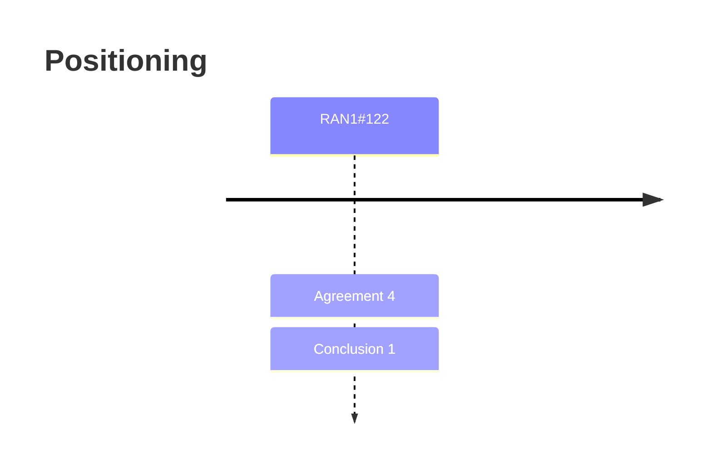

# Positioning (Rel-20)

> 이 파일은 `scripts/generate_report.py`가 자동으로 생성합니다. 직접 수정하지 마세요.

## 회의별 진행

## 누적 히스토리

| 회의 | Agenda | 구분 | 내용 | 출처 |
|---|---|---|---|---|
| RAN1#122 | 8.1.2 | Agreement | Adopt the text proposal to TS 38.215 v19.0.0 in Section 3 of R1-2505531. | [Chair notes RAN1#122 eom](https://www.3gpp.org/ftp/tsg_ran/WG1_RL1/TSGR1_122/Inbox/Chair_notes/Chair%20notes%20RAN1%23122%20eom.zip) [R1-2506436](https://www.3gpp.org/ftp/tsg_ran/WG1_RL1/TSGR1_122/Docs/R1-2506436.zip) |
| RAN1#122 | 8.1.2 | Agreement | Endorse the following text proposal to TS 38.214 v19.0.0. \| Reason for change \| Currently PRU is captured within the subsection of CPP, and it is limited to only when the UE is provided with phase related measurement together with other measurement(s). However, AI/ML positioning does not require the activation of CPP, although CPP is not prevented from being activated simultaneously. \| \| Summary of change \| Addition of PRU data in the general section of 5.1.6.5. \| \| Consequences if not approved \| The data related to PRU will not be supported for AI/ML positioning if CPP method is not activated simultaneously. \| \| Suggested text proposal \| TS 38.214 (V19.0.0) 5.1.6.5 PRS reception procedure ================= text omitted=============================== Within each window indicated by NR-DL-PRS-MeasurementTimeWindowsConfig, the UE expects that the indicated DL PRS resource sets across all dl-PRS-IDs are from one DL PRS positioning frequency layer, and that the number of indicated DL PRS resource sets associated with each dl-PRS-ID are the same. The UE may be provided with NR-PRU-DL-Info which contains measurement(s) performed by a positioning reference unit (PRU) [20, TS 38.305], the timestamps associated with the measurement(s), and the location information of the PRU. ================= text omitted=============================== \| | [Chair notes RAN1#122 eom](https://www.3gpp.org/ftp/tsg_ran/WG1_RL1/TSGR1_122/Inbox/Chair_notes/Chair%20notes%20RAN1%23122%20eom.zip) [R1-2506437](https://www.3gpp.org/ftp/tsg_ran/WG1_RL1/TSGR1_122/Docs/R1-2506437.zip) |
| RAN1#122 | 8.1.2 | Agreement | Update the following LPP parameters in higher layer parameter list to RAN2. \|  \| Sub-feature group \| RAN2 Parent IE \| Parameter name in the spec \| New or existing? \| Description \| Value range \| Per (UE, cell, TRP, …) \| \| Associated ID for Info #7 \| UE-based positioning Case 1 \| FFS for RAN2 \| AssociatedID-TRP-LocationInfo \| New \| The associated ID (optional) provides implicit indication of Info #7. For given TRP(s), the same associated ID implies that geographical coordinates of the TRP(s) can be understood as consistent by the UE. The associated ID is not expected to provide the real value of Info #7 (i.e., geographical coordinates of the TRP(s) are not disclosed). An associated ID is configured per-cell (e.g., NCGI-r15). Note: Info #7 can be provided explicitly (as in legacy UE-based DL-TDOA) or implicitly by Associated ID. \| FFS for RAN2 (e.g., 0..255) \| Per cell \| \|  \| Sub-feature group \| RAN2 Parent IE \| Parameter name in the spec \| New or existing? \| Description \| Value range \| Per (UE, cell, TRP, …) \| \| Assistance data Info #7 \| UE-based positioning Case 1 \| FFS for RAN2 \| (It is up to RAN2 to decide which existing IEs to include for providing Info #7) \| Existing \| LMF can provide to UE the assistance information (optional) from legacy UE-based DL-TDOA: Info #7 in Table 8.12.2.1.0-1 in 38.305 v18.3.0. Note: Info #7 can be provided explicitly (as in legacy UE-based DL-TDOA) or implicitly by Associated ID. \| Reuse existing \| Per UE \| \|  \| Sub-feature group \| RAN2 Parent IE \| Parameter name in the spec \| New or existing? \| Description \| Value range \| Per (UE, cell, TRP, …) \| \| Assistance data Info #1 ~ Info #6, Info #8 ~ Info #15 \| UE-based positioning Case 1 \| FFS for RAN2 \| (It is up to RAN2 to decide which existing IEs to include for providing Info #1 ~ Info #6, Info #8 ~ Info #15) \| Existing \| LMF can provide to UE the assistance information (optional) from legacy UE-based DL-TDOA: Info #1 ~ Info #6, Info #8 ~ Info #15 in Table 8.12.2.1.0-1 in 38.305 v18.3.0. \| Reuse existing \| Per UE \| | [Chair notes RAN1#122 eom](https://www.3gpp.org/ftp/tsg_ran/WG1_RL1/TSGR1_122/Inbox/Chair_notes/Chair%20notes%20RAN1%23122%20eom.zip) [R1-2506437](https://www.3gpp.org/ftp/tsg_ran/WG1_RL1/TSGR1_122/Docs/R1-2506437.zip) |
| RAN1#122 | 8.1.2 | Conclusion | RAN1 has no consensus whether the IE for assistance data Info#7 and AssociatedID-TRP-LocationInfo  can be simultaneously enabled. It is upto RAN2 to decide whether the IE for assistance data Info#7 and AssociatedID-TRP-LocationInfo  can be simultaneously enabled. | [Chair notes RAN1#122 eom](https://www.3gpp.org/ftp/tsg_ran/WG1_RL1/TSGR1_122/Inbox/Chair_notes/Chair%20notes%20RAN1%23122%20eom.zip) [R1-2506437](https://www.3gpp.org/ftp/tsg_ran/WG1_RL1/TSGR1_122/Docs/R1-2506437.zip) |
| RAN1#122 | 8.1.2 | Agreement | Include the IE for Rel-19 enhanced measurement (i.e., UL SRS-TDCT, UL SRS-TDCP in 38.215) in higher layer parameter list to RAN3. \|  \| Sub-feature group \| RAN3 Parent IE \| Parameter name in the spec \| New or existing? \| Description \| Value range \| Per (UE, cell, TRP, …) \| \| Rel-19 enhanced measurement \| NG-RAN node assisted positioning Case 3b \| FFS for RAN3 \| FFS for RAN3 \| New \| Rel-19 enhanced channel measurement, which can be either (a) or (b): (a) UL SRS-TDCT; (b) paired UL SRS-TDCT and UL SRS-TDCP. \|  \| Per UE \| | [Chair notes RAN1#122 eom](https://www.3gpp.org/ftp/tsg_ran/WG1_RL1/TSGR1_122/Inbox/Chair_notes/Chair%20notes%20RAN1%23122%20eom.zip) [R1-2506437](https://www.3gpp.org/ftp/tsg_ran/WG1_RL1/TSGR1_122/Docs/R1-2506437.zip) |
