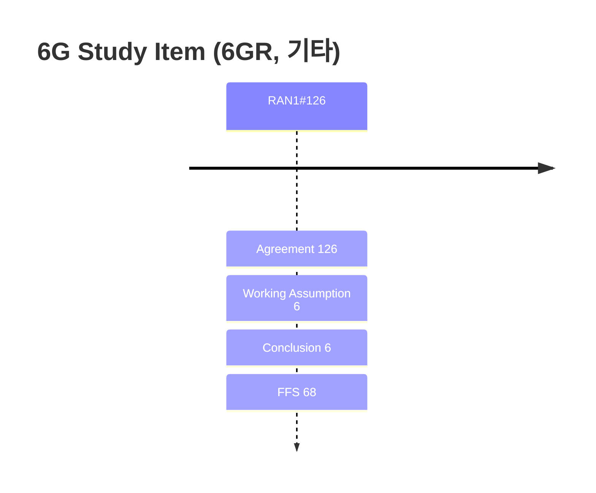

# 6G Study Item (6GR, 기타) (Rel-20)

> 이 파일은 `scripts/generate_report.py`가 자동으로 생성합니다. 직접 수정하지 마세요.

## 회의별 진행

## 누적 히스토리

| 회의 | Agenda | 구분 | 내용 | 출처 |
|---|---|---|---|---|
| RAN1#126 | 10.2.1 | Agreement | Agree on the embedded template for UL PAPR reduction scheme results collection in section 4.5 of R1-2606804. Companies having evaluation results are encouraged to fill the template and upload it into the draft folder indicated by FL by 27th August EOD. | [Chair notes RAN1#126_eom1](https://www.3gpp.org/ftp/tsg_ran/WG1_RL1/TSGR1_126/Inbox/Chair_notes/Chair%20notes%20RAN1%23126_eom1.docx) [R1-2606803](https://www.3gpp.org/ftp/tsg_ran/WG1_RL1/TSGR1_126/Docs/R1-2606803.zip) |
| RAN1#126 | 10.2.1 | Agreement | Endorse the updated observations in section 3.5 in R1-2606804 | [Chair notes RAN1#126_eom1](https://www.3gpp.org/ftp/tsg_ran/WG1_RL1/TSGR1_126/Inbox/Chair_notes/Chair%20notes%20RAN1%23126_eom1.docx) [R1-2606804](https://www.3gpp.org/ftp/tsg_ran/WG1_RL1/TSGR1_126/Docs/R1-2606804.zip) |
| RAN1#126 | 10.2.1 | Agreement | Complete the following list of UL PAPR reduction techniques for further down-selection - Option 1: FDSS with no spectrum extension or truncation   - Transparent / non-transparent   - Modulation: Pi/2 BPSK / QPSK   - Applicable SE range: FFS - Option 2: FDSS with spectrum extension   - Transparent / non-transparent   - Modulation: Pi/2 BPSK / QPSK / 16QAM   - Applicable SE range: FFS - Option 3: FDSS with spectrum truncation   - Transparent / non-transparent   - Modulation: Pi/2 BPSK   - Applicable SE range: FFS - FFS: condition on when to apply finally selected option/scheme - Note: target to down select transparent / non-transparent and modulation (at least on 16QAM) for above options at RAN1#126bis | [Chair notes RAN1#126_eom1](https://www.3gpp.org/ftp/tsg_ran/WG1_RL1/TSGR1_126/Inbox/Chair_notes/Chair%20notes%20RAN1%23126_eom1.docx) [R1-2606804](https://www.3gpp.org/ftp/tsg_ran/WG1_RL1/TSGR1_126/Docs/R1-2606804.zip) |
| RAN1#126 | 10.2.1 | Agreement | For DFT size before SE/ST is applied, at least option 1 is supported, and whether option 2 is supported or not is further discussed and to be decided by RAN1#127 - Option 1: 12 * 2x3y5z subcarriers. - Option 2: X * 2x3y5z subcarriers, where X = 4.   - FFS: upper bound on applicable number of RBs for option 2 | [Chair notes RAN1#126_eom1](https://www.3gpp.org/ftp/tsg_ran/WG1_RL1/TSGR1_126/Inbox/Chair_notes/Chair%20notes%20RAN1%23126_eom1.docx) [R1-2606804](https://www.3gpp.org/ftp/tsg_ran/WG1_RL1/TSGR1_126/Docs/R1-2606804.zip) |
| RAN1#126 | 10.3.1 | Agreement | For the sub-matrix E of BG3, support the following option - Option E2 (from agreement in RAN1#124bis): A lower triangular matrix, wherein the number of columns with degree larger than 1 is less than I. - FFS: the value of I. - E can not be the identity matrix (i.e. Option E1). | [Chair notes RAN1#126_eom1](https://www.3gpp.org/ftp/tsg_ran/WG1_RL1/TSGR1_126/Inbox/Chair_notes/Chair%20notes%20RAN1%23126_eom1.docx) [R1-2606773](https://www.3gpp.org/ftp/tsg_ran/WG1_RL1/TSGR1_126/Docs/R1-2606773.zip) `[126-R20-6GR-Channel coding]` |
| RAN1#126 | 10.3.1 | Agreement | With respect to the decision for capability of BG3 in UL tasked by RANP, the following is supported: supporting BG3 in UL is mandatory with capability signaling for UEs except for UEs with up to 20MHz maximum UL channel bandwidth in any band supported by UE, i.e., BG3 in UL is optional for UEs with up to 20MHz maximum UL channel bandwidth in any band supported by UE. Note: Whether any additional exception to the above is needed is up to RAN plenary decision. | [Chair notes RAN1#126_eom1](https://www.3gpp.org/ftp/tsg_ran/WG1_RL1/TSGR1_126/Inbox/Chair_notes/Chair%20notes%20RAN1%23126_eom1.docx) [R1-2606774](https://www.3gpp.org/ftp/tsg_ran/WG1_RL1/TSGR1_126/Docs/R1-2606774.zip) `[126-R20-6GR-Channel coding]` |
| RAN1#126 | 10.3.1 | Agreement | For the evaluation of coding based candidates for small UCI with payload size of 3~11 bits, refer to the evaluation assumptions in PUCCH/PUSCH, with the following update - Use AWGN channel   - Note: Companies can provide results for other channels - Info. block length (bits w/o CRC): 3:1:11 - Metrics: SNR at target BLER, BER   - Other metrics agreed in PUCCH agenda can be also reported by companies - Companies to report the details of PUSCH/PUCCH including DM-RS configuration, PUCCH format, if any - Companies to report impact on receiver complexity/latency and transmitter complexity/latency, if any. \| The channel coding based candidates for evaluation are as below \| - 5G RM code (baseline) - Enhanced RM code - Enhanced PC-Polar code - Golay-based code - Vertical and horizontal code - CRC polynomial code - Note: Companies to report the details of coding based candidates - Note: Companies to provide comparison with 5G RM code. - Note: Companies can choose one or more candidates above for evaluation | [Chair notes RAN1#126_eom1](https://www.3gpp.org/ftp/tsg_ran/WG1_RL1/TSGR1_126/Inbox/Chair_notes/Chair%20notes%20RAN1%23126_eom1.docx) [R1-2606775](https://www.3gpp.org/ftp/tsg_ran/WG1_RL1/TSGR1_126/Docs/R1-2606775.zip) `[126-R20-6GR-Channel coding]` |
| RAN1#126 | 10.3.2 | Conclusion | With respect to RANP task to RAN1 (copied below) to conclude the support for constellation shaping in RAN1: \| Conclusion (RAN#112) RAN1 to continue the study on GS (i.e. 1D-NUC) and PS (ESS based PS and ECC based PS in Q3/26 decide by Q3 whether or not to support constellation shaping and if supported, between PS (including whether it is 1-bit or 2-bits PS scheme) and GS support of different constellation shaping schemes for DL and UL is precluded (e.g. PS for DL, GS for UL) If there is no consensus on the support of constellation shaping in Q3/26 the study on constellation shaping will be stopped \| RAN1 concludes the following: - There is no consensus in RAN1 to support any constellation shaping schemes for either DL or UL. - Summary of companies’ preferences is in R1-2606762.   - Some proponents of some constellation shaping schemes stated that they would agree to withdraw that scheme. | [Chair notes RAN1#126_eom1](https://www.3gpp.org/ftp/tsg_ran/WG1_RL1/TSGR1_126/Inbox/Chair_notes/Chair%20notes%20RAN1%23126_eom1.docx) [R1-2606883](https://www.3gpp.org/ftp/tsg_ran/WG1_RL1/TSGR1_126/Docs/R1-2606883.zip) `[126-R20-6GR-Modulation, joint channel coding and modulation]` |
| RAN1#126 | 10.3.2 | Conclusion | With respect to RANP guidance to RAN1 (copied below) for support of higher order modulation: \| RAN Chair guidance (RAN#112) For 1K QAM on UL and 4K QAM on DL: RAN1/RAN4 to continue study and make decision in Q3/26. \| From RAN1 perspective, for DL 4K QAM, and UL 1K QAM in 6GR, if supported, is restricted to FWA use case only and not for eMBB use case - The restriction to FWA use case shall be enforced in the spec   - FFS: How to reflect this restriction in the spec   - Other restrictions on DL 4K QAM and UL 1K QAM can be identified Multiple sources performed SLS to evaluate DL 4K QAM and UL 1K QAM under agreed evaluation methodology for FWA use case. The detailed assumptions and results are captured in the tables provided in R1-2606762. From RAN1 perspective, - RAN1 recommends to adopt 1k QAM for UL. - No consensus in RAN1 to recommend adopting 4K QAM for DL | [Chair notes RAN1#126_eom1](https://www.3gpp.org/ftp/tsg_ran/WG1_RL1/TSGR1_126/Inbox/Chair_notes/Chair%20notes%20RAN1%23126_eom1.docx) [R1-2606883](https://www.3gpp.org/ftp/tsg_ran/WG1_RL1/TSGR1_126/Docs/R1-2606883.zip) `[126-R20-6GR-Modulation, joint channel coding and modulation]` |
| RAN1#126 | 10.4.1 | Agreement | For further study of initial access for idle mode multi-carrier operation, consider at least the following potential use cases:   - UC-1: UL coverage enhancement / DL-UL coverage imbalance   - UC-2: RACH capacity / offloading / load balancing   - UC-3: Network energy saving / common-signaling reduction   - Other use cases are not precluded.   - For each identified use case, study whether and under which conditions multiple-carrier operation in idle mode provides additional benefit over existing mechanisms. | [Chair notes RAN1#126_eom1](https://www.3gpp.org/ftp/tsg_ran/WG1_RL1/TSGR1_126/Inbox/Chair_notes/Chair%20notes%20RAN1%23126_eom1.docx) `[126-R20-6GR-MC-Operation in idle mode]` |
| RAN1#126 | 10.4.1 | Agreement | For study of multiple carriers where for initial access a UE can utilize resources for UL (Msg1, etc) or for both UL (Msg1, etc.) and DL (Msg2, etc.) in one carrier other than the carrier where the UE obtains the system information providing configuration for those resources, consider the following potential scenarios for the set of candidate physical carriers for which resources are provided for initial access:   - S1: 1 DL physical carrier + N UL physical carriers, where N > 1   - S2: M DL physical carriers + 1 UL physical carrier, where M > 1   - S3: M DL physical carriers + N UL physical carriers, where M > 1 and N > 1 Note 1: The carrier where the UE obtains the system information and other candidate physical carrier(s) are counted above. Note 2: For a given UE and a given initial access procedure, UE may use only a subset of the candidate physical carrier. Note 3: The inclusion of a scenario for study does not imply agreement to support it. The need and applicable use cases/deployment scenarios for each scenario are subject to further study. | [Chair notes RAN1#126_eom1](https://www.3gpp.org/ftp/tsg_ran/WG1_RL1/TSGR1_126/Inbox/Chair_notes/Chair%20notes%20RAN1%23126_eom1.docx) `[126-R20-6GR-MC-Operation in idle mode]` |
| RAN1#126 | 10.4.1 | Agreement | For study of multiple carriers where for initial access a UE can utilize resources for UL (Msg1, etc) or for both UL (Msg1, etc.) and DL (Msg2, etc.) in one carrier other than the carrier where the UE obtains the system information providing configuration for those resources,   - As a baseline, a single selected physical carrier is used per link direction throughout an attempt of an RACH procedure. | [Chair notes RAN1#126_eom1](https://www.3gpp.org/ftp/tsg_ran/WG1_RL1/TSGR1_126/Inbox/Chair_notes/Chair%20notes%20RAN1%23126_eom1.docx) `[126-R20-6GR-MC-Operation in idle mode]` |
| RAN1#126 | 10.4.1 | Agreement | For further study of multiple carriers where for initial access a UE can utilize resources for UL (Msg1, etc) or for both UL (Msg1, etc.) and DL (Msg2, etc.) in one carrier other than the carrier where the UE obtains the system information providing configuration for those resources, consider at least the following deployment conditions:   - D1: co-located carriers for which a common timing/frequency synchronization relationship can be assumed   - D2: co-located carriers for which a common timing/frequency synchronization relationship cannot be assumed   - D3: non-collocated carriers for which a common timing/frequency synchronization relationship cannot be assumed   - Other relevant deployment assumptions, including carrier frequency relationship / band separation, numerology / duplexing configuration and UE RF/baseband capability, are considered as applicable. Note: whether a common timing/frequency synchronization relationship can be assumed is from UE perspective. | [Chair notes RAN1#126_eom1](https://www.3gpp.org/ftp/tsg_ran/WG1_RL1/TSGR1_126/Inbox/Chair_notes/Chair%20notes%20RAN1%23126_eom1.docx) `[126-R20-6GR-MC-Operation in idle mode]` |
| RAN1#126 | 10.4.2 | Agreement | Study UL transmission switching across carriers in 6GR, at least considering the following: - Whether/how to achieve unified design for all UL signals/channels - Signaling for switching, e.g., dynamic and/or semi-static switching - Number of Tx chains - Number of carriers - Switching gap - Interaction with carrier aggregation operation - Coordination with other WG(s), e.g., RAN4 (as needed) - Note: SRS antenna switching is separately discussed under UL CSI agenda | [Chair notes RAN1#126_eom1](https://www.3gpp.org/ftp/tsg_ran/WG1_RL1/TSGR1_126/Inbox/Chair_notes/Chair%20notes%20RAN1%23126_eom1.docx) `[126-R20-6GR-MC-Operation in connected mode]` |
| RAN1#126 | 10.4.2 | Agreement | Study DL reception switching across carriers in 6GR, at least considering the following: - Applicable scenario(s) (e.g., the scenario(s) considered for NR LB-CA), including identify the scenario(s) - Coordination with other WG(s), e.g., RAN4 (as needed) | [Chair notes RAN1#126_eom1](https://www.3gpp.org/ftp/tsg_ran/WG1_RL1/TSGR1_126/Inbox/Chair_notes/Chair%20notes%20RAN1%23126_eom1.docx) `[126-R20-6GR-MC-Operation in connected mode]` |
| RAN1#126 | 10.4.2 | Agreement | For 6GR multiple carrier operation in connected mode, study mechanisms for fast enabling/disabling access to additional carriers, considering at least the following: - UE power saving and/or NW energy saving - Carrier states - How to enable/disable - Assumed NW-side requirements/conditions - Assumed UE-side requirements | [Chair notes RAN1#126_eom1](https://www.3gpp.org/ftp/tsg_ran/WG1_RL1/TSGR1_126/Inbox/Chair_notes/Chair%20notes%20RAN1%23126_eom1.docx) `[126-R20-6GR-MC-Operation in connected mode]` |
| RAN1#126 | 10.4.2 | Agreement | For 6GR multiple carrier operation in connected mode, study mechanisms for PXSCH resource allocation, considering at least the following: - A PXSCH confined within a carrier - A PXSCH over multiple carriers   - Applicable scenario and condition   - Coordination with other WG(s), e.g., RAN4 (as needed) | [Chair notes RAN1#126_eom1](https://www.3gpp.org/ftp/tsg_ran/WG1_RL1/TSGR1_126/Inbox/Chair_notes/Chair%20notes%20RAN1%23126_eom1.docx) `[126-R20-6GR-MC-Operation in connected mode]` |
| RAN1#126 | 10.4.2 | Agreement | For 6GR multiple carrier operation in connected mode, study mechanisms for scheduling PXSCH, considering at least the following: - Self-carrier scheduling   - Note: self-carrier scheduling is that a DCI on a carrier schedules a PXSCH on a same carrier - Cross-carrier scheduling   - Note: cross-carrier scheduling is that a DCI on a carrier schedules a PXSCH on another carrier - Multi-carrier scheduling   - Note: multi-carrier scheduling is that a DCI on a carrier schedules a single PXSCH across multiple carriers, or individual PXSCH per carrier - Coordination with other WG(s), e.g., RAN4 (as needed) - Applicable scenario and condition for the above mechanism(s) - Multiple slot scheduling will be discussed separately in other agenda. | [Chair notes RAN1#126_eom1](https://www.3gpp.org/ftp/tsg_ran/WG1_RL1/TSGR1_126/Inbox/Chair_notes/Chair%20notes%20RAN1%23126_eom1.docx) `[126-R20-6GR-MC-Operation in connected mode]` |
| RAN1#126 | 10.4.2 | Agreement | For the study of bandwidth operation with single carrier operation in CONNECTED mode for a UE in 6G, at least consider the following: - A “6GR-BW” should comprise at least a frequency location and the number of contiguous PRBs within a carrier.   - Study the necessity that any other parameter (s) are associated to a “6GR-BW” operation     - Note: RAN1 strives to minimize the number of parameter(s) that is associated with a “6GR-BW” - Signal(s)/channel(s) transmission/receiving associated to a “6GR-BW” - Benefit(s) and necessity of switching of “6GR-BW” for DL and/or UL, and potential mechanisms for switching | [Chair notes RAN1#126_eom1](https://www.3gpp.org/ftp/tsg_ran/WG1_RL1/TSGR1_126/Inbox/Chair_notes/Chair%20notes%20RAN1%23126_eom1.docx) `[126-R20-6GR-MC-Operation in connected mode]` |
| RAN1#126 | 10.5.1.1 | Agreement | For the link budget evaluations in around 7 GHz for coverage gap identification, the assumptions for the receiver noise figure are 9 dB and 5 dB for DL and UL respectively (agreed in RAN1#124) - Send an LS to RAN4 about the assumptions for information only. | [Chair notes RAN1#126_eom1](https://www.3gpp.org/ftp/tsg_ran/WG1_RL1/TSGR1_126/Inbox/Chair_notes/Chair%20notes%20RAN1%23126_eom1.docx) `[126-R20-6GR-Synchronization and Beam Measurement]` |
| RAN1#126 | 10.5.1.1 | Agreement | For the link budget evaluations for the coverage gap identification, no update to the cell area reliability for initial-access related signals/channels, i.e., 95% for control channel, SSB and SIB1 and 90% for other channels that are capable of HARQ retransmissions but HARQ retransmissions are not assumed. | [Chair notes RAN1#126_eom1](https://www.3gpp.org/ftp/tsg_ran/WG1_RL1/TSGR1_126/Inbox/Chair_notes/Chair%20notes%20RAN1%23126_eom1.docx) `[126-R20-6GR-Synchronization and Beam Measurement]` |
| RAN1#126 | 10.5.1.1 | Agreement | Support Resource block boundaries alignment between NR and 6GR on a MRSS carrier. | [Chair notes RAN1#126_eom1](https://www.3gpp.org/ftp/tsg_ran/WG1_RL1/TSGR1_126/Inbox/Chair_notes/Chair%20notes%20RAN1%23126_eom1.docx) `[126-R20-6GR-Synchronization and Beam Measurement]` |
| RAN1#126 | 10.5.1.1 | Agreement | In 6GR, aNB-side semi-static SBFD is supported. | [Chair notes RAN1#126_eom1](https://www.3gpp.org/ftp/tsg_ran/WG1_RL1/TSGR1_126/Inbox/Chair_notes/Chair%20notes%20RAN1%23126_eom1.docx) `[126-R20-6GR-Synchronization and Beam Measurement]` |
| RAN1#126 | 10.5.1.1 | Working Assumption | For 6GR, one SSB is defined by a single value of X - One 6GR SSB spans X (4<=X<=7) OFDM symbols within a slot | [Chair notes RAN1#126_eom1](https://www.3gpp.org/ftp/tsg_ran/WG1_RL1/TSGR1_126/Inbox/Chair_notes/Chair%20notes%20RAN1%23126_eom1.docx) `[126-R20-6GR-Synchronization and Beam Measurement]` |
| RAN1#126 | 10.5.1.1 | Agreement | - One 6GR SSB spans 20 RBs | [Chair notes RAN1#126_eom1](https://www.3gpp.org/ftp/tsg_ran/WG1_RL1/TSGR1_126/Inbox/Chair_notes/Chair%20notes%20RAN1%23126_eom1.docx) `[126-R20-6GR-Synchronization and Beam Measurement]` |
| RAN1#126 | 10.5.1.1 | Agreement | For one 6G SSB, the number of RBs for PSS is 12 RBs. | [Chair notes RAN1#126_eom1](https://www.3gpp.org/ftp/tsg_ran/WG1_RL1/TSGR1_126/Inbox/Chair_notes/Chair%20notes%20RAN1%23126_eom1.docx) `[126-R20-6GR-Synchronization and Beam Measurement]` |
| RAN1#126 | 10.5.1.1 | Agreement | Study the following aspects for 6GR PSS - Sequence type   - Option 1: m-sequence   - Option 2: ZC-based sequence   - Option 3: Other sequence - Sequence length   - Option 1: 127   - Option 2: 127<L<=144 - Number of sequences - Number of symbols for PSS | [Chair notes RAN1#126_eom1](https://www.3gpp.org/ftp/tsg_ran/WG1_RL1/TSGR1_126/Inbox/Chair_notes/Chair%20notes%20RAN1%23126_eom1.docx) `[126-R20-6GR-Synchronization and Beam Measurement]` |
| RAN1#126 | 10.5.1.1 | Agreement | Study the following aspect for 6GR SSS - Sequence type   - Gold sequence as a benchmark   - FFS: Other sequences - Sequence length   - Option 1: 127   - Option 2: > 127 - Number of sequences - Number of symbols for SSS | [Chair notes RAN1#126_eom1](https://www.3gpp.org/ftp/tsg_ran/WG1_RL1/TSGR1_126/Inbox/Chair_notes/Chair%20notes%20RAN1%23126_eom1.docx) `[126-R20-6GR-Synchronization and Beam Measurement]` |
| RAN1#126 | 10.5.1.1 | Agreement | Final LS R1-2606913 with following contents is endorsed. 1. Overall Description: In the study of “Re-use of existing 5G mid-band (~3.5GHz) site grid for 6G deployments in at least around 7 GHz and targeting comparable coverage to 5G mid-band”, RAN1 made an agreement that for the link budget evaluations in around 7 GHz for coverage gap identification, the assumptions for the receiver noise figure are 9 dB and 5 dB for DL and UL respectively. There is no implication that RAN4 should use the same assumption. 2. Actions: To RAN4 ACTION: RAN1 would like to respectfully inform RAN4 about the above receiver noise figure assumptions. | [Chair notes RAN1#126_eom1](https://www.3gpp.org/ftp/tsg_ran/WG1_RL1/TSGR1_126/Inbox/Chair_notes/Chair%20notes%20RAN1%23126_eom1.docx) `[126-R20-6GR-Synchronization and Beam Measurement]` |
| RAN1#126 | 10.5.1.1 | Agreement | The coverage gap between ~7GHz and 5G mid-band for different signals and channels during initial access are identified in the following tables. Table X: Coverage gap between 7.0 GHz and 5G mid-band (3.5 GHz) for different signals and channels during initial access for UMa O2I \| Signals/channels \| Number of Sample(s) \| Coverage gap (trimmed mean) \| Standard Deviation (w/o outlier) \| \| PSS/SSS w/o combining \| 11 \| -7.24 \| 1.63 \| \| PBCH w/o combining \| 9 \| -8.32 \| 1.83 \| \| PSS/SSS w/ 4 combining \| 8 \| -4.08 \| 1.30 \| \| PBCH w/ 4 combining \| 14 \| -3.09 \| 1.62 \| \| SIB1 PDCCH \| 17 \| -5.56 \| 1.63 \| \| SIB1 PDSCH \| 16 \| -6.91 \| 1.68 \| \| Msg2 PDSCH \| 11 \| -3.96 \| 2.61 \| \| Msg4 PDSCH \| 13 \| -4.11 \| 1.77 \| \| PRACH format 0 \| 14 \| -2.73 \| 1.43 \| \| PRACH format B4 \| 14 \| -4.80 \| 2.19 \| \| PRACH format C2 \| 11 \| -8.37 \| 1.21 \| \| Msg3 PUSCH \| 20 \| -8.68 \| 1.67 \| \| Msg5 PUSCH \| 11 \| -13.00 \| 2.98 \| \| PUCCH format 1 \| 13 \| -3.64 \| 2.33 \| Comparing the coverage between 3.5GHz and 2.6GHz in UMa O2I, there is 4.5 dB difference for Msg 3, which is assumed to be applicable for all signals/channels. Table X: Coverage gap between 7.0 GHz and 5G mid-band (3.5 GHz) for different signals and channels during initial access for UMa O2O \| Signals/channels \| Number of Sample(s) \| Coverage gap (trimmed mean) \| Standard Deviation (w/o outlier) \| \| PSS/SSS w/o combining \| 5 \| -2.81 \| 0.33 \| \| PBCH w/o combining \| 4 \| -1.51 \| 0.13 \| \| PSS/SSS w/ 4 combining \| 6 \| 1.13 \| 2.15 \| \| PBCH w/ 4 combining \| 9 \| 1.69 \| 1.52 \| \| SIB1 PDCCH \| 8 \| -1.28 \| 0.65 \| \| SIB1 PDSCH \| 9 \| -2.92 \| 1.33 \| \| Msg2 PDSCH \| 6 \| 0.21 \| 2.61 \| \| Msg4 PDSCH \| 7 \| -1.06 \| 1.64 \| \| PRACH format 0 \| 8 \| 2.54 \| 0.57 \| \| PRACH format B4 \| 7 \| 0.22 \| 1.68 \| \| PRACH format C2 \| 7 \| -4.09 \| 1.47 \| \| Msg3 PUSCH \| 11 \| -3.75 \| 1.11 \| \| Msg5 PUSCH \| 6 \| -10.19 \| 3.01 \| \| PUCCH format 1 \| 5 \| -0.03 \| 1.12 \| Comparing the coverage between 3.5GHz and 2.6GHz in UMa O2O, there is 2.58 dB difference for Msg 3, which is assumed to be applicable for all signals/channels. Table X: Coverage gap between 7.0 GHz and 5G mid-band (3.5 GHz) for different signals and channels during initial access for SMa O2I \| Signals/channels \| Number of Sample(s) \| Coverage gap (trimmed mean) \| Standard Deviation (w/o outlier) \| \| PSS/SSS w/o combining \| 5 \| -3.64 \| 0.44 \| \| PBCH w/o combining \| 3 \| -2.16 \| N/A \| \| PSS/SSS w/ 4 combining \| 4 \| -1.27 \| 1.47 \| \| PBCH w/ 4 combining \| 7 \| 1.11 \| 0.99 \| \| SIB1 PDCCH \| 7 \| -1.80 \| 0.60 \| \| SIB1 PDSCH \| 7 \| -3.35 \| 1.21 \| \| Msg2 PDSCH \| 5 \| 0.68 \| 2.01 \| \| Msg4 PDSCH \| 5 \| -1.91 \| 1.35 \| \| PRACH format 0 \| 7 \| 1.88 \| 0.59 \| \| PRACH format B4 \| 5 \| -1.40 \| 1.54 \| \| PRACH format C2 \| 6 \| -5.23 \| 1.09 \| \| Msg3 PUSCH \| 7 \| -4.01 \| 0.41 \| \| Msg5 PUSCH \| 5 \| -11.76 \| 2.88 \| \| PUCCH format 1 \| 4 \| -0.22 \| 0.89 \| Table X: Coverage gap between 7.0 GHz and 5G mid-band (3.5 GHz) for different signals and channels during initial access for SMa O2O \| Signals/channels \| Number of Sample(s) \| Coverage gap (trimmed mean) \| Standard Deviation (w/o outlier) \| \| PSS/SSS w/o combining \| 5 \| -2.81 \| 0.33 \| \| PBCH w/o combining \| 3 \| -1.42 \| N/A \| \| PSS/SSS w/ 4 combining \| 4 \| -0.50 \| 1.25 \| \| PBCH w/ 4 combining \| 7 \| 1.92 \| 1.03 \| \| SIB1 PDCCH \| 7 \| -1.18 \| 0.67 \| \| SIB1 PDSCH \| 7 \| -2.67 \| 1.21 \| \| Msg2 PDSCH \| 5 \| 1.07 \| 2.40 \| \| Msg4 PDSCH \| 5 \| -0.85 \| 1.24 \| \| PRACH format 0 \| 7 \| 2.60 \| 0.61 \| \| PRACH format B4 \| 5 \| -0.82 \| 1.17 \| \| PRACH format C2 \| 6 \| -4.60 \| 1.05 \| \| Msg3 PUSCH \| 7 \| -3.21 \| 0.49 \| \| Msg5 PUSCH \| 5 \| -11.13 \| 2.88 \| \| PUCCH format 1 \| 4 \| 0.56 \| 0.67 \| | [Chair notes RAN1#126_eom1](https://www.3gpp.org/ftp/tsg_ran/WG1_RL1/TSGR1_126/Inbox/Chair_notes/Chair%20notes%20RAN1%23126_eom1.docx) `[126-R20-6GR-Synchronization and Beam Measurement]` |
| RAN1#126 | 10.5.1.1 | Agreement | For the MaxCL requirement in TR 38.914, companies are encouraged to provide MaxCL evaluations based on the following assumptions: - Assumptions used for maxCL calculations in TR38.914: - Table 5.1.20.1-2: MaxCL calculation assumptions \| UE Tx power \| 23dBm \| \| DL Tx power \| 46dBm \| \| BS receiver noise figure \| 5dB \| \| UE receiver noise figure \| 9dB \| \| Interference margin \| 0dB \|   - Note: DL Tx power is 46dBm per 20 MHz and scales with wider bandwidth. - Carrier frequency, duplex and SCS   - FDD, carrier frequency: 0.7 GHz, 15kHz SCS   - TDD, carrier frequency: 2.6 GHz, 30kHz SCS - UE speed: 3kmh - Channel model   - TDL-C with 300ns delay spread     - DL: 2T2R and 2T1R     - UL: 1T2R - Signals/channels to be evaluated   - DL: NR PSS/SSS, PBCH, Common PDCCH, SIB1 PDSCH, Msg2/4 PDSCH   - UL: NR PRACH format C2/B4/0, MSG3 PUSCH, MSG5 PUSCH (companies to report assumption of the payload of actual transmission),  MSG4 PUCCH Format 1 - The simulation assumptions in section A.1 in TR38.830 are used as a starting point.   - The payload for NR SIB1 PDSCH is 1200 bits. | [Chair notes RAN1#126_eom1](https://www.3gpp.org/ftp/tsg_ran/WG1_RL1/TSGR1_126/Inbox/Chair_notes/Chair%20notes%20RAN1%23126_eom1.docx) `[126-R20-6GR-Synchronization and Beam Measurement]` |
| RAN1#126 | 10.5.1.1 | Agreement | Capture the evaluation results from companies on NES evaluations into the TR - Note: Evaluation results can be updated in the next meeting. \| Company \| BS Cat \| Load (RU) \| Configuration \| 40 ms \| 80 ms \| 160 ms \| \| Mid-band (~2-4 GHz) — NES gains vs 20 ms baseline \| Mid-band (~2-4 GHz) — NES gains vs 20 ms baseline \| Mid-band (~2-4 GHz) — NES gains vs 20 ms baseline \| Mid-band (~2-4 GHz) — NES gains vs 20 ms baseline \| Mid-band (~2-4 GHz) — NES gains vs 20 ms baseline \| Mid-band (~2-4 GHz) — NES gains vs 20 ms baseline \| Mid-band (~2-4 GHz) — NES gains vs 20 ms baseline \| \| CEWiT [R1-2606646] \| Cat 1 \| 5% / 10% / 20% \| SLS 21-cell, SIB1 retained at 20 ms \| – \| 23.4% / 19.3% / 16.4% \| 24.9% / 20.8% / 17.5% \| \| CEWiT [R1-2606646] \| Cat 1 \| 5% / 10% / 20% \| SLS 21-cell, SIB1 and common signals CLUSTERED \| – \| 51% / 47.8% / 45.4% \| 56.3% / 52.7% / 49.5% \| \| OPPO [R1-2605917] \| Cat 1 / Cat 2 / Cat 2.1 \| 0% \| — \| 32% / 20% / 20% \| 67% / 31% / 31% \| 81% / 36% / 62% \| \| OPPO [R1-2605917] \| Cat 1 / Cat 2 / Cat 2.1 \| Low NA \| — \| 23% / 16% / 16% \| 40% / 23% / 24% \| 49% / 27% / 30% \| \| OPPO [R1-2605917] \| Cat 1 / Cat 2 / Cat 2.1 \| Light NA. \| — \| 15% / 11% / 11% \| 24% / 16% / 16% \| 28% / 19% / 19% \| \| OPPO [R1-2605917] \| Cat 1 / Cat 2 / Cat 2.1 \| Med NA \| — \| 9% / 7% / 7% \| 14% / 11% / 11% \| 17% / 12% / 13% \| \| Samsung [R1-2605823] \| Cat 1 / Cat 2 \| 0% \| — \| 36% / 26.2% \| 72.3% / 39.3% \| 85.6% / 45.8% \| \| Samsung [R1-2605823] \| Cat 1 / Cat 2 \| 14% \| — \| 19.5% / 5.2% \| 29.5% / 13.6% \| 34.7% / 14.6% \| \| Qualcomm [R1-2606375] \| Cat 1 / Cat 2 \| 0% \| — \| 18% / 3.7% \| 57% / 5.5% \| 78% / 6.5% \| \| Qualcomm [R1-2606375] \| Cat 1 / Cat 2 \| 5% \| — \| 11% / 3.1% \| 18% / 4.5% \| 19% / 5.5% \| \| Qualcomm [R1-2606375] \| Cat 1 / Cat 2 \| 15% \| — \| 5% / 2.1% \| 8% / 3.7% \| 9% / 4.2% \| \| Ericsson [R1-2605521] \| Cat 1 \| 0% / 4% \| — \| 13% / 12% \| 62% / 38% \| 80% / 62% \| \| Ofinno [R1-2605675] \| Cat 1 / Cat 2 \| 0% \| Set 1 \| 11% / 8% \| 72% / 12% \| 84% / 14% \| \| Ofinno [R1-2605675] \| Cat 1 / Cat 2 \| 0% \| Set 2 \| 21% / 11% \| 59% / 16% \| 78% / 19% \| \| Ofinno [R1-2605675] \| Cat 1 / Cat 2 \| 0% \| Set 3 \| 12% / 37% \| 87% / 55% \| 93% / 64% \| \| Spreadtrum [R1-2605254] \| Cat 2.1 \| 0% \| — \| 12.48% \| 18.71% \| – \| \| ZTE [R1-2605431] \| Cat 1 \| 0% \| SSB + SIB1 + PRACH all at 160 ms \| – \| – \| 53.5% \| \| ZTE [R1-2605431] \| Cat 1 \| Low n.s. \| SSB + SIB1 + PRACH at 160 ms \| – \| – \| 32.9% \| \| Lenovo [R1-2606336] \| Cat 1 \| 0% \| Clustered SSB \| – \| 23.5% \| 61% \| \| Lenovo [R1-2606336] \| Cat 1 \| 0% \| Non-clustered SSB \| 20.5% \| 57% \| 77.5% \| \| HONOR [R1-2606186] \| Cat 1 \| 0% \| 20 → 160 ms \| – \| – \| 80% \| \| InterDigital [R1-2605686] \| Cat 1 / Cat 2 / Cat 2.1 \| ~5% \| Single beam \| 49.4%/3.9%/3.9% \| 53.1%/5.9%/43.1% \| 54.9%/6.9%/45.1% \| \| InterDigital [R1-2605686] \| Cat 1 / Cat 2 / Cat 2.1 \| ~25% \| Single beam \| 15.4%/1.6%/1.6% \| 17.3%/2.4%/15.4% \| 18.2%/2.9%/17.9% \| \| InterDigital [R1-2605686] \| Cat 1 / Cat 2 / Cat 2.1 \| ~5% \| 4 beams \| 48.4%/13.5%/13.5% \| 58.7%/20.3%/49.2% \| 63.8%/23.8%/53.7% \| \| InterDigital [R1-2605686] \| Cat 1 / Cat 2 / Cat 2.1 \| ~25% \| 4 beams \| 19.1%/7.3%/6.3% \| 24.1%/9.7%/21.3% \| 26.8%/11.5%/25.1% \| \| Huawei [R1-2605291] \| Cat 1 \| 0% / 4% / 8% \| 8 beams, no AD-SS \| baseline \| 19% / 18% / 17% \| 31% / 30% / 28% \| \| Huawei [R1-2605291] \| Cat 1 \| 0% / 4% / 8% \| 4 beams, no AD-SS \| baseline \| 30% / 22% / 20% \| 44% / 37% / 33% \| \| Huawei [R1-2605291] \| Cat 1 \| 0% / 4% / 8% \| 8 beams, WITH AD-SS \| baseline \| 12% / 12% / 11% \| 21% / 20% / 19% \| \| Huawei [R1-2605291] \| Cat 1 \| 0% / 4% / 8% \| 4 beams, WITH AD-SS \| baseline \| 22% / 15% / 13% \| 31% / 25% / 23% \| \| Nokia (R1- 2601832 \| Cat 2 \| 0% \| SSB and SIB1 same periodicity and in consegutive slots, 8 beams \| 27% \| 41% \| 48% \| \| Nokia (R1- 2601832) \| Cat 2.1 \| 0% \| SSB and SIB1 same periodicity and in consegutive slots, 8 beams \| 27% \| 41% \| 66% \| \| Xiaomi [R1-2605563] \| Cat 1/Cat 2 \| 0% \| SS#0 period of 20ms, PO period of 1.28s, RO period of 10ms \| 39.3%/9.3% \| 45% / 13.1% \| 49% / 15.9 \| \| Mid-band (~2–4 GHz), reference configuration Set 1 (TDD, FR1), 8 beams / 64 ports — NES gains vs 20 ms baseline \| Mid-band (~2–4 GHz), reference configuration Set 1 (TDD, FR1), 8 beams / 64 ports — NES gains vs 20 ms baseline \| Mid-band (~2–4 GHz), reference configuration Set 1 (TDD, FR1), 8 beams / 64 ports — NES gains vs 20 ms baseline \| Mid-band (~2–4 GHz), reference configuration Set 1 (TDD, FR1), 8 beams / 64 ports — NES gains vs 20 ms baseline \| Mid-band (~2–4 GHz), reference configuration Set 1 (TDD, FR1), 8 beams / 64 ports — NES gains vs 20 ms baseline \| Mid-band (~2–4 GHz), reference configuration Set 1 (TDD, FR1), 8 beams / 64 ports — NES gains vs 20 ms baseline \| Mid-band (~2–4 GHz), reference configuration Set 1 (TDD, FR1), 8 beams / 64 ports — NES gains vs 20 ms baseline \| \| MediaTek [R1-2606847] \| Cat 1 / Cat 2 \| Low (0 < L ≤ 15%) \| SSB + SIB1 + RO, un-clustered \| 17.2% / 4.6% \| 37.7% / 7.7% \| 49.9% / 9.3% \| \| MediaTek [R1-2606847] \| Cat 1 / Cat 2 \| Low (0 < L ≤ 15%) \| No SIB1 (SSB + RO only), un-clustered \| 26.6% / 9.5% \| 43.0% / 10.5% \| 52.9% / 11.1% \| \| MediaTek [R1-2606847] \| Cat 1 / Cat 2 \| Low (0 < L ≤ 15%) \| SSB + SIB1 + RO, clustered \| 13.0% / 2.4% \| 30.8% / 2.6% \| 44.4% / 1.4% \| \| MediaTek [R1-2606847] \| Cat 1 / Cat 2 \| Low (0 < L ≤ 15%) \| No SIB1 (SSB + RO only), clustered \| 22.1% / 6.5% \| 36.1% / 5.1% \| 46.7% / 3.4% \| \| MediaTek [R1-2606847] \| Cat 1 / Cat 2 \| Light (15 < L ≤ 30%) \| SSB + SIB1 + RO, un-clustered \| 8.1% / 2.8% \| 15.2% / 4.2% \| 19.9% / 5.0% \| \| MediaTek [R1-2606847] \| Cat 1 / Cat 2 \| Light (15 < L ≤ 30%) \| No SIB1 (SSB + RO only), un-clustered \| 12.6% / 5.3% \| 18.1% / 6.3% \| 22.1% / 5.7% \| \| MediaTek [R1-2606847] \| Cat 1 / Cat 2 \| Light (15 < L ≤ 30%) \| SSB + SIB1 + RO, clustered \| 1.2% / −2.4% \| 4.5% / −5.1% \| 11.2% / −6.3% \| \| MediaTek [R1-2606847] \| Cat 1 / Cat 2 \| Light (15 < L ≤ 30%) \| No SIB1 (SSB + RO only), clustered \| 5.3% / 0.4% \| 6.9% / −3.0% \| 13.0% / −4.6% \| \| MediaTek [R1-2606847] \| Cat 1 / Cat 2 \| Medium (30 < L ≤ 50%) \| SSB + SIB1 + RO, un-clustered \| 4.5% / 2.0% \| 7.7% / 2.6% \| 9.7% / 3.0% \| \| MediaTek [R1-2606847] \| Cat 1 / Cat 2 \| Medium (30 < L ≤ 50%) \| No SIB1 (SSB + RO only), un-clustered \| 7.3% / 3.8% \| 10.1% / 4.6% \| 11.6% / 3.4% \| \| MediaTek [R1-2606847] \| Cat 1 / Cat 2 \| Medium (30 < L ≤ 50%) \| SSB + SIB1 + RO, clustered \| −0.8% / −2.4% \| 1.2% / −3.6% \| 4.7% / −4.8% \| \| MediaTek [R1-2606847] \| Cat 1 / Cat 2 \| Medium (30 < L ≤ 50%) \| No SIB1 (SSB + RO only), clustered \| 2.0% / −0.2% \| 3.0% / −1.6% \| 6.1% / −3.0% \| \| Around 7 GHz (Set 4) — NES gains vs 20 ms baseline \| Around 7 GHz (Set 4) — NES gains vs 20 ms baseline \| Around 7 GHz (Set 4) — NES gains vs 20 ms baseline \| Around 7 GHz (Set 4) — NES gains vs 20 ms baseline \| Around 7 GHz (Set 4) — NES gains vs 20 ms baseline \| Around 7 GHz (Set 4) — NES gains vs 20 ms baseline \| Around 7 GHz (Set 4) — NES gains vs 20 ms baseline \| \| vivo [R1-2605459] \| Cat 1 / Cat 2 / Cat 2.1 \| 0% \| N=1 (no repetition) \| 36% / 24% / 24% \| 68% / 36% / 36% \| 83% / 43% / 63% \| \| vivo [R1-2605459] \| Cat 1 / Cat 2 / Cat 2.1 \| 0% \| N=2 \| 2% / 0% / 0% \| 48% / 24% / 24% \| 72% / 36% / 55% \| \| vivo [R1-2605459] \| Cat 1 / Cat 2 / Cat 2.1 \| 0% \| N=4 \| – \| 4% / 0% / 0% \| 50% / 23% / 39% \| \| CMCC [R1-2605631] \| Cat 1 / Cat 2.1 \| 0% \| 8 beams \| 34.7% / 23.1% \| 52.9% / 33.6% \| 69.4% / 51% \| \| NTT DOCOMO [R1-2606501] \| Cat 1 / Cat 2 \| 10% \| Clustered signal + clustered data occasions \| 53% / 46% \| 70% / 56% \| 77% / 60% \| \| CATT [R1-2605717] \| Cat 1 \| 0% \| L=4 beams \| – \| 76.6% \| 87.1% \| \| CATT [R1-2605717] \| Cat 1 \| 0% \| L=8 beams \| – \| 75.6% \| 86.8% \| \| Huawei [R1-2605291] \| Cat 1 \| 0% / 4% / 8% \| 8 beams, no AD-SS \| baseline \| 16% / 15% / 9% \| 25% / 22% / 15% \| \| Huawei [R1-2605291] \| Cat 1 \| 0% / 4% / 8% \| 16 beams, no AD-SS \| baseline \| 6% / 5% / 5% \| 14% / 13% / 12% \| \| Huawei [R1-2605291] \| Cat 1 \| 0% / 4% / 8% \| 8 beams, WITH AD-SS \| baseline \| 10% / 5% / 4% \| 15% / 13% / 11% \| \| Huawei [R1-2605291] \| Cat 1 \| 0% / 4% / 8% \| 8 beams, no AD-SS \| baseline \| 16% / 15% / 9% \| 25% / 22% / 15% \| \| Band not stated — NES gains vs 20 ms baseline \| Band not stated — NES gains vs 20 ms baseline \| Band not stated — NES gains vs 20 ms baseline \| Band not stated — NES gains vs 20 ms baseline \| Band not stated — NES gains vs 20 ms baseline \| Band not stated — NES gains vs 20 ms baseline \| Band not stated — NES gains vs 20 ms baseline \| \| Apple [R1-2606022] \| Cat 1 / Cat 2 / Cat 2.1 \| 0% \| — \| 32.7% / 21.9% / 21.9% \| 61.3% / 32.8% / 32.8% \| 79.7% / 38.2% / 56.3% \| \| Apple [R1-2606022] \| Cat 1 / Cat 2 / Cat 2.1 \| 9.8% \| — \| 24.5% / 17.2% / 17.2% \| 43.8% / 25.8% / 25.8% \| 56.1% / 30% / 38.7% \| \| Apple [R1-2606022] \| Cat 1 / Cat 2 / Cat 2.1 \| 22% \| — \| 16.6% / 12.5% / 12.5% \| 28.8% / 18.7% / 18.7% \| 36.3% / 21.8% / 26.2% \| | [Chair notes RAN1#126_eom1](https://www.3gpp.org/ftp/tsg_ran/WG1_RL1/TSGR1_126/Inbox/Chair_notes/Chair%20notes%20RAN1%23126_eom1.docx) `[126-R20-6GR-Synchronization and Beam Measurement]` |
| RAN1#126 | 10.5.1.1 | Agreement | For SSB transmission, study Option 1: For a given frequency band, a single set of values for {X, Y, M} is predefined in default 6GR SSB periodicity - Non-adjustable number of repetitions of transmitted SSBs Note: for discussion purpose, - X: the max number of candidate 6GR SSBs in a 6GR SSB burst - Y: the max number of candidate 6GR SSB burst(s) in a default 6GR SSB periodicity - M: the max number of candidate 6GR SSB repetitions within a default 6GR SSB periodicity Option 2: For a given frequency band, a single set of values for {X, Y, M} is predefined in default 6GR SSB periodicity and the actual number of repetitions of transmitted SSBs can be adjusted by the aNB - FFS: how to adjust the actual number of repetitions of transmitted SSBs including potential restrictions Note: for discussion purpose, - X: the max number of candidate 6GR SSBs in a 6GR SSB burst - Y: the max number of candidate 6GR SSB burst(s) in a default 6GR SSB periodicity - M: the max number of candidate 6GR SSB repetitions within a default 6GR SSB periodicity | [Chair notes RAN1#126_eom1](https://www.3gpp.org/ftp/tsg_ran/WG1_RL1/TSGR1_126/Inbox/Chair_notes/Chair%20notes%20RAN1%23126_eom1.docx) `[126-R20-6GR-Synchronization and Beam Measurement]` |
| RAN1#126 | 10.5.1.1 | Agreement | RAN1 to study and evaluate the following solutions - Option 1:   - SSB repetition within one SSB period and UE is assumed to at least support SSB combining within one SSB period   - 160 ms default SSB periodicity for initial cell search - Option 2:   - SSB repetition within one SSB period and UE is assumed to at least support SSB combining within one SSB period   - 80 ms default SSB periodicity for initial cell search - Option 3:   - UE is assumed to at least support SSB combining across different SSB periods   - 40 ms default SSB periodicity for initial cell search - Option 4:   - SSB repetition within one SSB period and UE is assumed to at least support SSB combining within one SSB period and support SSB combining across different SSB periods   - 40 ms default SSB periodicity for initial cell search - Option 5:   - UE is assumed to at least support SSB combining across different SSB periods   - 20 ms default SSB periodicity for initial cell search To mitigate the UE impact with longer SSB periodicity in Option 1/2/3/4, RAN1 to study the following solutions - Solutions to reduce cell search complexity and latency - Additional synchronization signals - Clustered allocations of SSB, SIB1 and paging - Other solutions are not precluded FFS: Additional configurable SSB periodicities | [Chair notes RAN1#126_eom1](https://www.3gpp.org/ftp/tsg_ran/WG1_RL1/TSGR1_126/Inbox/Chair_notes/Chair%20notes%20RAN1%23126_eom1.docx) `[126-R20-6GR-Synchronization and Beam Measurement]` |
| RAN1#126 | 10.5.1.1 | Agreement | Draft LS R1-2606890 is endorsed in principle. Final LS R1-2606891 is endorsed. | [Chair notes RAN1#126_eom1](https://www.3gpp.org/ftp/tsg_ran/WG1_RL1/TSGR1_126/Inbox/Chair_notes/Chair%20notes%20RAN1%23126_eom1.docx) `[126-R20-6GR-Synchronization and Beam Measurement]` |
| RAN1#126 | 10.5.1.2 | Agreement | Update the scenario characteristic table for PRACH design study (changes in RED): \| Carrier Frequency \| Around 700 MHz \| Around 2 GHz \| Around 4 GHz \| Around 7 GHz \| Around 30 GHz \| \| Duplex Scheme \| FDD \| FDD, TDD, SBFD \| TDD, SBFD \| TDD, SBFD \| TDD, SBFD \| \| ISD [m] \| 200, 500, 1299, 1732, 5000, 100000 \| 20, 200, 250, 500, 1299, 1732, \| 20, 50, 200, 250, 500, 1299, 1732, \| 20, 50, 200, 250, 500, 1299, 1732, \| 1732 \| \| Distance derived from ISD [m] (see NOTE 1) \| 133, 333, 866, 1155, 3333, 10000, 100000 \| 13, 133, 167, 333, 866, 1155 \| 13, 33, 133, 167, 333, 866, 1155 ATG: 100000 FWA: 10000 \| 13, 33, 133, 167, 333, 866, 1155 ATG: 100000 FWA: 10000 \| FFS \| \| Max Cell range [m] (see NOTE 2) \| 100000 \| 1155 \| Mobile: 1155 ATG: 100000 FWA: 10000 \| Mobile: 1155 ATG: 100000 FWA: 10000 \| FFS \| \| RTT derived from distance [us] (see NOTE 3) \| 0.89, 2.22, 5.77, 7.7, 22.2, 666.7 \| 0.09, 0.89, 1.11, 2.22, 5.77, 7.7 \| 0.09, 0.89, 1.11, 2.22, 5.77, 7.7, FWA: 66.7 ATG: \| 0.09, 0.89, 1.11, 2.22, 5.77, 7.7, FWA: 66.7 ATG: \|  \| \| Max RTT [us] (see NOTE 4) \| 666.7 \| 7.7 \| Mobile: 7.7 ATG: FWA: 66.7 \| Mobile: 7.7 ATG: FWA: 66.7 \| FFS \| \| Target Delay Delay Spread (see NOTE 5) \| FFS \| FFS \| FFS \| FFS \| FFS \| \| Preamble Duration (see NOTE 6) \|  \|  \|  \|  \|  \| \| UE Mobility Values [km/h] \| 30, 40, 100, 120 (for 3.333 km cell range), 160 (for 100km cell range), 200 \| 3, 30, 40, 100, 120, 200, [NTN: 3, 250, 1500] \| 3, 30, 40, 120, 200, HST: 500 ATG: 1500 \| 3, 30, 40, 120, 200 HST: 500 ATG: 1500 \| FFS \| \| Max UE Mobility [km/h] (see NOTE 7) \| 160 (for 100km cell range) 120 (for 3.333km cell range) 200 (for 1.155km cell range) \| 200 [NTN: 1500] \| 200 HST: 500 ATG: 1500 \| 200 HST: 500 ATG: 1500 \| FFS HST: 500 \| \| Max Doppler Shift [Hz] (see NOTE 8) \| 259.3 \| 741 \| 1482 HST: 3704 ATG: \| 2593 HST: 6482 ATG: \| HST: 27778 \| \| NOTE 1: Distance derived from ISD is calculated by “ISD*2/3”. ATG and single cell with large coverage directly provides cell range with ISD. NOTE 2: Max Cell range is the maximum value of ‘Distance derived from ISD’ NOTE 3: RTT derived from distance is calculated by ‘Distance derived from ISD *2/3e8’. NOTE 4: Max RTT is the maximum value of ‘RTT derived from distance’ NOTE 5: Details of Target delay is FFS. Delay spread is the additional delays that may need to considered in addition to max RTT NOTE 6: Details of preamble duration is FFS. NOTE 7: Max mobility is the maximum of ‘Mobility values’ NOTE 8: Max doppler shift for TN was based on ‘UE mobility [km/h] * 1000/3600 * (Carrier Freq [Hz]/3e8)*2’ \| NOTE 1: Distance derived from ISD is calculated by “ISD*2/3”. ATG and single cell with large coverage directly provides cell range with ISD. NOTE 2: Max Cell range is the maximum value of ‘Distance derived from ISD’ NOTE 3: RTT derived from distance is calculated by ‘Distance derived from ISD *2/3e8’. NOTE 4: Max RTT is the maximum value of ‘RTT derived from distance’ NOTE 5: Details of Target delay is FFS. Delay spread is the additional delays that may need to considered in addition to max RTT NOTE 6: Details of preamble duration is FFS. NOTE 7: Max mobility is the maximum of ‘Mobility values’ NOTE 8: Max doppler shift for TN was based on ‘UE mobility [km/h] * 1000/3600 * (Carrier Freq [Hz]/3e8)*2’ \| NOTE 1: Distance derived from ISD is calculated by “ISD*2/3”. ATG and single cell with large coverage directly provides cell range with ISD. NOTE 2: Max Cell range is the maximum value of ‘Distance derived from ISD’ NOTE 3: RTT derived from distance is calculated by ‘Distance derived from ISD *2/3e8’. NOTE 4: Max RTT is the maximum value of ‘RTT derived from distance’ NOTE 5: Details of Target delay is FFS. Delay spread is the additional delays that may need to considered in addition to max RTT NOTE 6: Details of preamble duration is FFS. NOTE 7: Max mobility is the maximum of ‘Mobility values’ NOTE 8: Max doppler shift for TN was based on ‘UE mobility [km/h] * 1000/3600 * (Carrier Freq [Hz]/3e8)*2’ \| NOTE 1: Distance derived from ISD is calculated by “ISD*2/3”. ATG and single cell with large coverage directly provides cell range with ISD. NOTE 2: Max Cell range is the maximum value of ‘Distance derived from ISD’ NOTE 3: RTT derived from distance is calculated by ‘Distance derived from ISD *2/3e8’. NOTE 4: Max RTT is the maximum value of ‘RTT derived from distance’ NOTE 5: Details of Target delay is FFS. Delay spread is the additional delays that may need to considered in addition to max RTT NOTE 6: Details of preamble duration is FFS. NOTE 7: Max mobility is the maximum of ‘Mobility values’ NOTE 8: Max doppler shift for TN was based on ‘UE mobility [km/h] * 1000/3600 * (Carrier Freq [Hz]/3e8)*2’ \| NOTE 1: Distance derived from ISD is calculated by “ISD*2/3”. ATG and single cell with large coverage directly provides cell range with ISD. NOTE 2: Max Cell range is the maximum value of ‘Distance derived from ISD’ NOTE 3: RTT derived from distance is calculated by ‘Distance derived from ISD *2/3e8’. NOTE 4: Max RTT is the maximum value of ‘RTT derived from distance’ NOTE 5: Details of Target delay is FFS. Delay spread is the additional delays that may need to considered in addition to max RTT NOTE 6: Details of preamble duration is FFS. NOTE 7: Max mobility is the maximum of ‘Mobility values’ NOTE 8: Max doppler shift for TN was based on ‘UE mobility [km/h] * 1000/3600 * (Carrier Freq [Hz]/3e8)*2’ \| NOTE 1: Distance derived from ISD is calculated by “ISD*2/3”. ATG and single cell with large coverage directly provides cell range with ISD. NOTE 2: Max Cell range is the maximum value of ‘Distance derived from ISD’ NOTE 3: RTT derived from distance is calculated by ‘Distance derived from ISD *2/3e8’. NOTE 4: Max RTT is the maximum value of ‘RTT derived from distance’ NOTE 5: Details of Target delay is FFS. Delay spread is the additional delays that may need to considered in addition to max RTT NOTE 6: Details of preamble duration is FFS. NOTE 7: Max mobility is the maximum of ‘Mobility values’ NOTE 8: Max doppler shift for TN was based on ‘UE mobility [km/h] * 1000/3600 * (Carrier Freq [Hz]/3e8)*2’ \| Note: Notes from RAN1 #125 agreement still apply to the table above. Note: For modelling of the doppler, each individual path follows TR 38.901 | [Chair notes RAN1#126_eom1](https://www.3gpp.org/ftp/tsg_ran/WG1_RL1/TSGR1_126/Inbox/Chair_notes/Chair%20notes%20RAN1%23126_eom1.docx) `[126-R20-6GR-PRACH]` |
| RAN1#126 | 10.5.1.2 | Agreement | For the study of preamble format reduction, below template is adopted for companies to provide set of preamble design targets that provide enablement of 6GR use cases and deployment scenarios. Please provide minimal set of preamble design targets that companies believe is the best representation for 6GR, including information on how the representative preamble design targets for 6GR is selected. - A row represented Preamble design targets are represented by {Carrier Frequency, Delay (Max RTT + Delay Spread), Doppler Shift} tuple. \| Identifier (company + Index) \| Carrier Frequency \| Delay (Max RTT + Delay Spread) \| Doppler Shift \| Notes (any information to additional share, e.g., sequence length, occupied BW, SCS, number of sequence repetition, preamble duration, frame structure restrictions, information on derivation, motivation, etc) \| \|  \|  \|  \|  \|  \| \|  \|  \|  \|  \|  \| \|  \|  \|  \|  \|  \| \|  \|  \|  \|  \|  \| | [Chair notes RAN1#126_eom1](https://www.3gpp.org/ftp/tsg_ran/WG1_RL1/TSGR1_126/Inbox/Chair_notes/Chair%20notes%20RAN1%23126_eom1.docx) `[126-R20-6GR-PRACH]` |
| RAN1#126 | 10.5.1.2 | Conclusion | To report the following details for PRACH evaluations: - Receiver algorithm details, including:   - Detection threshold strategy:     - threshold configured to address false alarm only (impacting miss detection)       - Example 1) Threshold is determined based on noise variance     - threshold configured to address false alarm (impacting miss detection) and false detection probability jointly       - Example 2) Threshold is determined based on noise variance, inter-sequence interference + noise estimated from measurements outside the window of the detected peak         - Detection metric is normalized by interference+noise estimate, where the estimate is derived (e.g., maximum or median of the detection metric) from the detection metric outside the window around the detected peak within the NCS duration of the preamble. The detection peak window can be +/- estimated/approximated channel delay.       - Example 3) Threshold is determined based on noise variance, sequence interference estimated from measurement of total receive signal power of a RO   - In case of ZC sequence detection with Restricted Set A and B, details of detection algorithm to handle the detection sidelobes. - For False alarm statistics, which option used for false alarm (and determination of detection threshold)   - Option 1) if BS performs detection on a RO, the false alarm event happens for a preamble sequence detection, and a false alarm event is counted for the preamble sequence (false alarm event may happen multiple times within a RO for across the multiple preamble sequences). In this case, the denominator used to compute false alarm probability is the number of preambles to be detected (per RO).   - Option 2) if BS performs detection on a RO, the false alarm event happens for any preamble sequence detection, and the a single false alarm event counted for a RO. In this case, denominator used to compute false alarm probability is 1 (per RO). - Relative Tx power assumption of UEs (and any pathloss measurement and RF impairment modeling, if used) - User distribution per RO, for example   - Same number of users transmitting PRACH preamble in each RO   - Varying number of users transmitting PRACH preamble in each RO (may be based on traffic characteristics) - Preamble sequence selection   - For example, NR ZC provides information on number of root sequences, number of cyclic shifts, and Ncs value among the 64 preamble set used for evaluation. | [Chair notes RAN1#126_eom1](https://www.3gpp.org/ftp/tsg_ran/WG1_RL1/TSGR1_126/Inbox/Chair_notes/Chair%20notes%20RAN1%23126_eom1.docx) `[126-R20-6GR-PRACH]` |
| RAN1#126 | 10.5.1.2 | Agreement | For study of whether the maximum number of preambles per RO is increased beyond 64, take into account at least: - the justification and use case for the capacity increase (e.g., load model, access rate per cell, target collision probability, availability of ROs in time/frequency); - the available root-sequence pool and the resulting inter-cell reusing for the assumed sequence length; and   - Note: Preamble sequence, format, as well as availability of ROs in time/frequency are taken into account when calculating available sequence pool and reuse. - the resulting Miss detection, Type-1 (intra-cell), and Type-2 (inter-cell) false-detection performance under PRACH transmission load in the network.   - Companies are asked to provide information on detection algorithm and detection metric thresholds (and adaptation strategies, if any) used for evaluations. - associated transmitter/receiver complexity, and random access latency | [Chair notes RAN1#126_eom1](https://www.3gpp.org/ftp/tsg_ran/WG1_RL1/TSGR1_126/Inbox/Chair_notes/Chair%20notes%20RAN1%23126_eom1.docx) `[126-R20-6GR-PRACH]` |
| RAN1#126 | 10.5.1.3 | Agreement | For initial access, confirm the RAN1#125 Working Assumption that the frequency location and bandwidth of the SIB1-PDSCH are determined independently of the UE's bandwidth capability | [Chair notes RAN1#126_eom1](https://www.3gpp.org/ftp/tsg_ran/WG1_RL1/TSGR1_126/Inbox/Chair_notes/Chair%20notes%20RAN1%23126_eom1.docx) `[126-R20-6GR-Bandwidth operation]` |
| RAN1#126 | 10.5.1.3 | Agreement | For single-carrier operation, RAN1 to define one common resource block grid (CRB grid) across UEs for the DL of the given carrier for 6GR. For single-carrier operation, RAN1 to define one common resource block grid (CRB grid) across UEs for the UL of the given carrier for 6GR. | [Chair notes RAN1#126_eom1](https://www.3gpp.org/ftp/tsg_ran/WG1_RL1/TSGR1_126/Inbox/Chair_notes/Chair%20notes%20RAN1%23126_eom1.docx) `[126-R20-6GR-Bandwidth operation]` |
| RAN1#126 | 10.5.1.3 | Agreement | For initial access in a single-carrier cell, - The schedulable frequency resources of SIB1-PDSCH contains the frequency location and bandwidth of the CORESET for SIB1-PDCCH monitoring. | [Chair notes RAN1#126_eom1](https://www.3gpp.org/ftp/tsg_ran/WG1_RL1/TSGR1_126/Inbox/Chair_notes/Chair%20notes%20RAN1%23126_eom1.docx) `[126-R20-6GR-Bandwidth operation]` |
| RAN1#126 | 10.5.1.3 | Agreement | For initial access in a single-carrier cell, - For option 2, further study   - Alt 1: The schedulable frequency resources of SIB1-PDSCH are predefined without explicit signaling in MIB.   - Alt 2: The schedulable frequency resources of SIB1-PDSCH are explicitly signaled in MIB, subject to minimum/limited impact to MIB coverage/overhead. | [Chair notes RAN1#126_eom1](https://www.3gpp.org/ftp/tsg_ran/WG1_RL1/TSGR1_126/Inbox/Chair_notes/Chair%20notes%20RAN1%23126_eom1.docx) `[126-R20-6GR-Bandwidth operation]` |
| RAN1#126 | 10.5.1.3 | Agreement | Single numerology is adopted for the common RB (CRB) grid for 6GR single-carrier operation for a given band. | [Chair notes RAN1#126_eom1](https://www.3gpp.org/ftp/tsg_ran/WG1_RL1/TSGR1_126/Inbox/Chair_notes/Chair%20notes%20RAN1%23126_eom1.docx) `[126-R20-6GR-Bandwidth operation]` |
| RAN1#126 | 10.5.2.1 | Agreement | - At least aggregation levels of 1, 2, 4, 8, 16 are supported for 6GR PDCCH.   - Note: A CCE aggregation level is not used when the number of CCE in a CORESET is smaller than the aggregation level. | [Chair notes RAN1#126_eom1](https://www.3gpp.org/ftp/tsg_ran/WG1_RL1/TSGR1_126/Inbox/Chair_notes/Chair%20notes%20RAN1%23126_eom1.docx) [R1-2606611](https://www.3gpp.org/ftp/tsg_ran/WG1_RL1/TSGR1_126/Docs/R1-2606611.zip) `[126-R20-6GR-Transmission scheme for DL control channel]` |
| RAN1#126 | 10.5.2.1 | Agreement | - A CCE consists of 6 REGs for 6GR PDCCH - REGs in a REG bundle are contiguous in frequency and time. - At least REG-bundle size of 6 REGs is supported   - FFS a need for other sizes. | [Chair notes RAN1#126_eom1](https://www.3gpp.org/ftp/tsg_ran/WG1_RL1/TSGR1_126/Inbox/Chair_notes/Chair%20notes%20RAN1%23126_eom1.docx) [R1-2606612](https://www.3gpp.org/ftp/tsg_ran/WG1_RL1/TSGR1_126/Docs/R1-2606612.zip) `[126-R20-6GR-Transmission scheme for DL control channel]` |
| RAN1#126 | 10.5.2.1 | Agreement | For the study of precoding granularity consider the following options from the UE perspective: - Option 1: Precoding granularity is only a single REG bundle - Option 2: The same precoder is used for all contiguous REGs in a CORESET - Option 3: The same precoder is used for multiple contiguous REG bundles in time/frequency within the PDCCH candidate - Option 4: The same precoder is used for multiple contiguous REG bundles in time/frequency. | [Chair notes RAN1#126_eom1](https://www.3gpp.org/ftp/tsg_ran/WG1_RL1/TSGR1_126/Inbox/Chair_notes/Chair%20notes%20RAN1%23126_eom1.docx) [R1-2606612](https://www.3gpp.org/ftp/tsg_ran/WG1_RL1/TSGR1_126/Docs/R1-2606612.zip) `[126-R20-6GR-Transmission scheme for DL control channel]` |
| RAN1#126 | 10.5.2.1 | Agreement | - Both contiguous and non-contiguous frequency-domain resource allocation are supported for 6GR CORESET. - At least 6-PRB 6GR PDCCH CORESET frequency-domain resource allocation granularity is supported   - FFS a need, feasibility and conditions for other CORESET granularities | [Chair notes RAN1#126_eom1](https://www.3gpp.org/ftp/tsg_ran/WG1_RL1/TSGR1_126/Inbox/Chair_notes/Chair%20notes%20RAN1%23126_eom1.docx) [R1-2606613](https://www.3gpp.org/ftp/tsg_ran/WG1_RL1/TSGR1_126/Docs/R1-2606613.zip) `[126-R20-6GR-Transmission scheme for DL control channel]` |
| RAN1#126 | 10.5.2.1 | Agreement | - PDCCH payload bit-level scrambling before modulation is used for 6GR PDCCH. - FFS: Details | [Chair notes RAN1#126_eom1](https://www.3gpp.org/ftp/tsg_ran/WG1_RL1/TSGR1_126/Inbox/Chair_notes/Chair%20notes%20RAN1%23126_eom1.docx) [R1-2606614](https://www.3gpp.org/ftp/tsg_ran/WG1_RL1/TSGR1_126/Docs/R1-2606614.zip) `[126-R20-6GR-Transmission scheme for DL control channel]` |
| RAN1#126 | 10.5.2.1 | Agreement | Companies are encouraged to provide the analysis for comparison of MU-MIMO schemes (based on orthogonal and/or non-orthogonal DMRS) and single-layer, single-port, single-user PDCCH considering   - The necessity to introduce orthogonal DMRS for 6GR PDCCH   - At least the following two cases:     - Case1: double resources for two paired MU-MIMO UEs than for a single user and the same total power are assumed from NW point of view     - Case 2: the same resources for single user and two paired MU-MIMO users and the same total power are assumed from NW point of view   - Performance based on link level and/or system level evaluations (e.g., BLER, spectrum efficiency)   - Used models and criteria on the user pairing for MU-MIMO based on orthogonal multi-port DMRS and/or non-orthogonal single-port DMRS   - Assumptions on the UE receiver   - Assumptions on UE specific precoding   - Impacts on UE complexity   - Assumed channel model (at least CDL channel model for link level evaluations)   - Assumed DCI size Note: The discussion of the utilization of orthogonal DMRS ports for other purposes (e.g. intercell-interference mitigation) than MU-MIMO is not precluded. | [Chair notes RAN1#126_eom1](https://www.3gpp.org/ftp/tsg_ran/WG1_RL1/TSGR1_126/Inbox/Chair_notes/Chair%20notes%20RAN1%23126_eom1.docx) [R1-2606614](https://www.3gpp.org/ftp/tsg_ran/WG1_RL1/TSGR1_126/Docs/R1-2606614.zip) `[126-R20-6GR-Transmission scheme for DL control channel]` |
| RAN1#126 | 10.5.2.1 | Agreement | Study the need, feasibility including at least UE complexity and benefits of CSI acquisition for PDCCH. Note: Solutions, if found to be feasible and needed, shall be coordinated with the other AIs. | [Chair notes RAN1#126_eom1](https://www.3gpp.org/ftp/tsg_ran/WG1_RL1/TSGR1_126/Inbox/Chair_notes/Chair%20notes%20RAN1%23126_eom1.docx) [R1-2606614](https://www.3gpp.org/ftp/tsg_ran/WG1_RL1/TSGR1_126/Docs/R1-2606614.zip) `[126-R20-6GR-Transmission scheme for DL control channel]` |
| RAN1#126 | 10.5.2.2 | Agreement | - Support the following for 6GR DL DMRS   - For X = 2, Nmax = 48   - For X = 1, FFS Nmax where Nmax<= 24   - The CDM group structure is comb-based including at least comb-2     - FFS Applicable cases for comb-2   - The indication of the co-scheduled UE information includes at least one of the following: the DMRS port(s) information or CDM group information or the FD-OCC despreading length information for the co-scheduled UE   - Note:     - X is the TD-OCC length     - Nmax is the maximum number of orthogonal DMRS ports     - The maximum number of orthogonal DMRS ports that a UE can support is a separate discussion in WI phase     - AI/ML based DMRS overhead reduction is a separate discussion | [Chair notes RAN1#126_eom1](https://www.3gpp.org/ftp/tsg_ran/WG1_RL1/TSGR1_126/Inbox/Chair_notes/Chair%20notes%20RAN1%23126_eom1.docx) [R1-2606676](https://www.3gpp.org/ftp/tsg_ran/WG1_RL1/TSGR1_126/Docs/R1-2606676.zip) `[126-R20-6GR-Transmission scheme for DL shared channel]` |
| RAN1#126 | 10.5.2.2 | Agreement | - For codeword-to-layer mapping for PDSCH:   - For PDSCH rank 1—4, down-select from the following alternatives:     - Alt 1: 1 CW for rank 1—4     - Alt 2: 1 CW for rank 1, 2 CWs for rank 2—4     - Alt 3: 1 CW for rank 1, 2 CWs for rank 2, 3 CWs for rank 3, 4 CWs for rank 4   - Further study whether the codeword-to-layer mapping is fixed or flexible   - Note: Above does not preclude different modulation order per layer(s) within a codeword | [Chair notes RAN1#126_eom1](https://www.3gpp.org/ftp/tsg_ran/WG1_RL1/TSGR1_126/Inbox/Chair_notes/Chair%20notes%20RAN1%23126_eom1.docx) [R1-2606676](https://www.3gpp.org/ftp/tsg_ran/WG1_RL1/TSGR1_126/Docs/R1-2606676.zip) `[126-R20-6GR-Transmission scheme for DL shared channel]` |
| RAN1#126 | 10.5.2.2 | Agreement | - For codeword-to-layer mapping for PDSCH:   - For PDSCH rank up to 5—8, down-select from the following alternatives:     - Alt 1: 1 CW for rank 5—8     - Alt 2: 2 CWs for rank 5—8     - Alt 3: 4 CWs for rank 5—8     - Alt 4: 5 CWs for rank 5, 6 CWs for rank 6, 7 CWs for rank 7, 8 CWs for rank 8   - Further study whether the codeword-to-layer mapping is fixed or flexible   - Note: Above does not preclude different modulation order per layer(s) within a codeword   - Note: Codeword-to-layer mapping for rank > 8 can be further discussed subject to outcome of discussion on maximum number of layers per UE | [Chair notes RAN1#126_eom1](https://www.3gpp.org/ftp/tsg_ran/WG1_RL1/TSGR1_126/Inbox/Chair_notes/Chair%20notes%20RAN1%23126_eom1.docx) [R1-2606676](https://www.3gpp.org/ftp/tsg_ran/WG1_RL1/TSGR1_126/Docs/R1-2606676.zip) `[126-R20-6GR-Transmission scheme for DL shared channel]` |
| RAN1#126 | 10.5.2.2 | Agreement | - For AI based receiver for PDSCH DMRS overhead reduction   - Study Sub-case A (orthogonal sparse DMRS) including at least the following     - AI/ML receiver assumption for evaluation purpose       - Including model input, output, and label     - Label quality impact including label acquisition method and how it is made in practice     - Generalization and scalability performance     - Model inference complexity and number of parameters     - Data collection and performance monitoring     - MU-MIMO pairing aspects     - PDSCH processing delay     - Relevant specification impact(s)     - Other study aspects are not precluded   - Study Sub-case B and consider how to address the following challenge aspects for Sub-case B (SIP)     - Inter-layer interference, inter-UE interference, and inter-cell interference handling     - PAPR     - Whether/how to perform Rnn estimation     - UE Coexistence     - Power allocation between DMRS and data     - High UE implementation complexity     - Other challenge aspects are not precluded     - Study the list under Sub-case A   - Strive to down-select up to one sub-case | [Chair notes RAN1#126_eom1](https://www.3gpp.org/ftp/tsg_ran/WG1_RL1/TSGR1_126/Inbox/Chair_notes/Chair%20notes%20RAN1%23126_eom1.docx) [R1-2606677](https://www.3gpp.org/ftp/tsg_ran/WG1_RL1/TSGR1_126/Docs/R1-2606677.zip) `[126-R20-6GR-Transmission scheme for DL shared channel]` |
| RAN1#126 | 10.5.2.2 | Agreement | - For BS antenna configurations at around 2 GHz, update RAN1#124-bis agreements as follows:   - Around 2 GHz     - 4 TXRUs, 32 AEs, (M, N, P, Mg, Ng; Mp, Np) = (8, 2, 2, 1, 1; 1, 2), (dH, dV) = (0.5, 0.50.8), (“Outdoor Combination 1”)     - 32 TXRUs, 128 AEs, (M, N, P, Mg, Ng; Mp, Np) = (8, 8, 2, 1, 1; 2, 8), (dH, dV) = (0.5, 0.5)     - 64 TXRUs, 192 AEs, (M, N, P, Mg, Ng; Mp, Np) = (12, 8, 2, 1, 1; 4, 8), (dH, dV) = (0.5, 0.5), (“Outdoor Combination 2”) | [Chair notes RAN1#126_eom1](https://www.3gpp.org/ftp/tsg_ran/WG1_RL1/TSGR1_126/Inbox/Chair_notes/Chair%20notes%20RAN1%23126_eom1.docx) [R1-2606677](https://www.3gpp.org/ftp/tsg_ran/WG1_RL1/TSGR1_126/Docs/R1-2606677.zip) `[126-R20-6GR-Transmission scheme for DL shared channel]` |
| RAN1#126 | 10.5.2.2 | Agreement | - For BS antenna configurations at around 4 GHz, update RAN1#124-bis agreements as follows:   - Around 4 GHz     - 4 TXRUs, 32 AEs, (M, N, P, Mg, Ng, Mp, Np) = (8, 2, 2, 1, 1; 1, 2), (dH, dV) = (0.5, 0.8), (“Outdoor Combination 0”)     - 32 TXRUs, 128 AEs, (M, N, P, Mg, Ng, Mp, Np) = (8, 8, 2, 1 ,1; 2, 8), (dH, dV) = (0.5, 0.80.5) , (“Indoor Combination 12”)     - 64 TXRUs, 192AEs, (M, N, P, Mg, Ng; Mp, Np) = (12, 8, 2, 1, 1, 4, 8). (dH, dV) = (0.5, 0.8), (“Outdoor Combination 1”) | [Chair notes RAN1#126_eom1](https://www.3gpp.org/ftp/tsg_ran/WG1_RL1/TSGR1_126/Inbox/Chair_notes/Chair%20notes%20RAN1%23126_eom1.docx) [R1-2606677](https://www.3gpp.org/ftp/tsg_ran/WG1_RL1/TSGR1_126/Docs/R1-2606677.zip) `[126-R20-6GR-Transmission scheme for DL shared channel]` |
| RAN1#126 | 10.5.2.2 | Agreement | - For maximum number layers per UE for PDSCH, down-select one of the following options:     - Option 1: Up to 8 layers     - Option 2: Up to 12 layers     - Option 3: Up to 16 layers   - Note: The UE capability is a separate discussion for normative work. | [Chair notes RAN1#126_eom1](https://www.3gpp.org/ftp/tsg_ran/WG1_RL1/TSGR1_126/Inbox/Chair_notes/Chair%20notes%20RAN1%23126_eom1.docx) [R1-2606677](https://www.3gpp.org/ftp/tsg_ran/WG1_RL1/TSGR1_126/Docs/R1-2606677.zip) `[126-R20-6GR-Transmission scheme for DL shared channel]` |
| RAN1#126 | 10.5.2.2 | Agreement | - Study (semi-)open-loop transmission and whether/how to support specification-non-transparent schemes for PDSCH   - Consider, at least, high-mobility scenario, scenarios with outdated CSI, and UE specific/common PDSCH   - Consider specification-transparent and closed-loop schemes as performance baselines   - FFS: Impact on DMRS | [Chair notes RAN1#126_eom1](https://www.3gpp.org/ftp/tsg_ran/WG1_RL1/TSGR1_126/Inbox/Chair_notes/Chair%20notes%20RAN1%23126_eom1.docx) [R1-2606678](https://www.3gpp.org/ftp/tsg_ran/WG1_RL1/TSGR1_126/Docs/R1-2606678.zip) `[126-R20-6GR-Transmission scheme for DL shared channel]` |
| RAN1#126 | 10.5.2.2 | Agreement | - Regarding the set of coordinated TRPs for multi-TRP transmission for PDSCH:   - For discussion purposes, consider the following definitions for set of serving TRPs, the set of interference-coordination TRPs, and set of coordinated TRPs:     - The set of serving TRPs per UE (of cardinality up to ) and the set of interference-coordination TRPs per UE (of cardinality up to ) are subsets of the set of coordinated TRPs at the NW (of cardinality up to )   - Further study:     - The maximum number of serving TRPs per UE,     - The maximum number of interference-coordination TRPs per UE,     - The maximum number of coordinated TRPs at the NW,     - Standard impact, if any   - Note: TRP may not be specified in 6G specification   - Note: The above does not preclude the multiple subsets of serving TRPs. | [Chair notes RAN1#126_eom1](https://www.3gpp.org/ftp/tsg_ran/WG1_RL1/TSGR1_126/Inbox/Chair_notes/Chair%20notes%20RAN1%23126_eom1.docx) [R1-2606678](https://www.3gpp.org/ftp/tsg_ran/WG1_RL1/TSGR1_126/Docs/R1-2606678.zip) `[126-R20-6GR-Transmission scheme for DL shared channel]` |
| RAN1#126 | 10.5.2.2 | Agreement | - Consider the following for the co-schedule UE information indication/assumption for a target UE   - Study at least the following options for the DMRS ports for the co-scheduled UEs     - Option 0: The aNB indicates the CDM group(s) without data     - Option 1: The aNB indicates the CDM group(s) for the co-scheduled UEs     - Option 2: The aNB indicates the DMRS ports for the co-scheduled UEs within the same CDM group as the target UE     - Option 3: The aNB indicates the FD-OCC despreading length     - Option 4: The aNB indicates the DMRS port(s) for the co-scheduled UEs   - Study at least the following options for modulation order and/or coding scheme for the co-scheduled UEs     - Option 1: The aNB indicates modulation order for co-scheduled UE(s)     - Option 2: The aNB indicates modulation order and coding scheme for co-scheduled UE(s)     - Option 3: The target UE may assume modulation order and/or coding scheme for co-scheduled UE(s)   - Study at least the following options on the frequency domain DMRS density for the co-scheduled UE(s)     - Option 1: The target UE can assume the frequency domain DMRS density for the co-scheduled UE(s) is the same as the target UE     - Option 2: The aNB indicates the frequency domain DMRS density for the co-scheduled UE(s)   - Study at least the following options for the QCL/TCI for co-scheduled UE(s)     - Option 1: The target UE can assume the QCL/TCI for the co-scheduled UE(s) is the same as the target UE     - Option 2: The aNB indicates the QCL/TCI for the co-scheduled UE(s)     - Option 3: The target UE may determine any QCL/TCI information for co-scheduled UE(s).   - Support that a target UE can assume the time-domain location for the co-scheduled UE’s DMRS should be the same as the target UE’s DMRS   - FFS: The target UE can assume the PRG allocation for the co-scheduled UE(s) is the same as the target UE   - FFS: The target UE can assume the DMRS sequence for the co-scheduled UE(s) is the same or different as the target UE   - FFS: Whether the information above can be optional or not with regard to different types of UE receivers   - FFS: When the target UE can assume there is no co-scheduled UEs   - FFS: For each item above, the DCI bit count per co-scheduled UE and its scaling with the number of co-scheduled UEs | [Chair notes RAN1#126_eom1](https://www.3gpp.org/ftp/tsg_ran/WG1_RL1/TSGR1_126/Inbox/Chair_notes/Chair%20notes%20RAN1%23126_eom1.docx) [R1-2606678](https://www.3gpp.org/ftp/tsg_ran/WG1_RL1/TSGR1_126/Docs/R1-2606678.zip) `[126-R20-6GR-Transmission scheme for DL shared channel]` |
| RAN1#126 | 10.5.2.2 | Agreement | With respect to the agreement below from RAN1#124bis, the following changes in red are made: | [Chair notes RAN1#126_eom1](https://www.3gpp.org/ftp/tsg_ran/WG1_RL1/TSGR1_126/Inbox/Chair_notes/Chair%20notes%20RAN1%23126_eom1.docx) [R1-2606679](https://www.3gpp.org/ftp/tsg_ran/WG1_RL1/TSGR1_126/Docs/R1-2606679.zip) `[126-R20-6GR-Transmission scheme for DL shared channel]` |
| RAN1#126 | 10.5.2.2 | Agreement | - Support the DMRS for PDSCH based on the Gold sequence initialized based on at least a scrambling ID or physical cell ID   - FFS: How the scrambling ID is indicated   - FFS: Other factors for the sequence initialization   - FFS: The number of scrambling IDs used to generate Gold sequence   - FFS: Details on the Gold sequence generator   - FFS: Additional supplementary sequence to reduce cross-correlation   - FFS: How to facilitate PAPR reduction property   - FFS: How to mitigate inter-port interference | [Chair notes RAN1#126_eom1](https://www.3gpp.org/ftp/tsg_ran/WG1_RL1/TSGR1_126/Inbox/Chair_notes/Chair%20notes%20RAN1%23126_eom1.docx) [R1-2606679](https://www.3gpp.org/ftp/tsg_ran/WG1_RL1/TSGR1_126/Docs/R1-2606679.zip) `[126-R20-6GR-Transmission scheme for DL shared channel]` |
| RAN1#126 | 10.5.2.2 | Agreement | - Consider the following for 6GR DMRS for single-slot based PDSCH for further evaluation and down-selection   - X=1, L = {1, 2, 3, 4, 5, 6}   - X=2, L = {1, 2, 3}   - Note:     - X is the TD-OCC length     - L is the number of units of consecutive DMRS symbols   - FFS: How to determine the value of L if multiple values are supported | [Chair notes RAN1#126_eom1](https://www.3gpp.org/ftp/tsg_ran/WG1_RL1/TSGR1_126/Inbox/Chair_notes/Chair%20notes%20RAN1%23126_eom1.docx) [R1-2606679](https://www.3gpp.org/ftp/tsg_ran/WG1_RL1/TSGR1_126/Docs/R1-2606679.zip) `[126-R20-6GR-Transmission scheme for DL shared channel]` |
| RAN1#126 | 10.5.2.2 | Agreement | - Support PT-RS transmitted at least within the FDRA for the PDSCH   - FFS: Whether PT-RS is transmitted from partial bandwidth or the whole bandwidth   - FFS: Frequency-domain pattern of the PT-RS - Support PT-RS transmitted at least within the TDRA for the PDSCH   - PT-RS is not present in the DMRS symbol   - FFS: Symbols for PT-RS - Study the conditions for the PT-RS presence - Study the maximum number of PT-RS ports - Study PT-RS and DMRS port association | [Chair notes RAN1#126_eom1](https://www.3gpp.org/ftp/tsg_ran/WG1_RL1/TSGR1_126/Inbox/Chair_notes/Chair%20notes%20RAN1%23126_eom1.docx) [R1-2606679](https://www.3gpp.org/ftp/tsg_ran/WG1_RL1/TSGR1_126/Docs/R1-2606679.zip) `[126-R20-6GR-Transmission scheme for DL shared channel]` |
| RAN1#126 | 10.5.2.2 | Agreement | - For TDRA for PDSCH contained within a single slot:   - For starting symbol  and number of symbols, , down-select from the following options:     - Option 1:     - Option 2:   - Note: DMRS design is discussed separately   - Study to consider, at least, impact on network energy saving and spectrum efficiency | [Chair notes RAN1#126_eom1](https://www.3gpp.org/ftp/tsg_ran/WG1_RL1/TSGR1_126/Inbox/Chair_notes/Chair%20notes%20RAN1%23126_eom1.docx) [R1-2606679](https://www.3gpp.org/ftp/tsg_ran/WG1_RL1/TSGR1_126/Docs/R1-2606679.zip) `[126-R20-6GR-Transmission scheme for DL shared channel]` |
| RAN1#126 | 10.5.2.2 | Agreement | - Study of multi-TRP transmission of single PDSCH scheduled by a single DCI to consider, at least, the following schemes assuming ideal backhaul:   - Dynamic point selection (DPS)   - Coherent joint transmission (CJT)   - Single Frequency Network (SFN), at least, for HST scenario     - Consider NR HST-SFN as a starting point   - Time division multiplexing (TDM) repetition   - Further study whether to consider also the following schemes:     - Frequency division multiplexing (FDM) repetition     - Non-coherent joint transmission (NC-JT) - Companies to report target use cases for each of the schemes - FFS: Whether above multi-TRP transmission schemes are transparent from UE perspective. | [Chair notes RAN1#126_eom1](https://www.3gpp.org/ftp/tsg_ran/WG1_RL1/TSGR1_126/Inbox/Chair_notes/Chair%20notes%20RAN1%23126_eom1.docx) [R1-2606679](https://www.3gpp.org/ftp/tsg_ran/WG1_RL1/TSGR1_126/Docs/R1-2606679.zip) `[126-R20-6GR-Transmission scheme for DL shared channel]` |
| RAN1#126 | 10.5.2.2 | Agreement | - Further study whether to consider the following schemes for study of multi-TRP transmission of multiple PDSCHs scheduled by multiple DCIs assuming non-ideal backhaul:   - Non-coherent joint transmission (NC-JT)     - FFS: Fully overlapping, partially overlapping, and non-overlapping NC-JT - Companies to report target use cases for each of the schemes | [Chair notes RAN1#126_eom1](https://www.3gpp.org/ftp/tsg_ran/WG1_RL1/TSGR1_126/Inbox/Chair_notes/Chair%20notes%20RAN1%23126_eom1.docx) [R1-2606679](https://www.3gpp.org/ftp/tsg_ran/WG1_RL1/TSGR1_126/Docs/R1-2606679.zip) `[126-R20-6GR-Transmission scheme for DL shared channel]` |
| RAN1#126 | 10.5.2.3 | Agreement | For codebook based PUSCH transmission for 6GR, study the following coherency types of UL precoder - Non-coherent type - Partial-coherent type - Full-coherent type - Full-power transmission precoder is separately discussed. | [Chair notes RAN1#126_eom1](https://www.3gpp.org/ftp/tsg_ran/WG1_RL1/TSGR1_126/Inbox/Chair_notes/Chair%20notes%20RAN1%23126_eom1.docx) [R1-2605829](https://www.3gpp.org/ftp/tsg_ran/WG1_RL1/TSGR1_126/Docs/R1-2605829.zip) `[126-R20-6GR-Transmission scheme for UL channels]` |
| RAN1#126 | 10.5.2.3 | Agreement | For codebook based PUSCH transmission for 6GR, study fixed codebook for full-coherent precoder type considering the following options and aspects: - Option 1. Reuse NR UL codebook - Option 2. Grassmannian codebook - Option 3. Per-element phase/amplitude quantization targeting SVD precoder approximation - Option 4. DFT based precoder - Other option(s) are not precluded. - Consider different antenna architectures and different waveforms - Whether/how to separately or commonly design 2TX/3TX/4TX/8TX codebook - Whether to keep constant modulus property - Whether/how to consider UE PA (power amplifier) constraint - Whether/how to define single-layer precoder only, and indicating a combination of precoder(s) - Consider different codebook size and precoder indication overhead - Whether/how to separately or commonly design codebook for CP-OFDM and DFT-S-OFDM. - Note: Partial/non-coherent precoder type are separately discussed. - Note: Per-layer power control is separately discussed. | [Chair notes RAN1#126_eom1](https://www.3gpp.org/ftp/tsg_ran/WG1_RL1/TSGR1_126/Inbox/Chair_notes/Chair%20notes%20RAN1%23126_eom1.docx) [R1-2605829](https://www.3gpp.org/ftp/tsg_ran/WG1_RL1/TSGR1_126/Docs/R1-2605829.zip) `[126-R20-6GR-Transmission scheme for UL channels]` |
| RAN1#126 | 10.5.2.3 | Agreement | For evaluation on coherent UL MIMO based PUSCH transmission for 6GR, at least the RF coherence requirements for coherent UL MIMO defined in TS38.101-1/2 are used as baseline - Companies to report   - Other additional RF coherence requirements can be reported by companies (optional)   - TX coherency error model | [Chair notes RAN1#126_eom1](https://www.3gpp.org/ftp/tsg_ran/WG1_RL1/TSGR1_126/Inbox/Chair_notes/Chair%20notes%20RAN1%23126_eom1.docx) [R1-2605829](https://www.3gpp.org/ftp/tsg_ran/WG1_RL1/TSGR1_126/Docs/R1-2605829.zip) `[126-R20-6GR-Transmission scheme for UL channels]` |
| RAN1#126 | 10.5.2.3 | Agreement | Support both of the following methods to convey the UCI over physical channel: - Method 1: Define a UCI dedicated physical channel, i.e., Physical Uplink Control Channel (PUCCH) - Method 2: UCI carried on PUSCH   - Note: Whether/how to support each UCI type (e.g., HARQ-ACK, CSI) on PUSCH with/without data is up to other agendas Further study on Option 3 per agreement in RAN1#124 | [Chair notes RAN1#126_eom1](https://www.3gpp.org/ftp/tsg_ran/WG1_RL1/TSGR1_126/Inbox/Chair_notes/Chair%20notes%20RAN1%23126_eom1.docx) [R1-2605830](https://www.3gpp.org/ftp/tsg_ran/WG1_RL1/TSGR1_126/Docs/R1-2605830.zip) `[126-R20-6GR-Transmission scheme for UL channels]` |
| RAN1#126 | 10.5.2.3 | Agreement | For transmission scheme(s) for 6GR PUCCH formats, study at least the followings aspects: - Scheme(s) with sequence(s) without DMRS - Scheme(s) with DMRS and/or channel coding   - Note: It does not mean that scheme(s) with DMRS only is considered - RAN1 strives for smaller number of formats for 6GR PUCCH, e.g., up to 2 or 3 formats. - Study at least the following point(s) for differentiation among 6GR PUCCH formats   - UCI payload size   - Transmission scheme   - Waveform   - Modulation schemes   - The number of OFDM symbols/PRBs for one PUCCH resource   - Multi-user multiplexing scheme(s)/capability/capacity - The study shall consider NR PUCCH formats as the benchmark | [Chair notes RAN1#126_eom1](https://www.3gpp.org/ftp/tsg_ran/WG1_RL1/TSGR1_126/Inbox/Chair_notes/Chair%20notes%20RAN1%23126_eom1.docx) [R1-2605830](https://www.3gpp.org/ftp/tsg_ran/WG1_RL1/TSGR1_126/Docs/R1-2605830.zip) `[126-R20-6GR-Transmission scheme for UL channels]` |
| RAN1#126 | 10.5.2.3 | Agreement | Support the following for UL DMRS for 6GR PUSCH at least based on CP-OFDM waveform - For X = 2, Nmax = 48 - For X = 1, FFS: Nmax where Nmax<= 24 - The CDM group structure is comb-based including at least comb-2   - FFS: Applicable cases for comb-2 - Note:   - X is the TD-OCC length   - Nmax is the maximum number of orthogonal DMRS ports   - AI/ML based DMRS overhead reduction is a separate discussion - FFS: Maximum number of orthogonal DMRS ports for DFT-s-OFDM | [Chair notes RAN1#126_eom1](https://www.3gpp.org/ftp/tsg_ran/WG1_RL1/TSGR1_126/Inbox/Chair_notes/Chair%20notes%20RAN1%23126_eom1.docx) [R1-2605830](https://www.3gpp.org/ftp/tsg_ran/WG1_RL1/TSGR1_126/Docs/R1-2605830.zip) `[126-R20-6GR-Transmission scheme for UL channels]` |
| RAN1#126 | 10.5.2.3 | Agreement | - For DMRS based on TD-OCC-X for a single-slot based PUSCH, the TD-OCC-X is applied to X consecutive symbols for DMRS   - Consider the same spacing between every X DMRS symbols     - Study how to identify the spacing between every X DMRS symbols     - FFS: whether there is any exception   - The number of DMRS symbols in a slot is L*X, and study the candidate value of L as follows     - For X = 1, L = {1, 2, 3, 4, 5, 6}     - For X = 2, L = {1, 2, 3}     - If multiple candidate values of L are supported, study how to determine the value of L   - Study at least the following options for the time-domain location of the first DMRS symbol     - Option 1: The first DMRS symbol is fixed as the first symbol allocated for the PUSCH     - Option 2: The candidate DMRS symbol(s) are fixed in a slot and the actual first DMRS symbol is the first candidate DMRS symbol within the TDRA for the PUSCH     - Option 3: The first DMRS symbol is indicated by the network relative to the first symbol of the PUSCH | [Chair notes RAN1#126_eom1](https://www.3gpp.org/ftp/tsg_ran/WG1_RL1/TSGR1_126/Inbox/Chair_notes/Chair%20notes%20RAN1%23126_eom1.docx) [R1-2605830](https://www.3gpp.org/ftp/tsg_ran/WG1_RL1/TSGR1_126/Docs/R1-2605830.zip) `[126-R20-6GR-Transmission scheme for UL channels]` |
| RAN1#126 | 10.5.2.3 | Agreement | For 6GR PUSCH transmission, study AI based receiver for PUSCH DMRS overhead reduction at least considering the followings: - Candidate(s) of low overhead DMRS pattern   - Subcase A     - At least Comb-based low overhead DMRS pattern in frequency domain     - FFS: time domain   - Subcase B in power domain Note: For a given low overhead DMRS pattern, it is transparent to the UE the type of receiver  (AI or non-AI) used at the network. | [Chair notes RAN1#126_eom1](https://www.3gpp.org/ftp/tsg_ran/WG1_RL1/TSGR1_126/Inbox/Chair_notes/Chair%20notes%20RAN1%23126_eom1.docx) [R1-2605831](https://www.3gpp.org/ftp/tsg_ran/WG1_RL1/TSGR1_126/Docs/R1-2605831.zip) `[126-R20-6GR-Transmission scheme for UL channels]` |
| RAN1#126 | 10.5.2.3 | Agreement | For study on AI based receiver for PUSCH DMRS overhead reduction, subcase C is deprioritized. | [Chair notes RAN1#126_eom1](https://www.3gpp.org/ftp/tsg_ran/WG1_RL1/TSGR1_126/Inbox/Chair_notes/Chair%20notes%20RAN1%23126_eom1.docx) [R1-2605831](https://www.3gpp.org/ftp/tsg_ran/WG1_RL1/TSGR1_126/Docs/R1-2605831.zip) `[126-R20-6GR-Transmission scheme for UL channels]` |
| RAN1#126 | 10.5.2.3 | Agreement | For codeword-to-layer mapping for PUSCH in 6GR: - For PUSCH rank 1—4, down-select from the following alternatives:   - Alt 1: 1CW for rank 1—4   - Alt 2: 1CW for rank 1, 2CWs for rank 2—4   - Alt 3: 1CW for rank 1, 2CWs for rank 2, 3CWs for rank 3, 4CWs for rank 4 - Further study whether the codeword-to-layer mapping is fixed or flexible - Note: Above does not preclude different modulation order per layer(s) within a codeword - Note: Above does not preclude different power allocation per layer | [Chair notes RAN1#126_eom1](https://www.3gpp.org/ftp/tsg_ran/WG1_RL1/TSGR1_126/Inbox/Chair_notes/Chair%20notes%20RAN1%23126_eom1.docx) [R1-2605832](https://www.3gpp.org/ftp/tsg_ran/WG1_RL1/TSGR1_126/Docs/R1-2605832.zip) `[126-R20-6GR-Transmission scheme for UL channels]` |
| RAN1#126 | 10.5.2.3 | Agreement | For codeword-to-layer mapping for PUSCH in 6GR: - For PUSCH rank up to 5—8, down-select from the following alternatives:   - Alt 1: 1CW for rank 5—8   - Alt 2: 2CWs for rank 5—8   - Alt 3: 4CWs for rank 5—8   - Alt 4: 5CWs for rank 5, 6CWs for rank 6, 7CWs for rank 7, 8CWs for rank 8 - Further study whether the codeword-to-layer mapping is fixed or flexible - Note: Above does not preclude different modulation order per layer(s) within a codeword - Note: Above does not preclude different power allocation per layer | [Chair notes RAN1#126_eom1](https://www.3gpp.org/ftp/tsg_ran/WG1_RL1/TSGR1_126/Inbox/Chair_notes/Chair%20notes%20RAN1%23126_eom1.docx) [R1-2605832](https://www.3gpp.org/ftp/tsg_ran/WG1_RL1/TSGR1_126/Docs/R1-2605832.zip) `[126-R20-6GR-Transmission scheme for UL channels]` |
| RAN1#126 | 10.5.2.3 | Agreement | The following is endorsed  as Draft an LS to RAN4 regarding the 6GR the RF coherence requirements. 1 Overall description: RAN1 are studying UL MIMO codebooks for 6G and have reached the following agreements: \| Agreement: For codebook based PUSCH transmission for 6GR, study fixed codebook for full-coherent precoder type considering the following options and aspects: Option 1. Reuse NR UL codebook Option 2. Grassmannian codebook Option 3. Per-element phase/amplitude quantization targeting SVD precoder approximation Option 4. DFT based precoder Other option(s) are not precluded. Consider different antenna architectures and different waveforms Whether/how to separately or commonly design 2TX/3TX/4TX/8TX codebook Whether to keep constant modulus property Whether/how to consider UE PA (power amplifier) constraint Whether/how to define single-layer precoder only, and indicating a combination of precoder(s) Consider different codebook size and precoder indication overhead Whether/how to separately or commonly design codebook for CP-OFDM and DFT-S-OFDM. Note: Partial/non-coherent precoder type are separately discussed. Note: Per-layer power control is separately discussed. Agreement: For evaluation on coherent UL MIMO based PUSCH transmission for 6GR, at least the RF coherence requirements for coherent UL MIMO defined in TS38.101-1/2 are used as baseline Companies to report Other additional RF coherence requirements can be reported by companies (optional) TX coherency error model \| RAN1 are currently using the coherent UL MIMO requirements in TS38.101-1/2 as baselines for evaluations including coherence imperfections. RAN1 would like to know if the /phase errors in these requirements  for 6G, especially for devices that support more than two port UL MIMO transmission. RAN1 have not so far agreed to models of coherence imperfections for codebook evaluations, and so such models are determined by each company. Therefore, while RAN1 can continue investigations, RAN1 would welcome suggestions on /phase error modeling for 6G UEs so that these may be used to refine RAN1’s evaluations. 2	Actions To RAN4 ACTION: 	RAN1 respectfully asks RAN4 if the /phase errors in current coherent UL MIMO requirements in TS38.101-1/2  for 6G, especially for devices that support more than two port UL MIMO transmission. While RAN1 can continue investigations, RAN1 would also welcome suggestions on /phase error modeling for UL MIMO. The corresponding final LS in R1-2606899 is endorsed. | [Chair notes RAN1#126_eom1](https://www.3gpp.org/ftp/tsg_ran/WG1_RL1/TSGR1_126/Inbox/Chair_notes/Chair%20notes%20RAN1%23126_eom1.docx) [R1-2605832](https://www.3gpp.org/ftp/tsg_ran/WG1_RL1/TSGR1_126/Docs/R1-2605832.zip) `[126-R20-6GR-Transmission scheme for UL channels]` |
| RAN1#126 | 10.5.2.3 | Agreement | For codebook based PUSCH transmission for 6GR, a fixed codebook is further clarified as follow: - For a given precoder indication size, a set of precoder(s) in fixed codebook is pre-defined/specified in the specification - Note: All 5G NR DL/UL codebooks are fixed codebook. - Note: Per agreement in RAN1#124bis, a fixed codebook is a codebook which is pre-defined in specification. | [Chair notes RAN1#126_eom1](https://www.3gpp.org/ftp/tsg_ran/WG1_RL1/TSGR1_126/Inbox/Chair_notes/Chair%20notes%20RAN1%23126_eom1.docx) [R1-2605832](https://www.3gpp.org/ftp/tsg_ran/WG1_RL1/TSGR1_126/Docs/R1-2605832.zip) `[126-R20-6GR-Transmission scheme for UL channels]` |
| RAN1#126 | 10.5.2.3 | Agreement | For codebook based PUSCH transmission for 6GR, study configurable codebook considering the following options and aspects: - Option 1. Downloadable codebook   - NW determines a set of precoder(s)/matrices.   - From NW, UE is configured with a set of precoder(s)/matrices.   - After NW acquires UL CSI, an UL precoder within the set of precoder(s) is indicated by NW to UE. - Option 2. Uploadable codebook   - UE determines a set of precoder(s) and reports to NW.   - From NW, UE is configured with a set of precoder(s).   - After NW acquires UL CSI, an UL precoder within the set of precoder(s) is indicated by NW to UE. - Whether to consider constant modulus property - Whether/how to indicate/obtain UE’s relevant information - How to construct hybrid approach between fixed codebook and configurable codebook - Memory burden / implementation complexity for UE/NW side - Applicable scenario/use case (e.g., applicable number of antenna ports) - How to consider PAPR increase and UE power constraint | [Chair notes RAN1#126_eom1](https://www.3gpp.org/ftp/tsg_ran/WG1_RL1/TSGR1_126/Inbox/Chair_notes/Chair%20notes%20RAN1%23126_eom1.docx) [R1-2605832](https://www.3gpp.org/ftp/tsg_ran/WG1_RL1/TSGR1_126/Docs/R1-2605832.zip) `[126-R20-6GR-Transmission scheme for UL channels]` |
| RAN1#126 | 10.5.4.1 | Agreement | For Option 1 of the physical channels/signals for the two stages in two-stage DCI study, - Same or different CORESET for the 1st stage and 2nd stage of a two-stage DCI can be considered - [Same or] different SSS for the 1st stage and 2nd stage of a two-stage DCI can be considered, if SSS is supported for the 2nd stage   - FFS if SSS is not supported for the 2nd stage | [Chair notes RAN1#126_eom1](https://www.3gpp.org/ftp/tsg_ran/WG1_RL1/TSGR1_126/Inbox/Chair_notes/Chair%20notes%20RAN1%23126_eom1.docx) [R1-2606047](https://www.3gpp.org/ftp/tsg_ran/WG1_RL1/TSGR1_126/Docs/R1-2606047.zip) `[126-R20-6GR-DL control channel and scheduling]` |
| RAN1#126 | 10.5.4.1 | Agreement | For Option 2 of the physical channels/signals for the two stages in two-stage DCI study - Option 2-1: The 2nd-stage uses PDCCH with modifications   - Same or different CORESET for the 1st stage and 2nd stage of a two-stage DCI can be considered   - [Same or] different SSS for the 1st stage and 2nd stage of a two-stage DCI can be considered, if SSS is supported for the 2nd stage     - FFS if SSS is not supported for the 2nd stage   - Study at least the following modifications beyond what supported for 1st stage:     - Additional aggregation level(s) and/or flexible position (with the granularity of CCE) of the 2nd stage     - Resource determination without hash function     - Higher order modulation for the 2nd stage - Option 2-2: The 2nd stage uses a PDSCH transmission scheme with at least the following exceptions/restrictions   - Polar code is used   - QPSK is used, FFS higher order modulation   - Single-layer transmission is the baseline   - FFS restriction on TDRA   - FFS others | [Chair notes RAN1#126_eom1](https://www.3gpp.org/ftp/tsg_ran/WG1_RL1/TSGR1_126/Inbox/Chair_notes/Chair%20notes%20RAN1%23126_eom1.docx) [R1-2606047](https://www.3gpp.org/ftp/tsg_ran/WG1_RL1/TSGR1_126/Docs/R1-2606047.zip) `[126-R20-6GR-DL control channel and scheduling]` |
| RAN1#126 | 10.5.4.1 | Agreement | - Study multiple PXSCH transmissions for a single carrier using a single DCI and whether to support at least the followings by considering related scenarios/benefits,   - Case 1: multiple slots, each slot contains at most one PXSCH   - Note: for above study, followings are assumed     - each PXSCH carries different TB     - single DCI schedules multiple PDSCH     - single DCI schedules multiple PUSCH     - single DCI is single stage or two stage | [Chair notes RAN1#126_eom1](https://www.3gpp.org/ftp/tsg_ran/WG1_RL1/TSGR1_126/Inbox/Chair_notes/Chair%20notes%20RAN1%23126_eom1.docx) [R1-2606047](https://www.3gpp.org/ftp/tsg_ran/WG1_RL1/TSGR1_126/Docs/R1-2606047.zip) `[126-R20-6GR-DL control channel and scheduling]` |
| RAN1#126 | 10.5.4.1 | Agreement | RAN1 to study at least Cell-specific, Group-specific DCI and UE-specific DCI for 6GR, with the following functions: - UE-specific DCI, including:   - One scheduling on DL/UL transmission by using fallback DCI  (e.g., single-layer transmission),     - Applicability for RRC connected state, and FFS applicability for other RRC states.   - One scheduling on DL/UL transmission by using non-fallback DCI (e.g., multi-layer transmission), where the DCI content depends on UE-specific RRC configuration;   - Non-scheduling/pure control information indication   - Note: a scheduling DCI can contain non-scheduling/control information - Cell-specific DCI and random access procedure DCI, including:   - Scheduling on common signals/channels, e.g.,     - Scheduling of system information;     - Scheduling of paging messages;   - Scheduling on random access procedure (e.g., scheduling of Msg2/Msg4 in DL, scheduling of Msg3 retransmission· in UL);   - Non-scheduling/pure control information indication - Group-specific DCI, including:   - Group-common information or group of UEs’ information indication. - For the fallback and non-fallback DCI design, the following principles apply:   - Fallback DCIs are defined for CSS     - Fallback DCI does not depend on UE-specific RRC configuration;     - FFS: details of CSS     - Note: applicable for UE-specific RRC reconfigurations   - FFS whether fallback DCIs for USS considering use cases.   - Non-fallback DCI can be dependent on RRC-configurable | [Chair notes RAN1#126_eom1](https://www.3gpp.org/ftp/tsg_ran/WG1_RL1/TSGR1_126/Inbox/Chair_notes/Chair%20notes%20RAN1%23126_eom1.docx) [R1-2606048](https://www.3gpp.org/ftp/tsg_ran/WG1_RL1/TSGR1_126/Docs/R1-2606048.zip) `[126-R20-6GR-DL control channel and scheduling]` |
| RAN1#126 | 10.5.4.1 | Agreement | Study at least the following mechanisms for DCI Container size determination (at least for RRC connected state), with the details as below: - For Alt 1:   - the container size(s) is implicitly derived from the RRC configuration,     - E.g., the size for a given DCI container is the maximum possible size based on RRC configurations for the applicable functionalities. - For Alt 2:   - the container size(s) are explicitly signalled by the network via RRC - For Alt 3’:   - DCI container size(s) is not dependent on UE-specific RRC configuration     - This is e.g., cell-specific DCI and random access procedure DCI in common search space. Details FFS. - FFS: Padding/reservation - FFS: need for truncation - FFS: need for size determination during bandwidth adaptation. - Regarding UE’s DCI monitoring size budget, for a single carrier operation,   - FFS: the maximum number of container sizes for a UE to monitor (e.g., for BD purpose) is Xmax.   - FFS: Whether the maximum number of container sizes for a UE to monitor (e.g., for BD purpose) for UE’s RNTI (e.g., C-RNTI) is Ymax.   - FFS: whether the limitation is per slot or across slots   - FFS: for multi-carrier cases - FFS minimum container size. - FFS maximum container size. - FFS maximum number of container sizes for two stage DCI - Note: Using a combination of the above alternatives for different use cases is not precluded | [Chair notes RAN1#126_eom1](https://www.3gpp.org/ftp/tsg_ran/WG1_RL1/TSGR1_126/Inbox/Chair_notes/Chair%20notes%20RAN1%23126_eom1.docx) [R1-2606048](https://www.3gpp.org/ftp/tsg_ran/WG1_RL1/TSGR1_126/Docs/R1-2606048.zip) `[126-R20-6GR-DL control channel and scheduling]` |
| RAN1#126 | 10.5.4.1 | Agreement | For the evaluation of two-stage DCI vs single-stage DCI, consider at least the following DCI container sizes (not including CRC) as starting point: - Single-stage DCI: 40-bit, 60-bit, 140-bit - Two-stage DCI   - For Option A,     - 1st-stage: 20-bit if it uses PDCCH     - 2nd-stage: same as single-stage DCI   - For Option A,     - 1st-stage: 40-bit if it uses PDCCH     - 2nd-stage: same as single-stage DCI   - For Option B,     - 1st-stage: 40-bit if it uses PDCCH     - 2nd-stage: (single-stage DCI size minus 20-bit) - 24-bit CRC is the default. - Other values of DCI container size are not precluded. - Companies are encouraged to report used/modified assumptions, other assumptions and corresponding justifications | [Chair notes RAN1#126_eom1](https://www.3gpp.org/ftp/tsg_ran/WG1_RL1/TSGR1_126/Inbox/Chair_notes/Chair%20notes%20RAN1%23126_eom1.docx) [R1-2606049](https://www.3gpp.org/ftp/tsg_ran/WG1_RL1/TSGR1_126/Docs/R1-2606049.zip) `[126-R20-6GR-DL control channel and scheduling]` |
| RAN1#126 | 10.5.4.2 | Agreement | Dynamically scheduled retransmission via DCI is regarded as a baseline for both CG PUSCH and SPS PDSCH in 6GR. | [Chair notes RAN1#126_eom1](https://www.3gpp.org/ftp/tsg_ran/WG1_RL1/TSGR1_126/Inbox/Chair_notes/Chair%20notes%20RAN1%23126_eom1.docx) [R1-2606527](https://www.3gpp.org/ftp/tsg_ran/WG1_RL1/TSGR1_126/Docs/R1-2606527.zip) `[126-R20-6GR-DL/UL transmission without dynamic scheduling]` |
| RAN1#126 | 10.5.4.2 | Agreement | Study whether/how to support dynamic adjustment of parameters for both CG PUSCH and SPS PDSCH operations. - FFS the details, including what needs to be changed from NR mechanisms and why | [Chair notes RAN1#126_eom1](https://www.3gpp.org/ftp/tsg_ran/WG1_RL1/TSGR1_126/Inbox/Chair_notes/Chair%20notes%20RAN1%23126_eom1.docx) [R1-2606527](https://www.3gpp.org/ftp/tsg_ran/WG1_RL1/TSGR1_126/Docs/R1-2606527.zip) `[126-R20-6GR-DL/UL transmission without dynamic scheduling]` |
| RAN1#126 | 10.5.4.2 | Agreement | - For a given CG PUSCH configuration which is not immediately activated in 6GR, the configuration is dynamically (re)activated/deactivated. Study how to support dynamic (re)activation/deactivation for the CG configuration. - For a given CG PUSCH configuration which is immediately activated in 6GR,   - Study whether/how to support dynamic deactivation for the CG configuration.   - Study whether/how to support dynamic (re)activation for the CG configuration.   - If dynamic (re)activation/deactivation is not supported for this case, the CG configuration can be released/deactivated only by RRC signaling. | [Chair notes RAN1#126_eom1](https://www.3gpp.org/ftp/tsg_ran/WG1_RL1/TSGR1_126/Inbox/Chair_notes/Chair%20notes%20RAN1%23126_eom1.docx) [R1-2606529](https://www.3gpp.org/ftp/tsg_ran/WG1_RL1/TSGR1_126/Docs/R1-2606529.zip) `[126-R20-6GR-DL/UL transmission without dynamic scheduling]` |
| RAN1#126 | 10.5.4.2 | Agreement | - For a given SPS PDSCH configuration in 6GR,   - The SPS PDSCH configuration can be activated/deactivated by DCI.   - Note: the SPS PDSCH configuration can be released by RRC.   - FFS activation by RRC | [Chair notes RAN1#126_eom1](https://www.3gpp.org/ftp/tsg_ran/WG1_RL1/TSGR1_126/Inbox/Chair_notes/Chair%20notes%20RAN1%23126_eom1.docx) [R1-2606529](https://www.3gpp.org/ftp/tsg_ran/WG1_RL1/TSGR1_126/Docs/R1-2606529.zip) `[126-R20-6GR-DL/UL transmission without dynamic scheduling]` |
| RAN1#126 | 10.5.4.3 | Agreement | - For the study of downlink HARQ-ACK feedback granularity smaller than TB-level and the corresponding mechanism, candidate options in RAN1#125 are categorized as follow. - Category A (HARQ-ACK schemes):   - NR CBG HARQ-ACK feedback as comparison baseline   - XOR-based retransmission feedback   - CB/CBG-level HARQ-ACK feedback of high-probability error patterns / codebook-based compressed feedback   - 2D lattice-based CBs feedback - Category B (feedback mechanisms/procedures may be applicable on top of a Category A scheme):   - Non-uniform CB-to-CBG mapping feedback   - Two-stage feedback   - Mixture of TB-level and CBG-level feedback   - Per-PDSCH on-demand request of CBG-level feedback   - Enabling/disabling of CBG-level HARQ-ACK feedback   - HARQ-ACK feedback enabling/disabling for some of CBGs - At least a common set of evaluation assumptions are to be determined in this meeting for Category A. - FFS same/additional evaluation assumptions are to be applied for Category B. | [Chair notes RAN1#126_eom1](https://www.3gpp.org/ftp/tsg_ran/WG1_RL1/TSGR1_126/Inbox/Chair_notes/Chair%20notes%20RAN1%23126_eom1.docx) [R1-2606797](https://www.3gpp.org/ftp/tsg_ran/WG1_RL1/TSGR1_126/Docs/R1-2606797.zip) `[126-R20-6GR-HARQ related]` |
| RAN1#126 | 10.5.4.3 | Agreement | In 6GR, study whether/how to address the case where the UE’s HARQ soft buffer is insufficient (e.g., all HARQ processes across all carriers/cells requiring retransmissions for soft combining simultaneously with maximum TBS), considering the possibility of the case and the different ways to address the case | [Chair notes RAN1#126_eom1](https://www.3gpp.org/ftp/tsg_ran/WG1_RL1/TSGR1_126/Inbox/Chair_notes/Chair%20notes%20RAN1%23126_eom1.docx) [R1-2606798](https://www.3gpp.org/ftp/tsg_ran/WG1_RL1/TSGR1_126/Docs/R1-2606798.zip) `[126-R20-6GR-HARQ related]` |
| RAN1#126 | 10.5.4.3 | Agreement | - For study of 6G HARQ-ACK codebook based on NR Type-1 codebook as starting point, consider at least the following   - Whether / how to reduce the codebook payload size   - Whether / how to reduce codebook construction complexity - For study of 6G HARQ-ACK codebook based on NR Type-2 codebook as starting point, consider at least the following   - Whether/how to achieve additional robustness against the DCI(s) missing including last DCI(s) missing   - Whether the counting / accumulating indication is confined within a cell or a set of cells - For study of 6G HARQ-ACK codebook based on NR (e)Type 3 codebook as starting point, consider at least the following   - Whether/how to achieve additional robustness against missing the DCI triggering the feedback   - Whether / how to reduce codebook payload size - FFS for each codebook type:   - HARQ-ACK bit ordering   - Determination of HARQ-ACK codebook payload size   - For relaxing the need for tight coordination between schedulers, determine which codebook type(s) should be considered   - Scheduling complexity   - How to carry HARQ-ACK bits for a DCI that does not schedule a PDSCH, for at least (e)type 3 codebook   - Whether/how to support standalone operation - FFS: other approaches | [Chair notes RAN1#126_eom1](https://www.3gpp.org/ftp/tsg_ran/WG1_RL1/TSGR1_126/Inbox/Chair_notes/Chair%20notes%20RAN1%23126_eom1.docx) [R1-2606799](https://www.3gpp.org/ftp/tsg_ran/WG1_RL1/TSGR1_126/Docs/R1-2606799.zip) `[126-R20-6GR-HARQ related]` |
| RAN1#126 | 10.5.4.3 | Agreement | For the study of downlink HARQ-ACK feedback granularity smaller than TB-level, the following common set of simulation assumptions are to be used for evaluating Category A HARQ-ACK schemes: \| # \| Parameter \| Assumptions \| \| 1 \| Evaluation methodology \| LLS / SLS(optional) with link adaptation \| \| 2 \| Carrier frequency \| 4 GHz Optional: 7GHz \| \| 3 \| Channel bandwidth \| 100MHz, SNR points reported by company Optional: 400MHz, SNR points reported by company \| \| 4 \| Subcarrier spacing \| 30kHz \| \| 5 \| Channel model \| TDL-A 30ns, CDL-C 100ns Optional: TDL-C 100ns, CDL-A 30ns, CDL-B 30ns \| \| 6 \| UE speed / Doppler \| 3km/h Optional: 30km/h, 80km/h \| \| 7 \| MIMO configuration \| 4Rx UE; Rank: company to report (fixed to 1, 2, 4 or adaptive rank) \| \| 8 \| Receiver functions \| Realistic channel estimation Precoding and receiver type to be reported \| \| 9 \| Link adaptation \| OLLA enabled Target BLER 10% Optional: Other target BLER value \| \| 10 \| NR CBG HARQ-ACK feedback as comparison baseline \| NR range 2/4/6/8 Optional: 16 for 400MHz, and other value(s) \| \| 11 \| Metrics \| (Average) feedback overhead per TB Ratio of retransmitted CB(s)/CBG(s) size to original TB size Impact on DL control overhead Optional: Spectrum efficiency / UE throughput / UE power consumption \| Note: Companies are encouraged to report any other assumptions/metric (e.g., traffic model, cell throughput) used in their SLS | [Chair notes RAN1#126_eom1](https://www.3gpp.org/ftp/tsg_ran/WG1_RL1/TSGR1_126/Inbox/Chair_notes/Chair%20notes%20RAN1%23126_eom1.docx) [R1-2606799](https://www.3gpp.org/ftp/tsg_ran/WG1_RL1/TSGR1_126/Docs/R1-2606799.zip) `[126-R20-6GR-HARQ related]` |
| RAN1#126 | 10.5.4.3 | Agreement | For Method 1 (dynamic indication of HARQ-ACK feedback timing and resource in DCI), study the timing scheme of the HARQ-ACK feedback timing indication, including at least: - Alt 1: counting/offset in physical slots - Alt 2: counting/offset in available slots   - FFS: how the available slots are defined/applied - Study also the HARQ-ACK feedback timing indication value range/set (e.g., number of candidate values) under each alternative. | [Chair notes RAN1#126_eom1](https://www.3gpp.org/ftp/tsg_ran/WG1_RL1/TSGR1_126/Inbox/Chair_notes/Chair%20notes%20RAN1%23126_eom1.docx) [R1-2606799](https://www.3gpp.org/ftp/tsg_ran/WG1_RL1/TSGR1_126/Docs/R1-2606799.zip) `[126-R20-6GR-HARQ related]` |
| RAN1#126 | 10.5.4.3 | Agreement | - In 6GR, to address the issues mentioned in RAN2 LS if needed, study DCI indication for a given UL HARQ process status based on the following approaches:   - Approach 1: DCI scheduling PUSCH indicating the status of the previously transmitted TB(s) associated with the same HARQ ID within same HARQ entity   - Approach 2: A DCI other than DCI scheduling PUSCH indicating UL HARQ process status for one or multiple HARQ processes   - Approach 3: DCI scheduling PUSCH indicating the status of TB(s) in the last transmitted PUSCH associated with the same HARQ ID within same HARQ entity | [Chair notes RAN1#126_eom1](https://www.3gpp.org/ftp/tsg_ran/WG1_RL1/TSGR1_126/Inbox/Chair_notes/Chair%20notes%20RAN1%23126_eom1.docx) [R1-2606799](https://www.3gpp.org/ftp/tsg_ran/WG1_RL1/TSGR1_126/Docs/R1-2606799.zip) `[126-R20-6GR-HARQ related]` |
| RAN1#126 | 10.5.4.4 | Agreement | For 6GR, for the discussion in the collision-handling in 10.5.4.4 agenda item, operation with single PHY priority (as opposite to having two PHY-level priorities) is prioritized for future discussions in Rel-20 6G study. FFS: whether two PHY priorities should be considered. | [Chair notes RAN1#126_eom1](https://www.3gpp.org/ftp/tsg_ran/WG1_RL1/TSGR1_126/Inbox/Chair_notes/Chair%20notes%20RAN1%23126_eom1.docx) [R1-2606707](https://www.3gpp.org/ftp/tsg_ran/WG1_RL1/TSGR1_126/Docs/R1-2606707.zip) `[126-R20-6GR-Handling of potential multiple uplink transmissions]` |
| RAN1#126 | 10.5.4.4 | Agreement | For handling of potential multiple UL transmissions in 6GR, study collision-handling procedures at least for simplification and reduction of UE/aNB complexity with considering performance impacts, e.g., including - Simplify the resource determination/mapping - Reduce the complexity on the timeline determination - Reduce the dependency between transmissions on different carriers - Simplify/reduce collision-handling cases | [Chair notes RAN1#126_eom1](https://www.3gpp.org/ftp/tsg_ran/WG1_RL1/TSGR1_126/Inbox/Chair_notes/Chair%20notes%20RAN1%23126_eom1.docx) [R1-2606707](https://www.3gpp.org/ftp/tsg_ran/WG1_RL1/TSGR1_126/Docs/R1-2606707.zip) `[126-R20-6GR-Handling of potential multiple uplink transmissions]` |
| RAN1#126 | 10.5.4.4 | Agreement | For collision handling between PUCCH and PUSCH across multiple carriers, study the following mechanisms: - Simultaneous transmission on different carriers - Multiplexing and/or prioritization - FFS: Applicable scenarios Note: Collision handling among other channels/signals will be discussed separately. | [Chair notes RAN1#126_eom1](https://www.3gpp.org/ftp/tsg_ran/WG1_RL1/TSGR1_126/Inbox/Chair_notes/Chair%20notes%20RAN1%23126_eom1.docx) [R1-2606708](https://www.3gpp.org/ftp/tsg_ran/WG1_RL1/TSGR1_126/Docs/R1-2606708.zip) `[126-R20-6GR-Handling of potential multiple uplink transmissions]` |
| RAN1#126 | 10.5.5 | Agreement | Support the following EVM of LLS for evaluating CB PUSCH: \| Parameters \| Values \| \| Carrier frequency \| 4 GHz \| \| SCS \| 30 kHz \| \| Waveform \| CP-OFDM DFT-s-OFDM \| \| System BW \| 20 MHz \| \| RB allocation for PUSCH \| 2 RBs and 14 symbols as starting point. Other values can be reported by company \| \| MCS for PUSCH \| MCS index 0 in Table 5.1.3.1-1 of TS38.214 as baseline Other value can be reported by company \| \| PUSCH payload size \| 56, 64 or 112 bits Company to report their choice. For 112 bits, company to report the RB allocation for PUSCH. \| \| Number of simultaneous UEs in one CB PUSCH transmission. \| 1, 2, 3, 4, \| \| Channel model \| CDL-A or TDL-A in TR 38.901 Company to report the choice. \| \| Delay spread \| 100 ns \| \| Channel correlation between simultaneous UEs \| Consider three cases: Randomly selected UEs. e.g, in CDL-A, use random UE AoA. Low channel correlation, High channel correlation, Company to report the details. \| \| UE speed \| 3 km/h Other values can be reported by the company. \| \| UE Tx antenna configuration \| 1 Tx antenna \| \| BS Rx antenna configuration \| 4, 8, 64 Rx antennas BS antenna geometry (M, N, P) is reported by company. \| \| Channel estimation \| Realistic \| \| Receiver \| MMSE-IRC \| \| DMRS configuration \| Rel-15 NR Type 1 DMRS Configuration to be reported by company, including total number of ports. \| \| Distribution of SNR of different UEs \| Option 1: equal SNR Option 2: Unequal SNR, The SNR is uniformly distributed in [x - Y, x + Y] (dB) where x is the per UE average SNR in dB. Values of Y can be reported by companies. Company to report the details \| \| Performance metric \| BLER of PUSCH reception SINR loss @1% BLER and @10% BLER with respect to single-UE transmission Optional: BLER error floor y% starting from x dB if any, company to report the definition of error floor False alarm rate and miss detection rate of DMRS port, or sequence (company to report the number of DMRS ports and number of sequences used in blind detection, detection method) Other metric can be reported by company. \| | [Chair notes RAN1#126_eom1](https://www.3gpp.org/ftp/tsg_ran/WG1_RL1/TSGR1_126/Inbox/Chair_notes/Chair%20notes%20RAN1%23126_eom1.docx) `[126-R20-6GR-Other signals, channels, and procedures]` |
| RAN1#126 | 10.5.5 | Conclusion | Company to report the LLS results as the format in the following table: \| BS Rx configurations \| Payload size and corresponding PUSCH RB allocation. \| Waveform, Channel model and channel correlation assumptions \| Configuration of DMRS port and DMRS sequence \| Distribution of SNR of different UEs \| DMRS ports/scramble IDs among simultaneous UEs. e.g., UEs use different DMRS ports, UEs use same DMRS ports but different scramble IDs. \| Evaluation results Note: company to report, for BLER results, whether blind detection on DMRS port and sequence is used or not. \| Evaluation results Note: company to report, for BLER results, whether blind detection on DMRS port and sequence is used or not. \| Evaluation results Note: company to report, for BLER results, whether blind detection on DMRS port and sequence is used or not. \| Evaluation results Note: company to report, for BLER results, whether blind detection on DMRS port and sequence is used or not. \| \| BS Rx configurations \| Payload size and corresponding PUSCH RB allocation. \| Waveform, Channel model and channel correlation assumptions \| Configuration of DMRS port and DMRS sequence \| Distribution of SNR of different UEs \| DMRS ports/scramble IDs among simultaneous UEs. e.g., UEs use different DMRS ports, UEs use same DMRS ports but different scramble IDs. \| SNR loss @10% BLER for 2,3,4 UEs w.r.t single UE transmission \| SNR loss @1% for 2,3,4 UEs w.r.t single UE transmission \| Optional: BLER error floors for 2,3,4 UEs: yes or no, and if yes, starting SNR and level of BLER error floor. \| Miss detection and false alarm rate of DMRS port or sequence. \| | [Chair notes RAN1#126_eom1](https://www.3gpp.org/ftp/tsg_ran/WG1_RL1/TSGR1_126/Inbox/Chair_notes/Chair%20notes%20RAN1%23126_eom1.docx) `[126-R20-6GR-Other signals, channels, and procedures]` |
| RAN1#126 | 10.5.5 | Agreement | For the study of multi-bit SR for requesting UL resources in 6G: - Focus the study and evaluation on the following candidate reporting content:   - Quantized buffer size. - Note: this candidate is for evaluation purpose only. - Study and determine whether/how the reported information in multi-bit SR can assist the BS to better schedule uplink resource for the UE - Study and determine for multi-bit SR:   - Applicable and non-applicable scenarios for multi-bit SR, including cell load (low/high) and target packet size (small/large).   - Whether and how to accommodate dynamic/flexible range of payload size of UL data.   - Excess granted resource caused by buffer size quantization. - Study and evaluate the required/maximal bit size and study the quantization method. - With the same aggregated UL resource overhead of multi-bit SR and 1-bit SR+ scheduled PUSCH for BSR, evaluate UL transmission scheduling latency performance of multi-SR vs the mechanism of 1-bit SR + BSR (the waiting time for next SR transmission occasion is included). - Evaluate the link coverage of multi-bit SR transmission in PUCCH with 1-bit SR coverage as baseline. - Compare the multi-bit SR carrying quantized buffer size with the solution of using multiple 1-bit SR configurations to indicate the same target quantized buffer size, considering the resource overhead and UL transmission scheduling latency. - Other candidate reporting contents can also be evaluated   - E.g., delay status report, LCH/LCG ID, predicted traffic timing information. | [Chair notes RAN1#126_eom1](https://www.3gpp.org/ftp/tsg_ran/WG1_RL1/TSGR1_126/Inbox/Chair_notes/Chair%20notes%20RAN1%23126_eom1.docx) `[126-R20-6GR-Other signals, channels, and procedures]` |
| RAN1#126 | 10.5.5 | Agreement | For remote interference management for 6GR: - At least support wireless-based RIM framework specified in 5G/NR as starting point for 6GR.   - Further study whether to support backhaul-based RIM framework. - Support the following two types of RIM-RS:   - RIM-RS Type 1: transmitted by victim BS to indicate the existence of remote interference   - RIM-RS Type 2: transmitted by aggressor BS to detect if remote interference still exists.   - The RIM RS shall carry the following information:     - BS group ID     - ‘Enough/Not enough’ indication in RIM-RS Type 1     - ‘Near/Far’ indication in RIM RS type 1.     - FFS: the RIM RS can carry 6G specific information.     - FFS: the RIM RS to carry duplex specific information, e.g., TDD frame structure, SBFD  subband/symbol configuration.   - FFS the time-domain and frequency domain design of RIM RS, the sequence in RIM RS, and the configuration methods of RIM RS, time location of RIM RS.   - FFS whether CSI-RS can be reused as RIM RS. | [Chair notes RAN1#126_eom1](https://www.3gpp.org/ftp/tsg_ran/WG1_RL1/TSGR1_126/Inbox/Chair_notes/Chair%20notes%20RAN1%23126_eom1.docx) `[126-R20-6GR-Other signals, channels, and procedures]` |
| RAN1#126 | 10.5.5 | Agreement | For BS-to-BS CLI handling in 6GR, recommend to support information exchange between BSs and study the following candidate information exchange content: - The slot configuration in TDD and time/frequency configuration of SBFD. - The configuration of BS-to-BS CLI measurement RS: CSI-RS and/or 6GR SSB. - The BS-to-BS CLI measurement results. - DL Tx beam(s) information. - Recommended and non-recommended beam. - BS-to-BS CLI mitigation request. | [Chair notes RAN1#126_eom1](https://www.3gpp.org/ftp/tsg_ran/WG1_RL1/TSGR1_126/Inbox/Chair_notes/Chair%20notes%20RAN1%23126_eom1.docx) `[126-R20-6GR-Other signals, channels, and procedures]` |
| RAN1#126 | 10.5.5 | Agreement | Study UE-initiated UE-to-UE CLI (UEI CLI) reporting with considering the following details: - The definition of CLI event is: when at least one RSRP/RSSI measurement larger than a configured threshold for a given time length, the CLI event is triggered.   - FFS: other CLI-related event(s). - Study and determine the measurement metric for CLI event detection:   - Option 1: non-filtered L1-RSRP/L1-RSSI   - Option 2: filtered L1-RSRP/L1-RSSI. - Study the CLI event detection procedure, report procedure and report contents. | [Chair notes RAN1#126_eom1](https://www.3gpp.org/ftp/tsg_ran/WG1_RL1/TSGR1_126/Inbox/Chair_notes/Chair%20notes%20RAN1%23126_eom1.docx) `[126-R20-6GR-Other signals, channels, and procedures]` |
| RAN1#126 | 10.5.5 | Agreement | For UE-to-UE CLI measurement in 6GR, the followings are recommended: - Support RSRP and RSSI as the measurement metrics   - Wideband RSSI measurement is supported.   - FFS on subband RSSI measurement. - Support to use SRS for RSRP measurement - Support to use CLI RSSI measurement resource for RSSI measurement   - For SBFD, UE measures the UE-to-UE CLI in UL subband - FFS: For SBFD, whether the UE can measure CLI in UL subband in the time duration of DL reception. - FFS: whether the UE measures the UE-to-UE CLI in DL subband in SBFD. | [Chair notes RAN1#126_eom1](https://www.3gpp.org/ftp/tsg_ran/WG1_RL1/TSGR1_126/Inbox/Chair_notes/Chair%20notes%20RAN1%23126_eom1.docx) `[126-R20-6GR-Other signals, channels, and procedures]` |
| RAN1#126 | 10.5.5 | Agreement | For UE-to-UE CLI reporting in 6GR, study L1 network-controlled CLI reporting with considering the followings: - Study The latency requirement for CLI reporting to determine the necessity of L1 network-controlled CLI reporting. - Consider periodic, semi-persistent and aperiodic reporting.   - Study the applicable scenarios for each reporting mechanism. - Consider the following two reporting content options:   - Option 1: N strongest RSRP or RSSI and corresponding resource indicators. The UE reports RSRP/RSSI for the strongest one and differential RSRP/RSSI for the other N-1.   - Option 2: a bit-map reporting with each bit corresponding each measurement resource, and bit value = 1 indicating the RSRP/RSSI measurement is above a configured threshold.   - Study the benefit of each reporting content. - Further study the following additional reporting content:   - UE reports the time information corresponding to the measurement resource with the largest RSRP/RSSI measurement. | [Chair notes RAN1#126_eom1](https://www.3gpp.org/ftp/tsg_ran/WG1_RL1/TSGR1_126/Inbox/Chair_notes/Chair%20notes%20RAN1%23126_eom1.docx) `[126-R20-6GR-Other signals, channels, and procedures]` |
| RAN1#126 | 10.5.5 | Agreement | Study non-transparent PUSCH resource muting mechanism for handling BS-to-BS CLI in 6GR and at least consider the following aspects: - The muting mechanism specified in NR rel-19 is the starting point for study. - Pattern(s) of resource muting.   - Including study whether/how to support flexible muting patterns for resource efficiency. - Whether/how to support dynamic/flexible adjustment of symbol position of muting resource. - Whether/how to support dynamic disable/enable muting. - Whether/how the TBS determination should consider the muting pattern in one PUSCH transmission. - Whether/how same symbol power can be maintained between muting and non-muting - Impact of multiplexed UCI in PUSCH - Performance comparison between non-transparent and transparent PUSCH resource muting mechanism. | [Chair notes RAN1#126_eom1](https://www.3gpp.org/ftp/tsg_ran/WG1_RL1/TSGR1_126/Inbox/Chair_notes/Chair%20notes%20RAN1%23126_eom1.docx) `[126-R20-6GR-Other signals, channels, and procedures]` |
| RAN1#126 | 10.6.1.1 | Agreement | Study DL WUS for both basic coverage and extended coverage. | [Chair notes RAN1#126_eom1](https://www.3gpp.org/ftp/tsg_ran/WG1_RL1/TSGR1_126/Inbox/Chair_notes/Chair%20notes%20RAN1%23126_eom1.docx) `[126-R20-6GR-Design of WUS]` |
| RAN1#126 | 10.6.1.1 | Agreement | - For DL WUS evaluations in FR1 and ~7 GHz, RAN1 assumes 1 µs and 2 ppm for maximum timing and frequency errors, Temax and Femax, respectively, prior to detecting DL WUS, at least within the same carrier as SSB. - Consider additionally potential solutions when necessary for addressing 2 µs timing error and 5 ppm frequency error, e.g.,   - DL WUS processing timeline relaxation - The actual timing and frequency errors, Te and Fe, respectively, are modelled as uniform distributions, Te ~ U [-Temax, Temax ] µs and Fe ~ U [-Femax, Femax] ppm, respectively, are assumed for link level simulations. | [Chair notes RAN1#126_eom1](https://www.3gpp.org/ftp/tsg_ran/WG1_RL1/TSGR1_126/Inbox/Chair_notes/Chair%20notes%20RAN1%23126_eom1.docx) `[126-R20-6GR-Design of WUS]` |
| RAN1#126 | 10.6.1.1 | Conclusion | RAN1 to down select between Zadoff-Chu sequence family and Gold sequence family for DL WUS at latest by RAN1#127. | [Chair notes RAN1#126_eom1](https://www.3gpp.org/ftp/tsg_ran/WG1_RL1/TSGR1_126/Inbox/Chair_notes/Chair%20notes%20RAN1%23126_eom1.docx) `[126-R20-6GR-Design of WUS]` |
| RAN1#126 | 10.6.1.1 | Agreement | Study maximum number of transmittable sequence candidates and maximum number of sequence candidates targeting a UE per DL WUS sequence resource, considering, e.g., - Detection performance - UE complexity and energy consumption - Overhead - BS complexity - Resilience to neighbor cell interference - RRC states - Information provided by DL WUS - Basic and extended coverage Note: A DL WUS sequence resource is the time and frequency resource of a single WUS sequence. A DL WUS MO may include multiple DL WUS sequence resources, including the same or different sequence. | [Chair notes RAN1#126_eom1](https://www.3gpp.org/ftp/tsg_ran/WG1_RL1/TSGR1_126/Inbox/Chair_notes/Chair%20notes%20RAN1%23126_eom1.docx) `[126-R20-6GR-Design of WUS]` |
| RAN1#126 | 10.6.1.1 | Agreement | - 1% BLER of the reference PDCCH at -8.1 dB SNR is assumed as the starting point of DL WUS design.   - Further discussed extended coverage. | [Chair notes RAN1#126_eom1](https://www.3gpp.org/ftp/tsg_ran/WG1_RL1/TSGR1_126/Inbox/Chair_notes/Chair%20notes%20RAN1%23126_eom1.docx) `[126-R20-6GR-Design of WUS]` |
| RAN1#126 | 10.6.1.2 | Agreement | At least in RRC idle, study for 6GR DL WUS by considering - At least SSB is used as QCL source, the association between SSB and DL WUS monitoring occasion(s), and the QCL type(s) | [Chair notes RAN1#126_eom1](https://www.3gpp.org/ftp/tsg_ran/WG1_RL1/TSGR1_126/Inbox/Chair_notes/Chair%20notes%20RAN1%23126_eom1.docx) `[126-R20-6GR-WUS operation in RRC states]` |
| RAN1#126 | 10.6.1.2 | Agreement | For RRC connected, study feasibility and necessity of serving cell RLM measurement by EE processing, considering at least: - UE energy saving gain - Coverage (e.g., achievable SINR/SNR) and accuracy   - Measurement metrics - Impact on the EE processing complexity - Based on at least 6GR sync signal   - other signals - Whether there is spec impact or not | [Chair notes RAN1#126_eom1](https://www.3gpp.org/ftp/tsg_ran/WG1_RL1/TSGR1_126/Inbox/Chair_notes/Chair%20notes%20RAN1%23126_eom1.docx) `[126-R20-6GR-WUS operation in RRC states]` |
| RAN1#126 | 10.6.1.2 | Agreement | Study the following cases for 6GR DL WUS monitoring occasions: - Case 1: A set of WUS monitoring occasions associated with at least one PO for a UE are TDMed, multiple sets of WUS monitoring occasions are TDMed. - Case 2: A set of WUS monitoring occasions associated with at least one PO for a UE are TDMed, multiple sets of WUS monitoring occasions are FDMed or FDMed combined with TDMed. - Case 3: A set of WUS monitoring occasions associated with at least one PO for a UE are FDMed or FDMed combined with TDMed For case 1, 2, and 3, UE is not required to monitor more than one MO at given time. considering at least: - Impact on the UE energy consumption - Impact on the UE complexity - Network energy gains if any | [Chair notes RAN1#126_eom1](https://www.3gpp.org/ftp/tsg_ran/WG1_RL1/TSGR1_126/Inbox/Chair_notes/Chair%20notes%20RAN1%23126_eom1.docx) `[126-R20-6GR-WUS operation in RRC states]` |
| RAN1#126 | 10.6.1.2 | Agreement | For collection of UE energy saving gain results for 6GR DL WUS in RRC connected, at least the following cases are considered: - Case 1:No neighboring cell RRM measurement \| Case \| Schemes for triggering PDCCH monitoring \| Serving cell RLM/RRM measurement \| Neighboring cell RRM measurement \| \| Case1-1 \| C-DRX only \| Non-EE processing \| Not applicable \| \| Case1-2 \| C-DRX with DCP \| Non-EE processing \| Not applicable \| \| Case 1-3 \| C-DRX with DL WUS \| Non-EE processing \| Not applicable \| \| Case 1-4 \| C-DRX with DL WUS \| EE processing \| Not applicable \| \| Case 1-5 \| DL WUS \| Non-EE processing \| Not applicable \| \| Case 1-6 \| DL WUS \| EE processing \| Not applicable \| - Case 2: with neighboring cell RRM measurement \| Case \| Schemes for triggering PDCCH monitoring \| Serving cell RLM/RRM measurement \| Neighboring cell RRM measurement \| \| Case 2-1 \| C-DRX only \| Non-EE processing \| non-EE processing \| \| Case 2-2 \| C-DRX with DCP \| Non-EE processing \| non-EE processing \| \| Case 2-3 \| C-DRX with DL WUS \| Non-EE processing \| non-EE processing \| \| Case 2-4 \| C-DRX with DL WUS \| EE processing \| Non-EE processing \| \| Case 2-5 \| C-DRX with DL WUS \| EE processing \| EE processing \| \| Case 2-6 \| DL WUS \| Non-EE processing \| non-EE processing \| \| Case 2-7 \| DL WUS \| EE processing \| Non-EE processing \| \| Case 2-8 \| DL WUS \| EE processing \| EE processing \| Note 1: Neighboring cell RRM measurement includes at least intra-frequency measurement, inter-frequency measurement is up to company report. How neighboring cell RRM measurement is performed by EE processing is up to companies’ report, including power consumption. L1 measurement is up to companies’ report. Note 2: For traffic, FTP, XR, IM can be evaluated and traffic arrvival rate is up to companies’ report Note 3: Assumed sleep state is up to company report. Note 4: In this evaluation, no further power scaling based on the number of occupied SSB symbols within a slot for the measurement by EE processing Note 5: If RLM/RRM measurement is not evaluated, please report. Note 6: it’s up to companies’ report how the evaluated C-DRX different from NR C-DRX Note 7: it’s up to companies’ report how the evaluated DCP different from NR DCP Note 8: when comparing different cases, companies are encouraged to at least consider the same monitoring periodicity of 6GR DL WUS and C-DRX cycle. Other periodicities are up to companies’ report. | [Chair notes RAN1#126_eom1](https://www.3gpp.org/ftp/tsg_ran/WG1_RL1/TSGR1_126/Inbox/Chair_notes/Chair%20notes%20RAN1%23126_eom1.docx) `[126-R20-6GR-WUS operation in RRC states]` |
| RAN1#126 | 10.6.1.2 | Agreement | For collecting UE energy saving results for 6GR DL WUS: - Endorse the template for collecting UE energy saving results in R1-2606878. Email discussion for collecting UE energy saving results in RRC idle by 2nd Oct, including potential updates to the template if any. Email discussion for collecting UE energy saving results in RRC connected by 6th Nov. | [Chair notes RAN1#126_eom1](https://www.3gpp.org/ftp/tsg_ran/WG1_RL1/TSGR1_126/Inbox/Chair_notes/Chair%20notes%20RAN1%23126_eom1.docx) `[126-R20-6GR-WUS operation in RRC states]` |
| RAN1#126 | 10.6.2 | Agreement | - For feasibility study of DS#1b, further study the following mechanisms for UE to acquire UL WUS configuration.   - Option 1: Pre-configuration and/or pre-defined in specification   - Option 2: Synchronization signal(s)   - Option 3: PBCH including PBCH DMRS   - Option 4: Broadcast PDSCH   - Option 5: Common PDCCH   - Note: Combination of above options can be considered.   - At least the followings are considered for further study of the above options     - NW configuration flexibility     - NW and UE energy saving/consumption     - UE complexity     - Signaling overhead     - Necessary payload by taking SIB26 for NR OD-SIB1 as the reference | [Chair notes RAN1#126_eom1](https://www.3gpp.org/ftp/tsg_ran/WG1_RL1/TSGR1_126/Inbox/Chair_notes/Chair%20notes%20RAN1%23126_eom1.docx) `[126-R20-6GR-Uplink WUS]` |
| RAN1#126 | 10.6.2 | Agreement | - For study of necessity for UL WUS, at least followings are considered as candidates of use cases.   - For UEs in idle mode,     - UE-initiated on-demand or adaptation procedures for one or multiple of the following signals/channels:       - 6GR SS/PBCH       - 6GR SIB1       - 6GR PRACH       - 6GR DL Reference Signal   - For UEs in connected mode,     - UE-initiated on-demand or adaptation procedures for one or multiple of the following signals/channels:       - 6GR SS/PBCH       - 6GR SIB1       - 6GR PRACH       - 6GR DL Reference Signal     - UL data indication (including ‘no UL data’ indication)     - Selection of PUSCH resource and/or PUSCH transmission parameter     - UL WUS based measurement     - Indication of new beam for BFR (if supported for 6GR) - With consideration of at least the following aspects:   - 6GR SSB/SIB1 periodicity/repetition   - Coverage   - UL WUS detection performance   - NW and UE energy/power consumption   - Latency   - NW and UE complexity   - Resource overhead   - Necessity of UE-triggered operation compared to NW-triggered mechanisms   - Which DS(s) are applicable to the above use cases   - Interference aspects   - Inter-node coordination   - Overlapping with existing or other 6GR mechanisms that could play the same functionalities | [Chair notes RAN1#126_eom1](https://www.3gpp.org/ftp/tsg_ran/WG1_RL1/TSGR1_126/Inbox/Chair_notes/Chair%20notes%20RAN1%23126_eom1.docx) `[126-R20-6GR-Uplink WUS]` |
| RAN1#126 | 10.6.2 | Agreement | - For study of feasibility for UL WUS, followings are observed for DS#2a in addition to previous RAN1 agreement.   - If UE transmits UL WUS to cell/carrier #2, and if cell/carrier #1 and cell/carrier #2 are non-co-located,     - UE can determine UL WUS transmission power as the pre-defined TX power (e.g., maximum TX power) Further study       - Whether/how to mitigate interference to the cell/carrier other than cell/carrier #2       - Whether/how to handle the impact to UL WUS detection performance       - Whether UE can determine path-loss estimation from cell/carrier #1 DL signals and power offset value provided by cell/carrier #1 when available/applicable.         - Details on how to use path-loss estimation from cell/carrier #1 DL signals     - UE can use wide/omni-directional beam or beam sweeping as UL WUS transmission beam. Further study       - How to handle the impact of reduced cell coverage, when using wide/omni-directional beam.       - How to determine narrow beam and whether/how to mitigate interference to the cell/carrier other than cell/carrier #2.     - UE can use cell/carrier #1 SSB as timing reference for UL WUS transmission when cell/carrier #1 and cell/carrier #2 are synchronized when the timing can be maintained in UE, or when cell#1/carrier #1 provides underlay coverage for cell#2/carrier #2.     - It is required to further study whether/how UE can use cell/carrier #1 SSB as timing reference for UL WUS transmission or not, when cell/carrier #1 and cell/carrier #2 are not synchronized, considering inter-cell distance, timing advance, etc.     - This can cover the scenario where UE moves from cell/carrier #1 to cell/carrier #2 (where cell/carrier #1 may not provide underlay coverage for cell/carrier #2) and can maintain DL timing/frequency synchronization and UL WUS configuration for a certain period of time       - It is required to further study the duration of the certain period of time with coordination with RAN4 as needed | [Chair notes RAN1#126_eom1](https://www.3gpp.org/ftp/tsg_ran/WG1_RL1/TSGR1_126/Inbox/Chair_notes/Chair%20notes%20RAN1%23126_eom1.docx) `[126-R20-6GR-Uplink WUS]` |
| RAN1#126 | 10.6.2 | Agreement | - RAN1 to study necessary information and required payload size for UL WUS configuration, considering at least the following information and its necessity   - Time and frequency domain resource size and location of UL WUS   - Mapping between 6GR synchronization signal and UL WUS occasion   - Parameters to determine UL WUS transmission power   - Parameters to determine UL WUS sequence/format   - Parameters for UE monitoring of response to UL WUS   - Cell access related information   - Note: SIB26 for NR OD-SIB1 is taken as a reference   - Note: The above does not preclude that some necessary information may be implicitly determined, without need of explicit payload | [Chair notes RAN1#126_eom1](https://www.3gpp.org/ftp/tsg_ran/WG1_RL1/TSGR1_126/Inbox/Chair_notes/Chair%20notes%20RAN1%23126_eom1.docx) `[126-R20-6GR-Uplink WUS]` |
| RAN1#126 | 10.6.3 | Agreement | - For the study of any information carried in DL-WUS with or, if supported, without the wake-up indication, RAN1 to at least use the following common assessment criteria:   - Complexity of the UE EE processing and NW’s impact (if any);   - Coverage impact of the resulting payload;   - DL (and, where applicable, UL) resource overhead;   - Energy-saving benefit at both UE side and network side, and latency impact;   - Overlapping with existing or other 6GR mechanisms that could carry the same information   - Whether DL-WUS used for other functions is beneficial than the existing or other 6GR mechanisms   - The agreed FAR/FDR/MDR for DL WUS are used as the threshold for FAR/FDR/MDR of the additional (non-wake-up) information and associated functionality. | [Chair notes RAN1#126_eom1](https://www.3gpp.org/ftp/tsg_ran/WG1_RL1/TSGR1_126/Inbox/Chair_notes/Chair%20notes%20RAN1%23126_eom1.docx) `[126-R20-6GR-WUS operation with other functionalities]` |
| RAN1#126 | 10.6.3 | Agreement | - For UEs in RRC_IDLE / RRC_INACTIVE state, RAN1 to study at least the following candidate additional functions for DL-WUS:   - Candidate #1: SI-modification and/or ETWS-CMAS notification carried via DL WUS.   - Candidate #2: Use DL-WUS as a trigger or indication for on-demand and/or additional RS and/or common signals/channels, if supported.   - Candidate #3: Use DL-WUS to indicate PF/PO resources or RACH occasions that can be used.   - Candidate #4: Study DL WUS to trigger Downlink Small Data Transmission (DL SDT) in inactive state, if supported. | [Chair notes RAN1#126_eom1](https://www.3gpp.org/ftp/tsg_ran/WG1_RL1/TSGR1_126/Inbox/Chair_notes/Chair%20notes%20RAN1%23126_eom1.docx) `[126-R20-6GR-WUS operation with other functionalities]` |
| RAN1#126 | 10.7.1 | Agreement | For 6GR NTN GNSS-less/free/degraded PRACH, the differential time and frequency errors documented in TR 38.742 are taken as targets for the study with the addition of at least the following scenarios: - S-band LEO-300 - Ka-band LEO-300 - FFS: details of these scenarios, including differential time/frequency errors | [Chair notes RAN1#126_eom1](https://www.3gpp.org/ftp/tsg_ran/WG1_RL1/TSGR1_126/Inbox/Chair_notes/Chair%20notes%20RAN1%23126_eom1.docx) [R1-2606418](https://www.3gpp.org/ftp/tsg_ran/WG1_RL1/TSGR1_126/Docs/R1-2606418.zip) `[126-R20-6GR-NTN specific requirement and design]` |
| RAN1#126 | 10.7.1 | Conclusion | For the 6GR NTN GNSS-less/free/degraded PRACH study: - The study is conducted in common agenda item, taking into account the NTN requirements which are developed under NTN specific agenda item (i.e. AI 10.7.1.).   - This does not preclude NTN specific adjustments to the common design if needed, which may be developed under NTN specific agenda item (i.e. AI 10.7.1) if the design from the common agenda item does not meet the NTN requirements. | [Chair notes RAN1#126_eom1](https://www.3gpp.org/ftp/tsg_ran/WG1_RL1/TSGR1_126/Inbox/Chair_notes/Chair%20notes%20RAN1%23126_eom1.docx) [R1-2606418](https://www.3gpp.org/ftp/tsg_ran/WG1_RL1/TSGR1_126/Docs/R1-2606418.zip) `[126-R20-6GR-NTN specific requirement and design]` |
| RAN1#126 | 10.7.1 | Agreement | The RAN1#125 agreement on LLS assumptions for SSB in 6GR NTN is corrected as follows: The following parameters are used to evaluate SSB coverage for the 6GR NTN link budget template: NOTE: Structure of NR signals / channels and other functionalities/features can be initially used for evaluation until other agenda items progress on the 6GR signals / channel structure/functionalities/features. \| Periodicity \| To be reported \| \| Performance metric \| 1% missed detection with 0.1% false alarm rate for PSS/SSS. 1% BLER for PBCH. Performance metric for different component physical channels / signals within the SSB (i.e., PSS, SSS, PBCH) can be separately reported Note: UE is not assumed to know the SS/PBCH block index \| \| SSB combining \| Companies to report which component physical channels / signals within the SSB (i.e., PSS, SSS, PBCH) are combined, and how many SSBs are combined (if any). Single-shot SSB detection is also reported. \| \| Other parameters \| Reported by companies (including maximum CFO and timing drift rate (us/s) assumed, combining algorithm, etc). CFO and timing drift are mandatorily reported. \| | [Chair notes RAN1#126_eom1](https://www.3gpp.org/ftp/tsg_ran/WG1_RL1/TSGR1_126/Inbox/Chair_notes/Chair%20notes%20RAN1%23126_eom1.docx) [R1-2606419](https://www.3gpp.org/ftp/tsg_ran/WG1_RL1/TSGR1_126/Docs/R1-2606419.zip) `[126-R20-6GR-NTN specific requirement and design]` |
| RAN1#126 | 10.7.1 | Agreement | For the 6GR NTN link budget template, for Ka/Ku band PDSCH and PUSCH link level evaluations, the PT-RS configuration is optional, and reported by companies if considered. | [Chair notes RAN1#126_eom1](https://www.3gpp.org/ftp/tsg_ran/WG1_RL1/TSGR1_126/Inbox/Chair_notes/Chair%20notes%20RAN1%23126_eom1.docx) [R1-2606419](https://www.3gpp.org/ftp/tsg_ran/WG1_RL1/TSGR1_126/Docs/R1-2606419.zip) `[126-R20-6GR-NTN specific requirement and design]` |
| RAN1#126 | 10.7.1 | Agreement | For the 6GR NTN link budget template, for Ka/Ku band link level evaluations, the UE and SAN phase noise model in clause 6.1.11.2 of TR38.803 can be optionally used for BPSK/QPSK (and in that case is reported by companies) and is used for higher order modulation (if evaluated for the link budget template) - NOTE: This agreement only applies to the 6GR NTN link budget template. | [Chair notes RAN1#126_eom1](https://www.3gpp.org/ftp/tsg_ran/WG1_RL1/TSGR1_126/Inbox/Chair_notes/Chair%20notes%20RAN1%23126_eom1.docx) [R1-2606420](https://www.3gpp.org/ftp/tsg_ran/WG1_RL1/TSGR1_126/Docs/R1-2606420.zip) `[126-R20-6GR-NTN specific requirement and design]` |
| RAN1#126 | 10.7.1 | Agreement | For the link budget template of 6G NTN, at least the following scenarios are evaluated - NOTE: APC = “Adverse propagation conditions” \|  \| LEO 300 \| LEO 600 \| LEO 1200 \| MEO 7000 \| GEO \| \| S-band \| 1) 30deg, beam edge, Outdoor 2) 30deg, beam edge, APC (Optional) \| 1) 30deg, beam edge, Outdoor 2) 30deg, beam edge, APC (Optional) \| N/A \| 1) 30deg, beam edge, Outdoor \| 1) 12.5deg, beam edge, Outdoor \| \| Ka band \| N/A \| 1) 30deg, beam edge, Outdoor \|  \| N/A \| 1) 12.5deg, beam edge, Outdoor \| \| Ku band \| N/A \| N/A \| 1) 30deg, beam edge, Outdoor \| N/A \| 1) 12.5deg, beam edge, Outdoor \| NOTE: In the scenarios above, no “wide beam” operation is assumed. The link budget for wide-beam operation can be provided by companies in the corresponding topic. The beam edge diameter is according to the agreed tables. NOTE: If companies provide results for other scenarios than mentioned above, the corresponding results can be captured in link budget summary table. | [Chair notes RAN1#126_eom1](https://www.3gpp.org/ftp/tsg_ran/WG1_RL1/TSGR1_126/Inbox/Chair_notes/Chair%20notes%20RAN1%23126_eom1.docx) [R1-2606421](https://www.3gpp.org/ftp/tsg_ran/WG1_RL1/TSGR1_126/Docs/R1-2606421.zip) `[126-R20-6GR-NTN specific requirement and design]` |
| RAN1#126 | 10.7.1 | Working Assumption | On the link budget template for 6GR NTN, the following values are used for Ka and Ku-band: - “(28a) Atmospheric loss (dB)”   - For Ka-band GEO 20GHz (12.5 degree elevation): 1.2dB   - For Ka band GEO 30GHz (12.5 degree elevation): 1.1dB   - For Ku band GEO (12.5 degree elevation): 0.2dB   - For Ka-band LEO (30 degree elevation): 0.5dB   - For Ku-band LEO (30 degree elevation): 0.1dB   - NOTE: These losses do not include rain loss. The values are obtained from ITU P.676 figures. - “(28b) Shadow fading margin (dB)” = 0 - “(28c) Scintillation loss (dB)”   - For GEO (12.5 degree elevation) Ka band, 1.1dB   - For LEO (30 degree elevation) Ka band, 0.3dB   - For GEO (12.5 degree elevation) Ku band, 0.3dB   - For LEO (30 degree elevation) Ku band, 0.2dB   - NOTE: This scintillation loss is due to tropospheric scintillation, as described in TR 38.811. - “(28d) Polarization loss (dB)” = 0dB   - This is due to matching polarizations between UE and SAN antenna - “(4b-2) / (11-b2) Scanning loss (dB)” is   - Calculated based on elevation angle and antenna element pattern gain for both SAN and UE (if they use antenna arrays)     - NOTE: RAN1 might need to revisit the agreed antenna element pattern gain. - “(20) Receiver implementation margin (dB)” = 1dB - “(27) Penetration margin” = 0dB - “(28e) Other losses” = 0dB NOTE: The study of a particular scenario for the link budget template does not imply that, if RAN1 determines a coverage gap for that scenario, it will be studied or specified how to close it. | [Chair notes RAN1#126_eom1](https://www.3gpp.org/ftp/tsg_ran/WG1_RL1/TSGR1_126/Inbox/Chair_notes/Chair%20notes%20RAN1%23126_eom1.docx) [R1-2606422](https://www.3gpp.org/ftp/tsg_ran/WG1_RL1/TSGR1_126/Docs/R1-2606422.zip) `[126-R20-6GR-NTN specific requirement and design]` |
| RAN1#126 | 10.7.1 | Working Assumption | For 6GR NTN MEO-7000 S-band, the following parameters are adopted: - For downlink: \|  \| MEO-7000 \| \| Maximum Bandwidth per beam \| 5MHz \| \| Beam size (note 1) \| 160km \| \| Satellite EIRP density /beam (dBW/MHz) \| 44 \| \| Payload Total DL power level (dBW) \| 26.72 \| \| Aggregated EIRP (Total) (dBW) \| 67.81 \| \| Satellite Tx max Gain \| 41.08 dBi \| \| Maximum EIRP per Satellite beam (dBW) \| 51 \| \| Total number of beam footprints \| 2774 \| \| Total number of simultaneously active beams \| 48 \| \| % simultaneously active beams* \| 1.73% \| \| Note 1: Reference beam size, different beam sizes may be evaluated and reported by companies (for e.g. hierarchical beam structure) \| Note 1: Reference beam size, different beam sizes may be evaluated and reported by companies (for e.g. hierarchical beam structure) \| - For uplink: \|  \| MEO-7000 \| \| Maximum Bandwidth per beam \| 5 MHz \| \| Beam size (note 1) \| 160km \| \| Satellite Rx max Gain \| 41.08 dBi \| \| Satellite max G/T \| 12.18 dB/K \| \| Total number of beam footprints \| 2774 \| \| Total number of simultaneously active beams* \| 48 \| \| % simultaneously active beams* \| 1.73% \| \| Note 1: Reference beam size, different beam sizes may be evaluated and reported by companies (for e.g. hierarchical beam structure) \| Note 1: Reference beam size, different beam sizes may be evaluated and reported by companies (for e.g. hierarchical beam structure) \| - Antenna parameters: \| Frequency \| S-band (i.e., 2 GHz) \| \| Orbit \| MEO-7000 \| \| TXRU mapping (for phased antenna array) \| Fully connected \| \| Satellite antenna configurations Option 1: Phased antenna array i.e. (M,N,P,Mg,Ng; Mp, Np), (dH,dV), (dg,H,dg,V) if any (M, N, P, Mg, Ng; Mp, Np) - M: Number of vertical antenna elements within a panel, on one polarization - N: Number of horizontal antenna elements within a panel, on one polarization - P: Number of polarizations - Mg: Number of panels in a column; - Ng: Number of panels in a row; - Mp: Number of vertical TXRUs within a panel, on one polarization - Np: Number of horizontal TXRUs within a panel, on one polarization Note: Mp and Np may not be applicable for fully-connected TXRU. Option 2: Reflector antenna \| Antenna elements: 8100 (90x90) Separation: 0.5 lambda Number of polarizations: 1 or 2. 1-pol: (M,N,P,Mg,Ng)= (90, 90, 1, 1, 1), , (dH,dV) = (0.5, 0.5) 2-pol: (M,N,P,Mg,Ng) = (90, 90, 2, 1, 1), (dH,dV) = (0.5, 0.5) \| \| Satellite Polarized antenna modelling e.g., models in section 7.3.2 in TR38.901 \| Circular \| \| Satellite antenna element gain pattern \| Table 7.3-1 in TR 38.901 Horizontal/vertical 3 dB beam width of single element (degree): 90 for H, 90 for V Element max directivity: 5dBi. An antenna efficiency of 50% is assumed which results in an effective element max gain of 2dB. The resulting overall antenna gain (after applying the array factor) is 41.08dB \| | [Chair notes RAN1#126_eom1](https://www.3gpp.org/ftp/tsg_ran/WG1_RL1/TSGR1_126/Inbox/Chair_notes/Chair%20notes%20RAN1%23126_eom1.docx) [R1-2606422](https://www.3gpp.org/ftp/tsg_ran/WG1_RL1/TSGR1_126/Docs/R1-2606422.zip) `[126-R20-6GR-NTN specific requirement and design]` |
| RAN1#126 | 10.7.1 | Working Assumption | For  6GR NTN LEO-1200 Ku-band, the following parameters are adopted - G/T = 6dB/K - EIRP density per beam = 13dBW/MHz - Antenna parameters: \| Frequency \| Ku-band \| \| Orbit \| LEO-1200 \| \| TXRU mapping (for phased antenna array) \| Fully connected \| \| Satellite antenna configurations Option 1: Phased antenna array i.e. (M,N,P,Mg,Ng; Mp, Np), (dH,dV), (dg,H,dg,V) if any (M, N, P, Mg, Ng; Mp, Np) - M: Number of vertical antenna elements within a panel, on one polarization - N: Number of horizontal antenna elements within a panel, on one polarization - P: Number of polarizations - Mg: Number of panels in a column; - Ng: Number of panels in a row; - Mp: Number of vertical TXRUs within a panel, on one polarization - Np: Number of horizontal TXRUs within a panel, on one polarization Note: Mp and Np may not be applicable for fully-connected TXRU. Option 2: Reflector antenna \| Antenna elements: 1296 (36x36) Separation: 0.5 lambda Number of polarizations: 1 or 2. 1-pol: (M,N,P,Mg,Ng)= (36, 36, 1, 1, 1), (dH,dV) = (0.5, 0.5) 2-pol:(M,N,P,Mg,Ng) = (36, 36, 2, 1, 1), (dH,dV) = (0.5, 0.5) \| \| Satellite Polarized antenna modelling e.g., models in section 7.3.2 in TR38.901 \| Circular \| \| Satellite antenna element gain pattern \| Table 7.3-1 in TR 38.901 Horizontal/vertical 3 dB beam width of single element (degree): [90] for H, 90 for V Element max directivity: 5dBi. An antenna efficiency of 50% is assumed which results in an effective element max gain of 2dB. The resulting overall antenna gain (after applying the array factor) is 33.126dB \| | [Chair notes RAN1#126_eom1](https://www.3gpp.org/ftp/tsg_ran/WG1_RL1/TSGR1_126/Inbox/Chair_notes/Chair%20notes%20RAN1%23126_eom1.docx) [R1-2606422](https://www.3gpp.org/ftp/tsg_ran/WG1_RL1/TSGR1_126/Docs/R1-2606422.zip) `[126-R20-6GR-NTN specific requirement and design]` |
| RAN1#126 | 10.7.1 | Working Assumption | For 6GR NTN Ka and Ku-band UE antenna assumptions, the following parameters are adopted: - NOTE: An additional set of parameters for a Ka and Ku band UEs with a larger antenna will be also adopted, details to be discussed in the next meeting. \| Frequency \| Ka-band (12cm) \| Ku-band (12cm) \| \| TXRU mapping (for phased antenna array) \| Fully connected \| Fully connected \| \| Satellite antenna configurations Option 1: Phased antenna array i.e. (M,N,P,Mg,Ng; Mp, Np), (dH,dV), (dg,H,dg,V) if any (M, N, P, Mg, Ng; Mp, Np) - M: Number of vertical antenna elements within a panel, on one polarization - N: Number of horizontal antenna elements within a panel, on one polarization - P: Number of polarizations - Mg: Number of panels in a column; - Ng: Number of panels in a row; - Mp: Number of vertical TXRUs within a panel, on one polarization - Np: Number of horizontal TXRUs within a panel, on one polarization Note: Mp and Np may not be applicable for fully-connected TXRU. Option 2: Reflector antenna \| Antenna elements: 256 (16x16) Separation: 0.5 lambda Number of polarizations: 1 or 2. 1-pol: (M,N,P,Mg,Ng)= (16, 16, 1, 1, 1), (dH,dV) = (0.5, 0.5) 2-pol:(M,N,P,Mg,Ng) = (16, 16, 2, 1, 1), (dH,dV) = (0.5, 0.5) \| Antenna elements: 81 (9x9) Separation: 0.5 lambda Number of polarizations: 1 or 2. 1-pol: (M,N,P,Mg,Ng)= (9, 9, 1, 1, 1), (dH,dV) = (0.5, 0.5) 2-pol:(M,N,P,Mg,Ng) = (9, 9, 2, 1, 1), (dH,dV) = (0.5, 0.5) \| \| Satellite Polarized antenna modelling e.g., models in section 7.3.2 in TR38.901 \| Circular \| Circular \| \| Satellite antenna element gain pattern \| Table 7.3-1 in TR 38.901 Horizontal/vertical 3 dB beam width of single element (degree): [90] for H, 90 for V Element max directivity: 5dBi. An antenna efficiency of 50% is assumed which results in an effective element max gain of 2dB. The resulting overall antenna gain (after applying the array factor) is 26.08dB \| Table 7.3-1 in TR 38.901 Horizontal/vertical 3 dB beam width of single element (degree): [90] for H, 90 for V Element max directivity: 5dBi. An antenna efficiency of 50% is assumed which results in an effective element max gain of 2dB. The resulting overall antenna gain (after applying the array factor) is 21.08dB \| | [Chair notes RAN1#126_eom1](https://www.3gpp.org/ftp/tsg_ran/WG1_RL1/TSGR1_126/Inbox/Chair_notes/Chair%20notes%20RAN1%23126_eom1.docx) [R1-2606422](https://www.3gpp.org/ftp/tsg_ran/WG1_RL1/TSGR1_126/Docs/R1-2606422.zip) `[126-R20-6GR-NTN specific requirement and design]` |
| RAN1#126 | 10.7.1 | Working Assumption | On the link budget template for 6GR NTN, the following values are used for S-band: - “(28a) Atmospheric loss (dB)” = 0.1dB for LEO 30 degree elevation and 0.2dB for GEO 12.5 degree - “(28b) Shadow fading margin (dB)” = 3dB   - Note: Additional losses due to e.g. light indoor/in-vehicle penetration loss may be considered under APC. - “(28c) Scintillation loss (dB)” = 2.2dB   - This is for the evaluated elevation angles. - “(28d) Polarization loss (dB)” = 3dB   - Assumes SAN antenna is circularly polarized and UE antenna is linearly polarized - “(4b-2) /  (11-b2) Scanning loss (dB)” is   - Calculated based on elevation angle and antenna element pattern gain, e.g. ~4dB for 30 degree elevation angle in LEO 600, if the SAN antenna is modeled as an array.     - NOTE: RAN1 might need to revisit the agreed antenna element pattern gain. - For UEs with omni antennas (11a)/(4c) “Boresight Antenna gain” is set to   - -5.5dB as baseline.     - 0dB can be considered optionally. - “(20) Receiver implementation margin (dB)” = 1dB - “(27) Penetration margin” = 0dB   - Note: Losses due to e.g. light indoor/in-vehicle penetration loss may be considered under APC. - “(28e) Other losses”: is set to:   - For outdoor UEs, 0dB   - For UEs in adverse propagation condition (APC): [a value between 6dB and 15dB]     - This value will be decided in the next meeting based on input from companies (values and associated scenarios).     - APC is only evaluated for downlink broadcast channel / signals.     - NOTE: UEs in adverse propagation conditions is per RAN guidance and is documented in TR 38.914 as 0% of users in Case 1 and 4% of users in Case 2. NOTE: The study of a particular scenario for the link budget template does not imply that, if RAN1 determines a coverage gap for that scenario, it will be studied or specified how to close it. | [Chair notes RAN1#126_eom1](https://www.3gpp.org/ftp/tsg_ran/WG1_RL1/TSGR1_126/Inbox/Chair_notes/Chair%20notes%20RAN1%23126_eom1.docx) [R1-2606422](https://www.3gpp.org/ftp/tsg_ran/WG1_RL1/TSGR1_126/Docs/R1-2606422.zip) `[126-R20-6GR-NTN specific requirement and design]` |
| RAN1#126 | 10.7.1 | Agreement | In 6GR NTN, under the label of “physical layer aspects of multi-satellite operation”, the following sub-aspects are studied under “physical layer aspects related to inter-satellite interference management” - Co-channel interference, taking into account characteristics of NTN channels (e.g. large and time-varying Doppler / timing offsets due to orbital dynamics)   - At least for LEO same orbit.   - FFS other parameters (e.g. elevation angle) - NOTE: It is assumed that the UE is only connected to one satellite at a time. | [Chair notes RAN1#126_eom1](https://www.3gpp.org/ftp/tsg_ran/WG1_RL1/TSGR1_126/Inbox/Chair_notes/Chair%20notes%20RAN1%23126_eom1.docx) [R1-2606422](https://www.3gpp.org/ftp/tsg_ran/WG1_RL1/TSGR1_126/Docs/R1-2606422.zip) `[126-R20-6GR-NTN specific requirement and design]` |
