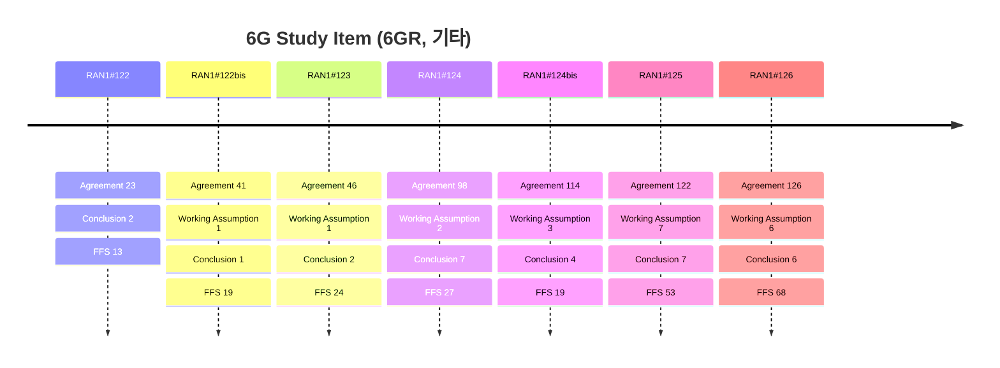

# 6G Study Item (6GR, 기타) (Rel-20)

> 이 파일은 `scripts/generate_report.py`가 자동으로 생성합니다. 직접 수정하지 마세요.

## 회의별 진행

## 누적 히스토리

| 회의 | Agenda | 구분 | 내용 | 출처 |
|---|---|---|---|---|
| RAN1#122 | 11.1 | Agreement | Study a scalable 6GR design for diverse device types, considering aspects: - What should be commonly applicable to all 6G device types - FFS: add-on features dedicated to specific device types, if any | [Chair notes RAN1#122 eom](https://www.3gpp.org/ftp/tsg_ran/WG1_RL1/TSGR1_122/Inbox/Chair_notes/Chair%20notes%20RAN1%23122%20eom.zip) `[122-R20-6GR-Overall]` |
| RAN1#122 | 11.1 | Agreement | - Study the device types from physical layer perspective to be supported by 6GR, subject to further discussion and confirmation in RAN | [Chair notes RAN1#122 eom](https://www.3gpp.org/ftp/tsg_ran/WG1_RL1/TSGR1_122/Inbox/Chair_notes/Chair%20notes%20RAN1%23122%20eom.zip) `[122-R20-6GR-Overall]` |
| RAN1#122 | 11.1 | Agreement | - For the study of RAN1 6GR design, consider the minimum spectrum allocation in which 6G can operate, subject to further discussion and confirmation in RAN.   - Note: RAN4 involvement is necessary. | [Chair notes RAN1#122 eom](https://www.3gpp.org/ftp/tsg_ran/WG1_RL1/TSGR1_122/Inbox/Chair_notes/Chair%20notes%20RAN1%23122%20eom.zip) `[122-R20-6GR-Overall]` |
| RAN1#122 | 11.1 | Agreement | - On enhanced overall coverage, identify coverage target(s) considering diverse use cases and device types | [Chair notes RAN1#122 eom](https://www.3gpp.org/ftp/tsg_ran/WG1_RL1/TSGR1_122/Inbox/Chair_notes/Chair%20notes%20RAN1%23122%20eom.zip) `[122-R20-6GR-Overall]` |
| RAN1#122 | 11.1 | Agreement | - Identify the high-level aspects which impact on the 6GR sync signal structure and associated periodicity. | [Chair notes RAN1#122 eom](https://www.3gpp.org/ftp/tsg_ran/WG1_RL1/TSGR1_122/Inbox/Chair_notes/Chair%20notes%20RAN1%23122%20eom.zip) `[122-R20-6GR-Overall]` |
| RAN1#122 | 11.1 | Agreement | - Identify the high-level aspects which impact on the NR-6GR MRSS support   - Including the lessons learned from LTE-NR DSS | [Chair notes RAN1#122 eom](https://www.3gpp.org/ftp/tsg_ran/WG1_RL1/TSGR1_122/Inbox/Chair_notes/Chair%20notes%20RAN1%23122%20eom.zip) `[122-R20-6GR-Overall]` |
| RAN1#122 | 11.1 | Agreement | - Study and identify the lessons learned from NR BWP framework | [Chair notes RAN1#122 eom](https://www.3gpp.org/ftp/tsg_ran/WG1_RL1/TSGR1_122/Inbox/Chair_notes/Chair%20notes%20RAN1%23122%20eom.zip) `[122-R20-6GR-Overall]` |
| RAN1#122 | 11.1 | Agreement | - Study and identify the lessons learned from NR spectrum utilization and aggregation framework   - DC is subject to RANP decision in June 2026   - Note: MRSS aspects are separate discussion | [Chair notes RAN1#122 eom](https://www.3gpp.org/ftp/tsg_ran/WG1_RL1/TSGR1_122/Inbox/Chair_notes/Chair%20notes%20RAN1%23122%20eom.zip) `[122-R20-6GR-Overall]` |
| RAN1#122 | 11.1 | Agreement | - Study the following smallest maximum supported RF and BB UE BW without spectrum aggregation for at least one low-tier device type supported by 6GR framework from physical layer perspective, subject to further discussion and confirmation in RAN   - Opt1: 3MHz   - Opt2: 5MHz   - Opt3: 10MHz   - Opt4: 20MHz   - FFS: the UL bandwidth may be different to the DL bandwidth   - FFS: the bandwidth value may be different for different SCS, duplex modes, and bands.   - FFS: whether RF and BB UE BW are same or different | [Chair notes RAN1#122 eom](https://www.3gpp.org/ftp/tsg_ran/WG1_RL1/TSGR1_122/Inbox/Chair_notes/Chair%20notes%20RAN1%23122%20eom.zip) `[122-R20-6GR-Overall]` |
| RAN1#122 | 11.1 | Agreement | - Study and identify the lessons learned from NR duplex modes - On 6GR duplexing study, RAN1 considers at least following duplex types   - FD-FDD   - Semi-static TDD   - gNB semi-static SBFD   - HD-FDD on UE side   - Dynamic TDD - Study whether to consider following duplexing types   - gNB dynamic SBFD   - UE SBFD   - gNB FD   - Note: Other duplex modes are not precluded | [Chair notes RAN1#122 eom](https://www.3gpp.org/ftp/tsg_ran/WG1_RL1/TSGR1_122/Inbox/Chair_notes/Chair%20notes%20RAN1%23122%20eom.zip) `[122-R20-6GR-Overall]` |
| RAN1#122 | 11.1 | Agreement | - For harmonized 6GR design for TN and NTN, RAN1 studies to identify the technical aspects affected by NTN characteristics, as well as lessons learned from NR/IoT NTN | [Chair notes RAN1#122 eom](https://www.3gpp.org/ftp/tsg_ran/WG1_RL1/TSGR1_122/Inbox/Chair_notes/Chair%20notes%20RAN1%23122%20eom.zip) `[122-R20-6GR-Overall]` |
| RAN1#122 | 11.2 | Agreement | - The deployment scenarios in TR38.914 should be considered for evaluation assumption - The common evaluation assumptions including the antenna modelling, general system-level simulation assumptions (including the carrier frequency, bandwidth and subcarrier spacing used for link-level simulation) for the deployment scenarios in TR38.914, link budget and traffic models will be discussed in AI 11.2   - Other assumptions including for link-level simulation specific to each technical topic will be separately discussed under each individual agenda.   - Note: Subcarrier spacing decision is up to AI 11.3.2. | [Chair notes RAN1#122 eom](https://www.3gpp.org/ftp/tsg_ran/WG1_RL1/TSGR1_122/Inbox/Chair_notes/Chair%20notes%20RAN1%23122%20eom.zip) `[122-R20-6GR-Evaluation]` |
| RAN1#122 | 11.2 | Conclusion | - Template in R1-2506582 is to be used for collecting inputs from companies.   - Additional NTN or TN assumptions, if any, or any necessary change of the parameters, are to be incorporated into the updated one of R1-2506582. | [Chair notes RAN1#122 eom](https://www.3gpp.org/ftp/tsg_ran/WG1_RL1/TSGR1_122/Inbox/Chair_notes/Chair%20notes%20RAN1%23122%20eom.zip) `[122-R20-6GR-Evaluation]` |
| RAN1#122 | 11.2 | Agreement | - Study which of the following traffic models are to be used for 6G evaluations, e.g.,   - Full buffer   - FTP Model 1 (in TR 36.814)   - FTP Model 2 (in TR 36.814)   - FTP Model 3 (in TR 36.872)   - XR Traffic models (in TR 38.838)   - VoIP model (as in TR 36.814)   - Instant message (as in TR 38.840) - Study whether to introduce the following traffic models for 6G evaluations considering, e.g.,   - FTP-3 variant with packet delay budget requirement     - Details FFS   - New traffic model considering a mixed/variable packet size and the associated time domain behaviors (e.g., time between adjacent packet arrivals, packet delay budget)     - Details FFS   - New traffic model(s) considering the new use cases or services, e.g., AI/ML services, immersive communication services, etc.     - Details FFS - Study whether to introduce new/additional approaches that can reflect the impact of bidirectional traffic flows on performance metrics (e.g., impact of UL TCP ACK latency on DL throughput/latency) Note: Whether/how to consider the combination of traffic model and loading level will be studied under individual agendas. | [Chair notes RAN1#122 eom](https://www.3gpp.org/ftp/tsg_ran/WG1_RL1/TSGR1_122/Inbox/Chair_notes/Chair%20notes%20RAN1%23122%20eom.zip) `[122-R20-6GR-Evaluation]` |
| RAN1#122 | 11.3.1 | Agreement | CP-OFDM and DFT-s-OFDM waveforms as defined in 5G NR are supported as the basis for 6GR for uplink - Enhancements/modifications on CP-OFDM/DFT-s-OFDM will be studied as potential additions - Other OFDM based waveforms are not precluded. | [Chair notes RAN1#122 eom](https://www.3gpp.org/ftp/tsg_ran/WG1_RL1/TSGR1_122/Inbox/Chair_notes/Chair%20notes%20RAN1%23122%20eom.zip) `[122-R20-6GR-Waveform]` |
| RAN1#122 | 11.3.1 | Agreement | CP-OFDM waveform as defined in 5G NR is supported as the basis for 6GR for downlink - Enhancements/modifications on CP-OFDM will be studied as potential additions - DFT-s-OFDM or any other OFDM-based waveform will be studied as a potential additional waveform for downlink Note: proponents to identify at least the target use cases, signals/channels to use the waveform, and how the proposal is intended (if applicable) to support multiplexing with CP-OFDM, including MRSS, and how multi-user multiplexing is supported, etc. Note: Proponents are encouraged to provide more detailed information on their proposals for the next meeting, e.g.: Proponents to characterize the main motivation for modification/additional waveform proposals: - Targeted link direction, i.e. DL, UL or both - Targeted use case (e.g. NTN, specific frequency range, etc.), if any - Potential motivations metrics used, and quantified gains for a proposal, e.g.   - Coverage   - Network energy efficiency   - UE energy efficiency   - Spectral efficiency   - High speed tolerance   - Scheduling flexibility   - Integration with ISAC Proponents provide information on the following aspects, if applicable - MRSS compatibility - Target channels/signals, e.g. all channels, PxSCH only, etc. - MIMO (SU and MU-MIMO) compatibility - Target modulations, and impact to other modulations, if applicable - Multi-user multiplexing/scheduling flexibility - Multiplexing/coexistence with baseline waveforms - Impact on synchronization and initial access - Expected specification impact - Transmitter/receiver complexity and impact to power consumption. | [Chair notes RAN1#122 eom](https://www.3gpp.org/ftp/tsg_ran/WG1_RL1/TSGR1_122/Inbox/Chair_notes/Chair%20notes%20RAN1%23122%20eom.zip) `[122-R20-6GR-Waveform]` |
| RAN1#122 | 11.3.2 | Agreement | - 6GR takes the following SCS as start point for discussion for all the signals/channels except PRACH.   - For sub 6GHz     - The following subcarrier spacing is at least supported       - 15kHz SCS for FDD, 30kHz SCS for TDD     - FFS: 30kHz SCS for FDD for around e.g., 1-2.5GHz     - FFS: 7.5kHz SCS for sub1GHz (FDD)     - Whether to discuss the FFS will be subject to RANP decision.   - For around 7GHz     - The following subcarrier spacing options can be studied       - 30kHz, 60kHz   - FFS: For around 15GHz     - The following subcarrier spacing options can be studied       - 30kHz, 60kHz, 120kHz     - Whether to discuss it will be subject to RANP decision   - For between 24.25GHz - 52.6GHz     - Subcarrier spacing 120kHz is supported   - FFS whether to allow using additional subcarrier spacing for SSB - FFS subcarrier spacing for PRACH and up to initial access discussion. | [Chair notes RAN1#122 eom](https://www.3gpp.org/ftp/tsg_ran/WG1_RL1/TSGR1_122/Inbox/Chair_notes/Chair%20notes%20RAN1%23122%20eom.zip) `[122-R20-6GR-Frame structure]` |
| RAN1#122 | 11.3.2 | Conclusion | - Numerologies for sensing is up to sensing agenda discussion. | [Chair notes RAN1#122 eom](https://www.3gpp.org/ftp/tsg_ran/WG1_RL1/TSGR1_122/Inbox/Chair_notes/Chair%20notes%20RAN1%23122%20eom.zip) `[122-R20-6GR-Frame structure]` |
| RAN1#122 | 11.3.2 | Agreement | - 6GR supports normal cyclic prefix, i.e., same as the normal CP defined in NR.   - FFS potential need for other CP | [Chair notes RAN1#122 eom](https://www.3gpp.org/ftp/tsg_ran/WG1_RL1/TSGR1_122/Inbox/Chair_notes/Chair%20notes%20RAN1%23122%20eom.zip) `[122-R20-6GR-Frame structure]` |
| RAN1#122 | 11.4.2 | Agreement | - For 6GR DL, 5G NR uniform QPSK, 16QAM, 64QAM, 256QAM and 1024QAM are supported as basis for study for data channel   - FFS: Enhancements and other modulation schemes - For 6GR UL, 5G NR uniform QPSK, 16QAM, 64QAM, and 256QAM are supported as basis for study for CP-OFDM for data channel   - FFS: Enhancements and other modulation schemes - For 6GR UL, 5G NR pi/2 BPSK, uniform QPSK, 16QAM, 64QAM, and 256QAM are supported as basis for study for DFT-s-OFDM for data channel   - FFS: Enhancements and other modulation schemes | [Chair notes RAN1#122 eom](https://www.3gpp.org/ftp/tsg_ran/WG1_RL1/TSGR1_122/Inbox/Chair_notes/Chair%20notes%20RAN1%23122%20eom.zip) |
| RAN1#122 | 11.5 | Agreement | Study how to reuse and update reference configurations in TR 38.864 for 6G BS. | [Chair notes RAN1#122 eom](https://www.3gpp.org/ftp/tsg_ran/WG1_RL1/TSGR1_122/Inbox/Chair_notes/Chair%20notes%20RAN1%23122%20eom.zip) `[122-R20-6GR-Energy efficiency]` |
| RAN1#122 | 11.5 | Agreement | Study how/whether to reuse or update the power model in TR 38.864 for evaluating BS power consumption for 6G BS. | [Chair notes RAN1#122 eom](https://www.3gpp.org/ftp/tsg_ran/WG1_RL1/TSGR1_122/Inbox/Chair_notes/Chair%20notes%20RAN1%23122%20eom.zip) `[122-R20-6GR-Energy efficiency]` |
| RAN1#122 | 11.5 | Agreement | - Study metric(s) for UE energy efficiency. - Study metric(s) for BS energy efficiency. | [Chair notes RAN1#122 eom](https://www.3gpp.org/ftp/tsg_ran/WG1_RL1/TSGR1_122/Inbox/Chair_notes/Chair%20notes%20RAN1%23122%20eom.zip) `[122-R20-6GR-Energy efficiency]` |
| RAN1#122 | 11.5 | Agreement | Study reference configurations and power consumption model for 6G UE, considering but not restricted to the following: - TR 38.840 (UEPS), TR38.875 (RedCap), TR38.865 (eRedCap), and TR38.869 (LP-WUS/WUR) for reference configurations - TR 38.840 (UEPS), TR38.875 (RedCap), and TR38.869 (LP-WUS/WUR) for power consumption models | [Chair notes RAN1#122 eom](https://www.3gpp.org/ftp/tsg_ran/WG1_RL1/TSGR1_122/Inbox/Chair_notes/Chair%20notes%20RAN1%23122%20eom.zip) `[122-R20-6GR-Energy efficiency]` |
| RAN1#122 | 11.5 | Agreement | - Study baseline BS setting(s) for evaluating 6G BS EE improvement/impact, considering NR features and 6G BS reference configuration(s) - Study baseline UE setting(s) for evaluating 6G UE EE improvement/impact, considering NR features and 6G UE reference configuration(s) | [Chair notes RAN1#122 eom](https://www.3gpp.org/ftp/tsg_ran/WG1_RL1/TSGR1_122/Inbox/Chair_notes/Chair%20notes%20RAN1%23122%20eom.zip) `[122-R20-6GR-Energy efficiency]` |
| RAN1#122bis | 11.1 | Agreement | - RAN1 provides methodology and corresponding initial analysis of potentially achievable coverage to RAN#110 to determine the coverage target(s) | [Chair notes RAN1#122b eom4](https://www.3gpp.org/ftp/tsg_ran/WG1_RL1/TSGR1_122b/Inbox/Chair_Notes/Chair%20notes%20RAN1%23122b%20eom4.docx) `[122bis-R20-6GR-Overall]` |
| RAN1#122bis | 11.1 | Agreement | - High-level aspects to consider for the 6GR sync signal structure include, but not limited to   - Sync raster design   - Spectrum allocation   - smallest maximum supported RF and BB UE BW without spectrum aggregation   - mobile broadband service requirements as high priority   - Energy efficiency for both BS and UE   - Detection/tracking performance, latency, and complexity     - Including initial cell search   - Coverage target   - Common design for diverse device types   - Consideration of the supported deployment   - Consideration on whether the single sync signal structure is sufficient   - Note: Aspects impacting on the periodicity is to be discussed under AI11.5 | [Chair notes RAN1#122b eom4](https://www.3gpp.org/ftp/tsg_ran/WG1_RL1/TSGR1_122b/Inbox/Chair_Notes/Chair%20notes%20RAN1%23122b%20eom4.docx) `[122bis-R20-6GR-Overall]` |
| RAN1#122bis | 11.1 | Agreement | - The aspects to consider for supporting NTN include, but not limited to   - Initial access, including cell search and SSB periodicity   - Coverage   - Duplexing   - Capacity   - Signalling overhead   - GNSS-less/resilient/based operation   - Large/varying doppler and propagation delay   - Beamforming / beam management / beam hopping Note: - High-level aspects to consider to enable lower CAPEX/OPEX with respect to current networks include, but not limited to   - UE/NW implementation complexity   - UE/NW energy efficiency   - MRSS   - Spectrum efficiency | [Chair notes RAN1#122b eom4](https://www.3gpp.org/ftp/tsg_ran/WG1_RL1/TSGR1_122b/Inbox/Chair_Notes/Chair%20notes%20RAN1%23122b%20eom4.docx) `[122bis-R20-6GR-Overall]` |
| RAN1#122bis | 11.2 | Agreement | For around 700MHz, for TXRU mapping at base station, it is adopted as mandatory option for simulation campaign that a single TXRU is mapped per panel per subarray per polarization. Note: Companies can provide results optionally, assuming fully connected TXRU mapping within a panel per polarization. | [Chair notes RAN1#122b eom4](https://www.3gpp.org/ftp/tsg_ran/WG1_RL1/TSGR1_122b/Inbox/Chair_Notes/Chair%20notes%20RAN1%23122b%20eom4.docx) `[122bis-R20-6GR-Evaluation]` |
| RAN1#122bis | 11.2 | Agreement | - For around 700MHz, 32 for total number of antenna element at base station, 4 for total number of TXRU at base station, (8, 2, 2, 1, 1; 1, 2) for (M,N,P,Mg,Ng; Mp, Np), and (0.5, 0.5)λ for (dH,dV) are assumed as the baseline combination. - For around 700MHz, 64 for total number of antenna element at base station, 8 for total number of TXRU at base station, (8, 4, 2, 1, 1; x, y) for (M,N,P,Mg,Ng; Mp, Np), and (0.5, 0.5)λ for (dH,dV) are assumed as the optional combination. Note: Other values/combinations are up to company to report | [Chair notes RAN1#122b eom4](https://www.3gpp.org/ftp/tsg_ran/WG1_RL1/TSGR1_122b/Inbox/Chair_Notes/Chair%20notes%20RAN1%23122b%20eom4.docx) `[122bis-R20-6GR-Evaluation]` |
| RAN1#122bis | 11.2 | Agreement | For around 2GHz carrier frequency, for BS antenna modelling \| BS antenna modelling \| Total number of antenna elements \| Total number of TXRU \| (M, N, P, Mg , Ng; Mp, Np) \| (dH,dV) \| \| Indoor \| Indoor \| Indoor \| Indoor \| Indoor \| \| Combination 1(Optional) \| 8 \| 4 \| (2, 2, 2, 1, 1; 1, 2) \| (0.5, 0.5)λ \| \| Combination 2 (Baseline) \| 32 \| 8 \| (4, 4, 2, 1, 1; 1, 4) \| (0.5, 0.5)λ \| \|  \|  \|  \|  \|  \| \| Outdoor \| Outdoor \| Outdoor \| Outdoor \| Outdoor \| \| Combination 1(Optional) \| 32 \| 4 \|  \| (0.5, 0.8)λ \| \| Combination 2 (Baseline) \| 192 \| 64 \| (12, 8, 2, 1, 1; 4, 8) \| (0.5, 0.5)λ \| \| Note1: A single TXRU is mapped per panel per subarray per polarization as mandatory option. Companies can provide results optionally, assuming fully connected TXRU mapping within a panel per polarization. Note2: Other combinations used in the simulation results are up to company to report. \| Note1: A single TXRU is mapped per panel per subarray per polarization as mandatory option. Companies can provide results optionally, assuming fully connected TXRU mapping within a panel per polarization. Note2: Other combinations used in the simulation results are up to company to report. \| Note1: A single TXRU is mapped per panel per subarray per polarization as mandatory option. Companies can provide results optionally, assuming fully connected TXRU mapping within a panel per polarization. Note2: Other combinations used in the simulation results are up to company to report. \| Note1: A single TXRU is mapped per panel per subarray per polarization as mandatory option. Companies can provide results optionally, assuming fully connected TXRU mapping within a panel per polarization. Note2: Other combinations used in the simulation results are up to company to report. \| Note1: A single TXRU is mapped per panel per subarray per polarization as mandatory option. Companies can provide results optionally, assuming fully connected TXRU mapping within a panel per polarization. Note2: Other combinations used in the simulation results are up to company to report. \| | [Chair notes RAN1#122b eom4](https://www.3gpp.org/ftp/tsg_ran/WG1_RL1/TSGR1_122b/Inbox/Chair_Notes/Chair%20notes%20RAN1%23122b%20eom4.docx) `[122bis-R20-6GR-Evaluation]` |
| RAN1#122bis | 11.2 | Conclusion | The following existing traffic models could be used for 6GR performance evaluations, - Full buffer - FTP Model 1 (in TR 36.814) - FTP Model 3 (in TR 36.872) - XR Traffic models (in TR 38.838) - VoIP model (as in TR 36.814) - Instant message (as in TR 38.840) - Note that which model(s) will be used can be further decided when performing simulations in each individual topic. | [Chair notes RAN1#122b eom4](https://www.3gpp.org/ftp/tsg_ran/WG1_RL1/TSGR1_122b/Inbox/Chair_Notes/Chair%20notes%20RAN1%23122b%20eom4.docx) `[122bis-R20-6GR-Evaluation]` |
| RAN1#122bis | 11.2 | Agreement | For the study traffic model(s) for 6GR AI/ML services:   - A representative AI/ML service is the generative AI, e.g., as defined in TR22.870. Send LS to SA4 (cc RAN2, SA1, SA2) requesting input if any on traffic characteristics for AI/ML services. Note: RAN1 is discussing the following options for the model:   - Option-1a: The model is parameterized by Token, e.g., Token size, Token arrival rate, and Token delay budget.     - Token is the minimum unit of data generated in the application layer.     - How to associate Tokens to PHY layer packets.     - How to reflect the variable importance of tokens.     - Whether other parameters are additionally needed when tokens are encapsulated together into a packet, e.g., packet arrival rate, packet success rate, and packet delay.   - Option-1b: The model is characterized by the parameters of PHY layer packet, including e.g., packet size, arrival rates, latency requirement, reliability requirement, etc.   - Option-1c: reusing or extending the FTP-3/XR traffic model.   - FFS other models/options need to be defined for other AI/ML services. | [Chair notes RAN1#122b eom4](https://www.3gpp.org/ftp/tsg_ran/WG1_RL1/TSGR1_122b/Inbox/Chair_Notes/Chair%20notes%20RAN1%23122b%20eom4.docx) `[122bis-R20-6GR-Evaluation]` |
| RAN1#122bis | 11.2 | Agreement | Study traffic modelling for evaluations related to immersive communication services including but not limited to advanced XR [e.g., TR22.870] and haptics services, - XR traffic models (in TR 38.838) are considered as starting point.   - FFS the detailed modifications on the parameters to the XR traffic model, e.g., higher packet size, higher packet arrival rate, higher packet size deviation, PDB, etc. - FFS how many models need to be defined and the corresponding representative use cases. - FFS how to incorporate haptics traffic (TR26.854). Send LS to SA4 requesting input if any on the relevant traffic characteristics, RAN1 can continue the study before SA4 potential response. | [Chair notes RAN1#122b eom4](https://www.3gpp.org/ftp/tsg_ran/WG1_RL1/TSGR1_122b/Inbox/Chair_Notes/Chair%20notes%20RAN1%23122b%20eom4.docx) `[122bis-R20-6GR-Evaluation]` |
| RAN1#122bis | 11.2 | Agreement | Study extensions to FTP Model 1/FTP Model 3 to incorporate the following: - Multiple packet sizes and associated time-domain behaviors (e.g., inter arrival time)   - FFS number of packet sizes (e.g., 2 or 3).   - FFS whether to have fixed or variable packet size and packet arrival rate for a given UE.   - FFS applicability of multiple packet sizes to only one or both of FTP Model 1/FTP Model 3.   - FFS packet size and arrival rate characteristics. - Packet delay budget (PDB) related parameters   - FFS PDB applicability to packets (e.g., one PDB parameter for only one traffic flow or different PDB parameters for different traffic flows).   - FFS how to consider the PDB, e.g., whether to drop packets when exceeding the budget, PDB aware metric. - Note consider the following for PDB:   - Applicability to the extension to FTP Model 1/ FTP Model 3 with one packet size.   - Applicability or not to the extension to FTP Model 1/ FTP Model 3 with multiple packet sizes. | [Chair notes RAN1#122b eom4](https://www.3gpp.org/ftp/tsg_ran/WG1_RL1/TSGR1_122b/Inbox/Chair_Notes/Chair%20notes%20RAN1%23122b%20eom4.docx) `[122bis-R20-6GR-Evaluation]` |
| RAN1#122bis | 11.2 | Agreement | The attached templates for NTN in R1-2507956 are endorsed in principle. | [Chair notes RAN1#122b eom4](https://www.3gpp.org/ftp/tsg_ran/WG1_RL1/TSGR1_122b/Inbox/Chair_Notes/Chair%20notes%20RAN1%23122b%20eom4.docx) `[122bis-R20-6GR-Evaluation]` |
| RAN1#122bis | 11.2 | Agreement | The following configurations for system-level simulations could be used for 6GR evaluation: \|  \| Indoor Hotspot \| Dense Urban \| Rural \| Urban Macro \| Sub-urban macro \| \| Carrier frequency \| Around 2 GHz Around 4 GHz Around 7 GHz Around 15 GHz Around 30 GHz \| Around 700 MHz Around 2 GHz Around 4 GHz Around 7 GHz Around 15 GHz Around 30 GHz \| Around 700 MHz Around 2 GHz Around 4 GHz Around 7 GHz \| Around 700 MHz Around 2 GHz Around 4 GHz Around 7 GHz Around 15 GHz Around 30 GHz \| Around 700 MHz Around 2 GHz Around 4 GHz Around 7 GHz Around 15 GHz Around 30 GHz \| \| Aggregated BW \| Follow system bandwidth per carrier frequency in TR 38.914 as 1) Around 700 MHz: Up to 60 MHz 2) Around 2GHz: Up to 200 MHz 3) Around 4GHz: Up to 300 MHz 4) Around 7GHz: Up to 400MHz 5) Around 15GHz: Up to 400MHz 6) Around 30GHz: Up to 1GHz \| Follow system bandwidth per carrier frequency in TR 38.914 as 1) Around 700 MHz: Up to 60 MHz 2) Around 2GHz: Up to 200 MHz 3) Around 4GHz: Up to 300 MHz 4) Around 7GHz: Up to 400MHz 5) Around 15GHz: Up to 400MHz 6) Around 30GHz: Up to 1GHz \| Follow system bandwidth per carrier frequency in TR 38.914 as 1) Around 700 MHz: Up to 60 MHz 2) Around 2GHz: Up to 200 MHz 3) Around 4GHz: Up to 300 MHz 4) Around 7GHz: Up to 400MHz 5) Around 15GHz: Up to 400MHz 6) Around 30GHz: Up to 1GHz \| Follow system bandwidth per carrier frequency in TR 38.914 as 1) Around 700 MHz: Up to 60 MHz 2) Around 2GHz: Up to 200 MHz 3) Around 4GHz: Up to 300 MHz 4) Around 7GHz: Up to 400MHz 5) Around 15GHz: Up to 400MHz 6) Around 30GHz: Up to 1GHz \| Follow system bandwidth per carrier frequency in TR 38.914 as 1) Around 700 MHz: Up to 60 MHz 2) Around 2GHz: Up to 200 MHz 3) Around 4GHz: Up to 300 MHz 4) Around 7GHz: Up to 400MHz 5) Around 15GHz: Up to 400MHz 6) Around 30GHz: Up to 1GHz \| \| Simulation BW \| Around 700 MHz: 20MHz, 60MHz \| Around 700 MHz: 20MHz, 60MHz \| Around 700 MHz: 20MHz, 60MHz \| Around 700 MHz: 20MHz, 60MHz \| Around 700 MHz: 20MHz, 60MHz \| \| Simulation BW \| Around 2 GHz: 20MHz, 100MHz, 200MHz \| Around 2 GHz: 20MHz, 100MHz, 200MHz \| Around 2 GHz: 20MHz, 100MHz, 200MHz \| Around 2 GHz: 20MHz, 100MHz, 200MHz \| Around 2 GHz: 20MHz, 100MHz, 200MHz \| \| Simulation BW \| Around 4 GHz: 20MHz, 100MHz, 200MHz, 300MHz \| Around 4 GHz: 20MHz, 100MHz, 200MHz, 300MHz \| Around 4 GHz: 20MHz, 100MHz, 200MHz, 300MHz \| Around 4 GHz: 20MHz, 100MHz, 200MHz, 300MHz \| Around 4 GHz: 20MHz, 100MHz, 200MHz, 300MHz \| \| Simulation BW \| Around 7 GHz: 20MHz, 100MHz, 200MHz, 400MHz \| Around 7 GHz: 20MHz, 100MHz, 200MHz, 400MHz \| Around 7 GHz: 20MHz, 100MHz, 200MHz, 400MHz \| Around 7 GHz: 20MHz, 100MHz, 200MHz, 400MHz \| Around 7 GHz: 20MHz, 100MHz, 200MHz, 400MHz \| \| Simulation BW \| Around 15 GHz: 20MHz, 100MHz, 200MHz, 400MHz \| Around 15 GHz: 20MHz, 100MHz, 200MHz, 400MHz \| Around 15 GHz: 20MHz, 100MHz, 200MHz, 400MHz \| Around 15 GHz: 20MHz, 100MHz, 200MHz, 400MHz \| Around 15 GHz: 20MHz, 100MHz, 200MHz, 400MHz \| \| Simulation BW \| Around 30GHz: 100MHz, 400MHz, 800MHz \| Around 30GHz: 100MHz, 400MHz, 800MHz \| Around 30GHz: 100MHz, 400MHz, 800MHz \| Around 30GHz: 100MHz, 400MHz, 800MHz \| Around 30GHz: 100MHz, 400MHz, 800MHz \| \| Simulation BW \| Note: other simulation BW could be considered. \| Note: other simulation BW could be considered. \| Note: other simulation BW could be considered. \| Note: other simulation BW could be considered. \| Note: other simulation BW could be considered. \| \| Note: The layout for each scenario will be separately discussed, including the carrier frequency combination for single layer and/or two layers. \| Note: The layout for each scenario will be separately discussed, including the carrier frequency combination for single layer and/or two layers. \| Note: The layout for each scenario will be separately discussed, including the carrier frequency combination for single layer and/or two layers. \| Note: The layout for each scenario will be separately discussed, including the carrier frequency combination for single layer and/or two layers. \| Note: The layout for each scenario will be separately discussed, including the carrier frequency combination for single layer and/or two layers. \| Note: The layout for each scenario will be separately discussed, including the carrier frequency combination for single layer and/or two layers. \| | [Chair notes RAN1#122b eom4](https://www.3gpp.org/ftp/tsg_ran/WG1_RL1/TSGR1_122b/Inbox/Chair_Notes/Chair%20notes%20RAN1%23122b%20eom4.docx) `[122bis-R20-6GR-Evaluation]` |
| RAN1#122bis | 11.2 | Agreement | Draft LS R1-2508183 is endorsed in principle. | [Chair notes RAN1#122b eom4](https://www.3gpp.org/ftp/tsg_ran/WG1_RL1/TSGR1_122b/Inbox/Chair_Notes/Chair%20notes%20RAN1%23122b%20eom4.docx) `[122bis-R20-6GR-Evaluation]` |
| RAN1#122bis | 11.2 | Agreement | Final LS R1-2508184 is endorsed. | [Chair notes RAN1#122b eom4](https://www.3gpp.org/ftp/tsg_ran/WG1_RL1/TSGR1_122b/Inbox/Chair_Notes/Chair%20notes%20RAN1%23122b%20eom4.docx) `[122bis-R20-6GR-Evaluation]` |
| RAN1#122bis | 11.2 | Agreement | For link budget template, consider the following candidates: - Candidate 1: Reusing the link budget template from TR38.830, i.e., the following table with notes as follows: - The values of the parameters are TBD. - MCL in row (22bis) is TBD. - FFS: whether/how/why to update \| System configuration \| System configuration \| \| Channel for evaluation \|  \| \| Scenarios and Carrier frequency (GHz) \|  \| \| BS antenna heights (m) \|  \| \| UT antenna heights (m) \|  \| \| Cell area reliability (%) \|  \| \| Lognormal shadow fading std deviation (dB) \|  \| \| Tx Diversity \|  \| \| Number of SSB \|  \| \| Transmitter \| Transmitter \| \| (1) Number of transmit antenna elements \|  \| \| (2) Number of transmit TxRUs Note: this row is void (left empty) for uplink \|  \| \| (2a) Number of transmit chains modelled in LLS \|  \| \| (3) Total transmit power (dBm) Note: total transmit power for system bandwidth \|  \| \| (3a) System bandwidth for downlink, or occupied bandwidth for uplink (Hz) \|  \| \| (3b) Power Spectrum Density = (3) - 10 log( (3a) / 1000000 ) (dBm/MHz) Note: no PSD constraint for uplink \|  \| \| (3c) Bandwidth used for the evaluated channel (Hz) Note: (3c) is identical to the number of PRBs assigned to the channel evaluated. For uplink, (3a) = (3c) \|  \| \| (3bis) Total transmit power for occupied bandwidth = (3b) + 10 log ((3c) /1000000) (dBm) \|  \| \| (4) Total antenna gain at antenna gain component 3 & antenna gain component 4 of transmitter = (4a) – (4b) (dB) \|  \| \| (4a) Antenna gain at antenna gain component 3 & antenna gain component 4 of transmitter = (4c) + 10 log ((1) / (2)) (dB) for downlink, and = (4c) + 10 log ((1) / (2a)) (dB) for uplink \|  \| \| (4b) Antenna gain correction factor at antenna gain component 3 & antenna gain component 4 of transmitter (dB) \|  \| \| (4c) Gain of antenna element (dBi) \|  \| \| (5) Total antenna gain at antenna gain component 2 of transmitter = (5a) - (5b) (dB) Note: zero for uplink \|  \| \| (5a) Antenna gain at antenna gain component 2 of transmitter = 10 log((2)/(2a)) (dB) Note: zero for uplink \|  \| \| (5b) Antenna gain correction factor at antenna gain component 2 of transmitter (dB) Note: zero for uplink \|  \| \| (8) Cable, connector, combiner, body losses, etc. (enumerate sources) (dB) (feeder loss must be included for and only for downlink) \|  \| \| (9) EIRP = (3bis) + (4) + (5) – (8) dBm \|  \| \| Receiver \| Receiver \| \| (10) Number of receive antenna elements \|  \| \| (10a) Number of receive TxRUs Note: this row is void (empty) for downlink \|  \| \| (10b) Number of receive chains modelled in LLS \|  \| \| (11) Total antenna gain at antenna gain component 3 & antenna gain component 4 of receiver = (11a) - (11b) (dB) \|  \| \| (11a) Antenna gain at antenna gain component 3 & antenna gain component 4 of receiver = (11c) + 10 log ((10)/(10a)) (dB) for uplink = (11c) + 10 log ((10)/(10b)) (dB) for downlink \|  \| \| (11b) Antenna gain correction factor at antenna gain component 3 & antenna gain component 4 of receiver (dB) \|  \| \| (11c) Gain of antenna element (dBi) \|  \| \| (11bis) Total antenna gain at antenna gain component 2 of receiver = (11bis-a) - (11bis-b) (dB) Note: zero for downlink \|  \| \| (11bis-a) Antenna gain at antenna gain component 2 of receiver = 10 log((10a)/(10b)) (dB) Note: zero for downlink \|  \| \| (11bis-b) Antenna gain correction factor at antenna gain component 2 of receiver (dB) Note: zero for downlink \|  \| \| (12) Cable, connector, combiner, body losses, etc. (enumerate sources) (dB) (feeder loss must be included for and only for uplink) \|  \| \| (13) Receiver noise figure (dB) \|  \| \| (14) Thermal noise density (dBm/Hz) \|  \| \| (15) Receiver interference density (dBm/Hz) \|  \| \| (16) Total noise plus interference density = 10 log (10^(( (13) + (14))/10) + 10^((15)/10)) (dBm/Hz) \|  \| \| (18) Effective noise power = (16) + 10 log ((3c)) (dBm) \|  \| \| (19) Required SNR (dB) \|  \| \| (20) Receiver implementation margin (dB) \|  \| \| (21) H-ARQ gain (dB) Note: Only applicable if HARQ is not considered in LLS \|  \| \| (22) Receiver sensitivity = (18) + (19) + (20) – (21) (dBm) \|  \| \| (22bis) MCL = (3bis) – (22) + (5) + (11bis) (dB) \|  \| \| (23) Hardware link budget, a.k.a. MIL = (9) + (11) + (11bis) − (12) − (22) (dB) Note: MIL can also be derived by (22bis) + (4) – (8) + (11) − (12) \|  \| \| Calculation of available pathloss \| Calculation of available pathloss \| \| (25) Shadow fading margin (function of the cell area reliability and lognormal shadow fading std deviation) (dB) \|  \| \| (26) BS selection/macro-diversity gain (dB) \|  \| \| (27) Penetration margin (dB) \|  \| \| (28) Other gains (dB) (if any please specify) \|  \| \| (29) Available path loss = (23) – (25) + (26) – (27) + (28) (dB) \|  \| \| Range/coverage efficiency calculation \| Range/coverage efficiency calculation \| \| FFS: (30) Maximum range (based on (29) and according to the system configuration section of the link budget) (m) \|  \| - Candidate 2: Template as Table 7.10.1-1 from TR38.913.   - FFS: whether/how/why to update. \| Item \| Value \| \| Transmitter \|  \| \| (1) Tx power (dBm) \|  \| \| Receiver \|  \| \| (2) Thermal noise density (dBm/Hz) \|  \| \| (3) Receiver noise figure (dB) \|  \| \| (4) Interference margin (dB) \|  \| \| (5) Occupied channel bandwidth (Hz) \|  \| \| (6) Effective noise power = (2) + (3) + (4) + 10 log(5) (dBm) \|  \| \| (7) Required SINR (dB) \|  \| \| (8) Receiver sensitivity = (6) + (7) (dBm) \|  \| \| (9) MaxCL = (1) - (8) (dB) \|  \| | [Chair notes RAN1#122b eom4](https://www.3gpp.org/ftp/tsg_ran/WG1_RL1/TSGR1_122b/Inbox/Chair_Notes/Chair%20notes%20RAN1%23122b%20eom4.docx) `[122bis-R20-6GR-Evaluation]` |
| RAN1#122bis | 11.2 | Agreement | For around 4GHz carrier frequency: \| BS antenna modelling \| Total number of antenna elements \| Total number of TXRU \| (M, N, P, Mg, Ng; Mp, Np) \| (dH,dV) \| \| Indoor \| Indoor \| Indoor \| Indoor \| Indoor \| \| Combination 1 \| 32 \| 32 \| (4, 4, 2, 1, 1; 4, 4) \| (0.5, 0.5)λ \| \| Combination 2 \| 128 \| 32 \| (8, 8, 2, 1, 1; 2, 8) \| (0.5, 0.5)λ \| \| Combination 3 \| 256 \| 64 \| (16, 8, 2, 1, 1;4, 8) \| (0.5, 0.5)λ \| \| Outdoor \| Outdoor \| Outdoor \| Outdoor \| Outdoor \| \| Combination 1 \| 192 \| 64 \| (12, 8, 2, 1, 1; 4, 8) \| (0.5, 0.8)λ \| \| Combination 2 \| 256 \| 64 \| (16, 8, 2, 1, 1; 4, 8) \| (0.5, 0.8)λ \| \| Combination 3 \| 512 \| 128 \| (16, 16, 2, 1, 1; 4, 16) \| (0.5, 0.5)λ \| \| Note1: A single TXRU is mapped per panel per subarray per polarization as mandatory option. Companies can provide results optionally, assuming fully connected TXRU mapping within a panel per polarization. Note2: Other combinations used in the simulation results are up to company to report. \| Note1: A single TXRU is mapped per panel per subarray per polarization as mandatory option. Companies can provide results optionally, assuming fully connected TXRU mapping within a panel per polarization. Note2: Other combinations used in the simulation results are up to company to report. \| Note1: A single TXRU is mapped per panel per subarray per polarization as mandatory option. Companies can provide results optionally, assuming fully connected TXRU mapping within a panel per polarization. Note2: Other combinations used in the simulation results are up to company to report. \| Note1: A single TXRU is mapped per panel per subarray per polarization as mandatory option. Companies can provide results optionally, assuming fully connected TXRU mapping within a panel per polarization. Note2: Other combinations used in the simulation results are up to company to report. \| Note1: A single TXRU is mapped per panel per subarray per polarization as mandatory option. Companies can provide results optionally, assuming fully connected TXRU mapping within a panel per polarization. Note2: Other combinations used in the simulation results are up to company to report. \| For around 7GHz carrier frequency: \| BS antenna modelling \| Total number of antenna elements \| Total number of TXRU \| (M, N, P, Mg, Ng; Mp, Np) \| (dH,dV) \| \| Indoor \| Indoor \| Indoor \| Indoor \| Indoor \| \| Combination 1 \| 64 \| 32 \| (4, 8, 2, 1, 1; 2, 8) \| (0.5, 0.5)λ \| \| Combination 2 \| 256 \| 64 \| (16, 8, 2, 1, 1; 4, 8) \| (0.5, 0.5)λ \| \| Combination 3 \| 512 \| 128 \| (16, 16, 2, 1, 1; 8, 8) \| (0.5, 0.5)λ \| \| Outdoor \| Outdoor \| Outdoor \| Outdoor \| Outdoor \| \| Combination 1 \| 768 \| 128 \| TBD \| (0.5, 0.8)λ \| \| Combination 2 \| 1024 \| 256 \| (32, 16, 2, 1, 1; 8, 16) \| (0.5, 0.8)λ \| \| Combination 3 \| 1536 \| 256 \| TBD \| (0.5, 0.8)λ \| \| Combination 4 \| 2048 \| 256 \| (32, 32, 2, 1, 1, 8, 16) \| (0.5, 0.5)λ \| \| Combination 5 \| 2048 \| 512 \| (64, 16, 2, 1, 1; 16, 16) \| (0.5, 0.5)λ \| \| Note1: A single TXRU is mapped per panel per subarray per polarization as mandatory option. Companies can provide results optionally, assuming fully connected TXRU mapping within a panel per polarization. Note2: Other combinations used in the simulation results are up to company to report. \| Note1: A single TXRU is mapped per panel per subarray per polarization as mandatory option. Companies can provide results optionally, assuming fully connected TXRU mapping within a panel per polarization. Note2: Other combinations used in the simulation results are up to company to report. \| Note1: A single TXRU is mapped per panel per subarray per polarization as mandatory option. Companies can provide results optionally, assuming fully connected TXRU mapping within a panel per polarization. Note2: Other combinations used in the simulation results are up to company to report. \| Note1: A single TXRU is mapped per panel per subarray per polarization as mandatory option. Companies can provide results optionally, assuming fully connected TXRU mapping within a panel per polarization. Note2: Other combinations used in the simulation results are up to company to report. \| Note1: A single TXRU is mapped per panel per subarray per polarization as mandatory option. Companies can provide results optionally, assuming fully connected TXRU mapping within a panel per polarization. Note2: Other combinations used in the simulation results are up to company to report. \| For around 30GHz carrier frequency: \| BS antenna modelling \| Total number of antenna elements \| Total number of TXRU \| (M, N, P, Mg, Ng; Mp, Np) \| (dH,dV) \| \| Indoor \| Indoor \| Indoor \| Indoor \| Indoor \| \| Combination 1 \| 128 \| 8 \| (4, 4, 2, 2, 2; 1, 1) \| (0.5, 0.5)λ \| \| Combination 2 \| 512 \| 8 \| (8, 8, 2, 2, 2; 1, 1) \| (0.5, 0.5)λ \| \| Combination 3 \| 1024 \| 8 \| (16, 8, 2, 2, 2; 1, 1) \| (0.5, 0.5)λ \| \| Combination 4 \| 768 \| 2 \| (24, 16, 2, 1, 1; 1, 1) \| (0.5, 0.5)λ \| \| Outdoor \| Outdoor \| Outdoor \| Outdoor \| Outdoor \| \| Combination 1 \| 2048 \| 16 \| (16, 8, 2, 4, 2; 1, 1) \| (0.5, 0.5)λ \| \| Combination 2 \| 4096 \| 32 \| (16, 8, 2, 4, 4; 1, 1) \| (0.5, 0.5)λ \| \| Combination 3 \| 1024 \| 4 \| (16, 16, 2, 2, 1; 1, 1) \| (0.5, 0.5)λ \| \| Note1: A single TXRU is mapped per panel per polarization as mandatory option. Companies can provide results optionally, assuming a single TXRU is mapped per panel per subarray per polarization as mandatory option. Note2: Other combinations used in the simulation results are up to company to report. \| Note1: A single TXRU is mapped per panel per polarization as mandatory option. Companies can provide results optionally, assuming a single TXRU is mapped per panel per subarray per polarization as mandatory option. Note2: Other combinations used in the simulation results are up to company to report. \| Note1: A single TXRU is mapped per panel per polarization as mandatory option. Companies can provide results optionally, assuming a single TXRU is mapped per panel per subarray per polarization as mandatory option. Note2: Other combinations used in the simulation results are up to company to report. \| Note1: A single TXRU is mapped per panel per polarization as mandatory option. Companies can provide results optionally, assuming a single TXRU is mapped per panel per subarray per polarization as mandatory option. Note2: Other combinations used in the simulation results are up to company to report. \| Note1: A single TXRU is mapped per panel per polarization as mandatory option. Companies can provide results optionally, assuming a single TXRU is mapped per panel per subarray per polarization as mandatory option. Note2: Other combinations used in the simulation results are up to company to report. \| | [Chair notes RAN1#122b eom4](https://www.3gpp.org/ftp/tsg_ran/WG1_RL1/TSGR1_122b/Inbox/Chair_Notes/Chair%20notes%20RAN1%23122b%20eom4.docx) `[122bis-R20-6GR-Evaluation]` |
| RAN1#122bis | 11.2 | Agreement | At least the following carrier frequencies could be considered (from RAN1 perspective) for 6GR NTN evaluations: - L-band (i.e., 1.5GHz) - S-band (i.e. 2 GHz) - Ku-band (FFS detailed frequency range) - Ka-band (i.e. 30 GHz for UL, 20GHz for DL) | [Chair notes RAN1#122b eom4](https://www.3gpp.org/ftp/tsg_ran/WG1_RL1/TSGR1_122b/Inbox/Chair_Notes/Chair%20notes%20RAN1%23122b%20eom4.docx) `[122bis-R20-6GR-Evaluation]` |
| RAN1#122bis | 11.3.1 | Agreement | Draft LS R1-2508068 is endorsed with following revision: - removing “Additionally, if time permits, any feedback for CP-OFDM PAPR reduction/MPR values achievable by implementation is also appreciated.” | [Chair notes RAN1#122b eom4](https://www.3gpp.org/ftp/tsg_ran/WG1_RL1/TSGR1_122b/Inbox/Chair_Notes/Chair%20notes%20RAN1%23122b%20eom4.docx) `[122bis-R20-6GR-Waveform]` |
| RAN1#122bis | 11.3.1 | Agreement | Final LS R1-2508069 is endorsed. | [Chair notes RAN1#122b eom4](https://www.3gpp.org/ftp/tsg_ran/WG1_RL1/TSGR1_122b/Inbox/Chair_Notes/Chair%20notes%20RAN1%23122b%20eom4.docx) `[122bis-R20-6GR-Waveform]` |
| RAN1#122bis | 11.3.1 | Agreement | - For uplink low-PAPR proposals, the link level performance evaluation criterion is Net Gain assuming same spectrum efficiency as the reference   - Net Gain [dB] = Tx power gain relative to the reference – SNR degradation relative to the reference @10% BLER     - A realistic PA model should be used     - When calculating the Tx power gain, the RAN4 metrics on the Tx power should be taken into account.     - For SNR degradation, fading channel and non-ideal channel estimation, including DMRS configuration, and equalization is encouraged.     - FFS: Other evaluation metrics     - Note: Companies to report how to calculate the Tx power gain, modulation and coding | [Chair notes RAN1#122b eom4](https://www.3gpp.org/ftp/tsg_ran/WG1_RL1/TSGR1_122b/Inbox/Chair_Notes/Chair%20notes%20RAN1%23122b%20eom4.docx) `[122bis-R20-6GR-Waveform]` |
| RAN1#122bis | 11.3.1 | Agreement | - Study the evaluation method for evaluating DFT-s-OFDM for UL with number of layers > 1. | [Chair notes RAN1#122b eom4](https://www.3gpp.org/ftp/tsg_ran/WG1_RL1/TSGR1_122b/Inbox/Chair_Notes/Chair%20notes%20RAN1%23122b%20eom4.docx) `[122bis-R20-6GR-Waveform]` |
| RAN1#122bis | 11.3.2 | Agreement | For communication, 6GR considers NR frame structure used as a starting point for the study item,   - Resource defined by one subcarrier and one symbol is called as resource element (RE).   - Resource block (RB) is defined where the number of consecutive subcarriers per RB is the same for all numerologies and the number of subcarriers per RB is 12   - Radio Frame length is 10ms   - Each radio frame is split into 10 subframes, each with a duration of 1 ms   - For given SCS and for given symbol, the symbol duration, normal CP length and boundary is same as NR design.   - A slot is defined as supporting 14 consecutive symbols for normal CP case and all subcarrier spacings. | [Chair notes RAN1#122b eom4](https://www.3gpp.org/ftp/tsg_ran/WG1_RL1/TSGR1_122b/Inbox/Chair_Notes/Chair%20notes%20RAN1%23122b%20eom4.docx) `[122bis-R20-6GR-Frame structure]` |
| RAN1#122bis | 11.3.2 | Agreement | 6GR study assumes same SCS between 6GR Sync signals and other channels/signals (except PRACH) for a given band. - FFS: same/different SCS between 6GR sync signal and other channels/signals (except PRACH) for FR2-1. - Note: ISAC is separately discussed in ISAC session. | [Chair notes RAN1#122b eom4](https://www.3gpp.org/ftp/tsg_ran/WG1_RL1/TSGR1_122b/Inbox/Chair_Notes/Chair%20notes%20RAN1%23122b%20eom4.docx) `[122bis-R20-6GR-Frame structure]` |
| RAN1#122bis | 11.3.2 | Agreement | - RAN1 assumes 400MHz maximum channel bandwidth at network side and 30kHz SCS around 7GHz - Study whether and how to enable UE to support 400MHz bandwidth | [Chair notes RAN1#122b eom4](https://www.3gpp.org/ftp/tsg_ran/WG1_RL1/TSGR1_122b/Inbox/Chair_Notes/Chair%20notes%20RAN1%23122b%20eom4.docx) `[122bis-R20-6GR-Frame structure]` |
| RAN1#122bis | 11.4.1 | Working Assumption | - Study 6G data channel coding for higher throughput than 5G with acceptable performance-complexity tradeoff for both NW side and UE side,   - Target peak data rate is assumed to be 2 times of the target peak data rate defined in TR38.913 Note: The other target throughput is up to company to report. Note: Applicability of the potential channel code will be further discussed. | [Chair notes RAN1#122b eom4](https://www.3gpp.org/ftp/tsg_ran/WG1_RL1/TSGR1_122b/Inbox/Chair_Notes/Chair%20notes%20RAN1%23122b%20eom4.docx) `[122-R20-6GR-Channel coding]` |
| RAN1#122bis | 11.4.1 | Agreement | - For 6G channel coding, LDPC is used for data (including SIBs) and Polar code is used for L1 control information (larger than 11 bits, including PBCH) - For 6G LDPC   - Working assumption: For data rate within NR range, reuse of NR LDPC design is supported   - For data rate beyond NR range, study LDPC extension with acceptable performance-complexity tradeoff for both NW side and UE side     - Note: Applicability of the potential LDPC extension to data rate within NR range will be further discussed - For 6G Polar code   - Working assumption: For control information within NR range (larger than 11 bits), reuse of NR Polar code design is supported   - For control information beyond NR range, study Polar code extension with acceptable performance-complexity tradeoff for both NW side and UE side     - Note: Necessity for control information beyond NR range is to be further discussed     - Polar code maximum mother code length is kept as 1024.   - FFS: further motivation(s) for potential extension/enhancement until RAN1#123 | [Chair notes RAN1#122b eom4](https://www.3gpp.org/ftp/tsg_ran/WG1_RL1/TSGR1_122b/Inbox/Chair_Notes/Chair%20notes%20RAN1%23122b%20eom4.docx) `[122-R20-6GR-Channel coding]` |
| RAN1#122bis | 11.4.2 | Agreement | For 6GR constellation shaping evaluation for CP-OFDM, and improved MCS table, the proposed scheme will be compared with non-shaping with NR MCS table. The evaluation and comparison should consider at least the following: - BLER performance under AWGN channel (at least for performance calibration)   - 1st transmission (baseline) and with HARQ re-transmission - BLER performance under fading channel with fixed MCS   - 1st transmission (baseline) and with HARQ re-transmission - Throughput performance with link adaptation (adaptive MCS and rank) under fading channel   - Needs to provide assumptions on rate adaptation (e.g., target BLER for 1st transmission, maximum # of retransmissions) - Transmitter and receiver complexity (e.g., shaping/deshaping, demapper), latency, parallelism implementation, and storage requirements, - Other KPI not excluded, such as PAPR, EVM, MPR/A-MPR - Expected spec impact - FFS detailed assumption of constellation shaping and improved MCS table - System level evaluation can be done after link level evaluation. | [Chair notes RAN1#122b eom4](https://www.3gpp.org/ftp/tsg_ran/WG1_RL1/TSGR1_122b/Inbox/Chair_Notes/Chair%20notes%20RAN1%23122b%20eom4.docx) `[122-R20-6GR-Modulation, joint channel coding and modulation]` |
| RAN1#122bis | 11.4.2 | Agreement | For 6GR constellation shaping study, proponent is encouraged to provide details for the PS/GS schemes considered for evaluation and comparison, including at least the following - Probabilistic shaping for CP-OFDM and DFT-s-OFDM   - Use the list of spectrum efficiencies in NR MCS table as starting point, and provide constellation (including normalization), coding rate and target probabilistic distribution for each SE     - If multiple coding rate and target probabilistic distribution pairs are provided for each SE, how to switch between them   - Relationship between shaping and FEC, coded bits to modulation symbol mapping, and other modules (such as scrambling, interleaving), in transmit and receive chains. How to handle HARQ retransmission   - PS algorithm details (for example, source coding based, channel coding based, etc) and parameters (such as block length, rate loss) - Geometric shaping for CP-OFDM and DFT-s-OFDM   - Use the list of spectrum efficiencies in NR MCS table as starting point, and provide target constellation shape (including normalization) (1D-NUC, 2D-NUC, QAM-CS, etc) for each SE     - If multiple constellation shapes are provided for each SE, how to switch between them   - GS mapping details, such as bit to constellation point mapping and shape   - Relationship with other blocks (such as scrambling, interleaving). How to handle HARQ retransmission | [Chair notes RAN1#122b eom4](https://www.3gpp.org/ftp/tsg_ran/WG1_RL1/TSGR1_122b/Inbox/Chair_Notes/Chair%20notes%20RAN1%23122b%20eom4.docx) `[122-R20-6GR-Modulation, joint channel coding and modulation]` |
| RAN1#122bis | 11.4.2 | Agreement | For link level simulation for modulation evaluation, companies are encouraged to evaluate with the following assumptions and should report the exact scheme evaluated. - channel configuration, including Channel profiles,Tx/RX antenna settings - For MIMO scenario: SU-MIMO or MU-MIMO, follow agenda item 11.2 for MIMO when available. - Precoder assumption   - Close loop MIMO (reciprocal beamforming (e.g., SVD, SLR/RZF, etc.), codebook based)     - Realistic CSI/SRS/AP-SRS periodicity and delay, and SRS chanEst assumptions,     - or genie beamforming   - Open loop MIMO - Receiver assumption (for MIMO): LMMSE (baseline) for UL, rML or LMMSE for DL - LLR demapper: Max-log (baseline) or Log-MAP - Channel estimation: Realistic (baseline) or ideal - Other assumptions: Channel coding NR-LDPC (baseline), PxSCH bandwidth, SCS, FD interleaver used or not, 5GNR BICM interleaver usage - Note: For MIMO, SIMO, MISO and SISO are included when possible | [Chair notes RAN1#122b eom4](https://www.3gpp.org/ftp/tsg_ran/WG1_RL1/TSGR1_122b/Inbox/Chair_Notes/Chair%20notes%20RAN1%23122b%20eom4.docx) `[122-R20-6GR-Modulation, joint channel coding and modulation]` |
| RAN1#122bis | 11.4.2 | Agreement | For 6GR constellation shaping evaluation for DFT-s-OFDM, and improved MCS table, the proposed scheme will be compared with non-shaping with NR MCS table. In addition to what has been agreed for CP-OFDM in earlier agreement, the evaluation and comparison should further consider at least the following: - PAPR/CM of the resulting waveform - EVM, MPR/A-MPR | [Chair notes RAN1#122b eom4](https://www.3gpp.org/ftp/tsg_ran/WG1_RL1/TSGR1_122b/Inbox/Chair_Notes/Chair%20notes%20RAN1%23122b%20eom4.docx) `[122-R20-6GR-Modulation, joint channel coding and modulation]` |
| RAN1#122bis | 11.4.2 | Agreement | For the study of uniform 4096QAM for DL and uniform 1024QAM for UL, need to study performance (assuming realistic channel estimation, time/freq synchronization assumption, phase noise assumption, etc), complexity/power consumption, requirements, benefit/necessity under applicable scenarios, associated restrictions, and challenges (such as EVM requirement, PAPR increase, MPR or A-MPR increase under realistic PA model). - FFS: How to involve RAN4 early - FFS: Shaping of higher order modulation - System level evaluation can be done after link level evaluation. | [Chair notes RAN1#122b eom4](https://www.3gpp.org/ftp/tsg_ran/WG1_RL1/TSGR1_122b/Inbox/Chair_Notes/Chair%20notes%20RAN1%23122b%20eom4.docx) `[122-R20-6GR-Modulation, joint channel coding and modulation]` |
| RAN1#122bis | 11.5 | Agreement | At least the following NR metrics, - Network energy saving gain relative to baseline for BS - UE energy saving gain relative to baseline for UE - Impact to UPT (User-Perceived Throughput), if applicable, as well as the metrics - Impact to latency, if applicable - Impact to QoS/delay budget satisfaction rate, if applicable are used for 6G energy efficiency evaluation. | [Chair notes RAN1#122b eom4](https://www.3gpp.org/ftp/tsg_ran/WG1_RL1/TSGR1_122b/Inbox/Chair_Notes/Chair%20notes%20RAN1%23122b%20eom4.docx) `[122bis-R20-6GR-Energy efficiency]` |
| RAN1#122bis | 11.5 | Agreement | Apply the following evaluation methodology framework for Quantitative analysis, - For NW unloaded/empty load case or UE idle/inactive mode: - For energy saving: analytical calculation - For performance impact: analytical calculation, LLS - For loaded cases and connected-mode UEs - For energy saving: SLS - For performance impact: LLS, SLS | [Chair notes RAN1#122b eom4](https://www.3gpp.org/ftp/tsg_ran/WG1_RL1/TSGR1_122b/Inbox/Chair_Notes/Chair%20notes%20RAN1%23122b%20eom4.docx) `[122bis-R20-6GR-Energy efficiency]` |
| RAN1#122bis | 11.5 | Agreement | For evaluation purposes, expand the existing BS power model reference configuration with a set for ~7 GHz operation with the following parameters: \| Property \| Configuration for Set 4 around 7 GHz \| \| Duplex \| TDD \| \| BW \| [100, 200, 400] MHz \| \| SCS \| [30 kHz, 60 kHz] \| \| Number of TRP \| 1 \| \| Total number of DL TX RUs \| [128, 256] \| \| Total DL power level \| [56] dBm \| \| Total number of UL Rx RUs \| [128, 256] \| Note: Bracketed values to be confirmed. Other values are not precluded. The above configuration has no implication on supported BW, SCS for 6GR. | [Chair notes RAN1#122b eom4](https://www.3gpp.org/ftp/tsg_ran/WG1_RL1/TSGR1_122b/Inbox/Chair_Notes/Chair%20notes%20RAN1%23122b%20eom4.docx) `[122bis-R20-6GR-Energy efficiency]` |
| RAN1#122bis | 11.5 | Agreement | Study whether/how to further update the BS model considering the following aspects, e.g., - Whether to downselect between Cat.1 and Cat. 2, - Updates of parameter values (including defining a new Cat), - Updates of power scaling, power states (including additional PSs) - Etc. Note: The defined BS power models does not preclude use case-specific enhancements regarding, e.g., multi-TRP, SBFD, multi-carrier etc | [Chair notes RAN1#122b eom4](https://www.3gpp.org/ftp/tsg_ran/WG1_RL1/TSGR1_122b/Inbox/Chair_Notes/Chair%20notes%20RAN1%23122b%20eom4.docx) `[122bis-R20-6GR-Energy efficiency]` |
| RAN1#122bis | 11.5 | Agreement | Study and evaluate NW energy savings and the impact on UE performance and user experience with respect to 20ms and longer periodicities of sync signal(s) at least for initial access with the following consideration, but not limited to: BS assumptions: - Cell-common signaling (e.g., sync signal(s), broadcast PDCCH, SIB-1, SIB, paging, PRACH), e.g.,   - Clustered provisioning of different cell-common signaling,   - On-demand provisioning of different cell-common signaling, - UE-specific signaling (for low, light, medium loads), e.g.,   - Clustered provisioning with cell-common signaling,   - Unclustered provisioning with cell-common signaling, UE impact: - Cell search complexity and latency, including frequency search latency, - UE Power consumption, - Sync signal detection, coverage and tracking performance, - RRM, mobility, - Beam management, - Other properties are not precluded, - Improvements to address identified impact, e.g.,   - Additional sync signal needs,   - Adaptation of sync signal transmission periodicity,   - Sparser synch raster. | [Chair notes RAN1#122b eom4](https://www.3gpp.org/ftp/tsg_ran/WG1_RL1/TSGR1_122b/Inbox/Chair_Notes/Chair%20notes%20RAN1%23122b%20eom4.docx) `[122bis-R20-6GR-Energy efficiency]` |
| RAN1#122bis | 11.5 | Agreement | Study and evaluate on-demand and/or periodic SIB-1 transmission with respect to - NW energy savings potential and UE power consumption impact, - SIB-1 acquisition delay, - NW and UE complexity, - Coverage, - Applicable deployment scenarios, e.g.,:   - Standalone cell/carrier,   - Multiple TRPs/cells/carriers. | [Chair notes RAN1#122b eom4](https://www.3gpp.org/ftp/tsg_ran/WG1_RL1/TSGR1_122b/Inbox/Chair_Notes/Chair%20notes%20RAN1%23122b%20eom4.docx) `[122bis-R20-6GR-Energy efficiency]` |
| RAN1#122bis | 11.5 | Agreement | For 6GR energy efficiency evaluation purposes, reuse the existing UE power consumption model FR1 and FR2 reference configurations in TR 38.840 for operation up to around 7GHz and within 24.25 GHz – 52.6 GHz, respectively. - Scaling rules can be updated, including additional rule(s) for scaling UE power consumption, and including around 7GHz specific update   - FFS: details. - Power value and transition time update, if necessary, including around 7GHz specific update - No implication on supported BW, SCS, modulation and antenna setting for 6GR - Revisit if SCS for around 7GHz is different with respect to the reference configuration | [Chair notes RAN1#122b eom4](https://www.3gpp.org/ftp/tsg_ran/WG1_RL1/TSGR1_122b/Inbox/Chair_Notes/Chair%20notes%20RAN1%23122b%20eom4.docx) `[122bis-R20-6GR-Energy efficiency]` |
| RAN1#122bis | 11.5 | Agreement | Study and evaluate DL WUS of OFDM based sequence and corresponding mechanisms for 6GR EE improvement, regarding at least the following aspects: - Coverage target for DL WUS (e.g., same as PDCCH, common sync signal, or other) - Measurements and/or synchronization. - System overhead and network energy consumption/UE energy saving for UE operation with the DL WUS. - RRC states - Other functionalities | [Chair notes RAN1#122b eom4](https://www.3gpp.org/ftp/tsg_ran/WG1_RL1/TSGR1_122b/Inbox/Chair_Notes/Chair%20notes%20RAN1%23122b%20eom4.docx) `[122bis-R20-6GR-Energy efficiency]` |
| RAN1#122bis | 11.5 | Agreement | For evaluation purposes, study extending NR UE power consumption scaling w.r.t. at least BW and/or antenna setting, considering at least the different characteristics in RF/BB power consumption and static/dynamic power consumption. | [Chair notes RAN1#122b eom4](https://www.3gpp.org/ftp/tsg_ran/WG1_RL1/TSGR1_122b/Inbox/Chair_Notes/Chair%20notes%20RAN1%23122b%20eom4.docx) `[122bis-R20-6GR-Energy efficiency]` |
| RAN1#122bis | 11.5 | Agreement | For evaluation purposes, study extending NR UE power consumption model for UE operation with DL WUS of OFDM-based sequence, regarding the following aspects: - Power state(s), sleep and non-sleep, and corresponding characteristics and power value(s) - Transition energy and time for each of sleep state(s) - Companies to report the assumption(s) for achieving the proposed power value(s), e.g., time/frequency domain detection, noise figure assumption(s), synchronization assumption(s), BW/antenna assumption(s), etc. | [Chair notes RAN1#122b eom4](https://www.3gpp.org/ftp/tsg_ran/WG1_RL1/TSGR1_122b/Inbox/Chair_Notes/Chair%20notes%20RAN1%23122b%20eom4.docx) `[122bis-R20-6GR-Energy efficiency]` |
| RAN1#122bis | 11.5 | Agreement | Study and evaluate on-demand sync signal(s) mechanisms for 6GR energy efficiency, considering, e.g.,: - On-demand sync signal(s) for single cell/carrier, multi-carrier/cell, multi-TRP, - Network-triggered and UE-triggered on-demand sync signal(s), - Idle and/or connected modes, - Other mechanisms/aspects/signals/channels are not precluded. | [Chair notes RAN1#122b eom4](https://www.3gpp.org/ftp/tsg_ran/WG1_RL1/TSGR1_122b/Inbox/Chair_Notes/Chair%20notes%20RAN1%23122b%20eom4.docx) `[122bis-R20-6GR-Energy efficiency]` |
| RAN1#122bis | 11.5 | Agreement | Study and evaluate multi-carrier/cells/TRPs mechanisms for 6GR NES, considering, e.g.,: - Sync signal-less carriers/cells/TRPs for at least intra-band and collocated inter-band multi-carrier/cell/TRPs, including potential extensions to additional deployments and scenarios, - RRC states, - UE energy consumption and complexity, - Other mechanisms/aspects/signals/channels are not precluded. | [Chair notes RAN1#122b eom4](https://www.3gpp.org/ftp/tsg_ran/WG1_RL1/TSGR1_122b/Inbox/Chair_Notes/Chair%20notes%20RAN1%23122b%20eom4.docx) `[122bis-R20-6GR-Energy efficiency]` |
| RAN1#123 | 11.1 | Agreement | If the minimum spectrum allocation is 3MHz with 15kHz SCS for 6GR, - Opt1: Design of the common signals/channels (at least for SSB) for initial access by assuming bandwidth larger than 3MHz, which is applicable to any spectrum allocations with adjustment, if applicable - Opt2: A single design of the common signals/channels (at least for SSB) for initial access by assuming minimum spectrum allocation as target bandwidth 3MHz, which is applicable to any spectrum allocations | [Chair notes RAN1#123 - eom3](https://www.3gpp.org/ftp/tsg_ran/WG1_RL1/TSGR1_123/Inbox/Chair_notes/Chair%20notes%20RAN1%23123%20-%20eom3.docx) `[123-R20-6GR-Overall]` |
| RAN1#123 | 11.1 | Agreement | Skeleton for TR 38.760-1 “Study on 6G Radio RAN1 aspects” v0.0.3 in R1-2509569 is endorsed. | [Chair notes RAN1#123 - eom3](https://www.3gpp.org/ftp/tsg_ran/WG1_RL1/TSGR1_123/Inbox/Chair_notes/Chair%20notes%20RAN1%23123%20-%20eom3.docx) `[123-R20-6GR-Overall]` |
| RAN1#123 | 11.1 | Agreement | - For scalable 6GR design for diverse device types, RAN1 can at least consider the following, targeting applicable to all 6G device types,   - Basic initial access procedures from RAN1 perspective   - Other PHY features after initial access procedure, e.g., Other DL/UL control, scheduling/HARQ   - Coverage features to meet the identified coverage target   - Energy saving both at BS and UE sides   - MRSS   - Note: whether these features are supported, mandatory or optional is separate discussion | [Chair notes RAN1#123 - eom3](https://www.3gpp.org/ftp/tsg_ran/WG1_RL1/TSGR1_123/Inbox/Chair_notes/Chair%20notes%20RAN1%23123%20-%20eom3.docx) `[123-R20-6GR-Overall]` |
| RAN1#123 | 11.1 | Agreement | - For the RAN1 study of “Re-use of existing 5G mid-band (~3.5GHz) site grid for 6G deployments in at least around 7 GHz and targeting comparable coverage to 5G mid-band”,   - The link budget template candidates 1 and 2 are used to calculate the metric(s) as starting point to compare existing 5G mid-band and 6G deployments in at least around 7 GHz, with potential future update.   - During initial access/random access     - Coverage target is referring the bottleneck channel (i.e. Rel-15 NR Msg3) during initial access/random access for existing 5G mid-band   - FFS target value(s) of data rate for data channels relative to 5G mid-band   - Following deployment scenarios are considered     - Urban macro (both O2I and outdoor)     - Sub-urban macro (both O2I and outdoor)   - Following carrier frequencies are considered to calculate the metric(s)     - [4 GHz] as the existing 5G mid-band     - 7 GHz as 6G deployment   - Template in R1-2509615 is to be used for collecting inputs on the values from companies. [Post-123-R20-6GR-Overall] – Shinya (DCM) Email discussion for collecting inputs on the values from companies for link budget template, Jan 26th until 30th | [Chair notes RAN1#123 - eom3](https://www.3gpp.org/ftp/tsg_ran/WG1_RL1/TSGR1_123/Inbox/Chair_notes/Chair%20notes%20RAN1%23123%20-%20eom3.docx) `[123-R20-6GR-Overall]` |
| RAN1#123 | 11.1 | Agreement | - For the smallest maximum supported RF and BB UE BW without spectrum aggregation for at least one low-tier device type supported by 6GR framework, from physical layer perspective, RAN1 to consider at least   - Overall device complexity   - Overall system performance impact   - Energy efficiency for both BS and UE   - Aim at a single common signals/channels design in idle mode and initial access for diverse device types, as well as meeting mobile broadband service requirements as high priority | [Chair notes RAN1#123 - eom3](https://www.3gpp.org/ftp/tsg_ran/WG1_RL1/TSGR1_123/Inbox/Chair_notes/Chair%20notes%20RAN1%23123%20-%20eom3.docx) `[123-R20-6GR-Overall]` |
| RAN1#123 | 11.2 | Agreement | Updating the BS antenna modelling agreed in the last meeting as follows: - For around 700MHz carrier frequency, for BS antenna modelling, - update the (8, 4, 2, 1, 1; x, y) to be (8, 4, 2, 1, 1; 1, 4). - For around 2GHz carrier frequency, for BS antenna modelling, - for outdoor combination 1 (i.e., 32AE/4TXRU), update the (M,N,P,Mg,Ng; Mp,Np) to be (8, 2, 2, 1, 1; 1, 2) - For around 7GHz carrier frequency, for BS antenna modelling, - for outdoor combination 1 (i.e., 768AE/128TXRU), update the (M,N,P,Mg,Ng; Mp,Np) to be (24, 16, 2, 1, 1; 4, 16). - for outdoor combination 3 (i.e., 1536AE/256TXRU), update the (M,N,P,Mg,Ng; Mp,Np) to be (48, 16 ,2, 1, 1; 8, 16). | [Chair notes RAN1#123 - eom3](https://www.3gpp.org/ftp/tsg_ran/WG1_RL1/TSGR1_123/Inbox/Chair_notes/Chair%20notes%20RAN1%23123%20-%20eom3.docx) `[123-R20-6GR-Evaluation]` |
| RAN1#123 | 11.2 | Agreement | For 6GR evaluation, the layout for system-level simulation is assumed as follows: - Note: Single layer will be prioritized for the evaluations. - Note: The carrier frequency for the corresponding layout for the two layers will be reported by companies for the evaluations. - FFS the minimum distance for random drop in two layers. - Note: for system-level simulation of MIMO schemes, specific assumptions could be discussed under MIMO discussion \| Parameters \| Indoor Hotspot \| Dense Urban \| Rural \| Urban Macro \| Suburban Macro \| \| Layout \| Single layer - Indoor floor (Open office), (Room size: 120m x 50m) \| Single layer: - Hex. Grid Two layers: - Macro layer: Hex. Grid - Micro layer: Random drop \| Single layer: - Hex. Grid \| Single layer: - Hex. Grid Two layers: - Macro layer: Hex. Grid - Micro layer: Random drop \| Single layer: - Hex. Grid \| | [Chair notes RAN1#123 - eom3](https://www.3gpp.org/ftp/tsg_ran/WG1_RL1/TSGR1_123/Inbox/Chair_notes/Chair%20notes%20RAN1%23123%20-%20eom3.docx) `[123-R20-6GR-Evaluation]` |
| RAN1#123 | 11.2 | Agreement | For 6GR evaluation, the total transmit power per BS for system-level simulation is assumed as follows: \| Total transmit power per BS \| Indoor Hotspot \| Dense Urban \| Rural \| Urban Macro \| Sub-urban macro \| \| Around 700MHz \| NA \| Macro BS: Option1: 44 dBm per 20 MHz Option2: 49 dBm per 20 MHz Micro BS: 33 dBm per 20 MHz \| Macro BS: 49 dBm per 20 MHz \| Macro BS: 49 dBm per 20 MHz Micro BS: 33 dBm per 20 MHz \| Macro BS: 49 dBm per 20 MHz \| \| Around 2GHz \| 24 dBm per 20 MHz \| Macro BS: Option1: 44 dBm per 20 MHz Option2: 46 dBm per 20 MHz Micro BS: 33 dBm per 20 MHz \| Macro BS: 49 dBm per 20 MHz \| Macro BS: Option1: 49 dBm per 20 MHz Option2: 46 dBm per 20 MHz Micro BS: 33 dBm per 20 MHz \| Macro BS: 49 dBm per 20 MHz \| \| Around 4GHz \| 24 dBm per 20 MHz \| Macro BS: Option1: 44 dBm per 20 MHz Micro BS: 33 dBm per 20 MHz \| Macro BS: 49 dBm per 20 MHz \| Macro BS: Option1: 49 dBm per 20 MHz Option2: 44 dBm per 20 MHz Option3: 46 dBm per 20 MHz Micro BS: 33 dBm per 20 MHz \| Macro BS: 49 dBm per 20 MHz \| \| Around 7GHz \| 24 dBm per 20 MHz \| Macro BS: Option1: 44 dBm per 20 MHz Option2: 43 dBm per 20 MHz Micro BS: 33 dBm per 20 MHz \| Macro BS: 49 dBm per 20 MHz \| Macro BS: Option1: 49 dBm per 20 MHz Option2: 43 dBm per 20 MHz Option3: 46 dBm per 20 MHz Micro BS: 33 dBm per 20 MHz \| Macro BS: 49 dBm per 20 MHz \| \| Around 15GHz \| 23dBm per 20MHz \| Macro BS: 4dBm per 20MHz Micro BS: 33 dBm per 20 MHz \| NA \| Macro BS: 4dBm per 20MHz Micro BS: 33 dBm per 20 MHz \| Macro BS: 4dBm per 20MHz \| \| Note: BS Tx power scales up with bandwidth proportionallythe maximum BS Tx power 56dBm for outdoor and for indoor. \| Note: BS Tx power scales up with bandwidth proportionallythe maximum BS Tx power 56dBm for outdoor and for indoor. \| Note: BS Tx power scales up with bandwidth proportionallythe maximum BS Tx power 56dBm for outdoor and for indoor. \| Note: BS Tx power scales up with bandwidth proportionallythe maximum BS Tx power 56dBm for outdoor and for indoor. \| Note: BS Tx power scales up with bandwidth proportionallythe maximum BS Tx power 56dBm for outdoor and for indoor. \| Note: BS Tx power scales up with bandwidth proportionallythe maximum BS Tx power 56dBm for outdoor and for indoor. \| \| Around 30GHz \| - Option1: 23 dBm per 20 MHz - Option2: 16dBm per 20MHz. \| Micro BS: 33 dBm per 20 MHz \| NA \| Micro BS: 33 dBm per 20 MHz \| Macro BS: 33 dBm per 20 MHz \| \| Note: BS Tx power scales up with bandwidth proportionally \| Note: BS Tx power scales up with bandwidth proportionally \| Note: BS Tx power scales up with bandwidth proportionally \| Note: BS Tx power scales up with bandwidth proportionally \| Note: BS Tx power scales up with bandwidth proportionally \| Note: BS Tx power scales up with bandwidth proportionally \| | [Chair notes RAN1#123 - eom3](https://www.3gpp.org/ftp/tsg_ran/WG1_RL1/TSGR1_123/Inbox/Chair_notes/Chair%20notes%20RAN1%23123%20-%20eom3.docx) `[123-R20-6GR-Evaluation]` |
| RAN1#123 | 11.2 | Agreement | For FTP Model 3, the packet delay budget (PDB) can be additionally considered, - The latency characteristic of the traffic in RAN side (i.e., air interface) is modelled as packet delay budget (PDB). The PDB is a limited time budget for a packet to be transmitted over the air from a BS to a UE for DL, or from a UE to a BS for UL. - For a given packet, the delay of the packet incurred in air interface is measured from the time that the packet arrives at the BS to the time that it is successfully transferred to the UE for DL, or from a UE to a BS for UL. If the delay is larger than a given PDB for the packet, the packet is said to violate PDB, otherwise the packet is said to be successfully delivered. - Values for PDB, e.g., {10ms, 20ms, 30ms, 50ms, 100ms, 200ms, 300ms, 1000ms, 2000ms} can be considered. - Which values will be used will consider the use case for the evaluations. | [Chair notes RAN1#123 - eom3](https://www.3gpp.org/ftp/tsg_ran/WG1_RL1/TSGR1_123/Inbox/Chair_notes/Chair%20notes%20RAN1%23123%20-%20eom3.docx) `[123-R20-6GR-Evaluation]` |
| RAN1#123 | 11.2 | Agreement | For 6GR evaluations related to Massive Communication (IoT), - For comparability with 5G results and verify that 6G can meet the IMT-2030 connection density requirements, the mMTC traffic model from IMT-2020 (TR 37.910) may be used as a starting point. This traffic model can be applied in UL or DL. - FFS: necessity of new traffic model(s) for 6GR evaluation in RAN1, e.g., for the following traffic types.   - Triggered/polled reporting   - Autonomous reporting (event-driven or periodic)   - Remote actuation   - Firmware/software upgrade | [Chair notes RAN1#123 - eom3](https://www.3gpp.org/ftp/tsg_ran/WG1_RL1/TSGR1_123/Inbox/Chair_notes/Chair%20notes%20RAN1%23123%20-%20eom3.docx) `[123-R20-6GR-Evaluation]` |
| RAN1#123 | 11.2 | Working Assumption | For 6GR evaluations related to immersive communications services, the following two amended XR models based on the existing XR traffic model (in TR 38.838) can be considered: - Model-1: eXR model without Haptics   - Regarding the statistical parameters for single stream CG traffic model defined in Table 5.4.1-1 TR 38.838, add values for immersive gaming regarding the data rate and the frame generation rate as in red: \| Parameters \| unit \| Baseline values for evaluation \| Optional values for evaluation \| Values for immersive gaming \| \| data rate: R \| Mbps \| 30, 8 \| 45 \| 100, 300, 500 \| \| frame generation rate: F \| fps or Hz \| 60 \|  \| 90,120 \| \| PDB \| ms \| 15 \| 10, 30 \| 15, or 10, 30 \|   - Regarding the statistical parameters for packet size following truncated Gaussian distribution in Table 5.1.1.1-1 TR 38.838, add values for immersive gaming regarding STD, Max, and Min values as in red: \| Parameter \| unit \| Baseline values for evaluation \| Optional values for evaluation for single eye buffer \| Values for immersive gaming \| \| Mean: M \| byte \| R×1e6 / F / 8 \| R×1e6 / F / 8 \| R×1e6 / F / 8 \| \| STD \| byte \| 10.5% of M \| 3 % of M \| [25 %] of M \| \| Max \| byte \| 150% of M \| 109% of M \| 300% of M \| \| Min \| byte \| 50% of M \| 91% of M \| 25% of M \| \| R: data rate of the flow in Mbps. F: frame generation rate of the flow in fps. Note that the mean and STD apply before truncation applies. Note that the value of R, F depend on application. \| R: data rate of the flow in Mbps. F: frame generation rate of the flow in fps. Note that the mean and STD apply before truncation applies. Note that the value of R, F depend on application. \| R: data rate of the flow in Mbps. F: frame generation rate of the flow in fps. Note that the mean and STD apply before truncation applies. Note that the value of R, F depend on application. \| R: data rate of the flow in Mbps. F: frame generation rate of the flow in fps. Note that the mean and STD apply before truncation applies. Note that the value of R, F depend on application. \| R: data rate of the flow in Mbps. F: frame generation rate of the flow in fps. Note that the mean and STD apply before truncation applies. Note that the value of R, F depend on application. \|   - Regarding the statistical parameters for AR UL Model 1 defined in Table 5.5.2.1-1 TR 38.838, add values for UL-heavy video uploading regarding packet size, generate rate, data rate, and PDB values as in red: \| Parameters \| unit \| value \| Values for UL video uploading \| \| Packet size \| byte \| Follows clause 5.1.1.1 (i.e., mean packet size = R×1e6 / F / 8, STD/Min/Max=10.5/50/150%) \| 1st candidate: Follows clause 5.1.1.1 (i.e., mean packet size = R×1e6 / F / 8, STD/Min/Max=10.5/50/150%) 2nd candidate: Follows clause 5.1.1.1 (i.e., mean packet size = R×1e6 / F / 8, STD/Min/Max=[25]/25/300%) \| \| packet generation rate: F \| Hz \| 60 \| 15, 30 \| \| Jitter \| ms \| Optional, follows the description in clause 5.1.1.2 \| Optional, follows the description in clause 5.1.1.2 \| \| Data rate: R \| Mbps \| 10 (baseline), 20 (optional) \| 20, 60, 100 \| \| PDB \| ms \| 30 (baseline), 10 or 15 or 60 (optional) \| 10, 15 \|   - The jitter is modelled the same as XR traffic model. - Model-2: eXR model with Haptics   - Haptics traffic is defined as XR traffic packet generation with co-generated haptics packets.     - FFS on how to generate the multi-channel haptics packet including how to handle silent periods of haptics and the haptics packet sizes.     - FFS on how to co-generate haptics packets and the XR traffic packets.   - Haptics packets has packet delay budget (PDB) of either 12 msec or 30 msec, which can be selected as a traffic model parameter. - Send LS to SA4 to inform about the above agreement and check if SA4 has related inputs for the model. Note: whether the working assumption can be confirmed relies on SA4’s response | [Chair notes RAN1#123 - eom3](https://www.3gpp.org/ftp/tsg_ran/WG1_RL1/TSGR1_123/Inbox/Chair_notes/Chair%20notes%20RAN1%23123%20-%20eom3.docx) `[123-R20-6GR-Evaluation]` |
| RAN1#123 | 11.2 | Agreement | For 6GR evaluation, the following are assumed for system-level simulation: \| Parameters \| Indoor Hotspot \| Dense Urban \| Rural \| Urban Macro \| Suburban Macro \| \| ISD \| 20m, equivalent to 12TRxPs per 120m x 50m \| Macro layer: 200m \| ISD 1: 1732m ISD 2: 5000m \| Macro: 500m \| ISD 1: 1299m ISD 2: 1732m \| \| BS antenna height \| 3m \| 25m for macro cells and 10m for micro cells \| 35 m \| 25m for macro cells and 10m for micro cells \| Alt 1: 35m(baseline) Alt 2: 25m(optional) \| \| BS noise figure \| Around 7GHz and below: 5dB Around 15GHz and above: 7dB \| Around 7GHz and below: 5dB Around 15GHz and above: 7dB \| Around 7GHz and below: 5dB Around 15GHz and above: 7dB \| Around 7GHz and below: 5dB Around 15GHz and above: 7dB \| Around 7GHz and below: 5dB Around 15GHz and above: 7dB \| \| UE antenna height \| TR38.901 Indoor-Office Table 7.2-2 \| TR38.901 UMi/UMa Table 7.2-1 \| TR38.901 RMa Table 7.2-3 \| TR38.901 UMa Table 7.2-1 \| TR38.901 SMa Table 7.2-5 \| \| UE noise figure \| Around 7GHz and below: [7, 9]dB Around 15GHz and above: 13dB, 10dB \| Around 7GHz and below: [7, 9]dB Around 15GHz and above: 13dB, 10dB \| Around 7GHz and below: [7, 9]dB Around 15GHz and above: 13dB, 10dB \| Around 7GHz and below: [7, 9]dB Around 15GHz and above: 13dB, 10dB \| Around 7GHz and below: [7, 9]dB Around 15GHz and above: 13dB, 10dB \| \| UE Receiver \| MMSE-IRC as the baseline R-ML Receiver as optional (FFS modelling) \| MMSE-IRC as the baseline R-ML Receiver as optional (FFS modelling) \| MMSE-IRC as the baseline R-ML Receiver as optional (FFS modelling) \| MMSE-IRC as the baseline R-ML Receiver as optional (FFS modelling) \| MMSE-IRC as the baseline R-ML Receiver as optional (FFS modelling) \| \| UE Power control parameter for UL \| Company report \| Company report \| Company report \| Company report \| Company report \| \| Channel model \| TR 38.901 v19.1.0 Indoor-Office \| TR 38.901 v19.1.0 UMa/UMi \| TR 38.901 v19.1.0 RMa \| TR 38.901 v19.1.0 UMa \| TR 38.901 v19.1.0 SMa, 0% vegetation. \| \| Numerology \| In line with AI 11.3 \| In line with AI 11.3 \| In line with AI 11.3 \| In line with AI 11.3 \| In line with AI 11.3 \| \| Scheduling \| Proportional fairness (PF) \| Proportional fairness (PF) \| Proportional fairness (PF) \| Proportional fairness (PF) \| Proportional fairness (PF) \| \| Inter-cell interference model \| Explicitly and realistically modelled \| Explicitly and realistically modelled \| Explicitly and realistically modelled \| Explicitly and realistically modelled \| Explicitly and realistically modelled \| \| Inter-cell interference estimation model \| Alt 1: Ideal, calculated by ground truth channel matrix Alt 2: Realistic model, Company report, e.g., Wishart distribution-based model; retain only diagonal elements of interference Cov. Matrix. \| Alt 1: Ideal, calculated by ground truth channel matrix Alt 2: Realistic model, Company report, e.g., Wishart distribution-based model; retain only diagonal elements of interference Cov. Matrix. \| Alt 1: Ideal, calculated by ground truth channel matrix Alt 2: Realistic model, Company report, e.g., Wishart distribution-based model; retain only diagonal elements of interference Cov. Matrix. \| Alt 1: Ideal, calculated by ground truth channel matrix Alt 2: Realistic model, Company report, e.g., Wishart distribution-based model; retain only diagonal elements of interference Cov. Matrix. \| Alt 1: Ideal, calculated by ground truth channel matrix Alt 2: Realistic model, Company report, e.g., Wishart distribution-based model; retain only diagonal elements of interference Cov. Matrix. \| \| Channel estimation assumption \| Alt 1: Ideal for benchmark Alt 2: Realistic, company report, e.g., direct/explicit RS estimation, apply gauss noise to real channel matrix, or random \| Alt 1: Ideal for benchmark Alt 2: Realistic, company report, e.g., direct/explicit RS estimation, apply gauss noise to real channel matrix, or random \| Alt 1: Ideal for benchmark Alt 2: Realistic, company report, e.g., direct/explicit RS estimation, apply gauss noise to real channel matrix, or random \| Alt 1: Ideal for benchmark Alt 2: Realistic, company report, e.g., direct/explicit RS estimation, apply gauss noise to real channel matrix, or random \| Alt 1: Ideal for benchmark Alt 2: Realistic, company report, e.g., direct/explicit RS estimation, apply gauss noise to real channel matrix, or random \| \| Feedback assumption \| Alt 1: Ideal Alt 2: Realistic, company report, e.g., consider feedback delay and overhead; codebook; \| Alt 1: Ideal Alt 2: Realistic, company report, e.g., consider feedback delay and overhead; codebook; \| Alt 1: Ideal Alt 2: Realistic, company report, e.g., consider feedback delay and overhead; codebook; \| Alt 1: Ideal Alt 2: Realistic, company report, e.g., consider feedback delay and overhead; codebook; \| Alt 1: Ideal Alt 2: Realistic, company report, e.g., consider feedback delay and overhead; codebook; \| \| O2I penetration loss (X% high loss, Y% low loss) \| NA \| Two options are supported: Option 1: 80% low loss, 20% high loss; Option 2: 50% low loss, 50% high loss \| 100% low loss \| Two options are supported: Option 1: 80% low loss, 20% high loss; Option 2: 50% low loss, 50% high loss \| Option 1: 100% Low-loss A Model as TR38.901. Option 2: 50% Low-loss A 50% Low-loss Model as TR38.901. \| \| Mechanic tilt \| 180° in GCS (pointing to the ground) as baseline \| 90° in GCS (pointing to horizontal direction) as baseline. Company can report if not follow the baseline. \| 90° in GCS (pointing to horizontal direction) as baseline. Company can report if not follow the baseline. \| 90° in GCS (pointing to horizontal direction) as baseline. Company can report if not follow the baseline. \| Baseline: 95° in GCS (pointing to horizontal direction) for ISD = 1299m; 92° in GCS (pointing to horizontal direction) for ISD = 1732m; Company can report if not follow the baseline. \| \| Electrical tilt \| Company can report other values for evaluations. \| Company can report other values for evaluations. \| Company can report other values for evaluations. \| Company can report other values for evaluations. \| Company can report other values for evaluations. \| \| Handover margin (dB) \| 1dB as baseline. 0dB and 3dB as optional configuration. \| 1dB as baseline. 0dB and 3dB as optional configuration. \| 1dB as baseline. 0dB and 3dB as optional configuration. \| 1dB as baseline. 0dB and 3dB as optional configuration. \| 1dB as baseline. 0dB and 3dB as optional configuration. \| \| UE attachment \| Based on RSRP from BS \| Based on RSRP from BS \| Based on RSRP from BS \| Based on RSRP from BS \| Based on RSRP from BS \| \| Wrapping around method \| No wrapping around \| Geographical distance-based wrapping \| Geographical distance-based wrapping \| Geographical distance-based wrapping \| Geographical distance-based wrapping \| \| Multi-TRP operation, e.g., ideal or non-ideal backhaul/sync \| Backhaul: ideal or non-ideal; sync: ideal or non-ideal; Company reports the assumptions of the non-ideal backhaul/non-ideal sync. \| Backhaul: ideal or non-ideal; sync: ideal or non-ideal; Company reports the assumptions of the non-ideal backhaul/non-ideal sync. \| Backhaul: ideal or non-ideal; sync: ideal or non-ideal; Company reports the assumptions of the non-ideal backhaul/non-ideal sync. \| Backhaul: ideal or non-ideal; sync: ideal or non-ideal; Company reports the assumptions of the non-ideal backhaul/non-ideal sync. \| Backhaul: ideal or non-ideal; sync: ideal or non-ideal; Company reports the assumptions of the non-ideal backhaul/non-ideal sync. \| | [Chair notes RAN1#123 - eom3](https://www.3gpp.org/ftp/tsg_ran/WG1_RL1/TSGR1_123/Inbox/Chair_notes/Chair%20notes%20RAN1%23123%20-%20eom3.docx) `[123-R20-6GR-Evaluation]` |
| RAN1#123 | 11.2 | Agreement | - For FTP3 extension with multiple packet sizes (the number of packet size X =FFS: 2 or 3), FTP 3-extension 1   - For each packet size S_i, the packets arrive according to Poisson distribution (as FTP 3) with mean inter-arrival time T_i  (or arrival rate λ_i where T_i = 1/ λ_i)   - Y packet sizes are simulated for each UE     - Down-select one from following       - Alt1: Y=1; X=e.g., 2 or 3       - Alt2: Y=X; X=e.g., 2 or 3       - Alt3: Either Alt1 or Alt2 can be used depending on the evaluation purpose   - FFS: values of S_i and T_i, and their inter-relation (if any)   - FFS: change “packet size” to “File size” (terminology)   - FFS timing relationship for different packet sizes if Y=X.   - FFS the number of UEs for each of X different sizes in a drop if Y=1. - Note: PDB can be considered separately if needed - Note: modeling sessions with multiple packets in each session can be discussed separately if needed. - Down-selection between X=2 and 3. | [Chair notes RAN1#123 - eom3](https://www.3gpp.org/ftp/tsg_ran/WG1_RL1/TSGR1_123/Inbox/Chair_notes/Chair%20notes%20RAN1%23123%20-%20eom3.docx) `[123-R20-6GR-Evaluation]` |
| RAN1#123 | 11.2 | Agreement | For traffic model(s) for AI/ML services, the following can be considered: - Packet size:   - How to model the packet size, a fixed one or multiple values, or modelled as a random variable. - Packet arrival:   - FFS the details to determine the packet arrival rate, e.g.,     - N multiple packets arrive together as a burst. The burst interval time is modelled as a random variable.       - Within the burst, the N packets arrive according to a statistical distribution.     - Packets arrive separately.   - FFS whether/how to model the Jitter and the relation with the packet arrival. - FFS: Whether the packet importance is known. Whether/how to reflect the packet importance. - Whether/How to consider the PDB, e.g., Packet delay budget: The latency characteristic of the traffic in RAN side (i.e., air interface) is modelled as packet delay budget (PDB). The PDB is a limited time budget for a packet to be transmitted over the air from a base station to a UE, or from a UE to a base station - FFS Whether/how to consider the Packet success rate requirement: [xx%] and the relation with the PDB. - FFS how to model different cases, e.g., image-based GenAI, video-based GenAI, and chatbot, etc. - FFS: Whether/how other traffic models (e.g., XR, FTP1/3) can be used to reflect above characteristics. Note: input from SA4 if any will be considered. | [Chair notes RAN1#123 - eom3](https://www.3gpp.org/ftp/tsg_ran/WG1_RL1/TSGR1_123/Inbox/Chair_notes/Chair%20notes%20RAN1%23123%20-%20eom3.docx) `[123-R20-6GR-Evaluation]` |
| RAN1#123 | 11.2 | Agreement | For 6GR evaluations, RAN1 to consider BS antenna modelling for around 15GHz carrier frequency as follows: \| BS antenna modelling \| Total number of antenna elements \| Total number of TXRU \| (M, N, P, Mg, Ng; Mp, Np) \| (dH,dV) \| \| Indoor \| Indoor \| Indoor \| Indoor \| Indoor \| \| Combination 1 \| 512 \| 128 \| (16, 16, 2, 1, 1; 8, 8) \| (0.5, 0.5)λ \| \| Combination 2 \| 128 \| 8 \| (4, 4, 2, 2, 2; 1, 1) \| (0.5, 0.5)λ \| \| Outdoor \| Outdoor \| Outdoor \| Outdoor \| Outdoor \| \| Combination 1 \| 2048 \| 256 \| (32, 32, 2, 1, 1; 4, 32) \| (0.5, 0.5)λ \| \| Combination 2 \| 2048 \| 128 \| (32, 32, 2, 1, 1; 4, 16) \| (0.5, 0.5)λ \| \| Combination 3 \| 2048 \| 32 \| (8, 8, 2, 4, 4; 1, 1) \| (0.5, 0.5)λ \| \| Note1: A single TXRU is mapped per panel per subarray per polarization for combination 1. A single TXRU is mapped per panel per polarization for combination. Note2: Other combinations used in the simulation results are up to company to report. \| Note1: A single TXRU is mapped per panel per subarray per polarization for combination 1. A single TXRU is mapped per panel per polarization for combination. Note2: Other combinations used in the simulation results are up to company to report. \| Note1: A single TXRU is mapped per panel per subarray per polarization for combination 1. A single TXRU is mapped per panel per polarization for combination. Note2: Other combinations used in the simulation results are up to company to report. \| Note1: A single TXRU is mapped per panel per subarray per polarization for combination 1. A single TXRU is mapped per panel per polarization for combination. Note2: Other combinations used in the simulation results are up to company to report. \| Note1: A single TXRU is mapped per panel per subarray per polarization for combination 1. A single TXRU is mapped per panel per polarization for combination. Note2: Other combinations used in the simulation results are up to company to report. \| | [Chair notes RAN1#123 - eom3](https://www.3gpp.org/ftp/tsg_ran/WG1_RL1/TSGR1_123/Inbox/Chair_notes/Chair%20notes%20RAN1%23123%20-%20eom3.docx) `[123-R20-6GR-Evaluation]` |
| RAN1#123 | 11.2 | Agreement | For 6GR evaluation, the UE distribution and UE speed for system-level simulation is assumed as follows: \| Parameters \| Indoor Hotspot \| Dense Urban \| Rural \| Urban Macro \| Suburban Macro \| \| UE distribution and UE speed \| 10 users per TRxP. 100% Indoor, 3km/h \| Single layer: Uniform/macro TRxP Two layers: Uniform/macro TRxP + Clustered/micro TRxP UE number per TRxP is [10, 30]. 80% indoor (3km/h); 20% outdoor(30km/h). \| Single layer: Uniform/macro TRxP UE number per TRxP is [10, 30]. 50% indoor (3km/h); 50% outdoor(120km/h). \| Single layer: Uniform/macro TRxP Two layers: Uniform/macro TRxP + Clustered/micro TRxP UE number per TRxP is [10, 30]. 80% indoor (3km/h); 20% outdoor(30km/h). \| Single layer: Uniform/macro TRxP UE number per TRxP is [10, 30]. 10% Outdoor pedestrian: 3km/h; 10% Outdoor in cars: 40km/h; 80% Indoor in houses: 3km/h. \| \| FFS: Applicability for FWA \| FFS: Applicability for FWA \| FFS: Applicability for FWA \| FFS: Applicability for FWA \| FFS: Applicability for FWA \| FFS: Applicability for FWA \| | [Chair notes RAN1#123 - eom3](https://www.3gpp.org/ftp/tsg_ran/WG1_RL1/TSGR1_123/Inbox/Chair_notes/Chair%20notes%20RAN1%23123%20-%20eom3.docx) `[123-R20-6GR-Evaluation]` |
| RAN1#123 | 11.2 | Agreement | For 6GR evaluation, the UE power class for system-level simulation is assumed as follows: \| UE power class \| Indoor Hotspot \| Dense Urban \| Rural \| Urban Macro \| Sub-urban macro \| \| Around 700MHz \| NA \| 23dBm \| 23dBm \| 23dBm \| 23dBm \| \| Around 2GHz \| 23dBm, 26dBm, 29dBm \| 23dBm, 26dBm, 29dBm \| 23dBm, 26dBm, 29dBm \| 23dBm, 26dBm, 29dBm \| 23dBm, 26dBm, 29dBm \| \| Around 4GHz \| 23dBm, 26dBm, 29dBm \| 23dBm, 26dBm, 29dBm \| 23dBm, 26dBm, 29dBm \| 23dBm, 26dBm, 29dBm \| 23dBm, 26dBm, 29dBm \| \| Around 7GHz \| 23dBm, 26dBm, 29dBm \| 23dBm, 26dBm, 29dBm \| 23dBm, 26dBm, 29dBm \| 23dBm, 26dBm, 29dBm \| 23dBm, 26dBm, 29dBm \| \| Around 15GHz \| 23dB, 26dBm, 29dBm \| 23dB, 26dBm, 29dBm \| NA \| 23dB, 26dBm, 29dBm \| 23dBm, 26dBm,29dBm \| \| Around 30GHz \| 23dB, 26dBm, 29dBm Note: EIRP should not exceed 43 dBm \| 23dB, 26dBm, 29dBm Note: EIRP should not exceed 43 dBm \| NA \| 23dB, 26dBm, 29dBm Note: EIRP should not exceed 43 dBm \| 23dBm, 26dBm, 29dBm EIRP should not exceed 43 dBm \| | [Chair notes RAN1#123 - eom3](https://www.3gpp.org/ftp/tsg_ran/WG1_RL1/TSGR1_123/Inbox/Chair_notes/Chair%20notes%20RAN1%23123%20-%20eom3.docx) `[123-R20-6GR-Evaluation]` |
| RAN1#123 | 11.2 | Agreement | Draft LS R1-2509595 is endorsed in principle by adding TSG SA for CC. | [Chair notes RAN1#123 - eom3](https://www.3gpp.org/ftp/tsg_ran/WG1_RL1/TSGR1_123/Inbox/Chair_notes/Chair%20notes%20RAN1%23123%20-%20eom3.docx) `[123-R20-6GR-Evaluation]` |
| RAN1#123 | 11.2 | Agreement | Final LS R1-2509596 is endorsed. | [Chair notes RAN1#123 - eom3](https://www.3gpp.org/ftp/tsg_ran/WG1_RL1/TSGR1_123/Inbox/Chair_notes/Chair%20notes%20RAN1%23123%20-%20eom3.docx) `[123-R20-6GR-Evaluation]` |
| RAN1#123 | 11.2 | Agreement | For 6GR NTN evaluations, the carrier frequency for Ku-band is 14GHz for UL and 11GHz for DL. | [Chair notes RAN1#123 - eom3](https://www.3gpp.org/ftp/tsg_ran/WG1_RL1/TSGR1_123/Inbox/Chair_notes/Chair%20notes%20RAN1%23123%20-%20eom3.docx) `[123-R20-6GR-Evaluation]` |
| RAN1#123 | 11.3.1 | Agreement | Add the following metrics for UL PAPR reduction to the existing agreement (made in RAN1#122b) - Net gain@10% BLER assuming similar spectral efficiency and same occupied bandwidth for each compared method - ACLR, EVM, IBE | [Chair notes RAN1#123 - eom3](https://www.3gpp.org/ftp/tsg_ran/WG1_RL1/TSGR1_123/Inbox/Chair_notes/Chair%20notes%20RAN1%23123%20-%20eom3.docx) `[123-R20-6GR-Waveform]` |
| RAN1#123 | 11.3.1 | Agreement | General evaluation assumptions for UL low-PAPR proposals \|  \| 3GPP 6GR \| \| Carrier frequency and scenario \| 4GHz \| \| Channel BW \| At least 100MHz for Urban (4GHz) \| \| Occupied BW \| To be discussed with detailed simulation assumptions \| \| SCS \| 30 kHz for 4GHz \| \| Channel model \| TDL-C 300ns for 4GHz \| \| UE speed \| 3km/h \| \| Number of Tx antennas for TDL channel \| 1 \| \| Number of Rx antennas for TDL channel \| 1 and 4 for 4GHz \| \| Number of DMRS symbols/slot (location as defined in NR) \| 2 \| \| Number of PUSCH data symbols/slot \| 12 \| \| HARQ configuration \| No retransmissions \| \| Frequency hopping \| Disabled \| | [Chair notes RAN1#123 - eom3](https://www.3gpp.org/ftp/tsg_ran/WG1_RL1/TSGR1_123/Inbox/Chair_notes/Chair%20notes%20RAN1%23123%20-%20eom3.docx) `[123-R20-6GR-Waveform]` |
| RAN1#123 | 11.3.1 | Agreement | For single user evaluation assumption for MCS and subcarriers UL low-PAPR proposals with spectrum extension \| No Spectrum Extension \| No Spectrum Extension \| With Spectrum Extension \| With Spectrum Extension \| With Spectrum Extension \| \| MCS \| #subcarriers \| #SCs before extension ) \| Occupied BW: #SCs after extension () \| Spectrum extension Extension: \| \| NR MCS \|  \|  \|  \|  \| For single user evaluation assumption for MCS and subcarriers UL low-PAPR proposals with spectrum truncation \| No Spectrum Truncation \| No Spectrum Truncation \| With Spectrum Truncation \| With Spectrum Truncation \| With Spectrum Truncation \| \| MCS \| #subcarriers \| #SCs before truncation ) \| Occupied BW: #SCs after truncation () \| Spectrum truncation factor Truncation: \| \| NR MCS \|  \|  \| 𝐵 \|  \| Note: other values for extension or truncation are not precluded. | [Chair notes RAN1#123 - eom3](https://www.3gpp.org/ftp/tsg_ran/WG1_RL1/TSGR1_123/Inbox/Chair_notes/Chair%20notes%20RAN1%23123%20-%20eom3.docx) `[123-R20-6GR-Waveform]` |
| RAN1#123 | 11.3.1 | Agreement | For both CP-OFDM and DFT-S-OFDM, for single user evaluation assumption for MCS and subcarriers UL low-PAPR proposals with tone reservation. \| MCS \| Occupied BW: #subcarriers \| #reserved tones (inband/sideband) \| Ratio of reserve \| \| NR MCS \|  \|  \| A/𝐵 \| | [Chair notes RAN1#123 - eom3](https://www.3gpp.org/ftp/tsg_ran/WG1_RL1/TSGR1_123/Inbox/Chair_notes/Chair%20notes%20RAN1%23123%20-%20eom3.docx) `[123-R20-6GR-Waveform]` |
| RAN1#123 | 11.3.1 | Agreement | Table is endorsed to characterize each proposal as a potential RAN1 observation. Characterization of each waveform proposal \|  \| Description \| \| Name of the proposal \|  \| \| Motivation of the proposal \| E.g. TN, NTN, ISAC, etc… \| \| Applicable link direction \| DL/UL/both \| \| Enhancement to CP-OFDM? \| No/Yes \| \| Enhancement to DFT-s-OFDM? \| No/Yes \| \| Additional OFDM-compatible waveform? \| No/Yes \| \| Target channel(s)/signal(s) \| PDCCH/PDSCH/PUCCH/PUSCH/xxx \| \| Target modulation \|  \| \| Motivation / use case \| Improved spectral efficiency, … \| \| Key Metric / KPI \| Spectral efficiency, … \| \| Key spec impact foreseen \|  \| \| MRSS compatibility \| Please explain \| \| Multiplexing/coexistence with other waveforms \| Please explain \| \| Multi-user multiplexing \| Please explain \| \| MIMO compatibility \| Please explain \| | [Chair notes RAN1#123 - eom3](https://www.3gpp.org/ftp/tsg_ran/WG1_RL1/TSGR1_123/Inbox/Chair_notes/Chair%20notes%20RAN1%23123%20-%20eom3.docx) `[123-R20-6GR-Waveform]` |
| RAN1#123 | 11.3.1 | Agreement | For UL PAPR reduction, values for occupied BW B: - {2, 4, 8, 16, 24, 30, 32, 64, 128, 240, 256} PRBs. - Other PRB allocations are not precluded. - Edge, outer and inner PRB allocations as defined in TS 38.101 should be considered. | [Chair notes RAN1#123 - eom3](https://www.3gpp.org/ftp/tsg_ran/WG1_RL1/TSGR1_123/Inbox/Chair_notes/Chair%20notes%20RAN1%23123%20-%20eom3.docx) `[123-R20-6GR-Waveform]` |
| RAN1#123 | 11.3.1 | Agreement | - Performance benefit to be evaluated using both link level and system level simulation. - FFS: metrics - Link level configuration for multi-layer UL waveforms study. \| Parameters \| Values \| \| Carrier frequency​​ \| 4 GHz \| \| Subcarrier spacing​​ \| 30 kHz​​ \| \| UE antenna ports \| 2, 4 \| \| BS antenna ports \| 64, port reduction is not precluded \| \| FDRA \| 4, 8, 16, 32, 64​​ \| \| Waveform​​s \| CP-OFDM DFT-s-OFDM​​ \| \| MCS/modulation​​ \| NR UL MCS table with 256 QAM \| \| Number of layers​ \| 2 layers​​, 4 layers \| \| Channel model​​ \| CDL-A30​​, TDL-C300, CDL-C300, \| \| UE speed​​ \| 3km/h​​, 30 km/h \| \| Channel est.​​ \| Practical​ \| \| SRS periodicity \| To be reported by the company \| \| Receiver \| LMMSE \| \| HARQ retransmission​ \| Disabled \| \| DMRS configuration \| Configuration type 1 2 DMRS symbols per slot \| \| Number of PUSCH data \| 12 symbols \| \| Waveform and MIMO configuration \| 5G codebook, to be reported by the company \| \| BLER target \| 10% \| \| Frequency hopping \| Disabled \| \| Power class and power mode \| Option 1: PC2, total power limited to 26 dBm. MaxRank 2: Each PA is limited to 23 dBm MaxRank 4: Each PA is limited to 20 dBm Option2: PC3, total power limited to 23 dBm. MaxRank 2: Each PA is limited to 20 dBm MaxRank 4: Each PA is limited to 17 dBm \| | [Chair notes RAN1#123 - eom3](https://www.3gpp.org/ftp/tsg_ran/WG1_RL1/TSGR1_123/Inbox/Chair_notes/Chair%20notes%20RAN1%23123%20-%20eom3.docx) `[123-R20-6GR-Waveform]` |
| RAN1#123 | 11.3.1 | Agreement | Table: System level configuration for multi-layer UL CP-OFDM/DFT-s-OFDM study: \| Parameters \| Values \| \| System configuration \| UMa, 21 cells, 10, 30 or 50 UEs/cell Detailed parameters not listed in this table according to UMa as defined in AI 11.2 \| \| Traffic model \| FTP model 3, 0.5 Mbyte packet sizes Network load up to companies to report Full buffer (optional, for calibration) \| \| Carrier frequency \| 4 GHz \| \| Channel bandwidth/Subcarrier spacing \| At least 100 MHz, 30KHz \| \| Frame structure \| TDD (DDDSU), S-slot D:G:U as 10:2:2 \| \| UE antenna ports \| Same as link level \| \| BS antenna ports \| Outdoor Combination 2 for UMa as agreed in 11.2 \| \| UE antenna model \| The UE handheld model as agreed in AI 11.2, companies to report the used model. \| \| ISD \| 500 m \| \| Maximum Number of layers (maxRank) per UE \| Adaptive rank, maxRank 2 or 4 SU-MIMO \| \| Receiver \| Same as link level, port reduction mapping to be reported \| \| Waveform and MIMO configuration \| Same as link level \| \| Power class and power mode \| Same as link level \| \| UL Maximum power \| MPR based Pcmax according to modulation/FDRA/waveform/coherency/etc. Option 1: 38.101-1 section 6.2D definition Option 2: Based on a realistic PA model \| \| UL Power Control Settings \| P0 and Alpha to be reported by the company \| \| SRS periodicity \| To be reported by the company \| Table: Link level multi-user evaluation assumption for UL low-PAPR proposals \| Parameters \| Values \| \| User # \| 2 users \| \| RB allocation \| X RBs per UE, with Y RB overlap. I.e. 2X-Y RBs as the total occupied BW \| \| Per user configuration \| As in the single user sim assumptions agreed earlier. \| \| Multi-user overlap RBs \| Reported by companies \| \| Baseline scheme \| No spectrum extension/truncation. (2X-Y)/2 RB as the occupied BW for each simulated UE. \| \| Per UE MCS \| Chosen to align with the spectral efficiency \| \| Receiver type \| The receiver type/algorithm to be reported by the proponent \| | [Chair notes RAN1#123 - eom3](https://www.3gpp.org/ftp/tsg_ran/WG1_RL1/TSGR1_123/Inbox/Chair_notes/Chair%20notes%20RAN1%23123%20-%20eom3.docx) `[123-R20-6GR-Waveform]` |
| RAN1#123 | 11.3.2 | Conclusion | Extended CP will not be further studied for TN communication. | [Chair notes RAN1#123 - eom3](https://www.3gpp.org/ftp/tsg_ran/WG1_RL1/TSGR1_123/Inbox/Chair_notes/Chair%20notes%20RAN1%23123%20-%20eom3.docx) `[123-R20-6GR-Frame structure]` |
| RAN1#123 | 11.3.2 | Agreement | - RAN1 assumes maximum channel bandwidth 800MHz or 400MHz at network side for FR2-1 - 800MHz or 400MHz, to be down-selected in the future - FFS: 800MHz or 400MHz at UE side. | [Chair notes RAN1#123 - eom3](https://www.3gpp.org/ftp/tsg_ran/WG1_RL1/TSGR1_123/Inbox/Chair_notes/Chair%20notes%20RAN1%23123%20-%20eom3.docx) `[123-R20-6GR-Frame structure]` |
| RAN1#123 | 11.3.2 | Agreement | For how to enable UE to support 400MHz bandwidth when a network supports 400 MHz Channel Bandwidth (CBW), the following options 1/2/3/4/5 are considered from RAN1 understanding for studying   - Option 5: Variance of Option 3 by assuming single FFT and 2 RF chain.   - FFS which aspects of the BB processor in option 3 and 4 should be separated/parallelled.   - Note: DL and UL design options may be considered independently.   - To provide potential specification impact of each option.   - To provide investigations on performance/energy efficiency/cost/complexity for the above options.   - Inform RAN4 about the above information. | [Chair notes RAN1#123 - eom3](https://www.3gpp.org/ftp/tsg_ran/WG1_RL1/TSGR1_123/Inbox/Chair_notes/Chair%20notes%20RAN1%23123%20-%20eom3.docx) `[123-R20-6GR-Frame structure]` |
| RAN1#123 | 11.3.2 | Agreement | Draft LS R1-2509577 is endorsed in principle | [Chair notes RAN1#123 - eom3](https://www.3gpp.org/ftp/tsg_ran/WG1_RL1/TSGR1_123/Inbox/Chair_notes/Chair%20notes%20RAN1%23123%20-%20eom3.docx) `[123-R20-6GR-Frame structure]` |
| RAN1#123 | 11.3.2 | Agreement | Final LS R1-2509578 is endorsed. R1-25095545 	FL summary for Frame Structure (1st round)	Moderator (CMCC) | [Chair notes RAN1#123 - eom3](https://www.3gpp.org/ftp/tsg_ran/WG1_RL1/TSGR1_123/Inbox/Chair_notes/Chair%20notes%20RAN1%23123%20-%20eom3.docx) `[123-R20-6GR-Frame structure]` |
| RAN1#123 | 11.4.1 | Agreement | For Polar code design for UCI with payload size larger than NR range (i.e., larger than 1706 bits), at least the following option is identified for further study - More than 2 segments Note: The necessity of UCI payload size larger than NR range needs to be confirmed by other agenda(s) | [Chair notes RAN1#123 - eom3](https://www.3gpp.org/ftp/tsg_ran/WG1_RL1/TSGR1_123/Inbox/Chair_notes/Chair%20notes%20RAN1%23123%20-%20eom3.docx) `[123-R20-6GR-Channel coding]` |
| RAN1#123 | 11.4.1 | Agreement | For the study of LDPC extension for data rate beyond NR range with acceptable performance-complexity tradeoff, - To provide the initial version of LDPC BG(s) and PCM(s) in the excel spreadsheet by RAN1#124 - To provide the required SNR and complexity for target BLER, and the evaluation assumptions of the decoding algorithm   - The definition of complexity will be further discussed - FFS: other metrics | [Chair notes RAN1#123 - eom3](https://www.3gpp.org/ftp/tsg_ran/WG1_RL1/TSGR1_123/Inbox/Chair_notes/Chair%20notes%20RAN1%23123%20-%20eom3.docx) `[123-R20-6GR-Channel coding]` |
| RAN1#123 | 11.4.1 | Agreement | - For the study of channel coding for small UCI with payload size of 3~11bits, at least considering:   - 5G RM code - Identify the justifiable drawbacks of 5G RM code, if exists, study potential solution(s). | [Chair notes RAN1#123 - eom3](https://www.3gpp.org/ftp/tsg_ran/WG1_RL1/TSGR1_123/Inbox/Chair_notes/Chair%20notes%20RAN1%23123%20-%20eom3.docx) `[123-R20-6GR-Channel coding]` |
| RAN1#123 | 11.4.1 | Agreement | For the study of BG(s) and PCM(s) for LDPC extension for data rate beyond NR range, at least the following evaluation assumptions will be considered. \| Parameters \| Values or assumptions \| \| Channel \| AWGN \| \| Modulation and code rate \| Uniform QAM modulations and corresponding code rates (i.e., (8,682.5/1024), (8, 797/1024), (8, 885/1024), (8, 948/1024)) in NR MCS Table 5.1.3.1-4 as starting point. Other modulation order, if used, can be reported. \| \| Interleaver \| Same as 5G NR. Other interleaver scheme (intra-CB level), if used, can be reported. \| \| Code block size (bits with CRC) \| CB size: same as 5G NR (8448 as baseline, other values less than 8448 can be reported). CB size: other value(s) larger than 8448 and no larger than 8448*2, e.g.,16k. Company to report the TBS. \| \| Target CB BLER \| BLER=10-2, 10-4 \| \| Decoding algorithm of LDPC \| Layered BP or min-sum(offset, normalized or adjusted min-sum) Company to report the details of offset, normalized or adjusted min-sum decoding algorithm, if used. Max number of iteration times: 5:1:20 Other iteration times can be reported. Decoding order: reversed order Other decoding order, if used, can be reported. \| \| Demodulation algorithm \| Max-log-map \| Note: For any comparison among 5G BG and BG(s)/PCM(s) proposed by companies, the BLER performance is compared at least under the same CB size. Note: all evaluation assumptions above are for simulation only and have no implication on the final design of BG(s)/PCM(s). For candidate comparison, both performance and complexity should be considered. The comparison of BLER performance is under the same computation complexity, - Computation complexity is defined as (the number of iteration times for required BLER) *(the number of ones in the lifted parity check matrix)/ (CB size) | [Chair notes RAN1#123 - eom3](https://www.3gpp.org/ftp/tsg_ran/WG1_RL1/TSGR1_123/Inbox/Chair_notes/Chair%20notes%20RAN1%23123%20-%20eom3.docx) `[123-R20-6GR-Channel coding]` |
| RAN1#123 | 11.4.1 | Conclusion | No consensus on motivation(s) for potential extension/enhancement for Polar code design with payload size within NR range (larger than 11bits). | [Chair notes RAN1#123 - eom3](https://www.3gpp.org/ftp/tsg_ran/WG1_RL1/TSGR1_123/Inbox/Chair_notes/Chair%20notes%20RAN1%23123%20-%20eom3.docx) `[123-R20-6GR-Channel coding]` |
| RAN1#123 | 11.4.2 | Agreement | For PS/GS fixed MCS performance reporting for 10% BLER (other target x% BLER can also be reported), adopt the following format for simulation as a starting point for result reporting. \| NR reference \| NR reference \| Scheme A (e.g, PS, 1D-NUC, 2D-NUC etc) \| Scheme A (e.g, PS, 1D-NUC, 2D-NUC etc) \| Scheme A (e.g, PS, 1D-NUC, 2D-NUC etc) \| \| SE \| (Mod order, coding rate) \| SE point specific parameters \| Baseline (uniform QAM) SNR to reach target BLER \| Gain/loss in dB wrt NR baseline at target BLER x% \| \| SE x \| (modOrder, coding rate) \| … \|  \|  \| \| SE y \| (modOrder, coding rate) \| … \|  \|  \| \| SE z \| (modOrder, coding rate) \| … \|  \|  \| \| SE point independent assumptions \| SE point independent assumptions \| Common assumptions for the scheme simulated, including channel type (AWGN, SISO, SIMO, MIMO) and antenna configuration, number of spatial layers, number of RB allocated, TB size, shaping algorithm used (including block length), freq domain interleaver applied or not, receiver assumption, precoding assumption, realistic channel estimation, etc \| Common assumptions for the scheme simulated, including channel type (AWGN, SISO, SIMO, MIMO) and antenna configuration, number of spatial layers, number of RB allocated, TB size, shaping algorithm used (including block length), freq domain interleaver applied or not, receiver assumption, precoding assumption, realistic channel estimation, etc \| Common assumptions for the scheme simulated, including channel type (AWGN, SISO, SIMO, MIMO) and antenna configuration, number of spatial layers, number of RB allocated, TB size, shaping algorithm used (including block length), freq domain interleaver applied or not, receiver assumption, precoding assumption, realistic channel estimation, etc \| Note: For NR MCS reference, since NR has multiple MCS tables, it is not enough to provide the MCS index. Instead, need to provide the (modulation order, coding rate) pair for the simulated SE Note: For SE point specific parameters: - For GS, this can be a pointer to the constellation used for this SE point - For PS, this can be a constellation size, coding rate and shaping parameter used for this SE point - Note: Other metrics (at least complexity) will be merged into the same table with other columns, if details of the metrics are agreeable. - Note: For AMC study, if possible, we can use the same table format | [Chair notes RAN1#123 - eom3](https://www.3gpp.org/ftp/tsg_ran/WG1_RL1/TSGR1_123/Inbox/Chair_notes/Chair%20notes%20RAN1%23123%20-%20eom3.docx) `[123-R20-6GR-Modulation, joint channel coding and modulation]` |
| RAN1#123 | 11.4.2 | Agreement | On how to evaluate complexity, storage requirement, delay and parallelism/serialism for PS and GS compared with uniform QAM. - For PS   - The demapper complexity is compared with uniform QAM demapper complexity     - Can report the demapper complexity with PS and the demapper complexity of NR MCS with the same spectrum efficiency, and the ratio of the complexities       - Also report the number of spatial layers, dm-algorithm used and the receiver type (e.g., LMMSE or rML), and fixed point assumed or floating point assumed.   - The Distribution Matcher (DM)/Distribution De-Matcher (DDM) complexity and/or storage requirement as a function of the DM algorithm used (ESS, CCDM, etc), precision of fixed point implementation, block length, and the number of bit levels shaped per symbol     - For complexity, can report the complexity normalized by the number of information bits       - As a reference, can also report the computation complexity of LDPC decoding with 10 iterations.     - For storage requirement, can report the overall storage needed for DM/DDM for supporting all MCS in the MCS table and all shaping related parameters     - DM and DDM complexity and storage will be counted separately   - The DM/DDM processing delay, parallelism/serialism, as a function of DM design and block length, and their impact to throughput - For GS,   - The demapper complexity is compared with uniform QAM demapper complexity     - Can report the ratio of GS demapper complexity over the uniform QAM demapper complexity       - Also report if 1D-NUC or 2D-NUC is used, # of spatial layers, and the receiver type (e.g., LMMSE or rML)     - Also need to report the assumption on complexity counting, e.g, fixed point assumed or floating point assumed   - The storage requirement for storing all the constellations corresponding to the MCS indices in the MCS table, as a function of precision of constellation point storage   - Processing delay and parallelism/serialism, if applicable, and their impact to throughput Note: the complexity is represented by the numbers of comparison, addition/subtraction, and multiplication/division operations, normalized by the number of information bits. Note: For complexity as a function of SE point, will add a column in the already agreed performance reporting table. Note: For complexity/storage not as a function of SE point, will add a row in the already agreed performance reporting table. Note: Spec impact will be separately evaluated, include BICM, scrambling, etc Note: For 4K uniform QAM DL and 1K uniform QAM UL link level performance study, the following format can be used for performance reporting. \| (modOrder, coding rate*1024, SE) \| Assumed TX/RX EVM \| Channel 1 \| Channel 2 \| Channel 3 \| \| (modOrder, coding rate*1024, SE) \| Assumed TX/RX EVM \| SNR to achieve target BLER \| SNR to achieve target BLER \| SNR to achieve target BLER \| \| (10, 900.5, 8.7939) for DL evaluation (8, 916.5, 7.1602) for UL evaluation \| Legacy EVM for 1K QAM for DL and 256QAM for UL respectively \|  \|  \|  \| \| (10, 948, 9.2578) for DL evaluation (8, 948, 7.4063) for UL evaluation \| Legacy EVM for 1K QAM for DL and 256 QAM for UL respectively \|  \|  \|  \| \| SE1 \|  \|  \|  \|  \| \| SE2 \|  \|  \|  \|  \| \| SE3 \|  \|  \|  \|  \| \| Other parameters \|  \|  \|  \|  \| - For assumed TX/RX EVM, before we receive any concrete numbers from RAN4, companies can provide their assumptions. One example can be 6dB tighter than the EVM of 1K QAM for DL and 256QAM for UL. - Other parameters include: Channel estimation assumption (genie or realistic), channel configurations (AWGN, SISO, SIMO, MIMO and TX/RX antenna configurations, channel types, number of spatial layers,), assumed residual freq offset range, number of allocated RBs, etc - Two highest MCS points in DL 1K QAM and UL 256QAM in NR added in the table for comparison. - This is preliminary result and not intended for TR Note: For high order uniform QAM for DL 4K QAM and UL 1K QAM, to provide the UPT with the high order QAM (DL 4K QAM and UL 1K QAM) over the UPT without the high order QAM under the assumed deployment scenario. | [Chair notes RAN1#123 - eom3](https://www.3gpp.org/ftp/tsg_ran/WG1_RL1/TSGR1_123/Inbox/Chair_notes/Chair%20notes%20RAN1%23123%20-%20eom3.docx) `[123-R20-6GR-Modulation, joint channel coding and modulation]` |
| RAN1#123 | 11.4.2 | Agreement | For PS/GS fixed MCS performance reporting for 10% BLER (other target x% BLER can also be reported), adopt the following format for simulation as a starting point for result reporting. \| NR reference \| NR reference \| Scheme A (e.g, PS, 1D-NUC, 2D-NUC etc) \| Scheme A (e.g, PS, 1D-NUC, 2D-NUC etc) \| Scheme A (e.g, PS, 1D-NUC, 2D-NUC etc) \| \| SE \| (Mod order, coding rate) \| SE point specific parameters \| Baseline (uniform QAM) SNR to reach target BLER \| Gain/loss in dB wrt NR baseline at target BLER x% \| \| SE x \| (modOrder, coding rate) \| … \|  \|  \| \| SE y \| (modOrder, coding rate) \| … \|  \|  \| \| SE z \| (modOrder, coding rate) \| … \|  \|  \| \| SE point independent assumptions \| SE point independent assumptions \| Common assumptions for the scheme simulated, including channel type (AWGN, SISO, SIMO, MIMO) and antenna configuration, number of spatial layers, number of RB allocated, TB size, shaping algorithm used (including block length), freq domain interleaver applied or not, receiver assumption, precoding assumption, realistic channel estimation, etc \| Common assumptions for the scheme simulated, including channel type (AWGN, SISO, SIMO, MIMO) and antenna configuration, number of spatial layers, number of RB allocated, TB size, shaping algorithm used (including block length), freq domain interleaver applied or not, receiver assumption, precoding assumption, realistic channel estimation, etc \| Common assumptions for the scheme simulated, including channel type (AWGN, SISO, SIMO, MIMO) and antenna configuration, number of spatial layers, number of RB allocated, TB size, shaping algorithm used (including block length), freq domain interleaver applied or not, receiver assumption, precoding assumption, realistic channel estimation, etc \| Note: For NR MCS reference, since NR has multiple MCS tables, it is not enough to provide the MCS index. Instead, need to provide the (modulation order, coding rate) pair for the simulated SE Note: For SE point specific parameters: - For GS, this can be a pointer to the constellation used for this SE point - For PS, this can be a constellation size, coding rate and shaping parameter used for this SE point - Note: Other metrics (at least complexity) will be merged into the same table with other columns, if details of the metrics are agreeable. - Note: For AMC study, if possible, we can use the same table format | [Chair notes RAN1#123 - eom3](https://www.3gpp.org/ftp/tsg_ran/WG1_RL1/TSGR1_123/Inbox/Chair_notes/Chair%20notes%20RAN1%23123%20-%20eom3.docx) `[123-R20-6GR-Modulation, joint channel coding and modulation]` |
| RAN1#123 | 11.4.2 | Agreement | To evaluate the proposal to allow a single spectrum efficiency point to be supported by multiple MCS entries (with different modulation order and coding rate combinations with uniform QAM or with different shaping parameters, coding rate, and constellation size combinations for PS and different coding rate and constellation combinations for GS). - When providing results, to provide the following information   - Details on the design of MCS table with overlapping MCS entries and expected size of MCS table, including performance comparison of designs with the same expected size of MCS table   - Performance benefit under different channel and rank assumptions     - As baseline, provide performance with legacy MCS table up to 256 QAM       - Can additionally provide performance with legacy MCS table up to 1K QAM     - For PS/GS, provide performance allowing each SE point to be mapped to one or more MCS entries       - For PS/GS, provide performance allowing each SE point to be mapped to only one MCS entry (from the set of one or more MCS entries)     - For uniform QAM, provide performance allowing each SE point to be mapped to one or more MCS entries   - MCS selection mechanism across multiple MCS corresponding to the same spectrum efficiency.     - If UE feedback is needed for gNB to select between multiple MCS entries corresponding to the same SE, provide details on what is to be fed back - FFS: How different MPR for different modulation order is captured in the simulation for uplink - FFS: How different EVM for different modulation order is captured in the simulation - For the purpose of this study, the same set of SE points as in legacy uniform QAM table will be used as starting point. - When reporting performance, also report other assumptions, including channel type (AWGN, SISO, SIMO, MIMO) and antenna configuration, number of spatial layers, number of RB allocated, TB size, shaping algorithm used (including block length), freq domain interleaver applied or not, receiver assumption, precoding assumption, realistic channel estimation, etc - To propose how to align shaping parameters or how to align coding rate for facilitating comparison. | [Chair notes RAN1#123 - eom3](https://www.3gpp.org/ftp/tsg_ran/WG1_RL1/TSGR1_123/Inbox/Chair_notes/Chair%20notes%20RAN1%23123%20-%20eom3.docx) `[123-R20-6GR-Modulation, joint channel coding and modulation]` |
| RAN1#123 | 11.4.2 | Agreement | For DFT-s-OFDM, further study how/whether Net Gain over uniform QAM can be achieved by PS/GS. | [Chair notes RAN1#123 - eom3](https://www.3gpp.org/ftp/tsg_ran/WG1_RL1/TSGR1_123/Inbox/Chair_notes/Chair%20notes%20RAN1%23123%20-%20eom3.docx) `[123-R20-6GR-Modulation, joint channel coding and modulation]` |
| RAN1#123 | 11.5 | Agreement | Add the following as one of reference configurations for BS power consumption \|  \| Set 4 around 7** GHz \| \| Duplex \| TDD \| \| System BW \| 400 MHz \| \| SCS \| 30 kHz \| \| Number of TRP \| 1 \| \| Total number of DL TX Rus \| 256 \| \| Total DL power level \| [62] dBm \| \| Total number of UL Rx Rus \| 256 \| \| **Pending agreement in 11.2 whether to evaluate 15 GHz. \| **Pending agreement in 11.2 whether to evaluate 15 GHz. \| | [Chair notes RAN1#123 - eom3](https://www.3gpp.org/ftp/tsg_ran/WG1_RL1/TSGR1_123/Inbox/Chair_notes/Chair%20notes%20RAN1%23123%20-%20eom3.docx) `[123-R20-6GR-Energy efficiency]` |
| RAN1#123 | 11.5 | Agreement | Include the following non-sleep states as 6G UE power consumption model. - Other power state(s) is not precluded - FFS: Configuration and relative power value(s) for EE processing in FR2 (including 24.25 GHz – 52.6 GHz) - Note: Pending agreement in 11.2 whether to evaluate 15 GHz \| Power State \| Characteristics \| Relative Power in FR1 (including around 7GHz) \| Relative Power in FR2 (including 24.25 GHz – 52.6 GHz) \| \| EE Processing \| Processing DL WUS of OFDM-based sequence(s) for at least wake-up indication and, if applicable, other 6GR signal(s) of OFDM-based sequence(s) for synchronization and/or measurement, in an energy efficient manner, based on the following configuration: FR1 (including around 7GHz) 5 MHz BW, 1-RX / 2-RX for reception; FFS: Power values for 2-RX, i.e., X1, X2, X3 Residue CFO up to [5] ppm and residue timing offset up to [2] us Noise Figure (NF) = 6GR UE NF Reception time up to one slot Note: Whether/how to scale power values for different reception time setting within one slot to be further discussed/decided FR2 (including 24.25 GHz – 52.6 GHz) FFS Note: No implication on which configuration(s) to be supported by 6GR EE-processing can only be performed during a sleep state with additional relative power value added w.r.t. the sleep state and without triggering UE transition out of the sleep state. Additional energy overhead [15], in unit of (relative power x ms), is included for each time entering or leaving EE processing during ultra-deep/deep sleep. Ramp-up or ramp-down time for EE processing is [2] ms. \| 10 / X1 (during micro sleep) 12 / X2 (during light sleep) 15 / X3 (during other sleep) \| FFS \| \| PDCCH-only \| No PDSCH and same-slot scheduling; this includes time for PDCCH decoding and any micro-sleep within the slot. \| 100 \| 175 \| \| SSB or CSI-RS proc. \| SSB can be used for fine time-frequency sync. and RSRP measurement of the serving/camping cell. TRS is the considered CSI-RS for sync. FFS the power scaling for processing other configurations of CSI-RS. \| 100 \| 175 \| \| PDCCH + PDSCH \| PDCCH + PDSCH. ACK/NACK in long PUCCH is modeled by UL power state. \| 300 \| 350 \| \| UL \| Long PUCCH or PUSCH or PRACH FFS: Power values for more Tx power levels, i.e., X4, X5, X6, X7 \| 250 (0 dBm) X4 (10 dBm) X5 (15 dBm) X6 (20 dBm) 700 (23 dBm) X7 (26 dBm) \| 350 (FFS Tx power level) \| | [Chair notes RAN1#123 - eom3](https://www.3gpp.org/ftp/tsg_ran/WG1_RL1/TSGR1_123/Inbox/Chair_notes/Chair%20notes%20RAN1%23123%20-%20eom3.docx) `[123-R20-6GR-Energy efficiency]` |
| RAN1#123 | 11.5 | Agreement | Include the following sleep states for 6G UE power consumption model. Note: Ultra Deep Sleep is not intended for connected mode \| Power State \| Characteristics \| Relative Power \| \| Ultra Deep Sleep \| Time interval for the sleep should be larger than the total transition time entering and leaving this state. Accurate timing or frequency may not always be maintained. \| 0.05 + Y* \| \| Deep Sleep \| Time interval for the sleep should be larger than the total transition time entering and leaving this state. Accurate timing may not always be maintained. \| 1 + Y* (Optional: 1) \| \| Light Sleep \| Time interval for the sleep should be larger than the total transition time entering and leaving this state. \| 20 \| \| Micro sleep \| Immediate transition is assumed for power saving study purpose from or to a non-sleep state \| 45 \| \| * Y value equals to 0.1, if EE processing is assumed for the evaluation; zero, otherwise. \| * Y value equals to 0.1, if EE processing is assumed for the evaluation; zero, otherwise. \| * Y value equals to 0.1, if EE processing is assumed for the evaluation; zero, otherwise. \| \| Sleep type \| Additional transition energy: (Relative power x ms) \| Total transition time** \| \| Ultra deep sleep \| [40000] \| [1600] ms*** \| \| Deep sleep \| 450 \| 20 ms*** \| \| Light sleep \| 100 \| 6 ms \| \| Micro sleep \| 0 \| 0 ms* \| \| * Immediate transition is assumed for power saving study purpose from or to a non-sleep state ** Ramp-up time is no less than half of the total transition time *** Time for sync/re-sync is not included \| * Immediate transition is assumed for power saving study purpose from or to a non-sleep state ** Ramp-up time is no less than half of the total transition time *** Time for sync/re-sync is not included \| * Immediate transition is assumed for power saving study purpose from or to a non-sleep state ** Ramp-up time is no less than half of the total transition time *** Time for sync/re-sync is not included \| | [Chair notes RAN1#123 - eom3](https://www.3gpp.org/ftp/tsg_ran/WG1_RL1/TSGR1_123/Inbox/Chair_notes/Chair%20notes%20RAN1%23123%20-%20eom3.docx) `[123-R20-6GR-Energy efficiency]` |
| RAN1#123 | 11.5 | Agreement | For evaluation purposes and relative comparison over different candidate energy saving schemes for 6GR, define the following baseline power saving configurations for UE for evaluation purpose for FR1 (including around 7GHz): - 5G NR I-DRX (1.28s cycle) for idle mode   - Group paging rate (for a PO): TBD - 5G NR C-DRX settings of (cycle, on-duration timer, inactivity timer) are assumed for the following 6GR traffic models for connected mode:   - VoIP: (40 ms, 8 ms, 10 ms)   - FTP3: (160 ms, 8 ms, 100 ms)   - Instant message: (320 ms, 8 ms, 100 ms)   - XR: (16 ms, 10 ms, 4 ms) - Companies can evaluate and report other traffic(s) and/or configuration(s) with justification Note: The corresponding evaluation is not intended for energy efficiency comparison with 5G/NR. | [Chair notes RAN1#123 - eom3](https://www.3gpp.org/ftp/tsg_ran/WG1_RL1/TSGR1_123/Inbox/Chair_notes/Chair%20notes%20RAN1%23123%20-%20eom3.docx) `[123-R20-6GR-Energy efficiency]` |
| RAN1#123 | 11.5 | Agreement | Total DL power level for Set 4 is 56 dBm. The following relative power levels applies to Set 4 for a CAT 1 BS and a CAT 2 BS: \| Power state \| Set 4 \| Set 4 \| \| Power state \| CAT 1 BS \| CAT 2 BS \| \| Deep sleep \| 1 \| 1 \| \| Light sleep \| 31 \| 3.1 \| \| Micro sleep \| 85 \| 7.3 \| \| Active DL \| 530 \| 67 \| \| Active UL \| 175 \| 10 \| | [Chair notes RAN1#123 - eom3](https://www.3gpp.org/ftp/tsg_ran/WG1_RL1/TSGR1_123/Inbox/Chair_notes/Chair%20notes%20RAN1%23123%20-%20eom3.docx) `[123-R20-6GR-Energy efficiency]` |
| RAN1#123 | 11.5 | Agreement | For the UE power model, assume: - : The ratio of active bandwidth to the bandwidth of reference configuration () - : The ratio of the maximum schedulable PDSCH throughput w.r.t. that of current active bandwidth,   - FFS: How the maximum schedulable PDSCH throughput ratio  is ensured by NW   - Companies to report the assumed technique to achieve the reduction in the maximum schedulable PDSCH throughput. Current techniques include at least: reduced scheduled maximum bandwidth, reduced scheduled maximum rank, and reduced scheduled duty cycle.   - No antenna adaptation is assumed simultaneously - For evaluation purpose,   - Company to report  value for the evaluation   - is another relaxed adaptation delay. Company to report  value for the evaluation.   - The adaptation delay is applied when adapting  and/or - Companies to report  from one of the two options:   - Option 1:  for Maximum BW (MaxBW) assumed for the evaluation   - Option 2: - Note: No implication on which configuration(s) and what adaptation(s) to be supported by 6GR Include the following scaling for DL bandwidth adaptation for 6GR UE power consumption model: - For PDCCH+PDSCH: \|  \|  \| Scaling factor when adaptation delay is assumed \| Scaling factor when adaptation delay is assumed \| \| 5% \| 1 \| X01 \| X11 \| \| 20% \| 1 \| X02 \| X12 + \| \| 100% \| {1, 1/2} \| 1 \| 1 \| \| 200% \| {1, 1/2} \| {X03, Y03} \| {X13, Y13} + \| \| 400% \| {1, 1/2, 1/4} \| {X04, Y04, Z04} \| {X04, Y04, Z04} \| - For PDCCH-only: \|  \|  \| Scaling factor when adaptation delay is assumed \| Scaling factor when adaptation delay is assumed \| \| 5% \| 1 \| X21 \| X31 \| \| 20% \| 1 \| X22 \| X32 + \| \| 100% \| 1 \| 1 \| 1 \| \| 200% \| {1, 1/2} \| {X23, Y23} \| {X33, Y33} + \| \| 400% \| {1, 1/2, 1/4} \| {X24, Y24, Z24} \| {X24, Y24, Z24} \| - Other DL signal/channel processing: \|  \| Scaling factor when adaptation delay is assumed \| Scaling factor when adaptation delay is assumed \| \| 5% \| X41 \| X51 \| \| 20% \| X42 \| X52 + \| \| 100% \| 1 \| 1 \| \| 200% \| X43 \| X53 + \| \| 400% \| X44 \| X44 \| - Not applicable to sleep states and EE processing state - Further consolidate the table for cases of a same scaling factor - FFS: Scaling factor for other value(s) of For UL bandwidth adaptation, - No scaling for FR1 and around 7GHz - In case scaling is needed for FR2 (including 24.25 GHz – 52.6 GHz), companies can report the assumed scaling factor Note: The term “bandwidth” used here is reusing the definition as 5GNR, which will be updated according to 6GR discussion Note: All columns and rows of the above tables will be further checked, and corresponding values will be checked and confirmed/extended. | [Chair notes RAN1#123 - eom3](https://www.3gpp.org/ftp/tsg_ran/WG1_RL1/TSGR1_123/Inbox/Chair_notes/Chair%20notes%20RAN1%23123%20-%20eom3.docx) `[123-R20-6GR-Energy efficiency]` |
| RAN1#124 | 10.1 | Agreement | For 6GR evaluation, RAN1 to model the UE antenna as follows for below 30GHz carrier frequency, - Note: Each of other topics could further decide to use which combination(s) for the evaluations. Other combinations are not precluded for evaluations, e.g., 2T6R, 3T6R, 6T6R, 6T8R. - Note: The antenna locations in Alt1 and Alt 2 in the following table are considered as examples and used for performance calibration. Any antenna array structures and/or antenna locations in section 7.3 in TR38.901 is possible for evaluations and up to companies to report. - Note: The antenna locations in Alt 2 not included in section 7.3 in TR38.901 are up to companies to report. - Note: The radiation power pattern of a single antenna element in Table 7.3-2 TR38.901 is assumed for . . - Note: The antenna element/location of T is a subset of the element/locations for R. - Note: The mapping between the combination and the device types might be separately discussed. \| UE antenna modelling for RAN1 evaluations \| Total number of antenna elements \| Total number of TXRU \| Alt 1: (M,N,P,Mg,Ng; Mp,Np), (dH,dV), (dg,H,dg,V) if any, or Alt 2: UT device antenna model using candidate antenna locations as described in section 7.3 in TR38.901 \| Applicable carrier frequency \| \| Combination0 NOTE1 \| 1 \| 1T1R, \| Alt 1: 1T: (M, N, P, Mg, Ng; Mp, Np)=(1, 1, 1, 1, 1; 1, 1) 1R: (M, N, P, Mg, Ng; Mp, Np)=(1, 1, 1, 1, 1; 1, 1) Alt 2: 1T 1R \| 700MHz, 2GHz \| \| Combination1 \| 2 \| 1T2R, \| Alt 1: 2R: (M, N, P, Mg, Ng; Mp, Np)=(1, 2, 1, 1, 1; 1, 2) for single polarization or (1, 1, 2, 1, 1; 1, 1) for dual polarization, (dH,dV)= (0.5, 0.5)λ Alt 2: 2R: [(1, 5), or (4, 8)] as described in section 7.3 in TR 38.901. \| 700MHz, 2GHz, 4GHz \| \| Combination2 \| 4 \| 1T4R, 2T4R, 4T4R \| Alt 1: 4R: (M, N, P, Mg, Ng; Mp, Np)=(1, 2, 2, 1, 1; 1, 2) for dual polarization or (2, 2, 1, 1, 1; 2, 2) for single polarization, (dH,dV)= (0.5, 0.5)λ Alt 2: 4R: [(2, 4, 6, 8), or (1, 3, 5, 7)] as described in section 7.3 in TR 38.901 \| 700MHz, 2GHz, 4GHz, 7GHz, 15GHz NOTE3 \| \| Combination3 \| 8 \| 1T8R, 2T8R, 4T8R, 8T8R \| Alt 1: (M, N, P, Mg, Ng; Mp, Np)= (1, 4, 2, 1, 1; 1, 4) for dual polarization or (2, 4, 1, 1, 1; 2, 4) for single polarization , (dH,dV)= (0.5, 0.5)λ Alt 2: (1, 2, 3, 4, 5, 6, 7, 8) as described in section 7.3 in TR38.901 \| 2GHz, 4GHz, 7GHz, 15GHz NOTE3 \| \| Combination4 NOTE2 \| 16 \| 4T16R 8T16R, \| Alt 1: 16R: (M, N, P, Mg, Ng; Mp, Np)= (2, 4, 2, 1, 1; 2,4) , (dH,dV)= (0.5, 0.5)λ Alt2: Company to report the antenna placement, directional pattern orientation of the CPE panel. \| 7GHz, 15GHz \| \| NOTE1: This combination is for IoT UE only. NOTE2: This combination is for CPE UE only. NOTE3: If number of TXRU and frequency combination is applicable. \| NOTE1: This combination is for IoT UE only. NOTE2: This combination is for CPE UE only. NOTE3: If number of TXRU and frequency combination is applicable. \| NOTE1: This combination is for IoT UE only. NOTE2: This combination is for CPE UE only. NOTE3: If number of TXRU and frequency combination is applicable. \| NOTE1: This combination is for IoT UE only. NOTE2: This combination is for CPE UE only. NOTE3: If number of TXRU and frequency combination is applicable. \| NOTE1: This combination is for IoT UE only. NOTE2: This combination is for CPE UE only. NOTE3: If number of TXRU and frequency combination is applicable. \| | [Chair notes RAN1#124 - eom_03](https://www.3gpp.org/ftp/tsg_ran/WG1_RL1/TSGR1_124/Inbox/Chair_notes/Chair%20notes%20RAN1%23124%20-%20eom_03.docx) `[124-R20-6GR-Evaluation]` |
| RAN1#124 | 10.1 | Agreement | For 6GR evaluation, RAN1 to model the UE antenna as follows for around 30GHz carrier frequency, - UE antenna configuration follows Table 1 below. - UE antenna radiation pattern follows Table 2 below. Table 1: UE antenna configuration for around 30GHz \| UE antenna configuration \| Values \| \| # of antenna elements per panel \| 8 elements per panel (M, N, P) = (2, 2, 2) \| \| # of panels \| Config 1: 2 panels on front and back; Config 2: 4 panels on 4 edges. \| \| # of TXRUs \| 2T2R per panel - The antenna elements of the same polarization of the same panel is virtualized into one TXRU \| Table 2: UE antenna radiation pattern for around 30GHz [see Table A.2.1-8 TR38.802] \| Parameter \| Values \| \| Antenna element radiation pattern in dim (dB) \|  \| \| Antenna element radiation pattern in dim (dB) \|  \| \| Combining method for 3D antenna element pattern (dB) \|  \| \| Maximum directional gain of an antenna element GE,max \| 5dBi \| | [Chair notes RAN1#124 - eom_03](https://www.3gpp.org/ftp/tsg_ran/WG1_RL1/TSGR1_124/Inbox/Chair_notes/Chair%20notes%20RAN1%23124%20-%20eom_03.docx) `[124-R20-6GR-Evaluation]` |
| RAN1#124 | 10.1 | Agreement | For 6GR evaluation, RAN1 to model the radiation pattern of a single antenna element for FWA/CPE including, - Candidate1: Isotropic, - Candidate2: Directional with different half power beamwidth and maximum directional gains as described in Table 1 below,   - CPE can be equipped with 1 to 3 antenna panels, each following Alt 1 ((M,N,P,Mg,Ng; Mp,Np), (dH,dV)) configuration. - Candidate3: Omnidirectional as described in Table 2 below. - The orientation of the can be optimized. Table 1: Directional radiation power pattern of a single antenna element for CPE \| Parameter \| Values \| \| Vertical cut of the radiation power pattern (dB) \|  \| \| Horizontal cut of the radiation power pattern (dB) \|  \| \| 3D radiation power pattern (dB) \|  \| \| Maximum directional gain of an antenna element \| GE,max dBi \| \|  \|  \| Table 2: Omnidirectional radiation power pattern of a single antenna element for CPE \| Parameter \| Values \| \| Vertical cut of the radiation power pattern (dB) \|  \| \| 3D radiation power pattern (dB) \| for any \| \| Maximum directional gain of an antenna element, GE,max \| 5 dBi \| | [Chair notes RAN1#124 - eom_03](https://www.3gpp.org/ftp/tsg_ran/WG1_RL1/TSGR1_124/Inbox/Chair_notes/Chair%20notes%20RAN1%23124%20-%20eom_03.docx) `[124-R20-6GR-Evaluation]` |
| RAN1#124 | 10.1 | Agreement | Define a 4 TXRU outdoor BS antenna configuration for about 4GHz carrier frequency as below. \| Outdoor \| Outdoor \| Outdoor \| Outdoor \| Outdoor \| \| BS antenna modelling \| Total number of antenna elements \| Total number of TXRU \| (M, N, P, Mg , Ng; Mp, Np) \| (dH,dV) \| \| Combination 0 (Optional) \| 32 \| 4 \| (8, 2, 2, 1, 1; 1, 2) \| (0.5, 0.8)λ \| | [Chair notes RAN1#124 - eom_03](https://www.3gpp.org/ftp/tsg_ran/WG1_RL1/TSGR1_124/Inbox/Chair_notes/Chair%20notes%20RAN1%23124%20-%20eom_03.docx) `[124-R20-6GR-Evaluation]` |
| RAN1#124 | 10.1 | Agreement | Regarding the agreement on UE transmission power assumptions in system-level simulation, the further update is highlighted as follows in red: - Transmission power of 35dBm is assumed for CPE only for below 30GHz.   - Note: EIRP limit could be considered \| UE power class \| Indoor Hotspot \| Dense Urban \| Rural \| Urban Macro \| Sub-urban macro \| \| Around 30GHz \| Minimum peak EIRP: 23dBm. EIRP should not exceed 43dBm. For CPE only (NOTE1): 35dBm<=peak EIRP<=55dBm. \| Minimum peak EIRP: 23dBm. EIRP should not exceed 43dBm. For CPE only (NOTE1): 35dBm<=peak EIRP<=55dBm. \| NA \| Minimum peak EIRP: 23dBm. EIRP should not exceed 43dBm. For CPE only (NOTE1): 35dBm<=peak EIRP<=55dBm. \| Minimum peak EIRP: 23dBm. EIRP should not exceed 43dBm. For CPE only (NOTE1): 35dBm<=peak EIRP<=55dBm. \| \| Around 30GHz \| NOTE1: It is up to company to report the simulated transmission power confined within the defined peak EIRP range. \| NOTE1: It is up to company to report the simulated transmission power confined within the defined peak EIRP range. \| NOTE1: It is up to company to report the simulated transmission power confined within the defined peak EIRP range. \| NOTE1: It is up to company to report the simulated transmission power confined within the defined peak EIRP range. \| NOTE1: It is up to company to report the simulated transmission power confined within the defined peak EIRP range. \| | [Chair notes RAN1#124 - eom_03](https://www.3gpp.org/ftp/tsg_ran/WG1_RL1/TSGR1_124/Inbox/Chair_notes/Chair%20notes%20RAN1%23124%20-%20eom_03.docx) `[124-R20-6GR-Evaluation]` |
| RAN1#124 | 10.1 | Agreement | Regarding the gNB transmission power assumptions in the evaluations, update the second note of the agreement as follows: \| Note: For evaluation purpose, BS Tx power scales up with bandwidth proportionally under the limitation of the maximum BS Tx power is 56dBm for outdoor and 33dBm for indoor for the above carrier frequencies. Note: The values defined in option1 refer to the Report ITU-R M. [IMT-2030. EVAL]. The values defined in option2 is calculated based on the proportional scaling with simulation bandwidth under the limitation of the maximum BS Tx power of 56dBm. \| | [Chair notes RAN1#124 - eom_03](https://www.3gpp.org/ftp/tsg_ran/WG1_RL1/TSGR1_124/Inbox/Chair_notes/Chair%20notes%20RAN1%23124%20-%20eom_03.docx) `[124-R20-6GR-Evaluation]` |
| RAN1#124 | 10.1 | Agreement | The agreed table for UE distribution and UE speed for system-level simulation, the further update is highlighted in cyan as follows: \| Parameters \| Indoor Hotspot \| Dense Urban \| Rural \| Urban Macro \| Suburban Macro \| \| UE distribution and UE speed \| 10 users per TRxP. Opt1: 100% Indoor, 3km/h \| Single layer: Uniform/macro TRxP Two layers: Uniform/macro TRxP + Clustered/micro TRxP UE number per TRxP is [10, 30, 50] NOTE1. Opt1: 80% indoor (3km/h); 20% outdoor in cars (30km/h). Opt2: 40% indoor (3km/h) 40% outdoor (3km/h) 20% outdoor in cars (30km/h). \| Single layer: Uniform/macro TRxP UE number per TRxP is [10, 30, 50]. Opt1: 50% indoor (3km/h); 50% outdoor in cars (120km/h). Opt2: 20% indoor (3km/h) 40% outdoor (60km/h) in cars 40% outdoor in cars (120km/h). \| Single layer: Uniform/macro TRxP Two layers: Uniform/macro TRxP + Clustered/micro TRxP UE number per TRxP is [10, 30, 50] NOTE1. Opt1: 80% indoor (3km/h); 20% outdoor in cars (30km/h). Opt2: 40% indoor (3km/h) 40% outdoor (3km/h) 20% outdoor in cars (30km/h). \| Single layer: Uniform/macro TRxP UE number per TRxP is [10, 30, 50]. Opt1: 10% Outdoor pedestrian: 3km/h; 10% Outdoor in cars: 40km/h; 80% Indoor in houses: 3km/h. Opt2: 20% outdoor in cars: 40km/h 80% indoor in houses: 3km/h \| \| FFS: Applicability for FWA NOTE1: Regarding the number of UEs per TRxP, a smaller or the same number of UEs is assumed for each micro TRxPs compared to each macro TRxPs. \| FFS: Applicability for FWA NOTE1: Regarding the number of UEs per TRxP, a smaller or the same number of UEs is assumed for each micro TRxPs compared to each macro TRxPs. \| FFS: Applicability for FWA NOTE1: Regarding the number of UEs per TRxP, a smaller or the same number of UEs is assumed for each micro TRxPs compared to each macro TRxPs. \| FFS: Applicability for FWA NOTE1: Regarding the number of UEs per TRxP, a smaller or the same number of UEs is assumed for each micro TRxPs compared to each macro TRxPs. \| FFS: Applicability for FWA NOTE1: Regarding the number of UEs per TRxP, a smaller or the same number of UEs is assumed for each micro TRxPs compared to each macro TRxPs. \| FFS: Applicability for FWA NOTE1: Regarding the number of UEs per TRxP, a smaller or the same number of UEs is assumed for each micro TRxPs compared to each macro TRxPs. \| | [Chair notes RAN1#124 - eom_03](https://www.3gpp.org/ftp/tsg_ran/WG1_RL1/TSGR1_124/Inbox/Chair_notes/Chair%20notes%20RAN1%23124%20-%20eom_03.docx) `[124-R20-6GR-Evaluation]` |
| RAN1#124 | 10.1 | Agreement | RAN1 to assume the UE antenna height and UE distribution for CPE for 6GR evaluations as follows: - Note: Indoor and outdoor CPE pre-selection criterion or mechanism could be further discussed in the evaluation phase. \| Parameters \| Rural \| Urban Macro \| Suburban Macro \| \| Antenna height for CPE only \| Indoor CPEs: follow the heights in 38.901 for RMa. Outdoor CPEs: 1m above rooftop. Building heights modeled as 3m or 6m, equally likely. \| Indoor CPEs: follow the heights in 38.901 for UMa. Outdoor CPEs: 1m above building height in 38.901 for UMa \| Indoor CPEs: follow the heights in 38.901 for SMa. Outdoor CPEs: 1m above building height in 38.901 for SMa \| \| UE distribution and UE speed for CPE only \| Profile 1 (mixed deployment): 80% Indoor CPE: (0, 0.3] km/h; 20% Outdoor rooftop mounted CPE: (0, 0.3]km/h. Profile 2 (Indoor CPE only): 100% Indoor: (0, 0.3]km/h. Profile 3 (Outdoor mounted CPE only): Rooftop mounted; 100% Outdoor: (0, 0.3] km/h. \| Profile 1 (mixed deployment): 80% Indoor CPE: (0, 0.3] km/h; 20% Outdoor rooftop mounted CPE: (0, 0.3]km/h. Profile 2 (Indoor CPE only): 100% Indoor: (0, 0.3]km/h. Profile 3 (Outdoor mounted CPE only): Rooftop mounted; 100% Outdoor: (0, 0.3] km/h. \| Profile 1 (mixed deployment): 80% Indoor CPE: (0, 0.3] km/h; 20% Outdoor rooftop mounted CPE: (0, 0.3]km/h. Profile 2 (Indoor CPE only): 100% Indoor: (0, 0.3]km/h. Profile 3 (Outdoor mounted CPE only): Rooftop mounted; 100% Outdoor: (0, 0.3] km/h. \| | [Chair notes RAN1#124 - eom_03](https://www.3gpp.org/ftp/tsg_ran/WG1_RL1/TSGR1_124/Inbox/Chair_notes/Chair%20notes%20RAN1%23124%20-%20eom_03.docx) `[124-R20-6GR-Evaluation]` |
| RAN1#124 | 10.1 | Conclusion | The scenarios captured in TR38.914 but are not discussed in RAN1 are also candidate scenarios for RAN1 evaluations for 6GR. | [Chair notes RAN1#124 - eom_03](https://www.3gpp.org/ftp/tsg_ran/WG1_RL1/TSGR1_124/Inbox/Chair_notes/Chair%20notes%20RAN1%23124%20-%20eom_03.docx) `[124-R20-6GR-Evaluation]` |
| RAN1#124 | 10.1 | Agreement | Regarding FTP3 extension with multiple packet sizes: - The number of packet sizes X = 2; - For each packet size S_i, the packets arrive according to Poisson distribution (as FTP 3) with mean inter-arrival time T_i  (or arrival rate λ_i where T_i = 1/ λ_i); - For Alt1: Y=1 packet size is simulated for each UE   - For FTP3-extension with X=2, K is the ratio between arrival rates of the packet sizes, i.e., λ_1= K·λ_2, with K>=1, assuming S_1<S_2,   - G>=1 is the ratio between the number of UEs with packet size S_1 and S_2, respectively.   - Values of S_i, λ_i, i=1, 2, and G can be decided in evaluation phase.   - Note: The following table is an illustration of the traffic configurations. \|  \| Example 1 \| Example 1 \| Example 2 \| Example 2 \| Example 3 \| Example 3 \| \| Packet Type \| Small size, i=1 \| Large size, i=2 \| Small size, i=1 \| Large size, i=2 \| Small size, i=1 \| Large size, i=2 \| \| S_i \| 10KB \| 500KB \| 4KB \| 400KB \| 10KB \| 100KB \| \| λ_i \| λ_1= K·λ_2, e.g., K=[3, 5, 8, 10] \| λ_1= K·λ_2, e.g., K=[3, 5, 8, 10] \| λ_1= K·λ_2, e.g., K=[3, 5, 8, 10] \| λ_1= K·λ_2, e.g., K=[3, 5, 8, 10] \| λ_1= K·λ_2, e.g., K=[3, 5, 8, 10] \| λ_1= K·λ_2, e.g., K=[3, 5, 8, 10] \| \| G \| N_1= G·N_2, e.g., G=[2, 4, 9] \| N_1= G·N_2, e.g., G=[2, 4, 9] \| N_1= G·N_2, e.g., G=[2, 4, 9] \| N_1= G·N_2, e.g., G=[2, 4, 9] \| N_1= G·N_2, e.g., G=[2, 4, 9] \| N_1= G·N_2, e.g., G=[2, 4, 9] \| \| G \| N_1 is the number of UEs with small packet size S_1; N_2 is the number of UEs with large packet size S_2. \| N_1 is the number of UEs with small packet size S_1; N_2 is the number of UEs with large packet size S_2. \| N_1 is the number of UEs with small packet size S_1; N_2 is the number of UEs with large packet size S_2. \| N_1 is the number of UEs with small packet size S_1; N_2 is the number of UEs with large packet size S_2. \| N_1 is the number of UEs with small packet size S_1; N_2 is the number of UEs with large packet size S_2. \| N_1 is the number of UEs with small packet size S_1; N_2 is the number of UEs with large packet size S_2. \| - For Alt2: Y=X=2 packet sizes are simulated for each UE   - The packet of each size is generated following the independent Poisson Process (S_i, λ_i) with i=1,2.   - K is the ratio between arrival rates of the packet sizes, i.e., λ_1= K·λ_2, with K>=1, assuming S_1<S_2.   - Values of (S_i, λ_i) with i=1,2 can be decided in evaluation phase.   - Note: The following table is an illustration of the traffic configurations. \|  \| Example 1 \| Example 1 \| Example 2 \| Example 2 \| Example 3 \| Example 3 \| \| Packet Type \| Small size, i=1 \| Large size, i=2 \| Small size, i=1 \| Large size, i=2 \| Small size, i=1 \| Large size, i=2 \| \| S_i \| [4]KB \| [800]KB \| 100KB \| 500KB \| 10KB \| 100KB \| \| λ_i \| λ_1= K·λ_2, e.g., K=[3, 5, 8, 10] \| λ_1= K·λ_2, e.g., K=[3, 5, 8, 10] \| λ_1= K·λ_2, e.g., K=[3, 5, 8, 10] \| λ_1= K·λ_2, e.g., K=[3, 5, 8, 10] \| λ_1= K·λ_2, e.g., K=[3, 5, 8, 10] \| λ_1= K·λ_2, e.g., K=[3, 5, 8, 10] \| | [Chair notes RAN1#124 - eom_03](https://www.3gpp.org/ftp/tsg_ran/WG1_RL1/TSGR1_124/Inbox/Chair_notes/Chair%20notes%20RAN1%23124%20-%20eom_03.docx) `[124-R20-6GR-Evaluation]` |
| RAN1#124 | 10.1 | Agreement | For 6GR evaluations related to Massive Communication (IoT), - In addition to the IMT-2030 L2 PDU message size of [32] bytes, evaluation of higher traffic loads can be used, e.g., evaluation with a larger L2 PDU message size of [320] bytes | [Chair notes RAN1#124 - eom_03](https://www.3gpp.org/ftp/tsg_ran/WG1_RL1/TSGR1_124/Inbox/Chair_notes/Chair%20notes%20RAN1%23124%20-%20eom_03.docx) `[124-R20-6GR-Evaluation]` |
| RAN1#124 | 10.2.1 | Agreement | Extend the RAN1#123 endorsed table to characterize each (waveform) proposal as a potential RAN1 observation as follows to cover also impacts to transmitter and receiver processing operation: \|  \| Description \| \| Name of the proposal \|  \| \| Motivation of the proposal \| E.g. TN, NTN, ISAC, etc… \| \| Applicable link direction \| DL/UL/both \| \| Enhancement to CP-OFDM? \| No/Yes \| \| Enhancement to DFT-s-OFDM? \| No/Yes \| \| Additional OFDM-compatible waveform? \| No/Yes \| \| Target channel(s)/signal(s) \| PDCCH/PDSCH/PUCCH/PUSCH/xxx \| \| Target modulation \|  \| \| Motivation / use case \| Improved spectral efficiency, … \| \| Key Metric / KPI \| Spectral efficiency, … \| \| Key spec impact foreseen \|  \| \| MRSS compatibility \| Please explain \| \| Multiplexing/coexistence with other waveforms \| Please explain \| \| Multi-user multiplexing \| Please explain \| \| MIMO compatibility \| Please explain \| \| Implementation/operation impacts on transmitter processing \| Please explain \| \| Implementation/operation impacts on receiver processing \| Please explain \| | [Chair notes RAN1#124 - eom_03](https://www.3gpp.org/ftp/tsg_ran/WG1_RL1/TSGR1_124/Inbox/Chair_notes/Chair%20notes%20RAN1%23124%20-%20eom_03.docx) [R1-2600786](https://www.3gpp.org/ftp/tsg_ran/WG1_RL1/TSGR1_124/Docs/R1-2600786.zip) `[124-R20-6GR-Waveform]` |
| RAN1#124 | 10.2.1 | Conclusion | DFT-s-OFDM waveform including related enhancements for 6GR Downlink will be no further discussed as part of AI 10.2.1. - Note: for DL signal (e.g., SS, WUS, sensing), it may or may not be separately discussed in corresponding AI. | [Chair notes RAN1#124 - eom_03](https://www.3gpp.org/ftp/tsg_ran/WG1_RL1/TSGR1_124/Inbox/Chair_notes/Chair%20notes%20RAN1%23124%20-%20eom_03.docx) [R1-2600787](https://www.3gpp.org/ftp/tsg_ran/WG1_RL1/TSGR1_124/Docs/R1-2600787.zip) `[124-R20-6GR-Waveform]` |
| RAN1#124 | 10.2.1 | Conclusion | Studies on UL coverage improvements through low UL PAPR enhancement for DFT-s-OFDM are to be handled with high priority in AI 10.2.1. | [Chair notes RAN1#124 - eom_03](https://www.3gpp.org/ftp/tsg_ran/WG1_RL1/TSGR1_124/Inbox/Chair_notes/Chair%20notes%20RAN1%23124%20-%20eom_03.docx) [R1-2600787](https://www.3gpp.org/ftp/tsg_ran/WG1_RL1/TSGR1_124/Docs/R1-2600787.zip) `[124-R20-6GR-Waveform]` |
| RAN1#124 | 10.2.1 | Conclusion | Studies on DFT-s-OFDM for multi-rank UL MIMO are to be handled with high priority in AI 10.2.1. | [Chair notes RAN1#124 - eom_03](https://www.3gpp.org/ftp/tsg_ran/WG1_RL1/TSGR1_124/Inbox/Chair_notes/Chair%20notes%20RAN1%23124%20-%20eom_03.docx) [R1-2600787](https://www.3gpp.org/ftp/tsg_ran/WG1_RL1/TSGR1_124/Docs/R1-2600787.zip) `[124-R20-6GR-Waveform]` |
| RAN1#124 | 10.2.1 | Agreement | For the evaluations of spectrum extension and spectrum truncation for UL low-PAPR solutions, the number of subcarriers A before extension / truncation is - Option 1: 12 * 2x3y5z subcarriers - Option 2: 2x3y5z subcarriers - FFS: whether the maximum value for A is needed Note: Companies are encouraged to investigate above options and bring inputs to RAN1#124bis. Note: the occupied bandwidth B is given in terms of number of RBs. | [Chair notes RAN1#124 - eom_03](https://www.3gpp.org/ftp/tsg_ran/WG1_RL1/TSGR1_124/Inbox/Chair_notes/Chair%20notes%20RAN1%23124%20-%20eom_03.docx) [R1-2600787](https://www.3gpp.org/ftp/tsg_ran/WG1_RL1/TSGR1_124/Docs/R1-2600787.zip) `[124-R20-6GR-Waveform]` |
| RAN1#124 | 10.2.1 | Agreement | NR Rel-15 DFT-s-OFDM should be used as the baseline reference when evaluating the gains of UL low-PAPR proposals. | [Chair notes RAN1#124 - eom_03](https://www.3gpp.org/ftp/tsg_ran/WG1_RL1/TSGR1_124/Inbox/Chair_notes/Chair%20notes%20RAN1%23124%20-%20eom_03.docx) [R1-2600787](https://www.3gpp.org/ftp/tsg_ran/WG1_RL1/TSGR1_124/Docs/R1-2600787.zip) `[124-R20-6GR-Waveform]` |
| RAN1#124 | 10.2.1 | Agreement | Following metrics are used for SLS evaluations for multi-layer UL DFT-s-OFDM and CP-OFDM studies. - User perceived throughput (UPT), including:   - High percentile (90%)   - mean   - median   - cell edge (5 & 10-percentile) - Optional for full buffer traffic only: cell average throughput - Companies are encouraged to report the CDF of instantaneous UL TX power across all UEs - Companies are encouraged to report the statistics on the UL TX rank. - Companies are encouraged to report the statistics on the applied MCS. | [Chair notes RAN1#124 - eom_03](https://www.3gpp.org/ftp/tsg_ran/WG1_RL1/TSGR1_124/Inbox/Chair_notes/Chair%20notes%20RAN1%23124%20-%20eom_03.docx) [R1-2600788](https://www.3gpp.org/ftp/tsg_ran/WG1_RL1/TSGR1_124/Docs/R1-2600788.zip) `[124-R20-6GR-Waveform]` |
| RAN1#124 | 10.2.1 | Agreement | Following metrics are used for LLS evaluation for multi-layer UL DFT-s-OFDM and CP-OFDM studies. - BLER curves (for a subset of NR MCS (covering whole range with spanning), HARQ re-transmissions disabled) for same transmission rank, for same resource allocation and same transmission power for DFT-s-OFDM and CP-OFDM   - Companies may derive Link-level throughput vs SNR based on BLER curves - Netgain | [Chair notes RAN1#124 - eom_03](https://www.3gpp.org/ftp/tsg_ran/WG1_RL1/TSGR1_124/Inbox/Chair_notes/Chair%20notes%20RAN1%23124%20-%20eom_03.docx) [R1-2600788](https://www.3gpp.org/ftp/tsg_ran/WG1_RL1/TSGR1_124/Docs/R1-2600788.zip) `[124-R20-6GR-Waveform]` |
| RAN1#124 | 10.2.1 | Agreement | For 2-layer/2Tx UL DFT-s-OFDM and CP-OFDM studies, following two cases are considered. - UE capable of only non-coherent precoder   - For UL CP-OFDM and DFT-s-OFDM rank-2 transmission, only non-coherent precoder option is allowed. - UE capable of fully-coherent precoder   - For UL CP-OFDM rank-2 transmission, all NR precoder options are allowed.   - For UL DFT-s-OFDM rank-2 transmission, only non-coherent precoder option is allowed. | [Chair notes RAN1#124 - eom_03](https://www.3gpp.org/ftp/tsg_ran/WG1_RL1/TSGR1_124/Inbox/Chair_notes/Chair%20notes%20RAN1%23124%20-%20eom_03.docx) [R1-2600788](https://www.3gpp.org/ftp/tsg_ran/WG1_RL1/TSGR1_124/Docs/R1-2600788.zip) `[124-R20-6GR-Waveform]` |
| RAN1#124 | 10.2.1 | Agreement | For the multi-layer UL DFT-s-OFDM and CP-OFDM studies, the NR reference should be evaluated assuming the Release 16 full power mode 1 to be enabled. | [Chair notes RAN1#124 - eom_03](https://www.3gpp.org/ftp/tsg_ran/WG1_RL1/TSGR1_124/Inbox/Chair_notes/Chair%20notes%20RAN1%23124%20-%20eom_03.docx) [R1-2600788](https://www.3gpp.org/ftp/tsg_ran/WG1_RL1/TSGR1_124/Docs/R1-2600788.zip) `[124-R20-6GR-Waveform]` |
| RAN1#124 | 10.2.1 | Agreement | The following UL low-PAPR proposals for DFT-s-OFDM are for further consideration: - Non-AI-ML-based   - FDSS (R1-2601092, R1-2600751, R1-2600801, R1-2600823, R1-2600914, R1-2601156)   - FDSS – spectrum extension (R1-2600027, R1-2601092, R1-2600823, R1-2600751, R1-2600914, R1-2601156, R1-2600261)   - FDSS – spectrum truncation for π/2 BPSK (R1-2601268, R1-2601212, R1-2601092, R1-2601156)   - Tone Reservation (R1-2600261, R1-2600716, R1-2601268)     - For π/2 BPSK or other modulation orders   - GMSK-Approximation based FDSS (R1-2600823)   - 3-tap filter based FDSS (R1-2508684)   - CFR-SE (R1-2600499)   - Offset-QAM or π/2-PAM with FDSS-spectrum truncation (R1-2600909, R1-2600138, R1-2601268, R1-2600751)   - Offset-QAM or π/2-PAM with FDSS-spectrum extension (R1-2600909, R1-2600138, R1-2600751, R1-2600823)   - Interpolation-based modulation (R1-2600261)   - AFDM based on DFT-s-OFDM (R1-2600999, R1-2601019) - AI-ML-based   - AI/ML-based waveform (R1-2600499, R1-2600751) Note: tdoc numbers described in each proposal provide information on the proposal for further consideration, and it does not mean these tdocs support the proposal. | [Chair notes RAN1#124 - eom_03](https://www.3gpp.org/ftp/tsg_ran/WG1_RL1/TSGR1_124/Inbox/Chair_notes/Chair%20notes%20RAN1%23124%20-%20eom_03.docx) [R1-2600789](https://www.3gpp.org/ftp/tsg_ran/WG1_RL1/TSGR1_124/Docs/R1-2600789.zip) `[124-R20-6GR-Waveform]` |
| RAN1#124 | 10.2.1 | Conclusion | Further clarifications on evaluations of UL low-PAPR proposals for DFT-s-OFDM: - In the evaluation assumptions, companies should disclose the necessary knowledge (e.g., filter coefficients, extention scheme, …) of the waveform at the receiver to process if any. | [Chair notes RAN1#124 - eom_03](https://www.3gpp.org/ftp/tsg_ran/WG1_RL1/TSGR1_124/Inbox/Chair_notes/Chair%20notes%20RAN1%23124%20-%20eom_03.docx) [R1-2600789](https://www.3gpp.org/ftp/tsg_ran/WG1_RL1/TSGR1_124/Docs/R1-2600789.zip) `[124-R20-6GR-Waveform]` |
| RAN1#124 | 10.3.1 | Agreement | For the study of LDPC extension beyond NR range, the following options of the maximum code block size are identified in RAN1#124 for further study   - Option 1: 8448   - Option 2: 8448*2 | [Chair notes RAN1#124 - eom_03](https://www.3gpp.org/ftp/tsg_ran/WG1_RL1/TSGR1_124/Inbox/Chair_notes/Chair%20notes%20RAN1%23124%20-%20eom_03.docx) [R1-2601567](https://www.3gpp.org/ftp/tsg_ran/WG1_RL1/TSGR1_124/Docs/R1-2601567.zip) `[124-R20-6GR-Channel coding]` |
| RAN1#124 | 10.3.1 | Agreement | For the study of LDPC extension beyond NR range, the following options of the number of information columns in BG are identified in RAN1#124 for further study   - Option 1: 22   - Option 2: 44   - Option 3: 33 | [Chair notes RAN1#124 - eom_03](https://www.3gpp.org/ftp/tsg_ran/WG1_RL1/TSGR1_124/Inbox/Chair_notes/Chair%20notes%20RAN1%23124%20-%20eom_03.docx) [R1-2601567](https://www.3gpp.org/ftp/tsg_ran/WG1_RL1/TSGR1_124/Docs/R1-2601567.zip) `[124-R20-6GR-Channel coding]` |
| RAN1#124 | 10.3.1 | Agreement | For the study of LDPC extension beyond NR range, the following options of puncturing before rate matching are identified in RAN1#124 for further study   - Option 1: no puncturing   - Option 2: puncture 1 column   - Option 3: puncture 2 columns | [Chair notes RAN1#124 - eom_03](https://www.3gpp.org/ftp/tsg_ran/WG1_RL1/TSGR1_124/Inbox/Chair_notes/Chair%20notes%20RAN1%23124%20-%20eom_03.docx) [R1-2601568](https://www.3gpp.org/ftp/tsg_ran/WG1_RL1/TSGR1_124/Docs/R1-2601568.zip) `[124-R20-6GR-Channel coding]` |
| RAN1#124 | 10.3.1 | Agreement | For performance evaluation purposes, the corresponding evaluation assumptions for study the Polar code segmentation enhancement used for L1 uplink control information with payload size beyond NR range and larger than 1706 bits, following evaluation assumptions are considered. \| Channel \| AWGN \| \| Modulation \| QPSK other modulation orders can be reported by companies \| \| UL \| Code rate: 1/8, 1/6, 1/5, 1/4, 1/3, 1/2, 2/3, 3/4 Information bit length (bits w/o CRC) A: 1706+S: S: X Coded bit length X is up to companies to report. S: 16 \| \| Decoding algorithm for Polar code \| CRC-aided SCL decoding Companies to report the list sizes either 8 or 16. \| \| Target BLER of UCI payload \| 10-2, 10-3 \| Note: 11 bits CRC per segment, rate matching, channel interleaver and code-block concatenation follow NR. Note: Companies to report other values that are used in their evaluations. | [Chair notes RAN1#124 - eom_03](https://www.3gpp.org/ftp/tsg_ran/WG1_RL1/TSGR1_124/Inbox/Chair_notes/Chair%20notes%20RAN1%23124%20-%20eom_03.docx) [R1-2601568](https://www.3gpp.org/ftp/tsg_ran/WG1_RL1/TSGR1_124/Docs/R1-2601568.zip) `[124-R20-6GR-Channel coding]` |
| RAN1#124 | 10.3.1 | Agreement | For the study of LDPC extension beyond NR range, the maximum lifting size is not larger than 384 - FFS: the exact value of the maximum lifting size | [Chair notes RAN1#124 - eom_03](https://www.3gpp.org/ftp/tsg_ran/WG1_RL1/TSGR1_124/Inbox/Chair_notes/Chair%20notes%20RAN1%23124%20-%20eom_03.docx) [R1-2601569](https://www.3gpp.org/ftp/tsg_ran/WG1_RL1/TSGR1_124/Docs/R1-2601569.zip) `[124-R20-6GR-Channel coding]` |
| RAN1#124 | 10.3.1 | Agreement | For the base graph of LDPC extension beyond NR range, the following is identified in RAN1#124 for further study - The LDPC extension is quasi-cyclic LDPC codes, the parity check matrix of quasi-cyclic LDPC Codes is defined at least by a matrix H of size (mb×z)×(nb×z), which consists of sub-block matrices of size z×z, where each sub-block matrix is composed by circularly shifted matrices or zero matrices. Wherein, mb, nb and z are integers larger than 1. - The values of mb, nb and z are FFS. - The row weight of circularly shifted matrices is less than or equal to 2. - FFS: Whether row weight of all circularly shifted matrices is 1, or the row weight of some circularly shifted matrices is 1 and the row weight of some circularly shifted matrices is 2. | [Chair notes RAN1#124 - eom_03](https://www.3gpp.org/ftp/tsg_ran/WG1_RL1/TSGR1_124/Inbox/Chair_notes/Chair%20notes%20RAN1%23124%20-%20eom_03.docx) [R1-2601666](https://www.3gpp.org/ftp/tsg_ran/WG1_RL1/TSGR1_124/Docs/R1-2601666.zip) `[124-R20-6GR-Channel coding]` |
| RAN1#124 | 10.3.1 | Agreement | For study of LDPC extension beyond NR range, at least the following metrics are considered for the performance comparison among BG1 and BG(s)/PCM(s) proposed by companies - Computational complexity difference to achieve the same BLER performance as BG1 under the reference maximum number of iterations of BG1. - SNR performance difference with the same computation complexity as BG1 under the reference maximum number of iterations of BG1. - The reference maximum number of iterations is 5, 7, 10, 15 based on BG1.   - Other values can be also reported by companies - Note: Companies can report the average number of iterations difference to achieve the same performance as BG1 under the reference maximum number of iterations of BG1. | [Chair notes RAN1#124 - eom_03](https://www.3gpp.org/ftp/tsg_ran/WG1_RL1/TSGR1_124/Inbox/Chair_notes/Chair%20notes%20RAN1%23124%20-%20eom_03.docx) [R1-2601666](https://www.3gpp.org/ftp/tsg_ran/WG1_RL1/TSGR1_124/Docs/R1-2601666.zip) `[124-R20-6GR-Channel coding]` |
| RAN1#124 | 10.3.2 | Agreement | - Parameters affect the PS complexity/storage/latency and BLER and throughput performance trade-off are at least: - DM output length in unit of I/Q symbol, - # of bits shaped per I/Q, - # of shaping parameters - # of DM blocks needed to support the target throughput of 6GR - DM algorithm and bit-width of variables in the DM algorithm - Impact of mismatch on the quantization bitwidth between DM and DDM. - Parameters affect the GS complexity/storage/latency and BLER and throughput performance trade-off are at least: - 1D-NUC or 2D-NUC - Constellations and  # of constellations - Bitwidth for describing the constellation - Bits to constellation mapping - The values of these parameters used in evaluations shall be submitted together with performance results. - Companies are encouraged to provide evaluations for different combination parameters to study different performance and complexity/storage/latency trade-offs to provide proper assessment including feasibility . | [Chair notes RAN1#124 - eom_03](https://www.3gpp.org/ftp/tsg_ran/WG1_RL1/TSGR1_124/Inbox/Chair_notes/Chair%20notes%20RAN1%23124%20-%20eom_03.docx) `[124-R20-6GR-Modulation, joint channel coding and modulation]` |
| RAN1#124 | 10.3.2 | Agreement | For the study of introducing DL 4K uniform QAM and UL 1K uniform QAM, focus on the following use cases: - FWA deployed outdoor - FWA deployed indoor - FFS: In-door hot-spot. - For SLS of DL 4K uniform QAM and UL 1K uniform QAM for CPE under FWA scenarios, assume the following: - For layout   - Dense Urban   - UMA - FFS: Other SLS parameters | [Chair notes RAN1#124 - eom_03](https://www.3gpp.org/ftp/tsg_ran/WG1_RL1/TSGR1_124/Inbox/Chair_notes/Chair%20notes%20RAN1%23124%20-%20eom_03.docx) [R1-2601550](https://www.3gpp.org/ftp/tsg_ran/WG1_RL1/TSGR1_124/Docs/R1-2601550.zip) `[124-R20-6GR-Modulation, joint channel coding and modulation]` |
| RAN1#124 | 10.3.2 | Agreement | Send LS to RAN4 to kindly provide the EVM and MPR values for DL 4K uniform QAM without shaping and UL 1K uniform QAM without shaping. | [Chair notes RAN1#124 - eom_03](https://www.3gpp.org/ftp/tsg_ran/WG1_RL1/TSGR1_124/Inbox/Chair_notes/Chair%20notes%20RAN1%23124%20-%20eom_03.docx) [R1-2601551](https://www.3gpp.org/ftp/tsg_ran/WG1_RL1/TSGR1_124/Docs/R1-2601551.zip) `[124-R20-6GR-Modulation, joint channel coding and modulation]` |
| RAN1#124 | 10.3.2 | Agreement | - For PS, potential impact to the TX/RX chain functionality blocks are identified as follows: - TX chain   - (Modified) TBS calculation   - (Modified) CB segmentation   - (New) DM functionalities     - Bit splitting: Split to shaped bits and unshaped bits     - DM     - Bit concatenation/multiplexing: Concatenate/multiplex DM output and unshaped bits   - (Modified) Bit interleaver and Bit selection   - (Modified) Scrambling: shaped bits should not be scrambled to keep the target distribution   - (Modified) Modulation: Power normalization needed for shaped constellation - RX chain   - (Modified) TBS calculation   - (New) DM functionalities     - Bit splitting: Split to shaped bits and unshaped bits     - DDM     - Bit concatenation/demultiplexing: Concatenate/demultiplex DDM output with unshaped bits   - (Modified) Bit de-interleaver and Bit selection   - (Modified) Descrambling:   - (Modified) Demodulation: Prior probability used in demodulation   - (Modified) CB concatenation Companies are encouraged to provide design details for the modification needed for above functionalities. Companies are encouraged to explain the reason if a functionality block is not impacted. | [Chair notes RAN1#124 - eom_03](https://www.3gpp.org/ftp/tsg_ran/WG1_RL1/TSGR1_124/Inbox/Chair_notes/Chair%20notes%20RAN1%23124%20-%20eom_03.docx) [R1-2601551](https://www.3gpp.org/ftp/tsg_ran/WG1_RL1/TSGR1_124/Docs/R1-2601551.zip) `[124-R20-6GR-Modulation, joint channel coding and modulation]` |
| RAN1#124 | 10.3.2 | Agreement | The draft LS in R1-2601663 is endorsed. The final LS in R1-2601664 is endorsed. | [Chair notes RAN1#124 - eom_03](https://www.3gpp.org/ftp/tsg_ran/WG1_RL1/TSGR1_124/Inbox/Chair_notes/Chair%20notes%20RAN1%23124%20-%20eom_03.docx) [R1-2601662](https://www.3gpp.org/ftp/tsg_ran/WG1_RL1/TSGR1_124/Docs/R1-2601662.zip) `[124-R20-6GR-Modulation, joint channel coding and modulation]` |
| RAN1#124 | 10.3.2 | Agreement | - For GS, potential impact to the TX/RX chain functionality blocks compared to NR are identified as follows: - TX chain   - Mapper     - Bit to constellation symbol mapping   - Modulation symbol generation - RX chain   - Demodulation of received symbols   - Demapper Companies are encouraged to identify potential impact on TX, RX chains if both NUC and uniform QAM are supported. Companies are encouraged to provide design details for the modification needed for above functionalities. Companies are encouraged to explain the reason if a functionality block is not impacted. | [Chair notes RAN1#124 - eom_03](https://www.3gpp.org/ftp/tsg_ran/WG1_RL1/TSGR1_124/Inbox/Chair_notes/Chair%20notes%20RAN1%23124%20-%20eom_03.docx) [R1-2601662](https://www.3gpp.org/ftp/tsg_ran/WG1_RL1/TSGR1_124/Docs/R1-2601662.zip) `[124-R20-6GR-Modulation, joint channel coding and modulation]` |
| RAN1#124 | 10.4 | Agreement | For NES evaluation purposes and relative comparison of different candidate energy saving schemes for 6GR, define the following baseline network configurations - SSB with 20 ms periodicity, at least for single cell - SIB1, if available, company to report assumed periodicity from {20 ms, 160 ms} - RO, if available, with 10/20 ms periodicity Furthermore, to assist comparisons - Companies to report ,  and  values for BS processing of the above signal(s)/channel(s) - Companies to report the average network load in % - Companies can evaluate and report other configuration(s) with justification Note: The corresponding evaluation is not intended for energy efficiency comparison with 5G/NR. | [Chair notes RAN1#124 - eom_03](https://www.3gpp.org/ftp/tsg_ran/WG1_RL1/TSGR1_124/Inbox/Chair_notes/Chair%20notes%20RAN1%23124%20-%20eom_03.docx) `[124-R20-6GR-Energy efficiency]` |
| RAN1#124 | 10.4 | Agreement | The following transition times are adopted for BS models CAT1 and CAT2, if supported, for BS reference configuration Set 4: \| Power state \| BS Category 1, Set 4 \| BS Category 2, Set 4 \| \| Deep sleep \| 50 ms \| 10 s \| \| Light sleep \| 6 ms \| 640 ms \| FFS: whether delta value is needed due to larger number of TXRU | [Chair notes RAN1#124 - eom_03](https://www.3gpp.org/ftp/tsg_ran/WG1_RL1/TSGR1_124/Inbox/Chair_notes/Chair%20notes%20RAN1%23124%20-%20eom_03.docx) `[124-R20-6GR-Energy efficiency]` |
| RAN1#124 | 10.4 | Agreement | The following relative transition energies are adopted for BS models CAT1 and CAT2, if supported, for BS reference configuration Set 4: \| Power state \| BS Category 1, Set 4 \| BS Category 2, Set 4 \| \| Deep sleep \| 1075 \| 31500 \| \| Light sleep \| 163 \| 1344 \| FFS: whether delta value is needed due to larger number of TXRU | [Chair notes RAN1#124 - eom_03](https://www.3gpp.org/ftp/tsg_ran/WG1_RL1/TSGR1_124/Inbox/Chair_notes/Chair%20notes%20RAN1%23124%20-%20eom_03.docx) `[124-R20-6GR-Energy efficiency]` |
| RAN1#124 | 10.4 | Agreement | IF a BS model CAT 2.1 (2-plus) is introduced, it has the following transition energy characteristics for Set 1-3. FFS: Set 4: \| Transition Time (Deep Sleep) \| Transition Time (Light Sleep) \| Additional Transition Energy (Deep Sleep) \| Additional Transition Energy (Light Sleep) \| \| 2 s \| 100 ms \| 3400 \| 170 \| | [Chair notes RAN1#124 - eom_03](https://www.3gpp.org/ftp/tsg_ran/WG1_RL1/TSGR1_124/Inbox/Chair_notes/Chair%20notes%20RAN1%23124%20-%20eom_03.docx) `[124-R20-6GR-Energy efficiency]` |
| RAN1#124 | 10.4 | Agreement | Include the following UL long PUCCH/PUSCH/PRACH power values in the UE power model: - Note: UE reference configuration is 1TX chain \| TX Power \| Relative Power \| \| 0 dBm \| 250 (agreed; reference only) \| \| 10 dBm (X4) \| 340 \| \| 15 dBm (X5) \| 410 \| \| 20 dBm (X6) \| 560 \| \| 23 dBm \| 700 (agreed; reference only) \| \| 26 dBm (X7) \| 1100 \| | [Chair notes RAN1#124 - eom_03](https://www.3gpp.org/ftp/tsg_ran/WG1_RL1/TSGR1_124/Inbox/Chair_notes/Chair%20notes%20RAN1%23124%20-%20eom_03.docx) `[124-R20-6GR-Energy efficiency]` |
| RAN1#124 | 10.4 | Agreement | Adopt the following cross-slot scheduling scaling for evaluation for 6GR UE power consumption model: \|  \| Scaling \| Comment \| \| PDCCH-only \| Power of cross-slot scheduling is 0.7x same-slot scheduling \| Applicable for FR1 (including around 7GHz) and FR2 (including 24.25 GHz – 52.6 GHz). \| | [Chair notes RAN1#124 - eom_03](https://www.3gpp.org/ftp/tsg_ran/WG1_RL1/TSGR1_124/Inbox/Chair_notes/Chair%20notes%20RAN1%23124%20-%20eom_03.docx) `[124-R20-6GR-Energy efficiency]` |
| RAN1#124 | 10.4 | Agreement | Include the following DL antenna scaling factors in 6GR UE power consumption model: - Note: Applicable for FR1 (including around 7GHz) and FR2 (including 24.25 GHz – 52.6 GHz), where, for FR2, number of DL antenna assumed is up to [4] - FFS: Scaling for 8Rx \| UE Rx Antenna Configuration \| Scaling \| \| 6Rx \| 1.4 × 4Rx \| \| 4Rx \| 1.0 \| \| 2Rx \| 0.7 × 4Rx \| \| 1Rx \| 0.7 × 2Rx \| | [Chair notes RAN1#124 - eom_03](https://www.3gpp.org/ftp/tsg_ran/WG1_RL1/TSGR1_124/Inbox/Chair_notes/Chair%20notes%20RAN1%23124%20-%20eom_03.docx) `[124-R20-6GR-Energy efficiency]` |
| RAN1#124 | 10.4 | Agreement | RAN1 to further define reference configuration for UEs with 20MHz or smaller bandwidth. - FFS: Same scaling rules (without SMaxBW) are applied to both reference configurations. - FFS: Reuse/extend the reference configuration and power values from NR TR 38.875 | [Chair notes RAN1#124 - eom_03](https://www.3gpp.org/ftp/tsg_ran/WG1_RL1/TSGR1_124/Inbox/Chair_notes/Chair%20notes%20RAN1%23124%20-%20eom_03.docx) `[124-R20-6GR-Energy efficiency]` |
| RAN1#124 | 10.4 | Agreement | Update PDCCH+PDSCH bandwidth scaling table in the 6GR UE power model with the following values - Subject to adaptation delay = Tmin, no larger than NR BWP switch delay (Type 2)   - SMaxBW can be zero, or the other option: 0.15 and 0.5 for MaxBW = 200% and 400%, respectively. Company to report which option is assumed in their evaluation. \| ΓB \| ΓTput=1 \| ΓTput=1/2 \| ΓTput=1/4 \| \| 25% \| 0.40 + SMaxBW \| - \| - \| \| 100% \| 1.00 + SMaxBW \| - \| - \| \| 200% \| 2.10 + SMaxBW \| 1.50 + SMaxBW \| - \| \| 400% \| 4.60 \| 3.20 \| 2.40 \| - If adaptation delay  is allowed, scaling factor for  can be 0.4 or the other option: 0.3. Company to report which option is assumed in their evaluation. | [Chair notes RAN1#124 - eom_03](https://www.3gpp.org/ftp/tsg_ran/WG1_RL1/TSGR1_124/Inbox/Chair_notes/Chair%20notes%20RAN1%23124%20-%20eom_03.docx) `[124-R20-6GR-Energy efficiency]` |
| RAN1#124 | 10.4 | Agreement | Update PDCCH-only bandwidth scaling table in the 6GR UE power model with the following values: - Subject to adaptation delay = Tmin, no larger than NR BWP switch delay (Type 2) - SMaxBW can be zero, or the other option: 0.3 and 1.0 for MaxBW = 200% and 400%, respectively. Company to report which option assumed in their evaluation. \| ΓB \| ΓTput=1 \| ΓTput<=1/2 \| \| 25% \| 0.80 + SMaxBW \| - \| \| 100% \| 1.00 + SMaxBW \| - \| \| 200% \| 1.60 + SMaxBW \| 1.30 + SMaxBW \| \| 400% \| 3.20 \| 2.40 \| - If adaptation delay  is allowed, scaling factor for  can be 0.8 or the other option: 0.6. Company to report which option is assumed in their evaluation. | [Chair notes RAN1#124 - eom_03](https://www.3gpp.org/ftp/tsg_ran/WG1_RL1/TSGR1_124/Inbox/Chair_notes/Chair%20notes%20RAN1%23124%20-%20eom_03.docx) `[124-R20-6GR-Energy efficiency]` |
| RAN1#124 | 10.4 | Agreement | Include the following bandwidth scaling table for micro sleep in the 6GR UE power model: - Subject to adaptation delay = Tmin, no larger than NR BWP switch delay (Type 2) - SMaxBW can be zero, or the other option: 0.3 and 1.0 for MaxBW = 200% and 400%, respectively. Company to report which option assumed in their evaluation. \| ΓB \| Scaling factor \| \| 25% \| 0.80 + SMaxBW \| \| 100% \| 1.00 + SMaxBW \| \| 200% \| 1.60 + SMaxBW \| \| 400% \| 3.20 \| - If adaptation delay  is allowed, scaling factor for  can be 0.8 or the other option: 0.6. Company to report which option is assumed in their evaluation. The following scaling w.r.t. DL antenna number is also applied to micro sleep: \| #RX antenna \| Scaling factor \| \| #RX = 1 \| 0.6 \| \| #RX = 2 \| 0.7 \| \| #RX = 4 \| 1.0 \| \| #RX = 6 \| 1.4 \| FFS: Whether the above scaling rules is applicable to light sleep | [Chair notes RAN1#124 - eom_03](https://www.3gpp.org/ftp/tsg_ran/WG1_RL1/TSGR1_124/Inbox/Chair_notes/Chair%20notes%20RAN1%23124%20-%20eom_03.docx) `[124-R20-6GR-Energy efficiency]` |
| RAN1#124 | 10.4 | Agreement | - For EE Processing 2-RX in FR1, adopt the following values: \| Sleep State \| 2-RX \| 1-RX (agreed; reference only) \| \| Micro sleep (X1) \| 14 \| 10 \| \| Light sleep (X2) \| 17 \| 12 \| \| Deep/Ultra-deep (X3) \| 21 \| 15 \| - If EE processing reception time is X symbols within a slot, the power value is scaled by (X/14). - FFS: whether to scale additional energy overhead - FFS: Values for 10MHz BW | [Chair notes RAN1#124 - eom_03](https://www.3gpp.org/ftp/tsg_ran/WG1_RL1/TSGR1_124/Inbox/Chair_notes/Chair%20notes%20RAN1%23124%20-%20eom_03.docx) `[124-R20-6GR-Energy efficiency]` |
| RAN1#124 | 10.4 | Agreement | BS model CAT 2.1 is introduced. All BS models CAT 1, CAT 2 and CAT 2.1 may be used for evaluations in 6GR SI. | [Chair notes RAN1#124 - eom_03](https://www.3gpp.org/ftp/tsg_ran/WG1_RL1/TSGR1_124/Inbox/Chair_notes/Chair%20notes%20RAN1%23124%20-%20eom_03.docx) `[124-R20-6GR-Energy efficiency]` |
| RAN1#124 | 10.4 | Agreement | In EE evaluations, to adapt a BS’s number of active antenna TXRU to {1/2 and 1/4} of the total number of antenna TXRU and to adapt the associated circuitry. FFS: - Power model for BS   - Power states   - State transitions   - Application of scaling of BS for static and/or dynamic parts - Coverage, throughput aspects in UL and DL - BS models and reference configuration compatibility - Applicable signals and channels, related procedures and RRC states - Latency aspects - UE power consumption and complexity aspects - BS complexity - Use cases (e.g., UE-initiated on-demand SIB1) | [Chair notes RAN1#124 - eom_03](https://www.3gpp.org/ftp/tsg_ran/WG1_RL1/TSGR1_124/Inbox/Chair_notes/Chair%20notes%20RAN1%23124%20-%20eom_03.docx) `[124-R20-6GR-Energy efficiency]` |
| RAN1#124 | 10.4 | Agreement | For CA reception based on one RF chain, power scaling factor is same as that of bandwidth scaling with the same total bandwidth. - Scaling on power consumption assuming all CCs are activated, and no implication on carrier activation/deactivation delay. - FFS: Separated scaling for slots with PDCCH-only - FFS: Scaling for CA reception based on more than one RF receive chains. | [Chair notes RAN1#124 - eom_03](https://www.3gpp.org/ftp/tsg_ran/WG1_RL1/TSGR1_124/Inbox/Chair_notes/Chair%20notes%20RAN1%23124%20-%20eom_03.docx) `[124-R20-6GR-Energy efficiency]` |
| RAN1#124 | 10.4 | Agreement | Adopt the following UL scaling for 6GR UE power consumption model: \|  \| Scaling \| Comment \| \| Short PUCCH \| Short PUCCH power = 0.3 x uplink power (Assume short PUCCH of 1-symbol) \| Applicable for FR1 (including around 7GHz) and FR2 (including 24.25 GHz – 52.6 GHz). \| \| SRS \| SRS power = 0.3 x uplink power (Assume SRS of 1-symbol) \| Applicable for FR1 (including around 7GHz) and FR2 (including 24.25 GHz – 52.6 GHz). \| - FFS: Scaling for different symbol numbers | [Chair notes RAN1#124 - eom_03](https://www.3gpp.org/ftp/tsg_ran/WG1_RL1/TSGR1_124/Inbox/Chair_notes/Chair%20notes%20RAN1%23124%20-%20eom_03.docx) `[124-R20-6GR-Energy efficiency]` |
| RAN1#124 | 10.5.0 | Agreement | For the 6GR smallest maximum UE bandwidth for at least one lower-tier device, RAN1 to further study the following alternatives: - Alt 1: 20MHz RF and BB bandwidth for both UL and DL with 15kHz SCS for FDD, and with 30kHz SCS for TDD - Alt 2: 5MHz RF and BB bandwidth for FDD with 15kHz SCS for both UL and DL, 10 or 20 MHz RF and BB bandwidth for TDD with 30kHz SCS for both UL and DL - Alt 3: 20MHz RF bandwidth for both UL and DL with 15kHz SCS for FDD, and with 30kHz SCS for TDD   - Narrower bandwidth for BB in UL, and/or Narrower bandwidth for BB in DL | [Chair notes RAN1#124 - eom_03](https://www.3gpp.org/ftp/tsg_ran/WG1_RL1/TSGR1_124/Inbox/Chair_notes/Chair%20notes%20RAN1%23124%20-%20eom_03.docx) `[124-R20-6GR-General, Synchronization and Beam Measurement]` |
| RAN1#124 | 10.5.0 | Agreement | For the RAN1 study of “Re-use of existing 5G mid-band (~3.5 GHz) site grid for 6G deployments in at least around 7 GHz and targeting comparable to same coverage to 5G mid-band”, - For the link budget evaluation for coverage gap identification in around 7 GHz   - For initial access, Rel-15 NR signals/channels during initial access are used for identifying the gap of individual signal/channel compared to Rel-15 NR msg3 in 5G mid-band, respectively - Note: The candidate coverage enhancement techniques will be separately discussed. | [Chair notes RAN1#124 - eom_03](https://www.3gpp.org/ftp/tsg_ran/WG1_RL1/TSGR1_124/Inbox/Chair_notes/Chair%20notes%20RAN1%23124%20-%20eom_03.docx) `[124-R20-6GR-General, Synchronization and Beam Measurement]` |
| RAN1#124 | 10.5.0 | Agreement | For 6GR spectrum aggregation operation, study the following methods and their associated application scenarios: - Method 1: Multiple physical carriers can be aggregated into single “Gothia cell”   - Note: the term ‘Gothia cell’ is for RAN1 discussion purposes, and whether/how to specify the feature / refer to the feature is separate RAN1 discussion. - Method 2: “Carrier aggregation” where multiple physical carriers can be aggregated into separate cells - For both methods, study them under idle mode and connected mode, and study their pros and cons at both NW and UE side | [Chair notes RAN1#124 - eom_03](https://www.3gpp.org/ftp/tsg_ran/WG1_RL1/TSGR1_124/Inbox/Chair_notes/Chair%20notes%20RAN1%23124%20-%20eom_03.docx) `[124-R20-6GR-General, Synchronization and Beam Measurement]` |
| RAN1#124 | 10.5.0 | Agreement | - For the RAN1 study of “Re-use of existing 5G mid-band (~3.5GHz) site grid for 6G deployments in at least around 7 GHz and targeting comparable coverage to 5G mid-band”, the following assumptions are assumed for link budget template candidates 1 for Msg3 PUSCH in 5G mid-band \| System configuration \| System configuration \| \| Channel for evaluation \| Msg3 PUSCH (TBS 56bits with 10% BLER target) \| \| Scenarios and Carrier frequency (GHz) \| FFS \| \| BS antenna heights (m) \| 25m for Urban macro, 35m for sub-urban macro \| \| UT antenna heights (m) \| TR38.901 UMa Table 7.2-1, SMa Table 7.2-5 \| \| Cell area reliability (%) \| 90% \| \| Lognormal shadow fading std deviation (dB) \| 6 or 8 (Refer to the row of Uma/SMa NLOS in Table 7.4.1-1 of TR 38.901 \| \| Tx Diversity \|  \| \| Number of SSB \|  \| \| Transmitter \| Transmitter \| \| (1) Number of transmit antenna elements \| 1 \| \| (2) Number of transmit TxRUs Note: this row is void (left empty) for uplink \|  \| \| (2a) Number of transmit chains modelled in LLS \| 1 \| \| (3) Total transmit power (dBm) Note: total transmit power for system bandwidth \| 23 \| \| 3a) System bandwidth for downlink, or occupied bandwidth for uplink (Hz) \| 720000 \| \| (3b) Power Spectrum Density = (3) - 10 log( (3a) / 1000000 ) (dBm/MHz) Note: no PSD constraint for uplink \|  \| \| (3c) Bandwidth used for the evaluated channel (Hz) Note: (3c) is identical to the number of PRBs assigned to the channel evaluated. For uplink, (3a) = (3c) \|  \| \| (3bis) Total transmit power for occupied bandwidth = (3b) + 10 log ((3c) /1000000) (dBm) \|  \| \| (4) Total antenna gain at antenna gain component 3 & antenna gain component 4 of transmitter = (4a) – (4b) (dB) \| 0 \| \| (4a) Antenna gain at antenna gain component 3 & antenna gain component 4 of transmitter = (4c) + 10 log ((1) / (2)) (dB) for downlink, and = (4c) + 10 log ((1) / (2a)) (dB) for uplink \| 0 \| \| (4b) Antenna gain correction factor at antenna gain component 3 & antenna gain component 4 of transmitter (dB) \| 0 \| \| (4c) Gain of antenna element (dBi) \| 0 \| \| (5) Total antenna gain at antenna gain component 2 of transmitter = (5a) - (5b) (dB) Note: zero for uplink \| 0 \| \| (5a) Antenna gain at antenna gain component 2 of transmitter = 10 log((2)/(2a)) (dB) Note: zero for uplink \| 0 \| \| (5b) Antenna gain correction factor at antenna gain component 2 of transmitter (dB) Note: zero for uplink \| 0 \| \| (8) Cable, connector, combiner, body losses, etc. (enumerate sources) (dB) (feeder loss must be included for and only for downlink) \| 0 \| \| (9) EIRP = (3bis) + (4) + (5) – (8) dBm \|  \| \| Receiver \| Receiver \| \| (10) Number of receive antenna elements \| 192 \| \| (10a) Number of receive TxRUs Note: this row is void (empty) for downlink \| 64 \| \| (10b) Number of receive chains modelled in LLS \| Reported by companies \| \| (11) Total antenna gain at antenna gain component 3 & antenna gain component 4 of receiver = (11a) - (11b) (dB) \|  \| \| (11a) Antenna gain at antenna gain component 3 & antenna gain component 4 of receiver = (11c) + 10 log ((10)/(10a)) (dB) for uplink = (11c) + 10 log ((10)/(10b)) (dB) for downlink \|  \| \| (11b) Antenna gain correction factor at antenna gain component 3 & antenna gain component 4 of receiver (dB) \| Reported by companies \| \| (11c) Gain of antenna element (dBi) \| 8 \| \| (11bis) Total antenna gain at antenna gain component 2 of receiver = (11bis-a) - (11bis-b) (dB) Note: zero for downlink \|  \| \| (11bis-a) Antenna gain at antenna gain component 2 of receiver = 10 log((10a)/(10b)) (dB) Note: zero for downlink \|  \| \| (11bis-b) Antenna gain correction factor at antenna gain component 2 of receiver (dB) Note: zero for downlink \| Reported by companies \| \| (12) Cable, connector, combiner, body losses, etc. (enumerate sources) (dB) (feeder loss must be included for and only for uplink) \| Reported by companies (same values used for NR midband and ~7GHz) \| \| (13) Receiver noise figure (dB) \| 5 \| \| (14) Thermal noise density (dBm/Hz) \| -174 \| \| (15) Receiver interference density (dBm/Hz) \| FFS \| \| (16) Total noise plus interference density = 10 log (10^(( (13) + (14))/10) + 10^((15)/10)) (dBm/Hz) \|  \| \| (18) Effective noise power = (16) + 10 log ((3c)) (dBm) \|  \| \| (19) Required SNR (dB) \|  \| \| (20) Receiver implementation margin (dB) \| 2 (same values used for NR midband and ~7GHz) \| \| (21) H-ARQ gain (dB) Note: Only applicable if HARQ is not considered in LLS \|  \| \| (22) Receiver sensitivity = (18) + (19) + (20) – (21) (dBm) \|  \| \| (22bis) MCL = (3bis) – (22) + (5) + (11bis) (dB) \|  \| \| (23) Hardware link budget, a.k.a. MIL = (9) + (11) + (11bis) − (12) − (22) (dB) Note: MIL can also be derived by (22bis) + (4) – (8) + (11) − (12) \|  \| \| Calculation of available pathloss \| Calculation of available pathloss \| \| (25) Shadow fading margin (function of the cell area reliability and lognormal shadow fading std deviation) (dB) \| Calculated by companies with the aforementioned parameters \| \| (26) BS selection/macro-diversity gain (dB) \| Reported by companies (same values used for NR midband and ~7GHz) \| \| (27) Penetration margin (dB) \| Value based on High-loss Model [Table 7.4.3-2 in TR 38.901] for Uma Value based on Low-loss A Model [Table 7.4.3-2 in TR 38.901] for SMa \| \| (28) Other gains (dB) (if any please specify) \| 0 \| \| (29) Available path loss = (23) – (25) + (26) – (27) + (28) (dB) \|  \| \| Range/coverage efficiency calculation \| Range/coverage efficiency calculation \| \| FFS: (30) Maximum range (based on (29) and according to the system configuration section of the link budget) (m) \|  \| | [Chair notes RAN1#124 - eom_03](https://www.3gpp.org/ftp/tsg_ran/WG1_RL1/TSGR1_124/Inbox/Chair_notes/Chair%20notes%20RAN1%23124%20-%20eom_03.docx) `[124-R20-6GR-General, Synchronization and Beam Measurement]` |
| RAN1#124 | 10.5.0 | Agreement | For the RAN1 study of “Re-use of existing 5G mid-band (~3.5GHz) site grid for 6G deployments in at least around 7 GHz and targeting comparable coverage to 5G mid-band”, the following assumptions are assumed for link budget template candidates 1 for signals/channels in around 7GHz \| System configuration \| System configuration \| \| Channel for evaluation \| Signals/channels during initial access assuming Rel-15 NR design \| \| Scenarios and Carrier frequency (GHz) \| FFS \| \| BS antenna heights (m) \| 25m for Urban macro, 35m for sub-urban macro \| \| UT antenna heights (m) \| TR38.901 UMa Table 7.2-1, SMa Table 7.2-5 \| \| Cell area reliability (%) \| 95% for control channel, SSB and SIB1, 90% for other data channel can be used as a starting point. \| \| Lognormal shadow fading std deviation (dB) \| 6/8 (Refer to the row of Uma/SMa NLOS in Table 7.4.1-1 of TR 38.901 \| \| Tx Diversity \| 0 \| \| Number of SSB \| 8 \| \| Transmitter \| Transmitter \| \| (1) Number of transmit antenna elements \| For BS: - Urban: - 768 antenna elements - 1024 antenna elements (optional) - Suburban: - 768 antenna elements - 1024 antenna elements (optional) For UE: - 1 \| \| (2) Number of transmit TxRUs Note: this row is void (left empty) for uplink \| BS: - 128 TxRUs (for 768 antenna elements) - 256 TxRUs (optional, for 1024 antenna elements) \| \| (2a) Number of transmit chains modelled in LLS \| Reported by companies \| \| (3) Total transmit power (dBm) Note: total transmit power for system bandwidth \| 46 dBm per 20 MHz for BS, with total transmit power no larger than 56 dBm (as agreed in RAN1#123 in AI 11.1) 23 dBm, 26dBm for UE \| \| (3a) System bandwidth for downlink, or occupied bandwidth for uplink (Hz) \| For downlink: System bandwidth: - 200 or 400 MHz For uplink: - Occupied bandwidth is reported by companies (same between NR midband and ~7GHz) \| \| (3b) Power Spectrum Density = (3) - 10 log( (3a) / 1000000 ) (dBm/MHz) Note: no PSD constraint for uplink \|  \| \| (3c) Bandwidth used for the evaluated channel (Hz) Note: (3c) is identical to the number of PRBs assigned to the channel evaluated. For uplink, (3a) = (3c) \|  \| \| (3bis) Total transmit power for occupied bandwidth = (3b) + 10 log ((3c) /1000000) (dBm) \|  \| \| (4) Total antenna gain at antenna gain component 3 & antenna gain component 4 of transmitter = (4a) – (4b) (dB) \|  \| \| (4a) Antenna gain at antenna gain component 3 & antenna gain component 4 of transmitter = (4c) + 10 log ((1) / (2)) (dB) for downlink, and = (4c) + 10 log ((1) / (2a)) (dB) for uplink \|  \| \| (4b) Antenna gain correction factor at antenna gain component 3 & antenna gain component 4 of transmitter (dB) \| Reported by companies \| \| (4c) Gain of antenna element (dBi) \| For BS: - 8 dBi For UE: - 0 dBi \| \| (5) Total antenna gain at antenna gain component 2 of transmitter = (5a) - (5b) (dB) Note: zero for uplink \|  \| \| (5a) Antenna gain at antenna gain component 2 of transmitter = 10 log((2)/(2a)) (dB) Note: zero for uplink \|  \| \| (5b) Antenna gain correction factor at antenna gain component 2 of transmitter (dB) Note: zero for uplink \| Reported by companies \| \| (8) Cable, connector, combiner, body losses, etc. (enumerate sources) (dB) (feeder loss must be included for and only for downlink) \| Reported by companies (same values used for NR midband and ~7GHz) \| \| (9) EIRP = (3bis) + (4) + (5) – (8) dBm \|  \| \| Receiver \| Receiver \| \| (10) Number of receive antenna elements \| For BS: - Urban: - 768 antenna elements - 1024 antenna elements (optional) - Suburban: - 768 antenna elements - 1024 antenna elements (optional) For UE: - 4 \| \| (10a) Number of receive TxRUs Note: this row is void (empty) for downlink \| BS: - 128 TxRUs (for 768 antenna elements) - 256 TxRUs (optional, for 1024 antenna elements) \| \| (10b) Number of receive chains modelled in LLS \| Reported by companies (same between two carrier frequencies) \| \| (11) Total antenna gain at antenna gain component 3 & antenna gain component 4 of receiver = (11a) - (11b) (dB) \|  \| \| (11a) Antenna gain at antenna gain component 3 & antenna gain component 4 of receiver = (11c) + 10 log ((10)/(10a)) (dB) for uplink = (11c) + 10 log ((10)/(10b)) (dB) for downlink \|  \| \| (11b) Antenna gain correction factor at antenna gain component 3 & antenna gain component 4 of receiver (dB) \| Reported by companies \| \| (11c) Gain of antenna element (dBi) \| For BS: - 8 dBi For UE: - 0 dBi \| \| (11bis) Total antenna gain at antenna gain component 2 of receiver = (11bis-a) - (11bis-b) (dB) Note: zero for downlink \|  \| \| (11bis-a) Antenna gain at antenna gain component 2 of receiver = 10 log((10a)/(10b)) (dB) Note: zero for downlink \|  \| \| (11bis-b) Antenna gain correction factor at antenna gain component 2 of receiver (dB) Note: zero for downlink \| Reported by companies \| \| (12) Cable, connector, combiner, body losses, etc. (enumerate sources) (dB) (feeder loss must be included for and only for uplink) \| Reported by companies (same values used for NR midband and ~7GHz) \| \| (13) Receiver noise figure (dB) \| DL: 9, UL: 5 \| \| (14) Thermal noise density (dBm/Hz) \| -174 \| \| (15) Receiver interference density (dBm/Hz) \| FFS \| \| (16) Total noise plus interference density = 10 log (10^(( (13) + (14))/10) + 10^((15)/10)) (dBm/Hz) \|  \| \| (18) Effective noise power = (16) + 10 log ((3c)) (dBm) \|  \| \| (19) Required SNR (dB) \|  \| \| (20) Receiver implementation margin (dB) \| 2 (same values used for NR midband and ~7GHz) \| \| (21) H-ARQ gain (dB) Note: Only applicable if HARQ is not considered in LLS \|  \| \| (22) Receiver sensitivity = (18) + (19) + (20) – (21) (dBm) \|  \| \| (22bis) MCL = (3bis) – (22) + (5) + (11bis) (dB) \|  \| \| (23) Hardware link budget, a.k.a. MIL = (9) + (11) + (11bis) − (12) − (22) (dB) Note: MIL can also be derived by (22bis) + (4) – (8) + (11) − (12) \|  \| \| Calculation of available pathloss \| Calculation of available pathloss \| \| (25) Shadow fading margin (function of the cell area reliability and lognormal shadow fading std deviation) (dB) \| calculated by companies with the aforementioned parameters \| \| (26) BS selection/macro-diversity gain (dB) \| Reported by companies (same values used for NR midband and ~7GHz) \| \| (27) Penetration margin (dB) \| Value based on High-loss Model [Table 7.4.3-2 in TR 38.901] Value based on Low-loss A Model [Table 7.4.3-2 in TR 38.901] for SMa \| \| (28) Other gains (dB) (if any please specify) \| Reported by companies \| \| (29) Available path loss = (23) – (25) + (26) – (27) + (28) (dB) \|  \| \| Range/coverage efficiency calculation \| Range/coverage efficiency calculation \| \| FFS: (30) Maximum range (based on (29) and according to the system configuration section of the link budget) (m) \|  \| Note: Companies to provide updated link budget results before April 3rd , to be triggered by email thread (March 30th ). [Post-124-R20-General Aspects-Coverage] – Xinghua (Huawei) Email discussion for collection of updated link budget results from Marth 30th until April 3rd. | [Chair notes RAN1#124 - eom_03](https://www.3gpp.org/ftp/tsg_ran/WG1_RL1/TSGR1_124/Inbox/Chair_notes/Chair%20notes%20RAN1%23124%20-%20eom_03.docx) `[124-R20-6GR-General, Synchronization and Beam Measurement]` |
| RAN1#124 | 10.5.0 | Agreement | 6GR shall at least be capable of configuring the same TDD slot configurations as TDD slot configurations deployed in 5G NR. | [Chair notes RAN1#124 - eom_03](https://www.3gpp.org/ftp/tsg_ran/WG1_RL1/TSGR1_124/Inbox/Chair_notes/Chair%20notes%20RAN1%23124%20-%20eom_03.docx) `[124-R20-6GR-General, Synchronization and Beam Measurement]` |
| RAN1#124 | 10.5.0 | Agreement | Study link direction determination for dynamic TDD, considering at least - UE PDCCH monitoring efforts and power consumption - Signaling overhead - Scheduling flexibility - Avoid duplicated functionalities - Collision handling | [Chair notes RAN1#124 - eom_03](https://www.3gpp.org/ftp/tsg_ran/WG1_RL1/TSGR1_124/Inbox/Chair_notes/Chair%20notes%20RAN1%23124%20-%20eom_03.docx) `[124-R20-6GR-General, Synchronization and Beam Measurement]` |
| RAN1#124 | 10.5.1.1 | Agreement | For initial access and mobility in 6GR, study the following deployment scenarios - Single beam and multi-beam based deployments - Single TRP and multi-TRP based deployments - Single carrier and multi-carrier deployments - Other deployment scenarios | [Chair notes RAN1#124 - eom_03](https://www.3gpp.org/ftp/tsg_ran/WG1_RL1/TSGR1_124/Inbox/Chair_notes/Chair%20notes%20RAN1%23124%20-%20eom_03.docx) |
| RAN1#124 | 10.5.1.1 | Agreement | For 6GR paging transmission/reception, study at least the following aspects: - Study paging transmission scheme(s) to facilitate network energy savings - Study paging scheme(s) to facilitate UE energy savings - Study necessity of paging capacity enhancement - Study necessity of paging coverage enhancement | [Chair notes RAN1#124 - eom_03](https://www.3gpp.org/ftp/tsg_ran/WG1_RL1/TSGR1_124/Inbox/Chair_notes/Chair%20notes%20RAN1%23124%20-%20eom_03.docx) |
| RAN1#124 | 10.5.1.1 | Agreement | Study 6GR signals, channels and procedures for initial access and idle mobility, considering at least - Cell/Initial Cell search and cell ID identification - Time/frequency synchronization/tracking - Beam measurement - System information acquisition - Whether TRP is transparent/non-transparent to UE during above procedures Study 6GR signals, channels and procedures for idle mobility, considering at least - Cell search and cell ID identification - Time/frequency synchronization/tracking - Beam measurement - System information acquisition - Whether TRP is transparent/non-transparent to UE during above procedures | [Chair notes RAN1#124 - eom_03](https://www.3gpp.org/ftp/tsg_ran/WG1_RL1/TSGR1_124/Inbox/Chair_notes/Chair%20notes%20RAN1%23124%20-%20eom_03.docx) |
| RAN1#124 | 10.5.1.1 | Agreement | For 6GR measurements in initial access and for mobility, study measurement resource, measurement quantity, measurement functionality and measurement procedure, at least including: - L1 measurements - Cell-level/[TRP-level] and beam-level measurement | [Chair notes RAN1#124 - eom_03](https://www.3gpp.org/ftp/tsg_ran/WG1_RL1/TSGR1_124/Inbox/Chair_notes/Chair%20notes%20RAN1%23124%20-%20eom_03.docx) |
| RAN1#124 | 10.5.1.1 | Agreement | Study beam operation during 6GR initial access, including: - Beam acquisition during initial access - Beam report/refinement during initial access - Feasibility and performance of spatial/temporal beam prediction during initial access | [Chair notes RAN1#124 - eom_03](https://www.3gpp.org/ftp/tsg_ran/WG1_RL1/TSGR1_124/Inbox/Chair_notes/Chair%20notes%20RAN1%23124%20-%20eom_03.docx) |
| RAN1#124 | 10.5.1.1 | Agreement | Basic 6GR sync signal structure is defined as 6GR SSB, which consists of primary synchronization signal(s), secondary synchronization signal(s) and physical broadcast channel(s) - FFS: Other types of 6GR sync signal/channel structure or reference signal and their structure | [Chair notes RAN1#124 - eom_03](https://www.3gpp.org/ftp/tsg_ran/WG1_RL1/TSGR1_124/Inbox/Chair_notes/Chair%20notes%20RAN1%23124%20-%20eom_03.docx) |
| RAN1#124 | 10.5.1.2 | Agreement | Study random access framework with the following aspects: - Enablement of energy efficient random access procedures (supporting SID objective 1b);   - Including both network and UE power saving - Coverage improvement (supporting SID objective 1d); - Support of random access for diverse device types and capabilities (supporting SID objective 1g); - System performance improvement from overhead reduction, simplification of signaling/configurations (supporting SID objective 1k); - Additionally consider following aspects   - random access latency;   - capacity   - detection reliability;   - high speed mobility; - Note: Other aspects identified during future discussions are not excluded. The following scenarios and assumptions beyond single carrier/TRP are considered for the study of above random access framework: - NTN - SBFD - multi-carrier - multi-TRP - Note: whether/how to support one or more of the scenarios/assumptions, including whether any special handling or functionality needs to be introduced in support of the scenarios/assumptions is part of the study. | [Chair notes RAN1#124 - eom_03](https://www.3gpp.org/ftp/tsg_ran/WG1_RL1/TSGR1_124/Inbox/Chair_notes/Chair%20notes%20RAN1%23124%20-%20eom_03.docx) `[124-R20-6GR-PRACH]` |
| RAN1#124 | 10.5.1.2 | Working Assumption | Adopt the following link level simulation assumption for random access evaluations: Link Level Assumption Parameters for Random Access \| Assumptions \| Value \| \| Carrier frequency \| Refer to AI 10.1 Select among the following candidates: 700 MHz, 2 GHz, 4 GHz, 7 GHz, 14 GHz, 30 GHz \| \| Duplex \| Select among the following candidates: FDD, TDD \| \| System Bandwidth \| 5 MHz, 10 MHz, 100 MHz \| \| Numerology \| 700 MHz carrier frequency: 15 kHz 2 GHz carrier frequency: 15 kHz [3.5/4] GHz carrier frequency: 30 kHz 7 GHz carrier frequency: [30] kHz [14/15] GHz carrier frequency: FFS 30 GHz carrier frequency: 120 kHz \| \| Antenna Configuration at the TRP \| Select among the following candidates: For TDL: - 1T1R, 2T2R, 4T4R, FFS: 16T16R, 64T64R For CDL: (M,N,P,Mg,Ng; Mp, Np) - FFS: - 30 GHz: (4,8,2,1,1; 1,2) (dH, dV) = (0.5, 0.5)λ \| \| Antenna Configuration at the UE \| For TDL: 1T2R, 2T2R, 2T4R For CDL: - FFS: 0.7, 2, [3.5/4], 7 GHz - handheld UT model with 1T2R, 2T2R, 2T4R - FFS: 14 GHz 30 GHz: (M,N,P,Mg,Ng; Mp, Np) = (2,4,2,1,2; 1,2) (dH, dV) = (0.5, 0.5)λ, (dg,H, dg,V) = (0, 0)λ, Θmg,ng = 90°; Ω0,1 = Ω0,0 + 180° - [Modeling of a polarized antenna shall follow Section 7.3.2 in TR 38.901] \| \| Channel estimation \| Realistic \| \| Channel Model \| Select among following DS candidates: 10, 30, 100, 300, 1000 ns FFS: other DS values \| \| Mobility \| Select among the following candidates: 3 km/h, 30km/h, 120 km/h, 500km/h, 1000 km/h \| \| RF Impairment modeling \| Phase noise (if modeled): Follow the models in R1-165685 Frequency offset (if modeled): - Non-initial acquisition - TRP: uniform distribution +/- 0.05 ppm - UE: uniform distribution +/- 0.1 ppm \| Note: additional parameter tables are evaluation parameters specific to the evaluation of PRACH or Msg 3 that would override the general link level assumption parameters for random access if fields were duplicate Additional Parameters for PRACH Evaluations \| Carrier Frequency \| 700 MHz \| 2 GHz \| [3.5/4] GHz \| 7 GHz \| [14/15] GHz \| 30 GHz \| \| Channel Model (baseline, other model usage not precluded) \| FFS: TDL-A - DS = 30 ns TDL-C - DS = 100, 300 ns FFS: other models \| FFS \| TDL-A - DS = 30 ns TDL-C - DS = 100, 300 ns FFS: CDL-C - DS = 100, 300 ns (see Note 1) FFS: other models \| TDL-C - DS = 100, 300 ns FFS: CDL-C - DS = 100, 300ns (see Note 1) FFS: other models \| FFS \| FFS CDL-C - DS = [30] ns (see Note 1) FFS: other models \| \| UE speed \| 3, 120 km/h, 500 km/h (optional) 30, 1000km/h \| 3, 120 km/h, 500 km/h (optional) 30, 1000km/h \| 3, 120 km/h, 500 km/h (optional) 30, 1000km/h \| 3, 120 km/h, 500 km/h (optional) 30, 1000km/h \| FFS \| 3 km/h (optional) other values \| \| RF Impairments modeling \| - TRP: uniform distribution +/- 0.05 ppm - UE: uniform distribution +/- 0.1 ppm \| - TRP: uniform distribution +/- 0.05 ppm - UE: uniform distribution +/- 0.1 ppm \| - TRP: uniform distribution +/- 0.05 ppm - UE: uniform distribution +/- 0.1 ppm \| - TRP: uniform distribution +/- 0.05 ppm - UE: uniform distribution +/- 0.1 ppm \| - TRP: uniform distribution +/- 0.05 ppm - UE: uniform distribution +/- 0.1 ppm \| - TRP: uniform distribution +/- 0.05 ppm - UE: uniform distribution +/- 0.1 ppm \| \| Initial timing Offset \| Timing uncertainty derived from cell radius \| Timing uncertainty derived from cell radius \| Timing uncertainty derived from cell radius \| Timing uncertainty derived from cell radius \| Timing uncertainty derived from cell radius \| Timing uncertainty derived from cell radius \| \| RO assumption \| Number of preambles per RO – 64, 256, 512, 1024 Number of UEs per RO – 1, 2, 4, 8 \| Number of preambles per RO – 64, 256, 512, 1024 Number of UEs per RO – 1, 2, 4, 8 \| Number of preambles per RO – 64, 256, 512, 1024 Number of UEs per RO – 1, 2, 4, 8 \| Number of preambles per RO – 64, 256, 512, 1024 Number of UEs per RO – 1, 2, 4, 8 \| Number of preambles per RO – 64, 256, 512, 1024 Number of UEs per RO – 1, 2, 4, 8 \| Number of preambles per RO – 64, 256, 512, 1024 Number of UEs per RO – 1, 2, 4, 8 \| \| PRACH Sequence & Format \| Companies to provide detailed information on sequence used (e.g., sequence type, length, CP/GP lengths, SCS, cyclic shift values, repetition, etc). \| Companies to provide detailed information on sequence used (e.g., sequence type, length, CP/GP lengths, SCS, cyclic shift values, repetition, etc). \| Companies to provide detailed information on sequence used (e.g., sequence type, length, CP/GP lengths, SCS, cyclic shift values, repetition, etc). \| Companies to provide detailed information on sequence used (e.g., sequence type, length, CP/GP lengths, SCS, cyclic shift values, repetition, etc). \| Companies to provide detailed information on sequence used (e.g., sequence type, length, CP/GP lengths, SCS, cyclic shift values, repetition, etc). \| Companies to provide detailed information on sequence used (e.g., sequence type, length, CP/GP lengths, SCS, cyclic shift values, repetition, etc). \| \| Target Performance \| 0.1% False Alarm 1% miss-detection \| 0.1% False Alarm 1% miss-detection \| 0.1% False Alarm 1% miss-detection \| 0.1% False Alarm 1% miss-detection \| 0.1% False Alarm 1% miss-detection \| 0.1% False Alarm 1% miss-detection \| \| NOTE 1: The CDL table is translated so that the strongest cluster’s AoD and AoA occur at a random angle for both the antenna panels of TRP and UE in the local coordinate systems. ZoD and ZoA is assumed to be unchanged. The value of the random angle is selected to be uniformly distributed from +30 to -30 degree. The random value is chosen independently for both AoD and AoA. CDL angle scaling is based on Clause 7.7.5.1 of TR38.901 v19.1.0. \| NOTE 1: The CDL table is translated so that the strongest cluster’s AoD and AoA occur at a random angle for both the antenna panels of TRP and UE in the local coordinate systems. ZoD and ZoA is assumed to be unchanged. The value of the random angle is selected to be uniformly distributed from +30 to -30 degree. The random value is chosen independently for both AoD and AoA. CDL angle scaling is based on Clause 7.7.5.1 of TR38.901 v19.1.0. \| NOTE 1: The CDL table is translated so that the strongest cluster’s AoD and AoA occur at a random angle for both the antenna panels of TRP and UE in the local coordinate systems. ZoD and ZoA is assumed to be unchanged. The value of the random angle is selected to be uniformly distributed from +30 to -30 degree. The random value is chosen independently for both AoD and AoA. CDL angle scaling is based on Clause 7.7.5.1 of TR38.901 v19.1.0. \| NOTE 1: The CDL table is translated so that the strongest cluster’s AoD and AoA occur at a random angle for both the antenna panels of TRP and UE in the local coordinate systems. ZoD and ZoA is assumed to be unchanged. The value of the random angle is selected to be uniformly distributed from +30 to -30 degree. The random value is chosen independently for both AoD and AoA. CDL angle scaling is based on Clause 7.7.5.1 of TR38.901 v19.1.0. \| NOTE 1: The CDL table is translated so that the strongest cluster’s AoD and AoA occur at a random angle for both the antenna panels of TRP and UE in the local coordinate systems. ZoD and ZoA is assumed to be unchanged. The value of the random angle is selected to be uniformly distributed from +30 to -30 degree. The random value is chosen independently for both AoD and AoA. CDL angle scaling is based on Clause 7.7.5.1 of TR38.901 v19.1.0. \| NOTE 1: The CDL table is translated so that the strongest cluster’s AoD and AoA occur at a random angle for both the antenna panels of TRP and UE in the local coordinate systems. ZoD and ZoA is assumed to be unchanged. The value of the random angle is selected to be uniformly distributed from +30 to -30 degree. The random value is chosen independently for both AoD and AoA. CDL angle scaling is based on Clause 7.7.5.1 of TR38.901 v19.1.0. \| NOTE 1: The CDL table is translated so that the strongest cluster’s AoD and AoA occur at a random angle for both the antenna panels of TRP and UE in the local coordinate systems. ZoD and ZoA is assumed to be unchanged. The value of the random angle is selected to be uniformly distributed from +30 to -30 degree. The random value is chosen independently for both AoD and AoA. CDL angle scaling is based on Clause 7.7.5.1 of TR38.901 v19.1.0. \| Additional Parameters for PUSCH of Msg.3 \| Parameter \| Value \| \| Frequency hopping \| w/ or w/o frequency hopping \| \| Number of UE transmit chains \| 1, 2 \| \| Number of DMRS symbol \| w/o frequency hopping: 3, w/ frequency hopping: 2 for each hop \| \| Waveform \| Company to report \| \| HARQ configuration \| For eMBB, whether HARQ is adopted is reported by companies. For VoIP, w/ HARQ. The maximum number of HARQ transmission (limited by frame structure and latency requirements) is reported by companies. \| \| Msg 3 Repetitions \| FFS \| \| PUSCH duration \| 14 OS \| \| Number of PRBs \| [2] \| \| TBS \| [56] bits FFS: other values \| \| Other parameters \| Reported by companies \| | [Chair notes RAN1#124 - eom_03](https://www.3gpp.org/ftp/tsg_ran/WG1_RL1/TSGR1_124/Inbox/Chair_notes/Chair%20notes%20RAN1%23124%20-%20eom_03.docx) `[124-R20-6GR-PRACH]` |
| RAN1#124 | 10.5.1.3 | Agreement | For basic initial access procedures considering UEs with different bandwidth capabilities, study the determination of frequency location(s) and bandwidth(s) for UE to receive/monitor the downlink signals/channels during initial access and idle mode for at least the following: - System information - Random access procedure - Paging - FFS: Relation to frequency location of 6G synchronization signals | [Chair notes RAN1#124 - eom_03](https://www.3gpp.org/ftp/tsg_ran/WG1_RL1/TSGR1_124/Inbox/Chair_notes/Chair%20notes%20RAN1%23124%20-%20eom_03.docx) `[124-R20-6GR-Bandwidth operation]` |
| RAN1#124 | 10.5.1.3 | Agreement | For basic initial access procedures considering UEs with different bandwidth capabilities, study the determination of the frequency location(s) and bandwidth(s) for UE to transmit uplink signals/channels during initial access and idle mode: - FFS: Relation to the DL frequency location(s) and bandwidth(s) in TDD - FFS: Relation to frequency location of 6G synchronization signals | [Chair notes RAN1#124 - eom_03](https://www.3gpp.org/ftp/tsg_ran/WG1_RL1/TSGR1_124/Inbox/Chair_notes/Chair%20notes%20RAN1%23124%20-%20eom_03.docx) `[124-R20-6GR-Bandwidth operation]` |
| RAN1#124 | 10.5.2.1 | Agreement | - 6G PDCCH study will consider at least the following concepts:       - CORESET       - CCE       - REG as the minimum resource unit       - REG bundle       - CCE to REG mapping       - Search Space       - PDCCH candidate and CCE aggregation levels       - Blind decoding       - DMRS for PDCCH       - Hash function - FFS the details of the concepts above - FFS the relation among CCE, REG, REG bundle, and PDCCH candidates | [Chair notes RAN1#124 - eom_03](https://www.3gpp.org/ftp/tsg_ran/WG1_RL1/TSGR1_124/Inbox/Chair_notes/Chair%20notes%20RAN1%23124%20-%20eom_03.docx) `[124-R20-6GR-Transmission scheme for DL control channel]` |
| RAN1#124 | 10.5.2.1 | Agreement | For 6G PDCCH study, consider at least the following aspects:   - Control-channel blocking   - Coverage   - UE energy consumption   - UE complexity   - Coexistence of different device types   - Reliability of PDCCH transmission   - NW complexity and scheduling   - Resource efficiency and overhead   - Latency   - MRSS | [Chair notes RAN1#124 - eom_03](https://www.3gpp.org/ftp/tsg_ran/WG1_RL1/TSGR1_124/Inbox/Chair_notes/Chair%20notes%20RAN1%23124%20-%20eom_03.docx) `[124-R20-6GR-Transmission scheme for DL control channel]` |
| RAN1#124 | 10.5.2.1 | Working Assumption | - REG consists of multiple REs. - CCE consists of a set of REGs. - PDCCH candidate corresponds to one or multiple CCE(s). - REG bundle consists of a set of REGs. | [Chair notes RAN1#124 - eom_03](https://www.3gpp.org/ftp/tsg_ran/WG1_RL1/TSGR1_124/Inbox/Chair_notes/Chair%20notes%20RAN1%23124%20-%20eom_03.docx) `[124-R20-6GR-Transmission scheme for DL control channel]` |
| RAN1#124 | 10.5.2.2 | Agreement | - Study PDSCH and RS for PDSCH based on the following SLS EVM assumptions   - Note: Additional EVM assumptions for AI/ML based DMRS overhead reduction can be further discussed.   - Note: EVM assumption for HST scenarios will be treated separately \| Parameter \| Value \| \| Carrier frequency and duplex \| Around 0.7 GHz, FDD Around 2 GHz, FDD Around 4 GHz, TDD Around 7 GHz, TDD Around 30 GHz, TDD \| \| Subcarrier spacing \| 15 kHz for FDD 30 kHz for TDD and around 2—7 GHz 120 kHz for TDD and around 30 GHz \| \| Waveform \| CP-OFDM \| \| Channel model \| TR 38.901 (Rel-19) \| \| Scenario \| Suburban macro, 1732 m ISD (for around 0.7—4 GHz) Urban macro, 500 m ISD (for around 0.7—30 GHz) Dense urban, 200 m ISD (for around 4—30 GHz) Other scenarios are not precluded (companies to report) \| \| Bandwidth \| 20 MHz (baseline) 100 MHz (for 4—7 GHz) (optional) Other bandwidths are not precluded (companies to report) \| \| Deployment \| 7 x 3, single layer, hex grid (baseline) 19 x 3, single layer, hex grid (optional) \| \| BS transmit power (for 20 MHz) \| For around 0.7—7 GHz 49 dBm for Suburban macro, 1732 m 46 dBm for Urban macro, 500 m 44 dBm for Dense urban, 200 m Note: BS Tx power scales up with bandwidth proportionally under the limitation of the maximum BS Tx power is 56 dBm for outdoor and 33 dBm for indoor for the above carrier frequencies. For around 30 GHz 33 dBm for all scenarios Other BS transmit powers are not precluded (companies to report) \| \| BS transmit power constraint \| Total transmit power constraint (baseline) Per-TXRU transmit power constraint (optional) \| \| BS antenna configuration \| Around 0.7 GHz: 4 TXRUs, 32AEs, (M, N, P, Mg, Ng; Mp, Np) = (8, 2, 2, 1, 1; 1, 2), (dH, dV) = (0.5, 0.5), (“Baseline Configuration”) Around 2 GHz: 4 TXRUs, 32 AEs, (M, N, P, Mg, Ng; Mp, Np) = (8, 2, 2, 1, 1; 1, 2), (dH, dV) = (0.5, 0.5), (“Outdoor Combination 1”) 32 TXRUs, 128 AEs, (M, N, P, Mg, Ng; Mp, Np) = (8, 8, 2, 1, 1; 2, 8), (dH, dV) = (0.5, 0.5) 64 TXRUs, 192 AEs, (M, N, P, Mg, Ng; Mp, Np) = (12, 8, 2, 1, 1; 4, 8), (dH, dV) = (0.5, 0.5), (“Outdoor Combination 2”) Around 4 GHz: 4 TXRUs, 32 AEs, (M, N, P, Mg, Ng, Mp, Np) = (8, 2, 2, 1, 1; 1, 2), (dH, dV) = (0.5, 0.8), (“Outdoor Combination 0”) 32 TXRUs, 128 AEs, (M, N, P, Mg, Ng, Mp, Np) = (8, 8, 2, 1 ,1; 2, 8), (dH, dV) = (0.5, 0.8) , (“Indoor Combination 1”) 64 TXRUs, 192AEs, (M, N, P, Mg, Ng; Mp, Np) = (12, 8, 2, 1, 1, 4, 8). (dH, dV) = (0.5, 0.8), (“Outdoor Combination 1”) FFS: Around 7 GHz: 128 TXRUs, 768 AEs, (M, N, P, Mg, Ng, Mp, Np) = (24, 16, 2, 1, 1; 4, 16), (dH, dV) = (0.5, 0.8), (“Outdoor Combination 1”) 256 TXRUs, 1024 AEs, (M, N, P, Mg, Ng, Mp, Np) = (32, 16, 2, 1, 1; 8, 16), (dH, dV) = (0.5, 0.8), (“Outdoor Combination 2”) 512 TXRUs, 2048AEs, (M, N, P, Mg, Ng; Mp, Np) = (64, 16, 2, 1, 1, 16, 16), (dH, dV) = (0.5, 0.5), (“Outdoor Combination 5”) 256 TXRUs, 1536 AEs, (M, N, P, Mg, Ng; Mp, Np) = (48, 16, 2, 1, 1, 8, 16). (dH, dV) = (0.5, 0.8), (“Outdoor Combination 3”) 128 TXRUs, 2048AEs, (M, N, P, Mg, Ng; Mp, Np) = (64, 16, 2, 1, 1, 8, 8), (dH, dV) = (0.5, 0.5) Around 30 GHz 4 TXRUs, 1024 AEs, (M, N, P, Mg, Ng, Mp, Np) = (16, 16, 2, 2, 1; 1, 1), (dH, dV) = (0.5, 0.5) , (“Outdoor Combination 3”) 16 TXRUs, 2048 AEs, (M, N, P, Mg, Ng, Mp, Np) = (16, 8, 2, 4, 2; 1, 1), (dH, dV) = (0.5, 0.5) , (“Outdoor Combination 1”) Other antenna configurations are not precluded (companies to report) \| \| BS mechanical/electrical tilt \| Mechanical tilt: 90° in GCS Electrical tilt: Company to report Other mechanical tilts are not precluded (companies to report) \| \| UE antenna configuration (IoT) \| Details follow corresponding agreements in Agenda 10.1 \| \| UE antenna configuration (handheld) \| Details follow corresponding agreements in Agenda 10.1 \| \| FFS: CPE configuration \| Details follow corresponding agreements in Agenda 10.1 \| \| UE speed (handheld) \| Urban macro and dense urban: indoor (3 km/h), outdoor (30km/h) Suburban macro: indoor (3 km/h), outdoor (40km/h) \| \| Traffic model \| FFS: NFB, FTP 1, 500 kB FFS: NFB, FTP 3, 500 kB FFS: FB and EFTP Other traffic models and packet sizes are not precluded (companies to report) \| \| Resource utilization \| FFS: 20%, 50%, 70% \| \| Number of UEs per cell \| FFS: 10 or 30 (for FTP 3) \| \| Scheduler \| PF \| \| MIMO scheme \| Reported by companies \| \| Receiver \| MMSE-IRC (baseline) R-ML (Reported by companies) \| \| DMRS channel estimation \| Realistic \| \| CSI-RS channel estimation \| Realistic \| \| Inter-cell interference estimation \| Realistic \| \| Inter-cell interference model \| Explicit \| \| CSI-RS periodicity \| 10 ms (optional) 20 ms (baseline) \| \| CSI delay \| 4 ms \| \| Phase errors for radios with uncalibrated antennas (for 4 TXRUs) \| Wideband phase error between Tx antenna port 0 and Tx antenna port () can be modeled as follows: in following two ways: Case 1: Independent random phase offset uniformly distributed between 0 and 2π between any two Tx antenna ports. \| \| Backhaul assumption \| Ideal backhaul (baseline) Non-ideal backhaul (optional) \| \| Performance metric \| Throughput Other performance metrics are not precluded (companies to report) \| \| Multi-TRP (e.g., CJT) scenario \| Reuse AI 10.5.3.1 (DL CSI) as reference and consider potential more TRPs than 3 \| | [Chair notes RAN1#124 - eom_03](https://www.3gpp.org/ftp/tsg_ran/WG1_RL1/TSGR1_124/Inbox/Chair_notes/Chair%20notes%20RAN1%23124%20-%20eom_03.docx) `[124-R20-6GR-Transmission scheme for DL shared channel]` |
| RAN1#124 | 10.5.2.2 | Agreement | - Study PDSCH and RS for PDSCH based on the following LLS EVM assumptions   - Note: Additional EVM assumptions for AI/ML based DMRS overhead reduction can be further discussed. \| Parameter \| Value \| \| Carrier frequency and duplex \| Around 0.7 GHz, FDD Around 2 GHz, FDD Around 4 GHz, TDD Around 7 GHz, TDD Around 30 GHz, TDD \| \| Subcarrier spacing \| 15 kHz for 0.7 and 2 GHz 30 kHz for 4 GHz and 7 GHz 120 kHz for 30 GHz \| \| Waveform \| CP-OFDM \| \| Channel model \| CDL-A/C/D in TR 38.901 \| \| System bandwidth \| 20 MHz 100 MHz Other bandwidths are not precluded (companies to report) \| \| PRG size \| 2 RBs, 4 RBs and wideband as start point for evaluation Other values are not precluded, and reported by companies \| \| Delay spread \| 30 ns, 100 ns, 300 ns, 1000 ns (optional) \| \| UE speed \| 3 km/h, 30 km/h, 120 km/h, 350 km/h, 500 km/h \| \| BS antenna configuration \| Align with SLS \| \| UE antenna configuration \| Align with SLS \| \| Receiver \| MMSE-IRC (baseline) R-ML (Reported by companies) Other receivers are not precluded (companies to report) \| \| Channel estimation \| Realistic \| \| FFS: Channel parameter estimation \| Companies to report channel parameter estimation, e.g., delay spread, Doppler spread, delay, SNR, etc. \| \| MIMO scheme \| Reported by companies \| \| MU-MIMO interference model \| The assumption of MU-MIMO interference in NR Rel-18 DMRS enhancement can be reused (companies to report which Alt \| \| Link adaptation and HARQ \| AMC or fixed MCS \| \| Phase errors for radios with uncalibrated antennas (for 4 TXRUs) Note: Only for radios with uncalibrated antennas \| Wideband phase error between Tx antenna port 0 and Tx antenna port () can be modeled as follows: Independent random phase offset uniformly distributed between 0 and 2π between any two Tx antenna ports. \| \| Performance metric \| BLER, SE, Throughput Other performance metrics are not precluded (companies to report) \| | [Chair notes RAN1#124 - eom_03](https://www.3gpp.org/ftp/tsg_ran/WG1_RL1/TSGR1_124/Inbox/Chair_notes/Chair%20notes%20RAN1%23124%20-%20eom_03.docx) `[124-R20-6GR-Transmission scheme for DL shared channel]` |
| RAN1#124 | 10.5.2.2 | Agreement | - Study the following options regarding the spec impact on the maximum number of orthogonal DMRS ports for PDSCH   - Option 1: Up to 24 orthogonal DMRS ports   - Option 2: Up to 32 orthogonal DMRS ports   - Option 3: Up to 48 orthogonal DMRS ports   - Option 4: Up to 64 orthogonal DMRS ports   - Option 5: Up to 96 orthogonal DMRS ports - Study Non-orthogonal DMRS on top of the options above to achieve the target number of MIMO layers (from network side) - Note: To provide link/system level simulation results for this study | [Chair notes RAN1#124 - eom_03](https://www.3gpp.org/ftp/tsg_ran/WG1_RL1/TSGR1_124/Inbox/Chair_notes/Chair%20notes%20RAN1%23124%20-%20eom_03.docx) `[124-R20-6GR-Transmission scheme for DL shared channel]` |
| RAN1#124 | 10.5.2.2 | Agreement | - Study the PT-RS for PDSCH including at least the following aspects   - The necessity of PT-RS in different bands | [Chair notes RAN1#124 - eom_03](https://www.3gpp.org/ftp/tsg_ran/WG1_RL1/TSGR1_124/Inbox/Chair_notes/Chair%20notes%20RAN1%23124%20-%20eom_03.docx) `[124-R20-6GR-Transmission scheme for DL shared channel]` |
| RAN1#124 | 10.5.2.3 | Agreement | If 6GR supports to define uplink control information (UCI) in Layer 1, study how to define the method(s) to convey the UCI over physical channel, at least (but not limited to) the following aspects: - Option 1: Define a UCI dedicated physical channel, i.e., Physical Uplink Control Channel (PUCCH) - Option 2: UCI carried on PUSCH - Option 3: Other method(s) Note: Whether UCI is carried in L1 or L2 to be discussed in agenda item 10.5.3.1 and 10.5.4.3 | [Chair notes RAN1#124 - eom_03](https://www.3gpp.org/ftp/tsg_ran/WG1_RL1/TSGR1_124/Inbox/Chair_notes/Chair%20notes%20RAN1%23124%20-%20eom_03.docx) `[124-R20-6GR-Transmission scheme for UL channels]` |
| RAN1#124 | 10.5.2.3 | Agreement | Support following table as the basic assumption of SLS for evaluation of PUSCH transmission scheme. Note: Additional EVM assumptions for AI/ML based evaluation can be further discussed. \| Parameters \| Proposals \| \| #1 Frequency range \| Around 0.7 GHz, FDD Around 2 GHz, FDD Around 4 GHz, TDD Around 7 GHz, TDD Around 30 GHz, TDD \| \| #2 Multiple access \| OFDMA \| \| #2-1 waveform \| CP-OFDM and DFTS-OFDM \| \| #3 Numerology \| 15 kHz for FDD 30 kHz for TDD and around 2—7 GHz 120 kHz for TDD and around 30 GHz \| \| #4 Scenario \| Suburban macro, 1732 m ISD (for around 0.7—4 GHz) Urban macro, 500 m ISD (for around 0.7—30 GHz) Dense urban, 200 m ISD (for around 4—30 GHz) Urban Macro (500m), one-layer deployment, two-layer deployment (Optional) Dense urban (200m), one-layer deployment, two-layer deployment (Optional) Urban Grid (Optional) Other scenarios are not precluded (companies to report) \| \| #4-1 Deployment \| 7 x 3, single layer, hex grid (baseline) 7 x 3 two layers, macro layer: hex grid; micro layer: locations of micro sites are reported by company (optional) 19 x 3, single layer, hex grid (optional) \| \| #5 Channel model \| TR 38.901 \| \| #6 System bandwidth \| 20 MHz (baseline) 100 MHz (for 4—7 GHz) (optional) Other bandwidths are not precluded (companies to report) \| \| #7 gNB RX antenna setup and port layouts (𝑀,𝑁,𝑃,𝑀𝑔,𝑁𝑔,𝑀𝑝,𝑁𝑝) \| Reuse SLS assumption for PDSCH (AI 10.5.2.2) and additional assumption as follows: Around 4 GHz: 4 TXRUs, 32 AEs, (M, N, P, Mg, Ng, Mp, Np) = (8, 2, 2, 1, 1; 1, 2), (dH, dV) = (0.5, 0.8) (optional) \| \| #8 BS receiver noise figure \| Around 7 GHz and below: 5dB Around 15 GHz and above: 7dB \| \| #9 BS receiver \| Baseline: MMSE-IRC Other can be reported \| \| #10 BS scheduler \| Proportional fair \| \| #11 Modulation \| Up to 256 QAM Other can be reported \| \| #12 MIMO scheme \| Depending on PUSCH scheme Reported by company (e.g., SU/MU-MIMO, max rank) \| \| #13 UE speed \| Urban macro and dense urban: indoor (3 km/h), outdoor (30km/h) Suburban macro: indoor (3 km/h), outdoor (40km/h) additional assumption of 0.3 km/h for FWA \| \| #14 UE TX antenna configuration \| Details follow corresponding agreements in Agenda 10.1. Other antenna location/configuration are not precluded and can be considered. \| \| FFS: CPE configuration \|  \| \| #15 Traffic model (FFS) \|  \| \| #16 Precoder granularity \| Company can report \| \| #17 Backhaul assumption \| Ideal backhaul (baseline) Non-ideal backhaul (optional) \| \| #18 Power control \| Company can report \| \| #19 UE power class \| 23dBm, 26dBm[,29dBm] \| \| #20 Metric \| Throughput Additional assumption of average UPT, 5%-tile UPT, 50%-tile UPT, 95%-tile UPT \| \| #21 Impairments \| Company can report (according to use case / scenario / scheme) e.g., UE coherence modeling, Tx power imbalance, relative phase error, DL&UL reciprocity \| - Note: EVM assumption for HST scenarios will be treated separately | [Chair notes RAN1#124 - eom_03](https://www.3gpp.org/ftp/tsg_ran/WG1_RL1/TSGR1_124/Inbox/Chair_notes/Chair%20notes%20RAN1%23124%20-%20eom_03.docx) `[124-R20-6GR-Transmission scheme for UL channels]` |
| RAN1#124 | 10.5.4.1 | Agreement | RAN1 to study what functions are indicated by DCI for 6GR. RAN1 to study how functions are indicated by DCI for 6GR. | [Chair notes RAN1#124 - eom_03](https://www.3gpp.org/ftp/tsg_ran/WG1_RL1/TSGR1_124/Inbox/Chair_notes/Chair%20notes%20RAN1%23124%20-%20eom_03.docx) `[124-R20-6GR-DL control channel and scheduling]` |
| RAN1#124 | 10.5.4.1 | Agreement | Study the adaptation of PDCCH monitoring in 6GR for UE energy efficiency purpose, considering at least: - Impact on network energy efficiency, as well as complexity and performance - UE energy saving gain Note: 6GR DL WUS related discussions are handled in AI 10.6. | [Chair notes RAN1#124 - eom_03](https://www.3gpp.org/ftp/tsg_ran/WG1_RL1/TSGR1_124/Inbox/Chair_notes/Chair%20notes%20RAN1%23124%20-%20eom_03.docx) `[124-R20-6GR-DL control channel and scheduling]` |
| RAN1#124 | 10.5.4.1 | Agreement | - Study single-stage and two-stage DCI. | [Chair notes RAN1#124 - eom_03](https://www.3gpp.org/ftp/tsg_ran/WG1_RL1/TSGR1_124/Inbox/Chair_notes/Chair%20notes%20RAN1%23124%20-%20eom_03.docx) `[124-R20-6GR-DL control channel and scheduling]` |
| RAN1#124 | 10.5.4.1 | Agreement | RAN1 to study L1 signalling framework for time-domain scheduling/resource allocation for downlink and uplink transmission by considering, e.g., within a slot or across the slot boundary, PXSCH repetitions, and other necessary aspects if any. - Note1: PXSCH corresponds to PDSCH or PUSCH. - Note2: it doesn’t mean those examples are confirmed - Note3: The descriptions/figures for scheduling options in [R1-2601584, FL summary] is an example for information. | [Chair notes RAN1#124 - eom_03](https://www.3gpp.org/ftp/tsg_ran/WG1_RL1/TSGR1_124/Inbox/Chair_notes/Chair%20notes%20RAN1%23124%20-%20eom_03.docx) `[124-R20-6GR-DL control channel and scheduling]` |
| RAN1#124 | 10.5.4.3 | Agreement | In 6GR, DL and UL HARQ operation designs considers at least the following aspects:   - latency   - reliability   - coverage   - power saving (NW and UE)   - NW complexity   - UE complexity   - diverse services/applications/traffics   - system efficiency/system throughput/user throughput   - feedback efficiency/UL and DL overhead Note: the design of DL and UL HARQ does not necessarily be the same | [Chair notes RAN1#124 - eom_03](https://www.3gpp.org/ftp/tsg_ran/WG1_RL1/TSGR1_124/Inbox/Chair_notes/Chair%20notes%20RAN1%23124%20-%20eom_03.docx) `[124-R20-6GR-HARQ related]` |
| RAN1#124 | 10.5.4.3 | Agreement | For DL HARQ in 6GR, study both following HARQ-ACK feedback mechanisms - Mechanism 1: HARQ-ACK information bits are transmitted via L1 signalling - Mechanism 2: HARQ-ACK information bits are transmitted via higher layer signalling (e.g., MAC CE) | [Chair notes RAN1#124 - eom_03](https://www.3gpp.org/ftp/tsg_ran/WG1_RL1/TSGR1_124/Inbox/Chair_notes/Chair%20notes%20RAN1%23124%20-%20eom_03.docx) `[124-R20-6GR-HARQ related]` |
| RAN1#124 | 10.5.4.3 | Agreement | For discussion purposes, - Asynchronous HARQ refers to that retransmission(s) occurs in a non pre-determined occasion once the corresponding initial transmission is scheduled. - Adaptive HARQ refers that the transmission parameters and resources for the retransmission can be adaptively adjusted. - For DL and UL in 6GR, support asynchronous and adaptive HARQ operation. | [Chair notes RAN1#124 - eom_03](https://www.3gpp.org/ftp/tsg_ran/WG1_RL1/TSGR1_124/Inbox/Chair_notes/Chair%20notes%20RAN1%23124%20-%20eom_03.docx) `[124-R20-6GR-HARQ related]` |
| RAN1#124 | 10.5.4.3 | Agreement | Study possible HARQ-ACK payload size range. | [Chair notes RAN1#124 - eom_03](https://www.3gpp.org/ftp/tsg_ran/WG1_RL1/TSGR1_124/Inbox/Chair_notes/Chair%20notes%20RAN1%23124%20-%20eom_03.docx) `[124-R20-6GR-HARQ related]` |
| RAN1#124 | 10.5.4.3 | Agreement | In 6GR, support at least TB level granularity for HARQ-ACK feedback | [Chair notes RAN1#124 - eom_03](https://www.3gpp.org/ftp/tsg_ran/WG1_RL1/TSGR1_124/Inbox/Chair_notes/Chair%20notes%20RAN1%23124%20-%20eom_03.docx) `[124-R20-6GR-HARQ related]` |
| RAN1#124 | 10.5.5 | Agreement | Study the UE-to-UE cross-link interference for 6GR: - Study and identify the applicable scenarios of UE-to-UE cross-link interference. - Study the characteristics of UE-to-UE cross-link interference, for example what is the potential interference signal level, what is the potential impact on system operation. - Study the mechanisms and techniques for handling UE-to-UE cross-link interference, including UE-to-UE cross-link interference measurement and reporting   - For each candidate mechanism, evaluate and analyze the performance benefit, impact to the system and complexity at BS/UE.   - Study the candidate resource or signals/channels for measuring UE-to-UE cross-link interference.   - Study and identify the candidate measurement quantities.   - Study the reporting mechanisms | [Chair notes RAN1#124 - eom_03](https://www.3gpp.org/ftp/tsg_ran/WG1_RL1/TSGR1_124/Inbox/Chair_notes/Chair%20notes%20RAN1%23124%20-%20eom_03.docx) `[124-R20-6GR-Other signals, channels, and procedures]` |
| RAN1#124 | 10.5.5 | Agreement | Study BS-to-BS cross-link interference for 6GR: - Study and identify the applicable scenarios of BS-to-BS cross-link interference. - Study the characteristics of BS-to-BS cross-link interference, for example what is the potential interference signal level, what is the potential impact to the system operation. - Study the mechanisms and techniques that can handle the BS-to-BS cross-link interference, including the mechanisms for measuring and identifying the BS-to-BS cross-link interference:   - For each considered mechanism, evaluate the performance benefit, impact to the system operation, and complexity at BS/UE.   - The candidate resource for measuring BS-to-BS cross-link interference.   - The measurement quantities at least for evaluation purpose. | [Chair notes RAN1#124 - eom_03](https://www.3gpp.org/ftp/tsg_ran/WG1_RL1/TSGR1_124/Inbox/Chair_notes/Chair%20notes%20RAN1%23124%20-%20eom_03.docx) `[124-R20-6GR-Other signals, channels, and procedures]` |
| RAN1#124 | 10.5.5 | Agreement | For handling remote interference in 6GR: - Study the applicable scenarios for remote interference between remote cells due to atmospheric ducting; - Study the impact of remote interference to the system, including the impact to the uplink reception. - Study the characteristics of the remote interference. - Study the candidate mechanisms for measuring/detecting/identifying remote interference, mechanisms to mitigate remote interference.   - For each candidate mechanism, evaluate the benefits and impact to the system. Note: UE reporting to request uplink resource scheduling is to be discussed under this agenda | [Chair notes RAN1#124 - eom_03](https://www.3gpp.org/ftp/tsg_ran/WG1_RL1/TSGR1_124/Inbox/Chair_notes/Chair%20notes%20RAN1%23124%20-%20eom_03.docx) `[124-R20-6GR-Other signals, channels, and procedures]` |
| RAN1#124 | 10.5.5 | Agreement | Study the UE reporting mechanism for requesting uplink resource with considering at least the following aspects: - Applicable use cases, at least including requesting resource for UL data transmission - UL transmission latency - Signalling overhead - UL resource efficiency - System capacity - Network/UE complexity - other aspects are not precluded | [Chair notes RAN1#124 - eom_03](https://www.3gpp.org/ftp/tsg_ran/WG1_RL1/TSGR1_124/Inbox/Chair_notes/Chair%20notes%20RAN1%23124%20-%20eom_03.docx) `[124-R20-6GR-Other signals, channels, and procedures]` |
| RAN1#124 | 10.6.1.1 | Agreement | Targeting for same coverage as 6G PDCCH in the same band, Study DL WUS coverage by considering at least the following aspects. - Missed detection rate - False alarm rate - RRC state differences - Different use cases - Reference configuration of PDCCH | [Chair notes RAN1#124 - eom_03](https://www.3gpp.org/ftp/tsg_ran/WG1_RL1/TSGR1_124/Inbox/Chair_notes/Chair%20notes%20RAN1%23124%20-%20eom_03.docx) `[124-R20-6GR-Design of WUS]` |
| RAN1#124 | 10.6.1.1 | Agreement | The same SCS is assumed for DL WUS as for the 6GR Sync signals in the same band if sync signals and data channels use the same SCS. FFS SCS of DL WUS if sync signals and data channels use different SCS in FR2-1 | [Chair notes RAN1#124 - eom_03](https://www.3gpp.org/ftp/tsg_ran/WG1_RL1/TSGR1_124/Inbox/Chair_notes/Chair%20notes%20RAN1%23124%20-%20eom_03.docx) `[124-R20-6GR-Design of WUS]` |
| RAN1#124 | 10.6.1.1 | Agreement | Study the following aspects of DL WUS design: - Time or frequency domain sequence definition - Time and frequency resource allocation - Multiplexing and coexistence with other signals and channels, including DL WUS - PAPR and BS/UE processing complexity - Network overhead and NW&UE energy efficiency - Other aspects are not precluded | [Chair notes RAN1#124 - eom_03](https://www.3gpp.org/ftp/tsg_ran/WG1_RL1/TSGR1_124/Inbox/Chair_notes/Chair%20notes%20RAN1%23124%20-%20eom_03.docx) `[124-R20-6GR-Design of WUS]` |
| RAN1#124 | 10.6.1.2 | Agreement | Study 6GR DL WUS triggering PDCCH monitoring with and without C-DRX in RRC connected state, considering at least: - UE energy saving gain - Impact to UPT, if applicable - Impact to latency, if applicable - Impact to QoS/delay budget satisfaction rate, if applicable - Network overhead/complexity - Network energy consumption - Other impacts, if any | [Chair notes RAN1#124 - eom_03](https://www.3gpp.org/ftp/tsg_ran/WG1_RL1/TSGR1_124/Inbox/Chair_notes/Chair%20notes%20RAN1%23124%20-%20eom_03.docx) `[124-R20-6GR-WUS operation in RRC states]` |
| RAN1#124 | 10.6.1.2 | Agreement | For RRC idle state, study serving cell RRM measurement based on 6GR measurement signal (e.g., at least 6GR sync signal) by EE processing, considering at least: - UE energy saving gain   - measurement based on EE processing together with DL-WUS monitoring vs measurement based on non-EE processing together with DL-WUS monitoring - coverage (e.g., achievable SINR/SNR) and accuracy - Impact on the EE processing complexity For RRC idle state, study neighboring cell RRM measurement based on 6GR measurement signal (e.g., at least 6GR sync signal) by EE processing, considering at least: - UE energy saving gain   - measurement based on EE processing together with DL-WUS monitoring vs measurement based on non-EE processing together with DL-WUS monitoring - Neighboring cell identification, measurement and evaluation - Neighboring cell number limitation, if any - Inter-cell interference - Coverage (e.g., achievable SINR/SNR) and accuracy - Impact on the EE processing complexity - FFS the power consumption of neighboring cell RRM measurement based on EE processing Note: It doesn’t mean the measurement in EE processing has to be coupled with DL WUS monitoring | [Chair notes RAN1#124 - eom_03](https://www.3gpp.org/ftp/tsg_ran/WG1_RL1/TSGR1_124/Inbox/Chair_notes/Chair%20notes%20RAN1%23124%20-%20eom_03.docx) `[124-R20-6GR-WUS operation in RRC states]` |
| RAN1#124 | 10.6.2 | Agreement | Study further necessity and feasibility of UL WUS under the following deployment scenario (DS): - DS#1: Standalone cell where UE obtains UL WUS configuration e.g., from standalone cell and/or pre-defined in the specifications   - DS#1a: Prior to UL WUS, nothing transmitted on the standalone cell   - DS#1b: Prior to UL WUS, always-on 6GR synchronization signals with or without PBCH on the standalone cell but no SIB1 on the standalone cell   - DS#1c: Prior to UL WUS, always-on 6GR synchronization signals with PBCH on the standalone cell and periodic SIB1 on the standalone cell   - Note: UL WUS is transmitted to the standalone cell - RAN1 to consider at least   - Coverage target of UL WUS   - How UE acquires synchronization for UL WUS   - How UE decides UL WUS transmission power   - RRC states for the above scenarios - Note: The above scenarios can be applicable to multi-TRP deployment scenario if TRP is transparent to UE at the time of UL WUS transmission - Note: The above scenarios are for study purposes only and do not imply 6GR support. | [Chair notes RAN1#124 - eom_03](https://www.3gpp.org/ftp/tsg_ran/WG1_RL1/TSGR1_124/Inbox/Chair_notes/Chair%20notes%20RAN1%23124%20-%20eom_03.docx) `[124-R20-6GR-Uplink WUS]` |
| RAN1#124 | 10.6.2 | Agreement | Study further necessity and feasibility of UL WUS under the following deployment scenario (DS): - DS#2: Multi-cell/carrier where UE obtains UL WUS configuration from cell/carrier #1   - Always-on 6GR synchronization signals with PBCH on cell/carrier #1, and SIB1 on cell/carrier #1   - DS#2a: Prior to UL WUS, nothing transmitted on cell/carrier #2   - DS#2b: Prior to UL WUS, always-on 6GR synchronization signals with or without PBCH on cell/carrier #2 but no SIB1 on cell/carrier #2   - DS#2c: Prior to UL WUS, 6GR synchronization signals with PBCH on cell/carrier #2 and periodic SIB1 on cell/carrier #2   - Note: UL WUS can be transmitted to cell/carrier #1 or cell/carrier #2 - RAN1 to consider at least   - Coverage target of UL WUS   - How UE acquires synchronization for UL WUS   - How UE decides UL WUS transmission power   - Whether the cells/carriers are in the same band or not   - Whether the cells/carriers are collocated or not   - RRC states for the above scenarios   - Whether the above scenarios can be applicable to multi-TRP deployment scenario - Note: The above scenarios are for study purposes only and do not imply 6GR support. | [Chair notes RAN1#124 - eom_03](https://www.3gpp.org/ftp/tsg_ran/WG1_RL1/TSGR1_124/Inbox/Chair_notes/Chair%20notes%20RAN1%23124%20-%20eom_03.docx) `[124-R20-6GR-Uplink WUS]` |
| RAN1#124 | 10.7.1 | Agreement | For NTN link budget template, RAN1 to take the TN link budget template as baseline with specific rows / values (including adding new rows) to be further discussed. | [Chair notes RAN1#124 - eom_03](https://www.3gpp.org/ftp/tsg_ran/WG1_RL1/TSGR1_124/Inbox/Chair_notes/Chair%20notes%20RAN1%23124%20-%20eom_03.docx) [R1-2601469](https://www.3gpp.org/ftp/tsg_ran/WG1_RL1/TSGR1_124/Docs/R1-2601469.zip) `[124-R20-6GR-NTN specific]` |
| RAN1#124 | 10.7.1 | Agreement | RAN1 will define evaluation parameters for at least the following combinations of satellite orbit and bands: - S-band:   - LEO 300, LEO 600, GEO - Ka band:   - [LEO 300], LEO 600, [LEO 1200], GEO - Ku band:   - LEO 1200, GEO NOTE 1: The evaluations for S band are expected to be similar to L-band. NOTE 2: This is only for the purpose of evaluations. | [Chair notes RAN1#124 - eom_03](https://www.3gpp.org/ftp/tsg_ran/WG1_RL1/TSGR1_124/Inbox/Chair_notes/Chair%20notes%20RAN1%23124%20-%20eom_03.docx) [R1-2601469](https://www.3gpp.org/ftp/tsg_ran/WG1_RL1/TSGR1_124/Docs/R1-2601469.zip) `[124-R20-6GR-NTN specific]` |
| RAN1#124 | 10.7.1 | Agreement | RAN1 to use the following terminology when discussing GNSS availability at least for physical layer operation. - GNSS-based: Refers to the network mode of operation which relies on devices being equipped with a GNSS receiver and the devices can obtain a position fix within a given accuracy   - FFS: How often the UE may be required to obtain a position fix, which may be related to the required accuracy.   - FFS: if position under this operation can be obtained by means other than GNSS that provides a comparable accuracy, e.g. pre-configuration for a fixed device. This may also include information other than positioning. - GNSS-degraded: Refers to the network mode of operation which relies on devices being equipped with a GNSS receiver, the devices were able to obtain a position fix at some point in time, but the devices may not currently have a position fix within a given accuracy.   - NOTE: The UE may be able to use the position fix for physical layer operation - GNSS-free/GNSS-less: Refers to the network mode of operation which does not rely on devices being equipped with a GNSS receiver, or devices are equipped with a GNSS receiver but do not have a current position fix that can be used for physical layer operation. | [Chair notes RAN1#124 - eom_03](https://www.3gpp.org/ftp/tsg_ran/WG1_RL1/TSGR1_124/Inbox/Chair_notes/Chair%20notes%20RAN1%23124%20-%20eom_03.docx) [R1-2601469](https://www.3gpp.org/ftp/tsg_ran/WG1_RL1/TSGR1_124/Docs/R1-2601469.zip) `[124-R20-6GR-NTN specific]` |
| RAN1#124 | 10.7.1 | Agreement | 6GR NTN targets to support GNSS-based operation, GNSS-degraded operation and GNSS-less/GNSS-free operation. | [Chair notes RAN1#124 - eom_03](https://www.3gpp.org/ftp/tsg_ran/WG1_RL1/TSGR1_124/Inbox/Chair_notes/Chair%20notes%20RAN1%23124%20-%20eom_03.docx) [R1-2601470](https://www.3gpp.org/ftp/tsg_ran/WG1_RL1/TSGR1_124/Docs/R1-2601470.zip) `[124-R20-6GR-NTN specific]` |
| RAN1#124 | 10.7.1 | Agreement | 6GR NTN uplink time-frequency synchronization follows the same principle as NR NTN as baseline: - The concept of “uplink synchronization reference point” is introduced in 6GR NTN. - 6GR NTN provides satellite assistance information - At least for GNSS-based operation, it is supported that UE uses its own location information + satellite assistance information to perform time-frequency pre-compensation. | [Chair notes RAN1#124 - eom_03](https://www.3gpp.org/ftp/tsg_ran/WG1_RL1/TSGR1_124/Inbox/Chair_notes/Chair%20notes%20RAN1%23124%20-%20eom_03.docx) [R1-2601470](https://www.3gpp.org/ftp/tsg_ran/WG1_RL1/TSGR1_124/Docs/R1-2601470.zip) `[124-R20-6GR-NTN specific]` |
| RAN1#124 | 10.7.1 | Conclusion | As a general principle for 6GR NTN study: - Under NTN agenda item, we will identify issues / requirements specific to NTN. - Potential solutions to these issues / requirements may be studied under the NTN agenda   - The outcome of this study may be discussed under other agenda items if common design is possible.   - These solutions may end up resulting in an extension of the TN design.   - This may depend on the solution / issue / requirement - NTN specific solutions may be introduced when a common / extended design cannot meet the NTN requirements. - When targeting a common design TN performance is prioritized. | [Chair notes RAN1#124 - eom_03](https://www.3gpp.org/ftp/tsg_ran/WG1_RL1/TSGR1_124/Inbox/Chair_notes/Chair%20notes%20RAN1%23124%20-%20eom_03.docx) [R1-2601470](https://www.3gpp.org/ftp/tsg_ran/WG1_RL1/TSGR1_124/Docs/R1-2601470.zip) `[124-R20-6GR-NTN specific]` |
| RAN1#124 | 10.7.1 | Agreement | 6GR supports large scheduling offsets to accommodate the RTT introduced by the satellite channel. Further discuss how to realize these scheduling offsets: - Option 1: Reuse the k_offset concept from NR as a baseline with potential modifications.   - NOTE: Under this option, additional scheduling offsets (e.g. similar to K1/K2 in NR) may be supported for scheduling flexibility, which apply in addition to k_offset. - Option 2: The large scheduling delays to accommodate the RTT are incorporated into the scheduling offsets (e.g. similar to K1/K2 in NR), which may or may not be common for TN and NTN | [Chair notes RAN1#124 - eom_03](https://www.3gpp.org/ftp/tsg_ran/WG1_RL1/TSGR1_124/Inbox/Chair_notes/Chair%20notes%20RAN1%23124%20-%20eom_03.docx) [R1-2601471](https://www.3gpp.org/ftp/tsg_ran/WG1_RL1/TSGR1_124/Docs/R1-2601471.zip) `[124-R20-6GR-NTN specific]` |
| RAN1#124 | 10.7.1 | Conclusion | When reporting inputs for the link budget template and evaluation assumptions to RAN1#124b, companies are encouraged to provide them in an xls attached to their contribution following the format of the xls attached to R1-2601471. | [Chair notes RAN1#124 - eom_03](https://www.3gpp.org/ftp/tsg_ran/WG1_RL1/TSGR1_124/Inbox/Chair_notes/Chair%20notes%20RAN1%23124%20-%20eom_03.docx) [R1-2601471](https://www.3gpp.org/ftp/tsg_ran/WG1_RL1/TSGR1_124/Docs/R1-2601471.zip) `[124-R20-6GR-NTN specific]` |
| RAN1#124 | 10.7.1 | Agreement | Study NTN specific issues/requirements at least for the following aspects for 6GR NTN under this agenda: - Uplink time-frequency synchronization - HARQ issues: e.g. enable/disable HARQ feedback (which may include how to efficiently operate with HARQ feedback enabled/disabled), number of HARQ processes, etc. - Timing relationships with large RTT. - Coverage target - Physical layer aspects of multi-satellite operation (including multi-orbit) - Aspects related to Multiple beams per satellite - Aspects related to satellite having more beam footprints than simultaneously active beams Other aspects are not precluded. | [Chair notes RAN1#124 - eom_03](https://www.3gpp.org/ftp/tsg_ran/WG1_RL1/TSGR1_124/Inbox/Chair_notes/Chair%20notes%20RAN1%23124%20-%20eom_03.docx) [R1-2601471](https://www.3gpp.org/ftp/tsg_ran/WG1_RL1/TSGR1_124/Docs/R1-2601471.zip) `[124-R20-6GR-NTN specific]` |
| RAN1#124bis | 10.2.1 | Agreement | Prioritize the following cases in the RAN1 study on UL coverage improvements through low UL PAPR enhancement for DFT-s-OFDM, based on Table in 5.3.1 of R1-2603312: - FDSS [for π/2 BPSK, QPSK, 16QAM]   - Opt1: Transparent filter     - Filter defined through transmitter requirement such as spectrum flatness by RAN4   - Opt2: non-transparent filter     - Filter coefficients specified in RAN1   - Note: This includes all the listed FDSS filtering variants - FDSS for [π/2 BPSK, QPSK, 16QAM] with spectral extension   - For FDSS part,     - Opt1: Transparent filter       - Filter defined through transmitter requirement such as spectrum flatness by RAN4     - Opt2: non-transparent filter       - Filter coefficients specified in RAN1   - Note: This includes all the listed variants of the spectrum extension - FDSS for π/2 BPSK with spectral truncation   - For FDSS part,     - Opt1: Transparent filter       - Filter defined through transmitter requirement such as spectrum flatness by RAN4     - Opt2: non-transparent filter       - Filter coefficients specified in RAN1   - Note: This includes all the listed variants of the spectrum truncation   - Note: At least one variant of spectral extension, offset-QPSK with smaller DFT size can result in the same signal as the FDSS for π/2 BPSK-ST - Note: companies are encouraged to report whether transparent CFR is used or not | [Chair notes RAN1#124bis_eom5](https://www.3gpp.org/ftp/tsg_ran/WG1_RL1/TSGR1_124b/Inbox/Chair_notes/Chair%20notes%20RAN1%23124bis_eom5.docx) [R1-2603312](https://www.3gpp.org/ftp/tsg_ran/WG1_RL1/TSGR1_124b/Docs/R1-2603312.zip) |
| RAN1#124bis | 10.2.1 | Conclusion | The study on the following listed proposals is noted. Further discussion on these is not planned under the waveform agenda item in RAN1 unless tasked by RAN at or after RAN#112. \| Proposal \| Company providing evaluation (please include the Tdoc#) \| Based on your results, indicate if you believe that the proposal should be considered for potential inclusion to 6GR \| \| TR (downlink) \| ZTE (R1-2602275) \| ZTE: YES \| \| DFT-s-OFDM with enhanced time domain resource multiplexing \| ZTE (R1-2602275) \| ZTE: YES \| \| GFB-OFDM \| ZTE (R1-2602275) \| ZTE: YES \| \| SLM \| ZTE (R1-2508856) CATT（R1-2602492） \| ZTE: YES CATT: YES \| \| Zak-OTFS-over-OFDM \| Cohere (R1-2602263) \| Cohere: YES \| \| Zak-OTFS \| Cohere (R1-2602263) \| Cohere: YES \| \| Interlace OFDM \|  \|  \| \| Spectral Precoding \| NICT(R1-2602831) \| NICT: YES \| \| OSDM \| Sheffield (R1-2602259) \| Shef: YES \| \| CP-OFDM with time-domain precoding \| PCL (R1-2602302) \| PCL: YES \| \| DFT-s-OFDM with flexible frequency domain mapping (e.g., frequency domain data-DMRS multiplexing) \| QC (R1-2603008) CATT（R1-2602492） \| QC: Yes CATT: Yes \| \| Multi-Tx Enhancement for DFT-s-OFDM \| QC (R1-2603008) IITH, Wisig (R1-2602880) \| QC: Yes IITH, Wisig: Yes \| \| Two-segment DFT-S-OFDM \| CATT（R1-2602492） \| CATT:Yes \| | [Chair notes RAN1#124bis_eom5](https://www.3gpp.org/ftp/tsg_ran/WG1_RL1/TSGR1_124b/Inbox/Chair_notes/Chair%20notes%20RAN1%23124bis_eom5.docx) [R1-2603313](https://www.3gpp.org/ftp/tsg_ran/WG1_RL1/TSGR1_124b/Docs/R1-2603313.zip) |
| RAN1#124bis | 10.3.1 | Agreement | For the study of LDPC extension beyond NR range, the maximum code block size of 8448 is assumed for further study with the following two options: - Option 1: 44 information columns in BG and a maximum lifting size of 192 - Option 2: 22 information columns in BG and a maximum lifting size of 384 Note: Aim to decide between option 1 and option 2 during this week. | [Chair notes RAN1#124bis_eom5](https://www.3gpp.org/ftp/tsg_ran/WG1_RL1/TSGR1_124b/Inbox/Chair_notes/Chair%20notes%20RAN1%23124bis_eom5.docx) `[124b-R20-6GR-Channel coding]` |
| RAN1#124bis | 10.3.1 | Agreement | For the study of LDPC extension beyond NR range, the mother code rate of approximately 2/3 is assumed for further study. - The above agreement is only applicable for study of the new BG. | [Chair notes RAN1#124bis_eom5](https://www.3gpp.org/ftp/tsg_ran/WG1_RL1/TSGR1_124b/Inbox/Chair_notes/Chair%20notes%20RAN1%23124bis_eom5.docx) `[124b-R20-6GR-Channel coding]` |
| RAN1#124bis | 10.3.1 | Agreement | For the study of LDPC extension beyond NR range, for the maximum information block size of 8448 bits, the total number of ones in the lifted parity check matrix under mother code rate is no larger than N, where N is determined by the total number of ones in the lifted parity check matrix of BG1 under the code rate of X. - X is not lower than 1/2. - FFS: Value of X. | [Chair notes RAN1#124bis_eom5](https://www.3gpp.org/ftp/tsg_ran/WG1_RL1/TSGR1_124b/Inbox/Chair_notes/Chair%20notes%20RAN1%23124bis_eom5.docx) `[124b-R20-6GR-Channel coding]` |
| RAN1#124bis | 10.3.1 | Agreement | For the study of LDPC extension beyond NR range, for the study of new BG, assume the parity check matrix for encoder consists of five sub-matrices (A, B, C, D, E) for further study, wherein   - Sub-matrix A contains columns that correspond to information bits.   - Sub-matrix C is a zero matrix   - Sub-matrix D: the number of columns of sub-matrix D equals to (the number of columns of Sub-matrix A) + (the number of columns of Sub-matrix B)   - Sub-matrix B contains columns that correspond to core parity check bits   - For sub-matrix B, consider the following options for further study, and strive for down-selection in RAN1#125     - Option B1: A weight-3 column with corresponding shifting values of [0, X, 0] or [X, 0, X], followed by a dual-diagonal structure with corresponding shifting values of [0,0]     - Option B2: At most 2 weight-3 columns and dual-diagonal structure(s) with comparable number of XOR and cyclic shift operations with Option B1, e.g.,         - Option B2-1: Sub-matrix B has a weight-3 column with corresponding shifting values of [a, b, c], followed by a dual-diagonal structure         - Option B2-2: Sub-matrix B can be decomposed into two sets: set 1 and set 2. Each set follows Option B1/ Option B2-1, with additional pair-wise orthogonality across sets, e.g.,   - For sub-matrix E, the following options are identified for further study, and strive for down-selection in RAN1#125     - Option E1: An identity matrix     - Option E2: A lower triangular matrix | [Chair notes RAN1#124bis_eom5](https://www.3gpp.org/ftp/tsg_ran/WG1_RL1/TSGR1_124b/Inbox/Chair_notes/Chair%20notes%20RAN1%23124bis_eom5.docx) [R1-2603340](https://www.3gpp.org/ftp/tsg_ran/WG1_RL1/TSGR1_124b/Docs/R1-2603340.zip) `[124b-R20-6GR-Channel coding]` |
| RAN1#124bis | 10.3.1 | Agreement | For the study of LDPC extension beyond NR range, for study of the new BG, consider a single edge BG with 44 information columns and a maximum lifting size of 192, with the following options identified for further study, and strive for down-selection among the options in RAN1#125 - Option 1: Row splitting, wherein one or more rows outside the core matrix (i.e., sub matrix A and sub matrix B) are split from at least some rows inside the core matrix, and the core column indices of the non-zero entries of the original row are a superset of those of the corresponding split row,     - The core matrix contains Y1 rows, and all elements of Y2 rows in sub-matrix A are ones.         - Y1= 3 or 4         - Y1Y21             - Sub-option 1-1: With at least the first row in sub-matrix A included in the Y2 rows             - Sub-option 1-2: The first row in sub-matrix A is not included in the Y2 rows.     - No puncturing before rate matching - Option 2: The single edge BG with 44 information columns and a maximum lifting size of 192 can be convertible to a BG with 22 information columns and a maximum lifting size of 384. More specifically, each 2x2 submatrix at column 2j, 2j+1, and row 2k, 2k+1 of the BG can only take one of the following forms: , , , .     - No puncturing or puncturing one or two columns before rate matching, wherein the puncturing (if any) is applied within the first two information columns and/or any core parity columns - Option 3: Quasi-row orthogonality in core matrix (i.e., sub matrix A and sub matrix B) and/or sub matrix D, i.e., in which except for certain columns, the row 2k, 2k+1 do not share non-zero entries in the same column in the sub-matrix A and/or sub-matrix D     - No puncturing or puncturing one or two columns before rate matching, wherein the puncturing (if any) is applied within the first two information columns and/or any core parity columns - The options above are not mutually exclusive and can be combined. - Other options that have a single edge BG with 44 information columns and a maximum lifting size of 192 are not precluded. | [Chair notes RAN1#124bis_eom5](https://www.3gpp.org/ftp/tsg_ran/WG1_RL1/TSGR1_124b/Inbox/Chair_notes/Chair%20notes%20RAN1%23124bis_eom5.docx) [R1-2603411](https://www.3gpp.org/ftp/tsg_ran/WG1_RL1/TSGR1_124b/Docs/R1-2603411.zip) `[124b-R20-6GR-Channel coding]` |
| RAN1#124bis | 10.3.2 | Agreement | At least support 5G NR equal probability uniform QAM constellation for 6G: - For 6GR DL, 5G NR equal probability uniform QPSK, 16QAM, 64QAM, 256QAM and 1024QAM are supported for CP-OFDM for data channel - For 6GR UL, 5G NR equal probability uniform QPSK, 16QAM, 64QAM, and 256QAM are supported for CP-OFDM for data channel - For 6GR UL, 5G NR pi/2 BPSK, equal probability uniform QPSK, 16QAM, 64QAM, and 256QAM are supported for DFT-s-OFDM for data channel   - Note: Further enhancements for low PAPR are being discussed in waveform agenda, and will be decided there Note: The support of equal probability uniform QAM does not have any implication to the study and potential inclusion of shaping based schemes and the study of waveform discussions. Note: Other equal probability uniform modulation schemes and modulation orders, including but not limited to DL 4kQAM and UL 1k QAM, can be separately discussed and can be additionally supported if justified. FFS: Impact on modulation if the waveform agenda item concludes on any waveform enhancements. | [Chair notes RAN1#124bis_eom5](https://www.3gpp.org/ftp/tsg_ran/WG1_RL1/TSGR1_124b/Inbox/Chair_notes/Chair%20notes%20RAN1%23124bis_eom5.docx) [R1-2603303](https://www.3gpp.org/ftp/tsg_ran/WG1_RL1/TSGR1_124b/Docs/R1-2603303.zip) `[124b-R20-6GR-Modulation, joint channel coding and modulation]` |
| RAN1#124bis | 10.3.2 | Agreement | For SLS study for DL 4K uniform QAM without shaping and UL 1K uniform QAM without shaping for CPE in FWA scenario, focus on the following subset of parameters for Dense Urban and Urban Macro: - Layout: Single layer - Frequency: Around 4GHz and/or Around 7GHz - BS antenna model: Outdoor Combination 2 for around 4GHz and Outdoor Combination 2 for around 7GHz - BS power: 44dBm/20MHz for around 4GHz, and 43dBm/20MHz for around 7GHz - O2I penetration loss: Option 2: 50% low loss, 50% high loss - Traffic model: FTP3 - UE distribution and UE speed:   - Profile 1 (mixed deployment): 80% Indoor CPE: (0, 0.3] km/h; 20% Outdoor rooftop mounted CPE: (0, 0.3]km/h.   - Profile 3 (Outdoor mounted CPE only): Roof-top mounted, 100% outdoor (0,0.3] km/h   - For outdoor rooftop mounted CPE, consider uniform distributed in 4-8 floors for building height. - UE antenna panel: Combination 3 Alt 1 for around 4GHz, combination 4 for around 7GHz   - Tx configuration of UE antenna panel for UL 1024QAM   - Companies to report antenna orientation - UE power class: 31dBm, 35dBm (Other values can be reported by companies) - Simulation BW: 100MHz, 20MHz - Maximum rank per CPE UE: 2, 4, 8 (optional) - Channel estimation: Realistic channel estimation - Assume MU-MIMO capability is available at gNB - MCS table including the additional MCS entries for DL 4K QAM and UL 1K QAM provided by company - Other parameter setting not precluded and company can report For SLS result reporting, also include - Rank distribution (for indoor CPE and outdoor LOS CPE and outdoor non-LOS CPE separately and jointly)   - Rank distribution when 4KQAM DL and 1KQAM UL is selected. - Modulation order (MCS) distribution (for indoor CPE and outdoor LOS CPE and outdoor non-LOS CPE separately and jointly) - Note: RAN4 input is needed for the following parameters:   - EVM assumption and modelling   - MPR assumption | [Chair notes RAN1#124bis_eom5](https://www.3gpp.org/ftp/tsg_ran/WG1_RL1/TSGR1_124b/Inbox/Chair_notes/Chair%20notes%20RAN1%23124bis_eom5.docx) [R1-2603303](https://www.3gpp.org/ftp/tsg_ran/WG1_RL1/TSGR1_124b/Docs/R1-2603303.zip) `[124b-R20-6GR-Modulation, joint channel coding and modulation]` |
| RAN1#124bis | 10.3.2 | Agreement | - For the evaluation of PS/GS schemes under fading channel, companies are encouraged to provide evaluation results for the following - SIMO 1x4: CDL-A 100ns, CDL-B 30ns, CDL-C 300ns, TDL-C 100ns - MIMO: Open loop for high speed UE with identity precoding, at least 200 Hz Doppler - MIMO: Closed loop precoding, Rank 4   - MIMO 4x4 CDL-A 100ns, MIMO 4x4 CDL-B 30ns,  MIMO 4x4 CDL-C 300ns,   - MIMO 32x4 CDL-A 100ns, MIMO 32x4 CDL-B 30ns,  MIMO 32x4 CDL-C 300ns | [Chair notes RAN1#124bis_eom5](https://www.3gpp.org/ftp/tsg_ran/WG1_RL1/TSGR1_124b/Inbox/Chair_notes/Chair%20notes%20RAN1%23124bis_eom5.docx) [R1-2603305](https://www.3gpp.org/ftp/tsg_ran/WG1_RL1/TSGR1_124b/Docs/R1-2603305.zip) `[124b-R20-6GR-Modulation, joint channel coding and modulation]` |
| RAN1#124bis | 10.4 | Agreement | Adopt  column of PDCCH-only BW scaling table for all other DL signal/channel processing - For S_MaxBW value, companies to report which option assumed (Option A: S_MaxBW=0; Option B: S_MaxBW={0.3 for MaxBW = 200%, 1.0 for MaxBW = 400%}). \|  \| Scaling Factor \| \| <=25% \| 0.80 + S_MaxBW \| \| 100% \| 1.00 + S_MaxBW \| \| 200% \| 1.60 + S_MaxBW \| \| 400% \| 3.20 \| | [Chair notes RAN1#124bis_eom5](https://www.3gpp.org/ftp/tsg_ran/WG1_RL1/TSGR1_124b/Inbox/Chair_notes/Chair%20notes%20RAN1%23124bis_eom5.docx) `[124b-R20-6GR-Energy efficiency]` |
| RAN1#124bis | 10.4 | Agreement | Adopt UL CA scaling for 2CC as - For inter-band CA (assuming 2 RFs), power scaling factor w.r.t. 1CC is 1.5 - For intra-band CA (assuming Single RF), at least the following power scaling factor is applied: \| @ 0 dBm \| @ 23 dBm \| @ 26 dBm \| \| 1.2 \| 1.05 \| 1.05 \| - Scaling on power consumption assuming all CCs are activated, and no implication on carrier activation/deactivation delay. | [Chair notes RAN1#124bis_eom5](https://www.3gpp.org/ftp/tsg_ran/WG1_RL1/TSGR1_124b/Inbox/Chair_notes/Chair%20notes%20RAN1%23124bis_eom5.docx) `[124b-R20-6GR-Energy efficiency]` |
| RAN1#124bis | 10.4 | Agreement | Power scaling factor for UL 2Tx antennas w.r.t. 1TX is 1.5 Note: 2TX antennas are in the same frequency band | [Chair notes RAN1#124bis_eom5](https://www.3gpp.org/ftp/tsg_ran/WG1_RL1/TSGR1_124b/Inbox/Chair_notes/Chair%20notes%20RAN1%23124bis_eom5.docx) `[124b-R20-6GR-Energy efficiency]` |
| RAN1#124bis | 10.4 | Agreement | The relative power values for CAT 2.1 are the same as the relative power values for CAT 2 across all reference configuration sets 1-4. | [Chair notes RAN1#124bis_eom5](https://www.3gpp.org/ftp/tsg_ran/WG1_RL1/TSGR1_124b/Inbox/Chair_notes/Chair%20notes%20RAN1%23124bis_eom5.docx) `[124b-R20-6GR-Energy efficiency]` |
| RAN1#124bis | 10.4 | Agreement | Transition times for CAT 2.1 in Set 4 are aligned with the agreed values for Sets 1, 2, and 3, i.e., - Light sleep: 100 milliseconds - Deep sleep: 2 seconds | [Chair notes RAN1#124bis_eom5](https://www.3gpp.org/ftp/tsg_ran/WG1_RL1/TSGR1_124b/Inbox/Chair_notes/Chair%20notes%20RAN1%23124bis_eom5.docx) `[124b-R20-6GR-Energy efficiency]` |
| RAN1#124bis | 10.4 | Agreement | Relative transition energy values for CAT 2.1 in Set 4 are - Light sleep: 210 - Deep sleep: 6300 | [Chair notes RAN1#124bis_eom5](https://www.3gpp.org/ftp/tsg_ran/WG1_RL1/TSGR1_124b/Inbox/Chair_notes/Chair%20notes%20RAN1%23124bis_eom5.docx) `[124b-R20-6GR-Energy efficiency]` |
| RAN1#124bis | 10.4 | Agreement | The power consumption of SBFD operation in BS, using a factor of its antennas,  and  , and a fraction of the spectrum,  and   for DL and UL operation, respectively, is modelled according to: where  is the static power in SBFD operation in BS,  and  are factors due to DL and UL SBFD operation. | [Chair notes RAN1#124bis_eom5](https://www.3gpp.org/ftp/tsg_ran/WG1_RL1/TSGR1_124b/Inbox/Chair_notes/Chair%20notes%20RAN1%23124bis_eom5.docx) `[124b-R20-6GR-Energy efficiency]` |
| RAN1#124bis | 10.4 | Agreement | Power scaling for UL BW with 200% BW ratio factor is 1.2 for 0 dBm TX power level. | [Chair notes RAN1#124bis_eom5](https://www.3gpp.org/ftp/tsg_ran/WG1_RL1/TSGR1_124b/Inbox/Chair_notes/Chair%20notes%20RAN1%23124bis_eom5.docx) `[124b-R20-6GR-Energy efficiency]` |
| RAN1#124bis | 10.4 | Agreement | For CA reception based on one RF chain, power scaling factor for PDCCH-only is defined as: (Bandwidth scaling factor for single CC reception with the same total bandwidth) + X  (CC number - 1) - X = [0.2] if the above assumes PDCCH monitoring per CC - X = 0 if PDCCH monitoring only on one CC - FFS: other cases The scaling factor assumes all CCs are activated. There is no implication on carrier activation/deactivation delay. | [Chair notes RAN1#124bis_eom5](https://www.3gpp.org/ftp/tsg_ran/WG1_RL1/TSGR1_124b/Inbox/Chair_notes/Chair%20notes%20RAN1%23124bis_eom5.docx) `[124b-R20-6GR-Energy efficiency]` |
| RAN1#124bis | 10.4 | Agreement | For CA reception based on multiple RF chains, overall power scaling factor is defined as: (Power scaling factor for CA reception based on one RF chain) + Y  (CC number - 1) where - Y models additional power scaling factor with each extra RF chain   - Y = [0.3] for reception of PDCCH + PDSCH, PDCCH-only and other signals/channels   - FFS: Same or different Y value for CC BW different from the reference configuration The scaling factor assumes the same number of RF chains as the CC number and that all CCs are activated. There is no implication on carrier activation/deactivation delay. | [Chair notes RAN1#124bis_eom5](https://www.3gpp.org/ftp/tsg_ran/WG1_RL1/TSGR1_124b/Inbox/Chair_notes/Chair%20notes%20RAN1%23124bis_eom5.docx) `[124b-R20-6GR-Energy efficiency]` |
| RAN1#124bis | 10.4 | Agreement | For evaluation purpose, EE processing power values for 10 MHz BW is 1.2x of the corresponding power values of 5MHz BW | [Chair notes RAN1#124bis_eom5](https://www.3gpp.org/ftp/tsg_ran/WG1_RL1/TSGR1_124b/Inbox/Chair_notes/Chair%20notes%20RAN1%23124bis_eom5.docx) `[124b-R20-6GR-Energy efficiency]` |
| RAN1#124bis | 10.4 | Agreement | Include UE power consumption values for the RRM measurements without EE processing as follows: - Serving cell RRM: 100 - Serving & Neighbor cell RRM: \| N: Number of cells for intra-frequency measurement \| Synchronous case \| Synchronous case \| Asynchronous case \| Asynchronous case \| \| N: Number of cells for intra-frequency measurement \| FR1 \| FR2 \| FR1 \| FR2 \| \| N=8 \| 150 \| 225 \| 170 \| 285 \| \| N=4 \| 120 \| 195 \| 140 \| 255 \| - Assume the neighbor cells are known cells - The above power values are based on 100MHz reference configuration. BW scaling for other DL signal/channel processing is applied if the active BW is different from the reference. - BW and antenna scaling rules can be applied - Note: FR1 includes ~7GHz, and FR2 includes 24.25 GHz – 52.6 GHz | [Chair notes RAN1#124bis_eom5](https://www.3gpp.org/ftp/tsg_ran/WG1_RL1/TSGR1_124b/Inbox/Chair_notes/Chair%20notes%20RAN1%23124bis_eom5.docx) `[124b-R20-6GR-Energy efficiency]` |
| RAN1#124bis | 10.5.0 | Agreement | For the RAN1 study of “Re-use of existing 5G mid-band (~3.5GHz) site grid for 6G deployments in at least around 7 GHz and targeting comparable coverage to 5G mid-band”, if link budget template candidates 1 is used to calculate the metric(s), the coverage gap between ~7GHz and 5G mid-band is calculated as follows Coverage gap = MPL1 – MPL2 – PL_diff [– additional margin]   - [FFS: detailed value of additional margin] Note: - MPL1: MPL of the evaluated signal/channel in ~7GHz - MPL2: MPL of the bottleneck channel in 5G mid-band (e.g., Rel-15 NR Msg3 for initial/random access procedure) - PL_diff = 20*log10(f1 / f2), where f1 and f2 are the carrier frequency for ~7GHz and 5G mid-band, respectively | [Chair notes RAN1#124bis_eom5](https://www.3gpp.org/ftp/tsg_ran/WG1_RL1/TSGR1_124b/Inbox/Chair_notes/Chair%20notes%20RAN1%23124bis_eom5.docx) `[124b-R20-6GR-General, Synchronization and Beam Measurement]` |
| RAN1#124bis | 10.5.0 | Agreement | RAN1 to discuss beamforming gain for DL broadcast channel and UL channel and to align the interpretation of the following parameters in link budget template candidate 1 - (4b) Antenna gain correction factor at antenna gain component 3 & antenna gain component 4 of transmitter (dB) - (5b) Antenna gain correction factor at antenna gain component 2 of transmitter (dB) - (11b) Antenna gain correction factor at antenna gain component 3 & antenna gain component 4 of receiver (dB) - (11bis-b) Antenna gain correction factor at antenna gain component 2 of receiver (dB) - (15) Receiver interference density - (27) Penetration margin (dB): Whether account for the indoor distance in the pathloss calculation in O2I scenarios - (25) Shadow fading margin (function of the cell area reliability and lognormal shadow fading std deviation) (dB): Function definition and whether handoff gain is accounted | [Chair notes RAN1#124bis_eom5](https://www.3gpp.org/ftp/tsg_ran/WG1_RL1/TSGR1_124b/Inbox/Chair_notes/Chair%20notes%20RAN1%23124bis_eom5.docx) `[124b-R20-6GR-General, Synchronization and Beam Measurement]` |
| RAN1#124bis | 10.5.0 | Agreement | For the RAN1 study of “Re-use of existing 5G mid-band (~3.5GHz) site grid for 6G deployments in at least around 7 GHz and targeting comparable coverage to 5G mid-band”, companies are encouraged to at least provide the link budget results for the following signals/channels during initial access in around 7GHz: - DL:NR PSS/SSS, SSB, Common PDCCH, SIB1 PDSCH, Msg2/4 PDSCH - UL:NR PRACH format C2/B4/0, MSG3 PUSCH, MSG5 PUSCH (companies to report assumption of the payload of actual transmission),  MSG4 PUCCH Format 1 - The simulation assumptions in section A.1 in TR38.830 are used as a starting point.   - The payload for NR SIB1 PDSCH is 1200 bits.   - FFS: other parameters | [Chair notes RAN1#124bis_eom5](https://www.3gpp.org/ftp/tsg_ran/WG1_RL1/TSGR1_124b/Inbox/Chair_notes/Chair%20notes%20RAN1%23124bis_eom5.docx) `[124b-R20-6GR-General, Synchronization and Beam Measurement]` |
| RAN1#124bis | 10.5.0 | Agreement | From frequency domain resource mapping perspective, study TB/CB/CBG mapping within a PDSCH with frequency domain resource allocation between 200MHz and 400MHz considering the following options: - Option A: A TB can span up to 400MHz - Option B: A TB can span up to 200MHz   - FFS details Note: For both options, whether multiple TBs are time domain multiplexed within a PDSCH due to other restrictions will be separately discussed in agenda item 10.5.2.2. | [Chair notes RAN1#124bis_eom5](https://www.3gpp.org/ftp/tsg_ran/WG1_RL1/TSGR1_124b/Inbox/Chair_notes/Chair%20notes%20RAN1%23124bis_eom5.docx) `[124b-R20-6GR-General, Synchronization and Beam Measurement]` |
| RAN1#124bis | 10.5.0 | Agreement | For the study of link direction determination for dynamic TDD, consider the following options: - Option 1:   - TDD pattern is based on DL, UL and flexible symbols   - TDD pattern is semi-statically configured   - No dynamic slot format indication as in NR   - For dynamically scheduled single transmission/reception in flexible symbols, UE link direction is determined only based on scheduling DCI   - Study transmissions/receptions without associated DCI in flexible symbols (if configured) - Option 2:   - Semi-statically configured TDD pattern is based on DL, UL and flexible symbols   - Dynamically indicated TDD pattern is based on DL, UL and guard symbols     - Dynamically indicated TDD pattern indicates DL, UL or guard symbols for flexible symbols according to semi-statically configured TDD pattern     - The TDD pattern should be provided to the UE with sufficient processing time to apply the TDD pattern change   - UE link direction is determined based on TDD pattern - Option 3:   - TDD pattern, based on DL, UL and guard symbols (i.e. no flexible symbols)   - UE is dynamically indicated with a TDD pattern out of predefined/preconfigured TDD pattern     - The TDD pattern should be provided to the UE with sufficient processing time to apply the TDD pattern change - Other options are not precluded | [Chair notes RAN1#124bis_eom5](https://www.3gpp.org/ftp/tsg_ran/WG1_RL1/TSGR1_124b/Inbox/Chair_notes/Chair%20notes%20RAN1%23124bis_eom5.docx) `[124b-R20-6GR-General, Synchronization and Beam Measurement]` |
| RAN1#124bis | 10.5.0 | Agreement | For the 6GR smallest maximum UE bandwidth for at least one lower-tier device, RAN1 agrees the following observations for the alternatives agreed in RAN1#124: - According to NR Rel-18 eRedCap study for a device supporting a single FDD band with spectrum allocation no smaller than 20MHz, when comparing on the basis of same PHY peak rate (~10 Mbps), the additional UE modem complexity reduction of Alt 2 compared with Alt 1 is ~10%, and the additional UE modem complexity reduction of Alt 3 compared with Alt 1 is ~5%. HD-FDD 1-Rx UE modem complexity reduction estimates from the eRedCap SI \| Closest RAN1#124 alternative for smallest maximum 6G UE bandwidth \| Modem complexity reduction option in eRedCap SI TR 38.865 \| Modem complexity reduction relative to eRedCap Option PR1 (Alt 1) \| \| Alt 1 \| Option PR1 \| 0% \| \| Alt 2 \| Option BW1 \| 10% \| \| Alt 3 with 5 MHz BB for all channels \| Option BW2 \| 7% \| \| Alt 3 with 5 MHz BB for PxSCH only \| Option BW3 \| 4% \| FD-FDD 1-Rx UE modem complexity reduction estimates from the eRedCap SI \| Closest RAN1#124 alternative for smallest maximum 6G UE bandwidth \| Modem complexity reduction option in eRedCap SI TR 38.865 \| Modem complexity reduction relative to eRedCap Option PR1 (Alt 1) \| \| Alt 1 \| Option PR1 \| 0% \| \| Alt 2 \| Option BW1 \| 8% \| \| Alt 3 with 5 MHz BB for all channels \| Option BW2 \| 5% \| \| Alt 3 with 5 MHz BB for PxSCH only \| Option BW3 \| 4% \| - Placeholder for companies to provide more UE complexity analysis based on inputs to RAN1#125, e.g., multi-band devices | [Chair notes RAN1#124bis_eom5](https://www.3gpp.org/ftp/tsg_ran/WG1_RL1/TSGR1_124b/Inbox/Chair_notes/Chair%20notes%20RAN1%23124bis_eom5.docx) `[124b-R20-6GR-General, Synchronization and Beam Measurement]` |
| RAN1#124bis | 10.5.0 | Conclusion | For the RAN1 study of “Re-use of existing 5G mid-band (~3.5GHz) site grid for 6G deployments in at least around 7 GHz and targeting comparable coverage to 5G mid-band”, to align the usage of the correction factors of BS antenna gain of common beams in co-site deployment evaluation, the following are observed as the common understanding - the total antenna gain of common beam is assumed to be unchanged/comparable if the beamwidth of SSB beams is unchanged, regardless of whether the number of BS antenna elements or BS TxRUs increases or not.   - The total BS antenna gain above refers to the sum value of entry (4)+(5)+(11bis) in the link budget table. - The total antenna gain of BS UL common beam is expected not to be smaller than that of BS DL common beam if the beamwidth of SSB beams is unchanged. Note: - (4) Total antenna gain at antenna gain component 3 & antenna gain component 4 of transmitter = (4a) – (4b) (dB) - (5) Total antenna gain at antenna gain component 2 of transmitter = (5a) - (5b) (dB) Note: zero for uplink - (11bis) Total antenna gain at antenna gain component 2 of receiver = (11bis-a) - (11bis-b) (dB) Note: zero for downlink | [Chair notes RAN1#124bis_eom5](https://www.3gpp.org/ftp/tsg_ran/WG1_RL1/TSGR1_124b/Inbox/Chair_notes/Chair%20notes%20RAN1%23124bis_eom5.docx) `[124b-R20-6GR-General, Synchronization and Beam Measurement]` |
| RAN1#124bis | 10.5.1.1 | Agreement | For discussion purpose, the following terminologies are defined - 6GR SSB burst: one 6GR SSB or multiple 6GR SSBs each with a different index compose a 6GR SSB burst - 6GR SSB burst set: one or multiple 6GR SSB burst(s) compose a 6GR SSB burst set   - Note: Whether and how to use the ’6GR SSB burst set’ is up to companies to report. - 6GR SSB periodicity: The time interval at which an SSB within a given SSB burst repeats in time Note: “index” is only for illustration purpose to identify a 6GR SSB within a 6GR SSB burst, whether and how to specify the terminologies will be further discussed. Note: all below examples are only used for improving understanding about above terminologies Example 1: 4 SSBs within a SSB burst (no repetition), 1 SSB burst within 1 SSB burst set Example 2: 4 SSBs within a SSB burst (4 consecutive repetitions), 1 SSB burst within 1 SSB burst set Example 3-1: 16 SSBs within a SSB burst (4 consecutive repetitions), 1 SSB burst within 1 SSB burst set Example 3-2: 16 SSBs within a SSB burst (4 consecutive repetitions), 4 SSB bursts within 1 SSB burst set Example 4-1: 16 SSBs within a SSB burst (4 interleaved repetitions), 1 SSB burst within 1 SSB burst set Example 4-2: 4 SSBs within a SSB burst (4 interleaved repetitions), 4 SSB bursts within 1 SSB burst set | [Chair notes RAN1#124bis_eom5](https://www.3gpp.org/ftp/tsg_ran/WG1_RL1/TSGR1_124b/Inbox/Chair_notes/Chair%20notes%20RAN1%23124bis_eom5.docx) |
| RAN1#124bis | 10.5.1.2 | Agreement | Adopt the following definition for miss detection probability and false alarm probability for RAN1 study (not intended for 6GR requirements) - Note: Definition of evaluation metrics are for the purpose of alignment of definition among companies. Companies are encouraged to provide information on evaluation metrics reported and the implication and importance of the evaluation metric in the contributions with evaluations. - Miss detection probability   - Total probability of following events (for a preamble transmission):     - Not detecting the preamble for a RO that was sent among the target preambles of the detecting BS     - Correct preamble detection but with the wrong timing estimation       - For correct preamble detection, the (residual) timing estimation error should be less than CP/2 of data symbol, e.g., SCS = 30kHz, CP/2 = 1.2 us - False alarm probability   - Probability of detecting any target preamble for a RO when no transmission has occurred (only noise) Adopt the following definition for metrics for evaluations for RAN1 study (not intended for 6GR requirements) - Note: Not all metrics may be applicable for all evaluation scenarios, and it is up to companies to provide appropriate metric(s) for information. The definitions are for the purpose of alignment of definition among companies. Companies are encouraged to provide information on evaluation metrics reported and the implication and importance of the evaluation metric in the contributions with evaluations. - Miss detection probability considering frequency estimation   - Total probability of following events (for a preamble transmission):     - Not detecting the preamble for a RO that was sent among the target preambles of the detecting BS     - Correct preamble detection but with the wrong timing estimation and/or frequency estimation       - For correct preamble detection,         - the (residual) timing estimation error should be less than CP/2 of data symbol, e.g., SCS = 30kHz, CP/2 = 1.2 us, and         - the (residual) frequency estimation error of PRACH detection should be less than some target value. Target value to be reported by company. - Type 1 false detection probability (intra-cell)   - Probability of detecting different preamble(s) for a RO than the one that was sent among the target preambles of the detecting BS. - Type 1 false detection rate (intra-cell)   - A = number of preamble(s) for a RO detected other than the one that was sent among the target preambles of the detecting BS   - B = Sum of A for all ROs that contain preamble transmission   - C = Total number of preamble transmission across all ROs   - Type 1 false detection rate = B divided by C - Type 2 false detection probability (inter-cell)   - Probability of detecting any target preamble for a RO when no transmission has occurred in the cell of detecting BS and transmission has occurred in another cell - Mixed false detection probability   - Probability of detecting multiple preambles (two or more) of which one of the detected preamble is correctly detected (multiple preamble detection for the detecting BS) for a RO when only one preamble among the target preambles of the detection BS was sent. | [Chair notes RAN1#124bis_eom5](https://www.3gpp.org/ftp/tsg_ran/WG1_RL1/TSGR1_124b/Inbox/Chair_notes/Chair%20notes%20RAN1%23124bis_eom5.docx) `[124b-R20-6GR-PRACH]` |
| RAN1#124bis | 10.5.1.2 | Agreement | - Study base sequences and preamble sequence generation/construction methods for 6GR PRACH taking into account one or more of the following aspects:   - detection performance (possibly including TA estimation performance, handling of frequency offset, miss-detection, false alarm, false detection, auto-correlation/cross correlation properties, etc)   - detection complexity for BS   - implementation complexity for UE   - Cubic metric/PAPR   - supported sequence lengths & associated SCS of a sequence   - [Preambles per random access occasion (RO) ]   - Inter-cell interference   - Coexistence with 5G NR PRACH sequences   - Note 1: Benchmark various performance metric(s) and considerations against 5G NR PRACH design as baseline   - Note 2: base sequences for 5G NR PRACH are ZC sequence, and preamble sequence generation is done via (time domain) cyclic shift of a ZC root sequence (base sequence) to create a specific preamble sequence.   - Note 3: companies are encouraged to provide the following information:     - detailed information for the sequence generation and construction of a preamble for PRACH     - correlation properties (compared to NR PRACH sequences, including correlation with NR PRACH sequences)     - Cubic metric/PAPR (at least compared to NR PRACH sequences)     - Applicable scenarios | [Chair notes RAN1#124bis_eom5](https://www.3gpp.org/ftp/tsg_ran/WG1_RL1/TSGR1_124b/Inbox/Chair_notes/Chair%20notes%20RAN1%23124bis_eom5.docx) `[124b-R20-6GR-PRACH]` |
| RAN1#124bis | 10.5.1.2 | Agreement | Replace the working assumption and agree on evaluation parameters for random access as follows: Link Level Assumption Parameters for Random Access \| Assumptions \| Value \| \| Carrier frequency \| Refer to AI 10.1 \| \| Duplex \| Select among the following candidates: FDD, TDD \| \| Carrier frequency & Duplex \| 0.7 GHz, FDD 2 GHz, FDD 4 GHz, TDD 7 GHz, TDD 15 GHz, TDD 30 GHz, TDD \| \| System Bandwidth \| 3MHz, 5 MHz, 10 MHz, 100 MHz \| \| (Shared channel) Numerology \| 700 MHz carrier frequency: 15 kHz 2 GHz carrier frequency: 15 kHz [3.5/4]4 GHz carrier frequency: 30 kHz 7 GHz carrier frequency: [30] kHz [14/15]15 GHz carrier frequency: FFS[30] kHz 30 GHz carrier frequency: 120 kHz \| \| Antenna Configuration at the TRP \| Select among the following candidates: For TDL: - 1T1R, 2T2R, 4T4R, FFS: 16T16R, 64T64R For CDL: (M,N,P,Mg,Ng; Mp, Np) - FFS: For TDL: - 2T2R, 2T4R - (optional) 1T1R, 1T2R, 4T4R For CDL: (M,N,P,Mg,Ng; Mp, Np) - 700 MHz: (8, 4, 2, 1, 1; 1, 4), (dH, dV) = (0.5, 0.5)λ (Outdoor Combination 2) - 2 GHz: (12, 8, 2, 1, 1; 4, 8), (dH, dV) = (0.5, 0.5)λ (Outdoor Combination 2) - For 4 GHz: (M, N, P, Mg, Ng, Mp, Np) = (8, 2, 2, 1, 1; 1, 2), (dH, dV) = (0.5, 0.8) - 7 GHz: (24, 16, 2, 1, 1; 4, 16), (dH, dV) = (0.5, 0.8)λ (Outdoor Combination 1) - 15 GHz: (32, 32, 2, 1, 1; 4, 16), (dH, dV) = (0.5, 0.5)λ (Outdoor Combination 2) - 30 GHz: (16, 8, 2, 4, 2; 1, 1), (dH, dV) = (0.5, 0.5)λ (Outdoor Combination 1) Antenna radiation pattern: based on SLS EVM (from Agenda 10.1) \| \| Antenna Configuration at the UE \| For TDL: 1T2R, 2T2R, 2T4R For CDL: - FFS: 0.7, 2, [3.5/4], 7 GHz - handheld UT model with 1T2R, 2T2R, 2T4R - FFS: - 700MHz, 2 GHz, 4 GHz: Combination 2 - handheld UT model (from Clause 7.3.2 of TR38.901) with 1T2R - 700 MHz, 2 GHz, 4 GHz, 7 GHz, 15 GHz: combination 3 - handheld UT model (from Clause 7.3.2 of TR38.901) with 2T2R, 2T4R - 30 GHz: Config 1 of 30GHz UT Antenna configuration for SLS EVM (from Agenda 10.1) Antenna radiation pattern: based on SLS EVM (from Agenda 10.1) \| \| Channel estimation \| Realistic \| \| Channel Model \| Select among following DS candidates: 10, 30, 100, 300, 1000 ns FFS: other DS values \| \| Mobility \| Select among the following candidates: 3 km/h, 30km/h, 120 km/h, 500km/h, 1000 km/h \| \| RF Impairment modeling \| Phase noise (if modeled): Follow the models in R1-165685 Frequency offset (if modeled): - TRP: uniform distribution +/- 0.05 ppm - UE: uniform distribution +/- 0.1 ppm For FR2, modeling of phase noise is recommended. For small SCS PRACH preambles (e.g. 1.25kHz or 5kHz) modeling of frequency offset is recommended. \| Additional Link Level Assumption Parameters for PRACH Evaluations \| Carrier Frequency \| 700 MHz \| 2 GHz \| [3.5/4]4 GHz \| 7 GHz \| [14/15]15 GHz \| 30 GHz \| \| Channel Model (baseline, other model usage not precluded) \| FFS: TDL-A - DS = 30 ns TDL-C - DS = 100 ns, 300 ns, (optional) 1000 ns FFS: other models \| FFS TDL-C - DS = 100 ns, 300 ns, (optional) 1000 ns \| TDL-A - DS = 30 ns TDL-C - DS = 100 ns, 300 ns, (optional) 1000 ns FFS: CDL-C - DS = 100, 300 ns (see Note 1) FFS: other models \| TDL-C - DS = 100, 300 ns FFS: CDL-C - DS = 100, 300ns (see Note 1) FFS: other models \| FFS TDL-C - DS = 100 ns CDL-C - DS = 100 ns (see Note 1) \| FFS CDL-C DS = 30 ns (see Note 1) \| \| UE speed \| 3, 120 km/h, 500 km/h (optional) 30, 1000km/h \| 3, 120 km/h, 500 km/h (optional) 30, 1000km/h \| 3, 120 km/h, 500 km/h (optional) 30, 1000km/h \| 3, 120 km/h, 500 km/h (optional) 30, 1000km/h \| FFS 3 km/h (optional) other values \| 3 km/h (optional) other values \| \| RF Impairments modeling \| TRP: uniform distribution +/- 0.05 ppm UE: uniform distribution +/- 0.1 ppm \| TRP: uniform distribution +/- 0.05 ppm UE: uniform distribution +/- 0.1 ppm \| TRP: uniform distribution +/- 0.05 ppm UE: uniform distribution +/- 0.1 ppm \| TRP: uniform distribution +/- 0.05 ppm UE: uniform distribution +/- 0.1 ppm \| TRP: uniform distribution +/- 0.05 ppm UE: uniform distribution +/- 0.1 ppm \| TRP: uniform distribution +/- 0.05 ppm UE: uniform distribution +/- 0.1 ppm \| \| Initial timing Offset \| Timing uncertainty derived from cell radius Companies to report time modelling details (e.g., min, max, distribution, etc.) \| Timing uncertainty derived from cell radius Companies to report time modelling details (e.g., min, max, distribution, etc.) \| Timing uncertainty derived from cell radius Companies to report time modelling details (e.g., min, max, distribution, etc.) \| Timing uncertainty derived from cell radius Companies to report time modelling details (e.g., min, max, distribution, etc.) \| Timing uncertainty derived from cell radius Companies to report time modelling details (e.g., min, max, distribution, etc.) \| Timing uncertainty derived from cell radius Companies to report time modelling details (e.g., min, max, distribution, etc.) \| \| RO assumption \| Number of preambles per RO –32, 64, 128,512 Other values: up to companies to report Number of UEs per RO – 1, 2, 4, 8 \| Number of preambles per RO –32, 64, 128,512 Other values: up to companies to report Number of UEs per RO – 1, 2, 4, 8 \| Number of preambles per RO –32, 64, 128,512 Other values: up to companies to report Number of UEs per RO – 1, 2, 4, 8 \| Number of preambles per RO –32, 64, 128,512 Other values: up to companies to report Number of UEs per RO – 1, 2, 4, 8 \| Number of preambles per RO –32, 64, 128,512 Other values: up to companies to report Number of UEs per RO – 1, 2, 4, 8 \| Number of preambles per RO –32, 64, 128,512 Other values: up to companies to report Number of UEs per RO – 1, 2, 4, 8 \| \| PRACH Sequence & Format \| Companies to provide detailed information on sequence used (e.g., sequence type, length, CP/GP lengths, SCS, cyclic shift values, repetition, etc). \| Companies to provide detailed information on sequence used (e.g., sequence type, length, CP/GP lengths, SCS, cyclic shift values, repetition, etc). \| Companies to provide detailed information on sequence used (e.g., sequence type, length, CP/GP lengths, SCS, cyclic shift values, repetition, etc). \| Companies to provide detailed information on sequence used (e.g., sequence type, length, CP/GP lengths, SCS, cyclic shift values, repetition, etc). \| Companies to provide detailed information on sequence used (e.g., sequence type, length, CP/GP lengths, SCS, cyclic shift values, repetition, etc). \| Companies to provide detailed information on sequence used (e.g., sequence type, length, CP/GP lengths, SCS, cyclic shift values, repetition, etc). \| \| Target Performance \| 0.1% False Alarm 1% miss-detection \| 0.1% False Alarm 1% miss-detection \| 0.1% False Alarm 1% miss-detection \| 0.1% False Alarm 1% miss-detection \| 0.1% False Alarm 1% miss-detection \| 0.1% False Alarm 1% miss-detection \| \| NOTE 1: The CDL table is translated so that the strongest cluster’s AoD and AoA occur at a random angle for both the antenna panels of TRP and UE in the local coordinate systems. ZoD and ZoA is assumed to be unchanged. The value of the random angle is selected to be uniformly distributed from +30 to -30 degree. The random value is chosen independently for both AoD and AoA. CDL angle scaling is based on Clause 7.7.5.1 of TR38.901 v19.1.0. \| NOTE 1: The CDL table is translated so that the strongest cluster’s AoD and AoA occur at a random angle for both the antenna panels of TRP and UE in the local coordinate systems. ZoD and ZoA is assumed to be unchanged. The value of the random angle is selected to be uniformly distributed from +30 to -30 degree. The random value is chosen independently for both AoD and AoA. CDL angle scaling is based on Clause 7.7.5.1 of TR38.901 v19.1.0. \| NOTE 1: The CDL table is translated so that the strongest cluster’s AoD and AoA occur at a random angle for both the antenna panels of TRP and UE in the local coordinate systems. ZoD and ZoA is assumed to be unchanged. The value of the random angle is selected to be uniformly distributed from +30 to -30 degree. The random value is chosen independently for both AoD and AoA. CDL angle scaling is based on Clause 7.7.5.1 of TR38.901 v19.1.0. \| NOTE 1: The CDL table is translated so that the strongest cluster’s AoD and AoA occur at a random angle for both the antenna panels of TRP and UE in the local coordinate systems. ZoD and ZoA is assumed to be unchanged. The value of the random angle is selected to be uniformly distributed from +30 to -30 degree. The random value is chosen independently for both AoD and AoA. CDL angle scaling is based on Clause 7.7.5.1 of TR38.901 v19.1.0. \| NOTE 1: The CDL table is translated so that the strongest cluster’s AoD and AoA occur at a random angle for both the antenna panels of TRP and UE in the local coordinate systems. ZoD and ZoA is assumed to be unchanged. The value of the random angle is selected to be uniformly distributed from +30 to -30 degree. The random value is chosen independently for both AoD and AoA. CDL angle scaling is based on Clause 7.7.5.1 of TR38.901 v19.1.0. \| NOTE 1: The CDL table is translated so that the strongest cluster’s AoD and AoA occur at a random angle for both the antenna panels of TRP and UE in the local coordinate systems. ZoD and ZoA is assumed to be unchanged. The value of the random angle is selected to be uniformly distributed from +30 to -30 degree. The random value is chosen independently for both AoD and AoA. CDL angle scaling is based on Clause 7.7.5.1 of TR38.901 v19.1.0. \| NOTE 1: The CDL table is translated so that the strongest cluster’s AoD and AoA occur at a random angle for both the antenna panels of TRP and UE in the local coordinate systems. ZoD and ZoA is assumed to be unchanged. The value of the random angle is selected to be uniformly distributed from +30 to -30 degree. The random value is chosen independently for both AoD and AoA. CDL angle scaling is based on Clause 7.7.5.1 of TR38.901 v19.1.0. \| Link Level Parameters for PUSCH of Msg.3 or Msg.5 for FR1 \| Parameter \| Value \| \| Frequency hopping \| w/ or w/o frequency hopping For w/ frequency hopping: inter-slot hopping with repetition \| \| Number of UE transmit chains \| 1, 2 \| \| Number of DMRS symbol \| w/o frequency hopping: 3, w/ frequency hopping: 2 for each hop \| \| Waveform \| Company to report \| \| HARQ configuration \| For eMBB, whether HARQ is adopted is reported by companies. For VoIP, w/ HARQ. The maximum number of HARQ transmission (limited by frame structure and latency requirements) can be reported by companies. \| \| PUSCH Msg 3 Repetitions \| FFS w/ or w/o repetition - For w/ repetition, repetition number: 1, 2, 4, 8 w/ or w/o DMRS bundling w/ or w/o OCC \| \| PUSCH duration \| 14 OS [28] OS \| \| Number of PRBs \| [2, 3, 4] \| \| TBS \| [56] bits companies to report other values FFS: values \| \| Other parameters \| Reported by companies. \| | [Chair notes RAN1#124bis_eom5](https://www.3gpp.org/ftp/tsg_ran/WG1_RL1/TSGR1_124b/Inbox/Chair_notes/Chair%20notes%20RAN1%23124bis_eom5.docx) `[124b-R20-6GR-PRACH]` |
| RAN1#124bis | 10.5.1.2 | Agreement | Adopt the following parameters for MsgA of 2-step RACH. Additional Parameters for MsgA of 2-step RACH \| Parameters \| Values \| \| MsgA PRACH format \| Company to report \| \| Waveform (data part) \| Company to report (among agreed waveform from agenda 10.2) \| \| The number of PUSCH symbols & PUSCH mapping type \| 14, Type A; [6], Type B as optional \| \| 1) Total Number of PRBs for MsgA PUSCH Or 2) number of PRBs per PUSCH occasion Note: either of them should be aligned for scheme comparison \| [6, 12] Or [1,2,3] \| \| PUSCH DMRS overhead \| [2 or 3] DMRS symbols \| \| Frequency hopping for MsgA PUSCH \| w/ or w/o frequency hopping \| \| TBS \| [72] bits as starting point, other values are not precluded \| \| Number of UEs \| 1 as a starting point; 2 or more for evaluation of shared PUSCH occasion \| \| Timing offset \| Uniform [0, RTT] \| \| HARQ transmission \| Disabled \| \| Receiver \| MMSE-IRC as baseline \| \| Channel estimation \| Realistic for both channel estimation and TO/FO estimation. Ideal can be considered for calibration, if needed. \| \| Target BLER \| [10%, 1%] for 1st transmission of MsgA as starting points. \| | [Chair notes RAN1#124bis_eom5](https://www.3gpp.org/ftp/tsg_ran/WG1_RL1/TSGR1_124b/Inbox/Chair_notes/Chair%20notes%20RAN1%23124bis_eom5.docx) `[124b-R20-6GR-PRACH]` |
| RAN1#124bis | 10.5.1.2 | Agreement | - Study and Identify at least the following set of deployment scenario characteristics for 6GR RACH preamble format design:   - target round trip time (RTT)/maximum cell radius   - target time duration of preamble   - target doppler/UE mobility   - target duplex scheme, PRACH SCS, and frequency ranges - Study and identify required preamble formats that correspond to the identified use cases. | [Chair notes RAN1#124bis_eom5](https://www.3gpp.org/ftp/tsg_ran/WG1_RL1/TSGR1_124b/Inbox/Chair_notes/Chair%20notes%20RAN1%23124bis_eom5.docx) `[124b-R20-6GR-PRACH]` |
| RAN1#124bis | 10.5.1.3 | Agreement | Study for idle mode, - Whether and how to define a common resource block grid in single-carrier operation | [Chair notes RAN1#124bis_eom5](https://www.3gpp.org/ftp/tsg_ran/WG1_RL1/TSGR1_124b/Inbox/Chair_notes/Chair%20notes%20RAN1%23124bis_eom5.docx) `[124b-R20-6GR-Bandwidth operation]` |
| RAN1#124bis | 10.5.1.3 | Agreement | For discussions on frequency location and bandwidth for UEs during initial access and idle mode, "frequency location" is defined as the starting position of the bandwidth | [Chair notes RAN1#124bis_eom5](https://www.3gpp.org/ftp/tsg_ran/WG1_RL1/TSGR1_124b/Inbox/Chair_notes/Chair%20notes%20RAN1%23124bis_eom5.docx) `[124b-R20-6GR-Bandwidth operation]` |
| RAN1#124bis | 10.5.2.1 | Agreement | - 6GR Control Resource Set (CORESET) to be defined for 6GR PDCCH     - CORESET defines at least duration in time and frequency resources used for PDCCH - 6GR Search Space (SS) set to be defined for 6GR PDCCH.     - A 6GR search space set defines at least a set of PDCCH candidates for a UE to monitor | [Chair notes RAN1#124bis_eom5](https://www.3gpp.org/ftp/tsg_ran/WG1_RL1/TSGR1_124b/Inbox/Chair_notes/Chair%20notes%20RAN1%23124bis_eom5.docx) `[124b-R20-6GR-Transmission scheme for DL control channel]` |
| RAN1#124bis | 10.5.2.1 | Agreement | - REG consists of multiple REs.     - REG occupies one OFDM symbol in the time domain.     - FFS for the REG allocation in frequency domain. - CCE consists of a set of REGs.     - FFS how to map a set of REGs to the CCE including the number of REGs per CCE.     - FFS REG indexing - PDCCH candidate corresponds to one or multiple CCE(s).     - The exact number of CCEs used for a single PDCCH candidate equals the Aggregation Level (AL) at least for PDCCH without repetition. Working Assumption from RAN1#124 is not necessarily to be confirmed. | [Chair notes RAN1#124bis_eom5](https://www.3gpp.org/ftp/tsg_ran/WG1_RL1/TSGR1_124b/Inbox/Chair_notes/Chair%20notes%20RAN1%23124bis_eom5.docx) `[124b-R20-6GR-Transmission scheme for DL control channel]` |
| RAN1#124bis | 10.5.2.1 | Working Assumption | - REG bundle consists of a set of REGs. | [Chair notes RAN1#124bis_eom5](https://www.3gpp.org/ftp/tsg_ran/WG1_RL1/TSGR1_124b/Inbox/Chair_notes/Chair%20notes%20RAN1%23124bis_eom5.docx) `[124b-R20-6GR-Transmission scheme for DL control channel]` |
| RAN1#124bis | 10.5.2.1 | Agreement | Study both non-interleaved and interleaved CCE-to-REG mapping for 6GR PDCCH. | [Chair notes RAN1#124bis_eom5](https://www.3gpp.org/ftp/tsg_ran/WG1_RL1/TSGR1_124b/Inbox/Chair_notes/Chair%20notes%20RAN1%23124bis_eom5.docx) `[124b-R20-6GR-Transmission scheme for DL control channel]` |
| RAN1#124bis | 10.5.2.1 | Agreement | At least QPSK modulation is used for 6GR PDCCH. - FFS necessity and feasibility of additional modulation(s) other than QPSK to be used for 6GR PDCCH | [Chair notes RAN1#124bis_eom5](https://www.3gpp.org/ftp/tsg_ran/WG1_RL1/TSGR1_124b/Inbox/Chair_notes/Chair%20notes%20RAN1%23124bis_eom5.docx) `[124b-R20-6GR-Transmission scheme for DL control channel]` |
| RAN1#124bis | 10.5.2.1 | Agreement | - Study CCE aggregation mechanism for 6GR PDCCH   - Consider ALs 1, 2, 4, 8, 16 as baseline   - Study the necessity, feasibility, and use-cases for supporting of higher and other ALs, e.g., 32.   - It is necessary to consider at least the number of REGs within one CCE, and the number of REs within one REG. - Study the necessity and use-cases of PDCCH repetition for 6GR PDCCH, considering at least the following:   - Intra-slot repetitions   - Inter-slot repetitions - Study the duration of CORESET in OFDM symbols   - Consider 1, 2, 3 symbols as baseline   - Study the necessity, feasibility and use-cases for supporting the CORESET durations longer than 3. - Study the trade-offs/relation among PDCCH repetition, CORESET duration, and the usage of Aggregation Levels. | [Chair notes RAN1#124bis_eom5](https://www.3gpp.org/ftp/tsg_ran/WG1_RL1/TSGR1_124b/Inbox/Chair_notes/Chair%20notes%20RAN1%23124bis_eom5.docx) `[124b-R20-6GR-Transmission scheme for DL control channel]` |
| RAN1#124bis | 10.5.2.1 | Agreement | - Study details of frequency-domain resource allocation for both contiguous and non-contiguous frequency-domain resource allocation for 6GR CORESET | [Chair notes RAN1#124bis_eom5](https://www.3gpp.org/ftp/tsg_ran/WG1_RL1/TSGR1_124b/Inbox/Chair_notes/Chair%20notes%20RAN1%23124bis_eom5.docx) `[124b-R20-6GR-Transmission scheme for DL control channel]` |
| RAN1#124bis | 10.5.2.1 | Agreement | - Study CRC scrambling, e.g., by an RNTI, for 6GR PDCCH. - Study PDCCH payload bit-level scrambling before modulation for 6GR PDCCH. | [Chair notes RAN1#124bis_eom5](https://www.3gpp.org/ftp/tsg_ran/WG1_RL1/TSGR1_124b/Inbox/Chair_notes/Chair%20notes%20RAN1%23124bis_eom5.docx) `[124b-R20-6GR-Transmission scheme for DL control channel]` |
| RAN1#124bis | 10.5.2.1 | Agreement | - Common Search Space (CSS) set and UE-Specific Search Space (USS) set to be defined for 6GR PDCCH. - A SS set is associated with at least one CORESET | [Chair notes RAN1#124bis_eom5](https://www.3gpp.org/ftp/tsg_ran/WG1_RL1/TSGR1_124b/Inbox/Chair_notes/Chair%20notes%20RAN1%23124bis_eom5.docx) `[124b-R20-6GR-Transmission scheme for DL control channel]` |
| RAN1#124bis | 10.5.2.1 | Conclusion | - NR and 6GR CORESETs are RAT-specific and configured independently.   - A 6GR UE operating in 6G network is only configured with 6GR CORESET(s). | [Chair notes RAN1#124bis_eom5](https://www.3gpp.org/ftp/tsg_ran/WG1_RL1/TSGR1_124b/Inbox/Chair_notes/Chair%20notes%20RAN1%23124bis_eom5.docx) `[124b-R20-6GR-Transmission scheme for DL control channel]` |
| RAN1#124bis | 10.5.2.1 | Agreement | - Study the necessity, feasibility, and ways of dynamic sharing and/or semi-static assignment of time-frequency resources of 5G and 6G PDCCH transmission for MRSS, ensuring 6GR performance   - The above is considered from the NW perspective in a way transparent to the UE. | [Chair notes RAN1#124bis_eom5](https://www.3gpp.org/ftp/tsg_ran/WG1_RL1/TSGR1_124b/Inbox/Chair_notes/Chair%20notes%20RAN1%23124bis_eom5.docx) `[124b-R20-6GR-Transmission scheme for DL control channel]` |
| RAN1#124bis | 10.5.2.1 | Agreement | - Hash function to be defined for 6GR PDCCH.   - Hash function can be used to determine the CCE index of a 6GR PDCCH candidate associated with a SS set.   - FFS hash function design for 6GR PDCCH. | [Chair notes RAN1#124bis_eom5](https://www.3gpp.org/ftp/tsg_ran/WG1_RL1/TSGR1_124b/Inbox/Chair_notes/Chair%20notes%20RAN1%23124bis_eom5.docx) `[124b-R20-6GR-Transmission scheme for DL control channel]` |
| RAN1#124bis | 10.5.2.1 | Agreement | - For 6GR PDCCH DMRS, study at least   - How to define DMRS resource mapping.   - How to define DMRS sequence generation and initialization. | [Chair notes RAN1#124bis_eom5](https://www.3gpp.org/ftp/tsg_ran/WG1_RL1/TSGR1_124b/Inbox/Chair_notes/Chair%20notes%20RAN1%23124bis_eom5.docx) `[124b-R20-6GR-Transmission scheme for DL control channel]` |
| RAN1#124bis | 10.5.2.1 | Agreement | - Support at least slot-level PDCCH monitoring with minimum periodicity of 1 slot for 6GR.   - The details of the slot-level PDCCH monitoring are FFS - Study whether and how to support PDCCH monitoring other than slot-level | [Chair notes RAN1#124bis_eom5](https://www.3gpp.org/ftp/tsg_ran/WG1_RL1/TSGR1_124b/Inbox/Chair_notes/Chair%20notes%20RAN1%23124bis_eom5.docx) `[124b-R20-6GR-Transmission scheme for DL control channel]` |
| RAN1#124bis | 10.5.2.1 | Agreement | - For the study of 6GR PDCCH transmit diversity consider at least the following:   - Single-port DMRS-based PDCCH transmission as a baseline   - The necessity and feasibility of the UE non-transparent transmission scheme compared to the transparent   - Precoder granularity, e.g., REG bundle. | [Chair notes RAN1#124bis_eom5](https://www.3gpp.org/ftp/tsg_ran/WG1_RL1/TSGR1_124b/Inbox/Chair_notes/Chair%20notes%20RAN1%23124bis_eom5.docx) `[124b-R20-6GR-Transmission scheme for DL control channel]` |
| RAN1#124bis | 10.5.2.2 | Agreement | - For FDRA for PDSCH on a single physical carrier:   - Support both bitmap-based (“Type 0”) and RIV-based (“Type 1”) mapping   - Support dynamic switching between bitmap-based mapping and RIV-based mapping   - Further study, at least, the following aspects:     - Granularity for bitmap-based and RIV-based mapping, considering support for wider bandwidth (more than 275 PRBs)     - Whether there are restrictions for 400 MHz CBW in case of two RF chains at the UE     - Note: Decision to study scheduling across multiple physical carriers is subject to agreements in other agenda items | [Chair notes RAN1#124bis_eom5](https://www.3gpp.org/ftp/tsg_ran/WG1_RL1/TSGR1_124b/Inbox/Chair_notes/Chair%20notes%20RAN1%23124bis_eom5.docx) `[124b-R20-6GR-Transmission scheme for DL shared channel]` |
| RAN1#124bis | 10.5.2.2 | Agreement | - Support PT-RS for PDSCH at least for FR2   - Study whether PT-RS is necessary for FR1 and around 7GHz   - If PT-RS for FR1/around 7GHz is supported, strive to have a unified design for all bands | [Chair notes RAN1#124bis_eom5](https://www.3gpp.org/ftp/tsg_ran/WG1_RL1/TSGR1_124b/Inbox/Chair_notes/Chair%20notes%20RAN1%23124bis_eom5.docx) `[124b-R20-6GR-Transmission scheme for DL shared channel]` |
| RAN1#124bis | 10.5.2.2 | Agreement | - The phase noise model defined in TR38.803 is used for further evaluation unless further update from RAN4   - Send an LS to RAN4 to check if RAN4 has plan to update it and when it will be updated | [Chair notes RAN1#124bis_eom5](https://www.3gpp.org/ftp/tsg_ran/WG1_RL1/TSGR1_124b/Inbox/Chair_notes/Chair%20notes%20RAN1%23124bis_eom5.docx) `[124b-R20-6GR-Transmission scheme for DL shared channel]` |
| RAN1#124bis | 10.5.2.2 | Agreement | - Study the DMRS assumption for MU-MIMO considering at least the following aspects   - Network indication or UE assumption of DMRS CDM group/ports/density/pattern/symbol(s) for co-scheduled UE(s)   - Network indication of number of CDM groups without data as in NR   - Network indication to assist the UE’s OCC despreading   - Network indication or UE assumption of the DMRS sequence for the co-scheduled UE(s)   - Network indication or UE assumption of the modulation order(s) for the co-scheduled UE(s)   - Network indication or UE assumption of the QCL/TCI information for the co-scheduled UE(s)   - Network indication or UE assumption of PRG allocation for the co-scheduled UE(s) | [Chair notes RAN1#124bis_eom5](https://www.3gpp.org/ftp/tsg_ran/WG1_RL1/TSGR1_124b/Inbox/Chair_notes/Chair%20notes%20RAN1%23124bis_eom5.docx) `[124b-R20-6GR-Transmission scheme for DL shared channel]` |
| RAN1#124bis | 10.5.2.2 | Agreement | - For CPE configuration, details follow corresponding agreements in Agenda 10.1 and 10.5.2.3 | [Chair notes RAN1#124bis_eom5](https://www.3gpp.org/ftp/tsg_ran/WG1_RL1/TSGR1_124b/Inbox/Chair_notes/Chair%20notes%20RAN1%23124bis_eom5.docx) `[124b-R20-6GR-Transmission scheme for DL shared channel]` |
| RAN1#124bis | 10.5.2.2 | Agreement | - For traffic model for SLS EVM, support: - NFB FTP model 1/3 with,   - 500 kB packet size   - 20%, 50%, and 70% resource utilization   - FTP 3-extension 1 model can be optionally considered   - 10 or 30 UEs per cell for applicable models - FB model can be optionally considered, for technical performance requirements (TPR) - Other traffic models and packet sizes are not precluded (companies to report) | [Chair notes RAN1#124bis_eom5](https://www.3gpp.org/ftp/tsg_ran/WG1_RL1/TSGR1_124b/Inbox/Chair_notes/Chair%20notes%20RAN1%23124bis_eom5.docx) `[124b-R20-6GR-Transmission scheme for DL shared channel]` |
| RAN1#124bis | 10.5.2.2 | Agreement | - Study PDSCH and RS for PDSCH based on the following additional SLS EVM assumptions for HST scenario   - Note: Other parameters follow agreements on SLS EVM for non-HST scenario   - Note: LLS EVM parameters for HST scenario are separately discussed \| Parameter \| Value \| \| Carrier frequency and duplex \| Around 4 GHz, TDD Around 7 GHz, TDD Around 30 GHz, TDD \| \| Channel model \| TR 38.901 with spatial consistency (optional) \| \| Scenario and deployment at around 4 and 7 GHz \| Rural macro, 500 m or 1732 m ISD between RRH sites, two TRxPs per RRH site, one or more RRH sites connected to a BBU, with RRH site to railway track distance: 100 m Inter-track distance: 6 m Train length: 400 m Train width: 3.38 m \| \| Scenario and deployment at around 30 GHz \| Rural macro, 500, 1732 m between BBU sites, one or more RRH sites connected to 1 BBU, one TRxP per RRH site, with RRH site to railway track distance: 5 m Inter-RRH site distance: [580 m, 580 m, 572 m] Inter-track distance: 6 m Train length: 400 m Train width: 3.38 m \| \| UE speed \| Rural macro: outdoor (350km/h, 500km/h) \| \| Number of UEs per cell and UE distribution \| 300 (assuming 1000 passengers per train and at least 30% activity ratio) 100% of users in train Companies to report how UEs at distributed in train \| \| Resource utilization \| 50%, 70%, 90% \| \| Multi-TRP scenario \| Maximum number of coordinated TRPs is 2, 4, 8 or 16 Other number of coordinated TRPs are not precluded \| \| CSI-RS periodicity \| 10 ms (optional) 20 ms (baseline) 40 ms (optional) 80 ms (optional) \| \| BS transmit power (for 20 MHz) \| For around 0.7—7 GHz 49 dBm For around 30 GHz 33 dBm Note: BS Tx power scales up with bandwidth proportionally under the limitation of the maximum BS Tx power is 56 dBm Other BS transmit powers are not precluded (companies to report) \| | [Chair notes RAN1#124bis_eom5](https://www.3gpp.org/ftp/tsg_ran/WG1_RL1/TSGR1_124b/Inbox/Chair_notes/Chair%20notes%20RAN1%23124bis_eom5.docx) `[124b-R20-6GR-Transmission scheme for DL shared channel]` |
| RAN1#124bis | 10.5.2.2 | Agreement | - For TDRA for PDSCH:   - Support a single mapping type, at least for PDSCH within a single slot     - Support flexible starting symbol       - Study which symbol(s) can be the starting symbol     - Study number of symbols       - Granularity is 1 symbol     - Further study DMRS position(s)     - Study time offset from the scheduling PDCCH, considering UE processing capabilities   - Study whether/how to support a single PDSCH transmission crossing slot boundary     - Including the maximum PDSCH duration     - Including whether the single PDSCH transmission can occupy contiguous or non-contiguous symbols     - Including impact on performance and complexity     - Including maximum TB size limit     - Note: If cross-slot boundary PDSCH transmission is supported, a single mapping type is supported also for cross-slot PDSCH transmission   - Study whether/how to support PDSCH repetition - Note: Whether/how to schedule multiple PDSCH transmissions using a single DCI is up to DCI content discussion | [Chair notes RAN1#124bis_eom5](https://www.3gpp.org/ftp/tsg_ran/WG1_RL1/TSGR1_124b/Inbox/Chair_notes/Chair%20notes%20RAN1%23124bis_eom5.docx) `[124b-R20-6GR-Transmission scheme for DL shared channel]` |
| RAN1#124bis | 10.5.2.2 | Agreement | - For channel parameter estimation for LLS EVM:   - Practical channel parameter estimation (baseline)   - Companies to report channel parameter estimation, e.g., delay spread, Doppler spread, delay, SNR, etc. (optional) | [Chair notes RAN1#124bis_eom5](https://www.3gpp.org/ftp/tsg_ran/WG1_RL1/TSGR1_124b/Inbox/Chair_notes/Chair%20notes%20RAN1%23124bis_eom5.docx) `[124b-R20-6GR-Transmission scheme for DL shared channel]` |
| RAN1#124bis | 10.5.2.2 | Agreement | - Draft LS R1-2603413 is endorsed in principle. | [Chair notes RAN1#124bis_eom5](https://www.3gpp.org/ftp/tsg_ran/WG1_RL1/TSGR1_124b/Inbox/Chair_notes/Chair%20notes%20RAN1%23124bis_eom5.docx) `[124b-R20-6GR-Transmission scheme for DL shared channel]` |
| RAN1#124bis | 10.5.2.2 | Agreement | - Final LS R1-2603453 is endorsed. | [Chair notes RAN1#124bis_eom5](https://www.3gpp.org/ftp/tsg_ran/WG1_RL1/TSGR1_124b/Inbox/Chair_notes/Chair%20notes%20RAN1%23124bis_eom5.docx) `[124b-R20-6GR-Transmission scheme for DL shared channel]` |
| RAN1#124bis | 10.5.2.2 | Agreement | - Study the sequence of DMRS for PDSCH considering at least the following aspects   - PAPR   - Inter-sequence interference   - Scrambling ID indication | [Chair notes RAN1#124bis_eom5](https://www.3gpp.org/ftp/tsg_ran/WG1_RL1/TSGR1_124b/Inbox/Chair_notes/Chair%20notes%20RAN1%23124bis_eom5.docx) `[124b-R20-6GR-Transmission scheme for DL shared channel]` |
| RAN1#124bis | 10.5.2.2 | Agreement | - For low overhead DMRS with AI/ML receiver for PDSCH reception, link level simulation is used for further study - The performance comparison is based on the following metrics   - Eventual KPI: BLER/SE/throughput   - Complexity KPI: FLOPs, the number of parameters | [Chair notes RAN1#124bis_eom5](https://www.3gpp.org/ftp/tsg_ran/WG1_RL1/TSGR1_124b/Inbox/Chair_notes/Chair%20notes%20RAN1%23124bis_eom5.docx) `[124b-R20-6GR-Transmission scheme for DL shared channel]` |
| RAN1#124bis | 10.5.2.2 | Agreement | For evaluation of DMRS for PDSCH, the following aspects are considered for further study: - Candidates for FD-OCC length: 2, 3, 4, 6, 8, 12, 16, 24, x - Candidates for TD-OCC length: 1 (i.e., single-symbol DMRS), 2, 4, x - Candidate for number of CDM groups: 2, 3, 4, 6, 8, 12, x - CDM group structure, e.g., comb-based, block-based, etc. | [Chair notes RAN1#124bis_eom5](https://www.3gpp.org/ftp/tsg_ran/WG1_RL1/TSGR1_124b/Inbox/Chair_notes/Chair%20notes%20RAN1%23124bis_eom5.docx) `[124b-R20-6GR-Transmission scheme for DL shared channel]` |
| RAN1#124bis | 10.5.2.2 | Agreement | - For SLS EVM for non-HST scenario:   - Revise the RAN1#124 agreement as follows: | [Chair notes RAN1#124bis_eom5](https://www.3gpp.org/ftp/tsg_ran/WG1_RL1/TSGR1_124b/Inbox/Chair_notes/Chair%20notes%20RAN1%23124bis_eom5.docx) `[124b-R20-6GR-Transmission scheme for DL shared channel]` |
| RAN1#124bis | 10.5.2.2 | Agreement | - Study PDSCH and RS for PDSCH based on the following SLS EVM assumptions   - Note: Additional EVM assumptions for AI/ML based DMRS overhead reduction can be further discussed.   - Note: EVM assumption for HST scenarios will be treated separately \| Parameter \| Value \| \| Carrier frequency and duplex \| Around 0.7 GHz, FDD Around 2 GHz, FDD Around 4 GHz, TDD Around 7 GHz, TDD Around 30 GHz, TDD \| \| Subcarrier spacing \| 15 kHz for FDD 30 kHz for TDD and around 2—7 GHz 120 kHz for TDD and around 30 GHz \| \| Waveform \| CP-OFDM \| \| Channel model \| TR 38.901 (Rel-19) \| \| Scenario \| Suburban macro, 1732 m ISD (for around 0.7—4 GHz) Urban macro, 500 m ISD (for around 0.7—30 GHz) Dense urban, 200 m ISD (for around 4—30 GHz) Other scenarios are not precluded (companies to report) \| \| Bandwidth \| 20 MHz (baseline) 100 MHz (for 4—7 GHz) (optional) Other bandwidths are not precluded (companies to report) \| \| Deployment \| 7 x 3, single layer, hex grid (baseline) 19 x 3, single layer, hex grid (optional) \| \| BS transmit power (for 20 MHz) \| For around 0.7—7 GHz 49 dBm for Suburban macro, 1732 m 46 dBm for Urban macro, 500 m 44 dBm for Dense urban, 200 m Note: BS Tx power scales up with bandwidth proportionally under the limitation of the maximum BS Tx power is 56 dBm for outdoor and 33 dBm for indoor for the above carrier frequencies. For around 30 GHz 33 dBm for all scenarios Other BS transmit powers are not precluded (companies to report) \| \| BS transmit power constraint \| Total transmit power constraint (baseline) Per-TXRU transmit power constraint (optional) \| \| BS antenna configuration \| Around 0.7 GHz: 4 TXRUs, 32AEs, (M, N, P, Mg, Ng; Mp, Np) = (8, 2, 2, 1, 1; 1, 2), (dH, dV) = (0.5, 0.5), (“Baseline Configuration”) Around 2 GHz: 4 TXRUs, 32 AEs, (M, N, P, Mg, Ng; Mp, Np) = (8, 2, 2, 1, 1; 1, 2), (dH, dV) = (0.5, 0.5), (“Outdoor Combination 1”) 32 TXRUs, 128 AEs, (M, N, P, Mg, Ng; Mp, Np) = (8, 8, 2, 1, 1; 2, 8), (dH, dV) = (0.5, 0.5) 64 TXRUs, 192 AEs, (M, N, P, Mg, Ng; Mp, Np) = (12, 8, 2, 1, 1; 4, 8), (dH, dV) = (0.5, 0.5), (“Outdoor Combination 2”) Around 4 GHz: 4 TXRUs, 32 AEs, (M, N, P, Mg, Ng, Mp, Np) = (8, 2, 2, 1, 1; 1, 2), (dH, dV) = (0.5, 0.8), (“Outdoor Combination 0”) 32 TXRUs, 128 AEs, (M, N, P, Mg, Ng, Mp, Np) = (8, 8, 2, 1 ,1; 2, 8), (dH, dV) = (0.5, 0.8) , (“Indoor Combination 1”) 64 TXRUs, 192AEs, (M, N, P, Mg, Ng; Mp, Np) = (12, 8, 2, 1, 1, 4, 8). (dH, dV) = (0.5, 0.8), (“Outdoor Combination 1”) Around 7 GHz: Details follow corresponding agreements in Agenda 10.1 Around 30 GHz 4 TXRUs, 1024 AEs, (M, N, P, Mg, Ng, Mp, Np) = (16, 16, 2, 2, 1; 1, 1), (dH, dV) = (0.5, 0.5) , (“Outdoor Combination 3”) 16 TXRUs, 2048 AEs, (M, N, P, Mg, Ng, Mp, Np) = (16, 8, 2, 4, 2; 1, 1), (dH, dV) = (0.5, 0.5) , (“Outdoor Combination 1”) Other antenna configurations are not precluded (companies to report) \| \| BS mechanical/electrical tilt \| Mechanical tilt: 90° in GCS Electrical tilt: Company to report Other mechanical tilts are not precluded (companies to report) \| \| UE antenna configuration (IoT) \| Details follow corresponding agreements in Agenda 10.1 \| \| UE antenna configuration (handheld) \| Details follow corresponding agreements in Agenda 10.1 \| \| CPE configuration \| Details follow corresponding agreements in Agenda 10.1/10.5.2.3 \| \| UE speed (handheld) \| Urban macro and dense urban: 80% indoor in buildings (3 km/h), 20% outdoor in cars (30km/h) Suburban macro: 80% indoor in buildings (3 km/h), 20% outdoor in cars (40km/h) \| \| Traffic model \| NFB FTP model 1/3 with 500 kB packet size 20%, 50%, and 70% resource utilization FTP 3-extension 1 model can be optionally considered 10 or 30 UEs per cell for applicable models FB model can be optionally considered, for technical performance requirements (TPR) Other traffic models and packet sizes are not precluded (companies to report) \| \| Scheduler \| PF \| \| MIMO scheme \| Reported by companies \| \| Receiver \| MMSE-IRC (baseline) R-ML (Reported by companies) \| \| DMRS channel estimation \| Realistic \| \| CSI-RS channel estimation \| Realistic \| \| Inter-cell interference estimation \| Realistic \| \| Inter-cell interference model \| Explicit \| \| CSI-RS periodicity \| 10 ms (optional) 20 ms (baseline) \| \| CSI delay \| 4 ms \| \| Phase errors for radios with uncalibrated antennas (for 4 TXRUs) \| Wideband phase error between Tx antenna port 0 and Tx antenna port () can be modeled as follows: Independent random phase offset uniformly distributed between 0 and 2π between any two Tx antenna ports. \| \| Backhaul assumption \| Ideal backhaul (baseline) Non-ideal backhaul (optional) \| \| Performance metric \| Throughput Other performance metrics are not precluded (companies to report) \| \| Multi-TRP (e.g., CJT) scenario \| For evaluation of multi-TRP under single layer deployment, consider multi-TRP Scenario 1, 2, and 3, with Same antenna configuration and Tx power is assumed across TRPs. Note: other multi-TRP scenarios are not precluded Note: TRP assumption for HST scenarios will be treated separately \| \| Multi-TRP Scenario 1: Intra-cell scenario, with 4 TRPs/RRHs per multi-TRP set \| Multi-TRP Scenario 2: Intra-site, inter-cell, with 3 TRPs per cooperative set (as baseline) \| Multi-TRP Scenario 3: Inter/intra-site, inter-cell with TRPs per cooperative set \| \|  \|  \| Companies report the setting when N>1 \| | [Chair notes RAN1#124bis_eom5](https://www.3gpp.org/ftp/tsg_ran/WG1_RL1/TSGR1_124b/Inbox/Chair_notes/Chair%20notes%20RAN1%23124bis_eom5.docx) `[124b-R20-6GR-Transmission scheme for DL shared channel]` |
| RAN1#124bis | 10.5.2.2 | Agreement | - For LLS EVM for non-HST scenario:   - Revise the RAN1#124 agreement as follows: | [Chair notes RAN1#124bis_eom5](https://www.3gpp.org/ftp/tsg_ran/WG1_RL1/TSGR1_124b/Inbox/Chair_notes/Chair%20notes%20RAN1%23124bis_eom5.docx) `[124b-R20-6GR-Transmission scheme for DL shared channel]` |
| RAN1#124bis | 10.5.2.2 | Agreement | - Study PDSCH and RS for PDSCH based on the following LLS EVM assumptions   - Note: Additional EVM assumptions for AI/ML based DMRS overhead reduction can be further discussed. \| Parameter \| Value \| \| Carrier frequency and duplex \| Around 0.7 GHz, FDD Around 2 GHz, FDD Around 4 GHz, TDD Around 7 GHz, TDD Around 30 GHz, TDD \| \| Subcarrier spacing \| 15 kHz for 0.7 and 2 GHz 30 kHz for 4 GHz and 7 GHz 120 kHz for 30 GHz \| \| Waveform \| CP-OFDM \| \| Channel model \| CDL-A/C/D in TR 38.901 \| \| System bandwidth \| 20 MHz 100 MHz Other bandwidths are not precluded (companies to report) \| \| PRG size \| 2 RBs, 4 RBs and wideband as start point for evaluation Other values are not precluded, and reported by companies \| \| Delay spread \| 30 ns, 100 ns, 300 ns, 1000 ns (optional) \| \| UE speed \| 3 km/h, 30 km/h, 120 km/h, 350 km/h, 500 km/h \| \| BS antenna configuration \| Align with SLS \| \| UE antenna configuration \| Align with SLS \| \| Receiver \| MMSE-IRC (baseline) R-ML (Reported by companies) Other receivers are not precluded (companies to report) \| \| Channel estimation \| Realistic \| \| Channel parameter estimation \| Practical channel parameter estimation (baseline) Companies to report channel parameter estimation, e.g., delay spread, Doppler spread, delay, SNR, etc. (optional) \| \| MIMO scheme \| Reported by companies \| \| MU-MIMO interference model \| The assumption of MU-MIMO interference in NR Rel-18 DMRS enhancement can be reused (companies to report which Alt) \| \| Link adaptation and HARQ \| AMC or fixed MCS \| \| Phase errors for radios with uncalibrated antennas (for 4 TXRUs) Note: Only for radios with uncalibrated antennas \| Wideband phase error between Tx antenna port 0 and Tx antenna port () can be modeled as follows: Independent random phase offset uniformly distributed between 0 and 2π between any two Tx antenna ports. \| \| Performance metric \| BLER, SE, Throughput Other performance metrics are not precluded (companies to report) \| | [Chair notes RAN1#124bis_eom5](https://www.3gpp.org/ftp/tsg_ran/WG1_RL1/TSGR1_124b/Inbox/Chair_notes/Chair%20notes%20RAN1%23124bis_eom5.docx) `[124b-R20-6GR-Transmission scheme for DL shared channel]` |
| RAN1#124bis | 10.5.2.2 | Agreement | - Study codeword-to-layer mapping for PDSCH:   - Consider the following aspects     - The number of codewords for each rank     - The maximum number of codewords     - The maximum rank per codeword     - The modulation order per layer(s)   - Including identifying and evaluating important aspects affecting performance and complexity that are impacted by codeword-to-layer mapping   - NR spatial first, frequency second, time third mapping as baseline for evaluation   - NR codeword-to-layer mapping as baseline for evaluation - Further study whether/how to map one or more transport block(s) to time/frequency resources and its impact on codeword-to-layer mapping - Further study aspects related to modulation order and code rate and its impact on codeword-to-layer mapping | [Chair notes RAN1#124bis_eom5](https://www.3gpp.org/ftp/tsg_ran/WG1_RL1/TSGR1_124b/Inbox/Chair_notes/Chair%20notes%20RAN1%23124bis_eom5.docx) `[124b-R20-6GR-Transmission scheme for DL shared channel]` |
| RAN1#124bis | 10.5.2.3 | Agreement | For 6GR PUSCH transmission, - The supported number of UE antenna ports are {1, 2, 3, 4, 8}   - FFS: Other number of UE antenna ports - The maximum number of SU-MIMO layers is assumed same as the given number of UE antenna ports for CP-OFDM - Separate discussion on the number of antenna ports of UE device(s) | [Chair notes RAN1#124bis_eom5](https://www.3gpp.org/ftp/tsg_ran/WG1_RL1/TSGR1_124b/Inbox/Chair_notes/Chair%20notes%20RAN1%23124bis_eom5.docx) `[124b-R20-6GR-Transmission scheme for UL channels]` |
| RAN1#124bis | 10.5.2.3 | Agreement | For frequency domain resource allocation for a PUSCH, - Support physically contiguous allocation in a single physical carrier   - Study frequency domain resource allocation granularity/unit(s) - FFS physically non-contiguous allocation in a single physical carrier - Note: Scheduling across multiple physical carriers is subject to agreements in other agenda items - Note: Frequency hopping, interleaving, UL muting, potential impact of SBFD are separately discussed | [Chair notes RAN1#124bis_eom5](https://www.3gpp.org/ftp/tsg_ran/WG1_RL1/TSGR1_124b/Inbox/Chair_notes/Chair%20notes%20RAN1%23124bis_eom5.docx) `[124b-R20-6GR-Transmission scheme for UL channels]` |
| RAN1#124bis | 10.5.2.3 | Agreement | Support the following table as the assumption of LLS for evaluation of PUSCH and DMRS. \| Parameters \| Proposals \| \| #1 Carrier frequency \| Around 0.7 GHz, FDD Around 2 GHz, FDD Around 4 GHz, TDD Around 7 GHz, TDD Around 30 GHz, TDD \| \| #2 SCS \| 15 kHz for FDD 30 kHz for TDD and around 2 - 7 GHz 120 kHz for TDD and around 30 GHz \| \| #3 Waveform \| CP-OFDM, DFTS-OFDM \| \| #4 System BW \| 20 MHz 100 MHz Other bandwidths are not precluded (reported by company) \| \| #4-1 RB allocation \| Small: 4, 8 RBs Medium: 24 RBs Large: 48 RBs Other values are not precluded (reported by company) \| \| #5 Channel model \| CDL-A/C/D in TR 38.901 TDL-A/C in TR 38.901 (optional) Other channel models are not precluded (reported by company) \| \| #5-1 MU-MIMO interference model \| FFS: How to model MU-MIMO channel (e.g., can emulate low correlation among MU scheduled UEs) FFS: same RB allocation among MU scheduled UEs \| \| #6 Delay spread \| 30 ns 100 ns 300 ns 1000 ns (optional) \| \| #7 UE speed \| 3 km/h, 30 km/h, 120 km/h, 350 km/h, 500 km/h Additional assumption of 0.3 km/h for FWA \| \| #8 UE antenna configuration \| Align with SLS assumption for PUSCH \| \| #8-1 CPE antenna configuration \| Align with SLS assumption for PUSCH \| \| #9 BS antenna configuration \| Align with SLS assumption for PUSCH \| \| #10 Precoding granularity \| Reported by company, wideband precoding is baseline \| \| #11 SRS configuration \| Reported by company \| \| #12 Link adaptation \| AMC or fixed MCS \| \| #12-1 HARQ \| No HARQ as baseline HARQ retransmission as optional \| \| #13 Channel estimation \| Realistic, Ideal (as the upper bound, optional) Note: This also includes noise and interference estimation \| \| #14 Receiver \| Baseline: MMSE-IRC Other can be reported by company \| \| #15 DMRS specific assumptions \| Rel-15 NR Type 1/2, Rel-18 NR eType 1/2 design as baseline used for comparison (reported by companies which type(s) is used) For 6G PUSCH DMRS design, the following(s) can be reported by company, e.g., DMRS pattern used (including mapping in time and frequency), DMRS overhead, port allocation strategies, DMRS sequence, power boosting / multiplexing with data in FDM manner, etc \| \| #16 MIMO scheme \| Reported by company (e.g., SU/MU-MIMO, max rank, fixed rank/rank adaptation, UL codebook) \| \| #17 Performance metric \| BLER, throughput, PAPR MSE (optional) Net gain (optional, if applicable) which the definition is aligned based agreement in RAN1#122bis 6GR waveform agenda \| \| #18 Impairments \| Align with SLS assumption for PUSCH \| \| #19 TB size determination \| Reported by company how TB size is determined \| | [Chair notes RAN1#124bis_eom5](https://www.3gpp.org/ftp/tsg_ran/WG1_RL1/TSGR1_124b/Inbox/Chair_notes/Chair%20notes%20RAN1%23124bis_eom5.docx) `[124b-R20-6GR-Transmission scheme for UL channels]` |
| RAN1#124bis | 10.5.2.3 | Agreement | For time domain resource allocation for a PUSCH within a slot, consider at least the following aspects: - Support flexible starting symbol   - Study which symbol(s) can be the starting symbol - Study number of symbols   - Granularity is 1 symbol - Study time offset from the scheduling PDCCH, considering UE processing capabilities. Note: Time domain DMRS position is separately discussed | [Chair notes RAN1#124bis_eom5](https://www.3gpp.org/ftp/tsg_ran/WG1_RL1/TSGR1_124b/Inbox/Chair_notes/Chair%20notes%20RAN1%23124bis_eom5.docx) `[124b-R20-6GR-Transmission scheme for UL channels]` |
| RAN1#124bis | 10.5.2.3 | Agreement | In addition to the agreement on the basic assumption of SLS for evaluation of PUSCH transmission scheme in RAN1#124, for traffic model, support the followings - FTP Model 1/3, 0.5 Mbyte packet size - FTP 3-extension 1 (optional) - Resource Utilization (RU)   - 20%   - 50%   - 70% - Full buffer traffic model (optional, for 6G TPR evaluation) - 10 or 30 UEs per cell, other values are not precluded (companies to report) - Other traffic models and packet sizes are not precluded (companies to report) - Note: This is also applicable to assumption of SLS for evaluation of PUSCH DMRS | [Chair notes RAN1#124bis_eom5](https://www.3gpp.org/ftp/tsg_ran/WG1_RL1/TSGR1_124b/Inbox/Chair_notes/Chair%20notes%20RAN1%23124bis_eom5.docx) `[124b-R20-6GR-Transmission scheme for UL channels]` |
| RAN1#124bis | 10.5.2.3 | Agreement | In addition to the agreement on the basic assumption of SLS for evaluation of PUSCH transmission scheme in RAN1#124, for SLS assumption for PUSCH DMRS, support the followings - Deployment: other deployment is not precluded, and can be reported by company. - Link adaptation & HARQ retransmission are modelled   - Number of HARQ retransmissions is reported by company   - Note: this is also applicable to assumption of SLS for evaluation of PUSCH transmission scheme. - DMRS specific assumptions: reuse the assumption of LLS for evaluation of PUSCH and DMRS   - Reported by company, if additionally needed - This is also applicable with HST scenario. | [Chair notes RAN1#124bis_eom5](https://www.3gpp.org/ftp/tsg_ran/WG1_RL1/TSGR1_124b/Inbox/Chair_notes/Chair%20notes%20RAN1%23124bis_eom5.docx) `[124b-R20-6GR-Transmission scheme for UL channels]` |
| RAN1#124bis | 10.5.2.3 | Agreement | For PUSCH transmission scheme and PUSCH DMRS in HST scenario, in addition to the agreement on the basic assumption of SLS for evaluation of PUSCH transmission scheme in RAN1#124, support the followings. \| #1 Frequency range \| Around 4 GHz, TDD Around 7 GHz, TDD Around 30 GHz, TDD \| \| #3 Numerology \| 30 kHz for TDD and around 4—7 GHz 120 kHz for TDD and around 30 GHz \| \| #4 Scenario \| Around 4 GHz or Around 7 GHz: ISD 500 m or 1732 m between RRH sites, two TRxPs per RRH site, one or more RRH sites connected to a BBU. Around 30GHz: 1732 m between BBU sites, 3 RRH sites connected to 1 BBU, one TRxP per RRH site, inter RRH site distance (580 m, 580 m, 572 m) as in Figure 2 below. \| \| #4-1 Deployment \| Macro-layer only: Around 4 GHz or 7 GHz: Dedicated linear deployment along the railway line as in Figure 1 below. - RRH site to railway track distance: 100 m Figure 1 Around 30 GHz: Dedicated linear deployment along the railway line as in Figure 2. - RRH site to railway track distance: 5 m. Figure 2 \| \| #5 Channel model \| TR 38.901 with spatial consistency (optional) \| \| #13 UE speed \| 350km/h, 500km/h \| \| UE distributions \| - Train length: 400m - 300 (for non-full-buffer) (assuming 1000 passengers per high-speed train and at least 30% activity ratio) - 100% of users in train \| \| Multi-TRP scenario \| Maximum number of coordinated TRPs is 2, 4, 8 or 16 Other number of coordinated TRPs are not precluded \| | [Chair notes RAN1#124bis_eom5](https://www.3gpp.org/ftp/tsg_ran/WG1_RL1/TSGR1_124b/Inbox/Chair_notes/Chair%20notes%20RAN1%23124bis_eom5.docx) `[124b-R20-6GR-Transmission scheme for UL channels]` |
| RAN1#124bis | 10.5.2.3 | Agreement | Support codebook based PUSCH transmission for 6GR, and study at least the following aspects: - UL precoder is selected from an UL codebook, based on UL CSI acquisition in NW to schedule UE   - As baseline, SRS is used for UL CSI acquisition   - FFS: Which RS/method can be used to obtain UL CSI, other than SRS - UL codebook design, at least considering   - Fixed codebook which is pre-defined in specification   - Configurable codebook which can be configured by NW   - Hybrid approach of fixed and configurable codebook   - performance, resolution, overhead, codebook size comparing to 5G NR   - Diverse UE coherency capabilities   - Diverse UE Tx antenna structures | [Chair notes RAN1#124bis_eom5](https://www.3gpp.org/ftp/tsg_ran/WG1_RL1/TSGR1_124b/Inbox/Chair_notes/Chair%20notes%20RAN1%23124bis_eom5.docx) `[124b-R20-6GR-Transmission scheme for UL channels]` |
| RAN1#124bis | 10.5.2.3 | Agreement | For the assumption of LLS for evaluation of AI based receiver for PUSCH DMRS overhead reduction, - Support to reuse the assumption of LLS for evaluation of PUSCH and DMRS in RAN1#124b. - In addition, in RAN1#125, the following template is used as starting point for collecting related parameter values. - Further discuss on detail of values \| Parameters \| Value \| \| #1 Receiver assumptions \|  \| \| #2 Model input \| (Including model input dimension) \| \| #3 Model output \| (Including model output dimension) \| \| #4 Label \| (Labelling error model can be reported optionally) \| \| #5 Training type \|  \| \| #6 Number of MIMO layers \|  \| \| #7 Number of FLOPs \| (Number of FLOPs per RB/slot/layer can be reported optionally) \| \| #8 Number of parameters of AI Model \|  \| \| #9 Benchmark \| Receiver: non-AI based receiver with realistic assumption Other aspects (including DMRS patterns, etc) can be reported by company \| \| #10 Aspects to consider for generalization and scalability performance \|  \| | [Chair notes RAN1#124bis_eom5](https://www.3gpp.org/ftp/tsg_ran/WG1_RL1/TSGR1_124b/Inbox/Chair_notes/Chair%20notes%20RAN1%23124bis_eom5.docx) `[124b-R20-6GR-Transmission scheme for UL channels]` |
| RAN1#124bis | 10.5.2.3 | Agreement | In addition to the agreement on the basic assumption of SLS for evaluation of PUSCH transmission scheme in RAN1#124, for CPE configuration, support the followings - Indoor and outdoor CPE pre-selection criterion or mechanism   - Approach 0. Random selection between indoor/outdoor CPE, as baseline   - (optional) Approach 1. A pre-selection criterion is applied to ensure that the CPE/FWA devices experience sufficiently good link quality and the fraction of the cell over which service is sufficiently good is reported.   - (optional) Approach 2. The approach first assumes CPEs are indoors. Then according to the criteria, a number of worst performing households are either rejected or reassigned as outdoor CPEs. The number of outdoor CPEs is limited to some fraction (20% in the example of Profile 1), and the households with the worst performance that exceed the number of allowed outdoor CPEs are rejected.     - In cases where CPEs are 100% indoor or outdoor, prequalification can be used, and a fraction of worst performing households are rejected.     - The criteria can be e.g RSRP, minimum UL or DL data rate, etc.   - Other approaches are not precluded and can be considered (reported by company if considered)   - Note 1: This is only for Profile 1 (mixed deployment of indoor and outdoor CPE).   - Note 2: This is also applicable for assumption of SLS for evaluation of PUSCH DMRS | [Chair notes RAN1#124bis_eom5](https://www.3gpp.org/ftp/tsg_ran/WG1_RL1/TSGR1_124b/Inbox/Chair_notes/Chair%20notes%20RAN1%23124bis_eom5.docx) `[124b-R20-6GR-Transmission scheme for UL channels]` |
| RAN1#124bis | 10.5.2.3 | Agreement | In addition to the agreement on the basic assumption of SLS for evaluation of PUSCH transmission scheme in RAN1#124, for CPE antenna configuration, support the followings - Details follow corresponding agreements in Agenda 10.1. - Other antenna location/configuration are not precluded and can be considered (reported by company if considered), e.g.,   - For Alt 1 in agreement of AI 10.1, Outdoor CPEs use horizontally directive antenna elements.   - For Alt 1 and Alt 2 in agreement of AI 10.1, Single panel indoor and outdoor CPEs with horizontally directive antenna elements are oriented to point at the serving base station. Indoor CPEs whose antenna elements are omnidirectional in the horizontal plane are not constrained to be oriented to point at the serving base station. - Note: This is also applicable for assumption of SLS for evaluation of PUSCH DMRS. | [Chair notes RAN1#124bis_eom5](https://www.3gpp.org/ftp/tsg_ran/WG1_RL1/TSGR1_124b/Inbox/Chair_notes/Chair%20notes%20RAN1%23124bis_eom5.docx) `[124b-R20-6GR-Transmission scheme for UL channels]` |
| RAN1#124bis | 10.5.4.1 | Agreement | For the study of the adaptation of PDCCH monitoring in 6GR in connected mode, study at least the time domain adaptation of PDCCH monitoring and the corresponding signalling mechanisms, considering at least techniques in NR as starting point | [Chair notes RAN1#124bis_eom5](https://www.3gpp.org/ftp/tsg_ran/WG1_RL1/TSGR1_124b/Inbox/Chair_notes/Chair%20notes%20RAN1%23124bis_eom5.docx) [R1-2603347](https://www.3gpp.org/ftp/tsg_ran/WG1_RL1/TSGR1_124b/Docs/R1-2603347.zip) `[124b-R20-6GR-DL control channel and scheduling]` |
| RAN1#124bis | 10.5.4.1 | Agreement | Study whether/how to support the minimum DCI-to-PDSCH scheduling offset > 0 slot. | [Chair notes RAN1#124bis_eom5](https://www.3gpp.org/ftp/tsg_ran/WG1_RL1/TSGR1_124b/Inbox/Chair_notes/Chair%20notes%20RAN1%23124bis_eom5.docx) [R1-2603347](https://www.3gpp.org/ftp/tsg_ran/WG1_RL1/TSGR1_124b/Docs/R1-2603347.zip) `[124b-R20-6GR-DL control channel and scheduling]` |
| RAN1#124bis | 10.5.4.1 | Agreement | RAN1 to study how to determine various DCI sizes that the UE monitors. | [Chair notes RAN1#124bis_eom5](https://www.3gpp.org/ftp/tsg_ran/WG1_RL1/TSGR1_124b/Inbox/Chair_notes/Chair%20notes%20RAN1%23124bis_eom5.docx) [R1-2603348](https://www.3gpp.org/ftp/tsg_ran/WG1_RL1/TSGR1_124b/Docs/R1-2603348.zip) `[124b-R20-6GR-DL control channel and scheduling]` |
| RAN1#124bis | 10.5.4.1 | Agreement | RAN1 to study for a given DCI, the methods to determine the functions carried by the DCI   - e.g. single or multiple Header/Identifier field(s), RNTI, DCI size,… | [Chair notes RAN1#124bis_eom5](https://www.3gpp.org/ftp/tsg_ran/WG1_RL1/TSGR1_124b/Inbox/Chair_notes/Chair%20notes%20RAN1%23124bis_eom5.docx) [R1-2603348](https://www.3gpp.org/ftp/tsg_ran/WG1_RL1/TSGR1_124b/Docs/R1-2603348.zip) `[124b-R20-6GR-DL control channel and scheduling]` |
| RAN1#124bis | 10.5.4.1 | Agreement | For 6GR, a single PDCCH carrying the entire DCI information is the baseline at least for DCI transmitted for UEs in idle mode. | [Chair notes RAN1#124bis_eom5](https://www.3gpp.org/ftp/tsg_ran/WG1_RL1/TSGR1_124b/Inbox/Chair_notes/Chair%20notes%20RAN1%23124bis_eom5.docx) [R1-2603348](https://www.3gpp.org/ftp/tsg_ran/WG1_RL1/TSGR1_124b/Docs/R1-2603348.zip) `[124b-R20-6GR-DL control channel and scheduling]` |
| RAN1#124bis | 10.5.4.1 | Agreement | For the study of two-stage DCI in 6GR, consider at least the following aspects: - The targeted scenarios and use cases - Functionalities of the two stages and the information carried in each stage - Physical [channel/signal] for each stage - Timing relationships between first-stage [DCI], second-stage [DCI] and scheduled PDSCH(s)/PUSCH(s) - Monitoring and blind decoding assumptions for each stage - Network/UE complexity - Impact on coverage - Impact on reliability - Impact on blocking probability - Resource efficiency/overhead - Impact on UE/network power consumption - Impact on DCI decoding latency, and data processing timeline - Impact on scheduling delay and user experience - Pros and cons compared to single-stage DCI Note: companies are encouraged to provide their assumptions/designs used for studying above aspects | [Chair notes RAN1#124bis_eom5](https://www.3gpp.org/ftp/tsg_ran/WG1_RL1/TSGR1_124b/Inbox/Chair_notes/Chair%20notes%20RAN1%23124bis_eom5.docx) [R1-2603348](https://www.3gpp.org/ftp/tsg_ran/WG1_RL1/TSGR1_124b/Docs/R1-2603348.zip) `[124b-R20-6GR-DL control channel and scheduling]` |
| RAN1#124bis | 10.5.4.3 | Agreement | In 6GR, study whether and how to support downlink HARQ-ACK feedback granularity smaller than TB-level, considering at least the following factors. - Feedback overhead - Retransmission efficiency - Implementation feasibility | [Chair notes RAN1#124bis_eom5](https://www.3gpp.org/ftp/tsg_ran/WG1_RL1/TSGR1_124b/Inbox/Chair_notes/Chair%20notes%20RAN1%23124bis_eom5.docx) [R1-2603251](https://www.3gpp.org/ftp/tsg_ran/WG1_RL1/TSGR1_124b/Docs/R1-2603251.zip) `[124b-R20-6GR-HARQ related]` |
| RAN1#124bis | 10.5.4.3 | Agreement | In 6GR, study whether and how to support HARQ-ACK bundling across multiple TBs | [Chair notes RAN1#124bis_eom5](https://www.3gpp.org/ftp/tsg_ran/WG1_RL1/TSGR1_124b/Inbox/Chair_notes/Chair%20notes%20RAN1%23124bis_eom5.docx) [R1-2603251](https://www.3gpp.org/ftp/tsg_ran/WG1_RL1/TSGR1_124b/Docs/R1-2603251.zip) `[124b-R20-6GR-HARQ related]` |
| RAN1#124bis | 10.5.4.3 | Agreement | Study HARQ-ACK codebook(s) and its operation for downlink HARQ operation in 6GR, considering at least the following aspects: - HARQ-ACK codebook generation - HARQ-ACK feedback granularity, e.g., TB-level, smaller than TB-level, bundling across multiple TBs, etc. - Feedback overhead - HARQ-ACK payload size and bits order misalignment between NW and UE due to DCI missing - Ambiguity between DTX of DL assignment and PDSCH decoding failure when network decodes a NACK in a HARQ-ACK codebook - Coordination between schedulers, e.g., between multiple carriers, between DL and UL, etc. - Feedback complexity | [Chair notes RAN1#124bis_eom5](https://www.3gpp.org/ftp/tsg_ran/WG1_RL1/TSGR1_124b/Inbox/Chair_notes/Chair%20notes%20RAN1%23124bis_eom5.docx) [R1-2603253](https://www.3gpp.org/ftp/tsg_ran/WG1_RL1/TSGR1_124b/Docs/R1-2603253.zip) `[124b-R20-6GR-HARQ related]` |
| RAN1#124bis | 10.5.4.3 | Agreement | In 6GR, the minimum downlink HARQ-ACK payload size is 1 and the upper limit supported by 5G NR Polar coding can be reused (i.e., 1706 bits) at least for Mechanism 1 of HARQ feedback if supported. - Note1: this upper limit does not imply the max HARQ-ACK payload size would be 1706. - Note2: the exact value of the maximum size may be determined at a later stage if needed. | [Chair notes RAN1#124bis_eom5](https://www.3gpp.org/ftp/tsg_ran/WG1_RL1/TSGR1_124b/Inbox/Chair_notes/Chair%20notes%20RAN1%23124bis_eom5.docx) [R1-2603253](https://www.3gpp.org/ftp/tsg_ran/WG1_RL1/TSGR1_124b/Docs/R1-2603253.zip) `[124b-R20-6GR-HARQ related]` |
| RAN1#124bis | 10.5.4.3 | Agreement | In 6GR, study the details and pros and cons of the following methods to determine timing and resource for downlink HARQ-ACK feedback.   - Method 1: Dynamic indication in DCI   - Method 2: UE initiated HARQ-ACK feedback   - Method 3: Next available/feasible time slot of semi-static configured resources that satisfy UE processing time/capability   - Method 4: Only based on configuration via RRC   - Note: combinations of above methods and other methods are not precluded | [Chair notes RAN1#124bis_eom5](https://www.3gpp.org/ftp/tsg_ran/WG1_RL1/TSGR1_124b/Inbox/Chair_notes/Chair%20notes%20RAN1%23124bis_eom5.docx) [R1-2603253](https://www.3gpp.org/ftp/tsg_ran/WG1_RL1/TSGR1_124b/Docs/R1-2603253.zip) `[124b-R20-6GR-HARQ related]` |
| RAN1#124bis | 10.5.4.3 | Agreement | For 6GR UL: Study an explicit indication or implicit indication for a given HARQ process failure to trigger faster ARQ procedure in UL. - Note: Companies are encouraged to check RAN2 agreements and LS if any on fast ARQ in RAN2#133bis | [Chair notes RAN1#124bis_eom5](https://www.3gpp.org/ftp/tsg_ran/WG1_RL1/TSGR1_124b/Inbox/Chair_notes/Chair%20notes%20RAN1%23124bis_eom5.docx) [R1-2603326](https://www.3gpp.org/ftp/tsg_ran/WG1_RL1/TSGR1_124b/Docs/R1-2603326.zip) `[124b-R20-6GR-HARQ related]` |
| RAN1#124bis | 10.5.5 | Agreement | Study the following mechanisms with NR 1-bit SR mechanism as the benchmark for study: - Study the mechanism of transmitting multiple (>1) bits in SR. - Study enhancements of resource allocation and L1-aspect of triggering for SR for 1-bit.   - Note: This also applies to multiple bit SR study. - Study the L1-aspects of BS UL pre-scheduling mechanism. - Study the L1-aspects of contention-based BSR transmission. - Study the L1-aspects of BSR transmission in preconfigured PUSCH (contention free). | [Chair notes RAN1#124bis_eom5](https://www.3gpp.org/ftp/tsg_ran/WG1_RL1/TSGR1_124b/Inbox/Chair_notes/Chair%20notes%20RAN1%23124bis_eom5.docx) `[124b-R20-6GR-Other signals, channels, and procedures]` |
| RAN1#124bis | 10.5.5 | Agreement | Study UE-to-UE CLI handling mechanisms for 6GR: - The studies of UE-to-UE CLI focus on deployment scenarios of dynamic TDD, semi-static SBFD, TDD- semi-static SBFD coexistence, and consider inter-subband, intra-subband and intra-band CLI, both intra-cell CLI and inter-cell CLI. - Study the following UE-to-UE CLI measurement and reporting mechanism, considering at least the following aspects:   - Reference signals or/and channels for measuring CLI   - Timing misalignment for measurement   - Measurement metric   - CLI reporting contents.   - CLI reporting mechanisms.   - Network-controlled reporting.   - UE-initiated/Event-triggered CLI reporting. - Study the following UE-to-UE mitigation/suppression mechanisms:   - Coordination of time/frequency resource allocation.   - Uplink power control to reduce the CLI.   - Spatial domain methods to suppress CLI.   - Information exchange between BSs for example the configuration of CLI resources, TDD/SBFD configuration. | [Chair notes RAN1#124bis_eom5](https://www.3gpp.org/ftp/tsg_ran/WG1_RL1/TSGR1_124b/Inbox/Chair_notes/Chair%20notes%20RAN1%23124bis_eom5.docx) `[124b-R20-6GR-Other signals, channels, and procedures]` |
| RAN1#124bis | 10.5.5 | Agreement | Study BS-to-BS CLI handling mechanisms for 6GR: - The study of BS-to-BS CLI focus on deployment scenarios of dynamic TDD, semi-static SBFD, TDD-semi-static SBFD coexistence. The BS-to-BS CLI can be inter-subband interference, intra-subband interference and co-channel intra-band interference, inter-cell interference. - Study the following BS-to-BS handling mechanisms:   - Uplink resource muting mechanism to enable the BS to identify BS-to-BS CLI.   - BS-to-BS CLI/channel measurement mechanisms/resources.   - Coordinated scheduling   - Information exchange between BSs including the configuration of measurement resource, TDD/SBFD configuration, DL beam information CLI measurement results and CLI mitigation request.     - Note: this may or may not have RAN1 spec impact.   - DL Power allocation-based mechanism.   - Spatial domain solution, for example beam nulling, beam paring, restrict/preferred beam.   - Note: For any of the above items, the study includes necessity. | [Chair notes RAN1#124bis_eom5](https://www.3gpp.org/ftp/tsg_ran/WG1_RL1/TSGR1_124b/Inbox/Chair_notes/Chair%20notes%20RAN1%23124bis_eom5.docx) `[124b-R20-6GR-Other signals, channels, and procedures]` |
| RAN1#124bis | 10.5.5 | Agreement | Study mechanisms for handling remote interference management (RIM) for 6GR: - The study should consider   - Coexist of BSs with same or different TDD configurations for 6GR BS or for 6GR and NR BSs in the same band.   - Scenarios with at least one BS configured with SBFD   - The remote interference between NR BS and 6GR BS   - Note: The upper mid-band operation (around 7GHz) is also considered in the study. - Study the potential workflow and framework for 6GR RIM   - The wireless-based and backhaul-based RIM frameworks in NR are considered as the starting point for study.   - Aim to minimize unnecessary complexity. - Study the reference signal design for 6GR RIM, at least consider the following aspects:   - Take NR RIM RS as starting point or study.   - The functions of RIM RS, including how many types of RIM-RS, information indicated and carried in RIM RS, and physical layer design of RIM RS. | [Chair notes RAN1#124bis_eom5](https://www.3gpp.org/ftp/tsg_ran/WG1_RL1/TSGR1_124b/Inbox/Chair_notes/Chair%20notes%20RAN1%23124bis_eom5.docx) `[124b-R20-6GR-Other signals, channels, and procedures]` |
| RAN1#124bis | 10.6.1.1 | Agreement | For OFDM-based WUS sequence, further study time domain (e.g., DFT preprocessing) definition and frequency domain (w/o DFT preprocessing) definition with respect to the following aspects: - Link-level performance - BS implementation complexity - UE detection complexity   - Frequency domain and time domain receiver processing - PAPR performance and relevancy - Multiplexing and coexistence with other signals and channels | [Chair notes RAN1#124bis_eom5](https://www.3gpp.org/ftp/tsg_ran/WG1_RL1/TSGR1_124b/Inbox/Chair_notes/Chair%20notes%20RAN1%23124bis_eom5.docx) `[124b-R20-6GR-Design of WUS]` |
| RAN1#124bis | 10.6.1.1 | Agreement | In FR2-1, the same SCS is assumed for DL WUS as for the 6GR Sync signals in the same band if sync signals and data channels use the same SCS. | [Chair notes RAN1#124bis_eom5](https://www.3gpp.org/ftp/tsg_ran/WG1_RL1/TSGR1_124b/Inbox/Chair_notes/Chair%20notes%20RAN1%23124bis_eom5.docx) `[124b-R20-6GR-Design of WUS]` |
| RAN1#124bis | 10.6.1.1 | Agreement | The baseline reference configuration for link level coverage assessment of EE processing for DL WUS detection includes the following parameters referred to NR common PDCCH \| Aggregation level \| 8 \| \| # Rx antennas (PDCCH) \| 4 \| \| CORESET \| Refer to TR38.830 \| \| PDCCH payload \| 40-bits (excluding CRC) \| \| # Tx antennas (WUS+PDCCH) \| 2 \| | [Chair notes RAN1#124bis_eom5](https://www.3gpp.org/ftp/tsg_ran/WG1_RL1/TSGR1_124b/Inbox/Chair_notes/Chair%20notes%20RAN1%23124bis_eom5.docx) `[124b-R20-6GR-Design of WUS]` |
| RAN1#124bis | 10.6.1.1 | Agreement | Study at least the 6GR sync signals for UE sync for DL WUS reception. Further study necessity (e.g., if 6GR sync signals are found to be insufficient for DL WUS) applicability and impact of additional synchronization method for DL WUS reception (e.g., additional sync signals or DL WUS with sync functionality). | [Chair notes RAN1#124bis_eom5](https://www.3gpp.org/ftp/tsg_ran/WG1_RL1/TSGR1_124b/Inbox/Chair_notes/Chair%20notes%20RAN1%23124bis_eom5.docx) `[124b-R20-6GR-Design of WUS]` |
| RAN1#124bis | 10.6.1.1 | Agreement | At least the following assumptions are made of EE mode for DL WUS link level evaluations: \| Carrier frequency \| 700 MHz \| 3.5 GHz \| 7 GHz \| \| WUS SCS \| 15 kHz \| 30 kHz \| 30 kHz \| \| Channel model \| [TDL-A, 30 ns delay spread] TDL-C, 300 ns delay spread \| [TDL-A, 30 ns delay spread] TDL-C, 300 ns delay spread \| [TDL-A, 30 ns delay spread] TDL-C, 300 ns delay spread \| \| UE velocity \| 3km/h \| 3km/h \| 3km/h \| \| MDR/FAR assumptions \| Baseline miss-detection rate (MDR) of DL WUS is FFS % Baseline false-alarm rate (FAR*) of DL WUS is FFS % *FAR, to be defined FFS if additional values need to be specified for RRC CONNECTED and/or RRC IDLE/INACTIVE modes, respectively \| Baseline miss-detection rate (MDR) of DL WUS is FFS % Baseline false-alarm rate (FAR*) of DL WUS is FFS % *FAR, to be defined FFS if additional values need to be specified for RRC CONNECTED and/or RRC IDLE/INACTIVE modes, respectively \| Baseline miss-detection rate (MDR) of DL WUS is FFS % Baseline false-alarm rate (FAR*) of DL WUS is FFS % *FAR, to be defined FFS if additional values need to be specified for RRC CONNECTED and/or RRC IDLE/INACTIVE modes, respectively \| \| DL WUS BW \| Up to 12, 24 or 48 PRBs Max 10 MHz BW Time domain resource to be reported by companies \| Up to 12, 24 or 48 PRBs Max 10 MHz BW Time domain resource to be reported by companies \| Up to 12, 24 or 48 PRBs Max 10 MHz BW Time domain resource to be reported by companies \| \| Impairment modelling \| Residual Frequency error up to [5] ppm, lower values to be reported by companies with the corresponding power assumptions Residual timing error up to [2] µs, lower values to be reported by companies with the corresponding power assumptions \| Residual Frequency error up to [5] ppm, lower values to be reported by companies with the corresponding power assumptions Residual timing error up to [2] µs, lower values to be reported by companies with the corresponding power assumptions \| Residual Frequency error up to [5] ppm, lower values to be reported by companies with the corresponding power assumptions Residual timing error up to [2] µs, lower values to be reported by companies with the corresponding power assumptions \| \| Number of information bits \| up to companies to report \| up to companies to report \| up to companies to report \| \| Number of Rx antennas \| 1, 2 \| 1, 2 \| 1, 2 \| | [Chair notes RAN1#124bis_eom5](https://www.3gpp.org/ftp/tsg_ran/WG1_RL1/TSGR1_124b/Inbox/Chair_notes/Chair%20notes%20RAN1%23124bis_eom5.docx) `[124b-R20-6GR-Design of WUS]` |
| RAN1#124bis | 10.6.1.2 | Agreement | For RRC connected state, study feasibility and necessity of serving cell RRM measurement by EE processing, considering at least: - UE energy saving gain - Coverage (e.g., achievable SINR/SNR) and accuracy   - Measurement metrics - Impact on the EE processing complexity - Based on at least 6GR sync signal   - other signals - other measurement - Whether there is spec impact or not | [Chair notes RAN1#124bis_eom5](https://www.3gpp.org/ftp/tsg_ran/WG1_RL1/TSGR1_124b/Inbox/Chair_notes/Chair%20notes%20RAN1%23124bis_eom5.docx) `[124b-R20-6GR-WUS operation in RRC states]` |
| RAN1#124bis | 10.6.1.2 | Agreement | For RRC connected state, study feasibility and necessity of neighboring cell RRM measurement by EE processing, considering at least: - UE energy saving gain - Neighboring cell measurement type, e.g., intra-frequency, inter-frequency - Neighboring cell identification, measurement and evaluation - Neighboring cell number limitation if any - Inter-cell interference - Coverage (e.g., achievable SINR/SNR) and accuracy   - Measurement metrics - Based on at least 6GR sync signal   - other signals - Impact on the EE processing complexity the power consumption of neighboring cell RRM measurement based on EE processing - Other limitations if any - Whether there is spec impact or not | [Chair notes RAN1#124bis_eom5](https://www.3gpp.org/ftp/tsg_ran/WG1_RL1/TSGR1_124b/Inbox/Chair_notes/Chair%20notes%20RAN1%23124bis_eom5.docx) `[124b-R20-6GR-WUS operation in RRC states]` |
| RAN1#124bis | 10.6.1.2 | Agreement | Study 6GR OFDM sequence based DL WUS for waking up UE for at least paging purpose in RRC idle state, considering at least: - UE energy saving gain - Impact to latency, if applicable - Network overhead, complexity, and energy consumption - Distributed PO/PF and clustered PO/PF - Association between WUS monitoring occasion and PO - UE behaviors after waking-up - WUS indication granularity and the number of information bits carried by DLWUS - WUS monitoring periodicity - WUS monitoring occasions - Multi-beam operation including at least QCL assumption - Consequence of false alarm/miss detection - Other impacts, if any - Other RRC state if supported - Other functionalities of 6GR DL WUS - Same or different carriers for DL WUS and paging | [Chair notes RAN1#124bis_eom5](https://www.3gpp.org/ftp/tsg_ran/WG1_RL1/TSGR1_124b/Inbox/Chair_notes/Chair%20notes%20RAN1%23124bis_eom5.docx) `[124b-R20-6GR-WUS operation in RRC states]` |
| RAN1#124bis | 10.6.1.2 | Agreement | For the RAN1 study on DL WUS triggering PDCCH monitoring with and without C-DRX in RRC CONNECTED state, include: - DL WUS is monitored periodically based on network configuration - Once DL WUS is detected, UE starts PDCCH monitoring for a time duration, after a time offset   - the time duration, time offset   - whether WUS is monitored during the time duration - How UE stops PDCCH monitoring - How UE stops and starts WUS monitoring - WUS triggering PDCCH monitoring is per cell or cell group - One or more DL WUS configurations - Other details if any 2603451 2602035 2602034 | [Chair notes RAN1#124bis_eom5](https://www.3gpp.org/ftp/tsg_ran/WG1_RL1/TSGR1_124b/Inbox/Chair_notes/Chair%20notes%20RAN1%23124bis_eom5.docx) `[124b-R20-6GR-WUS operation in RRC states]` |
| RAN1#124bis | 10.6.2 | Agreement | - For study of feasibility for UL WUS, at least followings are observed for DS#1b.   - For the case where prior to UL WUS, always-on 6GR synchronization signals with PBCH on the standalone cell are transmitted,     - UE can acquire DL timing/frequency synchronization for UL WUS transmission at least via always-on 6GR synchronization signals and PBCH transmitted by the standalone cell.   - For the case where prior to UL WUS, always-on 6GR synchronization signals without PBCH on the standalone cell are transmitted,     - It is required to further study whether UE can acquire DL timing/frequency synchronization for UL WUS transmission at least via always-on 6GR synchronization signals transmitted by the standalone cell.   - For both cases,     - UE can determine UL WUS transmission power at least based on always-on 6GR synchronization signals transmitted by the standalone cell and information to determine UL WUS transmission power, if information is available       - It is required to further study whether/how information to determine UL WUS transmission power can be delivered to UE by e.g., PBCH, predefined in spec, or other methods     - It is required to further study the minimum information size/content necessary at least for UL WUS transmission/operation and how such information can be delivered to UE. | [Chair notes RAN1#124bis_eom5](https://www.3gpp.org/ftp/tsg_ran/WG1_RL1/TSGR1_124b/Inbox/Chair_notes/Chair%20notes%20RAN1%23124bis_eom5.docx) `[124b-R20-6GR-Uplink WUS]` |
| RAN1#124bis | 10.6.2 | Agreement | - For study of feasibility for UL WUS, at least followings are observed for DS#2b.   - If UE transmits UL WUS to cell/carrier #1,     - UE can acquire DL timing/frequency synchronization for UL WUS transmission at least via always-on 6GR synchronization signals and PBCH transmitted by cell/carrier #1.     - UE can determine UL WUS transmission power at least based on always-on 6GR synchronization signals transmitted by cell/carrier #1 and information to determine UL WUS transmission power, if information is possibly available at least from cell/carrier #1.   - If UE transmits UL WUS to cell/carrier #2,     - For the case where prior to UL WUS, always-on 6GR synchronization signals with PBCH on cell/carrier #2 are transmitted,       - UE can acquire DL timing/frequency synchronization for UL WUS transmission at least via always-on 6GR synchronization signals and PBCH transmitted by cell/carrier #2, or the feasibility and applicability by cell/carrier #1     - For the case where prior to UL WUS, always-on 6GR synchronization signals without PBCH on cell/carrier #2 are transmitted,       - It is required to further study whether/how UE can acquire DL timing/frequency synchronization for UL WUS transmission at least via always-on 6GR synchronization signals transmitted by cell/carrier #2, or the feasibility and applicability by cell/carrier #1     - UE can determine UL WUS transmission power at least based on always-on 6GR synchronization signals transmitted by cell/carrier #2 and information to determine UL WUS transmission power, if information is possibly available at least from cell/carrier #1. | [Chair notes RAN1#124bis_eom5](https://www.3gpp.org/ftp/tsg_ran/WG1_RL1/TSGR1_124b/Inbox/Chair_notes/Chair%20notes%20RAN1%23124bis_eom5.docx) `[124b-R20-6GR-Uplink WUS]` |
| RAN1#124bis | 10.7.1 | Agreement | For the issue of HARQ stalling due to large RTT in NTN, study the following solutions (which may or may not have specification impact), including their applicability: - Solution 1: HARQ feedback disabling. - Solution 2: PDSCH / PUSCH transmissions that span multiple slots. - Solution 3: aNB reusing the same HARQ process before receiving HARQ-ACK feedback for the previous transmission - Solution 4: Sufficient number of HARQ processes - Note: Combination of solutions above can be considered. - FFS: Whether the above techniques can be harmonized with TN | [Chair notes RAN1#124bis_eom5](https://www.3gpp.org/ftp/tsg_ran/WG1_RL1/TSGR1_124b/Inbox/Chair_notes/Chair%20notes%20RAN1%23124bis_eom5.docx) `[124b-R20-6GR-NTN specific]` |
| RAN1#124bis | 10.7.1 | Agreement | For 6GR NTN, the link budget template attached to R1-2603091 is endorsed. - Note: “Candidate 2” is not considered for NTN. | [Chair notes RAN1#124bis_eom5](https://www.3gpp.org/ftp/tsg_ran/WG1_RL1/TSGR1_124b/Inbox/Chair_notes/Chair%20notes%20RAN1%23124bis_eom5.docx) [R1-2603091](https://www.3gpp.org/ftp/tsg_ran/WG1_RL1/TSGR1_124b/Docs/R1-2603091.zip) `[124b-R20-6GR-NTN specific]` |
| RAN1#124bis | 10.7.1 | Conclusion | For the 6GR NTN link budget template, for the purpose of illustration the following figure and text describe how the assumed antenna virtualization mode can be used for different antenna types: - For reflector antenna:   - Antenna gain element (4c) captures the overall antenna gain   - Scanning loss (4b-2) =0   - Loss to beam edge (4b-1) can be set for the satellite and may depend on the elevation angle   - (1) = (2) (same # of elements as simulated) - For phased arrays:   - Antenna gain element (4c) captures the per-element antenna gain   - Scanning loss (4b-2) can be set according to the elevation angle   - Loss to beam edge (4b-1) can be set for the satellite and may depend on the elevation angle   - (2) is the number of simulated chains in LLS (either 1 or 2). (1) is the total number of antenna elements. - For UT transmitters with omni antennas   - Antenna gain element (4c) captures the overall antenna gain   - Scanning loss (4b-2) =0   - Loss to beam edge (4b-1) = 0   - (1) = (2) (same # of elements as simulated) NOTE: The above is for the “Transmitter” part of the 6GR NTN link budget template, the same antenna virtualization mode is used for the “Receiver” part of the 6GR NTN link budget template. | [Chair notes RAN1#124bis_eom5](https://www.3gpp.org/ftp/tsg_ran/WG1_RL1/TSGR1_124b/Inbox/Chair_notes/Chair%20notes%20RAN1%23124bis_eom5.docx) [R1-2603091](https://www.3gpp.org/ftp/tsg_ran/WG1_RL1/TSGR1_124b/Docs/R1-2603091.zip) `[124b-R20-6GR-NTN specific]` |
| RAN1#124bis | 10.7.1 | Agreement | In 6GR NTN, for the issue of satellite having more beam footprints than simultaneously active beams, study the following solutions, including their achievable coverage ratio of satellite and applicability: - Value of default SSB periodicity - Hierarchical beam structure (e.g. using beams of various sizes) | [Chair notes RAN1#124bis_eom5](https://www.3gpp.org/ftp/tsg_ran/WG1_RL1/TSGR1_124b/Inbox/Chair_notes/Chair%20notes%20RAN1%23124bis_eom5.docx) [R1-2603091](https://www.3gpp.org/ftp/tsg_ran/WG1_RL1/TSGR1_124b/Docs/R1-2603091.zip) `[124b-R20-6GR-NTN specific]` |
| RAN1#124bis | 10.7.1 | Agreement | For 6GR NTN study, RAN1 considers at least the following duplex types: - FD-FDD. - HD-FDD on UE side. \| Note the following is agreed in main session: On 6GR duplexing study, RAN1 considers at least following duplex types • FD-FDD • Semi-static TDD • gNB semi-static SBFD • HD-FDD on UE side • Dynamic TDD \| | [Chair notes RAN1#124bis_eom5](https://www.3gpp.org/ftp/tsg_ran/WG1_RL1/TSGR1_124b/Inbox/Chair_notes/Chair%20notes%20RAN1%23124bis_eom5.docx) [R1-2603091](https://www.3gpp.org/ftp/tsg_ran/WG1_RL1/TSGR1_124b/Docs/R1-2603091.zip) `[124b-R20-6GR-NTN specific]` |
| RAN1#124bis | 10.7.1 | Agreement | In 6GR NTN, under the label of “physical layer aspects of multi-satellite operation”, at least the following aspects are studied, including its applicability: - Physical layer aspects related to mobility   - NOTE: Coordination with RAN2 is expected for this topic, and for some aspects RAN1 may need to wait for RAN2 to progress before discussing in RAN1.   - NOTE: Companies can bring proposals on physical layer related issues related to mobility at different layers (e.g. L1/L2/L3) under this topic, and physical layer aspects of satellite selection and satellite switch. - Physical layer aspects related to inter-satellite interference management.   - FFS: Details of interference management techniques.   - NOTE: Companies can bring proposals on physical layer related issues related to inter-satellite interference management. - NOTE: For the two aspects above it is assumed that the UE is only connected to one satellite at a time. - NOTE: Under the label of “Multi-satellite operation” RAN1 discusses topics involving multiple satellites which may be in the same or different orbits/altitudes. Companies may bring further aspects (other than the two aspects above) under this label in future RAN1 meetings. | [Chair notes RAN1#124bis_eom5](https://www.3gpp.org/ftp/tsg_ran/WG1_RL1/TSGR1_124b/Inbox/Chair_notes/Chair%20notes%20RAN1%23124bis_eom5.docx) [R1-2603091](https://www.3gpp.org/ftp/tsg_ran/WG1_RL1/TSGR1_124b/Docs/R1-2603091.zip) `[124b-R20-6GR-NTN specific]` |
| RAN1#124bis | 10.7.1 | Working Assumption | For 6GR NTN, for S-band LEO-600 and LEO-300, the following assumption for SAN antenna model is adopted: - Other separate assumptions may be further considered for e.g. other satellite payload types. \| Frequency \| S-band (i.e., 2 GHz) \| S-band (i.e., 2 GHz) \| \| Orbit \| LEO-600 \| LEO-300 \| \| TXRU mapping (for phased antenna array) \| Fully connected \| Fully connected \| \| Satellite antenna configurations Option 1: Phased antenna array i.e. (M,N,P,Mg,Ng; Mp, Np), (dH,dV), (dg,H,dg,V) if any (M, N, P, Mg, Ng; Mp, Np) - M: Number of vertical antenna elements within a panel, on one polarization - N: Number of horizontal antenna elements within a panel, on one polarization - P: Number of polarizations - Mg: Number of panels in a column; - Ng: Number of panels in a row; - Mp: Number of vertical TXRUs within a panel, on one polarization - Np: Number of horizontal TXRUs within a panel, on one polarization Note: Mp and Np may not be applicable for fully-connected TXRU. Option 2: Reflector antenna \| Antenna elements: 1296 (36x36) Separation: 0.5 lambda Number of polarizations: 1 or 2. 1-pol: (M,N,P,Mg,Ng)= (36, 36, 1, 1, 1), (dH,dV) = (0.5, 0.5) 2-pol:(M,N,P,Mg,Ng) = (36, 36, 2, 1, 1), (dH,dV) = (0.5, 0.5) \| Antenna elements: 400 (20x20) Separation: 0.5 lambda Number of polarizations: 1 or 2. 1-pol: (M,N,P,Mg,Ng)= (20, 20, 1, 1, 1), , (dH,dV) = (0.5, 0.5) 2-pol: (M,N,P,Mg,Ng) = (20, 20, 2, 1, 1), (dH,dV) = (0.5, 0.5) \| \| Satellite Polarized antenna modelling e.g., models in section 7.3.2 in TR38.901 \| Circular \| Circular \| \| Satellite antenna element gain pattern \| Table 7.3-1 in TR 38.901 Horizontal/vertical 3 dB beam width of single element (degree): [90] for H, 90 for V Element max directivity: 5dBi. An antenna efficiency of 50% is assumed which results in an effective element max gain of 2dB. The resulting overall antenna gain (after applying the array factor) is 33.126dB \| Table 7.3-1 in TR 38.901 Horizontal/vertical 3 dB beam width of single element (degree): [90] for H, 90 for V Element max directivity: 5dBi. An antenna efficiency of 50% is assumed which results in an effective element max gain of 2dB. The resulting overall antenna gain (after applying the array factor) is 28.02dB \| NOTE: For the link budget template, the 50% efficiency should be accounted for (e.g. either in the “boresight antenna element gain”, in “other losses” or in “Cable, connector, combiner, body losses, etc”) | [Chair notes RAN1#124bis_eom5](https://www.3gpp.org/ftp/tsg_ran/WG1_RL1/TSGR1_124b/Inbox/Chair_notes/Chair%20notes%20RAN1%23124bis_eom5.docx) [R1-2603091](https://www.3gpp.org/ftp/tsg_ran/WG1_RL1/TSGR1_124b/Docs/R1-2603091.zip) `[124b-R20-6GR-NTN specific]` |
| RAN1#124bis | 10.7.1 | Working Assumption | For 6GR NTN, for the UE antenna model for S-band (all orbits), consider a subset of the following combinations: - FFS: Which of the combinations are considered, Total Number of TXRU, and details of Alt 1/ Alt 2 for the antenna model. - FFS: Whether some of the combinations only apply for some device types. \| UE antenna modelling for RAN1 evaluations \| Total number of antenna elements \| Total number of TXRU \| Alt 1: (M,N,P,Mg,Ng; Mp,Np), (dH,dV), (dg,H,dg,V) if any, or Alt 2: UT device antenna model using candidate antenna locations as described in section 7.3 in TR38.901 \| \| Combination0 \| 1 \| 1T1R, \| Alt 1: 1T: (M, N, P, Mg, Ng; Mp, Np)=(1, 1, 1, 1, 1; 1, 1) 1R: (M, N, P, Mg, Ng; Mp, Np)=(1, 1, 1, 1, 1; 1, 1) Alt 2: 1T 1R \| \| Combination1 \| 2 \| 1T2R, 2T2R \| Alt 1: 2R: (M, N, P, Mg, Ng; Mp, Np)=(1, 2, 1, 1, 1; 1, 2) for single polarization or (1, 1, 2, 1, 1; 1, 1) for dual polarization, (dH,dV)= (0.5, 0.5)λ Alt 2: 2R: [(1, 5), or (4, 8)] as described in section 7.3 in TR 38.901. \| \| Combination2 \| 4 \| 1T4R, 2T4R, 4T4R \| Alt 1: 4R: (M, N, P, Mg, Ng; Mp, Np)=(1, 2, 2, 1, 1; 1, 2) for dual polarization or (2, 2, 1, 1, 1; 2, 2) for single polarization, (dH,dV)= (0.5, 0.5)λ Alt 2: 4R: [(2, 4, 6, 8), or (1, 3, 5, 7)] as described in section 7.3 in TR 38.901 \| \| Combination3 \| 8 \| 1T8R, 2T8R, 4T8R, 8T8R \| Alt 1: (M, N, P, Mg, Ng; Mp, Np)= (1, 4, 2, 1, 1; 1, 4), or (2, 2, 2, 1, 1; 2, 2) for dual polarization or (2, 4, 1, 1, 1; 2, 4) for single polarization , (dH,dV)= (0.5, 0.5)λ Alt 2: (1, 2, 3, 4, 5, 6, 7, 8) as described in section 7.3 in TR38.901 \| | [Chair notes RAN1#124bis_eom5](https://www.3gpp.org/ftp/tsg_ran/WG1_RL1/TSGR1_124b/Inbox/Chair_notes/Chair%20notes%20RAN1%23124bis_eom5.docx) [R1-2603091](https://www.3gpp.org/ftp/tsg_ran/WG1_RL1/TSGR1_124b/Docs/R1-2603091.zip) `[124b-R20-6GR-NTN specific]` |
| RAN1#124bis | 10.7.1 | Agreement | For 6GR NTN evaluations, consider the following additional orbit for S-band, at least for link budget calculation purposes: - MEO-7000 | [Chair notes RAN1#124bis_eom5](https://www.3gpp.org/ftp/tsg_ran/WG1_RL1/TSGR1_124b/Inbox/Chair_notes/Chair%20notes%20RAN1%23124bis_eom5.docx) [R1-2603091](https://www.3gpp.org/ftp/tsg_ran/WG1_RL1/TSGR1_124b/Docs/R1-2603091.zip) `[124b-R20-6GR-NTN specific]` |
| RAN1#124bis | 10.7.1 | Agreement | For 6GR NTN, for realizing large scheduling offsets, the following is supported in principle: - Reuse the k_offset concept from NR as a baseline with potential modifications.   - NOTE: Under this option, additional scheduling offsets (e.g. similar to K1/K2 in NR) are assumed to be supported for scheduling flexibility, which apply in addition to k_offset.   - At least broadcast (FFS whether cell or beam specific) k_offset is supported.     - FFS whether UE-specific k_offset is supported. NOTE: This agreement may be revised if 6GR does not define concepts such as K1/K2, or if the baseline design of 6GR scheduling can already cover the RTT range of NTN. | [Chair notes RAN1#124bis_eom5](https://www.3gpp.org/ftp/tsg_ran/WG1_RL1/TSGR1_124b/Inbox/Chair_notes/Chair%20notes%20RAN1%23124bis_eom5.docx) [R1-2603091](https://www.3gpp.org/ftp/tsg_ran/WG1_RL1/TSGR1_124b/Docs/R1-2603091.zip) `[124b-R20-6GR-NTN specific]` |
| RAN1#124bis | 10.7.1 | Agreement | For 6GR NTN, RAN1 to study whether TA report is beneficial. | [Chair notes RAN1#124bis_eom5](https://www.3gpp.org/ftp/tsg_ran/WG1_RL1/TSGR1_124b/Inbox/Chair_notes/Chair%20notes%20RAN1%23124bis_eom5.docx) [R1-2603091](https://www.3gpp.org/ftp/tsg_ran/WG1_RL1/TSGR1_124b/Docs/R1-2603091.zip) `[124b-R20-6GR-NTN specific]` |
| RAN1#124bis | 10.7.1 | Agreement | For 6GR NTN, at least for GNSS-based operation, study which parameters are needed for satellite assistance info for UL time-frequency pre-compensation, considering NR NTN parameters in SIB19 as starting point. | [Chair notes RAN1#124bis_eom5](https://www.3gpp.org/ftp/tsg_ran/WG1_RL1/TSGR1_124b/Inbox/Chair_notes/Chair%20notes%20RAN1%23124bis_eom5.docx) [R1-2603091](https://www.3gpp.org/ftp/tsg_ran/WG1_RL1/TSGR1_124b/Docs/R1-2603091.zip) `[124b-R20-6GR-NTN specific]` |
| RAN1#125 | 10.2.1 | Agreement | CP-OFDM and DFT-s-OFDM waveforms as defined in 5G NR are supported for 6GR for uplink - Enhancements/modifications on DFT-s-OFDM for uplink are not precluded as potential additions | [Chair notes RAN1#125_eom](https://www.3gpp.org/ftp/tsg_ran/WG1_RL1/TSGR1_125/Inbox/Chair_notes/Chair%20notes%20RAN1%23125_eom.docx) [R1-2603725](https://www.3gpp.org/ftp/tsg_ran/WG1_RL1/TSGR1_125/Docs/R1-2603725.zip) |
| RAN1#125 | 10.2.1 | Agreement | CP-OFDM waveform as defined in 5G NR is supported for 6GR for downlink | [Chair notes RAN1#125_eom](https://www.3gpp.org/ftp/tsg_ran/WG1_RL1/TSGR1_125/Inbox/Chair_notes/Chair%20notes%20RAN1%23125_eom.docx) [R1-2603725](https://www.3gpp.org/ftp/tsg_ran/WG1_RL1/TSGR1_125/Docs/R1-2603725.zip) |
| RAN1#125 | 10.2.1 | Agreement | - Max rank for multi-layer UL DFT-s-OFDM:   - Max rank = 2 - Codebook for two-layer UL DFT-s-OFDM:   - For each precoder, each Tx port transmits at most one layer   - Final decision is to be done in UL transmission agenda - Relation of UE’s support of MaxRank for DFT-s-OFDM and CP-OFDM in the uplink:   - An UE supporting MaxRank = X (X=1 or 2) with DFT-s-OFDM supports at least the same MaxRank with CP-OFDM - Waveform Switching   - Support semi-static (RRC configured) PUSCH waveform determination for all RRC states operation     - FFS: details   - Support Dynamic PUSCH waveform determination for RRC connected mode operation     - FFS: details - Note: UE capability for above features can be discussed later once 6G UE capability framework is decided | [Chair notes RAN1#125_eom](https://www.3gpp.org/ftp/tsg_ran/WG1_RL1/TSGR1_125/Inbox/Chair_notes/Chair%20notes%20RAN1%23125_eom.docx) [R1-2603725](https://www.3gpp.org/ftp/tsg_ran/WG1_RL1/TSGR1_125/Docs/R1-2603725.zip) |
| RAN1#125 | 10.2.1 | Agreement | - FDSS with transparent filtering is beneficial to be supported for π/2-BPSK from RAN1 perspective   - FFS: QPSK, 16QAM - Draft LS to RAN4   - FFS: contents e.g., “the exact filter requirements are up to RAN4 discussions.” | [Chair notes RAN1#125_eom](https://www.3gpp.org/ftp/tsg_ran/WG1_RL1/TSGR1_125/Inbox/Chair_notes/Chair%20notes%20RAN1%23125_eom.docx) [R1-2603726](https://www.3gpp.org/ftp/tsg_ran/WG1_RL1/TSGR1_125/Docs/R1-2603726.zip) |
| RAN1#125 | 10.2.1 | Agreement | Draft LS in R1-2605068 is endorsed in principle with following updates. Final LS in R1-2605069 is endorsed. --- 1	Overall description RAN1 discussed coverage improvements through low PAPR enhancements for uplink DFT-s-OFDM waveform for 6GR. RAN1#125 in May 2026 in Dalian reached an agreement that Frequency Domain Spectrum Shaping (FDSS) with transparent filtering is beneficial at least for π/2-BPSK. The exact wording of the RAN1 agreement is copied below: \| Agreement: FDSS with transparent filtering is beneficial to be supported for π/2-BPSK from RAN1 perspective FFS: QPSK, 16QAM Draft LS to RAN4 FFS: contents e.g., “the exact filter requirements are up to RAN4 discussions.” \| RAN1 has also been studying other PAPR enhancement techniques, with observations made in RA1#125. 2	Actions To RAN4 ACTION: 	RAN1 respectfully asks RAN4 to take the RAN1 agreement on FDSS with transparent filtering into account in their work on 6GR. 3	Dates of next TSG RAN meetings RAN WG#126		24th – 28th August, 2026	Maastricht, Netherlands RAN WG#126bis	12th – 16th October, 2026	Jeju, Korea --- | [Chair notes RAN1#125_eom](https://www.3gpp.org/ftp/tsg_ran/WG1_RL1/TSGR1_125/Inbox/Chair_notes/Chair%20notes%20RAN1%23125_eom.docx) [R1-2605068](https://www.3gpp.org/ftp/tsg_ran/WG1_RL1/TSGR1_125/Docs/R1-2605068.zip) |
| RAN1#125 | 10.2.1 | Agreement | - Followings are used as comparison baseline for further study   - Net gain compared with legacy pi/2 BPSK with Rel-15 5G NR transparent FDSS and legacy QPSK/16QAM without FDSS   - target spectral efficiency points provided by Rel-15 5G NR MCS table for UL DFT-s-OFDM waveform - Companies are encouraged to report PA model used in the evaluation and whether transparent CFR is applied to the baseline - Note: when enhancement technique applies transparent FDSS with ST, companies are encouraged to report at least the result using same transparent FDSS without ST when same modulation is used - FFS: Support for FDSS-SE and corresponding spectral efficiency range - FFS: Support for FDSS-ST and corresponding spectral efficiency range - FFS: transparent/non-transparent filtering | [Chair notes RAN1#125_eom](https://www.3gpp.org/ftp/tsg_ran/WG1_RL1/TSGR1_125/Inbox/Chair_notes/Chair%20notes%20RAN1%23125_eom.docx) [R1-2605068](https://www.3gpp.org/ftp/tsg_ran/WG1_RL1/TSGR1_125/Docs/R1-2605068.zip) |
| RAN1#125 | 10.2.1 | Agreement | Following RAN1 report contents on waveform for communication to RAN are endorsed. Waveform for communication \| What RAN1 has discussed/observed/ agreed \| RAN1 agreed to support CP-OFDM for DL and CP-OFDM/DFT-s-OFDM for UL as defined in 5G NR for 6GR. RAN1 has prioritized the studies on “UL coverage improvement through low UL PAPR enhancement for DFT-s-OFDM” and “multi-rank UL-MIMO for DFT-s-OFDM”. RAN1 agreed to support maximum rank = 2 for multi-rank UL-MIMO for DFT-s-OFDM. RAN1 agreed to support semi-static and dynamic UL waveform switching RAN1 agreed for low UL PAPR enhancement for DFT-s-OFDM that for pi/2 BPSK, Frequency Domain Spectrum Shaping (FDSS) with transparent filtering is beneficial to be supported, and liaised RAN4 accordingly. RAN1 has captured interim observations on other PAPR enhancement techniques for UL DFT-s-OFDM RAN1 noted the study on other waveforms, and RAN1 concluded that further discussion is not planned in waveform agenda item in RAN1 unless tasked by RAN. \| \| What RAN1 plans to continue studying after June \| On low UL PAPR enhancement for DFT-s-OFDM: Further work after June 2026 is required in order to draw definite conclusions on the benefits and potential RAN1 spec impacts of spectral extension/truncation techniques with transparent/non-transparent filtering, the benefits and potential RAN1 spec impacts of non-transparent filtering with no spectral extension/truncation techniques. \| \| What RAN1 plans not to pursue after June \| RAN1 plans not to pursue the study on other waveforms than CP-OFDM for DL and CP-OFDM/DFT-s-OFDM for UL in waveform agenda item in RAN1 unless tasked by RAN. \| \| What RAN1 requests RAN guidance/ decision if any \|  \| | [Chair notes RAN1#125_eom](https://www.3gpp.org/ftp/tsg_ran/WG1_RL1/TSGR1_125/Inbox/Chair_notes/Chair%20notes%20RAN1%23125_eom.docx) [R1-2603728](https://www.3gpp.org/ftp/tsg_ran/WG1_RL1/TSGR1_125/Docs/R1-2603728.zip) |
| RAN1#125 | 10.3.1 | Agreement | For the study of the new BG(s) and its corresponding PCM(s) for LDPC extension beyond NR range, - Assume option B1 as agreed in RAN1#124bis for sub-matrix B, i.e.,     - A weight-3 column with corresponding shifting values of [0, X, 0] or [X, 0, X], followed by a dual-diagonal structure with corresponding shifting values of [0,0] - Assume option 1 agreed in RAN1#124bis with modification as below:     - Row splitting, wherein one or more rows outside the core matrix (i.e., sub matrix A and sub matrix B) are split from at least some rows inside the core matrix, and the core column indices of the non-zero entries of the original row are a superset of those of the corresponding split row,     - The core matrix contains Y1 rows, and all elements of Y2 rows in sub-matrix A are ones.         - Y1= 3 or 4         - Y1Y21             - With at least the first row in sub-matrix A included in the Y2 rows     - Quasi-row orthogonality in sub-matrix D, i.e., in which except for certain columns, the row 2k, 2k+1 do not share non-zero entries in the same column in the sub-matrix D     - No puncturing before rate matching as starting point. - Note: The design of new BG considers performance and computational complexity benefits for all applicable modulation order (e.g. 256 QAM and above) and code rates no less than approximately 2/3 at iterations (5, 7,10, 15) compared to BG1 | [Chair notes RAN1#125_eom](https://www.3gpp.org/ftp/tsg_ran/WG1_RL1/TSGR1_125/Inbox/Chair_notes/Chair%20notes%20RAN1%23125_eom.docx) [R1-2605016](https://www.3gpp.org/ftp/tsg_ran/WG1_RL1/TSGR1_125/Docs/R1-2605016.zip) `[125-R20-6GR-Channel coding]` |
| RAN1#125 | 10.3.1 | Agreement | For the study of LDPC extension, to determine the application condition of new BG (i.e., BG3), if introduced, the following is considered for DL - For a UE configured with N CCs, the reference data rate for the UE is   - where for n-th CC, the higher layer configured CC bandwidth is , configured maximum number of layers is , and configured maximum modulation order is , code rate R = 948/1024, and , overhead - Alt1-1:   - = [14812] Mbps (e.g. 400 MHz, 4 layers, 1024QAM, 0.08 overhead)   - = [7406] Mbps (e.g., 200 MHz, 4 layers, 1024QAM, 0.08 overhead) - Alt1-2:   - = [6200] Mbps (e.g., 200 MHz, 4 layers, 1024QAM, 0.18 overhead)   - = [3100] Mbps (e.g., 100 MHz, 4 layers, 1024QAM, 0.18 overhead) - For n-th CC, the application condition of new BG, if introduced, consider the following direction \|  \| X \| X > \| \|  \| Case 1: Alt2-1:BG1/BG2 Alt2-2: NW configured BG1/BG2 or BG1/BG2/BG3 \| Case 2: Alt 3-1: NW configured BG1/BG2 or BG1/BG2/BG3 BG1/BG2/BG3 is configured on at least M CC(s) where M is at least 1, and the aggregated data rate (i.e. summation of Yn) on the remaining (N-M) CC(s) using BG1/BG2 is Note: it is up to NW configuration on the selection of M CC(s) Alt 3-2: NW configured BG1/BG2 or BG1/BG2/BG3 per CC Alt 3-3: BG1/BG2/BG3 \| \| > \| Case 3: Alt4-1: NW configured BG1/BG2 or BG1/BG2/BG3 Alt4-2: BG1/BG2/BG3 \| Case 4: Alt5-1: BG1/BG2/BG3 Alt5-2: NW configured BG1/BG2 or BG1/BG2/BG3 \| Based on the above, focus on the following directions for discussion: Direction A: - Alt 1-1, - Case 1: BG1/BG2 - case 2, case 3: NW configured BG1/BG2 or BG1/BG2/BG3 per CC - Case 4: BG1/BG2/BG3 Direction B:         - Alt 1-2,         - Case 1/2/3/4: NW configured BG1/BG2 or BG1/BG2/BG3 per CC         - FFS: whether apply configurability in spectrum around 7GHz, e.g., BG1/BG2/BG3 Direction C: - Alt 1-2 - Case 1: NW configured BG1/BG2 or BG1/BG2/BG3 per CC - Case 3:   - NW configured BG1/BG2 or BG1/BG2/BG3 per CC for existing band   - Alt 4-2 for spectrum around 7 GHz - Case 2: Alt 3-1 - Case 4: BG1/BG2/BG3 - FFS on BG selection criteria when BG1/BG2/BG3 is used on a CC - FFS: BG3 applicability for FR2 (single CC, multi-CC), FR1/(around 7 GHz) -FR2 aggregation - FFS: UE capability for BG3 (optional, mandatory, other details, etc.) - FFS: details on application condition of new BG for UL, if introduced | [Chair notes RAN1#125_eom](https://www.3gpp.org/ftp/tsg_ran/WG1_RL1/TSGR1_125/Inbox/Chair_notes/Chair%20notes%20RAN1%23125_eom.docx) [R1-2605018](https://www.3gpp.org/ftp/tsg_ran/WG1_RL1/TSGR1_125/Docs/R1-2605018.zip) `[125-R20-6GR-Channel coding]` |
| RAN1#125 | 10.3.1 | Conclusion | Report the following for interim RAN1 report on Coding check point. \| What RAN1 has discussed/observed/agreed \| RAN1 agreed for 6G channel coding, LDPC is used for data (including SIBs) and Polar code is used for L1 control information (larger than 11 bits, including PBCH). RAN1 agreed for 6G data channel coding: 1) working assumption is that reuse of NR LDPC design is supported for data rate within NR range; 2) study LDPC extension for data rate beyond NR range. In addition, RAN1 studied and identified the structure and parameters of potential LDPC extension. The evaluation results of LDPC code extension beyond NR range have been captured in R1-2605123. RAN1 agreed on the framework of application condition of potential LDPC extension, if introduced. RAN1 agreed for 6G control channel coding: 1) RAN1 working assumption is that for control information within NR range (larger than 11 bits), reuse of NR Polar code design is supported. RAN1 concluded there is no consensus on motivation(s) for potential extension/enhancement for Polar code design for payload size within NR range (larger than 11bits). 2) study Polar code extension for payload size beyond NR range based on the evaluation assumptions in RAN1#124. In addition, RAN1 agreed to study more than 2 segments for Polar code with UCI payload size larger than 1706 bits. RAN1 agreed for 6G small UCI with 3~11 bits: 1) RAN1 agreed to at least consider 5G RM code for small UCI with payload size of 3~11 bits, identify the justifiable drawback of 5G RM code, if exists, study potential solution(s). \| \| What RAN1 plans to continue studying after June \| RAN1 plans to continue to study Polar code extension for payload size beyond NR range (larger than 11bits). RAN1 plans to continue to identify the justifiable drawbacks of 5G RM code, if exists, study potential solution(s). \| \| What RAN1 plans not to pursue after June \| RAN1 plans not to pursue Polar code extension for payload size within NR range (larger than 11bits) after June. \| \| What RAN1 requests RAN guidance/decision if any \| RAN1 needs RAN guidance on if and how to proceed on the remaining study for LDPC code extension. \| | [Chair notes RAN1#125_eom](https://www.3gpp.org/ftp/tsg_ran/WG1_RL1/TSGR1_125/Inbox/Chair_notes/Chair%20notes%20RAN1%23125_eom.docx) [R1-2605018](https://www.3gpp.org/ftp/tsg_ran/WG1_RL1/TSGR1_125/Docs/R1-2605018.zip) `[125-R20-6GR-Channel coding]` |
| RAN1#125 | 10.3.2 | Agreement | - Regarding the proposed geometric shaping or probabilistic shaping for modulation enhancements for 6GR:   - If any enhancements for modulation based on geometric shaping or probabilistic shaping for 6GR is supported, it can be configured by network in addition to equal probability uniform QAM that is already supported for 6GR.   - With respect to enhancements for modulation based on geometric shaping or probabilistic shaping, the status is captured under A, B, C as the following: - A) Regarding geometric shaping for 6GR, the following options have been considered:     - Option 1: 1D-NUC     - Option 2: 2D-NUC       - Option 2-A: QAM-CS based 2D-NUC where the constellation points are selected from a larger uniform QAM constellation       - Option 2-B: NP-NUC where the receiver assumes the constellation is uniform QAM       - Option 2-C: Unconstrained constellation 2D-NUC   - For further study of GS, if any, the following option is considered:     - Option 1. 1D-NUC for modulation order Qm in the range of: Qm>=4       - For quantization bit width Y per I/Q: Y<=[10] bits       - Bit to symbol mapping for 1D-NUC: Gray mapping as in uniform QAM   - Total number of NUC constellations is no larger than X for one MCS table     - FFS: Value of X   - If GS is further studied is a separate discussion   - B) Regarding probabilistic shaping for 6GR, the following options have been considered:     - Option1: ESS for PS DM       - Option 1-A: No limitation on the number of shaped bits per I/Q symbol       - Option 1-B: The number of shaped bits for each I or Q sample is no more than 2 bits     - Option2: ECC-DM for PS DM, where the number of shaped bits for each I or Q sample is no more than 2 bits     - Option3: CCDM for PS DM       - Option 3-A: No limitation on the number of shaped bits per I/Q symbol       - Option 3-B: The number of shaped bits for each I or Q sample is no more than 2 bits     - Option4: Huffman coding-based shaping for PS DM   - For further study of PS, if any, below options can be considered:     - Option 1-B     - Option 2   - If PS is further studied is a separate discussion   - For further study of PS schemes for 6GR, consider maximum DM/DDM block length of X I or Q samples     - 64<=X<=256 for ESS based DM     - X=1024 for ECC based DM   - C) Regarding the proposed enhancements for modulation based on geometric shaping and probabilistic shaping for 6GR, none of the enhancements are needed. | [Chair notes RAN1#125_eom](https://www.3gpp.org/ftp/tsg_ran/WG1_RL1/TSGR1_125/Inbox/Chair_notes/Chair%20notes%20RAN1%23125_eom.docx) [R1-2605122](https://www.3gpp.org/ftp/tsg_ran/WG1_RL1/TSGR1_125/Docs/R1-2605122.zip) `[125-R20-6GR-Modulation, joint channel coding and modulation]` |
| RAN1#125 | 10.3.2 | Conclusion | For interim RAN1 report on Modulation check point, the following changes are applied to R1-2605145:   - For UL 1K QAM for FWA use cases, UPT performance is captured for some UL FWA UE in SLS   - Enhancement of MCS table design The updated interim RAN1 report on Modulation check point as following \| What RAN1 has discussed/observed/agreed \| Agreed RAN1 agreed to at least support 5G NR equal probability uniform QAM constellation for 6G PS/GS: For PS, if any, down-selected to ECC-DM and ESS based DM with up to 2 shaped bits per I/Q symbol. For GS, if any, down-selected to 1D-NUC. Discussed For DL 4K QAM and UL 1K QAM, RAN1 discussed use cases, and defined SLS evaluation methodology. Multiple sources provided LLS and SLS evaluations. For constellation shaping, both GS and PS are being considered, with different schemes and parameter choices for each design. The complexity and spec impact for both GS and PS are evaluated and compared. Observed For constellation shaping, the fixed SE performance is evaluated across different channels and corresponding observations captured For constellation shaping, the complexity is evaluated and corresponding observations captured For UL 1K QAM for FWA use cases, UPT performance is captured for some UL FWA UE in SLS \| \| What RAN1 plans to continue studying after June \| Enhancement of MCS table design \| \| What RAN1 plans not to pursue after June \| PS/GS: PS other than ECC-DM and ESS based DM with up to 2 shaped bits per I/Q symbol. GS other than 1D-NUC \| \| What RAN1 requests RAN guidance/decision if any \| RAN1 needs RAN guidance on if and how to proceed on the remaining study for UL 1K QAM, DL 4K QAM, and constellation shaping based enhancements for modulation \| | [Chair notes RAN1#125_eom](https://www.3gpp.org/ftp/tsg_ran/WG1_RL1/TSGR1_125/Inbox/Chair_notes/Chair%20notes%20RAN1%23125_eom.docx) [R1-2605122](https://www.3gpp.org/ftp/tsg_ran/WG1_RL1/TSGR1_125/Docs/R1-2605122.zip) `[125-R20-6GR-Modulation, joint channel coding and modulation]` |
| RAN1#125 | 10.5.0 | Conclusion | SCS of 7.5kHz is not supported in 6G. | [Chair notes RAN1#125_eom](https://www.3gpp.org/ftp/tsg_ran/WG1_RL1/TSGR1_125/Inbox/Chair_notes/Chair%20notes%20RAN1%23125_eom.docx) `[125-R20-6GR-General, Synchronization and Beam Measurement]` |
| RAN1#125 | 10.5.0 | Conclusion | Only normal cyclic prefix as defined in NR is supported for 6GR TN communication. | [Chair notes RAN1#125_eom](https://www.3gpp.org/ftp/tsg_ran/WG1_RL1/TSGR1_125/Inbox/Chair_notes/Chair%20notes%20RAN1%23125_eom.docx) `[125-R20-6GR-General, Synchronization and Beam Measurement]` |
| RAN1#125 | 10.5.0 | Conclusion | RAN1 assumes the discussion on numerology and channel bandwidth for around 15 GHz band will be discussed when ITU-R spectrum confirmation is received. | [Chair notes RAN1#125_eom](https://www.3gpp.org/ftp/tsg_ran/WG1_RL1/TSGR1_125/Inbox/Chair_notes/Chair%20notes%20RAN1%23125_eom.docx) `[125-R20-6GR-General, Synchronization and Beam Measurement]` |
| RAN1#125 | 10.5.0 | Agreement | For aNB semi-static SBFD, study at least the following aspects - SBFD time-frequency resource determination - Random access procedure - UE transmission, reception and measurement behaviors and procedures within non-SBFD/SBFD symbols, or across SBFD and non-SBFD symbols, including link direction determination in symbols with SBFD operation   - Note: “non-SBFD symbols” and “SBFD symbols” are only for discussion purpose. Whether to introduce configuration of SBFD symbol type will be separately discussed. | [Chair notes RAN1#125_eom](https://www.3gpp.org/ftp/tsg_ran/WG1_RL1/TSGR1_125/Inbox/Chair_notes/Chair%20notes%20RAN1%23125_eom.docx) `[125-R20-6GR-General, Synchronization and Beam Measurement]` |
| RAN1#125 | 10.5.0 | Agreement | For the RAN1 study of “Re-use of existing 5G mid-band (~3.5GHz) site grid for 6G deployments in at least around 7 GHz and targeting comparable coverage to 5G mid-band”, - -999 dBm/Hz is used for (15) Receiver interference density   - Note: Zero interference margin is assumed here for coverage gap identification - Companies can additionally use the value(s) of (15) Receiver interference density based on SLS   - Note: Non-zero interference margin is assumed here for coverage gap identification. - RAN1 to discuss and agree on the value(s) for (15) from July 27th - August 7th 2026  and use it for coverage gap identification - The identified coverage gap assuming zero interference margin and non-zero interference margin will be captured separately - RAN1 to draw conclusions on the identified coverage gap assuming the non-zero interference margin(s) Note: Interference margin (X dB) is defined as entry (16) - (14) - (13) in the link budget table - (13) Receiver noise figure - (14) Thermal noise density; - (15) Receiver interference density: 10log(10^((X + (13) + (14))/10) - 10^(( (13) + (14))/10)) - (16) Total noise plus interference density: 10 log (10^(( (13) + (14))/10) + 10^((15)/10)) | [Chair notes RAN1#125_eom](https://www.3gpp.org/ftp/tsg_ran/WG1_RL1/TSGR1_125/Inbox/Chair_notes/Chair%20notes%20RAN1%23125_eom.docx) `[125-R20-6GR-General, Synchronization and Beam Measurement]` |
| RAN1#125 | 10.5.0 | Agreement | Study the scenarios and use cases of multiple carriers where for initial access a UE can utilize resources for UL (Msg1, etc) or for both UL (Msg1, etc.) and DL (Msg2, etc.) in one carrier other than the carrier where the UE obtains the system information providing configuration for those resources. - Study which resources can be provided by aNB - Study how UE selects resources, including how UE obtains DL synchronization for the transmission of Msg1 including co-located and non-collocated deployment scenarios - RAN1 to coordinate with RAN4 as necessary, e.g., timing, UL power control and any association between carriers | [Chair notes RAN1#125_eom](https://www.3gpp.org/ftp/tsg_ran/WG1_RL1/TSGR1_125/Inbox/Chair_notes/Chair%20notes%20RAN1%23125_eom.docx) `[125-R20-6GR-General, Synchronization and Beam Measurement]` |
| RAN1#125 | 10.5.0 | Agreement | From RAN1 perspective, to support 6G-6G spectrum aggregation for non-collocated deployment scenarios for FR1-FR2 combination, assuming backhaul latency up to 10ms - Both 6G-6G-DC with two cell groups and 6G-6G-CA with two PUCCH groups using separate TA per group to can support non-collocated FR1-FR2 spectrum aggregation with imperfect backhaul.   - The physical layer functionalities for both solutions are similar. - For 6G-6G-CA with a single PUCCH group, the following have been identified   - Compared to 6G-6G-DC and 6G-6G-CA with two PUCCH groups, 6G-6G-CA with single PUCCH group may provide better UL coverage in the case the HARQ-ACK for FR2 is transmitted in FR1.   - The larger HARQ RTT caused by the backhaul delay and rescheduling timeline can lead to HARQ process starvation and degrade the DL throughput. - Note: the term of PUCCH group similar to 5G design is assumed here only to facilitate discussions and it does not imply anything agreed for 6G design. Similarly, the same clarification is applied to any 5G term used above. | [Chair notes RAN1#125_eom](https://www.3gpp.org/ftp/tsg_ran/WG1_RL1/TSGR1_125/Inbox/Chair_notes/Chair%20notes%20RAN1%23125_eom.docx) `[125-R20-6GR-General, Synchronization and Beam Measurement]` |
| RAN1#125 | 10.5.0 | Agreement | For the 6GR smallest maximum UE bandwidth for at least one lower-tier device for FDD with 15kHz SCS: - Reasons for possible recommendation of 20MHz RF and BB bandwidth for both UL and DL (i.e. Alt 1) include:   - If initial access is independent of UE’s bandwidth capability, which requires initial access for both DL and UL to be contained within 20MHz and 5 MHz for Alt 1 and Alt 2 respectively even for FDD bands with spectrum allocation larger than 5MHz, Alt 1 allows both the lowest-tier device and MBB devices to operate in the same band with better system performance in terms of DL coverage assuming same PSD and capacity for initial access, paging and random access compared with Alt 2.     - For Alt 2, it results in lower performance for initial access for 6G MBB UEs compared to 5G MBB UEs, since 5G networks can configure a bandwidth larger than 5 MHz for initial access. But such DL coverage losses might be mitigated by techniques such as power boosting.   - The additional UE modem complexity reduction of Alt 2 compared with Alt 1 is no more than 10% when the same number of duplexers/SAW-filters/switches is considered for all alternatives   - In case of a multi-RAT device, UE modem complexity reduction of Alt 2 compared with Alt 1 may not be exploitable in all implementations, e.g. when the other RAT requires supporting a 20 MHz bandwidth.   - Alt. 1 can reach the minimum PHY peak data rate within a larger DL coverage assuming same PSD by using a lower MCS in 20 MHz CBW compared with Alt. 2 but in that case a bandwidth larger than 5MHz has to be used. - Reasons for possible recommendation of 5MHz RF and BB bandwidth for both UL and DL (i.e. Alt 2)  include:   - Alt 2 achieves ~8-10% additional UE modem complexity reduction compared with Alt 1 for a device supporting single FDD band   - 5MHz BW is feasible for all device types for initial access, paging and random access for FDD based on previous study and deployment experience     - More scheduling flexibility is offered by Alt 1 compared with Alt 2 if initial access is common to all device types, when the available bandwidth is larger than 5 MHz in an FDD band if an operator wants to operate both lowest-tier and MBB UEs in the same band. UL scheduling flexibility loss can be partially mitigated if fast frequency retuning (1-2 symbols) can be supported by lowest-tier UEs. - Reasons for possible recommendation of 20MHz RF bandwidth for both UL and DL, and 20MHz BB bandwidth for DL and 5MHz BB bandwidth for UL (i.e. Alt 3 with only BB BW reduction for UL) include:   - If initial access is independent of UE’s bandwidth capability, which requires initial access for both DL and UL to be contained within 20MHz and 5 MHz for Alt 3 and Alt 2 respectively and UL transmission is limited to 5MHz within each symbol for Alt 3 even for FDD bands with spectrum allocation larger than 5MHz, Alt 3 allows both the lowest-tier device and MBB devices to operate in the same band with better system performance in terms of DL coverage assuming same PSD and capacity for initial access, paging and random access compared with Alt 2.     - For Alt 2, it results in lower performance for initial access for 6G MBB UEs compared to 5G MBB UEs, since 5G networks can configure a bandwidth larger than 5 MHz for initial access. But such DL coverage losses might be mitigated by techniques such as power boosting.   - The additional UE modem complexity reduction of Alt 2 compared with Alt 3 (with only BB BW reduction for UL) is no more than 7% for a device supporting single FDD band   - The additional UE modem complexity reduction of Alt 3 (with only BB BW reduction for UL) compared with Alt 1 is less than 4% for a device supporting single FDD band.   - Alt. 3 can reach the minimum PHY peak data rate within a larger DL coverage assuming same PSD by using a lower MCS in 20 MHz CBW compared with Alt. 2 but in that case a bandwidth larger than 5MHz has to be used. - For all the three alternatives,   - There are more 5MHz spectrums than 20MHz spectrums in sub-1 GHz bands available for lowest-tier devices, although some operators may only have spectrums larger than 5MHz for lowest-tier devices   - For a device supporting multiple FDD bands, equipped with multiple band-specific analogue filters (duplex filters for FD-FDD, SAW filters for HD-FDD), when comparing on the basis of same PHY peak rate (~10 Mbps) and same number of band-specific analogue filters, the additional UE modem complexity reduction of Alt 2 and Alt 3 compared to Alt 1 is less than for single band device.   - For HD-FDD UL, five sources in RAN1 [R1-2603776][R1-2603941][R1-2604259][R1-2604548] [R1-2605059] observe that elimination of band-specific SAW filters can provide a substantial (~ 30-60%) modem complexity reduction for multi-band devices.     - RAN1 understands that multiple options are under discussion in RAN4 to support SAW-less UE implementation.     - The feasibility and benefits of different RAN4 options to facilitate supporting SAW-less UE implementation for different RAN1 smallest maximum UE bandwidth alternatives is up to RAN4.     - The outcome of the RAN4 study may have implications for the RF and/or BB bandwidth for HD-FDD UL. | [Chair notes RAN1#125_eom](https://www.3gpp.org/ftp/tsg_ran/WG1_RL1/TSGR1_125/Inbox/Chair_notes/Chair%20notes%20RAN1%23125_eom.docx) `[125-R20-6GR-General, Synchronization and Beam Measurement]` |
| RAN1#125 | 10.5.0 | Agreement | For the 6GR smallest maximum UE bandwidth for at least one lower-tier device, RAN1 recommends Alt 1 for TDD with 30kHz SCS - Alt 1: 20MHz RF and BB bandwidth for both UL and DL Note：No decision in RAN1 about the spectrum applicability and applicable frequency bands for lower-tier device. Note:  Above agreement has no linkage to FDD | [Chair notes RAN1#125_eom](https://www.3gpp.org/ftp/tsg_ran/WG1_RL1/TSGR1_125/Inbox/Chair_notes/Chair%20notes%20RAN1%23125_eom.docx) `[125-R20-6GR-General, Synchronization and Beam Measurement]` |
| RAN1#125 | 10.5.0 | Agreement | Update agreement for the study of link direction determination for dynamic TDD in RAN1#124bis as follows. For the study of link direction determination for dynamic TDD, consider the following options: - Option 1:   - TDD pattern is based on DL, UL and flexible symbols   - TDD pattern is semi-statically configured   - No dynamic slot format indication as in NR   - For dynamically scheduled single transmission/reception in flexible symbols, UE link direction is determined only based on scheduling DCI   - Study transmissions/receptions without associated DCI other than the configured transmissions/receptions in flexible symbols (if configured)   - For configured transmissions/receptions in flexible symbols, consider the following alternatives     - Alt 1: Configured transmissions/receptions in flexible symbols are valid and the link direction of the flexible symbols are not expected to be overridden by DCI       - FFS exceptions     - Alt 2: Configured transmissions/receptions in flexible symbols are invalid       - FFS exceptions     - Alt 3: Configured transmissions/receptions in flexible symbols are valid and can be overridden by dynamic scheduled transmission/reception in the same symbol if sufficient processing time is provided       - FFS exceptions     - Other alternatives are not precluded   - FFS: Maximum one DL-UL switching point within a TDD pattern - Option 2:   - Semi-statically configured TDD pattern is based on DL, UL and flexible symbols   - Dynamically indicated TDD pattern is based on DL, UL and guard symbols     - Dynamically indicated TDD pattern indicates DL, UL or guard symbols for flexible symbols according to semi-statically configured TDD pattern     - The TDD pattern should be provided to the UE with sufficient processing time to apply the TDD pattern change   - UE link direction is determined based on TDD pattern   - Link direction is not expected to be changed within certain time window   - Configured transmission/receptions are allowed on resolved flexible symbols     - Resolved flexible symbols are the symbols that already been scheduled with DL or UL within the time window   - FFS: Maximum one DL-UL switching point within a TDD pattern - Option 3:   - TDD pattern, based on DL, UL and guard symbols (i.e. no flexible symbols)   - UE is dynamically indicated with a TDD pattern out of predefined/preconfigured TDD pattern     - The TDD pattern should be provided to the UE with sufficient processing time to apply the TDD pattern change - Option 4:   - TDD pattern is based on DL, UL and flexible symbols   - TDD pattern is semi-statically configured   - No dynamic slot format indication as in NR   - For dynamically scheduled single transmission/reception in flexible symbols, UE link direction is determined only based on scheduling DCI   - Study transmissions/receptions without associated DCI other than the configured transmissions/receptions in flexible symbols (if configured)   - Configured transmissions/receptions are valid only in resolved flexible symbols     - Link direction is not expected to be changed within certain time window     - Resolved flexible symbols are the symbols that already been scheduled with DL or UL within the time window - Other options are not precluded FFS: scenarios, where whether/how to mitigate CLI of adjacent frequency between inter-operator for dynamic TDD | [Chair notes RAN1#125_eom](https://www.3gpp.org/ftp/tsg_ran/WG1_RL1/TSGR1_125/Inbox/Chair_notes/Chair%20notes%20RAN1%23125_eom.docx) `[125-R20-6GR-General, Synchronization and Beam Measurement]` |
| RAN1#125 | 10.5.0 | Agreement | For support of UEs operating with Maximum CBW of 400MHz in DL (i.e., non-CA single CC) and Maximum CBW of 200MHz in UL in a BS with a maximum CBW of 400MHz for around 7GHz, the frequency location of UL with a maximum CBW of 200MHz should be configured with certain flexibility within the entire configured DL bandwidth. - Center frequencies of DL and UL can be different from UE perspective - FFS configuration flexibility | [Chair notes RAN1#125_eom](https://www.3gpp.org/ftp/tsg_ran/WG1_RL1/TSGR1_125/Inbox/Chair_notes/Chair%20notes%20RAN1%23125_eom.docx) `[125-R20-6GR-General, Synchronization and Beam Measurement]` |
| RAN1#125 | 10.5.0 | Agreement | The following template are used to capture the identified coverage gap between ~7GHz and 5G mid-band for different signals and channels during initial access, FFS: where coverage gap is determined as the trimmed mean of all samples, trimmed mean is calculated by discarding the single lowest and highest values. or where coverage gap is determined as the median of all samples, and between these two, down-selection should be done before July 31 Table X: Coverage gap between 7.0 GHz and 5G mid-band (3.5 GHz) for different signals and channels during initial access [Template] \| Signals/channels \| Number of Sample(s) \| Coverage gap (FFS: trimmed mean/median) \| Standard Deviation (FFS: trimmed/median) \| \| PSS/SSS \|  \|  \|  \| \| PBCH \|  \|  \|  \| \| SIB1 PDCCH \|  \|  \|  \| \| SIB1 PDSCH \|  \|  \|  \| \| Msg2 PDSCH \|  \|  \|  \| \| Msg4 PDSCH \|  \|  \|  \| \| PRACH format 0 \|  \|  \|  \| \| PRACH format B4 \|  \|  \|  \| \| PRACH format C2 \|  \|  \|  \| \| Msg3 PUSCH \|  \|  \|  \| \| Msg5 PUSCH \|  \|  \|  \| \| PUCCH format 1 \|  \|  \|  \| Single pair of reference carrier frequencies (i.e. 3.5 GHz and 7.0 GHz) is used to generate the table above. For the coverage results that have been reported by companies for 2.6 GHz carrier, a common gap between 2.6 GHz and 3.5 GHz for all signals/channels is captured as an observation by trimmed mean, or median of the samples of coverage gaps between Msg3@2.6 GHz and Msg3@3.5 GHz. | [Chair notes RAN1#125_eom](https://www.3gpp.org/ftp/tsg_ran/WG1_RL1/TSGR1_125/Inbox/Chair_notes/Chair%20notes%20RAN1%23125_eom.docx) `[125-R20-6GR-General, Synchronization and Beam Measurement]` |
| RAN1#125 | 10.5.0 | Conclusion | For the RAN1 study of “Re-use of existing 5G mid-band (~3.5GHz) site grid for 6G deployments in at least around 7 GHz and targeting comparable coverage to 5G mid-band”, to align the usage of the correction factors of BS antenna gain of common beams in co-site deployment evaluation, the following are observed as the common understanding - the total antenna gain of BS DL common beam is assumed to be unchanged/comparable if the beamwidth of SSB beams is unchanged, regardless of whether the number of BS antenna elements or BS TxRUs increases or not.   - For DL: The total BS antenna gain above refers to the sum value of entry (4)+(5)) in the link budget table. - The total antenna gain of BS UL common beam is expected not to be smaller than that of BS DL common beam if the beamwidth of SSB beams is unchanged.   - For UL: The total BS antenna gain above refers to the sum value of entry (11)+(11bis) in the link budget table. Note: - (4) Total antenna gain at antenna gain component 3 & antenna gain component 4 of transmitter = (4a) – (4b) (dB) - (5) Total antenna gain at antenna gain component 2 of transmitter = (5a) - (5b) (dB) Note: zero for uplink - (11) Total antenna gain at antenna gain component 3 & antenna gain component 4 of receiver = (11a) - (11b) (dB) - (11bis) Total antenna gain at antenna gain component 2 of receiver = (11bis-a) - (11bis-b) (dB) Note: zero for downlink | [Chair notes RAN1#125_eom](https://www.3gpp.org/ftp/tsg_ran/WG1_RL1/TSGR1_125/Inbox/Chair_notes/Chair%20notes%20RAN1%23125_eom.docx) `[125-R20-6GR-General, Synchronization and Beam Measurement]` |
| RAN1#125 | 10.5.0 | Agreement | Following RAN1 report contents on Channel bandwidth (min and max), frame structure, numerology and basic sync signal structure and associated periodicity(ies) to RAN are endorsed. Channel bandwidth (min and max) \| What RAN1 has discussed/observed/ agreed \| Maximum channel bandwidth for around 7GHz has been concluded RAN1 listed two options for max channel bandwidth for FR2-1 RAN1 assumes the discussion on channel bandwidth for around 15 GHz band will be discussed when ITU-R spectrum confirmation is received \| \| What RAN1 plans to continue studying after June \| Channel bandwidth for sub 6GHz and FR2-1 Channel bandwidth for around 15GHz when ITU-R spectrum confirmation is received \| \| What RAN1 plans not to pursue after June \| Null \| \| What RAN1 requests RAN guidance/ decision if any \| Null \| Frame structure \| What RAN1 has discussed/observed/ agreed \| RAN1 agreed NR frame structure as a starting point for 6GR for communication RAN1 agreed 6GR communication frame structure as starting point for 6G ISAC RAN1 agreed that 6GR shall at least be capable of configuring the same TDD slot configurations as TDD slot configurations deployed in 5G NR \| \| What RAN1 plans to continue studying after June \| Frame structure for ISAC \| \| What RAN1 plans not to pursue after June \| Null \| \| What RAN1 requests RAN guidance/ decision if any \| Null \| Numerology \| What RAN1 has discussed/observed/ agreed \| RAN1 agreed subcarrier spacings for all the signals/channels except PRACH for sub 6GHz, around 7GHz, and for between 24.25 – 52.6GHz for 6GR communication RAN1 assumes same SCS between 6GR Sync signals and other channels/signals (except PRACH) for a given band except for FR2-1 RAN1 assumes the discussion on numerology for around 15 GHz band will be discussed when ITU-R spectrum confirmation is received RAN1 agreed to support only normal cyclic prefix as defined in NR for 6GR TN communication RAN1 agreed 6GR communication CP length and SCS as starting point for 6G ISAC \| \| What RAN1 plans to continue studying after June \| Subcarrier spacing(s) for PRACH Same/different SCS between 6GR sync signal and other channels/signals (except PRACH) for FR2-1 Other CP for NTN Numerologies for ISAC Numerology for around 15GHz when ITU-R spectrum confirmation is received \| \| What RAN1 plans not to pursue after June \| Null \| \| What RAN1 requests RAN guidance/ decision if any \| Null \| Basic sync signal structure and associated periodicity(ies) \| What RAN1 has discussed/observed/ agreed \| RAN1 agreed that the basic sync signal structure is defined as 6GR SSB consisting of PSS, SSS and PBCH RAN1 agreed that the 6GR SSB bandwidth is larger than 3MHz with 15kHz SCS RAN1 agreed the candidate options for 6GR SSB structure for further study RAN1 agreed the evaluation assumptions for the study of 6GR SSB structure and associated periodicity(ies) \| \| What RAN1 plans to continue studying after June \| Remaining details of basic sync signal structure and associated periodicity(ies) \| \| What RAN1 plans not to pursue after June \| Null \| \| What RAN1 requests RAN guidance/ decision if any \| Null \| | [Chair notes RAN1#125_eom](https://www.3gpp.org/ftp/tsg_ran/WG1_RL1/TSGR1_125/Inbox/Chair_notes/Chair%20notes%20RAN1%23125_eom.docx) `[125-R20-6GR-General, Synchronization and Beam Measurement]` |
| RAN1#125 | 10.5.0 | Agreement | Draft LS R1-2605137 is endorsed in principle. | [Chair notes RAN1#125_eom](https://www.3gpp.org/ftp/tsg_ran/WG1_RL1/TSGR1_125/Inbox/Chair_notes/Chair%20notes%20RAN1%23125_eom.docx) `[125-R20-6GR-General, Synchronization and Beam Measurement]` |
| RAN1#125 | 10.5.0 | Agreement | Final LS R1-2605138 is endorsed. | [Chair notes RAN1#125_eom](https://www.3gpp.org/ftp/tsg_ran/WG1_RL1/TSGR1_125/Inbox/Chair_notes/Chair%20notes%20RAN1%23125_eom.docx) `[125-R20-6GR-General, Synchronization and Beam Measurement]` |
| RAN1#125 | 10.5.1.1 | Agreement | Design of the common signals/channels (at least for SSB) for initial access by assuming bandwidth larger than 3MHz with 15kHz SCS, which is applicable to any spectrum allocations with adjustment, if applicable Note: at least bandwidth of SSB larger than 5G NR should be well justified. | [Chair notes RAN1#125_eom](https://www.3gpp.org/ftp/tsg_ran/WG1_RL1/TSGR1_125/Inbox/Chair_notes/Chair%20notes%20RAN1%23125_eom.docx) |
| RAN1#125 | 10.5.1.1 | Agreement | For idle mode mobility, - At least 6GR SSS of 6GR SSB is supported as measurement resource.   - FFS other signal in addition (e.g. other types of 6GR sync signal or reference signal, DMRS of PBCH) - For measurement metric, at least RSRP is supported, FFS   - RSRQ and the default SS-RSRQ definition if supported,   - SINR, and select one of those two in addition to RSRP | [Chair notes RAN1#125_eom](https://www.3gpp.org/ftp/tsg_ran/WG1_RL1/TSGR1_125/Inbox/Chair_notes/Chair%20notes%20RAN1%23125_eom.docx) |
| RAN1#125 | 10.5.1.1 | Agreement | Study the following options for 6GR SSB time-domain structure - Option 1: one 6GR SSB spans X (4<=X<=7) symbols within a slot   - Option 1-1:  one 6GR SSB spans 4 symbols within a slot   - Option 1-2:  one 6GR SSB spans X (4<X <=7) symbols within a slot - Option 2: one 6GR SSB spans Y (7<Y<=12) symbols within a slot | [Chair notes RAN1#125_eom](https://www.3gpp.org/ftp/tsg_ran/WG1_RL1/TSGR1_125/Inbox/Chair_notes/Chair%20notes%20RAN1%23125_eom.docx) |
| RAN1#125 | 10.5.1.1 | Agreement | For the purpose of discussing 6GR SSB burst pattern and associated default SSB periodicity, study the following: - The max number of candidate 6GR SSBs in a 6GR SSB burst: X - The max number of candidate 6GR SSB burst(s) in a default 6GR SSB periodicity: Y - The max number of candidate 6GR SSB repetitions within a default 6GR SSB periodicity: M - Default SSB periodicity for initial cell selection: T - The max number of default 6GR SSB periodicities (similar as what is assumed for evaluation in 5G NR performance) for UE performing 6GR SSB combining: N - Note: As an example, for NR in 3.5 GHz, X = 8, Y = 1, M = 1, N = 4, T = 20ms. For the study on the values of X, Y, Nand M for a given default SSB periodicity T, at least SSB detection performance, UE complexity, UE measurement aspects should be considered. | [Chair notes RAN1#125_eom](https://www.3gpp.org/ftp/tsg_ran/WG1_RL1/TSGR1_125/Inbox/Chair_notes/Chair%20notes%20RAN1%23125_eom.docx) |
| RAN1#125 | 10.5.1.1 | Agreement | For the study of 6GR SSB performance, the following can be assumed - Alt.1: Combining is performed across all 6GR SSB repetitions within a 6GR SSB burst in case of intra-burst repetition within an SSB periodicity - Alt.2: Combining is performed across all 6GR SSB repetitions across 6GR SSB bursts in case of inter-burst repetition (Y>1) within a SSB periodicity - Alt.3: Combining is performed across all 6GR SSBs within a 6GR SSB burst - Alt.4: Combining is performed across different SSB periodicities - Alt.5: Combining is not performed across 6GR SSBs within a SSB periodicity when M = 1 - Alt.6: Combination of above alternatives Note: To compare different 6GR SSB burst patterns, the same total number of SSBs (X*Y*N) within N*T are assumed. Note: The above assumptions are only for evaluation purpose and do not mandate UE implementations. Note: Companies to report which combining(s) is/are assumed in the study. Note: Companies to report the combining details and assumptions Note: Companies to report the burst pattern design details, e.g. the duration of the SSB burst, interval between different SSB burst. Note: SSB performance, UE complexity, UE measurement aspects should be considered. Note: Companies to report other related assumptions, e.g., whether power boosting is applied. | [Chair notes RAN1#125_eom](https://www.3gpp.org/ftp/tsg_ran/WG1_RL1/TSGR1_125/Inbox/Chair_notes/Chair%20notes%20RAN1%23125_eom.docx) |
| RAN1#125 | 10.5.1.1 | Agreement | As a baseline, the number of 6GR physical cell IDs is 1008 - FFS: Motivation to extend or reduce the number of PCI | [Chair notes RAN1#125_eom](https://www.3gpp.org/ftp/tsg_ran/WG1_RL1/TSGR1_125/Inbox/Chair_notes/Chair%20notes%20RAN1%23125_eom.docx) |
| RAN1#125 | 10.5.1.1 | Agreement | 6GR synchronization signals (PSS and SSS) in 6GR SSB carry full PCI information as baseline - FFS: Motivation to carry other information - FFS: Motivation to carry part of PCI information by other signals, e.g., PBCH DMRS, if 6GR synchronization signals carry part of PCI information | [Chair notes RAN1#125_eom](https://www.3gpp.org/ftp/tsg_ran/WG1_RL1/TSGR1_125/Inbox/Chair_notes/Chair%20notes%20RAN1%23125_eom.docx) |
| RAN1#125 | 10.5.1.1 | Agreement | For initial access procedures starting from initial cell search and cell search of reselection till the completion of random access in multi-TRP based deployments, study the following options - Option 1: Multiple TRPs are transparent to the UE, and corresponding definition about what transparent Multiple TRPs mean - Option 2: Multiple TRPs are non-transparent to the UE, and corresponding definition about what non-transparent Multiple TRPs mean Note: Companies are encouraged to study the coverage performance, network energy saving, the associated signalling overhead, access latency, UE complexity, and compatibility with single-TRP deployments for both options. Note: RACH related procedure/behaviour will be discussed under AI 10.5.1.2 | [Chair notes RAN1#125_eom](https://www.3gpp.org/ftp/tsg_ran/WG1_RL1/TSGR1_125/Inbox/Chair_notes/Chair%20notes%20RAN1%23125_eom.docx) |
| RAN1#125 | 10.5.1.2 | Agreement | Study the need, justification, and impact of increasing the maximum number of preambles per RO above 64 | [Chair notes RAN1#125_eom](https://www.3gpp.org/ftp/tsg_ran/WG1_RL1/TSGR1_125/Inbox/Chair_notes/Chair%20notes%20RAN1%23125_eom.docx) `[125-R20-6GR-PRACH]` |
| RAN1#125 | 10.5.1.2 | Agreement | Study if a subset of NR preamble formats is redundant for 6GR use cases and deployment scenarios. | [Chair notes RAN1#125_eom](https://www.3gpp.org/ftp/tsg_ran/WG1_RL1/TSGR1_125/Inbox/Chair_notes/Chair%20notes%20RAN1%23125_eom.docx) `[125-R20-6GR-PRACH]` |
| RAN1#125 | 10.5.1.2 | Agreement | Update the TRP antenna configuration for 4GHz from (8, 2, 2, 1, 1; 1, 2) (optional combination 0) to (12, 8, 2, 1, 1; 4, 8) (combination 1). Remove brackets from PUSCH duration: [28] OS for the evaluation of TBoMS. (For agreement made for LLS for PUSCH in RAN#124b) | [Chair notes RAN1#125_eom](https://www.3gpp.org/ftp/tsg_ran/WG1_RL1/TSGR1_125/Inbox/Chair_notes/Chair%20notes%20RAN1%23125_eom.docx) `[125-R20-6GR-PRACH]` |
| RAN1#125 | 10.5.1.2 | Agreement | Update the UT antenna configuration as follows: \| Antenna Configuration at the UE \| For TDL: Around 700 MHz, 2 GHz: 1T1R, 1T2R, 2T2R Around 2/4 GHz: 1T2R, 2T4R Around 7/15 GHz: 1T4R, 2T4R Around 30 GHz: 2T2R per panel as agreed in AI 10.1 For CDL: - Around 700 MHz, 2 GHz: 1T1R (Combination 0) - 700MHz, 2 GHz, 4 GHz: handheld UT model (from Clause 7.3.2 of TR38.901) with 1T2R (Combination 1), 1T4R (Combination 2), 2T4R (Combination 2) - 7 GHz, 15 GHz: handheld UT model (from Clause 7.3.2 of TR38.901) with 1T4R, 2T4R (Combination 2) - 30GHz (as agreed in AI 10.1): Company to report which UE antenna configuration is used Antenna radiation pattern: based on SLS EVM (from Agenda 10.1) \| | [Chair notes RAN1#125_eom](https://www.3gpp.org/ftp/tsg_ran/WG1_RL1/TSGR1_125/Inbox/Chair_notes/Chair%20notes%20RAN1%23125_eom.docx) `[125-R20-6GR-PRACH]` |
| RAN1#125 | 10.5.1.2 | Agreement | Study and identify set of essential information, if any, that is required to be conveyed as part of random access Msg 1/Msg 3/MsgA, respectively. - Consider the RAN2 LS in R1-2601765 (R2-2601354) Study mechanisms of conveying identified essential information | [Chair notes RAN1#125_eom](https://www.3gpp.org/ftp/tsg_ran/WG1_RL1/TSGR1_125/Inbox/Chair_notes/Chair%20notes%20RAN1%23125_eom.docx) `[125-R20-6GR-PRACH]` |
| RAN1#125 | 10.5.1.2 | Agreement | Study coverage enhancement mechanics and identify essential requirements, features, and components to support random access coverage requirements, including use cases, deployment scenarios for coverage enhancements. Note: Moderator summary R1-2605052 Section 4.14 contains information of PRACH sequence/preamble format proposals from companies. Companies are encouraged to review the information for future evaluations. | [Chair notes RAN1#125_eom](https://www.3gpp.org/ftp/tsg_ran/WG1_RL1/TSGR1_125/Inbox/Chair_notes/Chair%20notes%20RAN1%23125_eom.docx) `[125-R20-6GR-PRACH]` |
| RAN1#125 | 10.5.1.2 | Agreement | For PRACH design, companies are encouraged to provide information using the following table. The following entries for further study: \| Carrier Frequency \| Duplex Scheme \| ISD [m] \| Distance derived from ISD [m] (see NOTE 1) \| Max Cell range [m] (see NOTE 2) \| RTT derived from distance (see NOTE 3) [us] \| Max RTT [us] (see NOTE 4) \| Target Delay (see NOTE 5) \| Preamble Duration (see NOTE 6) \| UE Mobility Values [km/h] \| Max UE Mobility [km/h] (see NOTE 7) \| Max Doppler (see NOTE 8) [Hz] \| \| Around 700 MHz \| FDD \| 200, 500, 1299, 1732, 5000, 100000 \| 133, 333, 866, 1155, 3333, 10000, 100000 \| 100000 \| 0.89, 2.22, 5.77, 7.7, 22.2, 666.7 \| 666.7 \|  \|  \| 30, 40, 100, 120 (for 3.333 km cell range), 160 (for 100km cell range), 200 \| 160 (for 100km cell range) 120 (for 3.333km cell range) 200 (for 1.155km cell range) \| 259.3 \| \| Around 2 GHz \| FDD, TDD. FFS:SBFD \| 20, 200, 250, 500, 1299, 1732, \| 13, 133, 167, 333, 866, 1155 \| 1155 \| 0.09, 0.89, 1.11, 2.22, 5.77, 7.7 \| 7.7 \|  \|  \| 3, 30, 40, 100, 120, 200, [NTN: 3, 250, 1500] \| 200 [NTN: 1500] \| 741 \| \| Around 4 GHz \| TDD, FFS:SBFD \| 20, 50, 200, 250, 500, 1299, 1732, \| 13, 33, 133, 167, 333, 866, 1155 ATG: 100000 FWA: 10000 \| Mobile: 1155 ATG: 100000 FWA: 10000 \| 0.09, 0.89, 1.11, 2.22, 5.77, 7.7, FWA: 66.7 ATG: \| Mobile: 7.7 ATG: FWA: 66.7 \|  \|  \| 3, 30, 40, 120, 200, HST: 500 ATG: 1500 \| 200 HST: 500 ATG: 1500 \| 1482 HST: 3704 ATG: \| \| Around 7 GHz \| TDD, FFS:SBFD \| 20, 50, 200, 250, 500, 1299, 1732, \| 13, 33, 133, 167, 333, 866, 1155 ATG: 100000 FWA: 10000 \| Mobile: 1155 ATG: 100000 FWA: 10000 \| 0.09, 0.89, 1.11, 2.22, 5.77, 7.7, FWA: 66.7 ATG: \| Mobile: 7.7 ATG: FWA: 66.7 \|  \|  \| 3, 30, 40, 120, 200 HST: 500 ATG: 1500 \| 200 HST: 500 ATG: 1500 \| 2593 HST: 6482 ATG: \| \| Around 30 GHz \| TDD, FFS:SBFD \| 1732 \| FFS \| FFS \|  \| FFS \|  \|  \| FFS \| FFS HST: 500 \| HST: 27778 \| \| NOTE 1: Distance derived from ISD is calculated by “ISD*2/3”. ATG and single cell with large coverage directly provides cell range with ISD. NOTE 2: Max Cell range is the maximum value of ‘Distance derived from ISD’ NOTE 3: RTT derived from distance is calculated by ‘Distance derived from ISD *2/3e8’. NOTE 4: Max RTT is the maximum value of ‘RTT derived from distance’ NOTE 5: Details of Target delay is FFS. NOTE 6: Details of preamble duration is FFS NOTE 7: Max mobility is the maximum of ‘Mobility values’ NOTE 8: Max doppler for TN was based on ‘UE mobility [km/h] * 1000/3600 * (Carrier Freq [Hz]/3e8)*2’ \| NOTE 1: Distance derived from ISD is calculated by “ISD*2/3”. ATG and single cell with large coverage directly provides cell range with ISD. NOTE 2: Max Cell range is the maximum value of ‘Distance derived from ISD’ NOTE 3: RTT derived from distance is calculated by ‘Distance derived from ISD *2/3e8’. NOTE 4: Max RTT is the maximum value of ‘RTT derived from distance’ NOTE 5: Details of Target delay is FFS. NOTE 6: Details of preamble duration is FFS NOTE 7: Max mobility is the maximum of ‘Mobility values’ NOTE 8: Max doppler for TN was based on ‘UE mobility [km/h] * 1000/3600 * (Carrier Freq [Hz]/3e8)*2’ \| NOTE 1: Distance derived from ISD is calculated by “ISD*2/3”. ATG and single cell with large coverage directly provides cell range with ISD. NOTE 2: Max Cell range is the maximum value of ‘Distance derived from ISD’ NOTE 3: RTT derived from distance is calculated by ‘Distance derived from ISD *2/3e8’. NOTE 4: Max RTT is the maximum value of ‘RTT derived from distance’ NOTE 5: Details of Target delay is FFS. NOTE 6: Details of preamble duration is FFS NOTE 7: Max mobility is the maximum of ‘Mobility values’ NOTE 8: Max doppler for TN was based on ‘UE mobility [km/h] * 1000/3600 * (Carrier Freq [Hz]/3e8)*2’ \| NOTE 1: Distance derived from ISD is calculated by “ISD*2/3”. ATG and single cell with large coverage directly provides cell range with ISD. NOTE 2: Max Cell range is the maximum value of ‘Distance derived from ISD’ NOTE 3: RTT derived from distance is calculated by ‘Distance derived from ISD *2/3e8’. NOTE 4: Max RTT is the maximum value of ‘RTT derived from distance’ NOTE 5: Details of Target delay is FFS. NOTE 6: Details of preamble duration is FFS NOTE 7: Max mobility is the maximum of ‘Mobility values’ NOTE 8: Max doppler for TN was based on ‘UE mobility [km/h] * 1000/3600 * (Carrier Freq [Hz]/3e8)*2’ \| NOTE 1: Distance derived from ISD is calculated by “ISD*2/3”. ATG and single cell with large coverage directly provides cell range with ISD. NOTE 2: Max Cell range is the maximum value of ‘Distance derived from ISD’ NOTE 3: RTT derived from distance is calculated by ‘Distance derived from ISD *2/3e8’. NOTE 4: Max RTT is the maximum value of ‘RTT derived from distance’ NOTE 5: Details of Target delay is FFS. NOTE 6: Details of preamble duration is FFS NOTE 7: Max mobility is the maximum of ‘Mobility values’ NOTE 8: Max doppler for TN was based on ‘UE mobility [km/h] * 1000/3600 * (Carrier Freq [Hz]/3e8)*2’ \| NOTE 1: Distance derived from ISD is calculated by “ISD*2/3”. ATG and single cell with large coverage directly provides cell range with ISD. NOTE 2: Max Cell range is the maximum value of ‘Distance derived from ISD’ NOTE 3: RTT derived from distance is calculated by ‘Distance derived from ISD *2/3e8’. NOTE 4: Max RTT is the maximum value of ‘RTT derived from distance’ NOTE 5: Details of Target delay is FFS. NOTE 6: Details of preamble duration is FFS NOTE 7: Max mobility is the maximum of ‘Mobility values’ NOTE 8: Max doppler for TN was based on ‘UE mobility [km/h] * 1000/3600 * (Carrier Freq [Hz]/3e8)*2’ \| NOTE 1: Distance derived from ISD is calculated by “ISD*2/3”. ATG and single cell with large coverage directly provides cell range with ISD. NOTE 2: Max Cell range is the maximum value of ‘Distance derived from ISD’ NOTE 3: RTT derived from distance is calculated by ‘Distance derived from ISD *2/3e8’. NOTE 4: Max RTT is the maximum value of ‘RTT derived from distance’ NOTE 5: Details of Target delay is FFS. NOTE 6: Details of preamble duration is FFS NOTE 7: Max mobility is the maximum of ‘Mobility values’ NOTE 8: Max doppler for TN was based on ‘UE mobility [km/h] * 1000/3600 * (Carrier Freq [Hz]/3e8)*2’ \| NOTE 1: Distance derived from ISD is calculated by “ISD*2/3”. ATG and single cell with large coverage directly provides cell range with ISD. NOTE 2: Max Cell range is the maximum value of ‘Distance derived from ISD’ NOTE 3: RTT derived from distance is calculated by ‘Distance derived from ISD *2/3e8’. NOTE 4: Max RTT is the maximum value of ‘RTT derived from distance’ NOTE 5: Details of Target delay is FFS. NOTE 6: Details of preamble duration is FFS NOTE 7: Max mobility is the maximum of ‘Mobility values’ NOTE 8: Max doppler for TN was based on ‘UE mobility [km/h] * 1000/3600 * (Carrier Freq [Hz]/3e8)*2’ \| NOTE 1: Distance derived from ISD is calculated by “ISD*2/3”. ATG and single cell with large coverage directly provides cell range with ISD. NOTE 2: Max Cell range is the maximum value of ‘Distance derived from ISD’ NOTE 3: RTT derived from distance is calculated by ‘Distance derived from ISD *2/3e8’. NOTE 4: Max RTT is the maximum value of ‘RTT derived from distance’ NOTE 5: Details of Target delay is FFS. NOTE 6: Details of preamble duration is FFS NOTE 7: Max mobility is the maximum of ‘Mobility values’ NOTE 8: Max doppler for TN was based on ‘UE mobility [km/h] * 1000/3600 * (Carrier Freq [Hz]/3e8)*2’ \| NOTE 1: Distance derived from ISD is calculated by “ISD*2/3”. ATG and single cell with large coverage directly provides cell range with ISD. NOTE 2: Max Cell range is the maximum value of ‘Distance derived from ISD’ NOTE 3: RTT derived from distance is calculated by ‘Distance derived from ISD *2/3e8’. NOTE 4: Max RTT is the maximum value of ‘RTT derived from distance’ NOTE 5: Details of Target delay is FFS. NOTE 6: Details of preamble duration is FFS NOTE 7: Max mobility is the maximum of ‘Mobility values’ NOTE 8: Max doppler for TN was based on ‘UE mobility [km/h] * 1000/3600 * (Carrier Freq [Hz]/3e8)*2’ \| NOTE 1: Distance derived from ISD is calculated by “ISD*2/3”. ATG and single cell with large coverage directly provides cell range with ISD. NOTE 2: Max Cell range is the maximum value of ‘Distance derived from ISD’ NOTE 3: RTT derived from distance is calculated by ‘Distance derived from ISD *2/3e8’. NOTE 4: Max RTT is the maximum value of ‘RTT derived from distance’ NOTE 5: Details of Target delay is FFS. NOTE 6: Details of preamble duration is FFS NOTE 7: Max mobility is the maximum of ‘Mobility values’ NOTE 8: Max doppler for TN was based on ‘UE mobility [km/h] * 1000/3600 * (Carrier Freq [Hz]/3e8)*2’ \| NOTE 1: Distance derived from ISD is calculated by “ISD*2/3”. ATG and single cell with large coverage directly provides cell range with ISD. NOTE 2: Max Cell range is the maximum value of ‘Distance derived from ISD’ NOTE 3: RTT derived from distance is calculated by ‘Distance derived from ISD *2/3e8’. NOTE 4: Max RTT is the maximum value of ‘RTT derived from distance’ NOTE 5: Details of Target delay is FFS. NOTE 6: Details of preamble duration is FFS NOTE 7: Max mobility is the maximum of ‘Mobility values’ NOTE 8: Max doppler for TN was based on ‘UE mobility [km/h] * 1000/3600 * (Carrier Freq [Hz]/3e8)*2’ \| NOTE 1: Distance derived from ISD is calculated by “ISD*2/3”. ATG and single cell with large coverage directly provides cell range with ISD. NOTE 2: Max Cell range is the maximum value of ‘Distance derived from ISD’ NOTE 3: RTT derived from distance is calculated by ‘Distance derived from ISD *2/3e8’. NOTE 4: Max RTT is the maximum value of ‘RTT derived from distance’ NOTE 5: Details of Target delay is FFS. NOTE 6: Details of preamble duration is FFS NOTE 7: Max mobility is the maximum of ‘Mobility values’ NOTE 8: Max doppler for TN was based on ‘UE mobility [km/h] * 1000/3600 * (Carrier Freq [Hz]/3e8)*2’ \| Notes: - Values listed for study are from TR38.914 for sole purpose of evaluation RAN performance requirements or features, not intended to mandate actual deployments or network/device implementation. - Additional rows/columns are not precluded. - Changes to the field columns and removal of the field columns are not precluded.   - Target delay field column and Preamble duration column, including the details of the values, are FFS. - The values of the table are meant to be used for study of the preamble design and not intended to replace any 6GR requirements, nor intended to limit the use case and scenarios for 6GR PRACH preambles. - Preamble design should consider UL resource(s)/symbols(s)/slot(s) in SBFD/TDD pattern. RAN1 may consider additional considerations and aspects not listed in the table when developing preambles for 6GR. - RAN1 should strive to develop minimum set of preambles. A preamble format may support multiple use cases and deployment scenarios and RAN1 will not develop preambles targeting every single target value. - NTN related values and calculation methods may be included/refined and currently is FFS. | [Chair notes RAN1#125_eom](https://www.3gpp.org/ftp/tsg_ran/WG1_RL1/TSGR1_125/Inbox/Chair_notes/Chair%20notes%20RAN1%23125_eom.docx) `[125-R20-6GR-PRACH]` |
| RAN1#125 | 10.5.1.3 | Agreement | For initial access, one configuration of one CORESET for SIB1-PDCCH monitoring is provided in MIB. The determination of the frequency location and bandwidth of the CORESET for SIB1-PDCCH monitoring is independent of UE’s bandwidth capability | [Chair notes RAN1#125_eom](https://www.3gpp.org/ftp/tsg_ran/WG1_RL1/TSGR1_125/Inbox/Chair_notes/Chair%20notes%20RAN1%23125_eom.docx) `[125-R20-6GR-Bandwidth operation]` |
| RAN1#125 | 10.5.1.3 | Conclusion | The frequency location and bandwidth of the SIB1-PDSCH refer to the schedulable frequency resources for SIB1-PDSCH | [Chair notes RAN1#125_eom](https://www.3gpp.org/ftp/tsg_ran/WG1_RL1/TSGR1_125/Inbox/Chair_notes/Chair%20notes%20RAN1%23125_eom.docx) `[125-R20-6GR-Bandwidth operation]` |
| RAN1#125 | 10.5.1.3 | Agreement | For initial access, study the following options for the frequency location and bandwidth of SIB1-PDSCH: - Option 1: The frequency location and bandwidth of SIB1-PDSCH are the same as the frequency location and bandwidth of the CORESET for SIB1-PDCCH monitoring. - Option 2: The frequency location and bandwidth of SIB1-PDSCH can be different from the frequency location and bandwidth of the CORESET for SIB1-PDCCH monitoring | [Chair notes RAN1#125_eom](https://www.3gpp.org/ftp/tsg_ran/WG1_RL1/TSGR1_125/Inbox/Chair_notes/Chair%20notes%20RAN1%23125_eom.docx) `[125-R20-6GR-Bandwidth operation]` |
| RAN1#125 | 10.5.1.3 | Working Assumption | For initial access, the frequency location and bandwidth of the SIB1-PDSCH are determined independently of the UE’s bandwidth capability. | [Chair notes RAN1#125_eom](https://www.3gpp.org/ftp/tsg_ran/WG1_RL1/TSGR1_125/Inbox/Chair_notes/Chair%20notes%20RAN1%23125_eom.docx) `[125-R20-6GR-Bandwidth operation]` |
| RAN1#125 | 10.5.2.1 | Agreement | - For 6GR PDCCH, a Resource Element Group (REG) consists of 1 RB in the frequency domain and one OFDM symbol in the time domain. | [Chair notes RAN1#125_eom](https://www.3gpp.org/ftp/tsg_ran/WG1_RL1/TSGR1_125/Inbox/Chair_notes/Chair%20notes%20RAN1%23125_eom.docx) `[125-R20-6GR-Transmission scheme for DL control channel]` |
| RAN1#125 | 10.5.2.1 | Agreement | - RAN1 to confirm the working assumption on REG bundle - REG bundle is the minimal granularity for PDCCH precoding - REG bundle is used as at least as the unit for interleaving for interleaved CCE-to-REG mapping - FFS the number of REGs per REG bundle | [Chair notes RAN1#125_eom](https://www.3gpp.org/ftp/tsg_ran/WG1_RL1/TSGR1_125/Inbox/Chair_notes/Chair%20notes%20RAN1%23125_eom.docx) `[125-R20-6GR-Transmission scheme for DL control channel]` |
| RAN1#125 | 10.5.2.1 | Agreement | - Both non-interleaved and interleaved CCE-to-REG mapping to be defined for 6GR PDCCH. | [Chair notes RAN1#125_eom](https://www.3gpp.org/ftp/tsg_ran/WG1_RL1/TSGR1_125/Inbox/Chair_notes/Chair%20notes%20RAN1%23125_eom.docx) `[125-R20-6GR-Transmission scheme for DL control channel]` |
| RAN1#125 | 10.5.2.1 | Working Assumption | - For a given 6GR CORESET, there is only one CCE-to-REG mapping scheme: either interleaved or non-interleaved. | [Chair notes RAN1#125_eom](https://www.3gpp.org/ftp/tsg_ran/WG1_RL1/TSGR1_125/Inbox/Chair_notes/Chair%20notes%20RAN1%23125_eom.docx) `[125-R20-6GR-Transmission scheme for DL control channel]` |
| RAN1#125 | 10.5.2.1 | Agreement | - Study whether to support precoding granularity larger than a single REG bundle | [Chair notes RAN1#125_eom](https://www.3gpp.org/ftp/tsg_ran/WG1_RL1/TSGR1_125/Inbox/Chair_notes/Chair%20notes%20RAN1%23125_eom.docx) `[125-R20-6GR-Transmission scheme for DL control channel]` |
| RAN1#125 | 10.5.2.1 | Agreement | - UE transparent MU-MIMO using non-orthogonal DMRS with a single-port PDCCH DMRS reception from UE perspective is considered as the benchmark MU-MIMO transmission scheme for the study   - FFS the feasibility and necessity of specific enhancements (e.g., to the hash function, scrambling, etc.) - Study whether it is necessary and feasible to consider:   - 6GR PDCCH MU-MIMO with orthogonal multi-port DMRS transmission from the NW, assuming that UE is aware about the single port used for the PDCCH transmission dedicated to it,   - and additional necessity and feasibility that UE is aware about interfering/other ports or not - Study whether it is necessary and feasible to consider:   - 6GR PDCCH SU-MIMO with multi-port DMRS transmission from the NW and multi-port DMRS reception from UE perspective     - UE is aware about the ports/multiple layers used for the PDCCH transmission dedicated to it | [Chair notes RAN1#125_eom](https://www.3gpp.org/ftp/tsg_ran/WG1_RL1/TSGR1_125/Inbox/Chair_notes/Chair%20notes%20RAN1%23125_eom.docx) `[125-R20-6GR-Transmission scheme for DL control channel]` |
| RAN1#125 | 10.5.2.1 | Agreement | - Study the maximum number of RBs in 6GR PDCCH CORESET. | [Chair notes RAN1#125_eom](https://www.3gpp.org/ftp/tsg_ran/WG1_RL1/TSGR1_125/Inbox/Chair_notes/Chair%20notes%20RAN1%23125_eom.docx) `[125-R20-6GR-Transmission scheme for DL control channel]` |
| RAN1#125 | 10.5.2.1 | Agreement | - For the study of slot-level PDCCH monitoring consider:   - Whether monitoring occasions are restricted to the first [X] OFDM symbols of a slot   - Whether monitoring occasions can be present in any consecutive [Y] symbols in a slot | [Chair notes RAN1#125_eom](https://www.3gpp.org/ftp/tsg_ran/WG1_RL1/TSGR1_125/Inbox/Chair_notes/Chair%20notes%20RAN1%23125_eom.docx) `[125-R20-6GR-Transmission scheme for DL control channel]` |
| RAN1#125 | 10.5.2.1 | Agreement | - Use the following NR PDCCH DMRS mapping pattern as the benchmark for evaluation:   - 3 DMRS REs per REG   - DMRS is present in every OFDM symbol carrying the PDCCH - Study 6GR PDCCH DMRS mapping patterns compared to the benchmark - Study whether PDCCH DMRS REs for a PDCCH candidate are transmitted only within the REGs constituting that candidate. | [Chair notes RAN1#125_eom](https://www.3gpp.org/ftp/tsg_ran/WG1_RL1/TSGR1_125/Inbox/Chair_notes/Chair%20notes%20RAN1%23125_eom.docx) `[125-R20-6GR-Transmission scheme for DL control channel]` |
| RAN1#125 | 10.5.2.1 | Agreement | Consider the 5G NR Length-31 Gold sequence as the baseline for 6GR PDCCH DMRS study and evaluations. | [Chair notes RAN1#125_eom](https://www.3gpp.org/ftp/tsg_ran/WG1_RL1/TSGR1_125/Inbox/Chair_notes/Chair%20notes%20RAN1%23125_eom.docx) `[125-R20-6GR-Transmission scheme for DL control channel]` |
| RAN1#125 | 10.5.2.1 | Agreement | - Consider the 5G NR PDCCH CRC scrambling (masking) procedure as a starting point for 6GR PDCCH study - Consider the 5G NR PDCCH payload bit-level scrambling procedure as a starting point for 6GR PDCCH study | [Chair notes RAN1#125_eom](https://www.3gpp.org/ftp/tsg_ran/WG1_RL1/TSGR1_125/Inbox/Chair_notes/Chair%20notes%20RAN1%23125_eom.docx) `[125-R20-6GR-Transmission scheme for DL control channel]` |
| RAN1#125 | 10.5.2.1 | Agreement | - For the study of the necessity, feasibility, dynamic sharing of time-frequency resources of 5G and 6G PDCCH transmission for MRSS consider that 5G NR and 6GR CORESETs/Search Spaces can partially or fully overlap. | [Chair notes RAN1#125_eom](https://www.3gpp.org/ftp/tsg_ran/WG1_RL1/TSGR1_125/Inbox/Chair_notes/Chair%20notes%20RAN1%23125_eom.docx) `[125-R20-6GR-Transmission scheme for DL control channel]` |
| RAN1#125 | 10.5.2.1 | Agreement | For PDCCH blocking evaluation, consider, e.g., - The distribution of the ALs - Number of candidates per ALs - Number of UEs to be scheduled at a time - CORESET(s) configurations - Search space | [Chair notes RAN1#125_eom](https://www.3gpp.org/ftp/tsg_ran/WG1_RL1/TSGR1_125/Inbox/Chair_notes/Chair%20notes%20RAN1%23125_eom.docx) `[125-R20-6GR-Transmission scheme for DL control channel]` |
| RAN1#125 | 10.5.2.1 | Agreement | - Study how to achieve efficient support for the coexistence of wideband and narrowband CORESETs | [Chair notes RAN1#125_eom](https://www.3gpp.org/ftp/tsg_ran/WG1_RL1/TSGR1_125/Inbox/Chair_notes/Chair%20notes%20RAN1%23125_eom.docx) `[125-R20-6GR-Transmission scheme for DL control channel]` |
| RAN1#125 | 10.5.2.1 | Agreement | List of parameters and values for link-level evaluations of 6GR PDCCH: \| # \| Parameters \| Values \| \| Deployment/General configuration \| Deployment/General configuration \|  \| \| 1 \| Carrier Frequency \| - 0.7 GHz FDD - 2 GHz FDD, - 4 GHz TDD - 7 GHz, TDD - 30 GHz, TDD \| \| 2 \| SCS \| - 15 kHz for 0.7 and 2 GHz - 30 kHz for 4 GHz and 7 GHz - 120 kHz for 30 GHz \| \| 3 \| System BW \| Optional, up to company to report, e.g., 5MHz, 20 MHz, 100 MHz 400 MHz \| \| 4 \| Waveform \| CP-OFDM \| \| 5 \| Number of BS antenna \| For TDL channels: - For 700MHz/2GHz, 2Tx chains as baseline. - For 4GHz/7GHz/30GHz, 4Tx chains as baseline For CDL: - Up to company to report and following general 6G evaluation assumptions Other values up to company to report and following general 6G evaluation assumptions \| \| 6 \| Number of UE antenna \| For 700MHz/2GHz: - 2Rx, 1Rx For 4GHz/7GHz/30GHz: - 4Rx, 2Rx \| \| 7 \| Receiver type \| - Baseline: MMSE - Optional: MMSE-IRC, R-ML \| \| 8 \| Channel estimation \| - Baseline: Realistic - Optional: Ideal \| \| 9 \| UE speed, kmph \| - Baseline: 3 km/h, 120 km/h - Optional: 30 km/h, 350 km/h, 500 km/h \| \| 10 \| Channel model, Delay spread, ns \| - TDL-C 300 ns, TDL-A 30 ns, CDL-C - Other models, e.g., TDL-C 30 ns, CDL-A/D and delay spreads, e.g., 30 ns, 100 ns, 300 ns, 1000 ns up to company report \| \| 11 \| Interference \| - Baseline: absent, - Other modelling up to company report, e.g., for MU-MIMO \| \| Control Channel configuration \| Control Channel configuration \|  \| \| 12 \| Number of symbols for CORESET \| - Baseline: 1, 2, 3 OFDM symbols, - Other values up to company report \| \| 13 \| CORESET frequency allocation, PRBs \| Up to company report \| \| 13 \| CCE-to-REG mapping type \| - Interleaved, - Non-interleaved \| \| 14 \| REG bundle size, REGs \| Up to company report \| \| 16 \| CCE size, REGs \| Up to company report \| \| 17 \| Aggregation level \| - Baseline: 1, 2, 4, 8, 16 - Other values up to company report \| \| 18 \| CRC bits \| - Baseline: 24 bits - Other up to company report \| \| 19 \| Channel coding \| - Baseline: NR Polar - Other options up to company report \| \| 20 \| Modulation \| - Baseline: QPSK - Other options up to company report \| \| 21 \| DCI payload size (excluding CRC), bits \| Up to company report \| \| 23 \| Number of repetitions \| - Baseline: no repetitions - Other values up to company report \| \| 24 \| Target BLER \| - Baseline: 1% - Other values up to company report \| \| 25 \| FFS Link adaptation \| - Baseline: no - Other schemes up to company report \| \| DMRS and Precoding \| DMRS and Precoding \|  \| \| 26 \| DMRS sequence \| - Baseline: 5G NR Length-31 Gold sequence - Other up to company report \| \| 27 \| Freq. domain DMRS density/ DMRS mapping \| - Baseline: 3 DMRS REs per REG, DMRS is present in every OFDM symbol carrying the PDCCH - Other up to company report \| \| 28 \| Number of DMRS ports \| - Baseline: 1 - Other up to company report \| \| 29 \| Tx Diversity scheme/Precoder \| - Baseline: 1-port Precoder cycling - Other up to company report \| \| 30 \| Precoding granularity \| Up to company report \| \| 31 \| Channel estimation algorithm \| Up to company report \| \| 33 \| Decoding algorithm \| Up to company report \| \| Metrics \| Metrics \|  \| \| 34 \| Used metrics \| - Default: BLER, - Other up to company to report \| \| NOTE: The parameters and values are applicable to PDCCH transmitted within the CORESET. \| NOTE: The parameters and values are applicable to PDCCH transmitted within the CORESET. \| NOTE: The parameters and values are applicable to PDCCH transmitted within the CORESET. \| | [Chair notes RAN1#125_eom](https://www.3gpp.org/ftp/tsg_ran/WG1_RL1/TSGR1_125/Inbox/Chair_notes/Chair%20notes%20RAN1%23125_eom.docx) `[125-R20-6GR-Transmission scheme for DL control channel]` |
| RAN1#125 | 10.5.2.2 | Agreement | - Support DMRS-based PDSCH transmission with one DMRS port per layer, where the layers and DMRS ports are precoded using the same precoders   - Note: Whether/how to additionally support multiple DMRS ports per layer and/or DMRS-free PDSCH transmission is a separate discussion | [Chair notes RAN1#125_eom](https://www.3gpp.org/ftp/tsg_ran/WG1_RL1/TSGR1_125/Inbox/Chair_notes/Chair%20notes%20RAN1%23125_eom.docx) `[125-R20-6GR-Transmission scheme for DL shared channel]` |
| RAN1#125 | 10.5.2.2 | Agreement | - Support both SU-MIMO and MU-MIMO for PDSCH. | [Chair notes RAN1#125_eom](https://www.3gpp.org/ftp/tsg_ran/WG1_RL1/TSGR1_125/Inbox/Chair_notes/Chair%20notes%20RAN1%23125_eom.docx) `[125-R20-6GR-Transmission scheme for DL shared channel]` |
| RAN1#125 | 10.5.2.2 | Agreement | - For DMRS based on TD-OCC-X for a single-slot based PDSCH, the TD-OCC-X is applied to X consecutive symbols for DMRS   - Consider the same spacing between every X DMRS symbols     - Study how to identify the spacing between every X DMRS symbols     - FFS: whether there is any exception   - The number of DMRS symbols in a slot is L*X, and study the candidate value of L as follows     - For X = 1, L = {1, 2, 3, 4, 5, 6}     - For X = 2, L = {1, 2, 3}     - For X = 4, L = {1}     - If multiple candidate values of L are supported, study how to determine the value of L     - Note: Above does not mean X = {1, 2, 4} are all supported   - Study at least the following options for the time-domain location of the first DMRS symbol     - Option 1: The first DMRS symbol is fixed as the first symbol allocated for the PDSCH     - Option 2: The candidate DMRS symbol(s) are fixed in a slot and the actual first DMRS symbol is the first candidate DMRS symbol within the TDRA for the PDSCH     - Option 3: The first DMRS symbol is indicated by the network relative to the first symbol of the PDSCH | [Chair notes RAN1#125_eom](https://www.3gpp.org/ftp/tsg_ran/WG1_RL1/TSGR1_125/Inbox/Chair_notes/Chair%20notes%20RAN1%23125_eom.docx) `[125-R20-6GR-Transmission scheme for DL shared channel]` |
| RAN1#125 | 10.5.2.2 | Agreement | - For low overhead DMRS with AI/ML receiver for PDSCH reception, reuse the LLS EVM for PDSCH and RS agreed in RAN1 #124b   - Support the following additional EVM for generalization/scalability of the AI/ML models across one or multiple of the followings     - Various channel models, e.g., various CDL models     - Various delay spread     - Various Doppler spread     - Various SINR     - Various carrier frequencies     - Various UE speed     - Various UE antenna operations, e.g., UE selected antennas for DL reception, number of UE antennas, etc.     - Various aNB antenna configurations, e.g., antenna spacing, TXRU mapping, antenna layout, etc.     - Various downlink transmission operations, e.g., TDRA, FDRA, MCS, DMRS antenna port(s), PRG size, precoders, etc.     - Various number of MIMO layers   - Companies shall report the number of model parameters, AI/ML receiver related aspects (including at least model input, model output, and label) for the AI/ML model     - Companies shall report the number of FLOPs, FLOPs per RB/slot/layer, together with the corresponding inference configuration (e.g., number of Rx antennas, number of subcarriers, number of symbols and number of layers for PDSCH)     - Companies can optionally report whether/how the labelling error is modelled   - The following model generalization aspects defined in TR38.843 can be further considered     - Case 1: The AI model is trained based on training dataset from one Scenario #A/Configuration #A, and then the AI model performs inference/test on a dataset from the same Scenario #A/Configuration #A.     - Case 2: The AI model is trained based on training dataset from one Scenario #A/Configuration #A, and then the AI model performs inference/test on a different dataset than Scenario #A/Configuration #A, e.g., Scenario #B/Configuration #B, Scenario #A/Configuration #B.     - Case 3: The AI model is trained based on training dataset constructed by mixing datasets from multiple scenarios/configurations including Scenario #A/Configuration #A and a different dataset than Scenario #A/Configuration #A, e.g., Scenario #B/Configuration #B, Scenario #A/Configuration #B, and then the AI model performs inference/test on a dataset from a single Scenario/Configuration from the multiple scenarios/configurations, e.g., Scenario #A/Configuration #A, Scenario #B/Configuration #B, Scenario #A/Configuration #B. | [Chair notes RAN1#125_eom](https://www.3gpp.org/ftp/tsg_ran/WG1_RL1/TSGR1_125/Inbox/Chair_notes/Chair%20notes%20RAN1%23125_eom.docx) `[125-R20-6GR-Transmission scheme for DL shared channel]` |
| RAN1#125 | 10.5.2.2 | Agreement | - Study multi-TRP transmission for PDSCH(s), considering, at least, the following aspects:   - Whether/how to support single PDSCH from a single TRP and/or from multiple TRPs, and/or multiple PDSCHs from multiple TRPs   - Strive to minimize the number of multi-TRP transmission schemes     - E.g., avoid multiple schemes targeting the same scenario   - Whether/how to design common framework for both single-TRP and multi-TRP transmission   - Study of multi-TRP transmission to include identifying deployment conditions and operating regimes where multi-TRP transmission provides performance/energy saving benefits relative to single-TRP transmission     - E.g., high-speed train (HST) scenario | [Chair notes RAN1#125_eom](https://www.3gpp.org/ftp/tsg_ran/WG1_RL1/TSGR1_125/Inbox/Chair_notes/Chair%20notes%20RAN1%23125_eom.docx) `[125-R20-6GR-Transmission scheme for DL shared channel]` |
| RAN1#125 | 10.5.2.2 | Agreement | - For frequency interleaving of PDSCH:   - Support non-interleaved frequency mapping   - Study interleaved frequency mapping, considering, at least, the following aspects:     - Applicability to one or both of RIV-based and RBG-based mapping     - Mapping granularity     - Number of scheduled RBs     - Whether the interleaving is within one of the following:       - Subset or all of scheduled/allocated RB(s)       - Configured/predefined interleaving bandwidth(s)       - Subset or all of scheduled/allocated RB(s) within a configured/predefined interleaving bandwidth(s)       - FFS: Definition of interleaving bandwidth(s)       - FFS: Whether configured/predefined interleaving bandwidth(s) is independent of scheduled/allocated RB(s)     - Impact on performance compared to non-interleaved frequency mapping and compared to NR interleaved frequency mapping     - Impact on latency     - Impact on multiplexing/scheduling     - Impact on transmitter/receiver complexity | [Chair notes RAN1#125_eom](https://www.3gpp.org/ftp/tsg_ran/WG1_RL1/TSGR1_125/Inbox/Chair_notes/Chair%20notes%20RAN1%23125_eom.docx) `[125-R20-6GR-Transmission scheme for DL shared channel]` |
| RAN1#125 | 10.5.2.2 | Agreement | - For precoding granularity of PDSCH on a single physical carrier:   - Support PRB bundling, where UE assumes that precoding granularity is N consecutive PRBs in the frequency domain, and UE may assume the same precoding is applied within the precoding granularity     - Note: How precoding is performed within the precoding granularity is up to aNB implementation   - Further study which PRB bundling sizes, i.e., N, should be supported, considering, at least, support for wider bandwidth (more than 275 RBs), DMRS design, and UE-specific/common PDSCH transmission     - PRB bundling sizes supported in NR as starting point for study   - Further study potential impact (if any) of 2 RF chains at the UE for 400 MHz CBW   - Further study whether PRB bundling size is layer-common or layer-specific   - Note: Decision to study PRB bundling for the case of scheduling across multiple physical carriers is subject to agreements in other agenda items   - FFS: Per subcarrier/PRB precoding granularity | [Chair notes RAN1#125_eom](https://www.3gpp.org/ftp/tsg_ran/WG1_RL1/TSGR1_125/Inbox/Chair_notes/Chair%20notes%20RAN1%23125_eom.docx) `[125-R20-6GR-Transmission scheme for DL shared channel]` |
| RAN1#125 | 10.5.2.2 | Agreement | - For FDRA for PDSCH on a single physical carrier:   - For RBG-based mapping:     - Support nominal RBG size P larger than 16 RBs     - Further study specific values for nominal RBG size     - Further study whether nominal RBG size is configurable | [Chair notes RAN1#125_eom](https://www.3gpp.org/ftp/tsg_ran/WG1_RL1/TSGR1_125/Inbox/Chair_notes/Chair%20notes%20RAN1%23125_eom.docx) `[125-R20-6GR-Transmission scheme for DL shared channel]` |
| RAN1#125 | 10.5.2.2 | Agreement | - For FDRA for PDSCH on a single physical carrier:   - For RIV-based mapping:     - Minimum granularity is 1 RB     - Further study maximum granularity     - Further study whether granularity is configurable | [Chair notes RAN1#125_eom](https://www.3gpp.org/ftp/tsg_ran/WG1_RL1/TSGR1_125/Inbox/Chair_notes/Chair%20notes%20RAN1%23125_eom.docx) `[125-R20-6GR-Transmission scheme for DL shared channel]` |
| RAN1#125 | 10.5.2.2 | Agreement | - For PDSCH rate matching:   - Study whether/how to support semi-static configuration and/or dynamic indication of rate matching pattern   - Study whether/how to support RB-level, RE-level, and/or symbol-level  rate matching pattern   - Study whether/how to support channel/signal-based rate matching pattern   - Consider the following aspects for the study:     - Which 6G channels and signals to consider for rate matching purposes     - Which NR channels and signals to consider for rate matching purposes for 6GR-NR MRSS     - Which NB-IoT/eMTC channels and signals to consider for rate matching purposes of the following RAN requirement in TR 38.914: “The 6GR shall support coexistence with NB-IoT (all deployment modes) and eMTC via semi-static configuration”   - Note: Other aspects of 6GR-NR MRSS and 6G coexistence with NB-IoT/eMTC are discussed separately from PDSCH rate matching | [Chair notes RAN1#125_eom](https://www.3gpp.org/ftp/tsg_ran/WG1_RL1/TSGR1_125/Inbox/Chair_notes/Chair%20notes%20RAN1%23125_eom.docx) `[125-R20-6GR-Transmission scheme for DL shared channel]` |
| RAN1#125 | 10.5.2.2 | Agreement | - Support single-TRP transmission for PDSCH, i.e., A single TRP serves the UE | [Chair notes RAN1#125_eom](https://www.3gpp.org/ftp/tsg_ran/WG1_RL1/TSGR1_125/Inbox/Chair_notes/Chair%20notes%20RAN1%23125_eom.docx) `[125-R20-6GR-Transmission scheme for DL shared channel]` |
| RAN1#125 | 10.5.2.2 | Agreement | - For study of multi-TRP transmission for PDSCH(s):   - Consider a set of coordinated TRPs, which includes the set of serving TRP(s) and interference-coordination TRPs   - Further study size of set of coordinated TRPs, and how to coordinate, if necessary | [Chair notes RAN1#125_eom](https://www.3gpp.org/ftp/tsg_ran/WG1_RL1/TSGR1_125/Inbox/Chair_notes/Chair%20notes%20RAN1%23125_eom.docx) `[125-R20-6GR-Transmission scheme for DL shared channel]` |
| RAN1#125 | 10.5.2.3 | Agreement | Adopt the following LLS assumptions for evaluating UCI-dedicated physical channels: \| Parameters \| Proposals \| \| #1 Carrier frequency/Duplex \| Refer to the assumption for PUSCH and non-AI DMRS \| \| #2 SCS \| Refer to the assumption for PUSCH and non-AI DMRS \| \| #4 Channel model \| Refer to the assumption for PUSCH and non-AI DMRS \| \| #5 Delay spread \| Refer to the assumption for PUSCH and non-AI DMRS \| \| #6 UE speed \| Refer to the assumption for PUSCH and non-AI DMRS \| \| #7 Antenna configuration \| Refer to the assumption for PUSCH and non-AI DMRS \| \| #8 UCI payload \| 1/2/3/4/6/7/11/22/50/100 bits as reference, other values can also be evaluated \| \| #9 PRBs \| 1, Other values can also be evaluated based on companies’ report \| \| #10 OFDM symbols \| 1, 2, 4, 7, 14 Other values can also be evaluated based on companies’ report \| \| #11 Format/TX scheme \| Companies to report, including the details \| \| #12 Number of repetitions \| Companies to report \| \| #13 Frequency hopping \| Companies to report \| Chair’s guidance The following address how to handle overlap in studies between Agenda Items 10.3.1 and 10.5.2.3 regarding transmission of 3—11 bits on the UCI-dedicated physical channel: Case 1 (w/ channel coding): 3—11 bits  channel coding (in 10.3.1)  mapping  transmission. Case 2 (w/o channel coding): 3—11 bits  mapping to sequence  transmission How to compare Case 1 and Case 2: - 10.3.1 works on channel coding for 3—11 - 10.5.2.3 works on transmission schemes outside of channel coding   - For studying sequence based transmission     - The baseline for comparisons is NR RM block code.     - If a change to the NR RM block code or a new channel code for 3—11 bits is adopted in 10.3.1, it is also included in the comparison Note: the lower and upper bound for UCI size in this study is discussed in 10.5.2.3. | [Chair notes RAN1#125_eom](https://www.3gpp.org/ftp/tsg_ran/WG1_RL1/TSGR1_125/Inbox/Chair_notes/Chair%20notes%20RAN1%23125_eom.docx) `[125-R20-6GR-Transmission scheme for UL channels]` |
| RAN1#125 | 10.5.2.3 | Agreement | For evaluation of UCI-dedicated physical channels, consider at least (but not limited to) the following metrics: - For transmission scheme(s) with channel coding based UCI bit conveying with CRC,   - BLER <=1%   - NACK to ACK probability <=0.1% - For transmission scheme(s) with channel coding based UCI bit conveying without CRC, and with sequence based UCI bit conveying,   - BLER <=1% for UCI other than HARQ-ACK for comparison with transmission scheme(s) with channel coding based UCI bit conveying with CRC   - BER <=1% for UCI other than HARQ-ACK for comparison among transmission scheme(s) with channel coding based UCI bit conveying without CRC, and with sequence based UCI bit conveying   - DTX to ACK probability <=1%   - ACK missed probability <=1%   - NACK to ACK probability <=0.1% - Receiver complexity at BS side, e.g., computational complexity, and UE TX transmission complexity, PAPR | [Chair notes RAN1#125_eom](https://www.3gpp.org/ftp/tsg_ran/WG1_RL1/TSGR1_125/Inbox/Chair_notes/Chair%20notes%20RAN1%23125_eom.docx) `[125-R20-6GR-Transmission scheme for UL channels]` |
| RAN1#125 | 10.5.2.3 | Agreement | For the study of time domain resource allocation for PUSCH across more than one slot, consider: - At least the following scenario(s):   - Coverage improvements   - Flexible usage of UL symbols in TDD   - Overhead reduction in terms of the number of UL-scheduling DCIs - At least the following scheme(s)   - PUSCH repetition across multiple slots with the same starting symbol and length (a.k.a. repetition Type A in 5G NR)   - PUSCH repetition across multiple slots with same/different starting symbols and/or length (a.k.a. repetition Type B in 5G NR)   - Single TB generation over multiple slots (a.k.a. TBoMS in 5G NR)   - A PUSCH allocated across slot boundary(ies) - At least the following aspects   - the maximum PUSCH duration   - whether the single PUSCH transmission can occupy contiguous or non-contiguous symbols   - impact on performance and complexity including UE processing granularity/timeline   - maximum TB size limit Note: whether/how to schedule multiple PUSCH transmissions using a single DCI is up to DCI content discussion | [Chair notes RAN1#125_eom](https://www.3gpp.org/ftp/tsg_ran/WG1_RL1/TSGR1_125/Inbox/Chair_notes/Chair%20notes%20RAN1%23125_eom.docx) `[125-R20-6GR-Transmission scheme for UL channels]` |
| RAN1#125 | 10.5.2.3 | Agreement | For 6GR PUSCH transmission, to decide the supported maximum number of orthogonal DMRS ports, at least considering the followings: - Option 1. Up to 24 - Option 2. Up to 32 - Option 3. Up to 48 - Option 4. Up to 96 - Motivation, justification, potential use case, scenario - Company to provide at least the SLS results   - LLS results can be optionally provided by company | [Chair notes RAN1#125_eom](https://www.3gpp.org/ftp/tsg_ran/WG1_RL1/TSGR1_125/Inbox/Chair_notes/Chair%20notes%20RAN1%23125_eom.docx) `[125-R20-6GR-Transmission scheme for UL channels]` |
| RAN1#125 | 10.5.2.3 | Agreement | For 6GR PUSCH transmission, study DMRS design at least considering the following(s): - DMRS time/frequency domain parameters   - DMRS RE mapping   - Number of CDM groups   - Time domain DMRS symbol allocation   - Length of TD/FD-OCC   - Sequence of TD/FD-OCC - Possibly common DMRS design for CP-OFDM and DFT-S-OFDM - Possibly common DMRS design between PDSCH and PUSCH - Possibly common DMRS design for between different receiver types (e.g., AI-based, non-AI based) | [Chair notes RAN1#125_eom](https://www.3gpp.org/ftp/tsg_ran/WG1_RL1/TSGR1_125/Inbox/Chair_notes/Chair%20notes%20RAN1%23125_eom.docx) `[125-R20-6GR-Transmission scheme for UL channels]` |
| RAN1#125 | 10.5.2.3 | Agreement | For 6GR PUSCH transmission, study DMRS power boosting method, at least considering the following(s) - NR DMRS power boosting can be a starting point, i.e., by indicating number of CDM group(s) without data - PAPR difference, if any, between DMRS and PUSCH, at least impact on MU-MIMO performance - PAPR/PSD of DMRS and PUSCH - Different modulation order(s) - Impact from/on DMRS design including different DMRS density in frequency domain - When mature, send an LS to RAN4 to ask on the maximum PUSCH DMRS power boosting | [Chair notes RAN1#125_eom](https://www.3gpp.org/ftp/tsg_ran/WG1_RL1/TSGR1_125/Inbox/Chair_notes/Chair%20notes%20RAN1%23125_eom.docx) `[125-R20-6GR-Transmission scheme for UL channels]` |
| RAN1#125 | 10.5.2.3 | Agreement | Study whether/how to support closed-loop frequency selective precoding based PUSCH transmission for 6GR, considering at least following: - Wideband precoding as baseline for evaluation purpose - Applicable number of UE antenna port(s) and rank(s) - Applicable waveform(s) - Factors impacted on performance and complexity in UE/NW   - Frequency selective precoding granularity   - PAPR   - Realistic channel estimation   - UE antenna model   - SRS sounding overhead & channel aging   - Link budget   - UL Link adaptation   - UE TX coherency   - PUSCH frequency resource allocation per UE   - Number of BS RX antennas   - UL precoder design and indication method with signaling overhead & potential overhead reduction   - Other factors are not precluded | [Chair notes RAN1#125_eom](https://www.3gpp.org/ftp/tsg_ran/WG1_RL1/TSGR1_125/Inbox/Chair_notes/Chair%20notes%20RAN1%23125_eom.docx) `[125-R20-6GR-Transmission scheme for UL channels]` |
| RAN1#125 | 10.5.2.3 | Agreement | For 6GR PUSCH transmission - Study codeword-to-layer mapping scheme at least considering the followings:   - The number of codewords for each rank   - The number of layer(s) per codeword for each rank   - The maximum number of codewords   - Mapping of same or different modulation order for a number of layer(s) of a codeword   - Performance comparison with system aspects (e.g., DL control signaling overhead, HARQ complexity, different precoding schemes, impact on BS receiver implementation, performance with link adaptation and scheduling, small packet transmission with higher ranks, performance with directional antennas and/or impairments, MPR, antenna imbalance, UE complexity, processing delay, UL CSI acquisition, etc. Other aspects are not precluded) - Study whether/how to map one or more transport block(s) to time/frequency resources and its impact on codeword-to-layer mapping - Study same or different power allocation across-layers and its impact on codeword-to-layer mapping - Study aspects related to modulation order and code rate and its impact on codeword-to-layer mapping | [Chair notes RAN1#125_eom](https://www.3gpp.org/ftp/tsg_ran/WG1_RL1/TSGR1_125/Inbox/Chair_notes/Chair%20notes%20RAN1%23125_eom.docx) `[125-R20-6GR-Transmission scheme for UL channels]` |
| RAN1#125 | 10.5.2.3 | Agreement | For 6GR PUSCH transmission, study AI based receiver for PUSCH DMRS overhead reduction at least considering the followings: - Study sub-case A (sparse DMRS) at least the following   - AI receiver assumption for evaluation purpose     - Including model input, output, and label   - Label quality impact   - Generalization and scalability performance   - Model inference complexity and number of parameters   - Data collection and performance monitoring   - Relevant specification impact(s)   - Other study aspects are not precluded   - FFS: Whether to have same/different design for DFTS-OFDM and CP-OFDM, e.g., data/DMRS multiplexing in FDM manner, and PAPR - Study sub-case B (super-imposed DMRS) and/or sub-case C (DMRS-free),   - Consider how to address at least the following challenge aspects     - Inter-layer interference, inter-UE interference, and inter-cell interference handling     - PAPR     - Whether/how to perform Rnn estimation     - UE Coexistence     - (For sub-case B) power allocation between DMRS and data     - (For sub-case C) Dependency on the modulation design     - (For sub-case C) inter-vendor collaboration issue, if any     - Other challenge aspects are not precluded   - Study aspects listed under sub-case A (sparse DMRS)     - Other study aspects are not precluded - Note: RAN1 strives to down-select up to 1 sub-case | [Chair notes RAN1#125_eom](https://www.3gpp.org/ftp/tsg_ran/WG1_RL1/TSGR1_125/Inbox/Chair_notes/Chair%20notes%20RAN1%23125_eom.docx) `[125-R20-6GR-Transmission scheme for UL channels]` |
| RAN1#125 | 10.5.2.3 | Agreement | For the assumption of LLS for evaluation of AI based receiver for PUSCH DMRS overhead reduction, the agreed template in RAN1#124bis is updated as follows: \| Parameters \| Value \| \| #1 Receiver assumptions \| Reported up to company, for example, Details on Receiver options (in R1-2509598) Option 1: AI-based denoise on DMRS REs only Option 2: AI-based channel estimation for data REs (with or without denoise on DMRS REs) Option 3: AI based channel prediction for target REs Option 4: AI-based joint {channel estimation + equalization + demodulation/LLR calculation} Option 5: AI-based {channel estimation} + AI-based {equalization + demodulation/LLR calculation} Additional Receiver options Option 6: Channel estimation + equalization + AI-based {demodulation/LLR calculation} Option 7: AI-based {Channel estimation} + equalization + AI-based {demodulation/LLR calculation} Other receiver options are not precluded Note: Receiver type (such as AI/non-AI) including the above Options in aNB will not be specified. \| \| #2 Model input \| Reported by company, including input content and input dimension \| \| #3 Model output \| Reported by company, including output content and output dimension \| \| #4 Label \| Reported by company, including label acquisition method (Labelling error model can be reported optionally) \| \| #5 Training type \| Offline \| \| #6 Number of MIMO layers \| Reported by company \| \| #7 Number of FLOPs \| Reported by company Company also reports Inference related parameters for PUSCH (e.g., number of RBs, symbols) (Number of FLOPs per RB/slot/layer can be reported optionally) \| \| #8 Number of parameters of AI Model \| Reported by company \| \| #9 Benchmark \| Receiver: non-AI based receiver with realistic assumption Other aspects (including DMRS patterns, etc) can be reported by company \| \| #9-1 DMRS assumption for AI receiver \| reported by company \| \| #10 Aspects to consider for generalization and scalability performance \| Evaluation Methodologies & Frameworks Evaluation cases 1, 2, 3 in TR 38.843 Case 1: The AI model is trained based on training dataset from one Scenario #A/Configuration #A, and then the AI model performs inference/test on a dataset from the same Scenario #A/Configuration #A. Case 2: The AI model is trained based on training dataset from one Scenario #A/Configuration #A, and then the AI model performs inference/test on a different dataset than Scenario #A/Configuration #A, e.g., Scenario #B/Configuration #B, Scenario #A/Configuration #B. Case 3: The AI model is trained based on training dataset constructed by mixing datasets from multiple scenarios/configurations including Scenario #A/Configuration #A and a different dataset than Scenario #A/Configuration #A, e.g., Scenario #B/Configuration #B, Scenario #A/Configuration #B, and then the AI model performs inference/test on a dataset from a single Scenario/Configuration from the multiple scenarios/configurations, e.g., Scenario #A/Configuration #A, Scenario #B/Configuration #B, Scenario #A/Configuration #B. Companies to report the scenarios/configurations for generalization and scalability verification. Channel generation: considering Link Level channel and/or System Level channel (e.g., UMi, UMa) Link Level channel, if used for generating training data, shall be generated with diversified Channel & Environmental Conditions Companies can also use System Level channel to generate training data set Channel & Environmental Conditions Various Channel Types Various Channel parameters, such as various Delay Spread, various Doppler spread, various Angular Distributions Various UE speed Various SNR range Various interference level FFS: how to model interference in LLS Scheduling & System Configurations Different numbers of Tx/Rx antenna ports, MIMO layers, SU/MU-MIMO scenario, and UL precoders (TPMI) Varying time/frequency resource allocation Different MCS & Modulation, if applicable Different DMRS Configurations: DMRS pattern, sequence, time/frequency domain density Power allocation (for Sub-case B) Other aspects are not precluded, and reported by company (if needed) \| | [Chair notes RAN1#125_eom](https://www.3gpp.org/ftp/tsg_ran/WG1_RL1/TSGR1_125/Inbox/Chair_notes/Chair%20notes%20RAN1%23125_eom.docx) `[125-R20-6GR-Transmission scheme for UL channels]` |
| RAN1#125 | 10.5.2.3 | Agreement | Study DL/UL reciprocity based PUSCH transmission for 6GR, considering at least following candidate schemes: - Scheme 1. CSI-RS based DL channel estimation by UE, UE calculates UL precoder, UE transmits (precoded) SRS, and NW indicates UE precoder information to schedule (e.g., analogous with non-codebook based PUSCH in NR) - Scheme 2. CSI-RS-based DL channel acquisition by UE, UE reports channel information to NW, and NW selects an UL precoder to schedule UE   - FFS: What channel information UE reports   - FFS: how to determine UL precoder   - FFS: UL link adaptation - Scheme 3. CSI-RS-based DL channel acquisition by UE, UE reports channel information to NW and/or send SRS, the NW indicates the information on the desired UL precoder, the UE calculates/selects the precoder   - FFS: What channel information UE reports   - FFS: How NW indicates the information on the desired UL precoder   - FFS: How to represent the information   - FFS: How the UE calculates/selects the precoder. - Other scheme(s) are not precluded. - Note: For any scheme(s) requiring DL/UL reciprocity at UE side, the feasibility of DL/UL reciprocity at UE side should be considered. - Potential benefit(s) & scenario(s) over codebook-based PUSCH transmission as baseline For the purpose of performance evaluation of DL/UL reciprocity based PUSCH transmission for 6GR, consider the following antenna calibration error: - Antenna calibration error can be modeled as   - represents the uplink channel obtained using DL/UL reciprocity at UE side and has a dimension .   - is the downlink channel derived by CSI-RS and has a dimension .   - is the number of antenna ports of UE,  is the number antenna ports of aNB.   - is the amplitude mismatch coefficient and could be modeled as subject to uniform or Gaussian distribution, e.g., Gaussian distribution with zero mean and variance X1=0.35 dB.   - is the phase mismatch coefficient and could be modeled as subject to uniform or Gaussian distribution, e.g., Gaussian distribution with zero mean and variance Y1=5 degrees.   - Other values on X1 and Y1 can be considered and reported by companies.   - is the amplitude mismatch coefficient and could be modeled as subject to uniform or Gaussian distribution, e.g., Gaussian distribution with zero mean and variance X2 dB.   - is the phase mismatch coefficient and could be modeled as subject to uniform or Gaussian distribution, e.g., Gaussian distribution with zero mean and variance Y2 degrees.   - Values on X2 and Y2 are reported by companies.   - The distribution of  and  can also be reported by companies.   - Both or either of aNB or UE-side antenna calibration error can be used in the simulation and is reported by companies.   - It is assumed that DL/UL reciprocity calibration error is constant in UL scheduled bandwidth.   - Companies report how DL/UL reciprocity calibration error behavior in time domain considering UL coherency is modeled. - Send LS to RAN4 to inform the above contents and ask for feedback on model assumption above, whether DL/UL reciprocity can be achieved at UE side considering different UE implementations - RAN1 continue to study, and after RAN1 sensitivity check, send an LS to RAN4 to inform the above and the outcome, with potential assessment/check from RAN4 | [Chair notes RAN1#125_eom](https://www.3gpp.org/ftp/tsg_ran/WG1_RL1/TSGR1_125/Inbox/Chair_notes/Chair%20notes%20RAN1%23125_eom.docx) `[125-R20-6GR-Transmission scheme for UL channels]` |
| RAN1#125 | 10.5.2.3 | Agreement | Final LS 2605141 is endorsed. | [Chair notes RAN1#125_eom](https://www.3gpp.org/ftp/tsg_ran/WG1_RL1/TSGR1_125/Inbox/Chair_notes/Chair%20notes%20RAN1%23125_eom.docx) `[125-R20-6GR-Transmission scheme for UL channels]` |
| RAN1#125 | 10.5.4.1 | Agreement | Study at least the function(s) determination for DCI by one or multiple of the followings: - RNTI - Header/Identifier field(s) - DCI size - RRC configuration | [Chair notes RAN1#125_eom](https://www.3gpp.org/ftp/tsg_ran/WG1_RL1/TSGR1_125/Inbox/Chair_notes/Chair%20notes%20RAN1%23125_eom.docx) [R1-2603878](https://www.3gpp.org/ftp/tsg_ran/WG1_RL1/TSGR1_125/Docs/R1-2603878.zip) `[125-R20-6GR-DL control channel and scheduling]` |
| RAN1#125 | 10.5.4.1 | Agreement | For 6GR, aim to support time-domain adaptation technique(es) of PDCCH monitoring for RRC connected state, aiming for a simplified and/or unified framework with minimum duplication | [Chair notes RAN1#125_eom](https://www.3gpp.org/ftp/tsg_ran/WG1_RL1/TSGR1_125/Inbox/Chair_notes/Chair%20notes%20RAN1%23125_eom.docx) [R1-2603878](https://www.3gpp.org/ftp/tsg_ran/WG1_RL1/TSGR1_125/Docs/R1-2603878.zip) `[125-R20-6GR-DL control channel and scheduling]` |
| RAN1#125 | 10.5.4.1 | Agreement | Study the adaptation of the number of Rx antennas for PDCCH monitoring in 6GR for UE energy efficiency purpose, including at least energy saving gain, impact to coverage, impact to PDCCH blocking, spec impacts, how to ensure common understanding between UE and NW, application delay of antenna adaptation, impact to PDSCH reception. | [Chair notes RAN1#125_eom](https://www.3gpp.org/ftp/tsg_ran/WG1_RL1/TSGR1_125/Inbox/Chair_notes/Chair%20notes%20RAN1%23125_eom.docx) [R1-2603879](https://www.3gpp.org/ftp/tsg_ran/WG1_RL1/TSGR1_125/Docs/R1-2603879.zip) `[125-R20-6GR-DL control channel and scheduling]` |
| RAN1#125 | 10.5.4.1 | Agreement | Study at least the following mechanisms for DCI Container size determinations at least for RRC connected state - A DCI Container (defined for discussion purpose) is the physical payload that the UE attempts for decoding with a given size   - no size alignment procedures across different DCI containers - Alt 1: The DCI container size is implicitly determined by RRC for the DCI container, e.g., possible contents of the DCI - Alt 2: The network explicitly configures DCI container size(s) via RRC - Alt 3: DCI container size is pre-defined without any dependency on RRC Note: the above studies are applicable for single-stage DCI and two-stage DCI FFS: additional alternatives applicable for two-stage DCI only FFS: maximum number of DCI container sizes for a UE FFS: whether/how to do padding/truncation within a DCI container | [Chair notes RAN1#125_eom](https://www.3gpp.org/ftp/tsg_ran/WG1_RL1/TSGR1_125/Inbox/Chair_notes/Chair%20notes%20RAN1%23125_eom.docx) [R1-2603880](https://www.3gpp.org/ftp/tsg_ran/WG1_RL1/TSGR1_125/Docs/R1-2603880.zip) `[125-R20-6GR-DL control channel and scheduling]` |
| RAN1#125 | 10.5.4.1 | Agreement | For the study of two-stage DCI in 6GR, consider at least the following options for the physical channels/signals for the two stages: - Option 1: PDCCH for both the 1st stage and 2nd stage(s), and the 2nd stage(s) use the same transmission scheme and physical resource structure as the 1st stage - Option 2: PDCCH for the 1st stage,   - Dedicated time/frequency domain resource for the 2nd stage(s) is indicated in the 1st stage   - The 2nd stage(s) use a different transmission scheme and/or physical resource structure from the 1st stage     - FFS the physical channel for the 2nd stage and how the 2nd stage is transmitted over the indicated resource - Option 3: PDCCH for the 1st stage, and   - If the [2nd stage/two-stage] DCI schedules PDSCH(s) carrying DL-SCH data,     - 2nd stage is multiplexed on PDSCH(s) with DL-SCH data       - The 1st stage indicates the time/frequency domain resource for the PDSCH(s) with DL-SCH data       - FFS how the multiplexing is done   - If the [2nd stage/two-stage] DCI does not schedule any PDSCH carrying DL-SCH data,     - Option 3-1: Same as Option 1     - Option 3-2: Same as Option 2 - Option 4: sequence for the 1st stage, PDCCH for the 2nd stage   - Note: this is different from WUS-based PDCCH monitoring adaptation at least in the sense that whenever a two-stage DCI is transmitted, both the sequence and the 2nd stage PDCCH are always transmitted, i.e., there is a one-to-one correspondence between the 1st stage and 2nd stage.   - Note: deprioritize the sequence design until more detailed design of Option 4 is available.   - FFS: FAR and MDR target for the sequence - Note: Polar coding is assumed except for the 1st stage in Option 4. | [Chair notes RAN1#125_eom](https://www.3gpp.org/ftp/tsg_ran/WG1_RL1/TSGR1_125/Inbox/Chair_notes/Chair%20notes%20RAN1%23125_eom.docx) [R1-2603881](https://www.3gpp.org/ftp/tsg_ran/WG1_RL1/TSGR1_125/Docs/R1-2603881.zip) `[125-R20-6GR-DL control channel and scheduling]` |
| RAN1#125 | 10.5.4.1 | Agreement | For the study of two-stage DCI in 6GR, consider the following options for the information carried in the two stages: - Option A   - 1st stage DCI     - Carry only the information to decode the 2nd stage DCI   - 2nd stage DCI     - Carry scheduling info for PDSCH(s)/PUSCH(s) and/or other downlink control information (e.g., same as single stage DCI) - Option B   - 1st stage DCI     - Carry the information to decode the 2nd stage DCI and part of {scheduling info for PDSCH(s)/PUSCH(s) and/or other downlink control information}   - 2nd stage DCI     - Carry additional {scheduling info for PDSCH(s)/PUSCH(s) and/or other downlink control information} on top of those in 1st stage DCI - Option C   - 1st stage: a sequence indicating at least the presence of the 2nd stage DCI and/or the information to decode the 2nd stage   - 2nd stage DCI: same as a single-stage DCI   - Note: this option is applicable to only Option 4 of the physical channels/signals for the two stages - Other options are not precluded. - Note: companies are encouraged to analyse pros/cons of above options compared with single stage DCI | [Chair notes RAN1#125_eom](https://www.3gpp.org/ftp/tsg_ran/WG1_RL1/TSGR1_125/Inbox/Chair_notes/Chair%20notes%20RAN1%23125_eom.docx) [R1-2603881](https://www.3gpp.org/ftp/tsg_ran/WG1_RL1/TSGR1_125/Docs/R1-2603881.zip) `[125-R20-6GR-DL control channel and scheduling]` |
| RAN1#125 | 10.5.4.3 | Agreement | For the study on the ambiguity between DTX of DL assignment and PDSCH decoding failure in the HARQ-ACK codebook for 6GR, consider at least:   - NW implementation based approach including impacts on UEs with different NW implementation if any, impact of DTX events (e.g., assuming PDCCH missed detection probability is 1%)   - Self-decodable and non-self decodable PDSCH   - Trade-off between additional feedback overhead and performance benefits | [Chair notes RAN1#125_eom](https://www.3gpp.org/ftp/tsg_ran/WG1_RL1/TSGR1_125/Inbox/Chair_notes/Chair%20notes%20RAN1%23125_eom.docx) [R1-2604825](https://www.3gpp.org/ftp/tsg_ran/WG1_RL1/TSGR1_125/Docs/R1-2604825.zip) `[125-R20-6GR-HARQ related]` |
| RAN1#125 | 10.5.4.3 | Agreement | For DL HARQ in 6GR, support HARQ-ACK information bits transmitted via L1 signalling (i.e., Mechanism 1). - The design of DL HARQ-ACK feedback operation allows at least the possibility for the following while ensuring HARQ-ACK performance   - Relaxing the need for tight coordination between schedulers (e.g., between multiple carriers, between DL and UL, etc.)     - Decoupling of HARQ-ACK feedback triggering from the DL assignments scheduling the corresponding PDSCH     - Other solution that addresses the same issue can also be considered   - Other factors can also be considered - The design of DL HARQ-ACK feedback operation allows the simplification of UL channel collision/multiplexing/transmission (e.g., resource determination) involving HARQ-ACK | [Chair notes RAN1#125_eom](https://www.3gpp.org/ftp/tsg_ran/WG1_RL1/TSGR1_125/Inbox/Chair_notes/Chair%20notes%20RAN1%23125_eom.docx) [R1-2604826](https://www.3gpp.org/ftp/tsg_ran/WG1_RL1/TSGR1_125/Docs/R1-2604826.zip) `[125-R20-6GR-HARQ related]` |
| RAN1#125 | 10.5.4.3 | Agreement | Study HARQ-ACK codebook(s) for downlink HARQ operation in 6GR, considering: - HARQ-ACK codebook based on NR Type-1, NR Type-2, or NR (enhanced) Type-3 as starting point | [Chair notes RAN1#125_eom](https://www.3gpp.org/ftp/tsg_ran/WG1_RL1/TSGR1_125/Inbox/Chair_notes/Chair%20notes%20RAN1%23125_eom.docx) [R1-2604827](https://www.3gpp.org/ftp/tsg_ran/WG1_RL1/TSGR1_125/Docs/R1-2604827.zip) `[125-R20-6GR-HARQ related]` |
| RAN1#125 | 10.5.4.3 | Agreement | In 6GR, for the study of downlink HARQ-ACK feedback granularity smaller than TB-level and corresponding mechanism, consider at least the following: - XOR-based retransmission feedback - CB/CBG-level HARQ-ACK feedback of high-probability error patterns - NR CBG HARQ-ACK feedback - Codebook-based feedback - Two-stage feedback - 2D lattice-based CBs feedback - Per-PDSCH on demand request of CBG-level feedback - Mixture of TB-level and CBG-level feedback - Non-uniform CB-to-CBG mapping feedback - HARQ-ACK feedback enabling/disabling for some of CBGs - enabling/disabling of CBG-level HARQ-ACK feedback - Separate HARQ-ACK for CBs that carry MAC CEs or similar important data Note: in the above applicable options, CB-level and CBG-level can be both considered. Note: For the evaluation of above options, consider at least (average) feedback overhead per TB, ratio between size of retransmitted CB(s)/CBG(s) and size of original TB, and impact on DL control overhead, considering practical setup (e.g., fading channel, correlation across CBs, link adaptation, etc.) Note: Companies are encouraged to check FL summary and contributions | [Chair notes RAN1#125_eom](https://www.3gpp.org/ftp/tsg_ran/WG1_RL1/TSGR1_125/Inbox/Chair_notes/Chair%20notes%20RAN1%23125_eom.docx) [R1-2604827](https://www.3gpp.org/ftp/tsg_ran/WG1_RL1/TSGR1_125/Docs/R1-2604827.zip) `[125-R20-6GR-HARQ related]` |
| RAN1#125 | 10.5.4.3 | Agreement | For Method 3 (Next available/feasible time slot of semi-static configured resources that satisfy UE processing time/capability), study details of the following: - NW configures periodic UL feedback resources/timing occasions and UE feedback HARQ-ACK information for a PDSCH and/or a PDCCH associated with HARQ-ACK feedback received before a deadline in the first available UL feedback resource/timing occasion, where the deadline is determined/configured/indicated subject to UE processing time (e.g., Tproc,1) before the UL feedback resource/timing occasion. Note: all 5G NR terminologies used are for discussion purpose only | [Chair notes RAN1#125_eom](https://www.3gpp.org/ftp/tsg_ran/WG1_RL1/TSGR1_125/Inbox/Chair_notes/Chair%20notes%20RAN1%23125_eom.docx) [R1-2604828](https://www.3gpp.org/ftp/tsg_ran/WG1_RL1/TSGR1_125/Docs/R1-2604828.zip) `[125-R20-6GR-HARQ related]` |
| RAN1#125 | 10.5.4.3 | Agreement | For Method 1 (dynamic indication of HARQ-ACK feedback timing and resource in DCI), study details of at least the following: - The HARQ-ACK feedback timing and/or resource is indicated in   - each DL DCI with/without scheduling corresponding PDSCH(s) with associated HARQ-ACK feedback     - the DCI can provide         - indication of HARQ-ACK feedback timing and/or resource with applicable values for HARQ-ACK transmission;         - indication of HARQ-ACK feedback timing and/or resource can be invalid or absent (e.g., NNK1, non-numeric PRI, no field(s))   - an UL DCI,   - a dedicated DCI triggering HARQ-ACK feedback,   - a DL DCI that schedules a PDSCH not associated with that HARQ-ACK feedback, and/or   - other DCI   - If the DL DCI indicates an invalid timing and/or resource or timing and/or resource are absent, then the HARQ-ACK feedback timing and/or resource is determined by one of the above or other methods   - FFS: multiple HARQ-ACK feedback resources for multiple PDSCHs Note: all 5G NR terminologies used are for discussion purpose only | [Chair notes RAN1#125_eom](https://www.3gpp.org/ftp/tsg_ran/WG1_RL1/TSGR1_125/Inbox/Chair_notes/Chair%20notes%20RAN1%23125_eom.docx) [R1-2604828](https://www.3gpp.org/ftp/tsg_ran/WG1_RL1/TSGR1_125/Docs/R1-2604828.zip) `[125-R20-6GR-HARQ related]` |
| RAN1#125 | 10.5.5 | Agreement | RAN1 to evaluate the BSR in CB PUSCH, considering at least the following aspects: - The performance of decoding a PUSCH payload when N UEs transmit in the one same time and frequency PUSCH resource with considering the following assumptions:   - The N UEs use N different DMRS ports from a common pool of M (N<= M) different DMRS ports.   - The N UEs use same DMRS port from a common pool of M (N <= M) different DMRS ports but with different scrambling IDs for DMRS sequence.   - The N UEs use different combinations of DMRS port and scrambling ID for DMRS sequence, where the DMRS port(s) are chosen from a common pool of M(N<=M) different DMRS ports.   - The N UEs could use same or different waveform for PUSCH transmission.   - The N UEs use the same DMRS port from a common pool of M (N <= M) different DMRS ports and same scrambling IDs for DMRS sequence - Evaluate the following aspects of CB-BSR:   - Study and identify the definition of UE collision in CB PUSCH used for this evaluation and evaluate the probability of UE collision.     - Companies to report the definition used in their evaluations   - The L1 transmission delay of BSR in CB PUSCH.     - The L1 transmission delay is the time duration between the traffic arrival and when the BSR is decoded successfully.   - The CDF of the number of attempts of BSR transmission.   - The complexity of blind detection at the BS side.     - The evaluation can take into account that UEs uses C-RNTI or common RNTI for PUSCH scrambling and/or the number of different DMRS that is detected.   - The UL resource overhead for transmitting CB BSR.   - The impact of DMRS false alarm (if any).   - The above study and evaluation can consider system load. | [Chair notes RAN1#125_eom](https://www.3gpp.org/ftp/tsg_ran/WG1_RL1/TSGR1_125/Inbox/Chair_notes/Chair%20notes%20RAN1%23125_eom.docx) `[125-R20-6GR-Other signals, channels, and procedures]` |
| RAN1#125 | 10.5.5 | Agreement | Study L1 multi-bit SR with considering the following aspects: - The reporting contents for corresponding transmission condition in SR, - Identify the benefit and necessity of multi-bit SR over 1-bit SR:   - at least considering the latency of PUSCH resource scheduling, trade-off between SR overhead and accuracy of UL resource scheduling/buffer status information compression. - The potential required bit size of a multi-bit SR for each candidate reporting content. - The uplink channel for conveying multi-bit SR. - Compare multi-bit SR with other solutions. - The 1-bit SR+BSR mechanism is the benchmark for study. | [Chair notes RAN1#125_eom](https://www.3gpp.org/ftp/tsg_ran/WG1_RL1/TSGR1_125/Inbox/Chair_notes/Chair%20notes%20RAN1%23125_eom.docx) `[125-R20-6GR-Other signals, channels, and procedures]` |
| RAN1#125 | 10.5.5 | Agreement | For UE-to-UE CLI measurement and reporting in 6GR: - RAN1 to study the following metrics for UE-to-UE CLI measurements:   - RSSI and RSRP for direct interference, e.g., intra-band or intra-subband CLI.   - RSSI to measure the leakage of the interference, e.g., inter-subband CLI.   - The frequency domain granularity for measurement to be considered are: subband and wideband. - RAN1 to study the following methods of CLI measurement resources:   - CLI measurement based on explicit configuration of CLI RSSI measurement resource and/or SRS for RSRP measurement.   - CLI measurement/detection without explicit measurement resource configuration, e.g., exploit PDSCH reception to measure/detect CLI. - Study network-controlled CLI reporting.   - The benefits/drawbacks of network-controlled CLI reporting.   - The reporting signalling and triggering mechanisms.   - Study the following candidate reporting contents:     - Option 1: N strongest RSRP or RSSI and corresponding resource indicators.       - Report RSRP/RSSI for the strongest one and differential RSRP/RSSI for the other N-1.     - Option 2: indication of whether each measurement resource has RSRP or RSSI measurement larger than a threshold, for example one bitmap with each bit corresponding to one measurement resource.     - and any other options. - Study UE-initiated/event-triggering CLI reporting for overhead reduction and energy saving, at least considering the following aspects:   - The benefits over the network-controlled reporting.   - The definition of CLI event and study how to trigger the CLI reporting.   - The measurement resource/occasions for UE to detect the CLI event.   - The reporting contents and the UL reporting mechanism. - For the time alignment issue of CLI measurement resource:   - Study the reference timing that is used for each associated measurement occasions.   - Study whether/how the time alignment issue has impact on CLI measurement performance.   - Study the methods to handle the time alignment, if necessary | [Chair notes RAN1#125_eom](https://www.3gpp.org/ftp/tsg_ran/WG1_RL1/TSGR1_125/Inbox/Chair_notes/Chair%20notes%20RAN1%23125_eom.docx) `[125-R20-6GR-Other signals, channels, and procedures]` |
| RAN1#125 | 10.5.5 | Agreement | For BS-to-BS CLI measurement in 6GR: - RAN1 recommends to use CSI-RS and synchronization signal (e.g., 6GR SSB) to measure BS-to-BS CLI or Channel.   - Further study other channel or RS used for measuring BS-to-BS CLI. - Study UL resource muting mechanism for handling BS-to-BS in 6GR   - The UL resource muting mechanism specified in 5G/NR is the baseline for study.   - Study both transparent and non-transparent UL resource muting mechanisms,   - Study the mechanism with flexible UL resource muting symbol position(s) and flexible disable/enable indication.   - Study UL resource muting pattern. - Study the information exchange between the BSs, at least including the configuration of the CSI-RS and synchronization signal, measurement results, the recommended beam index and non-recommended beam index, the TDD time/frequency resources configuration, the SBFD time/frequency resources configuration. | [Chair notes RAN1#125_eom](https://www.3gpp.org/ftp/tsg_ran/WG1_RL1/TSGR1_125/Inbox/Chair_notes/Chair%20notes%20RAN1%23125_eom.docx) `[125-R20-6GR-Other signals, channels, and procedures]` |
| RAN1#125 | 10.6.1.1 | Agreement | - The False Alarm Rate is defined as the rate with which the UE detects any targeting DL WUS sequence, given that no DL WUS sequence was transmitted. - The False Detection Rate is defined as the rate with which the UE detects any targeting DL WUS sequence, given that any different DL WUS sequence(s) was transmitted. | [Chair notes RAN1#125_eom](https://www.3gpp.org/ftp/tsg_ran/WG1_RL1/TSGR1_125/Inbox/Chair_notes/Chair%20notes%20RAN1%23125_eom.docx) `[125-R20-6GR-Design of WUS]` |
| RAN1#125 | 10.6.1.1 | Agreement | For the DL WUS sequence, RAN1 to study a unified design with a single (T/F) waveform and sequence family across all RRC states. | [Chair notes RAN1#125_eom](https://www.3gpp.org/ftp/tsg_ran/WG1_RL1/TSGR1_125/Inbox/Chair_notes/Chair%20notes%20RAN1%23125_eom.docx) `[125-R20-6GR-Design of WUS]` |
| RAN1#125 | 10.6.1.1 | Agreement | For below 1 GHz, the PDCCH reference is AL16 and 2-Rx antennas (replacing former configuration). | [Chair notes RAN1#125_eom](https://www.3gpp.org/ftp/tsg_ran/WG1_RL1/TSGR1_125/Inbox/Chair_notes/Chair%20notes%20RAN1%23125_eom.docx) `[125-R20-6GR-Design of WUS]` |
| RAN1#125 | 10.6.1.1 | Agreement | Study for DL WUS coverage, considering, e.g., by - Time domain (repetitions and/or sequence extension), - Frequency domain or alternation (hopping), - Spatial (transmit and receive) diversity, - Power boosting. - Sequence types. | [Chair notes RAN1#125_eom](https://www.3gpp.org/ftp/tsg_ran/WG1_RL1/TSGR1_125/Inbox/Chair_notes/Chair%20notes%20RAN1%23125_eom.docx) `[125-R20-6GR-Design of WUS]` |
| RAN1#125 | 10.6.1.1 | Agreement | The following Missed Detection Rate, False Alarm Rates and False Detection Rates are assumed for EE processing in link level simulations: MDR: 0.5%, 1% FAR:1%, 5%, 10% FDR: 1%, 5%, 10% Companies to report impact on UE energy savings and NW resource overhead of different performance FAR and FDR values. | [Chair notes RAN1#125_eom](https://www.3gpp.org/ftp/tsg_ran/WG1_RL1/TSGR1_125/Inbox/Chair_notes/Chair%20notes%20RAN1%23125_eom.docx) `[125-R20-6GR-Design of WUS]` |
| RAN1#125 | 10.6.1.1 | Agreement | 4 Tx antennas are used in the reference configuration for link level coverage assessment of EE processing for DL WUS for 3.5 GHz and 7 GHz (replacing 2 Tx antennas). | [Chair notes RAN1#125_eom](https://www.3gpp.org/ftp/tsg_ran/WG1_RL1/TSGR1_125/Inbox/Chair_notes/Chair%20notes%20RAN1%23125_eom.docx) `[125-R20-6GR-Design of WUS]` |
| RAN1#125 | 10.6.1.1 | Agreement | Study time and frequency accuracy from EE processing of SSB. | [Chair notes RAN1#125_eom](https://www.3gpp.org/ftp/tsg_ran/WG1_RL1/TSGR1_125/Inbox/Chair_notes/Chair%20notes%20RAN1%23125_eom.docx) `[125-R20-6GR-Design of WUS]` |
| RAN1#125 | 10.6.1.1 | Agreement | Study at least the following sequence families for 6GR DL WUS design, - Zadoff-Chu sequences, or its variants - m-sequences, or its variants - Gold sequences, or its variants at least with respect to, - Link level performance (MDR, FAR, FDR), including time and frequency errors - Maximum number of available OFDM sequences for carrying information, - Sequence lengths and T/F mapping, - UE/BS complexity and energy consumption, - Overhead, - Co-existence with other 6GR signals and channels, Other aspects are not precluded. R2-2605130	Summary #2 of DL WUS design	Moderator (Ericsson) R2-2605063	Summary #2 of DL WUS design	Moderator (Ericsson) R2-2605062	Summary #1 of DL WUS design	Moderator (Ericsson) | [Chair notes RAN1#125_eom](https://www.3gpp.org/ftp/tsg_ran/WG1_RL1/TSGR1_125/Inbox/Chair_notes/Chair%20notes%20RAN1%23125_eom.docx) `[125-R20-6GR-Design of WUS]` |
| RAN1#125 | 10.6.1.2 | Agreement | For the paging rate per PO for evaluation purpose, assume per UE paging rate as RE, REF= 1%, 0.1%, 0.01% or 0.001% and YREF = 1.28s, and group paging rate RG can be determined as below: -	RG = 1 – (1 – RE)N, where N is the number of UEs in the group -	FFS: Value of N Note: -	For i-DRX with cycle duration Y second, -	Per UE paging probability RE = 1 – (1 – RE, REF )Y/YREF -	For e-DRX with K i-DRX cycles duration, PTW duration of L i-DRX cycles, and an i-DRX cycle duration Y second -	Per UE paging probability is -	RE = 1 – (1 – RE, REF )(K-L+1)Y/YREF for the first i-DRX cycle within the PTW -	RE = 1 – (1 – RE, REF )Y/YREF for each of the remaining L-1 i-DRX cycles within the PTW | [Chair notes RAN1#125_eom](https://www.3gpp.org/ftp/tsg_ran/WG1_RL1/TSGR1_125/Inbox/Chair_notes/Chair%20notes%20RAN1%23125_eom.docx) `[125-R20-6GR-WUS operation in RRC states]` |
| RAN1#125 | 10.6.1.2 | Agreement | The relative power values of EE processing are applied to the serving cell RRM measurement by EE processing. - Sequence related processing is assumed | [Chair notes RAN1#125_eom](https://www.3gpp.org/ftp/tsg_ran/WG1_RL1/TSGR1_125/Inbox/Chair_notes/Chair%20notes%20RAN1%23125_eom.docx) `[125-R20-6GR-WUS operation in RRC states]` |
| RAN1#125 | 10.6.1.2 | Agreement | Scale EE processing power of intra-frequency measurement only as below when no cell detection is assumed \| N: Number of cells for intra-frequency measurement \| Synchronous case \| \| N=8 \| 1.5x \| \| N=4 \| 1.2x \| - All above values are slot-averaged power - Synchronous case means actual SSB transmissions from cells are time-aligned e.g., timing of SSB i from cell i is aligned with timing of SSB i from cell j. - Sequence related processing is assumed - N includes serving cell and neighbor cell(s) - Note: Sleep power is not scaled by the table - Note: values are for FR1, and  ~7GHz - FFS relative power values of asynchronous case | [Chair notes RAN1#125_eom](https://www.3gpp.org/ftp/tsg_ran/WG1_RL1/TSGR1_125/Inbox/Chair_notes/Chair%20notes%20RAN1%23125_eom.docx) `[125-R20-6GR-WUS operation in RRC states]` |
| RAN1#125 | 10.6.1.2 | Agreement | For intra-frequency neighboring cell RRM measurement for RRC idle and RRC connected by EE processing, study at least - RRM measurement by EE processing, including at least - How to perform neighboring cell measurement, considering timeline and the number of neighboring cells - Whether/how to limit the applicable cases: synchronous case only or both synchronous case and asynchronous case - Cell detection/identification (if applicable), is performed by: - Alt 1: EE processing, including at least   - Study feasibility of     - cell ID detetion, SSB index detetion if applicable     - Note: Sequence related processing is assumed   - How to perform neighboring cell detection/identification, considering timeline and the number of neighboring cells   - Whether/how to limit the applicable cases: synchronous case only or both synchronous case and asynchronous case - Alt 2: non-EE processing | [Chair notes RAN1#125_eom](https://www.3gpp.org/ftp/tsg_ran/WG1_RL1/TSGR1_125/Inbox/Chair_notes/Chair%20notes%20RAN1%23125_eom.docx) `[125-R20-6GR-WUS operation in RRC states]` |
| RAN1#125 | 10.6.1.2 | Agreement | At least the following assumptions are made for evaluating the achievable SNR and accuracy for serving cell RRM measurement for both RRC idle and RRC connected by EE processing. \| Carrier frequency \| 3.5 GHz \| \| WUS SCS \| 15kHz for 700MHz; 30 kHz for other frequencies \| \| Channel model \| TDL-C, 300 ns delay spread \| \| UE velocity \| 3km/h \| \| PSS/SSS \| NR PSS/SSS \| \| Impairment modelling \| TO before SSB for measurement: up to x us CFO before SSB for measurement: up to x ppm Note: the uniform distribution from -max to +max is assumed for TO and CFO in the evaluation \| \| Number of Tx antennas \| 1 \| \| Number of Rx antennas \| 1, 2 \| \| Number of samples for measurement averaging \| 1, 2, 3, 4 \| \| SNR \| [-6 dB, -7dB, -8 dB] FFS the SNR for ~7GHz \| \| Inter-cell interference \| 3dB higher than measured cell. \| | [Chair notes RAN1#125_eom](https://www.3gpp.org/ftp/tsg_ran/WG1_RL1/TSGR1_125/Inbox/Chair_notes/Chair%20notes%20RAN1%23125_eom.docx) `[125-R20-6GR-WUS operation in RRC states]` |
| RAN1#125 | 10.6.1.2 | Agreement | For collection of UE energy saving gain results for serving cell RRM measurement by EE processing and DL WUS in RRC idle, companies are encouraged to consider the following cases: - Case 1:No neighboring cell RRM measurement   - At least the following are encouraged to be provided:     - Case 1-6 vs case 1-3     - Case 1-6 vs case 1-2 \| Case \| Serving cell RRM measurement \| Neighboring cell RRM measurement \| Paging monitoring \| \| Case1-1 \| Non-EE processing \| Not applicable \| I-DRX with PEI \| \| Case1-2 \| Non-EE processing \| Not applicable \| I-DRX without PEI \| \| Case 1-3 \| Non-EE processing \| Not applicable \| I-DRX with DL-WUS \| \| Case 1-6 \| EE processing \| Not applicable \| I-DRX with DL-WUS \| \| Note1: for each case, measurement is assumed to be performed every I-DRX cyle. Note2: Neighboring cell RRM measurement includes at least intra-frequency measurement, inter-frequency measurement is up to company report. How neighboring cell RRM measurement is performed by EE processing is up to companies’ report. Note3: Effective waking up rate is up to company report, e.g., <= 1% Note4: Assumed sleep state is up to company report. Note5: In this evaluation, no further power scaling based on the number of occupied SSB symbols within a slot for the measurement by EE processing \| Note1: for each case, measurement is assumed to be performed every I-DRX cyle. Note2: Neighboring cell RRM measurement includes at least intra-frequency measurement, inter-frequency measurement is up to company report. How neighboring cell RRM measurement is performed by EE processing is up to companies’ report. Note3: Effective waking up rate is up to company report, e.g., <= 1% Note4: Assumed sleep state is up to company report. Note5: In this evaluation, no further power scaling based on the number of occupied SSB symbols within a slot for the measurement by EE processing \| Note1: for each case, measurement is assumed to be performed every I-DRX cyle. Note2: Neighboring cell RRM measurement includes at least intra-frequency measurement, inter-frequency measurement is up to company report. How neighboring cell RRM measurement is performed by EE processing is up to companies’ report. Note3: Effective waking up rate is up to company report, e.g., <= 1% Note4: Assumed sleep state is up to company report. Note5: In this evaluation, no further power scaling based on the number of occupied SSB symbols within a slot for the measurement by EE processing \| Note1: for each case, measurement is assumed to be performed every I-DRX cyle. Note2: Neighboring cell RRM measurement includes at least intra-frequency measurement, inter-frequency measurement is up to company report. How neighboring cell RRM measurement is performed by EE processing is up to companies’ report. Note3: Effective waking up rate is up to company report, e.g., <= 1% Note4: Assumed sleep state is up to company report. Note5: In this evaluation, no further power scaling based on the number of occupied SSB symbols within a slot for the measurement by EE processing \| - Case 3: For UE with full neighboring cell RRM measurement   - At least the following are encouraged to be provided:     - Case 3-6 vs case 3-3     - Case 3-6 vs case 3-2 \| Case \| Serving cell RRM measurement \| Neighboring cell RRM measurement \| Paging monitoring \| \| Case 3-1 \| Non-EE processing \| Full measurement by non-EE processing \| I-DRX with PEI \| \| Case 3-2 \| Non-EE processing \| Full measurement by non-EE processing \| I-DRX without PEI \| \| Case 3-3 \| Non-EE processing \| Full measurement by non-EE processing \| I-DRX with DL-WUS \| \| Case 3-6 \| EE processing \| Full measurement by non-EE processing \| I-DRX with DL-WUS \| \| Note1: for each case, measurement is assumed to be performed every I-DRX cyle. Note2: Neighboring cell RRM measurement includes at least intra-frequency measurement, inter-frequency measurement is up to company report. How neighboring cell RRM measurement is performed by EE processing is up to companies’ report. Note3: Effective waking up rate is up to company report, e.g., <= 1% Note4: Assumed sleep state is up to company report. Note5: In this evaluation, no further power scaling based on the number of occupied SSB symbols within a slot for the measurement by EE processing \| Note1: for each case, measurement is assumed to be performed every I-DRX cyle. Note2: Neighboring cell RRM measurement includes at least intra-frequency measurement, inter-frequency measurement is up to company report. How neighboring cell RRM measurement is performed by EE processing is up to companies’ report. Note3: Effective waking up rate is up to company report, e.g., <= 1% Note4: Assumed sleep state is up to company report. Note5: In this evaluation, no further power scaling based on the number of occupied SSB symbols within a slot for the measurement by EE processing \| Note1: for each case, measurement is assumed to be performed every I-DRX cyle. Note2: Neighboring cell RRM measurement includes at least intra-frequency measurement, inter-frequency measurement is up to company report. How neighboring cell RRM measurement is performed by EE processing is up to companies’ report. Note3: Effective waking up rate is up to company report, e.g., <= 1% Note4: Assumed sleep state is up to company report. Note5: In this evaluation, no further power scaling based on the number of occupied SSB symbols within a slot for the measurement by EE processing \| Note1: for each case, measurement is assumed to be performed every I-DRX cyle. Note2: Neighboring cell RRM measurement includes at least intra-frequency measurement, inter-frequency measurement is up to company report. How neighboring cell RRM measurement is performed by EE processing is up to companies’ report. Note3: Effective waking up rate is up to company report, e.g., <= 1% Note4: Assumed sleep state is up to company report. Note5: In this evaluation, no further power scaling based on the number of occupied SSB symbols within a slot for the measurement by EE processing \| | [Chair notes RAN1#125_eom](https://www.3gpp.org/ftp/tsg_ran/WG1_RL1/TSGR1_125/Inbox/Chair_notes/Chair%20notes%20RAN1%23125_eom.docx) `[125-R20-6GR-WUS operation in RRC states]` |
| RAN1#125 | 10.6.1.2 | Agreement | For collection of UE energy saving gain results for neighboring cell RRM measurement by EE processing in RRC idle, companies are encouraged to consider the following cases:   - At least the following are encouraged to be provided:     - Case 4-6 vs case 4-2 \| Case \| Serving cell RRM measurement \| Neighboring cell RRM measurement \| Paging monitoring \| \| Case 4-2 \| EE processing \| Non-EE processing \| I-DRX with DL-WUS \| \| Case 4-4 \| EE processing \| Non-EE processing with relaxation.e.g., 4 times or 16 times \| I-DRX with DL-WUS \| \| Case 4-6 \| EE processing \| EE processing \| I-DRX with DL-WUS \| \| Note1: for case 4-2 and 4-6, measurement is assumed to be performed every I-DRX cyle. Note2: Neighboring cell RRM measurement includes at least intra-frequency measurement, inter-frequency measurement is up to company report. How neighboring cell RRM measurement is performed by EE processing is up to companies’ report, including power consumption. Note3: Effective waking up rate is up to company report, e.g., <= 1% Note4: Assumed sleep state is up to company report. Note5: In this evaluation, no further power scaling based on the number of occupied SSB symbols within a slot for the measurement by EE processing \| Note1: for case 4-2 and 4-6, measurement is assumed to be performed every I-DRX cyle. Note2: Neighboring cell RRM measurement includes at least intra-frequency measurement, inter-frequency measurement is up to company report. How neighboring cell RRM measurement is performed by EE processing is up to companies’ report, including power consumption. Note3: Effective waking up rate is up to company report, e.g., <= 1% Note4: Assumed sleep state is up to company report. Note5: In this evaluation, no further power scaling based on the number of occupied SSB symbols within a slot for the measurement by EE processing \| Note1: for case 4-2 and 4-6, measurement is assumed to be performed every I-DRX cyle. Note2: Neighboring cell RRM measurement includes at least intra-frequency measurement, inter-frequency measurement is up to company report. How neighboring cell RRM measurement is performed by EE processing is up to companies’ report, including power consumption. Note3: Effective waking up rate is up to company report, e.g., <= 1% Note4: Assumed sleep state is up to company report. Note5: In this evaluation, no further power scaling based on the number of occupied SSB symbols within a slot for the measurement by EE processing \| Note1: for case 4-2 and 4-6, measurement is assumed to be performed every I-DRX cyle. Note2: Neighboring cell RRM measurement includes at least intra-frequency measurement, inter-frequency measurement is up to company report. How neighboring cell RRM measurement is performed by EE processing is up to companies’ report, including power consumption. Note3: Effective waking up rate is up to company report, e.g., <= 1% Note4: Assumed sleep state is up to company report. Note5: In this evaluation, no further power scaling based on the number of occupied SSB symbols within a slot for the measurement by EE processing \| | [Chair notes RAN1#125_eom](https://www.3gpp.org/ftp/tsg_ran/WG1_RL1/TSGR1_125/Inbox/Chair_notes/Chair%20notes%20RAN1%23125_eom.docx) `[125-R20-6GR-WUS operation in RRC states]` |
| RAN1#125 | 10.6.1.2 | Agreement | For collection of UE energy saving gain results for 6GR DL WUS triggering PDCCH monitoring in RRC connected, companies are encouraged to consider the following cases: - C-DRX - DCP with C-DRX, UE monitors DCP during the X [slots/symbols] prior to the beginning of a slot where the UE would start the drx-onDurationTimer. X is up to companies’ report - 6GR OFDM sequence based DL WUS with C-DRX, UE monitors 6GR DL WUS during the X [slots/symbols] prior to the beginning of a slot where the UE would start the drx-onDurationTimer. X is up to companies’ report - 6GR OFDM sequence based DL WUS without C-DRX - Note1: it’s up to companies’ report how the evaluated C-DRX different from NR C-DRX - Note2: it’s up to companies’ report how the evaluated DCP different from NR DCP - Note3: when comparing different cases, companies are encouraged to at least consider the same monitoring periodicity of 6GR DL WUS and C-DRX cycle. Other periodicities are up to companies’ report. - Note4: Companies to report assumptions on measumrents | [Chair notes RAN1#125_eom](https://www.3gpp.org/ftp/tsg_ran/WG1_RL1/TSGR1_125/Inbox/Chair_notes/Chair%20notes%20RAN1%23125_eom.docx) `[125-R20-6GR-WUS operation in RRC states]` |
| RAN1#125 | 10.6.2 | Agreement | - For study of feasibility for UL WUS, at least followings are observed for DS#1c.   - UE can acquire DL timing/frequency synchronization for UL WUS transmission at least via always-on 6GR SSB transmitted by the standalone cell.   - UE can obtain information necessary for UL WUS transmission/operation and determine UL WUS transmission power at least via always-on 6GR SSB and periodic SIB1 and/or RRC signaling transmitted by the standalone cell. | [Chair notes RAN1#125_eom](https://www.3gpp.org/ftp/tsg_ran/WG1_RL1/TSGR1_125/Inbox/Chair_notes/Chair%20notes%20RAN1%23125_eom.docx) `[125-R20-6GR-Uplink WUS]` |
| RAN1#125 | 10.6.2 | Agreement | - For study of feasibility for UL WUS, at least followings are observed for DS#2c.   - If UE transmits UL WUS to cell/carrier #1,     - UE can acquire DL timing/frequency synchronization for UL WUS transmission at least via always-on 6GR SSB transmitted by cell/carrier #1.     - UE can obtain information necessary for UL WUS transmission/operation and determine UL WUS transmission power at least via always-on 6GR SSB and periodic SIB1 and/or RRC signaling transmitted by cell/carrier #1.   - If UE transmits UL WUS to cell/carrier #2,     - UE can acquire DL timing/frequency synchronization for UL WUS transmission at least via always-on 6GR SSB transmitted by cell/carrier #2.     - UE can obtain information necessary for UL WUS transmission/operation and determine UL WUS transmission power at least via always-on 6GR SSB and periodic SIB1 and/or RRC signaling transmitted by cell/carrier #2. | [Chair notes RAN1#125_eom](https://www.3gpp.org/ftp/tsg_ran/WG1_RL1/TSGR1_125/Inbox/Chair_notes/Chair%20notes%20RAN1%23125_eom.docx) `[125-R20-6GR-Uplink WUS]` |
| RAN1#125 | 10.6.2 | Agreement | - For study of feasibility for UL WUS, at least followings are observed for DS#2a.   - If UE transmits UL WUS to cell/carrier #1,     - UE can acquire DL timing/frequency synchronization for UL WUS transmission at least via always-on 6GR SSB transmitted by cell/carrier #1.     - UE can determine UL WUS transmission power at least based on always-on 6GR synchronization signals transmitted by cell/carrier #1 and information to determine UL WUS transmission power, when information is available at least from cell/carrier #1.   - If UE transmits UL WUS to cell/carrier #2,     - UE can acquire DL timing/frequency synchronization for UL WUS transmission at least via always-on 6GR SSB and/or periodic SIB1 transmitted by cell/carrier #1, if cell/carrier #1 and cell/carrier #2 are co-located and synchronized. Otherwise, it is required to further study how to acquire DL timing/frequency synchronization.     - UE can determine UL WUS transmission power at least based on always-on 6GR synchronization signals transmitted by cell/carrier #1 and information when available at least from cell/carrier #1, if cell/carrier #1 and cell/carrier #2 are co-located and synchronized. Otherwise, it is required to further study the feasibility and how to determine UL WUS transmission power and/or transmission beam. - Scenario where UE moves from cell/carrier #1 to cell/carrier #2 (where cell/carrier #1 may not provide underlay coverage for cell/carrier #2) and can maintain DL timing/frequency synchronization and UL WUS configuration for a certain period of time is part of DS#2a   - it is required to further study the feasibility and how to maintain DL timing/frequency synchronization and UL WUS configuration for a certain period of time. - It is required to further study triggering conditions for UE to transmit UL WUS for cell/carrier #2, given that no DL signals/channels are available from cell/carrier #2. - Note: Whether cell/carrier #1 and cell/carrier #2 are synchronized follows RAN4 definition. | [Chair notes RAN1#125_eom](https://www.3gpp.org/ftp/tsg_ran/WG1_RL1/TSGR1_125/Inbox/Chair_notes/Chair%20notes%20RAN1%23125_eom.docx) `[125-R20-6GR-Uplink WUS]` |
| RAN1#125 | 10.6.2 | Agreement | - For study of feasibility for UL WUS, at least followings are observed for DS#1a.   - Majority companies expressed the concern that UE cannot discover the cell or UE cannot acquire DL timing/frequency synchronization for UL WUS transmission even with the assistance of GNSS, while some companies claimed that GNSS (if applicable) can be used for GNSS-capable UE to derive timing information and acquire frequency synchronization for UL WUS transmission.   - Majority companies expressed the concern that UE cannot determine UL WUS transmission power without DL signals by the standalone cell, while some companies claimed that UE can use pre-configured or pre-defined parameters for UL power control for UL WUS transmission. Some companies indicated that pre-configured or pre-defined parameters for UL WUS transmission power may lead to excessive interference and BS/UE energy consumption. | [Chair notes RAN1#125_eom](https://www.3gpp.org/ftp/tsg_ran/WG1_RL1/TSGR1_125/Inbox/Chair_notes/Chair%20notes%20RAN1%23125_eom.docx) `[125-R20-6GR-Uplink WUS]` |
| RAN1#125 | 10.6.2 | Agreement | For 6GR EE evaluation, - BS power consumption is provided by   - For ,     - for BS in active DL transmission or UL reception where  is the BS dynamic power determined based on TR 38.864 and the scaling methods for BS for non-sleep mode in TR 38.864 clause 5.1 are reused, or     - for BS in sleep mode   - For ,     - Option 1 or Option 2 (which option is taken is up to company) is applied for the case of reference configuration Set 4 and TRxRUs more than 64 and Option 1 is applied for the other cases.     - Option 1:       - is the relative power corresponding to the current sleep state and  for BS in active DL transmission or UL reception.     - Option 2:       - is {0.5, 0.8, 0.9, 0.99} or optionally (), is up to company report       - is scaling factor calculated as:         - for , , , , respectively.         - is the fraction of (active) TRxRUs among all TRxRUs       - is the relative power corresponding to the current sleep state of  fraction of TRxRUs, and  for BS in active DL transmission or UL reception.       - is the relative power corresponding to the current sleep state of  fraction of TRxRUs       - , ,       - is the transition energy for  fraction of TXxRUs and  is the transition energy for  fraction of TXxRUs where  is the value of transition energy of the corresponding sleep state       - Design of the 6GR specification’s signal and channel properties regarding, e.g., coverage, assumes the BS is using all of its TRxRUs. This does not mandate for BS to use all of its TRxRUs for UL WUS reception.       - Note: This BS power consumption modeling for Option 2 is applicable at least to UL WUS reception     - BS with reduced active TRxRUs, operates with reduced coverage, compared that BS uses all of its TRxRUs     - FFS       - UL WUS coverage target and impact on UE power consumption/complexity when BS operates with reduced active TRxRUs - Transitions to and from sleep states assume a transition time partitioning of   - Ramp-down: 30%, Ramp-up: 70% - Note: This BS power consumption modeling is only for evaluation purpose. | [Chair notes RAN1#125_eom](https://www.3gpp.org/ftp/tsg_ran/WG1_RL1/TSGR1_125/Inbox/Chair_notes/Chair%20notes%20RAN1%23125_eom.docx) `[125-R20-6GR-Uplink WUS]` |
| RAN1#125 | 10.7.1 | Agreement | For 6GR NTN, RAN1 to develop an SLS methodology for multiple satellites to evaluate PHY aspects of multi-satellite operation: - FFS: How many satellites, including whether to simulate a whole constellation - FFS: Which scenarios, e.g. single or multi-orbit - NOTE: Unless explicitly agreed otherwise in future RAN1 meetings, it is assumed that the UE is served by one satellite at a time. NOTE: Single-satellite SLS methodology will also be developed. | [Chair notes RAN1#125_eom](https://www.3gpp.org/ftp/tsg_ran/WG1_RL1/TSGR1_125/Inbox/Chair_notes/Chair%20notes%20RAN1%23125_eom.docx) [R1-2604768](https://www.3gpp.org/ftp/tsg_ran/WG1_RL1/TSGR1_125/Docs/R1-2604768.zip) `[125-R20-6GR-NTN specific]` |
| RAN1#125 | 10.7.1 | Agreement | For 6G NTN, RAN1 to evaluate solutions for satellite having more beam footprints than simultaneously active beams by reporting the following for a given combination of {hierarchical beam structure scheme, default SSB periodicity}: - Coverage ratio for common channels, obtained as per Rel-19 methodology as (N2/(N1 + N2)) assuming N3=0. - Resource overhead of common channels. - Impact on link budget and cell acquisition latency (e.g. for a single sync raster point). - Impact (from RAN1 perspective) on measurements - NOTE: Details on assumptions for this evaluation (e.g. percentage of simultaneous active beams for UL and DL, calculation of cell acquisition latency, link budget, what common channels and their configuration are included for the resource overhead, etc.) will be separately discussed, and can be reported by companies until RAN1 can reach an agreement. - Companies to report details on the proposed hierarchical beam structure scheme and default SSB periodicity, including at least:   - Details on hierarchical beam structure scheme include at least the following:     - Assumed beam structure (e.g. wide/narrow beam, including the assumed beamwidth for the different beams), for both UL and DL.     - What channels / signals are transmitted in the different beams.     - Peak EIRP / antenna gain of the different beams     - Beam illumination pattern for the different beams (e.g. TDM between wide/narrow beam)     - Methodology for calculation of N1/N2   - Details on default SSB periodicity include at least the following:     - Beam illumination scheme for different signals / channels.     - SSB periodicity value. - NOTE: The above does not imply that hierarchical beam structure is only relevant for cases where the satellite has more beam footprints than simultaneously active beams - NOTE: Structure of NR signals / channels can be initially used for evaluation until other agenda items progress on the 6GR signals / channel structure. NOTE: The Rel-19 agreement including the definition of N1/N2/N3 is as follows: \| For system level study based on analytical evaluation: N1 beam footprints are in state “off” These beam footprints are not served by any signal (no satellite service in this area) N2 beam footprints are in state “common messages only” These beam footprints do not have any active user traffic, and are served the necessary information for cell discovery and initial access. Optionally, companies may consider user arrival (e.g. RACH access) in this type of cell, and should describe how this is taken into account in the analytical evaluation N3 beam footprints are in state “active traffic” These beam footprints have X active (e.g. VoNR) users each. These beam footprints are also served the necessary information for cell discovery and initial access N1 + N2 + N3 = “Total number of beam footprints “ N1, N2, N3, X are to be reported by companies. Resource utilization obtained under the assumptions above is to be reported by companies. Other assumptions made in the evaluation are to be reported by companies, e.g. power sharing scheme, beam hopping scheme, etc. \| | [Chair notes RAN1#125_eom](https://www.3gpp.org/ftp/tsg_ran/WG1_RL1/TSGR1_125/Inbox/Chair_notes/Chair%20notes%20RAN1%23125_eom.docx) [R1-2604768](https://www.3gpp.org/ftp/tsg_ran/WG1_RL1/TSGR1_125/Docs/R1-2604768.zip) `[125-R20-6GR-NTN specific]` |
| RAN1#125 | 10.7.1 | Agreement | For 6GR NTN, RAN1 to agree link level evaluation assumptions for the link budget template at least for the following channels: - PDCCH - SSB - PDSCH - PUSCH - PRACH - PUCCH NOTE: The purpose of link budget evaluation is to determine coverage gaps and margines. NOTE: Structure of NR signals / channels can be initially used for evaluation until other agenda items progress on the 6GR signals / channel structure. | [Chair notes RAN1#125_eom](https://www.3gpp.org/ftp/tsg_ran/WG1_RL1/TSGR1_125/Inbox/Chair_notes/Chair%20notes%20RAN1%23125_eom.docx) [R1-2604768](https://www.3gpp.org/ftp/tsg_ran/WG1_RL1/TSGR1_125/Docs/R1-2604768.zip) `[125-R20-6GR-NTN specific]` |
| RAN1#125 | 10.7.1 | Agreement | At least the following parameters for satellite assistance info for UL time-frequency pre-compensation are supported in 6GR NTN: - Ephemeris - Epoch time - Validity duration - RAN1 to further discuss whether the following parameters are supported:   - Parameter(s) to compensate common Doppler of the feeder link   - Common TA   - Common TA drift rate   - Common TA drift rate variation - FFS: details for each of the parameters - Note: Use of the terminology “Ephemeris”, “Epoch time” and “Validity duration” does not imply that the solutions are the same as 5G NR-NTN. | [Chair notes RAN1#125_eom](https://www.3gpp.org/ftp/tsg_ran/WG1_RL1/TSGR1_125/Inbox/Chair_notes/Chair%20notes%20RAN1%23125_eom.docx) [R1-2604769](https://www.3gpp.org/ftp/tsg_ran/WG1_RL1/TSGR1_125/Docs/R1-2604769.zip) `[125-R20-6GR-NTN specific]` |
| RAN1#125 | 10.7.1 | Agreement | RAN1 to study the following techniques for k-offset in 6GR NTN: - UE-specific k-offset. - Update of broadcast k-offset over time (e.g. based on satellite location) - For broadcast k-offset (which is agreed to be supported)   - Beam specific k-offset   - Cell specific k-offset | [Chair notes RAN1#125_eom](https://www.3gpp.org/ftp/tsg_ran/WG1_RL1/TSGR1_125/Inbox/Chair_notes/Chair%20notes%20RAN1%23125_eom.docx) [R1-2604769](https://www.3gpp.org/ftp/tsg_ran/WG1_RL1/TSGR1_125/Docs/R1-2604769.zip) `[125-R20-6GR-NTN specific]` |
| RAN1#125 | 10.7.1 | Agreement | Confirm the following working assumption in RAN1#124bis with the following changes in red: For 6GR NTN, for S-band LEO-600 and LEO-300, the following assumption for SAN antenna model is adopted: - Other separate assumptions may be further considered for e.g. other satellite payload types. \| Frequency \| S-band (i.e., 2 GHz) \| S-band (i.e., 2 GHz) \| \| Orbit \| LEO-600 \| LEO-300 \| \| TXRU mapping (for phased antenna array) \| Fully connected \| Fully connected \| \| Satellite antenna configurations Option 1: Phased antenna array i.e. (M,N,P,Mg,Ng; Mp, Np), (dH,dV), (dg,H,dg,V) if any (M, N, P, Mg, Ng; Mp, Np) - M: Number of vertical antenna elements within a panel, on one polarization - N: Number of horizontal antenna elements within a panel, on one polarization - P: Number of polarizations - Mg: Number of panels in a column; - Ng: Number of panels in a row; - Mp: Number of vertical TXRUs within a panel, on one polarization - Np: Number of horizontal TXRUs within a panel, on one polarization Note: Mp and Np may not be applicable for fully-connected TXRU. Option 2: Reflector antenna \| Antenna elements: 1296 (36x36) Separation: 0.5 lambda Number of polarizations: 1 or 2. 1-pol: (M,N,P,Mg,Ng)= (36, 36, 1, 1, 1), (dH,dV) = (0.5, 0.5) 2-pol:(M,N,P,Mg,Ng) = (36, 36, 2, 1, 1), (dH,dV) = (0.5, 0.5) \| Antenna elements: 400 (20x20) Separation: 0.5 lambda Number of polarizations: 1 or 2. 1-pol: (M,N,P,Mg,Ng)= (20, 20, 1, 1, 1), , (dH,dV) = (0.5, 0.5) 2-pol: (M,N,P,Mg,Ng) = (20, 20, 2, 1, 1), (dH,dV) = (0.5, 0.5) \| \| Satellite Polarized antenna modelling e.g., models in section 7.3.2 in TR38.901 \| Circular \| Circular \| \| Satellite antenna element gain pattern \| Table 7.3-1 in TR 38.901 Horizontal/vertical 3 dB beam width of single element (degree): [90] for H, 90 for V Element max directivity: 5dBi. An antenna efficiency of 50% is assumed which results in an effective element max gain of 2dB. The resulting overall antenna gain (after applying the array factor) is 33.126dB \| Table 7.3-1 in TR 38.901 Horizontal/vertical 3 dB beam width of single element (degree): [90] for H, 90 for V Element max directivity: 5dBi. An antenna efficiency of 50% is assumed which results in an effective element max gain of 2dB. The resulting overall antenna gain (after applying the array factor) is 28.02dB \| NOTE: For the link budget template, the 50% efficiency should be accounted for (e.g. either in the “boresight antenna element gain”, in “other losses” or in “Cable, connector, combiner, body losses, etc”) Note: The above does not impact whether the multi-layer MIMO will be studied or not. | [Chair notes RAN1#125_eom](https://www.3gpp.org/ftp/tsg_ran/WG1_RL1/TSGR1_125/Inbox/Chair_notes/Chair%20notes%20RAN1%23125_eom.docx) [R1-2604770](https://www.3gpp.org/ftp/tsg_ran/WG1_RL1/TSGR1_125/Docs/R1-2604770.zip) `[125-R20-6GR-NTN specific]` |
| RAN1#125 | 10.7.1 | Agreement | Confirm the following working assumption with the following changes | [Chair notes RAN1#125_eom](https://www.3gpp.org/ftp/tsg_ran/WG1_RL1/TSGR1_125/Inbox/Chair_notes/Chair%20notes%20RAN1%23125_eom.docx) [R1-2604770](https://www.3gpp.org/ftp/tsg_ran/WG1_RL1/TSGR1_125/Docs/R1-2604770.zip) `[125-R20-6GR-NTN specific]` |
| RAN1#125 | 10.7.1 | Working Assumption | For 6GR NTN, for the UE antenna model for S-band (all orbits), the following combinations are supported, with Combination1 (1T2R) with (M, N, P, Mg, Ng; Mp, Np) = (1, 1, 2, 1, 1; 1, 1) as the baseline for evaluations at least for LEO. - Additional combinations may be further added in the future. - Note: The above does not impact whether the multi-layer MIMO will be studied or not. - Note: Linear polarization is assumed at the terminal - FFS: Whether some of the combinations only apply for some device types. - FFS: Value of UE antenna gain \| UE antenna modelling for RAN1 evaluations \| Total number of antenna elements \| Total number of TXRU \| Alt 1: (M,N,P,Mg,Ng; Mp,Np), (dH,dV), (dg,H,dg,V) if any, or Alt 2: UT device antenna model using candidate antenna locations as described in section 7.3 in TR38.901 \| \| Combination0 \| 1 \| 1T1R, \| Alt 1: 1T: (M, N, P, Mg, Ng; Mp, Np)=(1, 1, 1, 1, 1; 1, 1) 1R: (M, N, P, Mg, Ng; Mp, Np)=(1, 1, 1, 1, 1; 1, 1) Alt 2: 1T 1R \| \| Combination1 \| 2 \| 1T2R, 2T2R \| Alt 1: 2R: (M, N, P, Mg, Ng; Mp, Np)=(1, 2, 1, 1, 1; 1, 2) for single polarization or (1, 1, 2, 1, 1; 1, 1) for dual polarization, (dH,dV)= (0.5, 0.5)λ Alt 2: 2R: [(1, 5), or (4, 8)] as described in section 7.3 in TR 38.901. \| \| Combination2 \| 4 \| 1T4R, 2T4R, 4T4R \| Alt 1: 4R: (M, N, P, Mg, Ng; Mp, Np)=(1, 2, 2, 1, 1; 1, 2) for dual polarization or (2, 2, 1, 1, 1; 2, 2) for single polarization, (dH,dV)= (0.5, 0.5)λ Alt 2: 4R: [(2, 4, 6, 8), or (1, 3, 5, 7)] as described in section 7.3 in TR 38.901 \| \| Combination3 \| 8 \| 1T8R, 2T8R, 4T8R, 8T8R \| Alt 1: (M, N, P, Mg, Ng; Mp, Np)= (1, 4, 2, 1, 1; 1, 4), or (2, 2, 2, 1, 1; 2, 2) for dual polarization or (2, 4, 1, 1, 1; 2, 4) for single polarization , (dH,dV)= (0.5, 0.5)λ Alt 2: (1, 2, 3, 4, 5, 6, 7, 8) as described in section 7.3 in TR38.901 \| | [Chair notes RAN1#125_eom](https://www.3gpp.org/ftp/tsg_ran/WG1_RL1/TSGR1_125/Inbox/Chair_notes/Chair%20notes%20RAN1%23125_eom.docx) [R1-2604770](https://www.3gpp.org/ftp/tsg_ran/WG1_RL1/TSGR1_125/Docs/R1-2604770.zip) `[125-R20-6GR-NTN specific]` |
| RAN1#125 | 10.7.1 | Working Assumption | For S-band LEO-600 in 6GR NTN for DL, take the following scenarios as the starting point for further evaluation: - Note: all the values in the table below will be revisited. Companies are encouraged to use these values for initial evaluations and initial alignment, but conclusions will not be drawn based on these values if they are modified. \|  \|  \| Set 6G-1 \| Set 6G-2 \| Set 6G-2 \| Set 6G-3 \| \| Maximum Bandwidth per beam \| Maximum Bandwidth per beam \| 5 MHz \| 5 MHz \| 5 MHz \| 5 MHz \| \| Beam size (note 1) \| Beam size (note 1) \| 50km \| 50km \| 50km \| 50km \| \| Satellite EIRP density /beam (dBW/MHz) \| Satellite EIRP density /beam (dBW/MHz) \| 40 \| 37 \| 37 \| 29 \| \| Payload Total DL power level (dBW) \| Payload Total DL power level (dBW) \| 34 \| 26 \| 23 \| 23.24 \| \| Aggregated EIRP (Total) (dBW) \| Aggregated EIRP (Total) (dBW) \| 67 \| 59 \| 56 \| 56.24 \| \| Satellite Tx max Gain \| Satellite Tx max Gain \| 33 dBi \| 33 dBi \| 33 dBi \| 33 dBi \| \| Maximum EIRP per Satellite beam (dBW) \| Maximum EIRP per Satellite beam (dBW) \| 47 \| 44 \| 44 \| 36 \| \| Total number of beam footprints \| Total number of beam footprints \| 1058 \| 1058 \| 1058 \| 1058 \| \| Total number of simultaneously active beams* \| Total number of simultaneously active beams* \| 106 \| 32 \| 16 \| 106 \| \| % simultaneously active beams* \| % simultaneously active beams* \| 10.02 % \| 3 % \| 1.5% \| 10.02 % \| \|  \| *Absolute number of simultaneously active beams is up to 212 for sets 6G-1 and 6G-3, and up to 16/32 for set 6G-2 (due to limitation of RF) Note 1: Reference beam size, different beam sizes may be evaluated and reported by companies (for e.g. hierarchical beam structure) \| *Absolute number of simultaneously active beams is up to 212 for sets 6G-1 and 6G-3, and up to 16/32 for set 6G-2 (due to limitation of RF) Note 1: Reference beam size, different beam sizes may be evaluated and reported by companies (for e.g. hierarchical beam structure) \| *Absolute number of simultaneously active beams is up to 212 for sets 6G-1 and 6G-3, and up to 16/32 for set 6G-2 (due to limitation of RF) Note 1: Reference beam size, different beam sizes may be evaluated and reported by companies (for e.g. hierarchical beam structure) \| *Absolute number of simultaneously active beams is up to 212 for sets 6G-1 and 6G-3, and up to 16/32 for set 6G-2 (due to limitation of RF) Note 1: Reference beam size, different beam sizes may be evaluated and reported by companies (for e.g. hierarchical beam structure) \| *Absolute number of simultaneously active beams is up to 212 for sets 6G-1 and 6G-3, and up to 16/32 for set 6G-2 (due to limitation of RF) Note 1: Reference beam size, different beam sizes may be evaluated and reported by companies (for e.g. hierarchical beam structure) \| | [Chair notes RAN1#125_eom](https://www.3gpp.org/ftp/tsg_ran/WG1_RL1/TSGR1_125/Inbox/Chair_notes/Chair%20notes%20RAN1%23125_eom.docx) [R1-2604770](https://www.3gpp.org/ftp/tsg_ran/WG1_RL1/TSGR1_125/Docs/R1-2604770.zip) `[125-R20-6GR-NTN specific]` |
| RAN1#125 | 10.7.1 | Working Assumption | For S-band LEO-600 in 6GR NTN for UL, take the following scenarios as the starting point for further evaluation: - Note: all the values in the table below will be revisited. Companies are encouraged to use these values for initial evaluations and initial alignment, but conclusions will not be drawn based on these values if they are modified. \|  \|  \| Set 6G-1 \| Set 6G-2 \| Set 6G-2 \| Set 6G-3 \| \| Maximum Bandwidth per beam \| Maximum Bandwidth per beam \| 5 MHz \| 5 MHz \| 5 MHz \| 5 MHz \| \| Beam size (note 1) \| Beam size (note 1) \| 50km \| 50km \| 50km \| 50km \| \| Satellite Rx max Gain \| Satellite Rx max Gain \| 33 dBi \| 33 dBi \| 33 dBi \| 33 dBi \| \| Satellite max G/T \| Satellite max G/T \| [5.5] dB/K \| [5.5] dB/K \| [5.5] dB/K \| [5.5] dB/K \| \| Total number of beam footprints \| Total number of beam footprints \| 1058 \| 1058 \| 1058 \| 1058 \| \| Total number of simultaneously active beams* \| Total number of simultaneously active beams* \| 212 \| 32 \| 16 \| 212 \| \| % simultaneously active beams* \| % simultaneously active beams* \| 20.04 % \| 3 % \| 1.5% \| 20.04 % \| \|  \| *Absolute number of simultaneously active beams is up to 212 for sets 6G-1 and 6G-3, and up to 16/32 for set 6G-2 (due to limitation of RF) Note 1: Reference beam size, different beam sizes may be evaluated and reported by companies (for e.g. hierarchical beam structure) \| *Absolute number of simultaneously active beams is up to 212 for sets 6G-1 and 6G-3, and up to 16/32 for set 6G-2 (due to limitation of RF) Note 1: Reference beam size, different beam sizes may be evaluated and reported by companies (for e.g. hierarchical beam structure) \| *Absolute number of simultaneously active beams is up to 212 for sets 6G-1 and 6G-3, and up to 16/32 for set 6G-2 (due to limitation of RF) Note 1: Reference beam size, different beam sizes may be evaluated and reported by companies (for e.g. hierarchical beam structure) \| *Absolute number of simultaneously active beams is up to 212 for sets 6G-1 and 6G-3, and up to 16/32 for set 6G-2 (due to limitation of RF) Note 1: Reference beam size, different beam sizes may be evaluated and reported by companies (for e.g. hierarchical beam structure) \| *Absolute number of simultaneously active beams is up to 212 for sets 6G-1 and 6G-3, and up to 16/32 for set 6G-2 (due to limitation of RF) Note 1: Reference beam size, different beam sizes may be evaluated and reported by companies (for e.g. hierarchical beam structure) \| | [Chair notes RAN1#125_eom](https://www.3gpp.org/ftp/tsg_ran/WG1_RL1/TSGR1_125/Inbox/Chair_notes/Chair%20notes%20RAN1%23125_eom.docx) [R1-2604771](https://www.3gpp.org/ftp/tsg_ran/WG1_RL1/TSGR1_125/Docs/R1-2604771.zip) `[125-R20-6GR-NTN specific]` |
| RAN1#125 | 10.7.1 | Agreement | For S band GEO: - Set 6G-1: Reuse GEO Set 1 from 38.821 - Set 6G-2: Reuse GEO Set 1 from 38.821 with the following modifications:   - 30m antenna diameter instead of 22m antenna diameter.   - Antenna gain of 55dBi instead of 51dBi   - G/T of 23dB/K instead of 19dB/K.   - NOTE: EIRP density remains the same | [Chair notes RAN1#125_eom](https://www.3gpp.org/ftp/tsg_ran/WG1_RL1/TSGR1_125/Inbox/Chair_notes/Chair%20notes%20RAN1%23125_eom.docx) [R1-2604771](https://www.3gpp.org/ftp/tsg_ran/WG1_RL1/TSGR1_125/Docs/R1-2604771.zip) `[125-R20-6GR-NTN specific]` |
| RAN1#125 | 10.7.1 | Working Assumption | For 6GR NTN, for Ka-band LEO-600, the following assumption for SAN antenna model is adopted: - Other separate assumptions may be further considered for e.g. other satellite payload types. \| Frequency \| Ka-band \| \| Orbit \| LEO-600 \| \| TXRU mapping (for phased antenna array) \| Fully connected \| \| Satellite antenna configurations Option 1: Phased antenna array i.e. (M,N,P,Mg,Ng; Mp, Np), (dH,dV), (dg,H,dg,V) if any (M, N, P, Mg, Ng; Mp, Np) - M: Number of vertical antenna elements within a panel, on one polarization - N: Number of horizontal antenna elements within a panel, on one polarization - P: Number of polarizations - Mg: Number of panels in a column; - Ng: Number of panels in a row; - Mp: Number of vertical TXRUs within a panel, on one polarization - Np: Number of horizontal TXRUs within a panel, on one polarization Note: Mp and Np may not be applicable for fully-connected TXRU. Option 2: Reflector antenna \| Antenna elements: 1600 (40 x 40) Separation: 0.5 lambda Number of polarizations: 1 or 2. 1-pol: (M,N,P,Mg,Ng)= (40, 40, 1, 1, 1), (dH,dV) = (0.5, 0.5) 2-pol:(M,N,P,Mg,Ng) = (40, 40, 2, 1, 1), (dH,dV) = (0.5, 0.5) \| \| Satellite Polarized antenna modelling e.g., models in section 7.3.2 in TR38.901 \| Circular \| \| Satellite antenna element gain pattern \| Table 7.3-1 in TR 38.901 Horizontal/vertical 3 dB beam width of single element (degree): 90 for H, 90 for V Element max directivity: 5dBi. An antenna efficiency of 50% is assumed which results in an effective element max gain of 2dB. The resulting overall antenna gain (after applying the array factor) is 34.03dB \| NOTE: For the link budget template, the 50% efficiency should be accounted for (e.g. either in the “boresight antenna element gain”, in “other losses” or in “Cable, connector, combiner, body losses, etc”) Note: The above does not impact whether the multi-layer MIMO will be studied or not. | [Chair notes RAN1#125_eom](https://www.3gpp.org/ftp/tsg_ran/WG1_RL1/TSGR1_125/Inbox/Chair_notes/Chair%20notes%20RAN1%23125_eom.docx) [R1-2604771](https://www.3gpp.org/ftp/tsg_ran/WG1_RL1/TSGR1_125/Docs/R1-2604771.zip) `[125-R20-6GR-NTN specific]` |
| RAN1#125 | 10.7.1 | Working Assumption | For Ka-band LEO-600 in 6GR NTN for UL and DL, take the following scenarios as the starting point for further evaluation: - Note: all the values in the table below will be revisited. Companies are encouraged to use these values for initial evaluations and initial alignment, but conclusions will not be drawn based on these values if they are modified. \|  \| Set 6G-1 \| Set 6G-2 \| \| Maximum Satellite Bandwidth per beam (MHz) \| 400.00 \| 400.00 \| \| Satellite EIRP density/beam (dBW/MHz) \| 11 \| 16 \| \| Total number of simultaneously active beams \| 64 \| 16 \| \| Satellite Max Tx/Rx antenna gain (dB) \| 34.00 \| 34.00 \| \| Payload total DL power level (dBW) \| 21 \| 20 \| \| Total number of beam footprints \| [800] \| [800] \| \| % of active beams \| [8] \| [2] \| \| Satellite max G/T (dB/K) \| 6.7 \| 5.1 \| | [Chair notes RAN1#125_eom](https://www.3gpp.org/ftp/tsg_ran/WG1_RL1/TSGR1_125/Inbox/Chair_notes/Chair%20notes%20RAN1%23125_eom.docx) [R1-2604771](https://www.3gpp.org/ftp/tsg_ran/WG1_RL1/TSGR1_125/Docs/R1-2604771.zip) `[125-R20-6GR-NTN specific]` |
| RAN1#126 | 10.2.1 | Agreement | Agree on the embedded template for UL PAPR reduction scheme results collection in section 4.5 of R1-2606804. Companies having evaluation results are encouraged to fill the template and upload it into the draft folder indicated by FL by 27th August EOD. | [Chair notes RAN1#126_eom1](https://www.3gpp.org/ftp/tsg_ran/WG1_RL1/TSGR1_126/Inbox/Chair_notes/Chair%20notes%20RAN1%23126_eom1.docx) [R1-2606803](https://www.3gpp.org/ftp/tsg_ran/WG1_RL1/TSGR1_126/Docs/R1-2606803.zip) |
| RAN1#126 | 10.2.1 | Agreement | Endorse the updated observations in section 3.5 in R1-2606804 | [Chair notes RAN1#126_eom1](https://www.3gpp.org/ftp/tsg_ran/WG1_RL1/TSGR1_126/Inbox/Chair_notes/Chair%20notes%20RAN1%23126_eom1.docx) [R1-2606804](https://www.3gpp.org/ftp/tsg_ran/WG1_RL1/TSGR1_126/Docs/R1-2606804.zip) |
| RAN1#126 | 10.2.1 | Agreement | Complete the following list of UL PAPR reduction techniques for further down-selection - Option 1: FDSS with no spectrum extension or truncation   - Transparent / non-transparent   - Modulation: Pi/2 BPSK / QPSK   - Applicable SE range: FFS - Option 2: FDSS with spectrum extension   - Transparent / non-transparent   - Modulation: Pi/2 BPSK / QPSK / 16QAM   - Applicable SE range: FFS - Option 3: FDSS with spectrum truncation   - Transparent / non-transparent   - Modulation: Pi/2 BPSK   - Applicable SE range: FFS - FFS: condition on when to apply finally selected option/scheme - Note: target to down select transparent / non-transparent and modulation (at least on 16QAM) for above options at RAN1#126bis | [Chair notes RAN1#126_eom1](https://www.3gpp.org/ftp/tsg_ran/WG1_RL1/TSGR1_126/Inbox/Chair_notes/Chair%20notes%20RAN1%23126_eom1.docx) [R1-2606804](https://www.3gpp.org/ftp/tsg_ran/WG1_RL1/TSGR1_126/Docs/R1-2606804.zip) |
| RAN1#126 | 10.2.1 | Agreement | For DFT size before SE/ST is applied, at least option 1 is supported, and whether option 2 is supported or not is further discussed and to be decided by RAN1#127 - Option 1: 12 * 2x3y5z subcarriers. - Option 2: X * 2x3y5z subcarriers, where X = 4.   - FFS: upper bound on applicable number of RBs for option 2 | [Chair notes RAN1#126_eom1](https://www.3gpp.org/ftp/tsg_ran/WG1_RL1/TSGR1_126/Inbox/Chair_notes/Chair%20notes%20RAN1%23126_eom1.docx) [R1-2606804](https://www.3gpp.org/ftp/tsg_ran/WG1_RL1/TSGR1_126/Docs/R1-2606804.zip) |
| RAN1#126 | 10.3.1 | Agreement | For the sub-matrix E of BG3, support the following option - Option E2 (from agreement in RAN1#124bis): A lower triangular matrix, wherein the number of columns with degree larger than 1 is less than I. - FFS: the value of I. - E can not be the identity matrix (i.e. Option E1). | [Chair notes RAN1#126_eom1](https://www.3gpp.org/ftp/tsg_ran/WG1_RL1/TSGR1_126/Inbox/Chair_notes/Chair%20notes%20RAN1%23126_eom1.docx) [R1-2606773](https://www.3gpp.org/ftp/tsg_ran/WG1_RL1/TSGR1_126/Docs/R1-2606773.zip) `[126-R20-6GR-Channel coding]` |
| RAN1#126 | 10.3.1 | Agreement | With respect to the decision for capability of BG3 in UL tasked by RANP, the following is supported: supporting BG3 in UL is mandatory with capability signaling for UEs except for UEs with up to 20MHz maximum UL channel bandwidth in any band supported by UE, i.e., BG3 in UL is optional for UEs with up to 20MHz maximum UL channel bandwidth in any band supported by UE. Note: Whether any additional exception to the above is needed is up to RAN plenary decision. | [Chair notes RAN1#126_eom1](https://www.3gpp.org/ftp/tsg_ran/WG1_RL1/TSGR1_126/Inbox/Chair_notes/Chair%20notes%20RAN1%23126_eom1.docx) [R1-2606774](https://www.3gpp.org/ftp/tsg_ran/WG1_RL1/TSGR1_126/Docs/R1-2606774.zip) `[126-R20-6GR-Channel coding]` |
| RAN1#126 | 10.3.1 | Agreement | For the evaluation of coding based candidates for small UCI with payload size of 3~11 bits, refer to the evaluation assumptions in PUCCH/PUSCH, with the following update - Use AWGN channel   - Note: Companies can provide results for other channels - Info. block length (bits w/o CRC): 3:1:11 - Metrics: SNR at target BLER, BER   - Other metrics agreed in PUCCH agenda can be also reported by companies - Companies to report the details of PUSCH/PUCCH including DM-RS configuration, PUCCH format, if any - Companies to report impact on receiver complexity/latency and transmitter complexity/latency, if any. \| The channel coding based candidates for evaluation are as below \| - 5G RM code (baseline) - Enhanced RM code - Enhanced PC-Polar code - Golay-based code - Vertical and horizontal code - CRC polynomial code - Note: Companies to report the details of coding based candidates - Note: Companies to provide comparison with 5G RM code. - Note: Companies can choose one or more candidates above for evaluation | [Chair notes RAN1#126_eom1](https://www.3gpp.org/ftp/tsg_ran/WG1_RL1/TSGR1_126/Inbox/Chair_notes/Chair%20notes%20RAN1%23126_eom1.docx) [R1-2606775](https://www.3gpp.org/ftp/tsg_ran/WG1_RL1/TSGR1_126/Docs/R1-2606775.zip) `[126-R20-6GR-Channel coding]` |
| RAN1#126 | 10.3.2 | Conclusion | With respect to RANP task to RAN1 (copied below) to conclude the support for constellation shaping in RAN1: \| Conclusion (RAN#112) RAN1 to continue the study on GS (i.e. 1D-NUC) and PS (ESS based PS and ECC based PS in Q3/26 decide by Q3 whether or not to support constellation shaping and if supported, between PS (including whether it is 1-bit or 2-bits PS scheme) and GS support of different constellation shaping schemes for DL and UL is precluded (e.g. PS for DL, GS for UL) If there is no consensus on the support of constellation shaping in Q3/26 the study on constellation shaping will be stopped \| RAN1 concludes the following: - There is no consensus in RAN1 to support any constellation shaping schemes for either DL or UL. - Summary of companies’ preferences is in R1-2606762.   - Some proponents of some constellation shaping schemes stated that they would agree to withdraw that scheme. | [Chair notes RAN1#126_eom1](https://www.3gpp.org/ftp/tsg_ran/WG1_RL1/TSGR1_126/Inbox/Chair_notes/Chair%20notes%20RAN1%23126_eom1.docx) [R1-2606883](https://www.3gpp.org/ftp/tsg_ran/WG1_RL1/TSGR1_126/Docs/R1-2606883.zip) `[126-R20-6GR-Modulation, joint channel coding and modulation]` |
| RAN1#126 | 10.3.2 | Conclusion | With respect to RANP guidance to RAN1 (copied below) for support of higher order modulation: \| RAN Chair guidance (RAN#112) For 1K QAM on UL and 4K QAM on DL: RAN1/RAN4 to continue study and make decision in Q3/26. \| From RAN1 perspective, for DL 4K QAM, and UL 1K QAM in 6GR, if supported, is restricted to FWA use case only and not for eMBB use case - The restriction to FWA use case shall be enforced in the spec   - FFS: How to reflect this restriction in the spec   - Other restrictions on DL 4K QAM and UL 1K QAM can be identified Multiple sources performed SLS to evaluate DL 4K QAM and UL 1K QAM under agreed evaluation methodology for FWA use case. The detailed assumptions and results are captured in the tables provided in R1-2606762. From RAN1 perspective, - RAN1 recommends to adopt 1k QAM for UL. - No consensus in RAN1 to recommend adopting 4K QAM for DL | [Chair notes RAN1#126_eom1](https://www.3gpp.org/ftp/tsg_ran/WG1_RL1/TSGR1_126/Inbox/Chair_notes/Chair%20notes%20RAN1%23126_eom1.docx) [R1-2606883](https://www.3gpp.org/ftp/tsg_ran/WG1_RL1/TSGR1_126/Docs/R1-2606883.zip) `[126-R20-6GR-Modulation, joint channel coding and modulation]` |
| RAN1#126 | 10.4.1 | Agreement | For further study of initial access for idle mode multi-carrier operation, consider at least the following potential use cases:   - UC-1: UL coverage enhancement / DL-UL coverage imbalance   - UC-2: RACH capacity / offloading / load balancing   - UC-3: Network energy saving / common-signaling reduction   - Other use cases are not precluded.   - For each identified use case, study whether and under which conditions multiple-carrier operation in idle mode provides additional benefit over existing mechanisms. | [Chair notes RAN1#126_eom1](https://www.3gpp.org/ftp/tsg_ran/WG1_RL1/TSGR1_126/Inbox/Chair_notes/Chair%20notes%20RAN1%23126_eom1.docx) `[126-R20-6GR-MC-Operation in idle mode]` |
| RAN1#126 | 10.4.1 | Agreement | For study of multiple carriers where for initial access a UE can utilize resources for UL (Msg1, etc) or for both UL (Msg1, etc.) and DL (Msg2, etc.) in one carrier other than the carrier where the UE obtains the system information providing configuration for those resources, consider the following potential scenarios for the set of candidate physical carriers for which resources are provided for initial access:   - S1: 1 DL physical carrier + N UL physical carriers, where N > 1   - S2: M DL physical carriers + 1 UL physical carrier, where M > 1   - S3: M DL physical carriers + N UL physical carriers, where M > 1 and N > 1 Note 1: The carrier where the UE obtains the system information and other candidate physical carrier(s) are counted above. Note 2: For a given UE and a given initial access procedure, UE may use only a subset of the candidate physical carrier. Note 3: The inclusion of a scenario for study does not imply agreement to support it. The need and applicable use cases/deployment scenarios for each scenario are subject to further study. | [Chair notes RAN1#126_eom1](https://www.3gpp.org/ftp/tsg_ran/WG1_RL1/TSGR1_126/Inbox/Chair_notes/Chair%20notes%20RAN1%23126_eom1.docx) `[126-R20-6GR-MC-Operation in idle mode]` |
| RAN1#126 | 10.4.1 | Agreement | For study of multiple carriers where for initial access a UE can utilize resources for UL (Msg1, etc) or for both UL (Msg1, etc.) and DL (Msg2, etc.) in one carrier other than the carrier where the UE obtains the system information providing configuration for those resources,   - As a baseline, a single selected physical carrier is used per link direction throughout an attempt of an RACH procedure. | [Chair notes RAN1#126_eom1](https://www.3gpp.org/ftp/tsg_ran/WG1_RL1/TSGR1_126/Inbox/Chair_notes/Chair%20notes%20RAN1%23126_eom1.docx) `[126-R20-6GR-MC-Operation in idle mode]` |
| RAN1#126 | 10.4.1 | Agreement | For further study of multiple carriers where for initial access a UE can utilize resources for UL (Msg1, etc) or for both UL (Msg1, etc.) and DL (Msg2, etc.) in one carrier other than the carrier where the UE obtains the system information providing configuration for those resources, consider at least the following deployment conditions:   - D1: co-located carriers for which a common timing/frequency synchronization relationship can be assumed   - D2: co-located carriers for which a common timing/frequency synchronization relationship cannot be assumed   - D3: non-collocated carriers for which a common timing/frequency synchronization relationship cannot be assumed   - Other relevant deployment assumptions, including carrier frequency relationship / band separation, numerology / duplexing configuration and UE RF/baseband capability, are considered as applicable. Note: whether a common timing/frequency synchronization relationship can be assumed is from UE perspective. | [Chair notes RAN1#126_eom1](https://www.3gpp.org/ftp/tsg_ran/WG1_RL1/TSGR1_126/Inbox/Chair_notes/Chair%20notes%20RAN1%23126_eom1.docx) `[126-R20-6GR-MC-Operation in idle mode]` |
| RAN1#126 | 10.4.2 | Agreement | Study UL transmission switching across carriers in 6GR, at least considering the following: - Whether/how to achieve unified design for all UL signals/channels - Signaling for switching, e.g., dynamic and/or semi-static switching - Number of Tx chains - Number of carriers - Switching gap - Interaction with carrier aggregation operation - Coordination with other WG(s), e.g., RAN4 (as needed) - Note: SRS antenna switching is separately discussed under UL CSI agenda | [Chair notes RAN1#126_eom1](https://www.3gpp.org/ftp/tsg_ran/WG1_RL1/TSGR1_126/Inbox/Chair_notes/Chair%20notes%20RAN1%23126_eom1.docx) `[126-R20-6GR-MC-Operation in connected mode]` |
| RAN1#126 | 10.4.2 | Agreement | Study DL reception switching across carriers in 6GR, at least considering the following: - Applicable scenario(s) (e.g., the scenario(s) considered for NR LB-CA), including identify the scenario(s) - Coordination with other WG(s), e.g., RAN4 (as needed) | [Chair notes RAN1#126_eom1](https://www.3gpp.org/ftp/tsg_ran/WG1_RL1/TSGR1_126/Inbox/Chair_notes/Chair%20notes%20RAN1%23126_eom1.docx) `[126-R20-6GR-MC-Operation in connected mode]` |
| RAN1#126 | 10.4.2 | Agreement | For 6GR multiple carrier operation in connected mode, study mechanisms for fast enabling/disabling access to additional carriers, considering at least the following: - UE power saving and/or NW energy saving - Carrier states - How to enable/disable - Assumed NW-side requirements/conditions - Assumed UE-side requirements | [Chair notes RAN1#126_eom1](https://www.3gpp.org/ftp/tsg_ran/WG1_RL1/TSGR1_126/Inbox/Chair_notes/Chair%20notes%20RAN1%23126_eom1.docx) `[126-R20-6GR-MC-Operation in connected mode]` |
| RAN1#126 | 10.4.2 | Agreement | For 6GR multiple carrier operation in connected mode, study mechanisms for PXSCH resource allocation, considering at least the following: - A PXSCH confined within a carrier - A PXSCH over multiple carriers   - Applicable scenario and condition   - Coordination with other WG(s), e.g., RAN4 (as needed) | [Chair notes RAN1#126_eom1](https://www.3gpp.org/ftp/tsg_ran/WG1_RL1/TSGR1_126/Inbox/Chair_notes/Chair%20notes%20RAN1%23126_eom1.docx) `[126-R20-6GR-MC-Operation in connected mode]` |
| RAN1#126 | 10.4.2 | Agreement | For 6GR multiple carrier operation in connected mode, study mechanisms for scheduling PXSCH, considering at least the following: - Self-carrier scheduling   - Note: self-carrier scheduling is that a DCI on a carrier schedules a PXSCH on a same carrier - Cross-carrier scheduling   - Note: cross-carrier scheduling is that a DCI on a carrier schedules a PXSCH on another carrier - Multi-carrier scheduling   - Note: multi-carrier scheduling is that a DCI on a carrier schedules a single PXSCH across multiple carriers, or individual PXSCH per carrier - Coordination with other WG(s), e.g., RAN4 (as needed) - Applicable scenario and condition for the above mechanism(s) - Multiple slot scheduling will be discussed separately in other agenda. | [Chair notes RAN1#126_eom1](https://www.3gpp.org/ftp/tsg_ran/WG1_RL1/TSGR1_126/Inbox/Chair_notes/Chair%20notes%20RAN1%23126_eom1.docx) `[126-R20-6GR-MC-Operation in connected mode]` |
| RAN1#126 | 10.4.2 | Agreement | For the study of bandwidth operation with single carrier operation in CONNECTED mode for a UE in 6G, at least consider the following: - A “6GR-BW” should comprise at least a frequency location and the number of contiguous PRBs within a carrier.   - Study the necessity that any other parameter (s) are associated to a “6GR-BW” operation     - Note: RAN1 strives to minimize the number of parameter(s) that is associated with a “6GR-BW” - Signal(s)/channel(s) transmission/receiving associated to a “6GR-BW” - Benefit(s) and necessity of switching of “6GR-BW” for DL and/or UL, and potential mechanisms for switching | [Chair notes RAN1#126_eom1](https://www.3gpp.org/ftp/tsg_ran/WG1_RL1/TSGR1_126/Inbox/Chair_notes/Chair%20notes%20RAN1%23126_eom1.docx) `[126-R20-6GR-MC-Operation in connected mode]` |
| RAN1#126 | 10.5.1.1 | Agreement | For the link budget evaluations in around 7 GHz for coverage gap identification, the assumptions for the receiver noise figure are 9 dB and 5 dB for DL and UL respectively (agreed in RAN1#124) - Send an LS to RAN4 about the assumptions for information only. | [Chair notes RAN1#126_eom1](https://www.3gpp.org/ftp/tsg_ran/WG1_RL1/TSGR1_126/Inbox/Chair_notes/Chair%20notes%20RAN1%23126_eom1.docx) `[126-R20-6GR-Synchronization and Beam Measurement]` |
| RAN1#126 | 10.5.1.1 | Agreement | For the link budget evaluations for the coverage gap identification, no update to the cell area reliability for initial-access related signals/channels, i.e., 95% for control channel, SSB and SIB1 and 90% for other channels that are capable of HARQ retransmissions but HARQ retransmissions are not assumed. | [Chair notes RAN1#126_eom1](https://www.3gpp.org/ftp/tsg_ran/WG1_RL1/TSGR1_126/Inbox/Chair_notes/Chair%20notes%20RAN1%23126_eom1.docx) `[126-R20-6GR-Synchronization and Beam Measurement]` |
| RAN1#126 | 10.5.1.1 | Agreement | Support Resource block boundaries alignment between NR and 6GR on a MRSS carrier. | [Chair notes RAN1#126_eom1](https://www.3gpp.org/ftp/tsg_ran/WG1_RL1/TSGR1_126/Inbox/Chair_notes/Chair%20notes%20RAN1%23126_eom1.docx) `[126-R20-6GR-Synchronization and Beam Measurement]` |
| RAN1#126 | 10.5.1.1 | Agreement | In 6GR, aNB-side semi-static SBFD is supported. | [Chair notes RAN1#126_eom1](https://www.3gpp.org/ftp/tsg_ran/WG1_RL1/TSGR1_126/Inbox/Chair_notes/Chair%20notes%20RAN1%23126_eom1.docx) `[126-R20-6GR-Synchronization and Beam Measurement]` |
| RAN1#126 | 10.5.1.1 | Working Assumption | For 6GR, one SSB is defined by a single value of X - One 6GR SSB spans X (4<=X<=7) OFDM symbols within a slot | [Chair notes RAN1#126_eom1](https://www.3gpp.org/ftp/tsg_ran/WG1_RL1/TSGR1_126/Inbox/Chair_notes/Chair%20notes%20RAN1%23126_eom1.docx) `[126-R20-6GR-Synchronization and Beam Measurement]` |
| RAN1#126 | 10.5.1.1 | Agreement | - One 6GR SSB spans 20 RBs | [Chair notes RAN1#126_eom1](https://www.3gpp.org/ftp/tsg_ran/WG1_RL1/TSGR1_126/Inbox/Chair_notes/Chair%20notes%20RAN1%23126_eom1.docx) `[126-R20-6GR-Synchronization and Beam Measurement]` |
| RAN1#126 | 10.5.1.1 | Agreement | For one 6G SSB, the number of RBs for PSS is 12 RBs. | [Chair notes RAN1#126_eom1](https://www.3gpp.org/ftp/tsg_ran/WG1_RL1/TSGR1_126/Inbox/Chair_notes/Chair%20notes%20RAN1%23126_eom1.docx) `[126-R20-6GR-Synchronization and Beam Measurement]` |
| RAN1#126 | 10.5.1.1 | Agreement | Study the following aspects for 6GR PSS - Sequence type   - Option 1: m-sequence   - Option 2: ZC-based sequence   - Option 3: Other sequence - Sequence length   - Option 1: 127   - Option 2: 127<L<=144 - Number of sequences - Number of symbols for PSS | [Chair notes RAN1#126_eom1](https://www.3gpp.org/ftp/tsg_ran/WG1_RL1/TSGR1_126/Inbox/Chair_notes/Chair%20notes%20RAN1%23126_eom1.docx) `[126-R20-6GR-Synchronization and Beam Measurement]` |
| RAN1#126 | 10.5.1.1 | Agreement | Study the following aspect for 6GR SSS - Sequence type   - Gold sequence as a benchmark   - FFS: Other sequences - Sequence length   - Option 1: 127   - Option 2: > 127 - Number of sequences - Number of symbols for SSS | [Chair notes RAN1#126_eom1](https://www.3gpp.org/ftp/tsg_ran/WG1_RL1/TSGR1_126/Inbox/Chair_notes/Chair%20notes%20RAN1%23126_eom1.docx) `[126-R20-6GR-Synchronization and Beam Measurement]` |
| RAN1#126 | 10.5.1.1 | Agreement | Final LS R1-2606913 with following contents is endorsed. 1. Overall Description: In the study of “Re-use of existing 5G mid-band (~3.5GHz) site grid for 6G deployments in at least around 7 GHz and targeting comparable coverage to 5G mid-band”, RAN1 made an agreement that for the link budget evaluations in around 7 GHz for coverage gap identification, the assumptions for the receiver noise figure are 9 dB and 5 dB for DL and UL respectively. There is no implication that RAN4 should use the same assumption. 2. Actions: To RAN4 ACTION: RAN1 would like to respectfully inform RAN4 about the above receiver noise figure assumptions. | [Chair notes RAN1#126_eom1](https://www.3gpp.org/ftp/tsg_ran/WG1_RL1/TSGR1_126/Inbox/Chair_notes/Chair%20notes%20RAN1%23126_eom1.docx) `[126-R20-6GR-Synchronization and Beam Measurement]` |
| RAN1#126 | 10.5.1.1 | Agreement | The coverage gap between ~7GHz and 5G mid-band for different signals and channels during initial access are identified in the following tables. Table X: Coverage gap between 7.0 GHz and 5G mid-band (3.5 GHz) for different signals and channels during initial access for UMa O2I \| Signals/channels \| Number of Sample(s) \| Coverage gap (trimmed mean) \| Standard Deviation (w/o outlier) \| \| PSS/SSS w/o combining \| 11 \| -7.24 \| 1.63 \| \| PBCH w/o combining \| 9 \| -8.32 \| 1.83 \| \| PSS/SSS w/ 4 combining \| 8 \| -4.08 \| 1.30 \| \| PBCH w/ 4 combining \| 14 \| -3.09 \| 1.62 \| \| SIB1 PDCCH \| 17 \| -5.56 \| 1.63 \| \| SIB1 PDSCH \| 16 \| -6.91 \| 1.68 \| \| Msg2 PDSCH \| 11 \| -3.96 \| 2.61 \| \| Msg4 PDSCH \| 13 \| -4.11 \| 1.77 \| \| PRACH format 0 \| 14 \| -2.73 \| 1.43 \| \| PRACH format B4 \| 14 \| -4.80 \| 2.19 \| \| PRACH format C2 \| 11 \| -8.37 \| 1.21 \| \| Msg3 PUSCH \| 20 \| -8.68 \| 1.67 \| \| Msg5 PUSCH \| 11 \| -13.00 \| 2.98 \| \| PUCCH format 1 \| 13 \| -3.64 \| 2.33 \| Comparing the coverage between 3.5GHz and 2.6GHz in UMa O2I, there is 4.5 dB difference for Msg 3, which is assumed to be applicable for all signals/channels. Table X: Coverage gap between 7.0 GHz and 5G mid-band (3.5 GHz) for different signals and channels during initial access for UMa O2O \| Signals/channels \| Number of Sample(s) \| Coverage gap (trimmed mean) \| Standard Deviation (w/o outlier) \| \| PSS/SSS w/o combining \| 5 \| -2.81 \| 0.33 \| \| PBCH w/o combining \| 4 \| -1.51 \| 0.13 \| \| PSS/SSS w/ 4 combining \| 6 \| 1.13 \| 2.15 \| \| PBCH w/ 4 combining \| 9 \| 1.69 \| 1.52 \| \| SIB1 PDCCH \| 8 \| -1.28 \| 0.65 \| \| SIB1 PDSCH \| 9 \| -2.92 \| 1.33 \| \| Msg2 PDSCH \| 6 \| 0.21 \| 2.61 \| \| Msg4 PDSCH \| 7 \| -1.06 \| 1.64 \| \| PRACH format 0 \| 8 \| 2.54 \| 0.57 \| \| PRACH format B4 \| 7 \| 0.22 \| 1.68 \| \| PRACH format C2 \| 7 \| -4.09 \| 1.47 \| \| Msg3 PUSCH \| 11 \| -3.75 \| 1.11 \| \| Msg5 PUSCH \| 6 \| -10.19 \| 3.01 \| \| PUCCH format 1 \| 5 \| -0.03 \| 1.12 \| Comparing the coverage between 3.5GHz and 2.6GHz in UMa O2O, there is 2.58 dB difference for Msg 3, which is assumed to be applicable for all signals/channels. Table X: Coverage gap between 7.0 GHz and 5G mid-band (3.5 GHz) for different signals and channels during initial access for SMa O2I \| Signals/channels \| Number of Sample(s) \| Coverage gap (trimmed mean) \| Standard Deviation (w/o outlier) \| \| PSS/SSS w/o combining \| 5 \| -3.64 \| 0.44 \| \| PBCH w/o combining \| 3 \| -2.16 \| N/A \| \| PSS/SSS w/ 4 combining \| 4 \| -1.27 \| 1.47 \| \| PBCH w/ 4 combining \| 7 \| 1.11 \| 0.99 \| \| SIB1 PDCCH \| 7 \| -1.80 \| 0.60 \| \| SIB1 PDSCH \| 7 \| -3.35 \| 1.21 \| \| Msg2 PDSCH \| 5 \| 0.68 \| 2.01 \| \| Msg4 PDSCH \| 5 \| -1.91 \| 1.35 \| \| PRACH format 0 \| 7 \| 1.88 \| 0.59 \| \| PRACH format B4 \| 5 \| -1.40 \| 1.54 \| \| PRACH format C2 \| 6 \| -5.23 \| 1.09 \| \| Msg3 PUSCH \| 7 \| -4.01 \| 0.41 \| \| Msg5 PUSCH \| 5 \| -11.76 \| 2.88 \| \| PUCCH format 1 \| 4 \| -0.22 \| 0.89 \| Table X: Coverage gap between 7.0 GHz and 5G mid-band (3.5 GHz) for different signals and channels during initial access for SMa O2O \| Signals/channels \| Number of Sample(s) \| Coverage gap (trimmed mean) \| Standard Deviation (w/o outlier) \| \| PSS/SSS w/o combining \| 5 \| -2.81 \| 0.33 \| \| PBCH w/o combining \| 3 \| -1.42 \| N/A \| \| PSS/SSS w/ 4 combining \| 4 \| -0.50 \| 1.25 \| \| PBCH w/ 4 combining \| 7 \| 1.92 \| 1.03 \| \| SIB1 PDCCH \| 7 \| -1.18 \| 0.67 \| \| SIB1 PDSCH \| 7 \| -2.67 \| 1.21 \| \| Msg2 PDSCH \| 5 \| 1.07 \| 2.40 \| \| Msg4 PDSCH \| 5 \| -0.85 \| 1.24 \| \| PRACH format 0 \| 7 \| 2.60 \| 0.61 \| \| PRACH format B4 \| 5 \| -0.82 \| 1.17 \| \| PRACH format C2 \| 6 \| -4.60 \| 1.05 \| \| Msg3 PUSCH \| 7 \| -3.21 \| 0.49 \| \| Msg5 PUSCH \| 5 \| -11.13 \| 2.88 \| \| PUCCH format 1 \| 4 \| 0.56 \| 0.67 \| | [Chair notes RAN1#126_eom1](https://www.3gpp.org/ftp/tsg_ran/WG1_RL1/TSGR1_126/Inbox/Chair_notes/Chair%20notes%20RAN1%23126_eom1.docx) `[126-R20-6GR-Synchronization and Beam Measurement]` |
| RAN1#126 | 10.5.1.1 | Agreement | For the MaxCL requirement in TR 38.914, companies are encouraged to provide MaxCL evaluations based on the following assumptions: - Assumptions used for maxCL calculations in TR38.914: - Table 5.1.20.1-2: MaxCL calculation assumptions \| UE Tx power \| 23dBm \| \| DL Tx power \| 46dBm \| \| BS receiver noise figure \| 5dB \| \| UE receiver noise figure \| 9dB \| \| Interference margin \| 0dB \|   - Note: DL Tx power is 46dBm per 20 MHz and scales with wider bandwidth. - Carrier frequency, duplex and SCS   - FDD, carrier frequency: 0.7 GHz, 15kHz SCS   - TDD, carrier frequency: 2.6 GHz, 30kHz SCS - UE speed: 3kmh - Channel model   - TDL-C with 300ns delay spread     - DL: 2T2R and 2T1R     - UL: 1T2R - Signals/channels to be evaluated   - DL: NR PSS/SSS, PBCH, Common PDCCH, SIB1 PDSCH, Msg2/4 PDSCH   - UL: NR PRACH format C2/B4/0, MSG3 PUSCH, MSG5 PUSCH (companies to report assumption of the payload of actual transmission),  MSG4 PUCCH Format 1 - The simulation assumptions in section A.1 in TR38.830 are used as a starting point.   - The payload for NR SIB1 PDSCH is 1200 bits. | [Chair notes RAN1#126_eom1](https://www.3gpp.org/ftp/tsg_ran/WG1_RL1/TSGR1_126/Inbox/Chair_notes/Chair%20notes%20RAN1%23126_eom1.docx) `[126-R20-6GR-Synchronization and Beam Measurement]` |
| RAN1#126 | 10.5.1.1 | Agreement | Capture the evaluation results from companies on NES evaluations into the TR - Note: Evaluation results can be updated in the next meeting. \| Company \| BS Cat \| Load (RU) \| Configuration \| 40 ms \| 80 ms \| 160 ms \| \| Mid-band (~2-4 GHz) — NES gains vs 20 ms baseline \| Mid-band (~2-4 GHz) — NES gains vs 20 ms baseline \| Mid-band (~2-4 GHz) — NES gains vs 20 ms baseline \| Mid-band (~2-4 GHz) — NES gains vs 20 ms baseline \| Mid-band (~2-4 GHz) — NES gains vs 20 ms baseline \| Mid-band (~2-4 GHz) — NES gains vs 20 ms baseline \| Mid-band (~2-4 GHz) — NES gains vs 20 ms baseline \| \| CEWiT [R1-2606646] \| Cat 1 \| 5% / 10% / 20% \| SLS 21-cell, SIB1 retained at 20 ms \| – \| 23.4% / 19.3% / 16.4% \| 24.9% / 20.8% / 17.5% \| \| CEWiT [R1-2606646] \| Cat 1 \| 5% / 10% / 20% \| SLS 21-cell, SIB1 and common signals CLUSTERED \| – \| 51% / 47.8% / 45.4% \| 56.3% / 52.7% / 49.5% \| \| OPPO [R1-2605917] \| Cat 1 / Cat 2 / Cat 2.1 \| 0% \| — \| 32% / 20% / 20% \| 67% / 31% / 31% \| 81% / 36% / 62% \| \| OPPO [R1-2605917] \| Cat 1 / Cat 2 / Cat 2.1 \| Low NA \| — \| 23% / 16% / 16% \| 40% / 23% / 24% \| 49% / 27% / 30% \| \| OPPO [R1-2605917] \| Cat 1 / Cat 2 / Cat 2.1 \| Light NA. \| — \| 15% / 11% / 11% \| 24% / 16% / 16% \| 28% / 19% / 19% \| \| OPPO [R1-2605917] \| Cat 1 / Cat 2 / Cat 2.1 \| Med NA \| — \| 9% / 7% / 7% \| 14% / 11% / 11% \| 17% / 12% / 13% \| \| Samsung [R1-2605823] \| Cat 1 / Cat 2 \| 0% \| — \| 36% / 26.2% \| 72.3% / 39.3% \| 85.6% / 45.8% \| \| Samsung [R1-2605823] \| Cat 1 / Cat 2 \| 14% \| — \| 19.5% / 5.2% \| 29.5% / 13.6% \| 34.7% / 14.6% \| \| Qualcomm [R1-2606375] \| Cat 1 / Cat 2 \| 0% \| — \| 18% / 3.7% \| 57% / 5.5% \| 78% / 6.5% \| \| Qualcomm [R1-2606375] \| Cat 1 / Cat 2 \| 5% \| — \| 11% / 3.1% \| 18% / 4.5% \| 19% / 5.5% \| \| Qualcomm [R1-2606375] \| Cat 1 / Cat 2 \| 15% \| — \| 5% / 2.1% \| 8% / 3.7% \| 9% / 4.2% \| \| Ericsson [R1-2605521] \| Cat 1 \| 0% / 4% \| — \| 13% / 12% \| 62% / 38% \| 80% / 62% \| \| Ofinno [R1-2605675] \| Cat 1 / Cat 2 \| 0% \| Set 1 \| 11% / 8% \| 72% / 12% \| 84% / 14% \| \| Ofinno [R1-2605675] \| Cat 1 / Cat 2 \| 0% \| Set 2 \| 21% / 11% \| 59% / 16% \| 78% / 19% \| \| Ofinno [R1-2605675] \| Cat 1 / Cat 2 \| 0% \| Set 3 \| 12% / 37% \| 87% / 55% \| 93% / 64% \| \| Spreadtrum [R1-2605254] \| Cat 2.1 \| 0% \| — \| 12.48% \| 18.71% \| – \| \| ZTE [R1-2605431] \| Cat 1 \| 0% \| SSB + SIB1 + PRACH all at 160 ms \| – \| – \| 53.5% \| \| ZTE [R1-2605431] \| Cat 1 \| Low n.s. \| SSB + SIB1 + PRACH at 160 ms \| – \| – \| 32.9% \| \| Lenovo [R1-2606336] \| Cat 1 \| 0% \| Clustered SSB \| – \| 23.5% \| 61% \| \| Lenovo [R1-2606336] \| Cat 1 \| 0% \| Non-clustered SSB \| 20.5% \| 57% \| 77.5% \| \| HONOR [R1-2606186] \| Cat 1 \| 0% \| 20 → 160 ms \| – \| – \| 80% \| \| InterDigital [R1-2605686] \| Cat 1 / Cat 2 / Cat 2.1 \| ~5% \| Single beam \| 49.4%/3.9%/3.9% \| 53.1%/5.9%/43.1% \| 54.9%/6.9%/45.1% \| \| InterDigital [R1-2605686] \| Cat 1 / Cat 2 / Cat 2.1 \| ~25% \| Single beam \| 15.4%/1.6%/1.6% \| 17.3%/2.4%/15.4% \| 18.2%/2.9%/17.9% \| \| InterDigital [R1-2605686] \| Cat 1 / Cat 2 / Cat 2.1 \| ~5% \| 4 beams \| 48.4%/13.5%/13.5% \| 58.7%/20.3%/49.2% \| 63.8%/23.8%/53.7% \| \| InterDigital [R1-2605686] \| Cat 1 / Cat 2 / Cat 2.1 \| ~25% \| 4 beams \| 19.1%/7.3%/6.3% \| 24.1%/9.7%/21.3% \| 26.8%/11.5%/25.1% \| \| Huawei [R1-2605291] \| Cat 1 \| 0% / 4% / 8% \| 8 beams, no AD-SS \| baseline \| 19% / 18% / 17% \| 31% / 30% / 28% \| \| Huawei [R1-2605291] \| Cat 1 \| 0% / 4% / 8% \| 4 beams, no AD-SS \| baseline \| 30% / 22% / 20% \| 44% / 37% / 33% \| \| Huawei [R1-2605291] \| Cat 1 \| 0% / 4% / 8% \| 8 beams, WITH AD-SS \| baseline \| 12% / 12% / 11% \| 21% / 20% / 19% \| \| Huawei [R1-2605291] \| Cat 1 \| 0% / 4% / 8% \| 4 beams, WITH AD-SS \| baseline \| 22% / 15% / 13% \| 31% / 25% / 23% \| \| Nokia (R1- 2601832 \| Cat 2 \| 0% \| SSB and SIB1 same periodicity and in consegutive slots, 8 beams \| 27% \| 41% \| 48% \| \| Nokia (R1- 2601832) \| Cat 2.1 \| 0% \| SSB and SIB1 same periodicity and in consegutive slots, 8 beams \| 27% \| 41% \| 66% \| \| Xiaomi [R1-2605563] \| Cat 1/Cat 2 \| 0% \| SS#0 period of 20ms, PO period of 1.28s, RO period of 10ms \| 39.3%/9.3% \| 45% / 13.1% \| 49% / 15.9 \| \| Mid-band (~2–4 GHz), reference configuration Set 1 (TDD, FR1), 8 beams / 64 ports — NES gains vs 20 ms baseline \| Mid-band (~2–4 GHz), reference configuration Set 1 (TDD, FR1), 8 beams / 64 ports — NES gains vs 20 ms baseline \| Mid-band (~2–4 GHz), reference configuration Set 1 (TDD, FR1), 8 beams / 64 ports — NES gains vs 20 ms baseline \| Mid-band (~2–4 GHz), reference configuration Set 1 (TDD, FR1), 8 beams / 64 ports — NES gains vs 20 ms baseline \| Mid-band (~2–4 GHz), reference configuration Set 1 (TDD, FR1), 8 beams / 64 ports — NES gains vs 20 ms baseline \| Mid-band (~2–4 GHz), reference configuration Set 1 (TDD, FR1), 8 beams / 64 ports — NES gains vs 20 ms baseline \| Mid-band (~2–4 GHz), reference configuration Set 1 (TDD, FR1), 8 beams / 64 ports — NES gains vs 20 ms baseline \| \| MediaTek [R1-2606847] \| Cat 1 / Cat 2 \| Low (0 < L ≤ 15%) \| SSB + SIB1 + RO, un-clustered \| 17.2% / 4.6% \| 37.7% / 7.7% \| 49.9% / 9.3% \| \| MediaTek [R1-2606847] \| Cat 1 / Cat 2 \| Low (0 < L ≤ 15%) \| No SIB1 (SSB + RO only), un-clustered \| 26.6% / 9.5% \| 43.0% / 10.5% \| 52.9% / 11.1% \| \| MediaTek [R1-2606847] \| Cat 1 / Cat 2 \| Low (0 < L ≤ 15%) \| SSB + SIB1 + RO, clustered \| 13.0% / 2.4% \| 30.8% / 2.6% \| 44.4% / 1.4% \| \| MediaTek [R1-2606847] \| Cat 1 / Cat 2 \| Low (0 < L ≤ 15%) \| No SIB1 (SSB + RO only), clustered \| 22.1% / 6.5% \| 36.1% / 5.1% \| 46.7% / 3.4% \| \| MediaTek [R1-2606847] \| Cat 1 / Cat 2 \| Light (15 < L ≤ 30%) \| SSB + SIB1 + RO, un-clustered \| 8.1% / 2.8% \| 15.2% / 4.2% \| 19.9% / 5.0% \| \| MediaTek [R1-2606847] \| Cat 1 / Cat 2 \| Light (15 < L ≤ 30%) \| No SIB1 (SSB + RO only), un-clustered \| 12.6% / 5.3% \| 18.1% / 6.3% \| 22.1% / 5.7% \| \| MediaTek [R1-2606847] \| Cat 1 / Cat 2 \| Light (15 < L ≤ 30%) \| SSB + SIB1 + RO, clustered \| 1.2% / −2.4% \| 4.5% / −5.1% \| 11.2% / −6.3% \| \| MediaTek [R1-2606847] \| Cat 1 / Cat 2 \| Light (15 < L ≤ 30%) \| No SIB1 (SSB + RO only), clustered \| 5.3% / 0.4% \| 6.9% / −3.0% \| 13.0% / −4.6% \| \| MediaTek [R1-2606847] \| Cat 1 / Cat 2 \| Medium (30 < L ≤ 50%) \| SSB + SIB1 + RO, un-clustered \| 4.5% / 2.0% \| 7.7% / 2.6% \| 9.7% / 3.0% \| \| MediaTek [R1-2606847] \| Cat 1 / Cat 2 \| Medium (30 < L ≤ 50%) \| No SIB1 (SSB + RO only), un-clustered \| 7.3% / 3.8% \| 10.1% / 4.6% \| 11.6% / 3.4% \| \| MediaTek [R1-2606847] \| Cat 1 / Cat 2 \| Medium (30 < L ≤ 50%) \| SSB + SIB1 + RO, clustered \| −0.8% / −2.4% \| 1.2% / −3.6% \| 4.7% / −4.8% \| \| MediaTek [R1-2606847] \| Cat 1 / Cat 2 \| Medium (30 < L ≤ 50%) \| No SIB1 (SSB + RO only), clustered \| 2.0% / −0.2% \| 3.0% / −1.6% \| 6.1% / −3.0% \| \| Around 7 GHz (Set 4) — NES gains vs 20 ms baseline \| Around 7 GHz (Set 4) — NES gains vs 20 ms baseline \| Around 7 GHz (Set 4) — NES gains vs 20 ms baseline \| Around 7 GHz (Set 4) — NES gains vs 20 ms baseline \| Around 7 GHz (Set 4) — NES gains vs 20 ms baseline \| Around 7 GHz (Set 4) — NES gains vs 20 ms baseline \| Around 7 GHz (Set 4) — NES gains vs 20 ms baseline \| \| vivo [R1-2605459] \| Cat 1 / Cat 2 / Cat 2.1 \| 0% \| N=1 (no repetition) \| 36% / 24% / 24% \| 68% / 36% / 36% \| 83% / 43% / 63% \| \| vivo [R1-2605459] \| Cat 1 / Cat 2 / Cat 2.1 \| 0% \| N=2 \| 2% / 0% / 0% \| 48% / 24% / 24% \| 72% / 36% / 55% \| \| vivo [R1-2605459] \| Cat 1 / Cat 2 / Cat 2.1 \| 0% \| N=4 \| – \| 4% / 0% / 0% \| 50% / 23% / 39% \| \| CMCC [R1-2605631] \| Cat 1 / Cat 2.1 \| 0% \| 8 beams \| 34.7% / 23.1% \| 52.9% / 33.6% \| 69.4% / 51% \| \| NTT DOCOMO [R1-2606501] \| Cat 1 / Cat 2 \| 10% \| Clustered signal + clustered data occasions \| 53% / 46% \| 70% / 56% \| 77% / 60% \| \| CATT [R1-2605717] \| Cat 1 \| 0% \| L=4 beams \| – \| 76.6% \| 87.1% \| \| CATT [R1-2605717] \| Cat 1 \| 0% \| L=8 beams \| – \| 75.6% \| 86.8% \| \| Huawei [R1-2605291] \| Cat 1 \| 0% / 4% / 8% \| 8 beams, no AD-SS \| baseline \| 16% / 15% / 9% \| 25% / 22% / 15% \| \| Huawei [R1-2605291] \| Cat 1 \| 0% / 4% / 8% \| 16 beams, no AD-SS \| baseline \| 6% / 5% / 5% \| 14% / 13% / 12% \| \| Huawei [R1-2605291] \| Cat 1 \| 0% / 4% / 8% \| 8 beams, WITH AD-SS \| baseline \| 10% / 5% / 4% \| 15% / 13% / 11% \| \| Huawei [R1-2605291] \| Cat 1 \| 0% / 4% / 8% \| 8 beams, no AD-SS \| baseline \| 16% / 15% / 9% \| 25% / 22% / 15% \| \| Band not stated — NES gains vs 20 ms baseline \| Band not stated — NES gains vs 20 ms baseline \| Band not stated — NES gains vs 20 ms baseline \| Band not stated — NES gains vs 20 ms baseline \| Band not stated — NES gains vs 20 ms baseline \| Band not stated — NES gains vs 20 ms baseline \| Band not stated — NES gains vs 20 ms baseline \| \| Apple [R1-2606022] \| Cat 1 / Cat 2 / Cat 2.1 \| 0% \| — \| 32.7% / 21.9% / 21.9% \| 61.3% / 32.8% / 32.8% \| 79.7% / 38.2% / 56.3% \| \| Apple [R1-2606022] \| Cat 1 / Cat 2 / Cat 2.1 \| 9.8% \| — \| 24.5% / 17.2% / 17.2% \| 43.8% / 25.8% / 25.8% \| 56.1% / 30% / 38.7% \| \| Apple [R1-2606022] \| Cat 1 / Cat 2 / Cat 2.1 \| 22% \| — \| 16.6% / 12.5% / 12.5% \| 28.8% / 18.7% / 18.7% \| 36.3% / 21.8% / 26.2% \| | [Chair notes RAN1#126_eom1](https://www.3gpp.org/ftp/tsg_ran/WG1_RL1/TSGR1_126/Inbox/Chair_notes/Chair%20notes%20RAN1%23126_eom1.docx) `[126-R20-6GR-Synchronization and Beam Measurement]` |
| RAN1#126 | 10.5.1.1 | Agreement | For SSB transmission, study Option 1: For a given frequency band, a single set of values for {X, Y, M} is predefined in default 6GR SSB periodicity - Non-adjustable number of repetitions of transmitted SSBs Note: for discussion purpose, - X: the max number of candidate 6GR SSBs in a 6GR SSB burst - Y: the max number of candidate 6GR SSB burst(s) in a default 6GR SSB periodicity - M: the max number of candidate 6GR SSB repetitions within a default 6GR SSB periodicity Option 2: For a given frequency band, a single set of values for {X, Y, M} is predefined in default 6GR SSB periodicity and the actual number of repetitions of transmitted SSBs can be adjusted by the aNB - FFS: how to adjust the actual number of repetitions of transmitted SSBs including potential restrictions Note: for discussion purpose, - X: the max number of candidate 6GR SSBs in a 6GR SSB burst - Y: the max number of candidate 6GR SSB burst(s) in a default 6GR SSB periodicity - M: the max number of candidate 6GR SSB repetitions within a default 6GR SSB periodicity | [Chair notes RAN1#126_eom1](https://www.3gpp.org/ftp/tsg_ran/WG1_RL1/TSGR1_126/Inbox/Chair_notes/Chair%20notes%20RAN1%23126_eom1.docx) `[126-R20-6GR-Synchronization and Beam Measurement]` |
| RAN1#126 | 10.5.1.1 | Agreement | RAN1 to study and evaluate the following solutions - Option 1:   - SSB repetition within one SSB period and UE is assumed to at least support SSB combining within one SSB period   - 160 ms default SSB periodicity for initial cell search - Option 2:   - SSB repetition within one SSB period and UE is assumed to at least support SSB combining within one SSB period   - 80 ms default SSB periodicity for initial cell search - Option 3:   - UE is assumed to at least support SSB combining across different SSB periods   - 40 ms default SSB periodicity for initial cell search - Option 4:   - SSB repetition within one SSB period and UE is assumed to at least support SSB combining within one SSB period and support SSB combining across different SSB periods   - 40 ms default SSB periodicity for initial cell search - Option 5:   - UE is assumed to at least support SSB combining across different SSB periods   - 20 ms default SSB periodicity for initial cell search To mitigate the UE impact with longer SSB periodicity in Option 1/2/3/4, RAN1 to study the following solutions - Solutions to reduce cell search complexity and latency - Additional synchronization signals - Clustered allocations of SSB, SIB1 and paging - Other solutions are not precluded FFS: Additional configurable SSB periodicities | [Chair notes RAN1#126_eom1](https://www.3gpp.org/ftp/tsg_ran/WG1_RL1/TSGR1_126/Inbox/Chair_notes/Chair%20notes%20RAN1%23126_eom1.docx) `[126-R20-6GR-Synchronization and Beam Measurement]` |
| RAN1#126 | 10.5.1.1 | Agreement | Draft LS R1-2606890 is endorsed in principle. Final LS R1-2606891 is endorsed. | [Chair notes RAN1#126_eom1](https://www.3gpp.org/ftp/tsg_ran/WG1_RL1/TSGR1_126/Inbox/Chair_notes/Chair%20notes%20RAN1%23126_eom1.docx) `[126-R20-6GR-Synchronization and Beam Measurement]` |
| RAN1#126 | 10.5.1.2 | Agreement | Update the scenario characteristic table for PRACH design study (changes in RED): \| Carrier Frequency \| Around 700 MHz \| Around 2 GHz \| Around 4 GHz \| Around 7 GHz \| Around 30 GHz \| \| Duplex Scheme \| FDD \| FDD, TDD, SBFD \| TDD, SBFD \| TDD, SBFD \| TDD, SBFD \| \| ISD [m] \| 200, 500, 1299, 1732, 5000, 100000 \| 20, 200, 250, 500, 1299, 1732, \| 20, 50, 200, 250, 500, 1299, 1732, \| 20, 50, 200, 250, 500, 1299, 1732, \| 1732 \| \| Distance derived from ISD [m] (see NOTE 1) \| 133, 333, 866, 1155, 3333, 10000, 100000 \| 13, 133, 167, 333, 866, 1155 \| 13, 33, 133, 167, 333, 866, 1155 ATG: 100000 FWA: 10000 \| 13, 33, 133, 167, 333, 866, 1155 ATG: 100000 FWA: 10000 \| FFS \| \| Max Cell range [m] (see NOTE 2) \| 100000 \| 1155 \| Mobile: 1155 ATG: 100000 FWA: 10000 \| Mobile: 1155 ATG: 100000 FWA: 10000 \| FFS \| \| RTT derived from distance [us] (see NOTE 3) \| 0.89, 2.22, 5.77, 7.7, 22.2, 666.7 \| 0.09, 0.89, 1.11, 2.22, 5.77, 7.7 \| 0.09, 0.89, 1.11, 2.22, 5.77, 7.7, FWA: 66.7 ATG: \| 0.09, 0.89, 1.11, 2.22, 5.77, 7.7, FWA: 66.7 ATG: \|  \| \| Max RTT [us] (see NOTE 4) \| 666.7 \| 7.7 \| Mobile: 7.7 ATG: FWA: 66.7 \| Mobile: 7.7 ATG: FWA: 66.7 \| FFS \| \| Target Delay Delay Spread (see NOTE 5) \| FFS \| FFS \| FFS \| FFS \| FFS \| \| Preamble Duration (see NOTE 6) \|  \|  \|  \|  \|  \| \| UE Mobility Values [km/h] \| 30, 40, 100, 120 (for 3.333 km cell range), 160 (for 100km cell range), 200 \| 3, 30, 40, 100, 120, 200, [NTN: 3, 250, 1500] \| 3, 30, 40, 120, 200, HST: 500 ATG: 1500 \| 3, 30, 40, 120, 200 HST: 500 ATG: 1500 \| FFS \| \| Max UE Mobility [km/h] (see NOTE 7) \| 160 (for 100km cell range) 120 (for 3.333km cell range) 200 (for 1.155km cell range) \| 200 [NTN: 1500] \| 200 HST: 500 ATG: 1500 \| 200 HST: 500 ATG: 1500 \| FFS HST: 500 \| \| Max Doppler Shift [Hz] (see NOTE 8) \| 259.3 \| 741 \| 1482 HST: 3704 ATG: \| 2593 HST: 6482 ATG: \| HST: 27778 \| \| NOTE 1: Distance derived from ISD is calculated by “ISD*2/3”. ATG and single cell with large coverage directly provides cell range with ISD. NOTE 2: Max Cell range is the maximum value of ‘Distance derived from ISD’ NOTE 3: RTT derived from distance is calculated by ‘Distance derived from ISD *2/3e8’. NOTE 4: Max RTT is the maximum value of ‘RTT derived from distance’ NOTE 5: Details of Target delay is FFS. Delay spread is the additional delays that may need to considered in addition to max RTT NOTE 6: Details of preamble duration is FFS. NOTE 7: Max mobility is the maximum of ‘Mobility values’ NOTE 8: Max doppler shift for TN was based on ‘UE mobility [km/h] * 1000/3600 * (Carrier Freq [Hz]/3e8)*2’ \| NOTE 1: Distance derived from ISD is calculated by “ISD*2/3”. ATG and single cell with large coverage directly provides cell range with ISD. NOTE 2: Max Cell range is the maximum value of ‘Distance derived from ISD’ NOTE 3: RTT derived from distance is calculated by ‘Distance derived from ISD *2/3e8’. NOTE 4: Max RTT is the maximum value of ‘RTT derived from distance’ NOTE 5: Details of Target delay is FFS. Delay spread is the additional delays that may need to considered in addition to max RTT NOTE 6: Details of preamble duration is FFS. NOTE 7: Max mobility is the maximum of ‘Mobility values’ NOTE 8: Max doppler shift for TN was based on ‘UE mobility [km/h] * 1000/3600 * (Carrier Freq [Hz]/3e8)*2’ \| NOTE 1: Distance derived from ISD is calculated by “ISD*2/3”. ATG and single cell with large coverage directly provides cell range with ISD. NOTE 2: Max Cell range is the maximum value of ‘Distance derived from ISD’ NOTE 3: RTT derived from distance is calculated by ‘Distance derived from ISD *2/3e8’. NOTE 4: Max RTT is the maximum value of ‘RTT derived from distance’ NOTE 5: Details of Target delay is FFS. Delay spread is the additional delays that may need to considered in addition to max RTT NOTE 6: Details of preamble duration is FFS. NOTE 7: Max mobility is the maximum of ‘Mobility values’ NOTE 8: Max doppler shift for TN was based on ‘UE mobility [km/h] * 1000/3600 * (Carrier Freq [Hz]/3e8)*2’ \| NOTE 1: Distance derived from ISD is calculated by “ISD*2/3”. ATG and single cell with large coverage directly provides cell range with ISD. NOTE 2: Max Cell range is the maximum value of ‘Distance derived from ISD’ NOTE 3: RTT derived from distance is calculated by ‘Distance derived from ISD *2/3e8’. NOTE 4: Max RTT is the maximum value of ‘RTT derived from distance’ NOTE 5: Details of Target delay is FFS. Delay spread is the additional delays that may need to considered in addition to max RTT NOTE 6: Details of preamble duration is FFS. NOTE 7: Max mobility is the maximum of ‘Mobility values’ NOTE 8: Max doppler shift for TN was based on ‘UE mobility [km/h] * 1000/3600 * (Carrier Freq [Hz]/3e8)*2’ \| NOTE 1: Distance derived from ISD is calculated by “ISD*2/3”. ATG and single cell with large coverage directly provides cell range with ISD. NOTE 2: Max Cell range is the maximum value of ‘Distance derived from ISD’ NOTE 3: RTT derived from distance is calculated by ‘Distance derived from ISD *2/3e8’. NOTE 4: Max RTT is the maximum value of ‘RTT derived from distance’ NOTE 5: Details of Target delay is FFS. Delay spread is the additional delays that may need to considered in addition to max RTT NOTE 6: Details of preamble duration is FFS. NOTE 7: Max mobility is the maximum of ‘Mobility values’ NOTE 8: Max doppler shift for TN was based on ‘UE mobility [km/h] * 1000/3600 * (Carrier Freq [Hz]/3e8)*2’ \| NOTE 1: Distance derived from ISD is calculated by “ISD*2/3”. ATG and single cell with large coverage directly provides cell range with ISD. NOTE 2: Max Cell range is the maximum value of ‘Distance derived from ISD’ NOTE 3: RTT derived from distance is calculated by ‘Distance derived from ISD *2/3e8’. NOTE 4: Max RTT is the maximum value of ‘RTT derived from distance’ NOTE 5: Details of Target delay is FFS. Delay spread is the additional delays that may need to considered in addition to max RTT NOTE 6: Details of preamble duration is FFS. NOTE 7: Max mobility is the maximum of ‘Mobility values’ NOTE 8: Max doppler shift for TN was based on ‘UE mobility [km/h] * 1000/3600 * (Carrier Freq [Hz]/3e8)*2’ \| Note: Notes from RAN1 #125 agreement still apply to the table above. Note: For modelling of the doppler, each individual path follows TR 38.901 | [Chair notes RAN1#126_eom1](https://www.3gpp.org/ftp/tsg_ran/WG1_RL1/TSGR1_126/Inbox/Chair_notes/Chair%20notes%20RAN1%23126_eom1.docx) `[126-R20-6GR-PRACH]` |
| RAN1#126 | 10.5.1.2 | Agreement | For the study of preamble format reduction, below template is adopted for companies to provide set of preamble design targets that provide enablement of 6GR use cases and deployment scenarios. Please provide minimal set of preamble design targets that companies believe is the best representation for 6GR, including information on how the representative preamble design targets for 6GR is selected. - A row represented Preamble design targets are represented by {Carrier Frequency, Delay (Max RTT + Delay Spread), Doppler Shift} tuple. \| Identifier (company + Index) \| Carrier Frequency \| Delay (Max RTT + Delay Spread) \| Doppler Shift \| Notes (any information to additional share, e.g., sequence length, occupied BW, SCS, number of sequence repetition, preamble duration, frame structure restrictions, information on derivation, motivation, etc) \| \|  \|  \|  \|  \|  \| \|  \|  \|  \|  \|  \| \|  \|  \|  \|  \|  \| \|  \|  \|  \|  \|  \| | [Chair notes RAN1#126_eom1](https://www.3gpp.org/ftp/tsg_ran/WG1_RL1/TSGR1_126/Inbox/Chair_notes/Chair%20notes%20RAN1%23126_eom1.docx) `[126-R20-6GR-PRACH]` |
| RAN1#126 | 10.5.1.2 | Conclusion | To report the following details for PRACH evaluations: - Receiver algorithm details, including:   - Detection threshold strategy:     - threshold configured to address false alarm only (impacting miss detection)       - Example 1) Threshold is determined based on noise variance     - threshold configured to address false alarm (impacting miss detection) and false detection probability jointly       - Example 2) Threshold is determined based on noise variance, inter-sequence interference + noise estimated from measurements outside the window of the detected peak         - Detection metric is normalized by interference+noise estimate, where the estimate is derived (e.g., maximum or median of the detection metric) from the detection metric outside the window around the detected peak within the NCS duration of the preamble. The detection peak window can be +/- estimated/approximated channel delay.       - Example 3) Threshold is determined based on noise variance, sequence interference estimated from measurement of total receive signal power of a RO   - In case of ZC sequence detection with Restricted Set A and B, details of detection algorithm to handle the detection sidelobes. - For False alarm statistics, which option used for false alarm (and determination of detection threshold)   - Option 1) if BS performs detection on a RO, the false alarm event happens for a preamble sequence detection, and a false alarm event is counted for the preamble sequence (false alarm event may happen multiple times within a RO for across the multiple preamble sequences). In this case, the denominator used to compute false alarm probability is the number of preambles to be detected (per RO).   - Option 2) if BS performs detection on a RO, the false alarm event happens for any preamble sequence detection, and the a single false alarm event counted for a RO. In this case, denominator used to compute false alarm probability is 1 (per RO). - Relative Tx power assumption of UEs (and any pathloss measurement and RF impairment modeling, if used) - User distribution per RO, for example   - Same number of users transmitting PRACH preamble in each RO   - Varying number of users transmitting PRACH preamble in each RO (may be based on traffic characteristics) - Preamble sequence selection   - For example, NR ZC provides information on number of root sequences, number of cyclic shifts, and Ncs value among the 64 preamble set used for evaluation. | [Chair notes RAN1#126_eom1](https://www.3gpp.org/ftp/tsg_ran/WG1_RL1/TSGR1_126/Inbox/Chair_notes/Chair%20notes%20RAN1%23126_eom1.docx) `[126-R20-6GR-PRACH]` |
| RAN1#126 | 10.5.1.2 | Agreement | For study of whether the maximum number of preambles per RO is increased beyond 64, take into account at least: - the justification and use case for the capacity increase (e.g., load model, access rate per cell, target collision probability, availability of ROs in time/frequency); - the available root-sequence pool and the resulting inter-cell reusing for the assumed sequence length; and   - Note: Preamble sequence, format, as well as availability of ROs in time/frequency are taken into account when calculating available sequence pool and reuse. - the resulting Miss detection, Type-1 (intra-cell), and Type-2 (inter-cell) false-detection performance under PRACH transmission load in the network.   - Companies are asked to provide information on detection algorithm and detection metric thresholds (and adaptation strategies, if any) used for evaluations. - associated transmitter/receiver complexity, and random access latency | [Chair notes RAN1#126_eom1](https://www.3gpp.org/ftp/tsg_ran/WG1_RL1/TSGR1_126/Inbox/Chair_notes/Chair%20notes%20RAN1%23126_eom1.docx) `[126-R20-6GR-PRACH]` |
| RAN1#126 | 10.5.1.3 | Agreement | For initial access, confirm the RAN1#125 Working Assumption that the frequency location and bandwidth of the SIB1-PDSCH are determined independently of the UE's bandwidth capability | [Chair notes RAN1#126_eom1](https://www.3gpp.org/ftp/tsg_ran/WG1_RL1/TSGR1_126/Inbox/Chair_notes/Chair%20notes%20RAN1%23126_eom1.docx) `[126-R20-6GR-Bandwidth operation]` |
| RAN1#126 | 10.5.1.3 | Agreement | For single-carrier operation, RAN1 to define one common resource block grid (CRB grid) across UEs for the DL of the given carrier for 6GR. For single-carrier operation, RAN1 to define one common resource block grid (CRB grid) across UEs for the UL of the given carrier for 6GR. | [Chair notes RAN1#126_eom1](https://www.3gpp.org/ftp/tsg_ran/WG1_RL1/TSGR1_126/Inbox/Chair_notes/Chair%20notes%20RAN1%23126_eom1.docx) `[126-R20-6GR-Bandwidth operation]` |
| RAN1#126 | 10.5.1.3 | Agreement | For initial access in a single-carrier cell, - The schedulable frequency resources of SIB1-PDSCH contains the frequency location and bandwidth of the CORESET for SIB1-PDCCH monitoring. | [Chair notes RAN1#126_eom1](https://www.3gpp.org/ftp/tsg_ran/WG1_RL1/TSGR1_126/Inbox/Chair_notes/Chair%20notes%20RAN1%23126_eom1.docx) `[126-R20-6GR-Bandwidth operation]` |
| RAN1#126 | 10.5.1.3 | Agreement | For initial access in a single-carrier cell, - For option 2, further study   - Alt 1: The schedulable frequency resources of SIB1-PDSCH are predefined without explicit signaling in MIB.   - Alt 2: The schedulable frequency resources of SIB1-PDSCH are explicitly signaled in MIB, subject to minimum/limited impact to MIB coverage/overhead. | [Chair notes RAN1#126_eom1](https://www.3gpp.org/ftp/tsg_ran/WG1_RL1/TSGR1_126/Inbox/Chair_notes/Chair%20notes%20RAN1%23126_eom1.docx) `[126-R20-6GR-Bandwidth operation]` |
| RAN1#126 | 10.5.1.3 | Agreement | Single numerology is adopted for the common RB (CRB) grid for 6GR single-carrier operation for a given band. | [Chair notes RAN1#126_eom1](https://www.3gpp.org/ftp/tsg_ran/WG1_RL1/TSGR1_126/Inbox/Chair_notes/Chair%20notes%20RAN1%23126_eom1.docx) `[126-R20-6GR-Bandwidth operation]` |
| RAN1#126 | 10.5.2.1 | Agreement | - At least aggregation levels of 1, 2, 4, 8, 16 are supported for 6GR PDCCH.   - Note: A CCE aggregation level is not used when the number of CCE in a CORESET is smaller than the aggregation level. | [Chair notes RAN1#126_eom1](https://www.3gpp.org/ftp/tsg_ran/WG1_RL1/TSGR1_126/Inbox/Chair_notes/Chair%20notes%20RAN1%23126_eom1.docx) [R1-2606611](https://www.3gpp.org/ftp/tsg_ran/WG1_RL1/TSGR1_126/Docs/R1-2606611.zip) `[126-R20-6GR-Transmission scheme for DL control channel]` |
| RAN1#126 | 10.5.2.1 | Agreement | - A CCE consists of 6 REGs for 6GR PDCCH - REGs in a REG bundle are contiguous in frequency and time. - At least REG-bundle size of 6 REGs is supported   - FFS a need for other sizes. | [Chair notes RAN1#126_eom1](https://www.3gpp.org/ftp/tsg_ran/WG1_RL1/TSGR1_126/Inbox/Chair_notes/Chair%20notes%20RAN1%23126_eom1.docx) [R1-2606612](https://www.3gpp.org/ftp/tsg_ran/WG1_RL1/TSGR1_126/Docs/R1-2606612.zip) `[126-R20-6GR-Transmission scheme for DL control channel]` |
| RAN1#126 | 10.5.2.1 | Agreement | For the study of precoding granularity consider the following options from the UE perspective: - Option 1: Precoding granularity is only a single REG bundle - Option 2: The same precoder is used for all contiguous REGs in a CORESET - Option 3: The same precoder is used for multiple contiguous REG bundles in time/frequency within the PDCCH candidate - Option 4: The same precoder is used for multiple contiguous REG bundles in time/frequency. | [Chair notes RAN1#126_eom1](https://www.3gpp.org/ftp/tsg_ran/WG1_RL1/TSGR1_126/Inbox/Chair_notes/Chair%20notes%20RAN1%23126_eom1.docx) [R1-2606612](https://www.3gpp.org/ftp/tsg_ran/WG1_RL1/TSGR1_126/Docs/R1-2606612.zip) `[126-R20-6GR-Transmission scheme for DL control channel]` |
| RAN1#126 | 10.5.2.1 | Agreement | - Both contiguous and non-contiguous frequency-domain resource allocation are supported for 6GR CORESET. - At least 6-PRB 6GR PDCCH CORESET frequency-domain resource allocation granularity is supported   - FFS a need, feasibility and conditions for other CORESET granularities | [Chair notes RAN1#126_eom1](https://www.3gpp.org/ftp/tsg_ran/WG1_RL1/TSGR1_126/Inbox/Chair_notes/Chair%20notes%20RAN1%23126_eom1.docx) [R1-2606613](https://www.3gpp.org/ftp/tsg_ran/WG1_RL1/TSGR1_126/Docs/R1-2606613.zip) `[126-R20-6GR-Transmission scheme for DL control channel]` |
| RAN1#126 | 10.5.2.1 | Agreement | - PDCCH payload bit-level scrambling before modulation is used for 6GR PDCCH. - FFS: Details | [Chair notes RAN1#126_eom1](https://www.3gpp.org/ftp/tsg_ran/WG1_RL1/TSGR1_126/Inbox/Chair_notes/Chair%20notes%20RAN1%23126_eom1.docx) [R1-2606614](https://www.3gpp.org/ftp/tsg_ran/WG1_RL1/TSGR1_126/Docs/R1-2606614.zip) `[126-R20-6GR-Transmission scheme for DL control channel]` |
| RAN1#126 | 10.5.2.1 | Agreement | Companies are encouraged to provide the analysis for comparison of MU-MIMO schemes (based on orthogonal and/or non-orthogonal DMRS) and single-layer, single-port, single-user PDCCH considering   - The necessity to introduce orthogonal DMRS for 6GR PDCCH   - At least the following two cases:     - Case1: double resources for two paired MU-MIMO UEs than for a single user and the same total power are assumed from NW point of view     - Case 2: the same resources for single user and two paired MU-MIMO users and the same total power are assumed from NW point of view   - Performance based on link level and/or system level evaluations (e.g., BLER, spectrum efficiency)   - Used models and criteria on the user pairing for MU-MIMO based on orthogonal multi-port DMRS and/or non-orthogonal single-port DMRS   - Assumptions on the UE receiver   - Assumptions on UE specific precoding   - Impacts on UE complexity   - Assumed channel model (at least CDL channel model for link level evaluations)   - Assumed DCI size Note: The discussion of the utilization of orthogonal DMRS ports for other purposes (e.g. intercell-interference mitigation) than MU-MIMO is not precluded. | [Chair notes RAN1#126_eom1](https://www.3gpp.org/ftp/tsg_ran/WG1_RL1/TSGR1_126/Inbox/Chair_notes/Chair%20notes%20RAN1%23126_eom1.docx) [R1-2606614](https://www.3gpp.org/ftp/tsg_ran/WG1_RL1/TSGR1_126/Docs/R1-2606614.zip) `[126-R20-6GR-Transmission scheme for DL control channel]` |
| RAN1#126 | 10.5.2.1 | Agreement | Study the need, feasibility including at least UE complexity and benefits of CSI acquisition for PDCCH. Note: Solutions, if found to be feasible and needed, shall be coordinated with the other AIs. | [Chair notes RAN1#126_eom1](https://www.3gpp.org/ftp/tsg_ran/WG1_RL1/TSGR1_126/Inbox/Chair_notes/Chair%20notes%20RAN1%23126_eom1.docx) [R1-2606614](https://www.3gpp.org/ftp/tsg_ran/WG1_RL1/TSGR1_126/Docs/R1-2606614.zip) `[126-R20-6GR-Transmission scheme for DL control channel]` |
| RAN1#126 | 10.5.2.2 | Agreement | - Support the following for 6GR DL DMRS   - For X = 2, Nmax = 48   - For X = 1, FFS Nmax where Nmax<= 24   - The CDM group structure is comb-based including at least comb-2     - FFS Applicable cases for comb-2   - The indication of the co-scheduled UE information includes at least one of the following: the DMRS port(s) information or CDM group information or the FD-OCC despreading length information for the co-scheduled UE   - Note:     - X is the TD-OCC length     - Nmax is the maximum number of orthogonal DMRS ports     - The maximum number of orthogonal DMRS ports that a UE can support is a separate discussion in WI phase     - AI/ML based DMRS overhead reduction is a separate discussion | [Chair notes RAN1#126_eom1](https://www.3gpp.org/ftp/tsg_ran/WG1_RL1/TSGR1_126/Inbox/Chair_notes/Chair%20notes%20RAN1%23126_eom1.docx) [R1-2606676](https://www.3gpp.org/ftp/tsg_ran/WG1_RL1/TSGR1_126/Docs/R1-2606676.zip) `[126-R20-6GR-Transmission scheme for DL shared channel]` |
| RAN1#126 | 10.5.2.2 | Agreement | - For codeword-to-layer mapping for PDSCH:   - For PDSCH rank 1—4, down-select from the following alternatives:     - Alt 1: 1 CW for rank 1—4     - Alt 2: 1 CW for rank 1, 2 CWs for rank 2—4     - Alt 3: 1 CW for rank 1, 2 CWs for rank 2, 3 CWs for rank 3, 4 CWs for rank 4   - Further study whether the codeword-to-layer mapping is fixed or flexible   - Note: Above does not preclude different modulation order per layer(s) within a codeword | [Chair notes RAN1#126_eom1](https://www.3gpp.org/ftp/tsg_ran/WG1_RL1/TSGR1_126/Inbox/Chair_notes/Chair%20notes%20RAN1%23126_eom1.docx) [R1-2606676](https://www.3gpp.org/ftp/tsg_ran/WG1_RL1/TSGR1_126/Docs/R1-2606676.zip) `[126-R20-6GR-Transmission scheme for DL shared channel]` |
| RAN1#126 | 10.5.2.2 | Agreement | - For codeword-to-layer mapping for PDSCH:   - For PDSCH rank up to 5—8, down-select from the following alternatives:     - Alt 1: 1 CW for rank 5—8     - Alt 2: 2 CWs for rank 5—8     - Alt 3: 4 CWs for rank 5—8     - Alt 4: 5 CWs for rank 5, 6 CWs for rank 6, 7 CWs for rank 7, 8 CWs for rank 8   - Further study whether the codeword-to-layer mapping is fixed or flexible   - Note: Above does not preclude different modulation order per layer(s) within a codeword   - Note: Codeword-to-layer mapping for rank > 8 can be further discussed subject to outcome of discussion on maximum number of layers per UE | [Chair notes RAN1#126_eom1](https://www.3gpp.org/ftp/tsg_ran/WG1_RL1/TSGR1_126/Inbox/Chair_notes/Chair%20notes%20RAN1%23126_eom1.docx) [R1-2606676](https://www.3gpp.org/ftp/tsg_ran/WG1_RL1/TSGR1_126/Docs/R1-2606676.zip) `[126-R20-6GR-Transmission scheme for DL shared channel]` |
| RAN1#126 | 10.5.2.2 | Agreement | - For AI based receiver for PDSCH DMRS overhead reduction   - Study Sub-case A (orthogonal sparse DMRS) including at least the following     - AI/ML receiver assumption for evaluation purpose       - Including model input, output, and label     - Label quality impact including label acquisition method and how it is made in practice     - Generalization and scalability performance     - Model inference complexity and number of parameters     - Data collection and performance monitoring     - MU-MIMO pairing aspects     - PDSCH processing delay     - Relevant specification impact(s)     - Other study aspects are not precluded   - Study Sub-case B and consider how to address the following challenge aspects for Sub-case B (SIP)     - Inter-layer interference, inter-UE interference, and inter-cell interference handling     - PAPR     - Whether/how to perform Rnn estimation     - UE Coexistence     - Power allocation between DMRS and data     - High UE implementation complexity     - Other challenge aspects are not precluded     - Study the list under Sub-case A   - Strive to down-select up to one sub-case | [Chair notes RAN1#126_eom1](https://www.3gpp.org/ftp/tsg_ran/WG1_RL1/TSGR1_126/Inbox/Chair_notes/Chair%20notes%20RAN1%23126_eom1.docx) [R1-2606677](https://www.3gpp.org/ftp/tsg_ran/WG1_RL1/TSGR1_126/Docs/R1-2606677.zip) `[126-R20-6GR-Transmission scheme for DL shared channel]` |
| RAN1#126 | 10.5.2.2 | Agreement | - For BS antenna configurations at around 2 GHz, update RAN1#124-bis agreements as follows:   - Around 2 GHz     - 4 TXRUs, 32 AEs, (M, N, P, Mg, Ng; Mp, Np) = (8, 2, 2, 1, 1; 1, 2), (dH, dV) = (0.5, 0.50.8), (“Outdoor Combination 1”)     - 32 TXRUs, 128 AEs, (M, N, P, Mg, Ng; Mp, Np) = (8, 8, 2, 1, 1; 2, 8), (dH, dV) = (0.5, 0.5)     - 64 TXRUs, 192 AEs, (M, N, P, Mg, Ng; Mp, Np) = (12, 8, 2, 1, 1; 4, 8), (dH, dV) = (0.5, 0.5), (“Outdoor Combination 2”) | [Chair notes RAN1#126_eom1](https://www.3gpp.org/ftp/tsg_ran/WG1_RL1/TSGR1_126/Inbox/Chair_notes/Chair%20notes%20RAN1%23126_eom1.docx) [R1-2606677](https://www.3gpp.org/ftp/tsg_ran/WG1_RL1/TSGR1_126/Docs/R1-2606677.zip) `[126-R20-6GR-Transmission scheme for DL shared channel]` |
| RAN1#126 | 10.5.2.2 | Agreement | - For BS antenna configurations at around 4 GHz, update RAN1#124-bis agreements as follows:   - Around 4 GHz     - 4 TXRUs, 32 AEs, (M, N, P, Mg, Ng, Mp, Np) = (8, 2, 2, 1, 1; 1, 2), (dH, dV) = (0.5, 0.8), (“Outdoor Combination 0”)     - 32 TXRUs, 128 AEs, (M, N, P, Mg, Ng, Mp, Np) = (8, 8, 2, 1 ,1; 2, 8), (dH, dV) = (0.5, 0.80.5) , (“Indoor Combination 12”)     - 64 TXRUs, 192AEs, (M, N, P, Mg, Ng; Mp, Np) = (12, 8, 2, 1, 1, 4, 8). (dH, dV) = (0.5, 0.8), (“Outdoor Combination 1”) | [Chair notes RAN1#126_eom1](https://www.3gpp.org/ftp/tsg_ran/WG1_RL1/TSGR1_126/Inbox/Chair_notes/Chair%20notes%20RAN1%23126_eom1.docx) [R1-2606677](https://www.3gpp.org/ftp/tsg_ran/WG1_RL1/TSGR1_126/Docs/R1-2606677.zip) `[126-R20-6GR-Transmission scheme for DL shared channel]` |
| RAN1#126 | 10.5.2.2 | Agreement | - For maximum number layers per UE for PDSCH, down-select one of the following options:     - Option 1: Up to 8 layers     - Option 2: Up to 12 layers     - Option 3: Up to 16 layers   - Note: The UE capability is a separate discussion for normative work. | [Chair notes RAN1#126_eom1](https://www.3gpp.org/ftp/tsg_ran/WG1_RL1/TSGR1_126/Inbox/Chair_notes/Chair%20notes%20RAN1%23126_eom1.docx) [R1-2606677](https://www.3gpp.org/ftp/tsg_ran/WG1_RL1/TSGR1_126/Docs/R1-2606677.zip) `[126-R20-6GR-Transmission scheme for DL shared channel]` |
| RAN1#126 | 10.5.2.2 | Agreement | - Study (semi-)open-loop transmission and whether/how to support specification-non-transparent schemes for PDSCH   - Consider, at least, high-mobility scenario, scenarios with outdated CSI, and UE specific/common PDSCH   - Consider specification-transparent and closed-loop schemes as performance baselines   - FFS: Impact on DMRS | [Chair notes RAN1#126_eom1](https://www.3gpp.org/ftp/tsg_ran/WG1_RL1/TSGR1_126/Inbox/Chair_notes/Chair%20notes%20RAN1%23126_eom1.docx) [R1-2606678](https://www.3gpp.org/ftp/tsg_ran/WG1_RL1/TSGR1_126/Docs/R1-2606678.zip) `[126-R20-6GR-Transmission scheme for DL shared channel]` |
| RAN1#126 | 10.5.2.2 | Agreement | - Regarding the set of coordinated TRPs for multi-TRP transmission for PDSCH:   - For discussion purposes, consider the following definitions for set of serving TRPs, the set of interference-coordination TRPs, and set of coordinated TRPs:     - The set of serving TRPs per UE (of cardinality up to ) and the set of interference-coordination TRPs per UE (of cardinality up to ) are subsets of the set of coordinated TRPs at the NW (of cardinality up to )   - Further study:     - The maximum number of serving TRPs per UE,     - The maximum number of interference-coordination TRPs per UE,     - The maximum number of coordinated TRPs at the NW,     - Standard impact, if any   - Note: TRP may not be specified in 6G specification   - Note: The above does not preclude the multiple subsets of serving TRPs. | [Chair notes RAN1#126_eom1](https://www.3gpp.org/ftp/tsg_ran/WG1_RL1/TSGR1_126/Inbox/Chair_notes/Chair%20notes%20RAN1%23126_eom1.docx) [R1-2606678](https://www.3gpp.org/ftp/tsg_ran/WG1_RL1/TSGR1_126/Docs/R1-2606678.zip) `[126-R20-6GR-Transmission scheme for DL shared channel]` |
| RAN1#126 | 10.5.2.2 | Agreement | - Consider the following for the co-schedule UE information indication/assumption for a target UE   - Study at least the following options for the DMRS ports for the co-scheduled UEs     - Option 0: The aNB indicates the CDM group(s) without data     - Option 1: The aNB indicates the CDM group(s) for the co-scheduled UEs     - Option 2: The aNB indicates the DMRS ports for the co-scheduled UEs within the same CDM group as the target UE     - Option 3: The aNB indicates the FD-OCC despreading length     - Option 4: The aNB indicates the DMRS port(s) for the co-scheduled UEs   - Study at least the following options for modulation order and/or coding scheme for the co-scheduled UEs     - Option 1: The aNB indicates modulation order for co-scheduled UE(s)     - Option 2: The aNB indicates modulation order and coding scheme for co-scheduled UE(s)     - Option 3: The target UE may assume modulation order and/or coding scheme for co-scheduled UE(s)   - Study at least the following options on the frequency domain DMRS density for the co-scheduled UE(s)     - Option 1: The target UE can assume the frequency domain DMRS density for the co-scheduled UE(s) is the same as the target UE     - Option 2: The aNB indicates the frequency domain DMRS density for the co-scheduled UE(s)   - Study at least the following options for the QCL/TCI for co-scheduled UE(s)     - Option 1: The target UE can assume the QCL/TCI for the co-scheduled UE(s) is the same as the target UE     - Option 2: The aNB indicates the QCL/TCI for the co-scheduled UE(s)     - Option 3: The target UE may determine any QCL/TCI information for co-scheduled UE(s).   - Support that a target UE can assume the time-domain location for the co-scheduled UE’s DMRS should be the same as the target UE’s DMRS   - FFS: The target UE can assume the PRG allocation for the co-scheduled UE(s) is the same as the target UE   - FFS: The target UE can assume the DMRS sequence for the co-scheduled UE(s) is the same or different as the target UE   - FFS: Whether the information above can be optional or not with regard to different types of UE receivers   - FFS: When the target UE can assume there is no co-scheduled UEs   - FFS: For each item above, the DCI bit count per co-scheduled UE and its scaling with the number of co-scheduled UEs | [Chair notes RAN1#126_eom1](https://www.3gpp.org/ftp/tsg_ran/WG1_RL1/TSGR1_126/Inbox/Chair_notes/Chair%20notes%20RAN1%23126_eom1.docx) [R1-2606678](https://www.3gpp.org/ftp/tsg_ran/WG1_RL1/TSGR1_126/Docs/R1-2606678.zip) `[126-R20-6GR-Transmission scheme for DL shared channel]` |
| RAN1#126 | 10.5.2.2 | Agreement | With respect to the agreement below from RAN1#124bis, the following changes in red are made: | [Chair notes RAN1#126_eom1](https://www.3gpp.org/ftp/tsg_ran/WG1_RL1/TSGR1_126/Inbox/Chair_notes/Chair%20notes%20RAN1%23126_eom1.docx) [R1-2606679](https://www.3gpp.org/ftp/tsg_ran/WG1_RL1/TSGR1_126/Docs/R1-2606679.zip) `[126-R20-6GR-Transmission scheme for DL shared channel]` |
| RAN1#126 | 10.5.2.2 | Agreement | - Support the DMRS for PDSCH based on the Gold sequence initialized based on at least a scrambling ID or physical cell ID   - FFS: How the scrambling ID is indicated   - FFS: Other factors for the sequence initialization   - FFS: The number of scrambling IDs used to generate Gold sequence   - FFS: Details on the Gold sequence generator   - FFS: Additional supplementary sequence to reduce cross-correlation   - FFS: How to facilitate PAPR reduction property   - FFS: How to mitigate inter-port interference | [Chair notes RAN1#126_eom1](https://www.3gpp.org/ftp/tsg_ran/WG1_RL1/TSGR1_126/Inbox/Chair_notes/Chair%20notes%20RAN1%23126_eom1.docx) [R1-2606679](https://www.3gpp.org/ftp/tsg_ran/WG1_RL1/TSGR1_126/Docs/R1-2606679.zip) `[126-R20-6GR-Transmission scheme for DL shared channel]` |
| RAN1#126 | 10.5.2.2 | Agreement | - Consider the following for 6GR DMRS for single-slot based PDSCH for further evaluation and down-selection   - X=1, L = {1, 2, 3, 4, 5, 6}   - X=2, L = {1, 2, 3}   - Note:     - X is the TD-OCC length     - L is the number of units of consecutive DMRS symbols   - FFS: How to determine the value of L if multiple values are supported | [Chair notes RAN1#126_eom1](https://www.3gpp.org/ftp/tsg_ran/WG1_RL1/TSGR1_126/Inbox/Chair_notes/Chair%20notes%20RAN1%23126_eom1.docx) [R1-2606679](https://www.3gpp.org/ftp/tsg_ran/WG1_RL1/TSGR1_126/Docs/R1-2606679.zip) `[126-R20-6GR-Transmission scheme for DL shared channel]` |
| RAN1#126 | 10.5.2.2 | Agreement | - Support PT-RS transmitted at least within the FDRA for the PDSCH   - FFS: Whether PT-RS is transmitted from partial bandwidth or the whole bandwidth   - FFS: Frequency-domain pattern of the PT-RS - Support PT-RS transmitted at least within the TDRA for the PDSCH   - PT-RS is not present in the DMRS symbol   - FFS: Symbols for PT-RS - Study the conditions for the PT-RS presence - Study the maximum number of PT-RS ports - Study PT-RS and DMRS port association | [Chair notes RAN1#126_eom1](https://www.3gpp.org/ftp/tsg_ran/WG1_RL1/TSGR1_126/Inbox/Chair_notes/Chair%20notes%20RAN1%23126_eom1.docx) [R1-2606679](https://www.3gpp.org/ftp/tsg_ran/WG1_RL1/TSGR1_126/Docs/R1-2606679.zip) `[126-R20-6GR-Transmission scheme for DL shared channel]` |
| RAN1#126 | 10.5.2.2 | Agreement | - For TDRA for PDSCH contained within a single slot:   - For starting symbol  and number of symbols, , down-select from the following options:     - Option 1:     - Option 2:   - Note: DMRS design is discussed separately   - Study to consider, at least, impact on network energy saving and spectrum efficiency | [Chair notes RAN1#126_eom1](https://www.3gpp.org/ftp/tsg_ran/WG1_RL1/TSGR1_126/Inbox/Chair_notes/Chair%20notes%20RAN1%23126_eom1.docx) [R1-2606679](https://www.3gpp.org/ftp/tsg_ran/WG1_RL1/TSGR1_126/Docs/R1-2606679.zip) `[126-R20-6GR-Transmission scheme for DL shared channel]` |
| RAN1#126 | 10.5.2.2 | Agreement | - Study of multi-TRP transmission of single PDSCH scheduled by a single DCI to consider, at least, the following schemes assuming ideal backhaul:   - Dynamic point selection (DPS)   - Coherent joint transmission (CJT)   - Single Frequency Network (SFN), at least, for HST scenario     - Consider NR HST-SFN as a starting point   - Time division multiplexing (TDM) repetition   - Further study whether to consider also the following schemes:     - Frequency division multiplexing (FDM) repetition     - Non-coherent joint transmission (NC-JT) - Companies to report target use cases for each of the schemes - FFS: Whether above multi-TRP transmission schemes are transparent from UE perspective. | [Chair notes RAN1#126_eom1](https://www.3gpp.org/ftp/tsg_ran/WG1_RL1/TSGR1_126/Inbox/Chair_notes/Chair%20notes%20RAN1%23126_eom1.docx) [R1-2606679](https://www.3gpp.org/ftp/tsg_ran/WG1_RL1/TSGR1_126/Docs/R1-2606679.zip) `[126-R20-6GR-Transmission scheme for DL shared channel]` |
| RAN1#126 | 10.5.2.2 | Agreement | - Further study whether to consider the following schemes for study of multi-TRP transmission of multiple PDSCHs scheduled by multiple DCIs assuming non-ideal backhaul:   - Non-coherent joint transmission (NC-JT)     - FFS: Fully overlapping, partially overlapping, and non-overlapping NC-JT - Companies to report target use cases for each of the schemes | [Chair notes RAN1#126_eom1](https://www.3gpp.org/ftp/tsg_ran/WG1_RL1/TSGR1_126/Inbox/Chair_notes/Chair%20notes%20RAN1%23126_eom1.docx) [R1-2606679](https://www.3gpp.org/ftp/tsg_ran/WG1_RL1/TSGR1_126/Docs/R1-2606679.zip) `[126-R20-6GR-Transmission scheme for DL shared channel]` |
| RAN1#126 | 10.5.2.3 | Agreement | For codebook based PUSCH transmission for 6GR, study the following coherency types of UL precoder - Non-coherent type - Partial-coherent type - Full-coherent type - Full-power transmission precoder is separately discussed. | [Chair notes RAN1#126_eom1](https://www.3gpp.org/ftp/tsg_ran/WG1_RL1/TSGR1_126/Inbox/Chair_notes/Chair%20notes%20RAN1%23126_eom1.docx) [R1-2605829](https://www.3gpp.org/ftp/tsg_ran/WG1_RL1/TSGR1_126/Docs/R1-2605829.zip) `[126-R20-6GR-Transmission scheme for UL channels]` |
| RAN1#126 | 10.5.2.3 | Agreement | For codebook based PUSCH transmission for 6GR, study fixed codebook for full-coherent precoder type considering the following options and aspects: - Option 1. Reuse NR UL codebook - Option 2. Grassmannian codebook - Option 3. Per-element phase/amplitude quantization targeting SVD precoder approximation - Option 4. DFT based precoder - Other option(s) are not precluded. - Consider different antenna architectures and different waveforms - Whether/how to separately or commonly design 2TX/3TX/4TX/8TX codebook - Whether to keep constant modulus property - Whether/how to consider UE PA (power amplifier) constraint - Whether/how to define single-layer precoder only, and indicating a combination of precoder(s) - Consider different codebook size and precoder indication overhead - Whether/how to separately or commonly design codebook for CP-OFDM and DFT-S-OFDM. - Note: Partial/non-coherent precoder type are separately discussed. - Note: Per-layer power control is separately discussed. | [Chair notes RAN1#126_eom1](https://www.3gpp.org/ftp/tsg_ran/WG1_RL1/TSGR1_126/Inbox/Chair_notes/Chair%20notes%20RAN1%23126_eom1.docx) [R1-2605829](https://www.3gpp.org/ftp/tsg_ran/WG1_RL1/TSGR1_126/Docs/R1-2605829.zip) `[126-R20-6GR-Transmission scheme for UL channels]` |
| RAN1#126 | 10.5.2.3 | Agreement | For evaluation on coherent UL MIMO based PUSCH transmission for 6GR, at least the RF coherence requirements for coherent UL MIMO defined in TS38.101-1/2 are used as baseline - Companies to report   - Other additional RF coherence requirements can be reported by companies (optional)   - TX coherency error model | [Chair notes RAN1#126_eom1](https://www.3gpp.org/ftp/tsg_ran/WG1_RL1/TSGR1_126/Inbox/Chair_notes/Chair%20notes%20RAN1%23126_eom1.docx) [R1-2605829](https://www.3gpp.org/ftp/tsg_ran/WG1_RL1/TSGR1_126/Docs/R1-2605829.zip) `[126-R20-6GR-Transmission scheme for UL channels]` |
| RAN1#126 | 10.5.2.3 | Agreement | Support both of the following methods to convey the UCI over physical channel: - Method 1: Define a UCI dedicated physical channel, i.e., Physical Uplink Control Channel (PUCCH) - Method 2: UCI carried on PUSCH   - Note: Whether/how to support each UCI type (e.g., HARQ-ACK, CSI) on PUSCH with/without data is up to other agendas Further study on Option 3 per agreement in RAN1#124 | [Chair notes RAN1#126_eom1](https://www.3gpp.org/ftp/tsg_ran/WG1_RL1/TSGR1_126/Inbox/Chair_notes/Chair%20notes%20RAN1%23126_eom1.docx) [R1-2605830](https://www.3gpp.org/ftp/tsg_ran/WG1_RL1/TSGR1_126/Docs/R1-2605830.zip) `[126-R20-6GR-Transmission scheme for UL channels]` |
| RAN1#126 | 10.5.2.3 | Agreement | For transmission scheme(s) for 6GR PUCCH formats, study at least the followings aspects: - Scheme(s) with sequence(s) without DMRS - Scheme(s) with DMRS and/or channel coding   - Note: It does not mean that scheme(s) with DMRS only is considered - RAN1 strives for smaller number of formats for 6GR PUCCH, e.g., up to 2 or 3 formats. - Study at least the following point(s) for differentiation among 6GR PUCCH formats   - UCI payload size   - Transmission scheme   - Waveform   - Modulation schemes   - The number of OFDM symbols/PRBs for one PUCCH resource   - Multi-user multiplexing scheme(s)/capability/capacity - The study shall consider NR PUCCH formats as the benchmark | [Chair notes RAN1#126_eom1](https://www.3gpp.org/ftp/tsg_ran/WG1_RL1/TSGR1_126/Inbox/Chair_notes/Chair%20notes%20RAN1%23126_eom1.docx) [R1-2605830](https://www.3gpp.org/ftp/tsg_ran/WG1_RL1/TSGR1_126/Docs/R1-2605830.zip) `[126-R20-6GR-Transmission scheme for UL channels]` |
| RAN1#126 | 10.5.2.3 | Agreement | Support the following for UL DMRS for 6GR PUSCH at least based on CP-OFDM waveform - For X = 2, Nmax = 48 - For X = 1, FFS: Nmax where Nmax<= 24 - The CDM group structure is comb-based including at least comb-2   - FFS: Applicable cases for comb-2 - Note:   - X is the TD-OCC length   - Nmax is the maximum number of orthogonal DMRS ports   - AI/ML based DMRS overhead reduction is a separate discussion - FFS: Maximum number of orthogonal DMRS ports for DFT-s-OFDM | [Chair notes RAN1#126_eom1](https://www.3gpp.org/ftp/tsg_ran/WG1_RL1/TSGR1_126/Inbox/Chair_notes/Chair%20notes%20RAN1%23126_eom1.docx) [R1-2605830](https://www.3gpp.org/ftp/tsg_ran/WG1_RL1/TSGR1_126/Docs/R1-2605830.zip) `[126-R20-6GR-Transmission scheme for UL channels]` |
| RAN1#126 | 10.5.2.3 | Agreement | - For DMRS based on TD-OCC-X for a single-slot based PUSCH, the TD-OCC-X is applied to X consecutive symbols for DMRS   - Consider the same spacing between every X DMRS symbols     - Study how to identify the spacing between every X DMRS symbols     - FFS: whether there is any exception   - The number of DMRS symbols in a slot is L*X, and study the candidate value of L as follows     - For X = 1, L = {1, 2, 3, 4, 5, 6}     - For X = 2, L = {1, 2, 3}     - If multiple candidate values of L are supported, study how to determine the value of L   - Study at least the following options for the time-domain location of the first DMRS symbol     - Option 1: The first DMRS symbol is fixed as the first symbol allocated for the PUSCH     - Option 2: The candidate DMRS symbol(s) are fixed in a slot and the actual first DMRS symbol is the first candidate DMRS symbol within the TDRA for the PUSCH     - Option 3: The first DMRS symbol is indicated by the network relative to the first symbol of the PUSCH | [Chair notes RAN1#126_eom1](https://www.3gpp.org/ftp/tsg_ran/WG1_RL1/TSGR1_126/Inbox/Chair_notes/Chair%20notes%20RAN1%23126_eom1.docx) [R1-2605830](https://www.3gpp.org/ftp/tsg_ran/WG1_RL1/TSGR1_126/Docs/R1-2605830.zip) `[126-R20-6GR-Transmission scheme for UL channels]` |
| RAN1#126 | 10.5.2.3 | Agreement | For 6GR PUSCH transmission, study AI based receiver for PUSCH DMRS overhead reduction at least considering the followings: - Candidate(s) of low overhead DMRS pattern   - Subcase A     - At least Comb-based low overhead DMRS pattern in frequency domain     - FFS: time domain   - Subcase B in power domain Note: For a given low overhead DMRS pattern, it is transparent to the UE the type of receiver  (AI or non-AI) used at the network. | [Chair notes RAN1#126_eom1](https://www.3gpp.org/ftp/tsg_ran/WG1_RL1/TSGR1_126/Inbox/Chair_notes/Chair%20notes%20RAN1%23126_eom1.docx) [R1-2605831](https://www.3gpp.org/ftp/tsg_ran/WG1_RL1/TSGR1_126/Docs/R1-2605831.zip) `[126-R20-6GR-Transmission scheme for UL channels]` |
| RAN1#126 | 10.5.2.3 | Agreement | For study on AI based receiver for PUSCH DMRS overhead reduction, subcase C is deprioritized. | [Chair notes RAN1#126_eom1](https://www.3gpp.org/ftp/tsg_ran/WG1_RL1/TSGR1_126/Inbox/Chair_notes/Chair%20notes%20RAN1%23126_eom1.docx) [R1-2605831](https://www.3gpp.org/ftp/tsg_ran/WG1_RL1/TSGR1_126/Docs/R1-2605831.zip) `[126-R20-6GR-Transmission scheme for UL channels]` |
| RAN1#126 | 10.5.2.3 | Agreement | For codeword-to-layer mapping for PUSCH in 6GR: - For PUSCH rank 1—4, down-select from the following alternatives:   - Alt 1: 1CW for rank 1—4   - Alt 2: 1CW for rank 1, 2CWs for rank 2—4   - Alt 3: 1CW for rank 1, 2CWs for rank 2, 3CWs for rank 3, 4CWs for rank 4 - Further study whether the codeword-to-layer mapping is fixed or flexible - Note: Above does not preclude different modulation order per layer(s) within a codeword - Note: Above does not preclude different power allocation per layer | [Chair notes RAN1#126_eom1](https://www.3gpp.org/ftp/tsg_ran/WG1_RL1/TSGR1_126/Inbox/Chair_notes/Chair%20notes%20RAN1%23126_eom1.docx) [R1-2605832](https://www.3gpp.org/ftp/tsg_ran/WG1_RL1/TSGR1_126/Docs/R1-2605832.zip) `[126-R20-6GR-Transmission scheme for UL channels]` |
| RAN1#126 | 10.5.2.3 | Agreement | For codeword-to-layer mapping for PUSCH in 6GR: - For PUSCH rank up to 5—8, down-select from the following alternatives:   - Alt 1: 1CW for rank 5—8   - Alt 2: 2CWs for rank 5—8   - Alt 3: 4CWs for rank 5—8   - Alt 4: 5CWs for rank 5, 6CWs for rank 6, 7CWs for rank 7, 8CWs for rank 8 - Further study whether the codeword-to-layer mapping is fixed or flexible - Note: Above does not preclude different modulation order per layer(s) within a codeword - Note: Above does not preclude different power allocation per layer | [Chair notes RAN1#126_eom1](https://www.3gpp.org/ftp/tsg_ran/WG1_RL1/TSGR1_126/Inbox/Chair_notes/Chair%20notes%20RAN1%23126_eom1.docx) [R1-2605832](https://www.3gpp.org/ftp/tsg_ran/WG1_RL1/TSGR1_126/Docs/R1-2605832.zip) `[126-R20-6GR-Transmission scheme for UL channels]` |
| RAN1#126 | 10.5.2.3 | Agreement | The following is endorsed  as Draft an LS to RAN4 regarding the 6GR the RF coherence requirements. 1 Overall description: RAN1 are studying UL MIMO codebooks for 6G and have reached the following agreements: \| Agreement: For codebook based PUSCH transmission for 6GR, study fixed codebook for full-coherent precoder type considering the following options and aspects: Option 1. Reuse NR UL codebook Option 2. Grassmannian codebook Option 3. Per-element phase/amplitude quantization targeting SVD precoder approximation Option 4. DFT based precoder Other option(s) are not precluded. Consider different antenna architectures and different waveforms Whether/how to separately or commonly design 2TX/3TX/4TX/8TX codebook Whether to keep constant modulus property Whether/how to consider UE PA (power amplifier) constraint Whether/how to define single-layer precoder only, and indicating a combination of precoder(s) Consider different codebook size and precoder indication overhead Whether/how to separately or commonly design codebook for CP-OFDM and DFT-S-OFDM. Note: Partial/non-coherent precoder type are separately discussed. Note: Per-layer power control is separately discussed. Agreement: For evaluation on coherent UL MIMO based PUSCH transmission for 6GR, at least the RF coherence requirements for coherent UL MIMO defined in TS38.101-1/2 are used as baseline Companies to report Other additional RF coherence requirements can be reported by companies (optional) TX coherency error model \| RAN1 are currently using the coherent UL MIMO requirements in TS38.101-1/2 as baselines for evaluations including coherence imperfections. RAN1 would like to know if the /phase errors in these requirements  for 6G, especially for devices that support more than two port UL MIMO transmission. RAN1 have not so far agreed to models of coherence imperfections for codebook evaluations, and so such models are determined by each company. Therefore, while RAN1 can continue investigations, RAN1 would welcome suggestions on /phase error modeling for 6G UEs so that these may be used to refine RAN1’s evaluations. 2	Actions To RAN4 ACTION: 	RAN1 respectfully asks RAN4 if the /phase errors in current coherent UL MIMO requirements in TS38.101-1/2  for 6G, especially for devices that support more than two port UL MIMO transmission. While RAN1 can continue investigations, RAN1 would also welcome suggestions on /phase error modeling for UL MIMO. The corresponding final LS in R1-2606899 is endorsed. | [Chair notes RAN1#126_eom1](https://www.3gpp.org/ftp/tsg_ran/WG1_RL1/TSGR1_126/Inbox/Chair_notes/Chair%20notes%20RAN1%23126_eom1.docx) [R1-2605832](https://www.3gpp.org/ftp/tsg_ran/WG1_RL1/TSGR1_126/Docs/R1-2605832.zip) `[126-R20-6GR-Transmission scheme for UL channels]` |
| RAN1#126 | 10.5.2.3 | Agreement | For codebook based PUSCH transmission for 6GR, a fixed codebook is further clarified as follow: - For a given precoder indication size, a set of precoder(s) in fixed codebook is pre-defined/specified in the specification - Note: All 5G NR DL/UL codebooks are fixed codebook. - Note: Per agreement in RAN1#124bis, a fixed codebook is a codebook which is pre-defined in specification. | [Chair notes RAN1#126_eom1](https://www.3gpp.org/ftp/tsg_ran/WG1_RL1/TSGR1_126/Inbox/Chair_notes/Chair%20notes%20RAN1%23126_eom1.docx) [R1-2605832](https://www.3gpp.org/ftp/tsg_ran/WG1_RL1/TSGR1_126/Docs/R1-2605832.zip) `[126-R20-6GR-Transmission scheme for UL channels]` |
| RAN1#126 | 10.5.2.3 | Agreement | For codebook based PUSCH transmission for 6GR, study configurable codebook considering the following options and aspects: - Option 1. Downloadable codebook   - NW determines a set of precoder(s)/matrices.   - From NW, UE is configured with a set of precoder(s)/matrices.   - After NW acquires UL CSI, an UL precoder within the set of precoder(s) is indicated by NW to UE. - Option 2. Uploadable codebook   - UE determines a set of precoder(s) and reports to NW.   - From NW, UE is configured with a set of precoder(s).   - After NW acquires UL CSI, an UL precoder within the set of precoder(s) is indicated by NW to UE. - Whether to consider constant modulus property - Whether/how to indicate/obtain UE’s relevant information - How to construct hybrid approach between fixed codebook and configurable codebook - Memory burden / implementation complexity for UE/NW side - Applicable scenario/use case (e.g., applicable number of antenna ports) - How to consider PAPR increase and UE power constraint | [Chair notes RAN1#126_eom1](https://www.3gpp.org/ftp/tsg_ran/WG1_RL1/TSGR1_126/Inbox/Chair_notes/Chair%20notes%20RAN1%23126_eom1.docx) [R1-2605832](https://www.3gpp.org/ftp/tsg_ran/WG1_RL1/TSGR1_126/Docs/R1-2605832.zip) `[126-R20-6GR-Transmission scheme for UL channels]` |
| RAN1#126 | 10.5.4.1 | Agreement | For Option 1 of the physical channels/signals for the two stages in two-stage DCI study, - Same or different CORESET for the 1st stage and 2nd stage of a two-stage DCI can be considered - [Same or] different SSS for the 1st stage and 2nd stage of a two-stage DCI can be considered, if SSS is supported for the 2nd stage   - FFS if SSS is not supported for the 2nd stage | [Chair notes RAN1#126_eom1](https://www.3gpp.org/ftp/tsg_ran/WG1_RL1/TSGR1_126/Inbox/Chair_notes/Chair%20notes%20RAN1%23126_eom1.docx) [R1-2606047](https://www.3gpp.org/ftp/tsg_ran/WG1_RL1/TSGR1_126/Docs/R1-2606047.zip) `[126-R20-6GR-DL control channel and scheduling]` |
| RAN1#126 | 10.5.4.1 | Agreement | For Option 2 of the physical channels/signals for the two stages in two-stage DCI study - Option 2-1: The 2nd-stage uses PDCCH with modifications   - Same or different CORESET for the 1st stage and 2nd stage of a two-stage DCI can be considered   - [Same or] different SSS for the 1st stage and 2nd stage of a two-stage DCI can be considered, if SSS is supported for the 2nd stage     - FFS if SSS is not supported for the 2nd stage   - Study at least the following modifications beyond what supported for 1st stage:     - Additional aggregation level(s) and/or flexible position (with the granularity of CCE) of the 2nd stage     - Resource determination without hash function     - Higher order modulation for the 2nd stage - Option 2-2: The 2nd stage uses a PDSCH transmission scheme with at least the following exceptions/restrictions   - Polar code is used   - QPSK is used, FFS higher order modulation   - Single-layer transmission is the baseline   - FFS restriction on TDRA   - FFS others | [Chair notes RAN1#126_eom1](https://www.3gpp.org/ftp/tsg_ran/WG1_RL1/TSGR1_126/Inbox/Chair_notes/Chair%20notes%20RAN1%23126_eom1.docx) [R1-2606047](https://www.3gpp.org/ftp/tsg_ran/WG1_RL1/TSGR1_126/Docs/R1-2606047.zip) `[126-R20-6GR-DL control channel and scheduling]` |
| RAN1#126 | 10.5.4.1 | Agreement | - Study multiple PXSCH transmissions for a single carrier using a single DCI and whether to support at least the followings by considering related scenarios/benefits,   - Case 1: multiple slots, each slot contains at most one PXSCH   - Note: for above study, followings are assumed     - each PXSCH carries different TB     - single DCI schedules multiple PDSCH     - single DCI schedules multiple PUSCH     - single DCI is single stage or two stage | [Chair notes RAN1#126_eom1](https://www.3gpp.org/ftp/tsg_ran/WG1_RL1/TSGR1_126/Inbox/Chair_notes/Chair%20notes%20RAN1%23126_eom1.docx) [R1-2606047](https://www.3gpp.org/ftp/tsg_ran/WG1_RL1/TSGR1_126/Docs/R1-2606047.zip) `[126-R20-6GR-DL control channel and scheduling]` |
| RAN1#126 | 10.5.4.1 | Agreement | RAN1 to study at least Cell-specific, Group-specific DCI and UE-specific DCI for 6GR, with the following functions: - UE-specific DCI, including:   - One scheduling on DL/UL transmission by using fallback DCI  (e.g., single-layer transmission),     - Applicability for RRC connected state, and FFS applicability for other RRC states.   - One scheduling on DL/UL transmission by using non-fallback DCI (e.g., multi-layer transmission), where the DCI content depends on UE-specific RRC configuration;   - Non-scheduling/pure control information indication   - Note: a scheduling DCI can contain non-scheduling/control information - Cell-specific DCI and random access procedure DCI, including:   - Scheduling on common signals/channels, e.g.,     - Scheduling of system information;     - Scheduling of paging messages;   - Scheduling on random access procedure (e.g., scheduling of Msg2/Msg4 in DL, scheduling of Msg3 retransmission· in UL);   - Non-scheduling/pure control information indication - Group-specific DCI, including:   - Group-common information or group of UEs’ information indication. - For the fallback and non-fallback DCI design, the following principles apply:   - Fallback DCIs are defined for CSS     - Fallback DCI does not depend on UE-specific RRC configuration;     - FFS: details of CSS     - Note: applicable for UE-specific RRC reconfigurations   - FFS whether fallback DCIs for USS considering use cases.   - Non-fallback DCI can be dependent on RRC-configurable | [Chair notes RAN1#126_eom1](https://www.3gpp.org/ftp/tsg_ran/WG1_RL1/TSGR1_126/Inbox/Chair_notes/Chair%20notes%20RAN1%23126_eom1.docx) [R1-2606048](https://www.3gpp.org/ftp/tsg_ran/WG1_RL1/TSGR1_126/Docs/R1-2606048.zip) `[126-R20-6GR-DL control channel and scheduling]` |
| RAN1#126 | 10.5.4.1 | Agreement | Study at least the following mechanisms for DCI Container size determination (at least for RRC connected state), with the details as below: - For Alt 1:   - the container size(s) is implicitly derived from the RRC configuration,     - E.g., the size for a given DCI container is the maximum possible size based on RRC configurations for the applicable functionalities. - For Alt 2:   - the container size(s) are explicitly signalled by the network via RRC - For Alt 3’:   - DCI container size(s) is not dependent on UE-specific RRC configuration     - This is e.g., cell-specific DCI and random access procedure DCI in common search space. Details FFS. - FFS: Padding/reservation - FFS: need for truncation - FFS: need for size determination during bandwidth adaptation. - Regarding UE’s DCI monitoring size budget, for a single carrier operation,   - FFS: the maximum number of container sizes for a UE to monitor (e.g., for BD purpose) is Xmax.   - FFS: Whether the maximum number of container sizes for a UE to monitor (e.g., for BD purpose) for UE’s RNTI (e.g., C-RNTI) is Ymax.   - FFS: whether the limitation is per slot or across slots   - FFS: for multi-carrier cases - FFS minimum container size. - FFS maximum container size. - FFS maximum number of container sizes for two stage DCI - Note: Using a combination of the above alternatives for different use cases is not precluded | [Chair notes RAN1#126_eom1](https://www.3gpp.org/ftp/tsg_ran/WG1_RL1/TSGR1_126/Inbox/Chair_notes/Chair%20notes%20RAN1%23126_eom1.docx) [R1-2606048](https://www.3gpp.org/ftp/tsg_ran/WG1_RL1/TSGR1_126/Docs/R1-2606048.zip) `[126-R20-6GR-DL control channel and scheduling]` |
| RAN1#126 | 10.5.4.1 | Agreement | For the evaluation of two-stage DCI vs single-stage DCI, consider at least the following DCI container sizes (not including CRC) as starting point: - Single-stage DCI: 40-bit, 60-bit, 140-bit - Two-stage DCI   - For Option A,     - 1st-stage: 20-bit if it uses PDCCH     - 2nd-stage: same as single-stage DCI   - For Option A,     - 1st-stage: 40-bit if it uses PDCCH     - 2nd-stage: same as single-stage DCI   - For Option B,     - 1st-stage: 40-bit if it uses PDCCH     - 2nd-stage: (single-stage DCI size minus 20-bit) - 24-bit CRC is the default. - Other values of DCI container size are not precluded. - Companies are encouraged to report used/modified assumptions, other assumptions and corresponding justifications | [Chair notes RAN1#126_eom1](https://www.3gpp.org/ftp/tsg_ran/WG1_RL1/TSGR1_126/Inbox/Chair_notes/Chair%20notes%20RAN1%23126_eom1.docx) [R1-2606049](https://www.3gpp.org/ftp/tsg_ran/WG1_RL1/TSGR1_126/Docs/R1-2606049.zip) `[126-R20-6GR-DL control channel and scheduling]` |
| RAN1#126 | 10.5.4.2 | Agreement | Dynamically scheduled retransmission via DCI is regarded as a baseline for both CG PUSCH and SPS PDSCH in 6GR. | [Chair notes RAN1#126_eom1](https://www.3gpp.org/ftp/tsg_ran/WG1_RL1/TSGR1_126/Inbox/Chair_notes/Chair%20notes%20RAN1%23126_eom1.docx) [R1-2606527](https://www.3gpp.org/ftp/tsg_ran/WG1_RL1/TSGR1_126/Docs/R1-2606527.zip) `[126-R20-6GR-DL/UL transmission without dynamic scheduling]` |
| RAN1#126 | 10.5.4.2 | Agreement | Study whether/how to support dynamic adjustment of parameters for both CG PUSCH and SPS PDSCH operations. - FFS the details, including what needs to be changed from NR mechanisms and why | [Chair notes RAN1#126_eom1](https://www.3gpp.org/ftp/tsg_ran/WG1_RL1/TSGR1_126/Inbox/Chair_notes/Chair%20notes%20RAN1%23126_eom1.docx) [R1-2606527](https://www.3gpp.org/ftp/tsg_ran/WG1_RL1/TSGR1_126/Docs/R1-2606527.zip) `[126-R20-6GR-DL/UL transmission without dynamic scheduling]` |
| RAN1#126 | 10.5.4.2 | Agreement | - For a given CG PUSCH configuration which is not immediately activated in 6GR, the configuration is dynamically (re)activated/deactivated. Study how to support dynamic (re)activation/deactivation for the CG configuration. - For a given CG PUSCH configuration which is immediately activated in 6GR,   - Study whether/how to support dynamic deactivation for the CG configuration.   - Study whether/how to support dynamic (re)activation for the CG configuration.   - If dynamic (re)activation/deactivation is not supported for this case, the CG configuration can be released/deactivated only by RRC signaling. | [Chair notes RAN1#126_eom1](https://www.3gpp.org/ftp/tsg_ran/WG1_RL1/TSGR1_126/Inbox/Chair_notes/Chair%20notes%20RAN1%23126_eom1.docx) [R1-2606529](https://www.3gpp.org/ftp/tsg_ran/WG1_RL1/TSGR1_126/Docs/R1-2606529.zip) `[126-R20-6GR-DL/UL transmission without dynamic scheduling]` |
| RAN1#126 | 10.5.4.2 | Agreement | - For a given SPS PDSCH configuration in 6GR,   - The SPS PDSCH configuration can be activated/deactivated by DCI.   - Note: the SPS PDSCH configuration can be released by RRC.   - FFS activation by RRC | [Chair notes RAN1#126_eom1](https://www.3gpp.org/ftp/tsg_ran/WG1_RL1/TSGR1_126/Inbox/Chair_notes/Chair%20notes%20RAN1%23126_eom1.docx) [R1-2606529](https://www.3gpp.org/ftp/tsg_ran/WG1_RL1/TSGR1_126/Docs/R1-2606529.zip) `[126-R20-6GR-DL/UL transmission without dynamic scheduling]` |
| RAN1#126 | 10.5.4.3 | Agreement | - For the study of downlink HARQ-ACK feedback granularity smaller than TB-level and the corresponding mechanism, candidate options in RAN1#125 are categorized as follow. - Category A (HARQ-ACK schemes):   - NR CBG HARQ-ACK feedback as comparison baseline   - XOR-based retransmission feedback   - CB/CBG-level HARQ-ACK feedback of high-probability error patterns / codebook-based compressed feedback   - 2D lattice-based CBs feedback - Category B (feedback mechanisms/procedures may be applicable on top of a Category A scheme):   - Non-uniform CB-to-CBG mapping feedback   - Two-stage feedback   - Mixture of TB-level and CBG-level feedback   - Per-PDSCH on-demand request of CBG-level feedback   - Enabling/disabling of CBG-level HARQ-ACK feedback   - HARQ-ACK feedback enabling/disabling for some of CBGs - At least a common set of evaluation assumptions are to be determined in this meeting for Category A. - FFS same/additional evaluation assumptions are to be applied for Category B. | [Chair notes RAN1#126_eom1](https://www.3gpp.org/ftp/tsg_ran/WG1_RL1/TSGR1_126/Inbox/Chair_notes/Chair%20notes%20RAN1%23126_eom1.docx) [R1-2606797](https://www.3gpp.org/ftp/tsg_ran/WG1_RL1/TSGR1_126/Docs/R1-2606797.zip) `[126-R20-6GR-HARQ related]` |
| RAN1#126 | 10.5.4.3 | Agreement | In 6GR, study whether/how to address the case where the UE’s HARQ soft buffer is insufficient (e.g., all HARQ processes across all carriers/cells requiring retransmissions for soft combining simultaneously with maximum TBS), considering the possibility of the case and the different ways to address the case | [Chair notes RAN1#126_eom1](https://www.3gpp.org/ftp/tsg_ran/WG1_RL1/TSGR1_126/Inbox/Chair_notes/Chair%20notes%20RAN1%23126_eom1.docx) [R1-2606798](https://www.3gpp.org/ftp/tsg_ran/WG1_RL1/TSGR1_126/Docs/R1-2606798.zip) `[126-R20-6GR-HARQ related]` |
| RAN1#126 | 10.5.4.3 | Agreement | - For study of 6G HARQ-ACK codebook based on NR Type-1 codebook as starting point, consider at least the following   - Whether / how to reduce the codebook payload size   - Whether / how to reduce codebook construction complexity - For study of 6G HARQ-ACK codebook based on NR Type-2 codebook as starting point, consider at least the following   - Whether/how to achieve additional robustness against the DCI(s) missing including last DCI(s) missing   - Whether the counting / accumulating indication is confined within a cell or a set of cells - For study of 6G HARQ-ACK codebook based on NR (e)Type 3 codebook as starting point, consider at least the following   - Whether/how to achieve additional robustness against missing the DCI triggering the feedback   - Whether / how to reduce codebook payload size - FFS for each codebook type:   - HARQ-ACK bit ordering   - Determination of HARQ-ACK codebook payload size   - For relaxing the need for tight coordination between schedulers, determine which codebook type(s) should be considered   - Scheduling complexity   - How to carry HARQ-ACK bits for a DCI that does not schedule a PDSCH, for at least (e)type 3 codebook   - Whether/how to support standalone operation - FFS: other approaches | [Chair notes RAN1#126_eom1](https://www.3gpp.org/ftp/tsg_ran/WG1_RL1/TSGR1_126/Inbox/Chair_notes/Chair%20notes%20RAN1%23126_eom1.docx) [R1-2606799](https://www.3gpp.org/ftp/tsg_ran/WG1_RL1/TSGR1_126/Docs/R1-2606799.zip) `[126-R20-6GR-HARQ related]` |
| RAN1#126 | 10.5.4.3 | Agreement | For the study of downlink HARQ-ACK feedback granularity smaller than TB-level, the following common set of simulation assumptions are to be used for evaluating Category A HARQ-ACK schemes: \| # \| Parameter \| Assumptions \| \| 1 \| Evaluation methodology \| LLS / SLS(optional) with link adaptation \| \| 2 \| Carrier frequency \| 4 GHz Optional: 7GHz \| \| 3 \| Channel bandwidth \| 100MHz, SNR points reported by company Optional: 400MHz, SNR points reported by company \| \| 4 \| Subcarrier spacing \| 30kHz \| \| 5 \| Channel model \| TDL-A 30ns, CDL-C 100ns Optional: TDL-C 100ns, CDL-A 30ns, CDL-B 30ns \| \| 6 \| UE speed / Doppler \| 3km/h Optional: 30km/h, 80km/h \| \| 7 \| MIMO configuration \| 4Rx UE; Rank: company to report (fixed to 1, 2, 4 or adaptive rank) \| \| 8 \| Receiver functions \| Realistic channel estimation Precoding and receiver type to be reported \| \| 9 \| Link adaptation \| OLLA enabled Target BLER 10% Optional: Other target BLER value \| \| 10 \| NR CBG HARQ-ACK feedback as comparison baseline \| NR range 2/4/6/8 Optional: 16 for 400MHz, and other value(s) \| \| 11 \| Metrics \| (Average) feedback overhead per TB Ratio of retransmitted CB(s)/CBG(s) size to original TB size Impact on DL control overhead Optional: Spectrum efficiency / UE throughput / UE power consumption \| Note: Companies are encouraged to report any other assumptions/metric (e.g., traffic model, cell throughput) used in their SLS | [Chair notes RAN1#126_eom1](https://www.3gpp.org/ftp/tsg_ran/WG1_RL1/TSGR1_126/Inbox/Chair_notes/Chair%20notes%20RAN1%23126_eom1.docx) [R1-2606799](https://www.3gpp.org/ftp/tsg_ran/WG1_RL1/TSGR1_126/Docs/R1-2606799.zip) `[126-R20-6GR-HARQ related]` |
| RAN1#126 | 10.5.4.3 | Agreement | For Method 1 (dynamic indication of HARQ-ACK feedback timing and resource in DCI), study the timing scheme of the HARQ-ACK feedback timing indication, including at least: - Alt 1: counting/offset in physical slots - Alt 2: counting/offset in available slots   - FFS: how the available slots are defined/applied - Study also the HARQ-ACK feedback timing indication value range/set (e.g., number of candidate values) under each alternative. | [Chair notes RAN1#126_eom1](https://www.3gpp.org/ftp/tsg_ran/WG1_RL1/TSGR1_126/Inbox/Chair_notes/Chair%20notes%20RAN1%23126_eom1.docx) [R1-2606799](https://www.3gpp.org/ftp/tsg_ran/WG1_RL1/TSGR1_126/Docs/R1-2606799.zip) `[126-R20-6GR-HARQ related]` |
| RAN1#126 | 10.5.4.3 | Agreement | - In 6GR, to address the issues mentioned in RAN2 LS if needed, study DCI indication for a given UL HARQ process status based on the following approaches:   - Approach 1: DCI scheduling PUSCH indicating the status of the previously transmitted TB(s) associated with the same HARQ ID within same HARQ entity   - Approach 2: A DCI other than DCI scheduling PUSCH indicating UL HARQ process status for one or multiple HARQ processes   - Approach 3: DCI scheduling PUSCH indicating the status of TB(s) in the last transmitted PUSCH associated with the same HARQ ID within same HARQ entity | [Chair notes RAN1#126_eom1](https://www.3gpp.org/ftp/tsg_ran/WG1_RL1/TSGR1_126/Inbox/Chair_notes/Chair%20notes%20RAN1%23126_eom1.docx) [R1-2606799](https://www.3gpp.org/ftp/tsg_ran/WG1_RL1/TSGR1_126/Docs/R1-2606799.zip) `[126-R20-6GR-HARQ related]` |
| RAN1#126 | 10.5.4.4 | Agreement | For 6GR, for the discussion in the collision-handling in 10.5.4.4 agenda item, operation with single PHY priority (as opposite to having two PHY-level priorities) is prioritized for future discussions in Rel-20 6G study. FFS: whether two PHY priorities should be considered. | [Chair notes RAN1#126_eom1](https://www.3gpp.org/ftp/tsg_ran/WG1_RL1/TSGR1_126/Inbox/Chair_notes/Chair%20notes%20RAN1%23126_eom1.docx) [R1-2606707](https://www.3gpp.org/ftp/tsg_ran/WG1_RL1/TSGR1_126/Docs/R1-2606707.zip) `[126-R20-6GR-Handling of potential multiple uplink transmissions]` |
| RAN1#126 | 10.5.4.4 | Agreement | For handling of potential multiple UL transmissions in 6GR, study collision-handling procedures at least for simplification and reduction of UE/aNB complexity with considering performance impacts, e.g., including - Simplify the resource determination/mapping - Reduce the complexity on the timeline determination - Reduce the dependency between transmissions on different carriers - Simplify/reduce collision-handling cases | [Chair notes RAN1#126_eom1](https://www.3gpp.org/ftp/tsg_ran/WG1_RL1/TSGR1_126/Inbox/Chair_notes/Chair%20notes%20RAN1%23126_eom1.docx) [R1-2606707](https://www.3gpp.org/ftp/tsg_ran/WG1_RL1/TSGR1_126/Docs/R1-2606707.zip) `[126-R20-6GR-Handling of potential multiple uplink transmissions]` |
| RAN1#126 | 10.5.4.4 | Agreement | For collision handling between PUCCH and PUSCH across multiple carriers, study the following mechanisms: - Simultaneous transmission on different carriers - Multiplexing and/or prioritization - FFS: Applicable scenarios Note: Collision handling among other channels/signals will be discussed separately. | [Chair notes RAN1#126_eom1](https://www.3gpp.org/ftp/tsg_ran/WG1_RL1/TSGR1_126/Inbox/Chair_notes/Chair%20notes%20RAN1%23126_eom1.docx) [R1-2606708](https://www.3gpp.org/ftp/tsg_ran/WG1_RL1/TSGR1_126/Docs/R1-2606708.zip) `[126-R20-6GR-Handling of potential multiple uplink transmissions]` |
| RAN1#126 | 10.5.5 | Agreement | Support the following EVM of LLS for evaluating CB PUSCH: \| Parameters \| Values \| \| Carrier frequency \| 4 GHz \| \| SCS \| 30 kHz \| \| Waveform \| CP-OFDM DFT-s-OFDM \| \| System BW \| 20 MHz \| \| RB allocation for PUSCH \| 2 RBs and 14 symbols as starting point. Other values can be reported by company \| \| MCS for PUSCH \| MCS index 0 in Table 5.1.3.1-1 of TS38.214 as baseline Other value can be reported by company \| \| PUSCH payload size \| 56, 64 or 112 bits Company to report their choice. For 112 bits, company to report the RB allocation for PUSCH. \| \| Number of simultaneous UEs in one CB PUSCH transmission. \| 1, 2, 3, 4, \| \| Channel model \| CDL-A or TDL-A in TR 38.901 Company to report the choice. \| \| Delay spread \| 100 ns \| \| Channel correlation between simultaneous UEs \| Consider three cases: Randomly selected UEs. e.g, in CDL-A, use random UE AoA. Low channel correlation, High channel correlation, Company to report the details. \| \| UE speed \| 3 km/h Other values can be reported by the company. \| \| UE Tx antenna configuration \| 1 Tx antenna \| \| BS Rx antenna configuration \| 4, 8, 64 Rx antennas BS antenna geometry (M, N, P) is reported by company. \| \| Channel estimation \| Realistic \| \| Receiver \| MMSE-IRC \| \| DMRS configuration \| Rel-15 NR Type 1 DMRS Configuration to be reported by company, including total number of ports. \| \| Distribution of SNR of different UEs \| Option 1: equal SNR Option 2: Unequal SNR, The SNR is uniformly distributed in [x - Y, x + Y] (dB) where x is the per UE average SNR in dB. Values of Y can be reported by companies. Company to report the details \| \| Performance metric \| BLER of PUSCH reception SINR loss @1% BLER and @10% BLER with respect to single-UE transmission Optional: BLER error floor y% starting from x dB if any, company to report the definition of error floor False alarm rate and miss detection rate of DMRS port, or sequence (company to report the number of DMRS ports and number of sequences used in blind detection, detection method) Other metric can be reported by company. \| | [Chair notes RAN1#126_eom1](https://www.3gpp.org/ftp/tsg_ran/WG1_RL1/TSGR1_126/Inbox/Chair_notes/Chair%20notes%20RAN1%23126_eom1.docx) `[126-R20-6GR-Other signals, channels, and procedures]` |
| RAN1#126 | 10.5.5 | Conclusion | Company to report the LLS results as the format in the following table: \| BS Rx configurations \| Payload size and corresponding PUSCH RB allocation. \| Waveform, Channel model and channel correlation assumptions \| Configuration of DMRS port and DMRS sequence \| Distribution of SNR of different UEs \| DMRS ports/scramble IDs among simultaneous UEs. e.g., UEs use different DMRS ports, UEs use same DMRS ports but different scramble IDs. \| Evaluation results Note: company to report, for BLER results, whether blind detection on DMRS port and sequence is used or not. \| Evaluation results Note: company to report, for BLER results, whether blind detection on DMRS port and sequence is used or not. \| Evaluation results Note: company to report, for BLER results, whether blind detection on DMRS port and sequence is used or not. \| Evaluation results Note: company to report, for BLER results, whether blind detection on DMRS port and sequence is used or not. \| \| BS Rx configurations \| Payload size and corresponding PUSCH RB allocation. \| Waveform, Channel model and channel correlation assumptions \| Configuration of DMRS port and DMRS sequence \| Distribution of SNR of different UEs \| DMRS ports/scramble IDs among simultaneous UEs. e.g., UEs use different DMRS ports, UEs use same DMRS ports but different scramble IDs. \| SNR loss @10% BLER for 2,3,4 UEs w.r.t single UE transmission \| SNR loss @1% for 2,3,4 UEs w.r.t single UE transmission \| Optional: BLER error floors for 2,3,4 UEs: yes or no, and if yes, starting SNR and level of BLER error floor. \| Miss detection and false alarm rate of DMRS port or sequence. \| | [Chair notes RAN1#126_eom1](https://www.3gpp.org/ftp/tsg_ran/WG1_RL1/TSGR1_126/Inbox/Chair_notes/Chair%20notes%20RAN1%23126_eom1.docx) `[126-R20-6GR-Other signals, channels, and procedures]` |
| RAN1#126 | 10.5.5 | Agreement | For the study of multi-bit SR for requesting UL resources in 6G: - Focus the study and evaluation on the following candidate reporting content:   - Quantized buffer size. - Note: this candidate is for evaluation purpose only. - Study and determine whether/how the reported information in multi-bit SR can assist the BS to better schedule uplink resource for the UE - Study and determine for multi-bit SR:   - Applicable and non-applicable scenarios for multi-bit SR, including cell load (low/high) and target packet size (small/large).   - Whether and how to accommodate dynamic/flexible range of payload size of UL data.   - Excess granted resource caused by buffer size quantization. - Study and evaluate the required/maximal bit size and study the quantization method. - With the same aggregated UL resource overhead of multi-bit SR and 1-bit SR+ scheduled PUSCH for BSR, evaluate UL transmission scheduling latency performance of multi-SR vs the mechanism of 1-bit SR + BSR (the waiting time for next SR transmission occasion is included). - Evaluate the link coverage of multi-bit SR transmission in PUCCH with 1-bit SR coverage as baseline. - Compare the multi-bit SR carrying quantized buffer size with the solution of using multiple 1-bit SR configurations to indicate the same target quantized buffer size, considering the resource overhead and UL transmission scheduling latency. - Other candidate reporting contents can also be evaluated   - E.g., delay status report, LCH/LCG ID, predicted traffic timing information. | [Chair notes RAN1#126_eom1](https://www.3gpp.org/ftp/tsg_ran/WG1_RL1/TSGR1_126/Inbox/Chair_notes/Chair%20notes%20RAN1%23126_eom1.docx) `[126-R20-6GR-Other signals, channels, and procedures]` |
| RAN1#126 | 10.5.5 | Agreement | For remote interference management for 6GR: - At least support wireless-based RIM framework specified in 5G/NR as starting point for 6GR.   - Further study whether to support backhaul-based RIM framework. - Support the following two types of RIM-RS:   - RIM-RS Type 1: transmitted by victim BS to indicate the existence of remote interference   - RIM-RS Type 2: transmitted by aggressor BS to detect if remote interference still exists.   - The RIM RS shall carry the following information:     - BS group ID     - ‘Enough/Not enough’ indication in RIM-RS Type 1     - ‘Near/Far’ indication in RIM RS type 1.     - FFS: the RIM RS can carry 6G specific information.     - FFS: the RIM RS to carry duplex specific information, e.g., TDD frame structure, SBFD  subband/symbol configuration.   - FFS the time-domain and frequency domain design of RIM RS, the sequence in RIM RS, and the configuration methods of RIM RS, time location of RIM RS.   - FFS whether CSI-RS can be reused as RIM RS. | [Chair notes RAN1#126_eom1](https://www.3gpp.org/ftp/tsg_ran/WG1_RL1/TSGR1_126/Inbox/Chair_notes/Chair%20notes%20RAN1%23126_eom1.docx) `[126-R20-6GR-Other signals, channels, and procedures]` |
| RAN1#126 | 10.5.5 | Agreement | For BS-to-BS CLI handling in 6GR, recommend to support information exchange between BSs and study the following candidate information exchange content: - The slot configuration in TDD and time/frequency configuration of SBFD. - The configuration of BS-to-BS CLI measurement RS: CSI-RS and/or 6GR SSB. - The BS-to-BS CLI measurement results. - DL Tx beam(s) information. - Recommended and non-recommended beam. - BS-to-BS CLI mitigation request. | [Chair notes RAN1#126_eom1](https://www.3gpp.org/ftp/tsg_ran/WG1_RL1/TSGR1_126/Inbox/Chair_notes/Chair%20notes%20RAN1%23126_eom1.docx) `[126-R20-6GR-Other signals, channels, and procedures]` |
| RAN1#126 | 10.5.5 | Agreement | Study UE-initiated UE-to-UE CLI (UEI CLI) reporting with considering the following details: - The definition of CLI event is: when at least one RSRP/RSSI measurement larger than a configured threshold for a given time length, the CLI event is triggered.   - FFS: other CLI-related event(s). - Study and determine the measurement metric for CLI event detection:   - Option 1: non-filtered L1-RSRP/L1-RSSI   - Option 2: filtered L1-RSRP/L1-RSSI. - Study the CLI event detection procedure, report procedure and report contents. | [Chair notes RAN1#126_eom1](https://www.3gpp.org/ftp/tsg_ran/WG1_RL1/TSGR1_126/Inbox/Chair_notes/Chair%20notes%20RAN1%23126_eom1.docx) `[126-R20-6GR-Other signals, channels, and procedures]` |
| RAN1#126 | 10.5.5 | Agreement | For UE-to-UE CLI measurement in 6GR, the followings are recommended: - Support RSRP and RSSI as the measurement metrics   - Wideband RSSI measurement is supported.   - FFS on subband RSSI measurement. - Support to use SRS for RSRP measurement - Support to use CLI RSSI measurement resource for RSSI measurement   - For SBFD, UE measures the UE-to-UE CLI in UL subband - FFS: For SBFD, whether the UE can measure CLI in UL subband in the time duration of DL reception. - FFS: whether the UE measures the UE-to-UE CLI in DL subband in SBFD. | [Chair notes RAN1#126_eom1](https://www.3gpp.org/ftp/tsg_ran/WG1_RL1/TSGR1_126/Inbox/Chair_notes/Chair%20notes%20RAN1%23126_eom1.docx) `[126-R20-6GR-Other signals, channels, and procedures]` |
| RAN1#126 | 10.5.5 | Agreement | For UE-to-UE CLI reporting in 6GR, study L1 network-controlled CLI reporting with considering the followings: - Study The latency requirement for CLI reporting to determine the necessity of L1 network-controlled CLI reporting. - Consider periodic, semi-persistent and aperiodic reporting.   - Study the applicable scenarios for each reporting mechanism. - Consider the following two reporting content options:   - Option 1: N strongest RSRP or RSSI and corresponding resource indicators. The UE reports RSRP/RSSI for the strongest one and differential RSRP/RSSI for the other N-1.   - Option 2: a bit-map reporting with each bit corresponding each measurement resource, and bit value = 1 indicating the RSRP/RSSI measurement is above a configured threshold.   - Study the benefit of each reporting content. - Further study the following additional reporting content:   - UE reports the time information corresponding to the measurement resource with the largest RSRP/RSSI measurement. | [Chair notes RAN1#126_eom1](https://www.3gpp.org/ftp/tsg_ran/WG1_RL1/TSGR1_126/Inbox/Chair_notes/Chair%20notes%20RAN1%23126_eom1.docx) `[126-R20-6GR-Other signals, channels, and procedures]` |
| RAN1#126 | 10.5.5 | Agreement | Study non-transparent PUSCH resource muting mechanism for handling BS-to-BS CLI in 6GR and at least consider the following aspects: - The muting mechanism specified in NR rel-19 is the starting point for study. - Pattern(s) of resource muting.   - Including study whether/how to support flexible muting patterns for resource efficiency. - Whether/how to support dynamic/flexible adjustment of symbol position of muting resource. - Whether/how to support dynamic disable/enable muting. - Whether/how the TBS determination should consider the muting pattern in one PUSCH transmission. - Whether/how same symbol power can be maintained between muting and non-muting - Impact of multiplexed UCI in PUSCH - Performance comparison between non-transparent and transparent PUSCH resource muting mechanism. | [Chair notes RAN1#126_eom1](https://www.3gpp.org/ftp/tsg_ran/WG1_RL1/TSGR1_126/Inbox/Chair_notes/Chair%20notes%20RAN1%23126_eom1.docx) `[126-R20-6GR-Other signals, channels, and procedures]` |
| RAN1#126 | 10.6.1.1 | Agreement | Study DL WUS for both basic coverage and extended coverage. | [Chair notes RAN1#126_eom1](https://www.3gpp.org/ftp/tsg_ran/WG1_RL1/TSGR1_126/Inbox/Chair_notes/Chair%20notes%20RAN1%23126_eom1.docx) `[126-R20-6GR-Design of WUS]` |
| RAN1#126 | 10.6.1.1 | Agreement | - For DL WUS evaluations in FR1 and ~7 GHz, RAN1 assumes 1 µs and 2 ppm for maximum timing and frequency errors, Temax and Femax, respectively, prior to detecting DL WUS, at least within the same carrier as SSB. - Consider additionally potential solutions when necessary for addressing 2 µs timing error and 5 ppm frequency error, e.g.,   - DL WUS processing timeline relaxation - The actual timing and frequency errors, Te and Fe, respectively, are modelled as uniform distributions, Te ~ U [-Temax, Temax ] µs and Fe ~ U [-Femax, Femax] ppm, respectively, are assumed for link level simulations. | [Chair notes RAN1#126_eom1](https://www.3gpp.org/ftp/tsg_ran/WG1_RL1/TSGR1_126/Inbox/Chair_notes/Chair%20notes%20RAN1%23126_eom1.docx) `[126-R20-6GR-Design of WUS]` |
| RAN1#126 | 10.6.1.1 | Conclusion | RAN1 to down select between Zadoff-Chu sequence family and Gold sequence family for DL WUS at latest by RAN1#127. | [Chair notes RAN1#126_eom1](https://www.3gpp.org/ftp/tsg_ran/WG1_RL1/TSGR1_126/Inbox/Chair_notes/Chair%20notes%20RAN1%23126_eom1.docx) `[126-R20-6GR-Design of WUS]` |
| RAN1#126 | 10.6.1.1 | Agreement | Study maximum number of transmittable sequence candidates and maximum number of sequence candidates targeting a UE per DL WUS sequence resource, considering, e.g., - Detection performance - UE complexity and energy consumption - Overhead - BS complexity - Resilience to neighbor cell interference - RRC states - Information provided by DL WUS - Basic and extended coverage Note: A DL WUS sequence resource is the time and frequency resource of a single WUS sequence. A DL WUS MO may include multiple DL WUS sequence resources, including the same or different sequence. | [Chair notes RAN1#126_eom1](https://www.3gpp.org/ftp/tsg_ran/WG1_RL1/TSGR1_126/Inbox/Chair_notes/Chair%20notes%20RAN1%23126_eom1.docx) `[126-R20-6GR-Design of WUS]` |
| RAN1#126 | 10.6.1.1 | Agreement | - 1% BLER of the reference PDCCH at -8.1 dB SNR is assumed as the starting point of DL WUS design.   - Further discussed extended coverage. | [Chair notes RAN1#126_eom1](https://www.3gpp.org/ftp/tsg_ran/WG1_RL1/TSGR1_126/Inbox/Chair_notes/Chair%20notes%20RAN1%23126_eom1.docx) `[126-R20-6GR-Design of WUS]` |
| RAN1#126 | 10.6.1.2 | Agreement | At least in RRC idle, study for 6GR DL WUS by considering - At least SSB is used as QCL source, the association between SSB and DL WUS monitoring occasion(s), and the QCL type(s) | [Chair notes RAN1#126_eom1](https://www.3gpp.org/ftp/tsg_ran/WG1_RL1/TSGR1_126/Inbox/Chair_notes/Chair%20notes%20RAN1%23126_eom1.docx) `[126-R20-6GR-WUS operation in RRC states]` |
| RAN1#126 | 10.6.1.2 | Agreement | For RRC connected, study feasibility and necessity of serving cell RLM measurement by EE processing, considering at least: - UE energy saving gain - Coverage (e.g., achievable SINR/SNR) and accuracy   - Measurement metrics - Impact on the EE processing complexity - Based on at least 6GR sync signal   - other signals - Whether there is spec impact or not | [Chair notes RAN1#126_eom1](https://www.3gpp.org/ftp/tsg_ran/WG1_RL1/TSGR1_126/Inbox/Chair_notes/Chair%20notes%20RAN1%23126_eom1.docx) `[126-R20-6GR-WUS operation in RRC states]` |
| RAN1#126 | 10.6.1.2 | Agreement | Study the following cases for 6GR DL WUS monitoring occasions: - Case 1: A set of WUS monitoring occasions associated with at least one PO for a UE are TDMed, multiple sets of WUS monitoring occasions are TDMed. - Case 2: A set of WUS monitoring occasions associated with at least one PO for a UE are TDMed, multiple sets of WUS monitoring occasions are FDMed or FDMed combined with TDMed. - Case 3: A set of WUS monitoring occasions associated with at least one PO for a UE are FDMed or FDMed combined with TDMed For case 1, 2, and 3, UE is not required to monitor more than one MO at given time. considering at least: - Impact on the UE energy consumption - Impact on the UE complexity - Network energy gains if any | [Chair notes RAN1#126_eom1](https://www.3gpp.org/ftp/tsg_ran/WG1_RL1/TSGR1_126/Inbox/Chair_notes/Chair%20notes%20RAN1%23126_eom1.docx) `[126-R20-6GR-WUS operation in RRC states]` |
| RAN1#126 | 10.6.1.2 | Agreement | For collection of UE energy saving gain results for 6GR DL WUS in RRC connected, at least the following cases are considered: - Case 1:No neighboring cell RRM measurement \| Case \| Schemes for triggering PDCCH monitoring \| Serving cell RLM/RRM measurement \| Neighboring cell RRM measurement \| \| Case1-1 \| C-DRX only \| Non-EE processing \| Not applicable \| \| Case1-2 \| C-DRX with DCP \| Non-EE processing \| Not applicable \| \| Case 1-3 \| C-DRX with DL WUS \| Non-EE processing \| Not applicable \| \| Case 1-4 \| C-DRX with DL WUS \| EE processing \| Not applicable \| \| Case 1-5 \| DL WUS \| Non-EE processing \| Not applicable \| \| Case 1-6 \| DL WUS \| EE processing \| Not applicable \| - Case 2: with neighboring cell RRM measurement \| Case \| Schemes for triggering PDCCH monitoring \| Serving cell RLM/RRM measurement \| Neighboring cell RRM measurement \| \| Case 2-1 \| C-DRX only \| Non-EE processing \| non-EE processing \| \| Case 2-2 \| C-DRX with DCP \| Non-EE processing \| non-EE processing \| \| Case 2-3 \| C-DRX with DL WUS \| Non-EE processing \| non-EE processing \| \| Case 2-4 \| C-DRX with DL WUS \| EE processing \| Non-EE processing \| \| Case 2-5 \| C-DRX with DL WUS \| EE processing \| EE processing \| \| Case 2-6 \| DL WUS \| Non-EE processing \| non-EE processing \| \| Case 2-7 \| DL WUS \| EE processing \| Non-EE processing \| \| Case 2-8 \| DL WUS \| EE processing \| EE processing \| Note 1: Neighboring cell RRM measurement includes at least intra-frequency measurement, inter-frequency measurement is up to company report. How neighboring cell RRM measurement is performed by EE processing is up to companies’ report, including power consumption. L1 measurement is up to companies’ report. Note 2: For traffic, FTP, XR, IM can be evaluated and traffic arrvival rate is up to companies’ report Note 3: Assumed sleep state is up to company report. Note 4: In this evaluation, no further power scaling based on the number of occupied SSB symbols within a slot for the measurement by EE processing Note 5: If RLM/RRM measurement is not evaluated, please report. Note 6: it’s up to companies’ report how the evaluated C-DRX different from NR C-DRX Note 7: it’s up to companies’ report how the evaluated DCP different from NR DCP Note 8: when comparing different cases, companies are encouraged to at least consider the same monitoring periodicity of 6GR DL WUS and C-DRX cycle. Other periodicities are up to companies’ report. | [Chair notes RAN1#126_eom1](https://www.3gpp.org/ftp/tsg_ran/WG1_RL1/TSGR1_126/Inbox/Chair_notes/Chair%20notes%20RAN1%23126_eom1.docx) `[126-R20-6GR-WUS operation in RRC states]` |
| RAN1#126 | 10.6.1.2 | Agreement | For collecting UE energy saving results for 6GR DL WUS: - Endorse the template for collecting UE energy saving results in R1-2606878. Email discussion for collecting UE energy saving results in RRC idle by 2nd Oct, including potential updates to the template if any. Email discussion for collecting UE energy saving results in RRC connected by 6th Nov. | [Chair notes RAN1#126_eom1](https://www.3gpp.org/ftp/tsg_ran/WG1_RL1/TSGR1_126/Inbox/Chair_notes/Chair%20notes%20RAN1%23126_eom1.docx) `[126-R20-6GR-WUS operation in RRC states]` |
| RAN1#126 | 10.6.2 | Agreement | - For feasibility study of DS#1b, further study the following mechanisms for UE to acquire UL WUS configuration.   - Option 1: Pre-configuration and/or pre-defined in specification   - Option 2: Synchronization signal(s)   - Option 3: PBCH including PBCH DMRS   - Option 4: Broadcast PDSCH   - Option 5: Common PDCCH   - Note: Combination of above options can be considered.   - At least the followings are considered for further study of the above options     - NW configuration flexibility     - NW and UE energy saving/consumption     - UE complexity     - Signaling overhead     - Necessary payload by taking SIB26 for NR OD-SIB1 as the reference | [Chair notes RAN1#126_eom1](https://www.3gpp.org/ftp/tsg_ran/WG1_RL1/TSGR1_126/Inbox/Chair_notes/Chair%20notes%20RAN1%23126_eom1.docx) `[126-R20-6GR-Uplink WUS]` |
| RAN1#126 | 10.6.2 | Agreement | - For study of necessity for UL WUS, at least followings are considered as candidates of use cases.   - For UEs in idle mode,     - UE-initiated on-demand or adaptation procedures for one or multiple of the following signals/channels:       - 6GR SS/PBCH       - 6GR SIB1       - 6GR PRACH       - 6GR DL Reference Signal   - For UEs in connected mode,     - UE-initiated on-demand or adaptation procedures for one or multiple of the following signals/channels:       - 6GR SS/PBCH       - 6GR SIB1       - 6GR PRACH       - 6GR DL Reference Signal     - UL data indication (including ‘no UL data’ indication)     - Selection of PUSCH resource and/or PUSCH transmission parameter     - UL WUS based measurement     - Indication of new beam for BFR (if supported for 6GR) - With consideration of at least the following aspects:   - 6GR SSB/SIB1 periodicity/repetition   - Coverage   - UL WUS detection performance   - NW and UE energy/power consumption   - Latency   - NW and UE complexity   - Resource overhead   - Necessity of UE-triggered operation compared to NW-triggered mechanisms   - Which DS(s) are applicable to the above use cases   - Interference aspects   - Inter-node coordination   - Overlapping with existing or other 6GR mechanisms that could play the same functionalities | [Chair notes RAN1#126_eom1](https://www.3gpp.org/ftp/tsg_ran/WG1_RL1/TSGR1_126/Inbox/Chair_notes/Chair%20notes%20RAN1%23126_eom1.docx) `[126-R20-6GR-Uplink WUS]` |
| RAN1#126 | 10.6.2 | Agreement | - For study of feasibility for UL WUS, followings are observed for DS#2a in addition to previous RAN1 agreement.   - If UE transmits UL WUS to cell/carrier #2, and if cell/carrier #1 and cell/carrier #2 are non-co-located,     - UE can determine UL WUS transmission power as the pre-defined TX power (e.g., maximum TX power) Further study       - Whether/how to mitigate interference to the cell/carrier other than cell/carrier #2       - Whether/how to handle the impact to UL WUS detection performance       - Whether UE can determine path-loss estimation from cell/carrier #1 DL signals and power offset value provided by cell/carrier #1 when available/applicable.         - Details on how to use path-loss estimation from cell/carrier #1 DL signals     - UE can use wide/omni-directional beam or beam sweeping as UL WUS transmission beam. Further study       - How to handle the impact of reduced cell coverage, when using wide/omni-directional beam.       - How to determine narrow beam and whether/how to mitigate interference to the cell/carrier other than cell/carrier #2.     - UE can use cell/carrier #1 SSB as timing reference for UL WUS transmission when cell/carrier #1 and cell/carrier #2 are synchronized when the timing can be maintained in UE, or when cell#1/carrier #1 provides underlay coverage for cell#2/carrier #2.     - It is required to further study whether/how UE can use cell/carrier #1 SSB as timing reference for UL WUS transmission or not, when cell/carrier #1 and cell/carrier #2 are not synchronized, considering inter-cell distance, timing advance, etc.     - This can cover the scenario where UE moves from cell/carrier #1 to cell/carrier #2 (where cell/carrier #1 may not provide underlay coverage for cell/carrier #2) and can maintain DL timing/frequency synchronization and UL WUS configuration for a certain period of time       - It is required to further study the duration of the certain period of time with coordination with RAN4 as needed | [Chair notes RAN1#126_eom1](https://www.3gpp.org/ftp/tsg_ran/WG1_RL1/TSGR1_126/Inbox/Chair_notes/Chair%20notes%20RAN1%23126_eom1.docx) `[126-R20-6GR-Uplink WUS]` |
| RAN1#126 | 10.6.2 | Agreement | - RAN1 to study necessary information and required payload size for UL WUS configuration, considering at least the following information and its necessity   - Time and frequency domain resource size and location of UL WUS   - Mapping between 6GR synchronization signal and UL WUS occasion   - Parameters to determine UL WUS transmission power   - Parameters to determine UL WUS sequence/format   - Parameters for UE monitoring of response to UL WUS   - Cell access related information   - Note: SIB26 for NR OD-SIB1 is taken as a reference   - Note: The above does not preclude that some necessary information may be implicitly determined, without need of explicit payload | [Chair notes RAN1#126_eom1](https://www.3gpp.org/ftp/tsg_ran/WG1_RL1/TSGR1_126/Inbox/Chair_notes/Chair%20notes%20RAN1%23126_eom1.docx) `[126-R20-6GR-Uplink WUS]` |
| RAN1#126 | 10.6.3 | Agreement | - For the study of any information carried in DL-WUS with or, if supported, without the wake-up indication, RAN1 to at least use the following common assessment criteria:   - Complexity of the UE EE processing and NW’s impact (if any);   - Coverage impact of the resulting payload;   - DL (and, where applicable, UL) resource overhead;   - Energy-saving benefit at both UE side and network side, and latency impact;   - Overlapping with existing or other 6GR mechanisms that could carry the same information   - Whether DL-WUS used for other functions is beneficial than the existing or other 6GR mechanisms   - The agreed FAR/FDR/MDR for DL WUS are used as the threshold for FAR/FDR/MDR of the additional (non-wake-up) information and associated functionality. | [Chair notes RAN1#126_eom1](https://www.3gpp.org/ftp/tsg_ran/WG1_RL1/TSGR1_126/Inbox/Chair_notes/Chair%20notes%20RAN1%23126_eom1.docx) `[126-R20-6GR-WUS operation with other functionalities]` |
| RAN1#126 | 10.6.3 | Agreement | - For UEs in RRC_IDLE / RRC_INACTIVE state, RAN1 to study at least the following candidate additional functions for DL-WUS:   - Candidate #1: SI-modification and/or ETWS-CMAS notification carried via DL WUS.   - Candidate #2: Use DL-WUS as a trigger or indication for on-demand and/or additional RS and/or common signals/channels, if supported.   - Candidate #3: Use DL-WUS to indicate PF/PO resources or RACH occasions that can be used.   - Candidate #4: Study DL WUS to trigger Downlink Small Data Transmission (DL SDT) in inactive state, if supported. | [Chair notes RAN1#126_eom1](https://www.3gpp.org/ftp/tsg_ran/WG1_RL1/TSGR1_126/Inbox/Chair_notes/Chair%20notes%20RAN1%23126_eom1.docx) `[126-R20-6GR-WUS operation with other functionalities]` |
| RAN1#126 | 10.7.1 | Agreement | For 6GR NTN GNSS-less/free/degraded PRACH, the differential time and frequency errors documented in TR 38.742 are taken as targets for the study with the addition of at least the following scenarios: - S-band LEO-300 - Ka-band LEO-300 - FFS: details of these scenarios, including differential time/frequency errors | [Chair notes RAN1#126_eom1](https://www.3gpp.org/ftp/tsg_ran/WG1_RL1/TSGR1_126/Inbox/Chair_notes/Chair%20notes%20RAN1%23126_eom1.docx) [R1-2606418](https://www.3gpp.org/ftp/tsg_ran/WG1_RL1/TSGR1_126/Docs/R1-2606418.zip) `[126-R20-6GR-NTN specific requirement and design]` |
| RAN1#126 | 10.7.1 | Conclusion | For the 6GR NTN GNSS-less/free/degraded PRACH study: - The study is conducted in common agenda item, taking into account the NTN requirements which are developed under NTN specific agenda item (i.e. AI 10.7.1.).   - This does not preclude NTN specific adjustments to the common design if needed, which may be developed under NTN specific agenda item (i.e. AI 10.7.1) if the design from the common agenda item does not meet the NTN requirements. | [Chair notes RAN1#126_eom1](https://www.3gpp.org/ftp/tsg_ran/WG1_RL1/TSGR1_126/Inbox/Chair_notes/Chair%20notes%20RAN1%23126_eom1.docx) [R1-2606418](https://www.3gpp.org/ftp/tsg_ran/WG1_RL1/TSGR1_126/Docs/R1-2606418.zip) `[126-R20-6GR-NTN specific requirement and design]` |
| RAN1#126 | 10.7.1 | Agreement | The RAN1#125 agreement on LLS assumptions for SSB in 6GR NTN is corrected as follows: The following parameters are used to evaluate SSB coverage for the 6GR NTN link budget template: NOTE: Structure of NR signals / channels and other functionalities/features can be initially used for evaluation until other agenda items progress on the 6GR signals / channel structure/functionalities/features. \| Periodicity \| To be reported \| \| Performance metric \| 1% missed detection with 0.1% false alarm rate for PSS/SSS. 1% BLER for PBCH. Performance metric for different component physical channels / signals within the SSB (i.e., PSS, SSS, PBCH) can be separately reported Note: UE is not assumed to know the SS/PBCH block index \| \| SSB combining \| Companies to report which component physical channels / signals within the SSB (i.e., PSS, SSS, PBCH) are combined, and how many SSBs are combined (if any). Single-shot SSB detection is also reported. \| \| Other parameters \| Reported by companies (including maximum CFO and timing drift rate (us/s) assumed, combining algorithm, etc). CFO and timing drift are mandatorily reported. \| | [Chair notes RAN1#126_eom1](https://www.3gpp.org/ftp/tsg_ran/WG1_RL1/TSGR1_126/Inbox/Chair_notes/Chair%20notes%20RAN1%23126_eom1.docx) [R1-2606419](https://www.3gpp.org/ftp/tsg_ran/WG1_RL1/TSGR1_126/Docs/R1-2606419.zip) `[126-R20-6GR-NTN specific requirement and design]` |
| RAN1#126 | 10.7.1 | Agreement | For the 6GR NTN link budget template, for Ka/Ku band PDSCH and PUSCH link level evaluations, the PT-RS configuration is optional, and reported by companies if considered. | [Chair notes RAN1#126_eom1](https://www.3gpp.org/ftp/tsg_ran/WG1_RL1/TSGR1_126/Inbox/Chair_notes/Chair%20notes%20RAN1%23126_eom1.docx) [R1-2606419](https://www.3gpp.org/ftp/tsg_ran/WG1_RL1/TSGR1_126/Docs/R1-2606419.zip) `[126-R20-6GR-NTN specific requirement and design]` |
| RAN1#126 | 10.7.1 | Agreement | For the 6GR NTN link budget template, for Ka/Ku band link level evaluations, the UE and SAN phase noise model in clause 6.1.11.2 of TR38.803 can be optionally used for BPSK/QPSK (and in that case is reported by companies) and is used for higher order modulation (if evaluated for the link budget template) - NOTE: This agreement only applies to the 6GR NTN link budget template. | [Chair notes RAN1#126_eom1](https://www.3gpp.org/ftp/tsg_ran/WG1_RL1/TSGR1_126/Inbox/Chair_notes/Chair%20notes%20RAN1%23126_eom1.docx) [R1-2606420](https://www.3gpp.org/ftp/tsg_ran/WG1_RL1/TSGR1_126/Docs/R1-2606420.zip) `[126-R20-6GR-NTN specific requirement and design]` |
| RAN1#126 | 10.7.1 | Agreement | For the link budget template of 6G NTN, at least the following scenarios are evaluated - NOTE: APC = “Adverse propagation conditions” \|  \| LEO 300 \| LEO 600 \| LEO 1200 \| MEO 7000 \| GEO \| \| S-band \| 1) 30deg, beam edge, Outdoor 2) 30deg, beam edge, APC (Optional) \| 1) 30deg, beam edge, Outdoor 2) 30deg, beam edge, APC (Optional) \| N/A \| 1) 30deg, beam edge, Outdoor \| 1) 12.5deg, beam edge, Outdoor \| \| Ka band \| N/A \| 1) 30deg, beam edge, Outdoor \|  \| N/A \| 1) 12.5deg, beam edge, Outdoor \| \| Ku band \| N/A \| N/A \| 1) 30deg, beam edge, Outdoor \| N/A \| 1) 12.5deg, beam edge, Outdoor \| NOTE: In the scenarios above, no “wide beam” operation is assumed. The link budget for wide-beam operation can be provided by companies in the corresponding topic. The beam edge diameter is according to the agreed tables. NOTE: If companies provide results for other scenarios than mentioned above, the corresponding results can be captured in link budget summary table. | [Chair notes RAN1#126_eom1](https://www.3gpp.org/ftp/tsg_ran/WG1_RL1/TSGR1_126/Inbox/Chair_notes/Chair%20notes%20RAN1%23126_eom1.docx) [R1-2606421](https://www.3gpp.org/ftp/tsg_ran/WG1_RL1/TSGR1_126/Docs/R1-2606421.zip) `[126-R20-6GR-NTN specific requirement and design]` |
| RAN1#126 | 10.7.1 | Working Assumption | On the link budget template for 6GR NTN, the following values are used for Ka and Ku-band: - “(28a) Atmospheric loss (dB)”   - For Ka-band GEO 20GHz (12.5 degree elevation): 1.2dB   - For Ka band GEO 30GHz (12.5 degree elevation): 1.1dB   - For Ku band GEO (12.5 degree elevation): 0.2dB   - For Ka-band LEO (30 degree elevation): 0.5dB   - For Ku-band LEO (30 degree elevation): 0.1dB   - NOTE: These losses do not include rain loss. The values are obtained from ITU P.676 figures. - “(28b) Shadow fading margin (dB)” = 0 - “(28c) Scintillation loss (dB)”   - For GEO (12.5 degree elevation) Ka band, 1.1dB   - For LEO (30 degree elevation) Ka band, 0.3dB   - For GEO (12.5 degree elevation) Ku band, 0.3dB   - For LEO (30 degree elevation) Ku band, 0.2dB   - NOTE: This scintillation loss is due to tropospheric scintillation, as described in TR 38.811. - “(28d) Polarization loss (dB)” = 0dB   - This is due to matching polarizations between UE and SAN antenna - “(4b-2) / (11-b2) Scanning loss (dB)” is   - Calculated based on elevation angle and antenna element pattern gain for both SAN and UE (if they use antenna arrays)     - NOTE: RAN1 might need to revisit the agreed antenna element pattern gain. - “(20) Receiver implementation margin (dB)” = 1dB - “(27) Penetration margin” = 0dB - “(28e) Other losses” = 0dB NOTE: The study of a particular scenario for the link budget template does not imply that, if RAN1 determines a coverage gap for that scenario, it will be studied or specified how to close it. | [Chair notes RAN1#126_eom1](https://www.3gpp.org/ftp/tsg_ran/WG1_RL1/TSGR1_126/Inbox/Chair_notes/Chair%20notes%20RAN1%23126_eom1.docx) [R1-2606422](https://www.3gpp.org/ftp/tsg_ran/WG1_RL1/TSGR1_126/Docs/R1-2606422.zip) `[126-R20-6GR-NTN specific requirement and design]` |
| RAN1#126 | 10.7.1 | Working Assumption | For 6GR NTN MEO-7000 S-band, the following parameters are adopted: - For downlink: \|  \| MEO-7000 \| \| Maximum Bandwidth per beam \| 5MHz \| \| Beam size (note 1) \| 160km \| \| Satellite EIRP density /beam (dBW/MHz) \| 44 \| \| Payload Total DL power level (dBW) \| 26.72 \| \| Aggregated EIRP (Total) (dBW) \| 67.81 \| \| Satellite Tx max Gain \| 41.08 dBi \| \| Maximum EIRP per Satellite beam (dBW) \| 51 \| \| Total number of beam footprints \| 2774 \| \| Total number of simultaneously active beams \| 48 \| \| % simultaneously active beams* \| 1.73% \| \| Note 1: Reference beam size, different beam sizes may be evaluated and reported by companies (for e.g. hierarchical beam structure) \| Note 1: Reference beam size, different beam sizes may be evaluated and reported by companies (for e.g. hierarchical beam structure) \| - For uplink: \|  \| MEO-7000 \| \| Maximum Bandwidth per beam \| 5 MHz \| \| Beam size (note 1) \| 160km \| \| Satellite Rx max Gain \| 41.08 dBi \| \| Satellite max G/T \| 12.18 dB/K \| \| Total number of beam footprints \| 2774 \| \| Total number of simultaneously active beams* \| 48 \| \| % simultaneously active beams* \| 1.73% \| \| Note 1: Reference beam size, different beam sizes may be evaluated and reported by companies (for e.g. hierarchical beam structure) \| Note 1: Reference beam size, different beam sizes may be evaluated and reported by companies (for e.g. hierarchical beam structure) \| - Antenna parameters: \| Frequency \| S-band (i.e., 2 GHz) \| \| Orbit \| MEO-7000 \| \| TXRU mapping (for phased antenna array) \| Fully connected \| \| Satellite antenna configurations Option 1: Phased antenna array i.e. (M,N,P,Mg,Ng; Mp, Np), (dH,dV), (dg,H,dg,V) if any (M, N, P, Mg, Ng; Mp, Np) - M: Number of vertical antenna elements within a panel, on one polarization - N: Number of horizontal antenna elements within a panel, on one polarization - P: Number of polarizations - Mg: Number of panels in a column; - Ng: Number of panels in a row; - Mp: Number of vertical TXRUs within a panel, on one polarization - Np: Number of horizontal TXRUs within a panel, on one polarization Note: Mp and Np may not be applicable for fully-connected TXRU. Option 2: Reflector antenna \| Antenna elements: 8100 (90x90) Separation: 0.5 lambda Number of polarizations: 1 or 2. 1-pol: (M,N,P,Mg,Ng)= (90, 90, 1, 1, 1), , (dH,dV) = (0.5, 0.5) 2-pol: (M,N,P,Mg,Ng) = (90, 90, 2, 1, 1), (dH,dV) = (0.5, 0.5) \| \| Satellite Polarized antenna modelling e.g., models in section 7.3.2 in TR38.901 \| Circular \| \| Satellite antenna element gain pattern \| Table 7.3-1 in TR 38.901 Horizontal/vertical 3 dB beam width of single element (degree): 90 for H, 90 for V Element max directivity: 5dBi. An antenna efficiency of 50% is assumed which results in an effective element max gain of 2dB. The resulting overall antenna gain (after applying the array factor) is 41.08dB \| | [Chair notes RAN1#126_eom1](https://www.3gpp.org/ftp/tsg_ran/WG1_RL1/TSGR1_126/Inbox/Chair_notes/Chair%20notes%20RAN1%23126_eom1.docx) [R1-2606422](https://www.3gpp.org/ftp/tsg_ran/WG1_RL1/TSGR1_126/Docs/R1-2606422.zip) `[126-R20-6GR-NTN specific requirement and design]` |
| RAN1#126 | 10.7.1 | Working Assumption | For  6GR NTN LEO-1200 Ku-band, the following parameters are adopted - G/T = 6dB/K - EIRP density per beam = 13dBW/MHz - Antenna parameters: \| Frequency \| Ku-band \| \| Orbit \| LEO-1200 \| \| TXRU mapping (for phased antenna array) \| Fully connected \| \| Satellite antenna configurations Option 1: Phased antenna array i.e. (M,N,P,Mg,Ng; Mp, Np), (dH,dV), (dg,H,dg,V) if any (M, N, P, Mg, Ng; Mp, Np) - M: Number of vertical antenna elements within a panel, on one polarization - N: Number of horizontal antenna elements within a panel, on one polarization - P: Number of polarizations - Mg: Number of panels in a column; - Ng: Number of panels in a row; - Mp: Number of vertical TXRUs within a panel, on one polarization - Np: Number of horizontal TXRUs within a panel, on one polarization Note: Mp and Np may not be applicable for fully-connected TXRU. Option 2: Reflector antenna \| Antenna elements: 1296 (36x36) Separation: 0.5 lambda Number of polarizations: 1 or 2. 1-pol: (M,N,P,Mg,Ng)= (36, 36, 1, 1, 1), (dH,dV) = (0.5, 0.5) 2-pol:(M,N,P,Mg,Ng) = (36, 36, 2, 1, 1), (dH,dV) = (0.5, 0.5) \| \| Satellite Polarized antenna modelling e.g., models in section 7.3.2 in TR38.901 \| Circular \| \| Satellite antenna element gain pattern \| Table 7.3-1 in TR 38.901 Horizontal/vertical 3 dB beam width of single element (degree): [90] for H, 90 for V Element max directivity: 5dBi. An antenna efficiency of 50% is assumed which results in an effective element max gain of 2dB. The resulting overall antenna gain (after applying the array factor) is 33.126dB \| | [Chair notes RAN1#126_eom1](https://www.3gpp.org/ftp/tsg_ran/WG1_RL1/TSGR1_126/Inbox/Chair_notes/Chair%20notes%20RAN1%23126_eom1.docx) [R1-2606422](https://www.3gpp.org/ftp/tsg_ran/WG1_RL1/TSGR1_126/Docs/R1-2606422.zip) `[126-R20-6GR-NTN specific requirement and design]` |
| RAN1#126 | 10.7.1 | Working Assumption | For 6GR NTN Ka and Ku-band UE antenna assumptions, the following parameters are adopted: - NOTE: An additional set of parameters for a Ka and Ku band UEs with a larger antenna will be also adopted, details to be discussed in the next meeting. \| Frequency \| Ka-band (12cm) \| Ku-band (12cm) \| \| TXRU mapping (for phased antenna array) \| Fully connected \| Fully connected \| \| Satellite antenna configurations Option 1: Phased antenna array i.e. (M,N,P,Mg,Ng; Mp, Np), (dH,dV), (dg,H,dg,V) if any (M, N, P, Mg, Ng; Mp, Np) - M: Number of vertical antenna elements within a panel, on one polarization - N: Number of horizontal antenna elements within a panel, on one polarization - P: Number of polarizations - Mg: Number of panels in a column; - Ng: Number of panels in a row; - Mp: Number of vertical TXRUs within a panel, on one polarization - Np: Number of horizontal TXRUs within a panel, on one polarization Note: Mp and Np may not be applicable for fully-connected TXRU. Option 2: Reflector antenna \| Antenna elements: 256 (16x16) Separation: 0.5 lambda Number of polarizations: 1 or 2. 1-pol: (M,N,P,Mg,Ng)= (16, 16, 1, 1, 1), (dH,dV) = (0.5, 0.5) 2-pol:(M,N,P,Mg,Ng) = (16, 16, 2, 1, 1), (dH,dV) = (0.5, 0.5) \| Antenna elements: 81 (9x9) Separation: 0.5 lambda Number of polarizations: 1 or 2. 1-pol: (M,N,P,Mg,Ng)= (9, 9, 1, 1, 1), (dH,dV) = (0.5, 0.5) 2-pol:(M,N,P,Mg,Ng) = (9, 9, 2, 1, 1), (dH,dV) = (0.5, 0.5) \| \| Satellite Polarized antenna modelling e.g., models in section 7.3.2 in TR38.901 \| Circular \| Circular \| \| Satellite antenna element gain pattern \| Table 7.3-1 in TR 38.901 Horizontal/vertical 3 dB beam width of single element (degree): [90] for H, 90 for V Element max directivity: 5dBi. An antenna efficiency of 50% is assumed which results in an effective element max gain of 2dB. The resulting overall antenna gain (after applying the array factor) is 26.08dB \| Table 7.3-1 in TR 38.901 Horizontal/vertical 3 dB beam width of single element (degree): [90] for H, 90 for V Element max directivity: 5dBi. An antenna efficiency of 50% is assumed which results in an effective element max gain of 2dB. The resulting overall antenna gain (after applying the array factor) is 21.08dB \| | [Chair notes RAN1#126_eom1](https://www.3gpp.org/ftp/tsg_ran/WG1_RL1/TSGR1_126/Inbox/Chair_notes/Chair%20notes%20RAN1%23126_eom1.docx) [R1-2606422](https://www.3gpp.org/ftp/tsg_ran/WG1_RL1/TSGR1_126/Docs/R1-2606422.zip) `[126-R20-6GR-NTN specific requirement and design]` |
| RAN1#126 | 10.7.1 | Working Assumption | On the link budget template for 6GR NTN, the following values are used for S-band: - “(28a) Atmospheric loss (dB)” = 0.1dB for LEO 30 degree elevation and 0.2dB for GEO 12.5 degree - “(28b) Shadow fading margin (dB)” = 3dB   - Note: Additional losses due to e.g. light indoor/in-vehicle penetration loss may be considered under APC. - “(28c) Scintillation loss (dB)” = 2.2dB   - This is for the evaluated elevation angles. - “(28d) Polarization loss (dB)” = 3dB   - Assumes SAN antenna is circularly polarized and UE antenna is linearly polarized - “(4b-2) /  (11-b2) Scanning loss (dB)” is   - Calculated based on elevation angle and antenna element pattern gain, e.g. ~4dB for 30 degree elevation angle in LEO 600, if the SAN antenna is modeled as an array.     - NOTE: RAN1 might need to revisit the agreed antenna element pattern gain. - For UEs with omni antennas (11a)/(4c) “Boresight Antenna gain” is set to   - -5.5dB as baseline.     - 0dB can be considered optionally. - “(20) Receiver implementation margin (dB)” = 1dB - “(27) Penetration margin” = 0dB   - Note: Losses due to e.g. light indoor/in-vehicle penetration loss may be considered under APC. - “(28e) Other losses”: is set to:   - For outdoor UEs, 0dB   - For UEs in adverse propagation condition (APC): [a value between 6dB and 15dB]     - This value will be decided in the next meeting based on input from companies (values and associated scenarios).     - APC is only evaluated for downlink broadcast channel / signals.     - NOTE: UEs in adverse propagation conditions is per RAN guidance and is documented in TR 38.914 as 0% of users in Case 1 and 4% of users in Case 2. NOTE: The study of a particular scenario for the link budget template does not imply that, if RAN1 determines a coverage gap for that scenario, it will be studied or specified how to close it. | [Chair notes RAN1#126_eom1](https://www.3gpp.org/ftp/tsg_ran/WG1_RL1/TSGR1_126/Inbox/Chair_notes/Chair%20notes%20RAN1%23126_eom1.docx) [R1-2606422](https://www.3gpp.org/ftp/tsg_ran/WG1_RL1/TSGR1_126/Docs/R1-2606422.zip) `[126-R20-6GR-NTN specific requirement and design]` |
| RAN1#126 | 10.7.1 | Agreement | In 6GR NTN, under the label of “physical layer aspects of multi-satellite operation”, the following sub-aspects are studied under “physical layer aspects related to inter-satellite interference management” - Co-channel interference, taking into account characteristics of NTN channels (e.g. large and time-varying Doppler / timing offsets due to orbital dynamics)   - At least for LEO same orbit.   - FFS other parameters (e.g. elevation angle) - NOTE: It is assumed that the UE is only connected to one satellite at a time. | [Chair notes RAN1#126_eom1](https://www.3gpp.org/ftp/tsg_ran/WG1_RL1/TSGR1_126/Inbox/Chair_notes/Chair%20notes%20RAN1%23126_eom1.docx) [R1-2606422](https://www.3gpp.org/ftp/tsg_ran/WG1_RL1/TSGR1_126/Docs/R1-2606422.zip) `[126-R20-6GR-NTN specific requirement and design]` |
